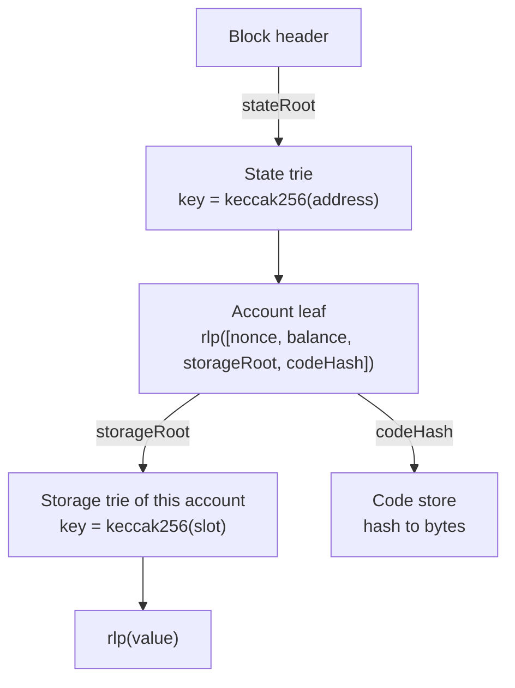

# 1.1 Accounts and world state

> [!abstract] In one minute
> - Every account has four fields: **nonce, balance, storageRoot, codeHash**. EOAs, contracts and 7702-delegated EOAs all use the same four fields. They differ only in what the fields hold.
> - A 7702-delegated EOA holds 23 bytes of code: `0xef0100 ‖ delegate`. EXTCODESIZE returns 23, EXTCODECOPY copies those 23 bytes, and EXTCODEHASH hashes them. Executing the account runs the delegate's code.
> - EXTCODEHASH returns `0` for an account that does not exist or is empty (EIP-161), `keccak256("")` for an account that exists with no code, and the code's hash otherwise.
> - `extcodesize > 0` is not an "is contract" test. It reads 0 during a constructor and at precomputed addresses, and it reads 23 for a delegated EOA.
> - World state is a Merkle-Patricia trie keyed by `keccak256(address)`. Each account's storage is its own trie keyed by `keccak256(slot)`. Code is stored by hash. `eth_getProof` returns the trie nodes that prove a slot's value against a block's `stateRoot`.
> - Balance can grow with no code running (priority fees, SELFDESTRUCT, withdrawals, pre-funding), so `address(this).balance` is never an accounting source of truth.

**Prerequisites:** none (start here) · **Leads to:** [[1.2 Transactions and fees]], [[1.5 Storage and transient storage]], [[1.8 Contract creation]], [[1.9 Gas accounting]]

## The account model

Ethereum's state is a map from 20-byte addresses to accounts. Every address maps to the same four-field record. What makes an address a wallet or a contract is only the contents of those fields.

| Field | Type | EOA (plain) | Contract | 7702-delegated EOA |
|---|---|---|---|---|
| `nonce` | uint64 | Count of transactions sent, plus 7702 authorizations signed | Count of contracts it has created, starting at 1 | Same as EOA: transactions sent plus authorizations signed |
| `balance` | uint256, in wei | Any | Any | Any |
| `storageRoot` | 32-byte trie root | Empty-trie root (`0x56e8…b421`) in practice | Root of its storage trie | Root of storage written by the delegate code (often non-empty) |
| `codeHash` | 32-byte hash | `keccak256("")` = `0xc5d2…a470` | `keccak256(runtime code)` | `keccak256(0xef0100 ‖ delegate)` |

The two magic constants are worth memorizing. Both were recomputed with `eth-hash` and `rlp` for this note:

| Constant | Value |
|---|---|
| `keccak256("")`, the codeHash of "no code" | `0xc5d2460186f7233c927e7db2dcc703c0e500b653ca82273b7bfad8045d85a470` |
| Empty trie root, `keccak256(rlp(""))` | `0x56e81f171bcc55a6ff8345e692c0f86e5b48e01b996cadc001622fb5e363b421` |

An account is stored in the state trie as the RLP encoding of `[nonce, balance, storageRoot, codeHash]`. For an EOA with nonce 0 and exactly 1 ETH, that is 78 bytes:

```text
f84c                                    list, 76 bytes of payload
80                                      nonce = 0 (RLP empty string)
88 0de0b6b3a7640000                     balance = 10^18 wei
a0 56e81f171bcc55a6ff8345e692c0f86e5b48e01b996cadc001622fb5e363b421   storageRoot (empty)
a0 c5d2460186f7233c927e7db2dcc703c0e500b653ca82273b7bfad8045d85a470   codeHash (no code)
```

Note what is *not* in the account: the address itself, the code bytes and the storage values. The address is the trie key (hashed). Code lives in a separate key-value store indexed by its hash. Storage lives in a separate trie whose root is the only thing the account carries.

## Account types compared

Before May 2025 there were two kinds of account. Since Pectra (7 May 2025) there are three.

| | EOA | Contract | 7702-delegated EOA |
|---|---|---|---|
| Controlled by | A secp256k1 private key | Its code only | Its private key *and* its delegate's code |
| Can originate a transaction | Yes | No (EIP-3607 rejects senders with code) | Yes (EIP-7702 amends EIP-3607 to allow a delegation indicator) |
| Code | None | Runtime code, at most 24,576 bytes (EIP-170) | Exactly 23 bytes: `0xef0100 ‖ address` |
| What runs when called | Nothing; the call succeeds | Its code | The delegate's code, in the EOA's context (its storage, balance and address) |
| EXTCODESIZE | 0 | Code length | 23 |
| Address origin | `keccak256(pubkey)[12:]` | CREATE or CREATE2 formula | Unchanged EOA address |
| Can the code change | — | No (except via SELFDESTRUCT in the creation transaction) | Yes, by signing a new authorization |

The delegation indicator reuses the `0xef` byte, which EIP-3541 (London) banned as the first byte of new contract code. No mainnet contract started with `0xef` when that ban activated, so `0xef0100` is unambiguous. When the EVM loads code for *execution* (CALL, DELEGATECALL, STATICCALL, CALLCODE, or a transaction to the account), it sees the indicator and loads the delegate's code instead. Only one hop is followed: if the delegate is itself delegated, its indicator is not followed again. Delegating to the zero address clears the code and resets the codeHash to `keccak256("")`.

The *ext*-code opcodes do not follow the delegation. They read the account's own code, which is the 23-byte indicator. CODESIZE and CODECOPY run inside the executing frame, so they see the delegate's code. This split is the source of most 7702 surprises. [[5.11 New attack surfaces - transient storage, EIP-7702, account abstraction]] and [[4.5 Account abstraction and smart wallets]] go deeper.

> [!warning] Delegated EOAs have real storage
> Delegate code writes to the EOA's own storage trie. If a user re-delegates from wallet A to wallet B, B inherits A's storage layout. Switching delegates without clearing or namespacing storage can corrupt state. Clearing the delegation does not clear the storage.

## Address derivation

### EOA: from a public key

1. Take the secp256k1 public key in **uncompressed** form: 64 bytes, `X ‖ Y`, *without* the `0x04` prefix byte.
2. Hash it with keccak256.
3. Keep the last 20 bytes.

Worked example with private key `1`. Its public key is the curve generator point G. Computed with `eth-keys` and `eth-hash`:

```text
pubkey X ‖ Y   = 79be667ef9dcbbac55a06295ce870b07029bfcdb2dce28d959f2815b16f81798
                 483ada7726a3c4655da4fbfc0e1108a8fd17b448a68554199c47d08ffb10d4b8
keccak256      = c0a6c424ac7157ae408398df 7e5f4552091a69125d5dfcb7b8c2659029395bdf
                 ^ dropped (12 bytes)      ^ address (20 bytes)
address        = 0x7E5F4552091A69125d5DfCb7b8C2659029395Bdf   (EIP-55 checksum)
```

Two classic mistakes: hashing the 33-byte compressed key, or hashing the 65-byte key with the `0x04` prefix. Both produce a valid-looking but wrong address.

### CREATE and CREATE2 (brief)

| Opcode | Address | Depends on |
|---|---|---|
| CREATE | `keccak256(rlp([sender, sender_nonce]))[12:]` | Creator and its nonce |
| CREATE2 | `keccak256(0xff ‖ sender ‖ salt ‖ keccak256(initcode))[12:]` | Creator, salt, initcode hash |

From `0x7E5F…5Bdf` above (computed): CREATE at nonce 0 gives `0xF2E246BB76DF876Cef8b38ae84130F4F55De395b`, at nonce 1 gives `0x2946259E0334f33A064106302415aD3391BeD384`. CREATE2 with salt 0 and initcode `0x00` gives `0xEB81701FEFbf48BC5BA1bc71972b6F799646b848`. Both formulas are deterministic, so anyone can compute a contract's address before it exists. That fact drives several pitfalls below. The full creation sequence is in [[1.8 Contract creation]], and cross-chain address planning is in [[4.3 Deterministic and cross-chain deployment]].

### 7702 keeps the EOA address

A 7702 authorization gives the user no new address and moves no funds. It writes the indicator into the EOA's code field. The address, balance, nonce history and token approvals all stay, which is the selling point over migrating to a fresh smart wallet. It is also why the old key remains a master key: whoever holds it can re-delegate or sign ordinary transactions at any time.

## Empty vs nonexistent accounts and EXTCODEHASH

**EIP-161** (Spurious Dragon, block 2,675,000, 22 Nov 2016) defined an *empty* account as one with no code, zero nonce and zero balance. It was a cleanup after the 2016 denial-of-service attacks, which had created millions of empty accounts cheaply. Its rules:

| Rule | Effect |
|---|---|
| (a) | A newly created contract starts with nonce 1, not 0 |
| (b) | CALL/SELFDESTRUCT pay the 25,000-gas new-account charge only if they send value to a dead account |
| (c) | No account may go from nonexistent to existent-but-empty |
| (d) | Any account touched by a transaction that ends up empty is deleted |

After EIP-161, "empty" and "nonexistent" behave the same almost everywhere. EIP-7523 (Last Call) goes further and states that no empty accounts exist on any post-merge network, mainnet included.

**EIP-1052** (Constantinople, 28 Feb 2019) added EXTCODEHASH so contracts could check code identity without copying the code. Its three-way result is the cleanest way to see the account states:

| Account state | EXTCODEHASH | EXTCODESIZE |
|---|---|---|
| Nonexistent | `0` | 0 |
| Empty (EIP-161) | `0` | 0 |
| Exists, no code (funded EOA, or contract mid-constructor) | `keccak256("")` = `0xc5d2…a470` | 0 |
| 7702-delegated EOA | `keccak256(0xef0100 ‖ delegate)` | 23 |
| Contract | `keccak256(runtime code)` | Code length |
| Precompile | `0` if it has never been funded, `keccak256("")` if it holds a balance | 0 |

Every row was confirmed by running a probe contract under py-evm's Prague rules. For a delegation to `0x1111…1111`, EXTCODEHASH returned `0xdfe7c7677e3d245aaff2e3e94db902f5fb37475eb611959c71ee641508dcf49a`, which equals `keccak256(0xef01001111111111111111111111111111111111111111)`.

> [!tip] Why the zero vs `keccak256("")` split matters
> - **Comparing against a known hash.** `a.codehash == EXPECTED` is a sound way to pin a dependency to exact bytecode. It is false for nonexistent, empty and codeless accounts, which is what you want.
> - **Testing "no code".** Check `codehash == 0 || codehash == keccak256("")`. Checking only one of them misclassifies the other case.
> - **Caching.** A cached "hash was 0" does not mean "will always be 0". Anyone can send 1 wei and the hash becomes `keccak256("")`. Anyone can deploy at a CREATE2 address and the hash becomes the code hash.

Gas: EXTCODEHASH launched at 400 gas, later rose to 700, and since Berlin it costs 2,600 cold or 100 warm, like BALANCE and EXTCODESIZE. See [[1.9 Gas accounting]].

## Why `extcodesize > 0` lies

The idea behind the check is that "a contract has code, an EOA does not". That idea fails in both directions.

| Case | EXTCODESIZE | Truth |
|---|---|---|
| Contract whose constructor is running | 0 | It is a contract |
| Precomputed CREATE/CREATE2 address, not yet deployed (counterfactual ERC-4337 wallets, factory targets) | 0 | It will be a contract; funds sent there are controlled by whoever deploys |
| 7702-delegated EOA | 23 | It is an EOA with a key, and it may or may not behave like a contract |
| Contract that called SELFDESTRUCT in its creation transaction | Non-zero until the transaction ends, then 0 | Gone after the transaction |

The constructor case was confirmed by running code. Inside initcode, `EXTCODESIZE(ADDRESS)` returned 0 while CODESIZE returned the initcode length. A Solidity constructor saw `address(this).code.length == 0` and `address(this).codehash == keccak256("")`: the account exists (nonce 1) but has no code until the constructor returns.

So "only EOAs can call this" checks built on code size are bypassed by calling from a constructor. Before 7702, `msg.sender == tx.origin` was a stronger "is EOA" test. After 7702 it is not, because a delegated EOA can be `tx.origin` and still run code mid-transaction.

> [!note] OpenZeppelin removed `isContract`
> OpenZeppelin Contracts 5.0 (5 Oct 2023) removed `Address.isContract`, listing it among functions dropped "for efficiency, simplification, and security purposes". Its v4 doc comment had already warned that a false result does not prove an address is an EOA. Code that still needs the check now writes `account.code.length > 0` and owns the risk.

Where code-size checks are still legitimate: as a *usability* guard, not a security boundary. Examples are reverting before a call that expects return data from an address with no code, or deciding whether to call a receiver hook. Even then, 7702 changes the answer. ERC-721 `safeTransferFrom` calls `onERC721Received` on any address with code, so it now calls into delegated EOAs. If the delegate does not implement the hook, the transfer reverts.

## World state and tries

### The two levels

The **state trie** is a Merkle-Patricia trie (hexary: up to 16 children per branch node). Its key is `keccak256(address)` and its value is `rlp([nonce, balance, storageRoot, codeHash])`. Its root is the `stateRoot` field in every block header (the fourth field, after parentHash, ommersHash and beneficiary).

Each account with storage has its own **storage trie**. Its key is `keccak256(slot)` with the slot as a 32-byte big-endian word. Its value is `rlp(value)` with leading zero bytes stripped. Slots holding zero are deleted from the trie, which is why writing zero can earn a gas refund. An account with no storage has the empty-trie root `0x56e8…b421`.

Hashing the keys ("secure trie") spreads keys evenly, so building an unusually deep path means grinding keccak prefixes, which gets expensive fast. Code is not in any trie. The account holds `codeHash`, and clients keep a separate `hash → bytes` store, so identical code (for example many copies of one minimal proxy) is stored once.



How slots are *chosen* (sequential layout, mapping and array slot formulas) is covered in [[2.3 Storage layout]]. What SSTORE and SLOAD cost is in [[1.5 Storage and transient storage]] and [[1.9 Gas accounting]].

### Storage proofs: `eth_getProof`

EIP-1186 defined the JSON-RPC method `eth_getProof(address, storageKeys[], block)`. Its EIP status is Stagnant, but all major clients implement it. It returns:

| Field | Meaning |
|---|---|
| `nonce`, `balance`, `codeHash` | The account's fields |
| `storageHash` | The account's storageRoot |
| `accountProof` | RLP-encoded trie nodes from the stateRoot node down to the account leaf |
| `storageProof[]` | For each key: `key`, `value`, and `proof` nodes from the storageRoot node down to the slot |

A verifier needs to trust only one 32-byte value: the `stateRoot`. Everything else is checked by hashing. Each node in the proof must hash to the reference held by its parent. The account proof is walked along the nibbles of `keccak256(address)`, the leaf is decoded to get `storageRoot`, and then the storage proof is walked along `keccak256(slot)`. A proof can also show that a slot is *absent* (value zero), because the path ends at a node that has no child for the next nibble.

For this note, a two-account state was built by hand with the `trie` library. Its root matched py-evm's root for the same state. Slot 0 then verified as 42 from a proof, slot 9 proved absent, and a proof checked against a wrong root was rejected.

### Verifying a slot from another chain

To prove "slot S of contract X on chain A held value V at block N" to a contract on chain B:

1. **Get a trusted block hash for chain A, block N, onto chain B.** This is the hard part, and it is a trust decision. Options include an L2's built-in view of L1 (for example an L1 block-hash oracle maintained by the rollup), a light-client or ZK proof of chain A's consensus, or a relayer or oracle committee. On the *same* chain, BLOCKHASH serves the last 256 blocks, and EIP-2935 (Prague) serves the last 8,191 block hashes from a system contract at `0x0000F90827F1C53a10cb7A02335B175320002935`.
2. **Submit the RLP block header.** Check `keccak256(header) == trustedBlockHash`, then decode the header and read `stateRoot`.
3. **Verify the account proof** against `stateRoot` with key `keccak256(X)`. Decode the leaf and read `storageRoot`.
4. **Verify the storage proof** against `storageRoot` with key `keccak256(S)`. RLP-decode the value.

Gas is dominated by calldata, hashing and RLP-decoding proof nodes. A full branch node is 532 bytes (16 child references of 33 bytes plus RLP overhead), so even a short proof runs to kilobytes. Onchain verifiers exist, such as the Optimism `SecureMerkleTrie` library. Bridge-level trust issues are in [[4.8 L2s and cross-chain]] and [[5.12 Cross-chain and bridges]].

> [!warning] Proof pitfalls
> - **Trusting the header, not the hash.** If the contract accepts a `stateRoot` from the caller without checking the header hash against a trusted source, the "proof" proves nothing.
> - **Finality.** A block hash from chain A that is later reorged out proves a state that never finalized. Use finalized or sufficiently deep blocks.
> - **Slot derivation.** The prover must compute the slot exactly as the target's compiler does: mapping keys, packing, and namespaced layouts. A wrong slot proves a true but irrelevant zero.
> - **Packed values.** The value is the whole 32-byte word. Extract and mask the field you need.

## Nonces

| Account | Starts at | Incremented by | Not incremented by |
|---|---|---|---|
| EOA | 0 | Each transaction it sends (even if it reverts); each 7702 authorization it signs that is applied; CREATE/CREATE2 run by its delegate code | Receiving ETH or calls |
| Contract | 1 (EIP-161) | Each CREATE and each CREATE2 it executes | Message calls it makes or receives |

- **CREATE and CREATE2 both bump the creator's nonce.** A test factory running CREATE2 then CREATE went from nonce 1 to 3. CREATE2's address ignores the nonce, but the nonce still moves, which shifts any later CREATE addresses.
- **7702 authorizations consume the authority's nonce.** Each authorization tuple carries the nonce the authority expects. If it matches, the code is set and the nonce goes up by one. The authorization list is processed after the sender's nonce is incremented. So if an EOA sponsors its own authorization, it must sign with `current_nonce + 1`.
- **The cap is 2^64 − 1** (EIP-2681, applied retroactively from genesis). A transaction that would push the nonce past it is invalid. A contract at nonce 2^64 − 1 that runs CREATE or CREATE2 gets 0 back, and no initcode gas is charged. Nobody will reach this by honest use, but tests and fuzzers can.

Transaction ordering, replay protection and nonce gaps are covered in [[1.2 Transactions and fees]].

## Balance that arrives without code running

A contract can reject ETH sent through a normal call by having no payable `receive` or `fallback`. It cannot reject ETH sent these ways:

| Route | Since | Code runs? |
|---|---|---|
| Beacon-chain withdrawals (EIP-4895): balance increases by `amount` in gwei, converted to wei | Shapella, 12 Apr 2023 | No, and no gas |
| Priority fees to the block's fee recipient (coinbase) | London, 5 Aug 2021 (EIP-1559) | No |
| SELFDESTRUCT beneficiary: after EIP-6780 the balance still moves even though the account is not deleted | Dencun, 13 Mar 2024 (EIP-6780 semantics) | No |
| ETH sent to an address before any code is deployed there (precomputed CREATE/CREATE2 address) | Always | No code exists yet |

The upcoming Glamsterdam fork lists EIP-8246 (Remove SELFDESTRUCT Burn) as scheduled. It would stop the last case where SELFDESTRUCT destroys ETH. It does not change the force-send behavior above. Glamsterdam activated on Sepolia (6 Oct 2026) and Hoodi (26 Oct 2026), but its mainnet date is not yet set (as of 29 Oct 2026).

So `address(this).balance` can rise at any time without your code knowing. Track deposits in a storage variable and treat the real balance as at least that.

> [!example] Gridlock: Edgeware Lockdrop (July 2019)
> `lock()` deployed a new `Lock` contract and asserted `address(lockAddr).balance == msg.value`. Lock addresses came from CREATE, so the next one was predictable. Sending 1 wei there in advance made every later `lock()` fail the assertion, a permanent denial of service. The fix changed `==` to `>=`. See [[5.7 Denial of service and griefing]].

## Where state is heading

Everything above describes the hexary Merkle-Patricia trie, which is still mainnet's state structure in October 2026. The long-standing problem is **witness size**. A stateless client needs proofs for everything a block touches. Hexary proofs are large, and code must be proven in full: EIP-7864 estimates that a worst-case 30-million-gas block touching single bytes of many contracts' code could need a witness of about 330 MB.

| Proposal | Status (29 Oct 2026) | Idea |
|---|---|---|
| EIP-7864 binary state tree | Draft | One binary tree for all state, hash-based. Hash function not final (BLAKE3 in the reference code; Keccak and Poseidon2 are candidates). The existing trie is frozen and new state goes into the new tree |
| EIP-6800 Verkle tree | Stagnant | Verkle commitments, which are elliptic-curve based and not post-quantum secure. EIP-7864 presents itself as the likely final tree in place of Verkle |
| EIP-4762 statelessness gas costs | Draft | Gas schedule charged per witness item, written for the Verkle layout and reused by the binary-tree work |

Both designs pack an account's basic data (version, code size, nonce, balance) into one leaf, split code into 31-byte chunks, and group storage slots and code chunks 256 to a "stem" so nearby items share one proof path. The effect on contracts, in short: code access is charged per chunk touched, EXTCODESIZE becomes a cheap header read, and adjacent low storage slots become much cheaper than keccak-scattered ones. The numbers and design consequences are in the expert answer of the [[#Question ladder]].

None of this is scheduled. The nearer-term changes are in Glamsterdam's scheduled list: EIP-7954 (contract size limit from 24 KiB to 64 KiB, initcode from 48 KiB to 128 KiB; in Last Call), EIP-8037 (state creation gas increase) and EIP-8038 (state-access gas update). Check final numbers in [[1.11 Hard forks that changed contract code]] before relying on them.

## Solidity and Yul in practice

Solidity exposes the account fields directly: `a.balance` (BALANCE), `a.code` (EXTCODESIZE then EXTCODECOPY), `a.code.length` (EXTCODESIZE only), `a.codehash` (EXTCODEHASH). In assembly, the same opcodes are `balance(a)`, `extcodesize(a)`, `extcodecopy(a, dst, offset, len)`, `extcodehash(a)`, and `selfbalance()` for the current contract.

The library below classifies an address and extracts a 7702 delegate. It compiles with solc 0.8.38 (`solcjs --bin --optimize`). The deployed `Probe` was run in py-evm on nonexistent, empty, funded-EOA, contract and delegated accounts, and every result matched the table above.

```solidity
// SPDX-License-Identifier: MIT
pragma solidity ^0.8.38;

/// Classifies an address by what the state says about it right now.
/// Informational only: never use the result as a security boundary.
library AccountKind {
    enum Kind {
        Empty,      // nonexistent or EIP-161 empty: codehash == 0
        NoCode,     // exists (nonce or balance) but has no code
        Delegated,  // EIP-7702 EOA: code == 0xef0100 || delegate
        Contract    // anything else with code
    }

    bytes32 internal constant EMPTY_CODEHASH =
        0xc5d2460186f7233c927e7db2dcc703c0e500b653ca82273b7bfad8045d85a470;

    function kind(address a) internal view returns (Kind k, address delegate) {
        bytes32 h = a.codehash;                  // EXTCODEHASH
        if (h == bytes32(0)) return (Kind.Empty, address(0));
        if (h == EMPTY_CODEHASH) return (Kind.NoCode, address(0));
        if (a.code.length == 23) {               // EXTCODESIZE
            bytes memory c = a.code;             // EXTCODECOPY of the 23-byte indicator
            if (c[0] == 0xef && c[1] == 0x01 && c[2] == 0x00) {
                assembly ("memory-safe") {
                    // c points at the length word; data starts at c + 32.
                    // Load 32 bytes starting at data + 3, keep the top 20.
                    delegate := shr(96, mload(add(c, 35)))
                }
                return (Kind.Delegated, delegate);
            }
        }
        return (Kind.Contract, address(0));
    }

    /// Same EXTCODEHASH read in inline assembly.
    function codehashAsm(address a) internal view returns (bytes32 h) {
        assembly ("memory-safe") {
            h := extcodehash(a)
        }
    }

    /// Copy only the 3-byte prefix and 20-byte delegate, without a dynamic bytes allocation.
    function delegateOf(address a) internal view returns (address d) {
        assembly ("memory-safe") {
            if eq(extcodesize(a), 23) {
                let ptr := mload(0x40)              // scratch at free memory, not advanced
                mstore(ptr, 0)                      // clean the word first
                extcodecopy(a, ptr, 0, 23)
                let word := mload(ptr)
                // top 3 bytes must be ef 01 00
                if eq(shr(232, word), 0xef0100) {
                    d := shr(96, shl(24, word))
                }
            }
        }
    }
}

contract Probe {
    function classify(address a) external view returns (AccountKind.Kind k, address d, address d2, bytes32 h) {
        (k, d) = AccountKind.kind(a);
        d2 = AccountKind.delegateOf(a);
        h = AccountKind.codehashAsm(a);
    }
}

/// Shows that a contract under construction has no code yet.
contract SeenDuringConstruction {
    uint256 public sizeInConstructor;
    bytes32 public hashInConstructor;

    constructor() {
        sizeInConstructor = address(this).code.length;  // 0
        hashInConstructor = address(this).codehash;     // keccak256("") once nonce is 1
    }
}
```

Points to notice:

- **`a.code.length` vs `a.code`.** `.code.length` compiles to EXTCODESIZE alone. `a.code` copies the whole code into memory. Use `.length` or `codehash` when you do not need the bytes.
- **Size 23 is not proof of delegation.** A normal contract can be 23 bytes long. The `0xef0100` prefix is the proof: no mainnet contract started with `0xef` when EIP-3541 activated, and none can be deployed now.
- **`delegateOf` uses free memory as scratch without moving the pointer.** Safe because nothing allocates in between. `mstore(ptr, 0)` clears bytes that `extcodecopy` does not overwrite. See [[3.5 Memory management in assembly]].
- **A classification is a snapshot.** The EOA can re-delegate at any later transaction.
- **Solidity's own code check.** For high-level calls that expect no return data, Solidity reverts if `extcodesize(target) == 0`. A delegated EOA passes, and the call runs the delegate's code. See [[1.7 Message calls and precompiles]].

## Pitfalls and incidents

| Date | Case | What went wrong | Lesson |
|---|---|---|---|
| Since Pectra (7 May 2025), reported in MetaMask delegation-framework issue #180 | ERC-223 tokens (for example DEAPCOIN) and delegated EOAs | ERC-223 uses `extcodesize` to decide whether to call `tokenFallback`. A delegated EOA returns 23, so the token calls `tokenFallback` on MetaMask's stateless delegator, which does not implement it. Transfers to and from the EOA revert, and tokens already held become stuck until the user un-delegates | Code-size heuristics written before 7702 misclassify delegated EOAs. Receiver hooks must tolerate delegates that do not implement them, and delegates should implement or safely ignore common hooks |
| 5 Oct 2023 | OpenZeppelin 5.0 removes `isContract` | Too many projects used it as a security check | Do not gate security on code size |
| July 2019 | Edgeware Lockdrop "Gridlock" | Strict equality on the balance of a predictable CREATE address; pre-funding caused permanent DoS | Never assume a fresh address has zero balance |
| Ongoing | "EOA-only" modifiers using `extcodesize == 0` | Bypassed by calling from a constructor | Use signatures or explicit allowlists, not code size, to authenticate |
| Ongoing | `msg.sender == tx.origin` as "is EOA" or reentrancy guard | A 7702-delegated `tx.origin` can run code mid-transaction | Use real reentrancy guards ([[5.2 Reentrancy]]) |

> [!warning] Footguns in one list
> - `codehash == 0` does not mean "never will have code". It may be a CREATE2 address waiting for deployment.
> - `codehash == keccak256("")` does not mean "EOA". It may be a contract mid-constructor.
> - `code.length == 23` does not mean "delegated". Check the `0xef0100` prefix.
> - `address(this).balance` is not your accounting. Force-sent ETH changes it.
> - An EOA's storage is no longer always empty. Delegate code writes to it.

## Question ladder

> [!question]- **B** What four fields make up an account? How do EOAs and contract accounts differ?
> Every account is `[nonce, balance, storageRoot, codeHash]`, RLP-encoded as a leaf in the state trie under key `keccak256(address)`.
>
> - **nonce**: for an EOA, the number of transactions it has sent (and, since 7702, authorizations it has signed). For a contract, the number of contracts it has created, starting at 1 because of EIP-161.
> - **balance**: wei held, a uint256.
> - **storageRoot**: root hash of the account's own storage trie. For an account with no storage it is the empty-trie root `0x56e8…b421`.
> - **codeHash**: keccak256 of the account's code. For no code it is `keccak256("")` = `0xc5d2…a470`. The code bytes live in a separate store keyed by this hash.
>
> The difference between EOAs and contracts is only in the field contents and how the account is controlled. An EOA has a private key, empty code and (before 7702) empty storage. It can sign and send transactions. A contract has no key. Its code decides everything it does, it cannot start a transaction (EIP-3607 rejects transactions whose sender has code), and its address comes from CREATE or CREATE2 rather than from a public key. Since Pectra there is a third case, the 7702-delegated EOA: it has a key *and* 23 bytes of code pointing at a delegate whose logic runs when the EOA is called.

> [!question]- **B** How is an EOA address derived from a public key?
> Take the uncompressed secp256k1 public key as 64 bytes `X ‖ Y` (drop the `0x04` prefix), compute keccak256, and keep the last 20 bytes. Optionally apply EIP-55 mixed-case checksumming for display.
>
> Worked example, private key `1` (public key = generator G), computed with code:
> ```text
> X ‖ Y     = 79be667e…16f81798 ‖ 483ada77…fb10d4b8
> keccak256 = c0a6c424ac7157ae408398df7e5f4552091a69125d5dfcb7b8c2659029395bdf
> address   = 0x7E5F4552091A69125d5DfCb7b8C2659029395Bdf
> ```
> An interviewer listens for three details: it is keccak256 and not NIST SHA3-256; the input is the 64-byte uncompressed key without prefix; and the address is the *low* 20 bytes. A follow-up is often "how does `ecrecover` fit in?" It recovers the public key from a signature and the message hash and returns this same derived address, or `address(0)` on failure (see [[5.8 Signatures and replay]]).

> [!question]- **I** What does EXTCODEHASH return for a nonexistent account vs an existing account with no code, and why does it matter?
> Per EIP-1052: **0** if the account does not exist or is empty under EIP-161 (no code, nonce 0, balance 0). **`keccak256("")`** (`0xc5d2…a470`) if the account exists but has no code, such as a funded EOA or a contract whose constructor is still running. Otherwise, the hash of its code. For a 7702-delegated EOA, that is the hash of the 23-byte indicator, not of the delegate's code.
>
> It matters in three ways:
> 1. **Correct "no code" tests** must accept both values: `h == 0 || h == keccak256("")`.
> 2. **The value can change without the target acting.** Sending 1 wei to a nonexistent address moves it from 0 to `keccak256("")`. Deploying at a precomputed address moves it to the code hash. Logic that caches or branches on these values can be steered by anyone.
> 3. **Pinning bytecode.** `target.codehash == EXPECTED` is a sound integrity check (for example on a clone or implementation) and fails safely for all no-code states. To pin a delegated EOA's delegate, compare against `keccak256(0xef0100 ‖ delegate)`.

> [!question]- **I** Why is `extcodesize > 0` an unreliable "is contract" check? Name three cases where it lies.
> Because code size is a property of the state at one moment, not of who controls the address.
> 1. **Constructor in progress.** The new account exists but has no code, so EXTCODESIZE is 0. A contract can call your "EOA-only" function from its constructor.
> 2. **Precomputed address.** A CREATE or CREATE2 address (for example a counterfactual ERC-4337 wallet) reads 0 until deployed, then becomes a contract, possibly deployed by someone else if the factory is permissionless.
> 3. **7702-delegated EOA.** Returns 23, so it is treated as a contract and receiver hooks (`tokenFallback`, `onERC721Received`) are called on a delegate that may not implement them. MetaMask's delegation-framework issue #180 documents ERC-223 tokens locked this way.
>
> A fourth: a contract that self-destructs in its creation transaction has code until the transaction ends. The fix is to stop asking "is this a contract?" for security. Authenticate with signatures or allowlists and treat code size as a usability hint. OpenZeppelin removed `Address.isContract` in 5.0 for this reason.

> [!question]- **A** What code does a 7702-delegated EOA hold, and what do EXTCODESIZE, EXTCODECOPY and EXTCODEHASH return for it?
> It holds exactly 23 bytes: the **delegation indicator** `0xef0100 ‖ delegate_address`. The `0xef` prefix is banned as a first byte for normal contracts (EIP-3541), so the indicator cannot be confused with deployed code.
>
> | Opcode | Result |
> |---|---|
> | EXTCODESIZE | 23 |
> | EXTCODECOPY | The 23 indicator bytes (zero-padded beyond them) |
> | EXTCODEHASH | `keccak256(0xef0100 ‖ delegate)`; for delegate `0x1111…1111` it is `0xdfe7…f49a` (computed) |
> | CODESIZE / CODECOPY (inside execution) | The delegate's code, because execution loaded it |
> | CALL / DELEGATECALL / STATICCALL to the EOA | Runs the delegate's code in the EOA's context |
>
> More details an interviewer will probe:
> - Only one hop is followed. If the delegate is itself delegated, the second indicator is not resolved. A delegation pointing at a precompile is treated as empty code.
> - Delegating to `address(0)` clears the code and resets the codeHash to `keccak256("")`.
> - Each authorization checks and increments the authority's nonce and makes the authority warm (EIP-2929 accessed addresses). Each costs 25,000 gas (`PER_EMPTY_ACCOUNT_COST`), and 12,500 is refunded if the authority is not empty, leaving the 12,500 `PER_AUTH_BASE_COST`.
> - Storage written by the delegate lives in the EOA's storage trie and survives re-delegation or clearing.
> - Tools that "follow" the indicator must do so themselves: read 23 bytes, check the prefix, extract bytes 3 to 22.

> [!question]- **A** How is contract storage committed to the state root? How would a contract on another chain verify a storage slot with a proof?
> **Commitment.** Each slot value is stored in the account's storage trie under key `keccak256(slot)`, as `rlp(value)` with leading zeros stripped, and zero values are removed. The trie root is the account's `storageRoot`. The account `[nonce, balance, storageRoot, codeHash]` is RLP-encoded and stored in the state trie under `keccak256(address)`. The state trie root is the `stateRoot` in the block header, and the header's hash is the block hash. So one 32-byte block hash commits to every slot of every contract. Change a slot and every hash on the path up to the block hash changes.
>
> **Cross-chain verification**, given chain A's block hash on chain B:
> 1. Establish a trusted block hash for chain A (rollup-provided L1 hash, light client, ZK consensus proof, or an oracle; on the same chain, BLOCKHASH for 256 blocks or EIP-2935 for 8,191).
> 2. Accept the RLP header, require `keccak256(header) == trustedHash`, and decode `stateRoot`.
> 3. Walk `accountProof` (from `eth_getProof`) from `stateRoot` along `keccak256(X)`, checking each node's hash against its parent's reference. Decode the leaf and take `storageRoot`.
> 4. Walk the storage proof from `storageRoot` along `keccak256(S)` and RLP-decode the value. A path that ends without a leaf proves the slot is zero.
>
> Strong answers add: the trust root is the block hash, not the proof; use finalized blocks; derive the slot exactly as the compiler does (mappings, packing, ERC-7201 namespaces); mask packed fields; and budget gas for kilobytes of proof.

> [!question]- **E** What would a move to a different state tree (Verkle or binary) change for code size, storage access costs and contract design?
> **Status first.** As of 29 Oct 2026 neither is scheduled. EIP-7864 (binary tree) is a Draft, EIP-6800 (Verkle) is Stagnant, and the gas model EIP-4762 is a Draft. Mainnet still uses the hexary Merkle-Patricia trie. The binary design has momentum because it needs only hash functions (post-quantum friendly) and modern proving systems narrow Verkle's proof-size advantage.
>
> **Why change at all.** Stateless validation needs witnesses for all state a block touches. Hexary proofs are wide (up to 16 siblings per level), and today code must be included whole, since there is no way to prove a part of it. EIP-7864 estimates a worst case of about 330 MB of witness for a 30-million-gas block that touches single bytes of code. The new trees make witnesses small and make gas track witness size.
>
> **Code.**
> - Code is split into 31-byte chunks (32 bytes stored, with one prefix byte giving the number of leading PUSH-data bytes so jump analysis works per chunk).
> - Execution pays per chunk touched. In EIP-4762, that is 200 gas per new chunk plus 1,900 gas per new 256-chunk group, replacing the size-independent cold-account cost. A 24 KiB contract is about 793 chunks across 4 groups. Executing a short path is cheap, but scattered jumps or a large EXTCODECOPY cost more.
> - EXTCODESIZE reads `code_size` from the account's basic-data leaf, so it no longer implies loading code.
> - Raising the code-size limit (EIP-7954 proposes 64 KiB for Glamsterdam) is less costly in a chunked world, because validators prove only the chunks used.
>
> **Storage.**
> - Slots are grouped 256 per stem. EIP-4762's rationale notes adjacent slots after the first cost 200 gas instead of 2,100, and the lowest 64 slots share the account's stem.
> - Keccak-derived slots (mappings, dynamic arrays, ERC-7201 namespaces) each land in a random stem and pay the branch cost every time.
> - Storage keys get an address-dependent prefix, which prevents grinding collisions across contracts.
>
> **Design consequences.** Put hot, co-accessed fields in low sequential slots and pack them. Prefer a struct in one mapping over parallel mappings when fields are read together (the struct's slots are consecutive). Keep hot code paths compact, or move rarely used code to separate contracts.
>
> **Failure modes.** EIP-7864 freezes the old trie and sends new state to the new tree, so a full migration is a separate, multi-step process. Contracts that hard-code gas assumptions (2,300-gas stipends, `gasleft()` checks, gas-metered relayers) break under any repricing. An interviewer listens for: witness size as the driver, chunk-based code gas, stem locality, "proposal, not scheduled", and gas-assumption fragility.

## Related notes

- [[1.2 Transactions and fees]] — how nonces order transactions and where priority fees go.
- [[1.5 Storage and transient storage]] — SLOAD/SSTORE semantics on the storage trie described here.
- [[1.7 Message calls and precompiles]] — what happens when you call an EOA, a contract, a delegated EOA or a precompile.
- [[1.8 Contract creation]] — CREATE/CREATE2 in full, initcode vs runtime code, the constructor-time state.
- [[1.9 Gas accounting]] — cold/warm pricing for BALANCE, EXTCODE* and storage.
- [[1.11 Hard forks that changed contract code]] — EIP-161, EIP-1052, EIP-6780, EIP-7702 and upcoming changes by fork.
- [[2.3 Storage layout]] — how Solidity picks the slots that become storage trie keys.
- [[4.3 Deterministic and cross-chain deployment]] — same address on many chains via CREATE2.
- [[4.5 Account abstraction and smart wallets]] — 7702 delegates and ERC-4337 wallets.
- [[4.8 L2s and cross-chain]] — where trusted block hashes come from for storage proofs.
- [[5.7 Denial of service and griefing]] — force-fed ETH and balance assumptions.
- [[5.11 New attack surfaces - transient storage, EIP-7702, account abstraction]] — delegation front-running, storage collisions, `tx.origin` changes.

## Sources

- [EIP-7702: Set Code for EOAs](https://eips.ethereum.org/EIPS/eip-7702) — delegation indicator, EXTCODESIZE = 23, EXTCODEHASH on the indicator, nonce handling, zero-address clearing, gas constants, precompile delegation, one-hop rule.
- [EIP-161: State trie clearing](https://eips.ethereum.org/EIPS/eip-161) — empty-account definition, rules (a) to (d), block 2,675,000.
- [EIP-1052: EXTCODEHASH opcode](https://eips.ethereum.org/EIPS/eip-1052) — 0 vs `keccak256("")` semantics, original 400-gas cost, precompile note.
- [EIP-1186: eth_getProof](https://eips.ethereum.org/EIPS/eip-1186) — RPC parameters and return fields, hashed keys, Stagnant status.
- [EIP-2681: Limit account nonce to 2^64-1](https://eips.ethereum.org/EIPS/eip-2681) — nonce cap, CREATE/CREATE2 behavior at the cap.
- [EIP-2935: Serve historical block hashes from state](https://eips.ethereum.org/EIPS/eip-2935) — 8,191-block window and system contract address.
- [EIP-4895: Beacon chain push withdrawals](https://eips.ethereum.org/EIPS/eip-4895) — gwei amounts, no code, no gas, activation timestamp.
- [EIP-6780: SELFDESTRUCT only in same transaction](https://eips.ethereum.org/EIPS/eip-6780) — balance still transferred, no deletion.
- [EIP-7523: Empty accounts deprecation](https://eips.ethereum.org/EIPS/eip-7523) — no empty accounts post-merge.
- [EIP-7864: Ethereum state using a unified binary tree](https://eips.ethereum.org/EIPS/eip-7864) — Draft status, layout, hash candidates, 330 MB witness estimate.
- [EIP-6800: Ethereum state using a unified verkle tree](https://eips.ethereum.org/EIPS/eip-6800) — Stagnant status, 31-byte code chunks.
- [EIP-4762: Statelessness gas cost changes](https://eips.ethereum.org/EIPS/eip-4762) — witness gas constants, same-stem storage discount.
- [EIP-7773: Glamsterdam hardfork meta](https://eips.ethereum.org/EIPS/eip-7773) — scheduled EIPs, testnet activation dates, no mainnet date.
- [EIP-7954: Increase maximum contract size](https://eips.ethereum.org/EIPS/eip-7954) — 24 KiB to 64 KiB, Last Call.
- [EIP-8246: Remove SELFDESTRUCT burn](https://eips.ethereum.org/EIPS/eip-8246) — Last Call, effect on self-beneficiary SELFDESTRUCT.
- [MetaMask delegation-framework issue #180](https://github.com/MetaMask/delegation-framework/issues/180) — ERC-223 tokens locked for 7702-delegated EOAs.
- [Introducing OpenZeppelin Contracts 5.0](https://www.openzeppelin.com/news/introducing-openzeppelin-contracts-5.0) — removal of `Address.isContract`.
- [Trail of Bits: Avoiding smart contract "Gridlock" with Slither](https://blog.trailofbits.com/2019/07/03/avoiding-smart-contract-gridlock-with-slither) — Edgeware Lockdrop balance-equality bug.
- [ethereum.org: Pectra 7702 guidelines](https://ethereum.org/roadmap/pectra/7702/) — `tx.origin` and EOA-check changes.
