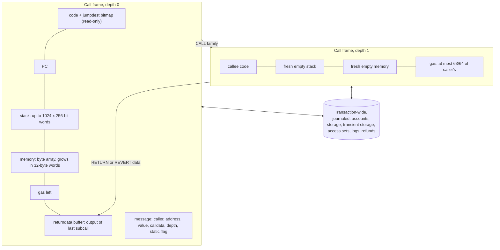

# 1.3 Execution model

> [!abstract] In one minute
> - The EVM is a **stack machine with 256-bit words**. Each call runs in a **frame**: read-only code, a program counter (PC), a stack of at most 1,024 words, a byte-addressed memory, a gas counter and a returndata buffer.
> - Only the **top 16 stack items** are reachable (`DUP1`–`DUP16`, `SWAP1`–`SWAP16`). That is the root of "stack too deep". EIP-8024 (`DUPN`, `SWAPN`, `EXCHANGE`) is scheduled for Glamsterdam but is not live.
> - `JUMP`/`JUMPI` may only land on a `JUMPDEST` byte (`0x5b`) that is **not inside PUSH data**. Clients find these with a linear **jumpdest analysis** before running the code.
> - Normal halts: `STOP`, `RETURN`, `REVERT`. **REVERT** undoes the frame's state changes but **returns unused gas and data**. **Exceptional halts** (invalid opcode `0xfe`, bad jump, stack underflow or overflow, static-mode write, out of gas) undo state, **burn all gas given to the frame** and return **no data**.
> - The call depth limit is 1,024, but since EIP-150 (2016) each call forwards at most 63/64 of the remaining gas. Under the 16,777,216-gas transaction cap you run out of gas at about depth 490.

**Prerequisites:** [[1.1 Accounts and world state]] · **Leads to:** [[1.4 Memory]], [[1.7 Message calls and precompiles]], [[1.9 Gas accounting]], [[3.2 Syntax and control flow]], [[3.11 Compiler IR and the optimizer]]

## The machine in one picture

When a transaction or message call reaches a contract, the client builds an **execution context**, or **call frame**: everything one running piece of code touches directly. Above the frames sits state shared by the whole transaction (accounts, storage, transient storage, warm/cold access sets, logs, refund counter). That state is **journaled**: each frame snapshots it on entry, and a failing frame's changes are rolled back.



Key point: a subcall gets a **new, empty stack and memory**. The only channels between frames are calldata in, returndata out, and the shared state. Message calls are covered in [[1.7 Message calls and precompiles]].

| Frame component | Scope | Survives the frame? | Covered in |
|---|---|---|---|
| Code | Read-only for this frame | Yes (it is the account's code) | [[1.8 Contract creation]] |
| PC | This frame | No | This note |
| Stack (≤ 1,024 words) | This frame | No | This note |
| Memory | This frame | No | [[1.4 Memory]] |
| Gas left | This frame | Unused gas returns to caller on success or REVERT | [[1.9 Gas accounting]] |
| Returndata buffer | This frame (holds the last subcall's output) | No | [[1.6 Calldata, returndata and logs]] |
| Calldata, caller, value, depth, static flag | This frame (from the message) | No | [[1.7 Message calls and precompiles]] |
| Storage, transient storage, balances, logs, access sets | Transaction-wide, journaled | Only if every enclosing frame succeeds | [[1.5 Storage and transient storage]] |

## The stack and 256-bit words

Every stack item is a 256-bit unsigned integer, called a **word**. Arithmetic wraps modulo 2^256. Signed opcodes (`SDIV`, `SMOD`, `SLT`, `SGT`, `SAR`, `SIGNEXTEND`) read the same bits as two's complement. There are no other machine types: an address, a bool and a selector are all just words. Opcodes pop their inputs from the top and push their results. Nothing is named, so the compiler must track where each variable sits relative to the top.

Two limits matter:

1. **Capacity.** The stack holds at most 1,024 words. The 1,025th push is a **stack overflow**, an exceptional halt. Popping from an empty stack (or running `ADD` with one item) is a **stack underflow**, also an exceptional halt.
2. **Reach.** `DUPn` (`0x80`–`0x8f`) copies the n-th item to the top, for n from 1 to 16. `SWAPn` (`0x90`–`0x9f`) swaps the top with the (n+1)-th item, for n from 1 to 16. The depth is encoded in the opcode byte itself, so there is no way to say "item 20". A variable must be in the top 16 slots to be copied, or the top 17 to be swapped. Anything deeper is dead weight until the items above it are popped.

## The program counter, jumps and JUMPDEST

The PC is a byte offset into the code. After each instruction it advances by one byte, plus the immediate bytes of a `PUSHn` (`0x60`–`0x7f` carry 1 to 32 bytes of data). Reading past the end of the code yields `0x00`, which is `STOP`. So falling off the end is a clean halt.

There are only two control-flow opcodes in legacy EVM code:

- `JUMP` (8 gas): pop `dest`, set `PC := dest`.
- `JUMPI` (10 gas): pop `dest`, pop `cond`, set `PC := dest` if `cond != 0`, else fall through.

Jumps are **dynamic**: the target is any word on the stack, not an immediate. So the target must pass a check. It is a valid **jump destination** only if:

1. `dest` is less than the code length,
2. the byte at `dest` is `0x5b` (`JUMPDEST`, 1 gas, does nothing), and
3. that byte is an **opcode**, not part of the immediate data of a preceding `PUSHn`.

Rule 3 needs **jumpdest analysis**. The client scans the code once from byte 0. When it meets `PUSHn`, it skips the next n bytes. Every `0x5b` it lands on as an opcode goes into a bitmap of valid targets. Clients cache this bitmap per code hash, and no gas is charged for it. A jump to any other offset is an exceptional halt.

There are no in-contract function calls at the machine level. A Solidity internal call pushes a return address and jumps; the callee jumps back (visible in the trace below). Yul's `function`, `if`, `switch` and `for` compile to the same jumps; see [[3.2 Syntax and control flow]].

> [!info]- Deep dive: why EOF wanted to kill jumpdest analysis
> The EVM Object Format (EOF, EIP-3540 and the EIP-7692 bundle) proposed a versioned container with separate code and data sections, static relative jumps (`RJUMP`, `RJUMPI`), no `JUMP`/`JUMPI`, and validation at deploy time. That would have removed runtime jumpdest analysis entirely. It would also have made immediates safe, because code is validated once and the validator knows where every instruction starts. EIP-663 (`DUPN`/`SWAPN`/`EXCHANGE`) was written for EOF only for exactly this reason.
>
> EOF was dropped from Fusaka in late April 2025 after community pushback, and it is not in Glamsterdam's scheduled list. The Solidity team removed its experimental EOF backend in 0.8.36. So legacy bytecode with dynamic jumps, and jumpdest analysis, is still the only model on mainnet. The new EIP-8024 brings deep stack access to legacy code instead (see the E question below).

## A tiny program, step by step

Bytecode `0x600360050180600a57fe5b5f5260205ff3` computes 3 + 5, jumps over an `INVALID` byte if the result is non-zero, stores the result in memory and returns it. The table was produced by running the code in py-evm (Prague rules). Stacks are written top first.

| PC | Bytes | Instruction | Gas | Stack after (top first) | Note |
|---|---|---|---|---|---|
| 0x00 | `60 03` | `PUSH1 0x03` | 3 | `[3]` | |
| 0x02 | `60 05` | `PUSH1 0x05` | 3 | `[5, 3]` | |
| 0x04 | `01` | `ADD` | 3 | `[8]` | |
| 0x05 | `80` | `DUP1` | 3 | `[8, 8]` | keep a copy as the condition |
| 0x06 | `60 0a` | `PUSH1 0x0a` | 3 | `[0x0a, 8, 8]` | jump target on top |
| 0x08 | `57` | `JUMPI` | 10 | `[8]` | 8 ≠ 0, so PC := 0x0a |
| 0x09 | `fe` | `INVALID` | – | – | skipped |
| 0x0a | `5b` | `JUMPDEST` | 1 | `[8]` | valid: an opcode, not PUSH data |
| 0x0b | `5f` | `PUSH0` | 2 | `[0, 8]` | EIP-3855 (Shanghai) |
| 0x0c | `52` | `MSTORE` | 3 + 3 memory | `[]` | memory[0..32] = 8 |
| 0x0d | `60 20` | `PUSH1 0x20` | 3 | `[0x20]` | |
| 0x0f | `5f` | `PUSH0` | 2 | `[0, 0x20]` | |
| 0x10 | `f3` | `RETURN` | 0 | halt | returns 32 bytes ending in `0x08` |

py-evm reports 39 gas used, which matches the column sum. Now try an invalid target: `0x605b600156` is `PUSH1 0x5b; PUSH1 0x01; JUMP`. Byte 1 really is `0x5b`, but it is PUSH data, so the jump is invalid. py-evm burned all 100,000 gas it was given.

## Halting: normal and exceptional

| Halt | Opcode | State changes of this frame | Gas left in the frame | Returndata to caller | Success flag |
|---|---|---|---|---|---|
| `STOP` | `0x00` | kept | returned to caller | empty | 1 |
| `RETURN(off, len)` | `0xf3` | kept | returned to caller | `memory[off, off+len)` | 1 |
| `REVERT(off, len)` | `0xfd` | rolled back | returned to caller | `memory[off, off+len)` | 0 |
| `INVALID` | `0xfe` | rolled back | **all consumed** | empty | 0 |
| Other exceptional halt | – | rolled back | **all consumed** | empty | 0 |

`RETURN` and `REVERT` only charge for memory expansion. `INVALID` (EIP-141) is a designated invalid opcode. Any byte with no assigned opcode behaves the same way. Solidity places `0xfe` between the runtime code and the metadata so that execution can never run into the metadata bytes.

The **exceptional halts** are:

| Cause | Example | py-evm error name |
|---|---|---|
| Invalid or undefined opcode | `0xfe`, or `0xe6` before Amsterdam | `InvalidInstruction` |
| Invalid jump destination | `JUMP` into PUSH data or a non-`0x5b` byte | `InvalidJumpDestination` (py-evm labels a `0x5b` inside PUSH data `InvalidInstruction`) |
| Stack underflow | `ADD` on a one-item stack | `InsufficientStack` |
| Stack overflow | the 1,025th push | `FullStack` |
| Static-mode violation | `SSTORE`, `TSTORE`, `LOG*`, `CREATE*`, `SELFDESTRUCT`, or `CALL` with value inside `STATICCALL` (EIP-214) | `WriteProtection` |
| Out of gas | any instruction that cannot pay its cost | `OutOfGas` |
| Returndata read out of bounds | `RETURNDATACOPY` past the end of the buffer (EIP-211) | `OutOfBoundsRead` |

I ran all but the last inside a child frame given 50,000 gas (the last at top level). Each gave the caller the same result: success flag 0, returndata size 0, all 50,000 gas gone. A caller cannot tell an out-of-gas from a bad jump.

> [!note] Out-of-gas is not special
> Out-of-gas is just one more exceptional halt. In the execution specs, every `ExceptionalHalt` sets the frame's `gas_left` to 0 and its output to empty. `Revert` keeps both. This is the whole difference between "revert" and "everything else".

## Call depth 1,024 and the 63/64 rule

The transaction's top frame is depth 0. The execution specs refuse a call when `depth + 1 > 1024`. The refused `CALL` does not halt the caller: it pushes 0, gives back the forwarded gas, and execution continues. In py-evm, a frame at depth 1,023 could still call (success 1); a frame at depth 1,024 got 0 back and paid only the 100 gas of a warm `CALL`.

Before 2016 this was an attack: recurse to depth 1,023, then call the victim, and every `send` it makes fails silently. **EIP-150 (Tangerine Whistle, block 2,463,000, 18 Oct 2016)** made a call forward at most "all but one 64th" of the caller's remaining gas: `N - floor(N / 64)`. The caller always keeps at least 1/64. So the gas available shrinks geometrically with depth, by a factor of (63/64)^d.

How deep can you actually get? I deployed `PUSH0 ×5; ADDRESS; GAS; CALL; STOP`, a contract that calls itself with all the gas it may forward, and measured the deepest frame in py-evm:

| Gas given to the top frame | Deepest depth reached (top frame = 0) |
|---|---|
| 300,000,000 | 675 |
| 60,000,000 | 573 |
| 16,777,216 (EIP-7825 transaction cap, Fusaka) | 492 |
| 1,000,000 | 313 |
| 100,000 | 170 |

(63/64)^1024 is about 9.9 × 10^-8. A simulation of the same loop says reaching depth 1,023 needs about 72 billion gas, roughly 4,300 times the per-transaction cap that Fusaka introduced (EIP-7825, 2^24 = 16,777,216 gas, live since 3 Dec 2025). EIP-150 itself said the de facto maximum became "~340" at the gas limits of the time. In practice the depth limit is now a theoretical bound. The real constraint is gas.

> [!warning] The 1/64 the caller keeps is an attack surface
> Because the caller keeps 1/64, it can continue after the callee runs out of gas. A relayer can send just enough gas for the outer frame to finish but not enough for the inner call. The inner call fails, the outer call records "done", and the user's action is lost. Meta-transaction forwarders defend against this by checking after the call that `gasleft() > requiredGas / 63` (see the `relay` snippet below). Griefing patterns are covered in [[5.7 Denial of service and griefing]].

## Out-of-gas vs revert in a subcall

This is the most important practical difference in the whole note. I ran a parent that `CALL`s a child with 50,000 gas. The child writes storage slot 0, emits a log, then ends in different ways. The parent records the success flag, `RETURNDATASIZE` and `GAS`.

| Child ends with | Success | `RETURNDATASIZE` | Parent gas after `CALL` | Child slot 0 | Logs kept |
|---|---|---|---|---|---|
| `RETURN(0, 32)` | 1 | 32 | 174,863 | 1 | 1 |
| `REVERT(0, 32)` | 0 | 32 | 174,863 | 0 | 0 |
| `INVALID` | 0 | 0 | 147,363 | 0 | 0 |
| infinite loop (out of gas) | 0 | 0 | 147,363 | 0 | 0 |
| stack overflow / bad jump / underflow | 0 | 0 | 147,363 | 0 | 0 |

The revert row costs the parent exactly as much as the success row. The child used about 22,500 gas (mostly the `SSTORE`) and handed the other 27,500 back. The exceptional rows lose all 50,000. Everything the child changed in shared state is rolled back in both failure cases, including transient storage and the warm/cold access sets. The gas it burned is not. The full breakdown is in the A question of the [[#Question ladder]].

## Solidity and Yul in practice

**Word size and types.** `uint256` and `bytes32` map one-to-one onto a word. Smaller types still take a full stack slot and need their high bits kept clean ([[2.1 Types]], [[3.9 Cleanup, dirty bits and safety]]). The B question below has the details.

**REVERT vs INVALID from Solidity.** Both functions below compile with 0.8.38. With 100,000 gas, `softFail()` used 191 gas and returned `0x63a2a81f…2a` (the `Nope(uint256)` selector plus 42). `hardFail()` used all 100,000 and returned nothing.

```solidity
// SPDX-License-Identifier: MIT
pragma solidity 0.8.38;

contract Halts {
    error Nope(uint256 code);

    // REVERT (0xfd): unused gas goes back to the caller, data = Nope.selector ++ 42.
    function softFail() external pure {
        revert Nope(42);
    }

    // INVALID (0xfe): exceptional halt, every unit of gas in this frame is burned, no data.
    function hardFail() external pure {
        assembly {
            invalid()
        }
    }
}
```

Since 0.8.0, `assert` and the built-in checks (overflow, division by zero, array bounds) use `REVERT` with `Panic(uint256)` data, not `INVALID`. Before 0.8.0, a failing `assert` executed `0xfe` and burned all gas. Error encoding is covered in [[2.8 Errors and reverts]].

**Calling, probing and bubbling.**

```solidity
// SPDX-License-Identifier: MIT
pragma solidity 0.8.38;

contract Prober {
    // Low-level call that copies nothing into memory, so a huge revert payload
    // cannot charge us memory expansion. We only read the size.
    function probe(address target, bytes calldata data, uint256 gasToSend)
        external
        returns (bool ok, uint256 gasAfter, uint256 rdSize)
    {
        bytes memory payload = data;
        assembly ("memory-safe") {
            ok := call(gasToSend, target, 0, add(payload, 0x20), mload(payload), 0, 0)
            rdSize := returndatasize()
        }
        gasAfter = gasleft();
    }

    // Forward a call and bubble the callee's revert data unchanged.
    function forward(address target, bytes calldata data) external returns (bytes memory) {
        (bool ok, bytes memory ret) = target.call(data);
        if (!ok) {
            assembly {
                revert(add(ret, 0x20), mload(ret))
            }
        }
        return ret;
    }

    // Guard against "insufficient gas" griefing by a relayer (EIP-150 63/64 rule):
    // if the callee ran out of gas because we were sent too little, fail loudly.
    function relay(address target, bytes calldata data, uint256 requiredGas) external returns (bool ok) {
        (ok, ) = target.call{gas: requiredGas}(data);
        if (gasleft() <= requiredGas / 63) {
            assembly {
                invalid()
            }
        }
    }
}
```

The `relay` check works because of the 63/64 rule. If the callee was really given `requiredGas`, the caller must have held at least `requiredGas × 64/63` before the call, so it keeps at least about `requiredGas / 63` for itself. If less than that is left after the call, the 63/64 cap must have cut the callee's gas below `requiredGas`, so the callee was short-changed. Burning all gas with `invalid()` makes the relayer pay for the attempt.

## Pitfalls and incidents

> [!warning] Revert data lands in your output buffer too
> The `CALL` family copies `min(retSize, returndatasize)` bytes of the child's output into the caller's memory **whether the child succeeded or reverted**. Assembly that reads the output area without checking the success flag will decode a revert payload as if it were a return value.

> [!warning] Returndata bombs
> A callee can revert with a huge payload. `(bool ok, bytes memory data) = target.call(...)` copies all of it into memory, and the caller pays the (quadratic) memory expansion. A malicious callee can make the caller run out of gas after the call "safely" failed. Use an assembly call with output size 0 and read only `returndatasize()` (as `probe` does), or cap the copy. See [[1.4 Memory]] and [[5.7 Denial of service and griefing]].

> [!warning] An empty revert looks like out-of-gas
> `revert()` with no data and an out-of-gas both give `ok == false` and `returndatasize() == 0`. If your code branches on "did the callee revert on purpose?", the only signal is gas: in the out-of-gas case the whole forwarded amount is gone, so comparing `gasleft()` before and after the call hints at what happened. It is a heuristic, not a proof, because a callee can also burn its gas on purpose.

> [!warning] Metadata and data can contain valid JUMPDESTs
> Jumpdest analysis does not know where "code" ends. A `0x5b` byte in constant data or in the CBOR metadata after `0xfe` is a valid jump target if no PUSH covers it. Compiled Solidity never jumps there, but hand-written or attacker-supplied bytecode can. This matters when you reason about what an unverified contract can do.

- **Call-stack depth attacks (2015–2016).** Before EIP-150, contracts that ignored the return value of `send` could be made to skip payments by an attacker who first recursed to depth 1,023. EIP-150 removed the class.
- **Pre-0.8 `assert` burning gas.** Contracts compiled before 0.8.0 that hit a failing `assert` consumed all gas forwarded to them.

## Question ladder

> [!question]- **B** Why is the word size 256 bits, and how does that shape Solidity types?
> **Why 256.** Ethereum's core values are 256 bits wide: Keccak-256 hashes, storage keys and storage values, and the secp256k1 field elements behind signatures. A 256-bit word holds any of them in one stack slot, and token amounts with 18 decimals fit with enormous headroom. The cost is that real CPUs are 64-bit, so every EVM `ADD` is four machine additions with carries. The designers chose convenience for crypto and accounting over raw speed.
>
> **How it shapes Solidity.**
> - `uint256`, `int256` and `bytes32` are native. They need no masking, so they are the default and usually the cheapest types for locals and parameters.
> - Smaller types (`uint8`, `uint128`, `address`, `bool`, `bytesN`) still take a full stack slot. The compiler has to keep the unused bits clean (masking with `AND` for unsigned types, `SIGNEXTEND` for signed). Small types only save gas when they are **packed** in storage or in structs ([[2.3 Storage layout]]).
> - Storage slots are 32 bytes because a slot is a word. Memory is read and written in 32-byte chunks by `MLOAD`/`MSTORE`. The ABI pads every static value to 32 bytes ([[2.5 ABI encoding and decoding]]).
> - Arithmetic wraps modulo 2^256 at the machine level. Solidity 0.8 adds overflow checks in software (the `Panic(0x11)` path you see in the trace below). `unchecked` removes them.
> - Signed integers are two's complement inside the same bits, so the EVM needs separate signed opcodes (`SLT`, `SDIV`, `SAR`).

> [!question]- **B** How do REVERT and INVALID (0xfe) differ in gas consumed and data returned?
> | | `REVERT` (`0xfd`, EIP-140, Byzantium) | `INVALID` (`0xfe`, EIP-141) |
> |---|---|---|
> | Kind of halt | Normal halt with failure | Exceptional halt |
> | State changes in the frame | Rolled back | Rolled back |
> | Gas | Only memory expansion is charged. All unused gas returns to the caller | All gas given to the frame is consumed |
> | Data | `memory[offset, offset+len)` becomes the caller's returndata | Returndata is empty |
> | Success flag in caller | 0 | 0 |
>
> Measured with 100,000 gas in py-evm: a compiled `revert Nope(42)` used 191 gas and returned 36 bytes (`0x63a2a81f` + 42). `assembly { invalid() }` used 100,000 and returned nothing. The raw bytecode `602a5f5260205ffd` (store 42, revert 32 bytes) used 16 gas.
>
> Both undo state in that frame only; a caller that checks `ok` can carry on. At the top frame, `REVERT` charges the sender only the gas used, while `INVALID` charges the whole gas limit. REVERT arrived in Byzantium (16 Oct 2017) because until then the only ways to abort were an invalid opcode or running out of gas, and both burned everything.

> [!question]- **I** Why does "stack too deep" happen, and what are the four standard fixes?
> **Cause.** `DUPn` and `SWAPn` encode their depth in the opcode byte, and the largest are `DUP16` and `SWAP16`. The legacy code generator gives every live value a fixed position on the stack: parameters, return variables, locals, the internal-call return address, and temporaries in the middle of an expression. When the compiler needs to read a value that sits deeper than 16 slots (or swap with one deeper than 17), there is no instruction that can do it. The compiler gives up with `CompilerError: Stack too deep`. The 1,024 capacity is irrelevant; it is reach, not size.
>
> I reproduced it with 0.8.38: a function with 17 `uint256` parameters and a named return fails on the legacy pipeline with: "Stack too deep. Try compiling with `--via-ir` (cli) or the equivalent `viaIR: true` (standard JSON) while enabling the optimizer. Otherwise, try removing local variables." The same file compiles with `viaIR: true`.
>
> **The four standard fixes.**
> 1. **Scope blocks.** Wrap temporaries in `{ ... }`. A variable's slot is freed at the closing brace, so the next block can reuse the space.
> 2. **Structs.** Pack many values into one `struct` in memory or calldata. On the stack it is one pointer, and fields are loaded on demand. My 17-field `Params calldata p` version compiles on the legacy pipeline.
> 3. **Split the function.** Move parts of the work into internal functions with fewer live values each, or recompute a cheap value instead of keeping it alive. Fewer parameters and returns also help.
> 4. **Compile with via-IR and the optimizer.** The Yul pipeline schedules the stack more cleverly, and its StackLimitEvader can move local variables from the stack into reserved memory. That move is disabled if the contract has inline assembly that touches memory and is not marked `memory-safe` ([[3.11 Compiler IR and the optimizer]], [[3.5 Memory management in assembly]]).
>
> Trade-offs an interviewer wants to hear: via-IR costs compile time, spills and memory structs cost gas, and marking assembly `memory-safe` just to silence the compiler risks "incorrect and undefined behavior that cannot easily be discovered by testing" (Solidity docs).

> [!question]- **I** How does the EVM decide a jump destination is valid? Why can't you jump into PUSH data?
> Before running code, the client does **jumpdest analysis**: a single linear pass from byte 0. At each position it reads the opcode. If it is `PUSHn` (`0x60`–`0x7f`), it skips the next n bytes as data. If it is `0x5b`, it marks the position as valid. The result is a bitmap that clients cache per code hash. At run time, `JUMP` and `JUMPI` (when taken) halt exceptionally unless the target is inside the code, holds `0x5b`, and is marked in the bitmap.
>
> **Why PUSH data is excluded.** If you could jump into immediate data, the same bytes would mean two different programs depending on where you entered. A `PUSH32` could hide 32 bytes of executable code that no disassembler shows. Static analysis, decompilers and auditors would have to consider every byte as a possible instruction start. Excluding PUSH data makes the instruction stream unambiguous: there is exactly one decoding of the code, the one starting at byte 0.
>
> **Demo.** `0x605b600156` (`PUSH1 0x5b; PUSH1 0x01; JUMP`) fails: offset 1 holds `0x5b`, but as PUSH data. py-evm consumed all 100,000 gas. `0x6003565b00` (`PUSH1 0x03; JUMP; JUMPDEST; STOP`) succeeds with 12 gas. The analysis also does not know where code ends, so appended data can contain valid targets (see [[#Pitfalls and incidents]]).
>
> This rule is why opcodes with immediates are hard to add to legacy code: changing what counts as PUSH data would change which `JUMPDEST`s are valid in deployed contracts. EOF answered with deploy-time validation; EIP-8024 answers with an encoding trick (see the E question).

> [!question]- **A** On a subcall revert vs out-of-gas, what happens to state, logs, remaining gas and returndata?
> Measured in py-evm with a child given 50,000 gas that writes a storage slot and emits a log first:
>
> | | Child `REVERT(0, 32)` | Child out of gas (or any exceptional halt) |
> |---|---|---|
> | Child's storage, balance and nonce changes | Rolled back | Rolled back |
> | Transient storage writes | Rolled back (EIP-1153) | Rolled back |
> | Logs emitted by the child and its subcalls | Dropped | Dropped |
> | Warm/cold access sets touched by the child | Rolled back (EIP-2929). Measured: parent's later `BALANCE(X)` cost 2,600, not 100 | Rolled back |
> | Refund counter | Child's changes discarded | Child's changes discarded |
> | Gas | Child used about 22,500; the remaining 27,500 returned. Parent had 174,863 left, the same as on success | All 50,000 consumed. Parent had 147,363 left |
> | Returndata buffer in the parent | 32 bytes (the revert payload) | Empty |
> | Caller's output memory region | Filled with `min(retSize, 32)` bytes of revert data | Untouched |
> | Value pushed by `CALL` | 0 | 0 |
> | Parent frame | Continues normally | Continues normally, on its retained 1/64 plus whatever it did not forward |
>
> **Mechanism.** The execution specs snapshot state when a frame starts and restore it on any error. `Revert` keeps `gas_left` and `output`; `ExceptionalHalt` zeroes both. The caller's `generic_call` then takes back the leftover gas, sets its returndata buffer to the child's output, pushes 0 and copies the output into memory.
>
> **What an interviewer listens for.**
> - Failure is **local to a frame**. A failed subcall does not fail the transaction unless the caller propagates it. Solidity's high-level calls propagate automatically; low-level `.call` does not.
> - **Gas spent is never refunded**, and the out-of-gas case burns all the gas you forwarded. That is why you forward bounded gas to untrusted code.
> - The caller always keeps at least 1/64 (EIP-150), so it can still act after the callee runs out of gas. This is what makes "insufficient gas" griefing possible and what the `gasleft() > gas / 63` check defends against.
> - Returndata is attacker-controlled in size. Copying it blindly is a denial-of-service vector.
> - A call refused at the depth limit is not a halt: the caller gets 0 back and keeps the gas.

> [!question]- **A** Trace a compiled function: dispatcher, callvalue check, calldata size check, ABI decode, body, ABI encode, RETURN.
> **Source** (`solcjs --bin --optimize`, 0.8.38, default EVM version `osaka`, legacy pipeline, 200 runs):
>
> ```solidity
> // SPDX-License-Identifier: MIT
> pragma solidity 0.8.38;
>
> contract Adder {
>     function add(uint256 a, uint256 b) external pure returns (uint256) {
>         return a + b;
>     }
> }
> ```
>
> The runtime code is 208 bytes. `keccak256("add(uint256,uint256)")[:4]` is `0x771602f7`. Below is the real runtime, disassembled with a small Python script and annotated using the compiler's `evm.assembly` output. I then ran it in py-evm with calldata for `add(2, 3)`: 106 instructions, 357 gas (plus the 21,000 intrinsic and calldata gas of the transaction), returned `5`.
>
> ```text
> ── Prologue: free memory pointer ───────────────────────────────
> 0000  6080        PUSH1 0x80
> 0002  6040        PUSH1 0x40
> 0004  52          MSTORE            mem[0x40] = 0x80  (12 gas, expands memory to 3 words)
> ── Callvalue check (hoisted: no function is payable) ───────────
> 0005  34          CALLVALUE
> 0006  80          DUP1
> 0007  15          ISZERO
> 0008  600e        PUSH1 0x0e
> 000a  57          JUMPI             value == 0 -> continue at 0x0e
> 000b  5f5ffd      PUSH0 PUSH0 REVERT   revert(0,0) if ETH was sent
> 000e  5b50        JUMPDEST POP
> ── Calldata size check + dispatcher ────────────────────────────
> 0010  6004        PUSH1 0x04
> 0012  36          CALLDATASIZE
> 0013  10          LT                calldatasize < 4 ?
> 0014  6026        PUSH1 0x26
> 0016  57          JUMPI             yes -> 0x26 (no fallback: revert)
> 0017  5f35        PUSH0 CALLDATALOAD   first 32 bytes of calldata
> 0019  60e01c      PUSH1 0xe0 SHR    >> 224 leaves the 4-byte selector
> 001c  80          DUP1              keep selector for further comparisons
> 001d  63771602f7  PUSH4 0x771602f7
> 0022  14          EQ
> 0023  602a        PUSH1 0x2a
> 0025  57          JUMPI             match -> add() entry at 0x2a
> 0026  5b5f5ffd    JUMPDEST revert(0,0)   unknown selector / short calldata
> ── add() entry: set up internal calls ──────────────────────────
> 002a  5b          JUMPDEST
> 002b  6039        PUSH1 0x39        return address for the body (-> encoder)
> 002d  6035        PUSH1 0x35        return address for the decoder
> 002f  36          CALLDATASIZE      dataEnd
> 0030  6004        PUSH1 0x04        headStart
> 0032  605d56      PUSH1 0x5d JUMP   "call" abi_decode(headStart, dataEnd)
> 0035  5b604b56    JUMPDEST PUSH1 0x4b JUMP   decoder returned; "call" body
> ── ABI encode + RETURN ─────────────────────────────────────────
> 0039  5b          JUMPDEST          stack: [result, selector]
> 003a  604051      PUSH1 0x40 MLOAD  free memory pointer (0x80)
> 003d  908152      SWAP1 DUP2 MSTORE mem[0x80] = result
> 0040  602001      PUSH1 0x20 ADD    end = 0xa0
> 0043  604051      PUSH1 0x40 MLOAD
> 0046  80910390    DUP1 SWAP2 SUB SWAP1   size = end - start = 0x20
> 004a  f3          RETURN            return mem[0x80, 0xa0)
> ── Body: return a + b ──────────────────────────────────────────
> 004b  5b5f        JUMPDEST PUSH0    return variable, zero-initialised
> 004d  6054        PUSH1 0x54        return address
> 004f  8284        DUP3 DUP5         copy b and a
> 0051  607c56      PUSH1 0x7c JUMP   "call" checked_add(a, b)
> 0054  5b9050      JUMPDEST SWAP1 POP   store sum in return variable
> 0057  5b92915050  JUMPDEST SWAP3 SWAP2 POP POP   shared epilogue: drop args
> 005c  56          JUMP              "return" (jump // out)
> ── ABI decode (uint256, uint256) ───────────────────────────────
> 005d  5b5f5f      JUMPDEST PUSH0 PUSH0
> 0060  6040        PUSH1 0x40
> 0062  8385        DUP4 DUP6
> 0064  03          SUB               dataEnd - headStart
> 0065  12          SLT               < 64 bytes of arguments?
> 0066  15606d57    ISZERO PUSH1 0x6d JUMPI   enough -> 0x6d
> 006a  5f5ffd      revert(0,0)       too short
> 006d  5b5050      JUMPDEST POP POP
> 0070  8035        DUP1 CALLDATALOAD a = calldata[4..36)
> 0072  92602090    SWAP3 PUSH1 0x20 SWAP1
> 0076  910135      SWAP2 ADD CALLDATALOAD   b = calldata[36..68)
> 0079  915056      SWAP2 POP JUMP    return to 0x35 with [b, a]
> ── checked_add: overflow check ─────────────────────────────────
> 007c  5b          JUMPDEST
> 007d  808201      DUP1 DUP3 ADD     sum = x + y (wraps mod 2^256)
> 0080  808211      DUP1 DUP3 GT      x > sum  means it wrapped
> 0083  15605757    ISZERO PUSH1 0x57 JUMPI   no overflow -> 0x57 epilogue
> 0087  634e487b71  PUSH4 0x4e487b71  Panic(uint256) selector
> 008c  60e01b      PUSH1 0xe0 SHL
> 008f  5f52        PUSH0 MSTORE      mem[0] = selector
> 0091  6011600452  PUSH1 0x11 PUSH1 0x04 MSTORE   mem[4] = 0x11 (overflow)
> 0096  60245ffd    PUSH1 0x24 PUSH0 REVERT        revert(0, 36)
> 009a  fe          INVALID           end of code; CBOR metadata follows
> ```
>
> **What to notice.**
> - **Dispatcher.** The selector is the top 4 bytes of the first calldata word, extracted with `SHR 224`. Each function costs one `DUP1 PUSH4 EQ PUSH1 JUMPI` comparison. With enough functions the compiler splits the comparisons into a tree using `GT` checks on the selector (in my tests with 200 runs: none at 6 functions, one split at 12, three at 20). The selector stays at the bottom of the stack for the whole run; it never gets popped because `RETURN` ends the frame.
> - **Callvalue check.** Every function is non-payable, so the check appears once, before the dispatcher. Sending 1 wei reverts at `0x0d` after 43 gas.
> - **Calldata size checks.** Two of them: fewer than 4 bytes skips dispatch (revert at `0x29`, 68 gas), and fewer than 64 bytes of arguments reverts in the decoder (at `0x6c`, 159 gas). Extra trailing calldata is accepted. `uint256` needs no range validation; an `address` or `uint8` parameter would add a cleanup check here.
> - **Internal calls are jumps.** Each "call" pushes a return address (`0x39`, `0x35`, `0x54`) and jumps. These return addresses occupy stack slots, which is part of why deep call chains of internal functions hit stack-too-deep.
> - **Shared tail.** The optimizer noticed that `checked_add`'s success path and the body's epilogue are the same code, so both jump to `0x57`. In the trace, `0x57–0x5c` runs twice.
> - **Overflow.** `add(2**256-1, 1)` reverts at `0x99` with `0x4e487b71…11`, which is `Panic(0x11)`, after 295 gas.
> - **ABI encode.** The result is written at the free memory pointer (`0x80`) and returned as 32 bytes. The free memory pointer itself is not bumped, because nothing else allocates afterwards.
>
> The via-IR pipeline produces a different layout. 0.8.38's changelog notes a cheaper calldata-size check in via-IR dispatch that saves one instruction per external call. Function semantics are in [[2.6 Functions, modifiers and special functions]]; ABI rules in [[2.5 ABI encoding and decoding]].

> [!question]- **E** The compiler now warns that `swapn`, `dupn` and `exchange` become reserved from the Amsterdam EVM version. What would deeper stack access change for compilers and stack-too-deep?
> **Status first.** The warning comes from **EIP-8024, "Backward Compatible SWAPN, DUPN, EXCHANGE"** (Last Call, deadline 1 Nov 2026). It is in the Scheduled for Inclusion list of the Glamsterdam meta EIP (EIP-7773). Glamsterdam activated on Sepolia on 6 Oct 2026 and Hoodi on 26 Oct 2026. The mainnet row in EIP-7773 is still blank. Treat everything below as **not yet live on mainnet**. The older EIP-663 defined the same three opcodes for EOF only; it is marked Stagnant now that EOF has been dropped.
>
> **What the 0.8.38 compiler does today.** Using one of these names as a Yul identifier gives: `Warning: "swapn" will be promoted to Yul reserved identifier in the future and will not be allowed anymore as an identifier.` I got the warning with the default `osaka` target and with `prague`. `evmVersion: "amsterdam"` is accepted only with `settings.experimental: true`. So rename any assembly variables called `dupn`, `swapn` or `exchange` now.
>
> **The opcodes (from EIP-8024).**
>
> | Opcode | Byte | Immediate | Effect | Reach | Gas |
> |---|---|---|---|---|---|
> | `DUPN` | `0xe6` | 1 byte | copy item n to top | n = 17 to 235 | 3 |
> | `SWAPN` | `0xe7` | 1 byte | swap top with item n+1 | n = 17 to 235, so item 18 to 236 | 3 |
> | `EXCHANGE` | `0xe8` | 1 byte | swap items n+1 and m+1, with 1 ≤ n < m and n + m ≤ 30 | within the top 30 | 3 |
>
> **How it stays compatible with jumpdest analysis.** The immediate byte must not be in `0x5b`–`0x7f` (91 to 127): those values make the instruction halt exceptionally. `0x5b` is `JUMPDEST` and `0x60`–`0x7f` are `PUSH1`–`PUSH32`. So whether old analysis reads the immediate as an opcode or as data, it never finds a hidden `JUMPDEST` and never starts skipping PUSH data. The jumpdest bitmap of every existing contract stays exactly the same. The EIP states the rule: "No new `JUMPDEST`s must be created in a given bytecode by the introduction of an instruction and none may be removed." I checked the encoding: `decode_single(x) = (x + 145) % 256` over the 219 allowed bytes gives exactly 17 to 235, and `encode_single(17) = 0x80`, so `e680` is `DUPN 17`. A side effect: `e6 5b` still contains a valid `JUMPDEST` at the second byte, and disassemblers must show the `DUPN` itself as invalid.
>
> **What changes for compilers.**
> - **Legacy pipeline.** Most "stack too deep" errors would disappear for ordinary functions, because the code generator could reach up to 235 slots instead of 16. The error would still exist in principle but would need hundreds of live values.
> - **via-IR.** The StackLimitEvader spills fewer variables to memory. Each avoided spill saves an `MSTORE`/`MLOAD` pair (at least 6 gas per round trip plus memory expansion), and less memory reserved for spills. Crucially, the "assembly must be `memory-safe` for spilling to work" constraint matters far less, because spilling is rarely needed.
> - **Optimizer freedom.** Today the Yul optimizer must avoid transformations that keep too many values alive (aggressive inlining, common-subexpression elimination, hoisting out of loops), or it creates stack-too-deep at code generation. Deeper reach lets it be more aggressive. Expect smaller and cheaper code in large functions.
> - **Stack shuffling.** `EXCHANGE n m` replaces `SWAPn SWAPm SWAPn`: 3 gas and 2 bytes instead of 9 gas and 3 bytes. Stack-layout algorithms can reach a target layout in fewer steps.
> - **Cost model.** Each deep op is 2 bytes instead of 1, so compilers will still prefer `DUP1`–`DUP16` when a value is near the top.
>
> **Failure modes and trade-offs.**
> - **Chain targeting.** Before Amsterdam, `0xe6`–`0xe8` are undefined opcodes and halt like `INVALID`, burning all gas. Code compiled with `evmVersion: amsterdam` deployed to an L2 or sidechain that has not adopted the fork will fail only on the paths that use deep access, possibly only under certain inputs. Same story as `PUSH0` in 2023. Pin `evmVersion` per target chain ([[4.3 Deterministic and cross-chain deployment]], [[4.8 L2s and cross-chain]]).
> - **Tooling.** Disassemblers, decompilers, symbolic executors and gas profilers must learn the immediate encoding and the excluded range. Until they do, traces of new contracts will be misread.
> - **Capacity is unchanged.** The stack is still 1,024 words. Deep access fixes reach, not size.
> - **Auditability.** The immediates are static, so stack access is still analyzable. That was an explicit design choice over a dynamic-depth `DUP`.
>
> What an interviewer listens for: you know that stack-too-deep is about reach rather than size, why immediates are hard in legacy code (jumpdest analysis), how EIP-8024's excluded range preserves existing jump targets, that this replaced the EOF-only EIP-663 after EOF stalled, and that the main practical risks are chain targeting and tooling.

## Related notes

- [[1.1 Accounts and world state]] — the shared state that frames read and journal.
- [[1.4 Memory]] — the frame's byte-addressed scratch space and its quadratic expansion cost.
- [[1.6 Calldata, returndata and logs]] — the input and output channels of a frame.
- [[1.7 Message calls and precompiles]] — how `CALL`, `DELEGATECALL` and `STATICCALL` create new frames.
- [[1.9 Gas accounting]] — opcode costs, memory expansion and the 63/64 forwarding rule in full.
- [[1.11 Hard forks that changed contract code]] — EIP-150, Byzantium, Shanghai and Amsterdam in context.
- [[2.6 Functions, modifiers and special functions]] — dispatcher, payable checks and fallback behavior from the Solidity side.
- [[2.8 Errors and reverts]] — how `require`, custom errors and `Panic` encode revert data.
- [[3.2 Syntax and control flow]] — how Yul's control flow compiles to `JUMP`/`JUMPI`.
- [[3.11 Compiler IR and the optimizer]] — via-IR, the StackLimitEvader and stack layout.
- [[5.7 Denial of service and griefing]] — returndata bombs and insufficient-gas griefing.

## Sources

- [EIP-150: Gas cost changes for IO-heavy operations](https://eips.ethereum.org/EIPS/eip-150) — "all but one 64th" rule, block 2,463,000, de facto depth "~340" at the time.
- [EIP-140: REVERT instruction](https://eips.ethereum.org/EIPS/eip-140) — REVERT semantics, gas and returndata; Byzantium.
- [EIP-141: Designated invalid EVM instruction](https://eips.ethereum.org/EIPS/eip-141) — `0xfe` as `INVALID`.
- [EIP-1153: Transient storage opcodes](https://eips.ethereum.org/EIPS/eip-1153) — transient writes revert with the frame; `TSTORE` forbidden in static context.
- [EIP-2929: Gas cost increases for state access opcodes](https://eips.ethereum.org/EIPS/eip-2929) — access sets revert with the scope.
- [EIP-7825: Transaction Gas Limit Cap](https://eips.ethereum.org/EIPS/eip-7825) — 16,777,216 (2^24) gas cap.
- [EIP-7607: Fusaka meta](https://eips.ethereum.org/EIPS/eip-7607) — EIP-7825 in Fusaka; mainnet activation 3 Dec 2025.
- [EIP-8024: Backward Compatible SWAPN, DUPN, EXCHANGE](https://eips.ethereum.org/EIPS/eip-8024) — opcodes, encoding, excluded immediate range, jumpdest compatibility, Last Call status.
- [EIP-663: Unlimited SWAP and DUP instructions](https://eips.ethereum.org/EIPS/eip-663) — EOF-only predecessor, Stagnant.
- [EIP-7773: Glamsterdam meta](https://eips.ethereum.org/EIPS/eip-7773) — EIP-8024 scheduled for inclusion; Sepolia and Hoodi activation times; mainnet not set.
- [execution-specs, Osaka `system.py`](https://raw.githubusercontent.com/ethereum/execution-specs/master/src/ethereum/forks/osaka/vm/instructions/system.py) — `generic_call`: depth check `depth + 1 > STACK_DEPTH_LIMIT`, returndata and output copy on success and error.
- [execution-specs, Osaka `interpreter.py`](https://raw.githubusercontent.com/ethereum/execution-specs/master/src/ethereum/forks/osaka/vm/interpreter.py) — `ExceptionalHalt` zeroes gas and output; `Revert` keeps them; snapshot restore.
- [Solidity v0.8.38 release](https://github.com/argotorg/solidity/releases/tag/v0.8.38) — reserved-identifier warning for `swapn`/`dupn`/`exchange`; Glamsterdam preparation; cheaper via-IR calldata-size check.
- [Solidity docs: Inline Assembly, Memory Safety](https://docs.soliditylang.org/en/latest/assembly.html) — via-IR moving stack variables to memory and the memory-safe requirement.
- [The Defiant: Ethereum removes EOF from Fusaka](https://thedefiant.io/news/blockchains/ethereum-removes-evm-object-format-fusaka-upgrade-eyes-glamsterdam-b97edac0) — EOF dropped from Fusaka, late April 2025.
- Local verification: solc-js 0.8.38 (`--bin --optimize` and standard JSON `evm.assembly`, legacy and via-IR) and py-evm 0.12.1b1 (Prague rules) for every trace, gas figure, halt behavior and depth measurement in this note.
