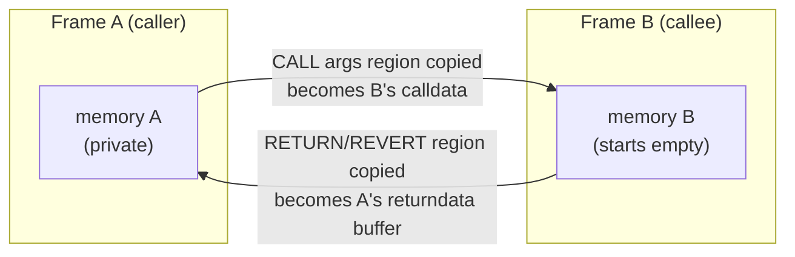

# 1.4 Memory

> [!abstract] In one minute
> - Memory is a **byte-addressed, zero-initialized scratchpad that belongs to one call frame**. Every CALL, DELEGATECALL, STATICCALL and CREATE starts with empty memory. It is thrown away when the frame ends. Data crosses frames only by copying: calldata in, returndata out.
> - Size grows in **32-byte words**. A frame's total memory cost is `3·w + ⌊w²/512⌋` gas for `w` words. Each opcode that touches a higher address pays the **difference** between the total cost after and before. An access of **zero length never expands** memory, whatever the offset.
> - The quadratic term catches up with the linear one at 48 KiB. 1 MiB costs 2,195,456 gas. One frame can reach only about **3.94 MB with 30M gas** and about **2.94 MB under the EIP-7825 per-transaction cap of 2^24 gas**.
> - Opcodes: MLOAD/MSTORE (3 gas, one word), MSTORE8 (3 gas, one byte), MSIZE (2 gas, the highest word touched, in bytes), MCOPY (Cancun, `3 + 3·words`, overlap-safe).
> - To copy memory, MCOPY beats the identity precompile by about 120 gas per call. It beats an MLOAD/MSTORE loop by about 17× at 4 KiB. A single word is still cheapest with one MLOAD and one MSTORE.
> - A callee can force its caller to pay for returndata it does not want (a **returndata bomb**). Copy at most what you need. Solidity refuses `msize()` in inline assembly when the Yul optimizer is on, because `msize` makes every memory access observable.

**Prerequisites:** [[1.3 Execution model]] · **Leads to:** [[1.6 Calldata, returndata and logs]], [[1.9 Gas accounting]], [[2.4 Memory layout]], [[3.5 Memory management in assembly]]

## Intuition: a whiteboard per call

Think of each call frame as a worker with a fresh whiteboard. The board starts blank (all zeros). The worker can write anywhere on it. The board is only as big as the furthest point written or read so far. Making it bigger costs gas, and each extra metre costs more than the last. When the worker returns, the board is wiped. Whatever the worker wanted to hand back had to be copied into a separate envelope: the returndata.

Three consequences follow, and the rest of this note explains them in detail:

1. Memory is **cheap when small**, about 3 gas per word. It becomes **expensive quickly when large**, because the cost grows with the square of the size.
2. Memory is **never shared**. A callee cannot read or corrupt its caller's memory, even under DELEGATECALL.
3. Memory **costs nothing to keep after the frame ends**. That is why it costs nothing to free, and why the EVM gives no refund for it.

## The memory model precisely

Memory is a byte array `μm` indexed from 0. Its logical size `μi` is counted in 32-byte words. Every offset is a 256-bit stack value. In practice gas limits what you can reach long before the 256-bit range does.

| Property | Rule |
|---|---|
| Addressing | Byte-addressed. MLOAD/MSTORE move 32 bytes starting at **any** byte offset. Unaligned access is legal. |
| Byte order | Big-endian. `mstore(p, 0xff)` puts `0xff` at `p+31`. |
| Initial contents | All zeros, for every new frame. |
| Size | `μi` words = the highest word touched, rounded up. It never shrinks within a frame. |
| Lifetime | One call frame (message call or contract creation). It is discarded on return, revert or exceptional halt. |
| Sharing | None. CALL, CALLCODE, DELEGATECALL, STATICCALL, CREATE and CREATE2 all start a child frame with empty memory. |
| Reading past the end | It is legal. The read expands memory and returns zeros. |

I checked the sharing rule in py-evm. The caller first expanded its own memory to 4 KiB, then called a callee that returns its own `msize()`. The callee saw **0**, both under CALL and under DELEGATECALL. DELEGATECALL borrows the caller's *storage*, *address* and *msg context*. It does not borrow memory.



## The memory opcodes

| Opcode | Byte | Gas (before expansion) | Stack in → out | Effect | Since |
|---|---|---|---|---|---|
| MCOPY | `0x5E` | `3 + 3·⌈len/32⌉` | `dst, src, len →` | Copies `len` bytes as if through a temporary buffer, so overlap is safe | Cancun (13 Mar 2024), EIP-5656 |
| MSIZE | `0x59` | 2 | `→ size` | Current size in bytes, always a multiple of 32 | Frontier |
| MSTORE8 | `0x53` | 3 | `offset, value →` | Writes the low byte of `value` at `offset` | Frontier |
| MSTORE | `0x52` | 3 | `offset, value →` | Writes 32 bytes at `offset..offset+31` | Frontier |
| MLOAD | `0x51` | 3 | `offset → value` | Reads 32 bytes at `offset..offset+31` | Frontier |

Every one of these also pays memory expansion if it reaches past the current size. MSIZE is the exception, because it only reports the size.

Two small traps:

- **MSTORE writes a whole word.** `mstore(p, x)` overwrites the 31 bytes after `p`. If you want to change one byte, use MSTORE8, or read-modify-write the word.
- **MSTORE8 still expands by a whole word.** In py-evm, `mstore8(0, 0xff)` left `msize() = 32`. `mstore8(32, 0xff)` left `msize() = 64`. `mload(1)` left `msize() = 64`, because it touches bytes 1 to 32, and byte 32 lies in the second word.

## Memory expansion

### The cost function

The Yellow Paper and the execution specs define the **total** memory cost of a frame whose memory is `w` words:

```text
C_mem(w) = G_memory · w + ⌊w² / 512⌋        G_memory = 3
w        = ⌈highest byte touched + 1⌉ / 32   (rounded up to whole words)
```

When an opcode needs memory up to byte `end = offset + size`, the EVM computes the new size `w' = ⌈end/32⌉`. If `w' > w`, the opcode pays `C_mem(w') − C_mem(w)` **before** it runs. If the frame does not have that much gas, it halts with out-of-gas. All of its gas is consumed, and its state changes are rolled back. The execution specs (`calculate_gas_extend_memory` in the Osaka fork) spell out the rules:

1. An access with `size == 0` is **skipped**. It never expands memory, whatever its offset.
2. Both the old size and the new end are rounded up to a whole word.
3. If the rounded end does not exceed the rounded current size, nothing is charged.
4. Otherwise the opcode pays the delta of the total-cost function, and memory grows to the new end.
5. An opcode with two regions (CALL's input and output, MCOPY's source and destination) is charged for both. The second region is charged against the size the first one already paid for.

Because the opcode pays a *delta of a convex function*, the price of a word depends on how big memory already is, not on which opcode touches it. Touching byte 1,000,000 first costs exactly as much as walking up to it in 32-byte steps.

I measured each rule in py-evm (Prague rules, which Osaka did not change for memory):

| Experiment | Result |
|---|---|
| `mcopy(2^64, 2^64, 0)` | Succeeds. `msize()` stays 0. |
| `calldatacopy(2^64, 0, 0)` | Succeeds. `msize()` stays 0. |
| `return(2^64, 0)` | Succeeds, for 5 gas in total. |
| `staticcall(gas, 0x04, 0, 0, 2^64, 0)` | Succeeds. The zero-length output region at 2^64 is ignored. |
| `return(2^64, 1)` | Out of gas. Expanding to about 2^64 bytes would cost about 6.5 × 10^32 gas. |
| `mcopy(0, 200, 1)` (the source is past the end) | `msize()` becomes 224. Reading the source expands memory too. |
| CALL with output region `[0x1000, +1024)`, callee returns nothing | Caller's `msize()` is 5,120. The output region is expanded **before** the call, whatever the callee returns. |
| `mstore(992, 1)`, then `mstore(0, 0)`, then `mstore(2016, 0)` | Second store pays no expansion. Third pays `C(64) − C(32) = 102` gas. |

> [!warning] Zero length means "any offset", not "offset zero"
> Because zero-size accesses are skipped, code like `return(ptr, 0)` or `revert(0, 0)` is free of expansion even if `ptr` is garbage. The reverse trap: a length that is *supposed* to be zero but is attacker-controlled is a gas bomb. If an attacker controls `size` in `returndatacopy(p, 0, size)` or `calldatacopy(p, off, size)`, they control your memory bill.

### Which opcodes expand memory

| Family | Opcodes | Region(s) charged |
|---|---|---|
| Word and byte access | MLOAD, MSTORE, MSTORE8 | `[offset, offset+32)`, or `[offset, offset+1)` for MSTORE8 |
| Copies into memory | CALLDATACOPY, CODECOPY, EXTCODECOPY, RETURNDATACOPY, MCOPY | Destination (and MCOPY's source). They also pay `3 gas × words copied`. |
| Hashing | KECCAK256 | Input region (plus `6 gas × words` for hashing) |
| Logging | LOG0–LOG4 | Data region |
| Calls | CALL, CALLCODE, DELEGATECALL, STATICCALL | Input region **and** output region, both charged before the call |
| Creation | CREATE, CREATE2 | Init-code region |
| Halting with data | RETURN, REVERT | Output region |

The copy opcodes differ in what happens when they read past the end of their *source*. CALLDATACOPY, CODECOPY and EXTCODECOPY pad with zeros. RETURNDATACOPY halts the frame with an exceptional halt if `offset + size > RETURNDATASIZE` (EIP-211, Byzantium). The details are in [[1.6 Calldata, returndata and logs]].

### The cost curve

Computed from the formula and checked opcode by opcode in py-evm. A single MSTORE ending at each size costs `3 + C_mem` from empty memory, and every row matched up to 2 MiB. The 4 MiB row ran out of gas with 30M, as the formula predicts.

| Memory size | Words | Linear part `3w` | Quadratic part `⌊w²/512⌋` | Total `C_mem` (gas) | Marginal gas for the next word | Average gas per word |
|---|---|---|---|---|---|---|
| 32 B | 1 | 3 | 0 | 3 | 3 | 3.0 |
| 1 KiB | 32 | 96 | 2 | 98 | 3 | 3.1 |
| 4 KiB | 128 | 384 | 32 | 416 | 3 | 3.2 |
| 32 KiB | 1,024 | 3,072 | 2,048 | 5,120 | 7 | 5.0 |
| 48 KiB | 1,536 | 4,608 | 4,608 | 9,216 | 9 | 6.0 |
| 64 KiB | 2,048 | 6,144 | 8,192 | 14,336 | 11 | 7.0 |
| 128 KiB | 4,096 | 12,288 | 32,768 | 45,056 | 19 | 11.0 |
| 256 KiB | 8,192 | 24,576 | 131,072 | 155,648 | 35 | 19.0 |
| 512 KiB | 16,384 | 49,152 | 524,288 | 573,440 | 67 | 35.0 |
| 1 MiB | 32,768 | 98,304 | 2,097,152 | 2,195,456 | 131 | 67.0 |
| 2 MiB | 65,536 | 196,608 | 8,388,608 | 8,585,216 | 259 | 131.0 |
| 4 MiB | 131,072 | 393,216 | 33,554,432 | 33,947,648 | 515 | 259.0 |

Read it this way:

- Below a few KiB, memory is effectively **linear at 3 gas per word**. This is where Solidity code normally lives.
- At **1,536 words (48 KiB)** the quadratic term equals the linear term. Past that point the square dominates.
- The marginal cost of the next word is about `3 + w/256`. Each doubling of size roughly **quadruples the total**.
- 4 MiB already costs more than a whole 30M-gas transaction.

> [!info]- Deep dive: why quadratic, and why it has not been changed
> The quadratic term is a crude cap on how much RAM a node must allocate per frame. Linear pricing alone would let 30M gas buy about 320 MB of memory (`30M/3 × 32 bytes`) in one frame. Several proposals would replace it with a linear, page-based price plus a hard limit. EIP-7923 proposes 100 gas per 4,096-byte page and a 64 MiB per-transaction limit. EIP-7686 proposes memory limits. The Glamsterdam repricing meta-EIP (EIP-8007) lists both as **declined for inclusion**. As of 29 Oct 2026, the quadratic rule still applies on mainnet, and Glamsterdam does not change it.

## Copying data into and within memory

Copies come in two kinds: bringing outside bytes **into** memory, and moving bytes **within** memory.

**Into memory.** CALLDATACOPY, CODECOPY, EXTCODECOPY and RETURNDATACOPY all cost `3` base (EXTCODECOPY pays account-access cost instead, see [[1.9 Gas accounting]]), plus `3 gas × ⌈size/32⌉`, plus memory expansion on the destination. A CALL that names an output region does an implicit RETURNDATACOPY of `min(outSize, returndatasize)` bytes into that region. Its expansion, though, is charged on the whole `outSize` up front.

**Within memory.** Before Cancun there was no opcode for it. Compilers used either an MLOAD/MSTORE loop, or a STATICCALL to the **identity precompile** at address `0x04`, which returns its input. EIP-5656 added MCOPY.

### MCOPY vs identity precompile vs word loop

Gas formulas, from EIP-5656 and the execution specs:

| Method | Gas formula (memory already expanded) | Notes |
|---|---|---|
| MCOPY | `3 + 3·words` | Overlap-safe, handles any length, Cancun and later |
| Identity precompile `0x04` | `100` (warm STATICCALL, EIP-2929) `+ 15 + 3·words` + about 16 gas of argument pushes | Precompiles are always warm. The call **overwrites the returndata buffer**. |
| Unrolled MLOAD/MSTORE | about `12·words` (PUSH + MLOAD + PUSH + MSTORE) | The code size grows with the length. Only practical for a known small length. |
| MLOAD/MSTORE loop | about `52·words` for a simple loop | Needs care with a non-multiple-of-32 tail and with overlap |

Measured in py-evm. Memory was pre-expanded so that the numbers exclude expansion. Each copy was checked byte for byte. The numbers include the PUSH costs of the arguments.

| Copy size | MCOPY | Identity precompile | Unrolled MLOAD/MSTORE | Loop (52 gas per word) |
|---|---|---|---|---|
| 32 B (1 word) | 14 | 136 | **11** | 56 |
| 256 B (8 words) | **35** | 157 | 95 | 420 |
| 4 KiB (128 words) | **395** | 517 | 1,535 | 6,660 |

Takeaways:

- **MCOPY always beats identity**, by about 122 gas. Both cost 3 gas per word, so the gap is the call overhead (100 gas for the warm call, 12 gas more base cost, plus the pushes). The gap is constant and does not grow with size.
- **One word**: a single MLOAD/MSTORE pair (11 gas) beats MCOPY (14 gas). From two words up, MCOPY wins.
- **Loops are the worst option** by far. Writing your own copy loop on a Cancun+ chain is almost never right.
- Solidity has used MCOPY for memory-to-memory byte-array copies since **0.8.25** (14 Mar 2024), with `evmVersion` Cancun or later. This covers `bytes` and `string` inside `abi.encode`, `abi.decode`, `bytes.concat` and similar. Copies from calldata, storage or returndata do not change. The `mcopy` Yul builtin arrived in 0.8.24. The 0.8.38 default `evmVersion` is `osaka`, and I confirmed that `bytes.concat` of two memory arrays emits MCOPY.

> [!tip] When identity still matters
> Use the identity precompile only when you target a chain or EVM version without MCOPY. Some L2s and sidechains lagged behind Cancun, and code compiled with `evmVersion` below `cancun` cannot use MCOPY. Set `evmVersion` deliberately for each target chain (see [[1.11 Hard forks that changed contract code]]).

## MSIZE and the optimizer

`msize()` returns the size of memory: the highest word *ever touched* in this frame, in bytes. That sounds harmless, but it turns every memory access into an **observable side effect**. An optimizer must then preserve even the effects that nothing reads.

- **Dead store elimination breaks.** Normally, `mstore(0x80, 1)` with no later read can be deleted. If an `msize()` comes later, deleting the store changes what `msize()` returns.
- **Reordering breaks.** Moving an MLOAD or MSTORE across an `msize()` changes the result.
- **Removing unused loads breaks.** Even `pop(mload(x))` expands memory and changes `msize()`.
- **Spilling breaks.** The via-IR pipeline can move stack variables into reserved memory to avoid stack-too-deep. Any code that reads `msize()` would see that hidden memory.

The Yul optimizer source documents the rule. The `UnusedPruner` comment says: *"If msize is used, we cannot remove any statements that access memory."* I checked this with standalone Yul and the optimizer on. A dead `mstore(0x80, 1)` was removed when the object did not use `msize`. It was kept when the object later did `sstore(0, msize())`.

Solidity goes further for inline assembly. **`msize()` is a compile error whenever the Yul optimizer is active.** That covers the legacy pipeline with `--optimize` (the Yul optimizer for inline assembly is on by default) and via-IR with optimization:

```text
SyntaxError: The msize instruction cannot be used when the Yul optimizer is activated
because it can change its semantics. Either disable the Yul optimizer or do not use the instruction.
```

With solc 0.8.38, the same contract compiled with the optimizer off, and with legacy `optimizer.details.yul = false`. It failed with the plain legacy optimizer on and with via-IR optimized. In practice, the "limit" on the optimizer is total: you either give up `msize` or you give up the Yul optimizer. Some older hand-written assembly used `msize()` as a cheap "fresh memory" pointer. Use the free memory pointer instead (see [[3.5 Memory management in assembly]]).

## Bridge: Solidity's conventions on top of raw memory

The EVM has no allocator. It only has bytes and an expansion price. Solidity adds a convention: `0x00–0x3f` is scratch space for hashing, `0x40` holds the **free memory pointer**, `0x60` is a permanent **zero slot** (the initial value of empty dynamic memory arrays), and allocation starts at `0x80`. Solidity's allocator only bumps the pointer and **never frees memory**. A loop that allocates leaks memory and pays a growing quadratic price. Memory above the free memory pointer is not guaranteed to be zero, because scratch use may have dirtied it. The layout is covered in [[2.4 Memory layout]]. Writing memory-safe assembly against it is covered in [[3.5 Memory management in assembly]].

## Solidity and Yul in practice

All Solidity snippets compile with solc 0.8.38 (`solcjs --bin --optimize`). I ran their bytecode in py-evm.

**Byte addressing and allocation, and the quadratic price of a memory array.** `basics()` returns `0x00…00ff`: MSTORE8 wrote the last byte of the big-endian word. `alloc(n)` shows the cost of `new uint256[](n)`.

```solidity
// SPDX-License-Identifier: MIT
pragma solidity 0.8.38;

contract MemoryBasics {
    /// Shows byte addressing, big-endian words and MSTORE8.
    function basics() external pure returns (bytes32 word) {
        assembly ("memory-safe") {
            let p := mload(0x40)              // free memory pointer
            mstore(p, 0)                      // make sure the word is clean
            mstore8(add(p, 31), 0xff)         // writes ONE byte, at p+31
            word := mload(p)                  // 0x00..00ff  (big-endian word)
            mstore(0x40, add(p, 0x20))        // keep Solidity's allocator honest
        }
    }

    /// Allocates n words. Gas grows quadratically in n.
    function alloc(uint256 n) external pure returns (uint256) {
        uint256[] memory a = new uint256[](n);
        return a.length;
    }
}
```

Measured execution gas of `alloc(n)` (no 21,000 intrinsic cost):

| n (words) | Bytes | Gas |
|---|---|---|
| 0 | 0 | 362 |
| 1,000 | 32,000 | 8,377 |
| 4,000 | 128,000 | 55,744 |
| 16,000 | 512,000 | 596,776 |
| 32,000 | 1,024,000 | 2,193,151 |
| 64,000 | 2,048,000 | 8,385,901 |

Doubling `n` from 32,000 to 64,000 multiplies the cost by 3.8. Besides expansion, the compiler zero-fills the array with a `calldatacopy` from past the end of calldata, which costs 3 gas per word. Freshly expanded memory is already zero, so that fill is redundant here. The compiler cannot know that memory above the free pointer is clean, so it pays anyway.

**Copying with MCOPY.** This is a memory-safe clone of a `bytes` array. It rounds the allocation up to a whole word so the next allocation stays aligned.

```solidity
// SPDX-License-Identifier: MIT
pragma solidity 0.8.38;

library MemCopy {
    /// Copies `src` into a fresh bytes array with MCOPY (Cancun+).
    function clone(bytes memory src) internal pure returns (bytes memory dst) {
        assembly ("memory-safe") {
            let len := mload(src)
            dst := mload(0x40)
            mstore(dst, len)
            mcopy(add(dst, 0x20), add(src, 0x20), len)
            // round the allocation up to a whole word
            mstore(0x40, add(add(dst, 0x20), and(add(len, 31), not(31))))
        }
    }
}

contract CopyUser {
    using MemCopy for bytes;
    function cloneIt(bytes calldata b) external pure returns (bytes memory) {
        return bytes(b).clone();
    }
    /// The compiler itself emits MCOPY here when evmVersion >= cancun.
    function concat(bytes memory a, bytes memory b) external pure returns (bytes memory) {
        return bytes.concat(a, b);
    }
}
```

**Bounding returndata (returndata-bomb defense).** The CALL names a zero-length output region, so nothing is copied automatically. Then at most `maxCopy` bytes are copied by hand.

```solidity
// SPDX-License-Identifier: MIT
pragma solidity 0.8.38;

library BoundedCall {
    /// Calls `target` but copies at most `maxCopy` bytes of returndata.
    /// A hostile callee cannot force a large memory expansion here.
    function call(address target, uint256 gasLimit, bytes memory data, uint256 maxCopy)
        internal
        returns (bool success, bytes memory ret)
    {
        assembly ("memory-safe") {
            // out size 0: the CALL itself copies nothing into our memory
            success := call(gasLimit, target, 0, add(data, 0x20), mload(data), 0, 0)
            let size := returndatasize()
            if gt(size, maxCopy) { size := maxCopy }
            ret := mload(0x40)
            mstore(ret, size)
            returndatacopy(add(ret, 0x20), 0, size)
            mstore(0x40, add(add(ret, 0x20), and(add(size, 31), not(31))))
        }
    }
}

contract Caller {
    function ping(address t) external returns (bool ok, bytes memory head) {
        (ok, head) = BoundedCall.call(t, 50_000, abi.encodeWithSignature("ping()"), 32);
    }

    /// The unsafe version: Solidity copies ALL returndata, even if it is ignored.
    function pingUnsafe(address t) external returns (bool ok) {
        (ok, ) = t.call{gas: 50_000}(abi.encodeWithSignature("ping()"));
    }
}

contract Bomb {
    /// Returns 100 KiB of zeros. This frame pays its own expansion (29,600 gas).
    fallback() external {
        assembly {
            return(0, 102400)
        }
    }
}
```

Measured against `Bomb`: `ping` used **30,545** gas in total, which is almost all the bomb's own budgeted spending. `pingUnsafe` used **69,737** gas. The extra **39,192** gas is the caller paying again to expand its own memory by 100 KiB and copy into it, even though it ignored the bytes. Against a benign callee that returns 32 bytes, both cost under 1,000 gas.

**Why `msize` blocks the optimizer**, in standalone Yul. Compiled with solc 0.8.38 and the optimizer on, the first object's MSTORE is deleted and the second object's is kept:

```yul
object "Dead" {
    code {
        mstore(0x80, 1)          // never read: optimizer removes it
        sstore(0, calldataload(0))
        stop()
    }
}
```

```yul
object "DeadMsize" {
    code {
        mstore(0x80, 1)          // never read, but changes msize(): must stay
        sstore(0, msize())
        stop()
    }
}
```

## Pitfalls and incidents

> [!warning] Returndata bomb
> A low-level `call` in Solidity copies **all** returndata into memory, even when you write `(bool ok, ) = t.call(...)` and ignore the bytes. A `try/catch` with `catch (bytes memory reason)` copies all revert data too. The callee pays for its own memory, but the caller pays **again** to expand its own memory and copy. If the caller forwarded most of its gas (63/64 by default), it keeps only 1/64. That is far too little to pay a bill as big as the callee's, so the caller runs out of gas *after* the call returns. Code that must finish after an untrusted call fails this way: bridges marking a message processed, keepers, liquidators, relayers. Nomad's `ExcessivelySafeCall` (a `_maxCopy` parameter) and Foundry's `return-bomb` lint exist for this. The defense: an output size of 0, then a bounded RETURNDATACOPY. See [[5.7 Denial of service and griefing]].

> [!warning] Attacker-controlled lengths
> Any memory length that an attacker controls, such as an array size in calldata, a `bytes` argument decoded into memory, or a returndata size, is a quadratic gas lever. Bound lengths before you allocate. Process large inputs straight from calldata instead of copying them to memory (see [[2.2 Data locations]]).

> [!warning] Allocation in loops
> Solidity never frees memory. `abi.encode(...)` or `new bytes(...)` inside a loop grows memory every iteration. A loop that is cheap in tests with 10 items can cost quadratically more with 10,000 items. If you need temporary space, reuse a buffer or reset the free memory pointer in carefully audited assembly.

> [!warning] Clobbering with MSTORE
> MSTORE writes 32 bytes. Writing a packed field with `mstore(p, x)` overwrites the 31 bytes that follow. This is a classic bug in hand-written ABI encoders. Use MSTORE8, or shift and mask.

> [!warning] RETURNDATACOPY out of bounds
> Unlike CALLDATACOPY, RETURNDATACOPY does not pad with zeros. Reading past `returndatasize()` is an exceptional halt that consumes all of the frame's gas. Always clamp to `returndatasize()`.

## Question ladder

> [!question]- **B** Is memory shared between a caller and a callee?
> No. Every new call frame (CALL, CALLCODE, DELEGATECALL, STATICCALL, CREATE, CREATE2) starts with its own memory: empty, all zeros, size 0. That memory is discarded when the frame ends.
>
> Data moves between frames only by **copying**. The caller names an input region of its memory, which becomes the callee's **calldata** (read-only, read with CALLDATALOAD and CALLDATACOPY). The callee names a region of *its* memory in RETURN or REVERT. That becomes the caller's **returndata buffer** (read with RETURNDATASIZE and RETURNDATACOPY, or copied straight into the CALL's output region).
>
> DELEGATECALL is the usual source of confusion. It shares **storage**, `address(this)`, `msg.sender` and `msg.value` with the caller, but **not memory**. I confirmed this in py-evm: a caller grew its memory to 4 KiB, then called a contract that returns its own `msize()`. The result was 0 under both CALL and DELEGATECALL.
>
> Two consequences: a callee cannot corrupt the caller's memory (memory safety across calls is free), and passing large data costs two copies (into calldata, then usually into the callee's memory).

> [!question]- **B** What does memory expansion cost, and when is it charged?
> The **total** cost of a frame's memory of `w` words is `C_mem(w) = 3·w + ⌊w²/512⌋` gas, where `w` is the highest touched byte rounded up to whole 32-byte words.
>
> It is charged **at the moment an opcode first touches memory beyond the current size**, before the opcode executes. The opcode pays only the **delta** `C_mem(new) − C_mem(old)`. If that is unaffordable, the frame halts out of gas.
>
> Details an interviewer will probe:
> - **Word rounding.** `mstore8(0, x)` expands to 32 bytes. `mload(1)` expands to 64 bytes.
> - **Zero length never expands.** `return(hugeOffset, 0)` and `mcopy(x, y, 0)` are free of expansion, even at offset 2^64 (verified in py-evm).
> - **Reads expand too.** MLOAD past the end, MCOPY's *source*, and KECCAK256's input all grow memory.
> - **Calls charge both regions up front.** The input and output regions of CALL-family opcodes are both expanded before the call.
> - **It is never refunded**, and memory never shrinks within the frame.
>
> Examples: 1 KiB costs 98 gas, 32 KiB costs 5,120 gas, and 1 MiB costs 2,195,456 gas. Copy opcodes also pay 3 gas per word copied, which is separate from expansion.

> [!question]- **I** Why do large in-memory arrays become expensive quickly?
> Because the expansion price is **quadratic in total size**, and each new word pays the marginal price at the *current* size: `C(w+1) − C(w) ≈ 3 + w/256` gas.
>
> - At small sizes, the price is 3 gas per word, so arrays of a few hundred elements are cheap.
> - At 1,536 words (48 KiB) the quadratic term equals the linear one.
> - At 32,768 words (1 MiB) each extra word costs about 131 gas, and the total is 2.2M gas.
> - Doubling the size roughly **quadruples** the total. In my measurements, `new uint256[](32000)` cost 2,193,151 gas, and `new uint256[](64000)` cost 8,385,901 gas.
>
> Solidity makes this worse in three ways:
> 1. **It never frees memory.** Temporary arrays, `abi.encode` results and copied `bytes` from earlier in the call all stay counted. A later allocation pays the marginal price on top of them.
> 2. **Hidden copies.** Reading a `bytes` argument into memory, `abi.decode`, returning memory arrays, and low-level calls that copy returndata each add to the size.
> 3. **Zero-filling.** `new T[](n)` writes zeros over the region (3 gas per word with CALLDATACOPY), because Solidity cannot assume memory above the free pointer is clean.
>
> Design responses: work from calldata (`bytes calldata`, slices) instead of copying into memory; stream or paginate instead of building big arrays; bound user-supplied lengths; reuse buffers in assembly; and push large-data work off-chain, with proofs or commitments on-chain.

> [!question]- **I** Compare MCOPY, the identity precompile and a word-by-word loop for copying.
> All three pay the same **memory expansion** for the regions they touch. They differ in per-copy overhead and per-word cost.
>
> | Copy size | MCOPY | Identity (`0x04`) | Unrolled MLOAD/MSTORE | Loop |
> |---|---|---|---|---|
> | 32 B | 14 | 136 | **11** | 56 |
> | 256 B | **35** | 157 | 95 | 420 |
> | 4 KiB | **395** | 517 | 1,535 | 6,660 |
>
> (Measured in py-evm, including argument pushes, with memory pre-expanded.)
>
> - **MCOPY** (`0x5E`, Cancun): `3 + 3·words`. It is safe for overlapping regions (it behaves as if it used a temporary buffer) and handles any byte length, including tails that are not a multiple of 32. It is the default choice from 2 words up. Solidity has emitted it for memory byte-array copies since 0.8.25.
> - **Identity precompile**: `15 + 3·words`, plus a warm STATICCALL (100 gas since EIP-2929, because precompiles are pre-warmed), plus the pushes of six arguments. It has the same per-word rate as MCOPY, plus a fixed overhead of about 120 gas. It also **clobbers the returndata buffer**, which matters if you were about to read the returndata of an earlier call. Use it only where MCOPY does not exist. EIP-5656 quotes "at least 157 gas" for 256 bytes post-EIP-2929, which matches my measurement.
> - **MLOAD/MSTORE**: 12 gas per word unrolled, or about 52 gas per word in a simple loop (counter, compare, jump). It is the cheapest option only for a **single word** (11 gas vs 14). Loops must handle the tail word without clobbering the bytes after the destination. They must also pick a copy direction when regions overlap (copy backwards if `dst > src`). Unrolling costs bytecode size.
>
> What an interviewer listens for: the overhead of a precompile call versus an opcode, overlap semantics, the returndata side effect, the tail-word clobber bug, and knowing that the choice depends on the target chain's EVM version.

> [!question]- **A** Why does using `msize` in assembly limit what the optimizer can do?
> `msize()` exposes the **highest memory address ever touched** as a program value. That makes the *existence* of every memory access part of the program's observable behaviour, not just the values it stores and reads. The optimizer's memory rewrites all assume that unread accesses do not matter:
>
> - **Dead store removal.** `mstore(p, x)` followed by an overwrite, or never read, cannot be deleted if a later `msize()` could see that `p` was touched.
> - **Unused load removal.** `pop(mload(x))` cannot be deleted. It may expand memory.
> - **Reordering and hoisting.** Moving a memory access across an `msize()`, or moving the `msize()` itself, changes its value. The Solidity optimizer docs list "opcodes that depend on … memory size" as **non-movable**, which also excludes them from common-subexpression elimination.
> - **Compiler-owned memory.** Via-IR can spill stack variables to reserved memory to avoid stack-too-deep, and the optimizer may introduce memory temporaries. With `msize()` in the program, any such hidden memory becomes visible.
>
> The Yul `UnusedPruner` states: "If msize is used, we cannot remove any statements that access memory." I verified this with standalone Yul under `--optimize`: a dead `mstore(0x80, 1)` was removed without `msize`, and kept when the object used `sstore(0, msize())`.
>
> For Solidity inline assembly, the compiler simply forbids it. solc 0.8.38 rejects `msize()` with "cannot be used when the Yul optimizer is activated because it can change its semantics", both with the legacy optimizer (whose Yul step is on by default) and with via-IR. It compiles only with the optimizer off or `details.yul: false`. So the practical answer is: using `msize` costs you the Yul optimizer for the whole compilation. Use the free memory pointer instead.

> [!question]- **E** Roughly how much memory can a single call frame touch with 30M gas? Show the math.
> **Setup.** All of a frame's memory is paid through `C(w) = 3w + w²/512`. Any access, read or write, expands memory, so "touch" equals "pay for". Solve `3w + w²/512 ≤ G`:
>
> ```text
> w² + 1536·w − 512·G ≤ 0
> w = (−1536 + √(1536² + 4·512·G)) / 2
> ```
>
> For large `G` the quadratic term dominates, so `w ≈ √(512·G)` and bytes ≈ `32·√(512·G)`. Memory grows only with the **square root** of gas: double the gas, and you get about 1.41× the memory.
>
> **30M gas, as asked.** `√(512 × 30,000,000) ≈ 123,935` words ≈ 3.97 MB as a first estimate. The exact solution is 123,169 words, which is **3,941,408 bytes ≈ 3.94 MB (3.76 MiB)**. In a real top-level transaction, subtract the 21,000 intrinsic gas and a few gas of opcodes. That gives 123,126 words = **3,940,032 bytes**. I verified this in py-evm: an MSTORE ending at byte 3,940,032 succeeds with 29,979,000 gas, and one word higher runs out of gas. About 99% of the gas is the quadratic part (29.6M of 30.0M).
>
> **But 30M is no longer the binding number.**
> - **EIP-7825** (Fusaka, live on mainnet since 3 Dec 2025) caps every transaction's gas limit at **2^24 = 16,777,216 gas**. A transaction above the cap is invalid. Under the cap, a top-level frame gets about 16,756,206 gas after intrinsic cost, which buys 91,859 words = **2,939,488 bytes ≈ 2.94 MB (2.80 MiB)** (verified in py-evm the same way). With the raw 2^24 it is 91,917 words, 2,941,344 bytes.
> - The **block gas limit** on mainnet is **60M** (raised during 2025, and still 60M in October 2026 reports). It does not help a single frame, because one transaction can use at most 2^24. Before Fusaka, a 60M-gas transaction could have touched about 5.58 MB in one frame. That is no longer possible. Glamsterdam testnets run with about 200M block gas limits, but the per-transaction cap still binds.
>
> **Expert follow-ups:**
> - **Per frame vs per transaction.** The bound is per frame, because each frame's memory starts at zero and is priced from zero. A transaction that recurses can hold memory in many frames at once. My rough simulation (each frame spends about 2% of its gas on memory, then forwards 63/64 of the rest, with about 150 gas of call overhead) holds about **18 MiB at once across about 225 nested frames** under the 2^24 cap. That is several times the single-frame figure. Splitting helps because the convex price is cheapest in small chunks. The 1/64 retained at each hop and the 1024 depth limit stop it from growing without bound. *(This is an estimate from my model, not a consensus bound.)*
> - **Why this matters.** Clients size their worst-case RAM from these numbers. That is the motivation for EIP-7686 (memory limits) and EIP-7923 (linear 4 KiB-page pricing with a 64 MiB per-transaction cap), both declined for Glamsterdam.
> - **Attack framing.** A griefer who controls a callee with gas `g` can produce about `32·√(512·g)` bytes of returndata. A naive caller then pays roughly `g` again to copy it, from the 1/64 it kept. That is why bounded copies matter.
>
> What the interviewer listens for: the quadratic formula, solved correctly; the square-root scaling; saying "per frame"; knowing the 2^24 transaction cap and that the 60M block limit is irrelevant for one frame; and the nested-frame nuance.

## Related notes
- [[1.3 Execution model]] — call frames, the stack and the machine state that memory belongs to
- [[1.6 Calldata, returndata and logs]] — the other byte areas, and the copy opcodes that move them into memory
- [[1.7 Message calls and precompiles]] — CALL argument and return regions, and the identity precompile
- [[1.9 Gas accounting]] — how expansion fits into total gas, the 63/64 rule and warm/cold access
- [[1.11 Hard forks that changed contract code]] — Cancun (MCOPY) and Osaka (transaction gas cap) in context
- [[2.2 Data locations]] — `memory` vs `calldata` vs `storage` at the Solidity level
- [[2.4 Memory layout]] — scratch space, the free memory pointer and the zero slot
- [[3.5 Memory management in assembly]] — memory-safe assembly, allocation and buffer reuse
- [[3.11 Compiler IR and the optimizer]] — the movability rules and the `msize` restriction
- [[4.10 Gas optimization]] — where memory costs show up in real gas budgets
- [[5.7 Denial of service and griefing]] — returndata bombs and attacker-controlled lengths

## Sources
- [EIP-5656: MCOPY](https://eips.ethereum.org/EIPS/eip-5656) — MCOPY semantics, gas `3 + 3·words`, overlap, comparison with identity (≥157 gas for 256 bytes post-2929) and loops (≥96)
- [EIP-7569: Dencun meta](https://eips.ethereum.org/EIPS/eip-7569) — Cancun activation 13 Mar 2024, includes EIP-5656
- [execution-specs, Osaka `vm/gas.py`](https://raw.githubusercontent.com/ethereum/execution-specs/master/src/ethereum/forks/osaka/vm/gas.py) — `calculate_memory_gas_cost`, `calculate_gas_extend_memory` (zero-size skip, word rounding, delta charging), constants: memory 3, copy 3, identity 15 + 3 per word
- [EIP-7825: Transaction gas limit cap](https://eips.ethereum.org/EIPS/eip-7825) — cap of 16,777,216 gas, Final
- [EIP-7607: Fusaka meta](https://eips.ethereum.org/EIPS/eip-7607) — Fusaka activation 3 Dec 2025, includes EIP-7825 and EIP-7935 (60M default)
- [ethereum.org: Building on Ethereum in 2026](https://ethereum.org/latest/building-on-ethereum-in-2026/) — 60M block gas limit, 2^24 transaction cap
- [Decrypt, 8 Oct 2026](https://decrypt.co/380538/ethereum-test-raises-block-limit-3x-current-capacity) and [Furlpay, 15 Oct 2026](https://furlpay.com/blog/ethereum-market-network-update-october-2026) — mainnet still at 60M; Glamsterdam on testnets, no mainnet date
- [Yellow.com, 20 Oct 2026](https://yellow.com/news/ethereum-glamsterdam-200m-gas-hoodi-mainnet) — Glamsterdam testnet schedule and the 200M Hoodi gas limit
- [EIP-8007: Glamsterdam gas repricings](https://eips.ethereum.org/EIPS/eip-8007) — EIP-7923 and EIP-7686 declined for inclusion
- [EIP-7923: Linear, page-based memory costing](https://eips.ethereum.org/EIPS/eip-7923) — 4,096-byte pages, 100 gas per page, 64 MiB limit (Draft)
- [Solidity docs: Inline assembly](https://docs.soliditylang.org/en/latest/assembly.html) — scratch space, free memory pointer, zero slot, memory-safe rules
- [Solidity docs: The optimizer](https://docs.soliditylang.org/en/latest/internals/optimizer.html) — expressions depending on memory size are non-movable
- [Solidity `UnusedPruner.h`](https://gitea.com/tweth/solidity/src/branch/develop/libyul/optimiser/UnusedPruner.h) — "If msize is used, we cannot remove any statements that access memory"
- [Solidity 0.8.25 release announcement](https://soliditylang.org/blog/2024/03/14/solidity-0.8.25-release-announcement/) — code generator uses MCOPY for memory byte-array copies; `mcopy` builtin from 0.8.24
- [Nomad ExcessivelySafeCall](https://www.npmjs.com/package/%40nomad-xyz%2Fexcessively-safe-call) — the returndata bomb and the `_maxCopy` defense
- [Foundry lint: return-bomb](https://www.getfoundry.sh/forge/linting/return-bomb) — Solidity copies the full returndata even when it is ignored
- Local verification: py-evm 0.12.1b1 (Prague VM) for every gas and `msize` measurement; solc-js 0.8.38 for compilation, the `msize` compile error and the default `evmVersion` (`osaka`)
