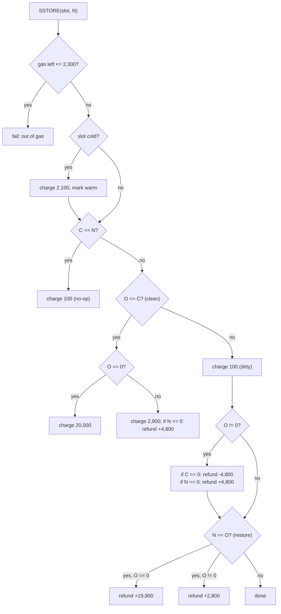

# 1.5 Storage and transient storage

> [!abstract] In one minute
> - Every contract has its own **storage**: 2^256 slots of 32 bytes, all zero until written. It persists across transactions and lives in the account's storage trie. **Transient storage** is a second, separate slot space with the same shape that is wiped at the end of every transaction.
> - **SLOAD** costs 2,100 gas cold and 100 gas warm. **SSTORE** costs 20,000 to turn a clean zero slot nonzero, 2,900 to change a clean nonzero slot, and 100 for a no-op or for any write to a slot already changed in this transaction. Add 2,100 if the slot is cold.
> - SSTORE pricing compares three values: **original** (at transaction start), **current** (now) and **new**. Clearing a slot adds a 4,800 refund. Restoring a slot to its original value refunds the difference, so net cost ends up near "one cold access plus 100 per write".
> - Refunds are paid only at transaction end, and capped at **one fifth of gross gas used** (EIP-3529). Refunds can never make a transaction cheaper than 80% of its gross cost.
> - **Sentry rule** (EIP-2200): SSTORE fails if 2,300 gas or less remains. This keeps `transfer`/`send` recipients from writing storage. **TSTORE has no sentry** and costs 100, so it does work on the 2,300 stipend.
> - **TLOAD/TSTORE** (EIP-1153, Cancun): 100 gas each, no warm/cold, no refunds. Writes roll back with a reverting frame. TSTORE is forbidden under STATICCALL. Under DELEGATECALL the slots belong to the caller.

**Prerequisites:** [[1.1 Accounts and world state]], [[1.3 Execution model]] · **Leads to:** [[1.9 Gas accounting]], [[2.3 Storage layout]], [[3.6 Storage, transient storage and bit packing]], [[5.11 New attack surfaces - transient storage, EIP-7702, account abstraction]]

## The storage model

Think of each contract as owning a giant array of 2^256 words. Each word is 32 bytes. Every word starts as zero. The array is sparse: only nonzero slots are actually stored. Writing zero to a slot deletes it from the trie, which is why clearing earns a refund.

The array belongs to the **storage context** of the running frame. For CALL and STATICCALL that is the callee. For DELEGATECALL and CALLCODE it is the caller, because the caller's storage is borrowed by someone else's code. That one rule explains every proxy storage-collision bug ([[5.9 Proxies, delegatecall and storage]]).

There is no opcode to read another account's storage. A contract can only SLOAD its own slots. Other contracts must expose getters. Off-chain tools read any slot with `eth_getStorageAt`, and prove it with `eth_getProof` against the block's state root ([[1.1 Accounts and world state]]).

Two facts follow from the model:

- **An unset slot reads as 0.** Storage cannot tell "never written" from "written zero". Contracts that need that distinction must encode it, for example with a sentinel value.
- **Slot numbers are 256-bit keys, not offsets.** The trie is keyed by `keccak256(slot)`, so slot 5 and slot 2^255 cost the same to access. Solidity uses this to put mappings and dynamic arrays at hashed locations. How Solidity assigns slot numbers to variables is covered in [[2.3 Storage layout]].

### Why storage is priced the way it is

Every full node keeps every nonzero slot of every contract, forever, and must update a Merkle path when one changes. So the gas schedule charges for three different costs:

1. **Reading from disk.** The first touch of a slot in a transaction may hit disk. Later touches hit a cache. This is the cold (2,100) versus warm (100) split from EIP-2929. The full access-list machinery is in [[1.9 Gas accounting]].
2. **Changing state.** Changing a committed value forces a trie update at block end. That is the 2,900 "reset" price.
3. **Growing state.** Turning a zero slot nonzero adds a new leaf every node stores permanently. That is the 20,000 "set" price, the most expensive common operation in the EVM.

Writes that only change a value already changed in this transaction add no new trie work, because the client only writes the final value. EIP-2200 net metering prices them at 100.

### SLOAD and SSTORE pricing history

| Fork (date) | Change | EIP |
|---|---|---|
| Glamsterdam (proposed, no mainnet date) | Storage write and state-creation repricing, refunds removed from block gas. See [[#Glamsterdam proposals]] | EIP-8037, EIP-8038, EIP-7778 |
| Cancun (13 Mar 2024) | TLOAD/TSTORE added at 100 gas each | EIP-1153 |
| London (5 Aug 2021) | Clear refund 15,000 → 4,800; refund cap 1/2 → 1/5 | EIP-3529 |
| Berlin (15 Apr 2021) | Cold 2,100 / warm 100; SSTORE reset 5,000 → 2,900; access lists (1,900 per prewarmed slot) | EIP-2929, EIP-2930 |
| Istanbul (8 Dec 2019) | Net metering with original/current/new and the 2,300 sentry; SLOAD 200 → 800 | EIP-2200, EIP-1884 |
| Petersburg (28 Feb 2019, same block as Constantinople) | EIP-1283 net metering removed before activation | EIP-1716 |
| Constantinople (planned Jan 2019) | EIP-1283 net metering delayed after ChainSecurity's reentrancy finding (15 Jan 2019) | EIP-1283 |
| Tangerine Whistle (18 Oct 2016) | SLOAD 50 → 200 | EIP-150 |
| Frontier (Jul 2015) | SSTORE 20,000 set / 5,000 otherwise, 15,000 clear refund, cap 1/2 of gas used | Yellow Paper |

## SSTORE: the complete current table

Three values decide the price:

- **original** (O): the slot's value at the start of the transaction. It never changes during the transaction.
- **current** (C): the slot's value right now, after earlier writes in this transaction that did not revert.
- **new** (N): the value being written.

A slot is **clean** if O = C (not yet changed this transaction) and **dirty** if O ≠ C.

The constants in force since London (and unchanged through Prague and Osaka):

| Name | Value | Origin |
|---|---|---|
| `COLD_SLOAD_COST` | 2,100 | EIP-2929 |
| `WARM_STORAGE_READ_COST` (the "SLOAD_GAS" of EIP-2200) | 100 | EIP-2929 |
| `SSTORE_SET_GAS` | 20,000 | EIP-2200 |
| `SSTORE_RESET_GAS` | 5,000 − 2,100 = 2,900 | EIP-2929 |
| `SSTORE_CLEARS_SCHEDULE` (clear refund) | 2,900 + 1,900 = 4,800 | EIP-3529 |
| `MAX_REFUND_QUOTIENT` | 5 | EIP-3529 |
| Sentry threshold | 2,300 (the call stipend) | EIP-2200 |

Every case. "Warm gas" is the price when the slot was already accessed in this transaction. "Cold" adds 2,100 and marks the slot warm. A dirty slot is always warm: the earlier write warmed it, and if that write's frame reverted, both the value and the warmth were rolled back.

| # | Case | O | C | N | Gas warm | Gas cold | Refund counter change |
|---|---|---|---|---|---|---|---|
| 1 | No-op | any | = N | = C | 100 | 2,200 | 0 |
| 2 | Fresh set | 0 | 0 | ≠ 0 | 20,000 | 22,100 | 0 |
| 3 | Fresh reset (update) | ≠ 0 | = O | ≠ 0, ≠ C | 2,900 | 5,000 | 0 |
| 4 | Fresh clear | ≠ 0 | = O | 0 | 2,900 | 5,000 | +4,800 |
| 5 | Dirty, was zero, still nonzero (0→1→2) | 0 | ≠ 0 | ≠ 0, ≠ C | 100 | n/a | 0 |
| 6 | Dirty, restore to zero (0→1→0) | 0 | ≠ 0 | 0 | 100 | n/a | +19,900 (20,000 − 100) |
| 7 | Dirty, nonzero to other nonzero (1→2→3) | ≠ 0 | ≠ 0, ≠ O | ≠ 0, ≠ O | 100 | n/a | 0 |
| 8 | Dirty, clear (1→2→0) | ≠ 0 | ≠ 0, ≠ O | 0 | 100 | n/a | +4,800 |
| 9 | Dirty, un-clear to other value (1→0→2) | ≠ 0 | 0 | ≠ 0, ≠ O | 100 | n/a | −4,800 |
| 10 | Dirty, un-clear to original (1→0→1) | ≠ 0 | 0 | = O | 100 | n/a | −4,800 + 2,800 = −2,000 |
| 11 | Dirty, restore to nonzero original (1→2→1) | ≠ 0 | ≠ 0, ≠ O | = O | 100 | n/a | +2,800 (2,900 − 100) |

Before any of this, the **sentry**: if gas left is 2,300 or less, the SSTORE fails with out-of-gas, whatever the case. SSTORE also fails in a static context, even for a no-op.

The refund counter is per transaction. It can dip during execution (case 9 subtracts) but never ends negative, because a subtraction only undoes an earlier +4,800 on the same slot. Refund changes made inside a frame that reverts are thrown away with the frame.



### Worked examples, verified on py-evm

Each row is one transaction that calls a contract whose code is just `PUSH1 v PUSH1 0 SSTORE` repeated, then STOP. The slot starts cold. "Tx gross" is 21,000 intrinsic plus all execution gas (the PUSHes add 6 per SSTORE). Run on py-evm `PragueVM` and `CancunVM`; both gave identical numbers.

| Sequence | SSTORE gas | Refund counter | Tx gross | Cap (gross / 5) | Refund applied | Gas paid |
|---|---|---|---|---|---|---|
| 0→1 | 22,100 | 0 | 43,106 | 8,621 | 0 | 43,106 |
| 1→2 | 5,000 | 0 | 26,006 | 5,201 | 0 | 26,006 |
| 1→0 | 5,000 | 4,800 | 26,006 | 5,201 | 4,800 | 21,206 |
| 0→1→0 | 22,100 + 100 = 22,200 | 19,900 | 43,212 | 8,642 | **8,642 (capped)** | 34,570 |
| 1→0→1 | 5,000 + 100 = 5,100 | +4,800 − 2,000 = 2,800 | 26,112 | 5,222 | 2,800 | 23,312 |
| 1→2→1 | 5,100 | 2,800 | 26,112 | 5,222 | 2,800 | 23,312 |
| 1→0→2 | 5,100 | 0 | 26,112 | 5,222 | 0 | 26,112 |
| 0→0 (no-op) | 2,200 | 0 | 23,206 | 4,641 | 0 | 23,206 |

Read the restore cases closely. Both 0→1→0 and 1→0→1 are designed to net out at 2,300 of SSTORE gas: one cold access (2,100) plus 100 per write. That is what EIP-2200 intends: a slot you put back is priced like a slot you only read. But 0→1→0 only nets 2,300 if the refund fits under the cap. In a small transaction it does not: the 19,900 refund is cut to 8,642 and the user pays 34,570 instead of about 23,312. In a large transaction (gross over 99,500 gas) the full 19,900 comes back. This is why "set a flag, then clear it" patterns, like the old zero-to-one reentrancy lock, were expensive, and why transient storage exists.

> [!info]- Deep dive: how clients track "original"
> The original value is the committed value from before the transaction, not from before the current call frame. Clients keep it in their per-transaction journal or state cache. py-evm reads it with `get_storage(..., from_journal=False)`. The execution-specs keep a snapshot of the state at transaction start and read the slot from it. Because it is per transaction, a slot changed by a frame that succeeded and then changed again by a sibling frame is still dirty. Because frames revert their journal entries, a write in a reverted frame leaves the slot clean.

### The sentry rule

EIP-2200 starts SSTORE with one check: if gas left is 2,300 or less, fail. It is a check, not a charge. With 2,301 gas left, a 100-gas or 2,200-gas SSTORE goes through. A py-evm test confirms the boundary: a frame entering an SSTORE with exactly 2,300 gas left fails; with 2,301 left the same 2,200-gas no-op succeeds.

The history behind it is in the question ladder ([[#Question ladder]]). In short: net metering made dirty writes cheap enough to fit inside the 2,300-gas stipend, which broke the old assumption that a `transfer` recipient cannot change state.

## Transient storage (EIP-1153)

Intuition: transient storage is "storage that forgets". It has storage's shape and its revert and call behavior, but it never reaches the state trie, and every slot is zero again when the transaction ends. It replaces the pattern "write a flag to storage, clear it before returning", which cost about 22,100 + 100 gas up front, with 200 gas.

It shipped in Cancun (13 Mar 2024) as two opcodes:

| Opcode | Byte | Stack | Gas | In static context |
|---|---|---|---|---|
| TLOAD | 0x5c | `key → value` | 100 | Allowed |
| TSTORE | 0x5d | `key, value →` | 100 | Exception (frame fails) |

The full semantics, each item checked on py-evm `PragueVM`:

| Property | Behavior | Test result |
|---|---|---|
| Address space | Separate from persistent storage. TSTORE(0) does not touch SLOAD(0) | — |
| Owner | The current storage context: callee for CALL/STATICCALL, **caller** for DELEGATECALL/CALLCODE | DELEGATECALL'd code did TSTORE(0, 9); caller's TLOAD(0) read 9. A plain CALL left the caller's slot at 5 |
| Lifetime | Whole transaction, across all calls. Not cleared when a call frame returns | Second call to D in the same tx read the 7 left by the first call |
| End of transaction | All slots discarded | The next transaction's TLOAD(0) read 0 |
| Revert | Writes made since a frame started are rolled back if that frame reverts, including writes by its subcalls | Caller wrote 5, delegatecall wrote 9 then reverted, caller read 5 |
| STATICCALL | TSTORE throws; TLOAD works | STATICCALL to TSTORE code returned failure; to TLOAD code returned success |
| Gas | Flat 100 each. No cold/warm, no access list, no refunds, no 20,000 "set" price | TSTORE + TLOAD + 3 PUSH1 + POP = 211 gas |
| Stipend | No sentry. TSTORE works inside a 2,300-gas `transfer` | CALL with 2,300 gas to TSTORE code succeeded |

Why 100 and not 3, like memory? Because transient writes must be journaled for revert, and they persist across frames. The EIP prices TSTORE like a warm SSTORE to a dirty slot and TLOAD like a warm SLOAD.

> [!warning] Transient storage outlives your call
> The slot is not cleared when your function returns. It is cleared when the *transaction* ends. Any contract that can be called twice in one transaction (multicall, a router, an EIP-4337 bundle, an EIP-7702 batch) will see the leftovers of the first call. Clear every transient slot you set before returning, unless carrying it forward is the point. Details and attack patterns are in [[5.11 New attack surfaces - transient storage, EIP-7702, account abstraction]].

What it is good for:

- **Reentrancy locks.** Set at entry, clear at exit, 200 gas of TSTOREs plus a TLOAD, with no 0→1 set cost and no refund-cap surprise. See [[5.2 Reentrancy]].
- **Per-transaction accounting.** "Flash accounting": track each party's net debt across many calls and settle once at the end (Uniswap v4 uses this style). The order-book answer below uses it for taker totals.
- **Passing context through untrusted frames.** A callback can read data set by the caller without trusting calldata from the intermediate contract.
- **Cheap per-transaction approvals** ("transient approvals") that cannot leak into a later transaction.

What it is not: a cache for values you want next block. Solidity's docs show the classic mistake, a transient `multiplier` set in one transaction that reads 0 in the next.

## Glamsterdam proposals

> [!warning] Proposals, not live rules
> Glamsterdam (EIP-7773) went live on the Sepolia testnet on 6 Oct 2026 and on Hoodi on 26 Oct 2026. It has **no mainnet date**. EIP-8037 and EIP-8038 are in Last Call until 1 Nov 2026, so the numbers below may still change. Mainnet today (Osaka) uses the table above.

| EIP | Status (29 Oct 2026) | What changes for storage |
|---|---|---|
| EIP-8038 State-access gas cost update | Scheduled for Glamsterdam; Last Call | SSTORE becomes access (2,100 cold / 100 warm, unchanged) + `STORAGE_WRITE` 10,000 (was about 2,800) when a clean slot changes. Clear refund 4,800 → 11,616. Restore-to-original refunds `STORAGE_WRITE` |
| EIP-8037 State creation gas cost increase | Scheduled; Last Call | 0→nonzero charged in a separate "state gas" dimension: 64 bytes × 1,530 gas per byte = 97,920 state gas, replacing the 20,000. 0→x→0 in one transaction refills that state gas |
| EIP-7778 Block gas accounting without refunds | Scheduled; Last Call | Refunds still lower what the user pays, but no longer let a block execute more than its gas limit |
| EIP-8032 size-based SSTORE pricing | Declined for Glamsterdam | — |
| EIP-7971 cheaper TLOAD/TSTORE with a transaction-global limit | Declined for Glamsterdam | — |

The direction is clear even if the numbers move: new slots get much more expensive, plain updates get several times more expensive, and refunds stop affecting block size. Designs that reuse nonzero slots and pack fields gain the most.

## Solidity and Yul in practice

Solidity places state variables at slots 0, 1, 2… and packs small types together; mappings and dynamic arrays live at keccak-derived slots. That is [[2.3 Storage layout]]. Here only the EVM-visible consequences matter.

**Transient state variables.** Since Solidity 0.8.28 (9 Oct 2024), value-type state variables can be declared `transient`, in both the legacy and IR pipelines. They need EVM version `cancun` or later. They cannot be initialized at declaration (the constructor's transaction would wipe the value), and cannot be `constant` or `immutable`. Reference types (mappings, arrays, structs) are not yet supported. Transient variables have their own slot numbering, independent of the persistent layout.

```solidity
// SPDX-License-Identifier: MIT
pragma solidity ^0.8.28;

contract TransientLock {
    // Lives in transient storage: its own slot space, separate from persistent slots.
    bool transient locked;

    modifier nonReentrant() {
        require(!locked, "reentrant");
        locked = true;
        _;
        locked = false; // assign, do not `delete` (0.8.28-0.8.33 via-IR bug)
    }

    function withdraw(uint256 amount) external nonReentrant {
        (bool ok, ) = msg.sender.call{value: amount}("");
        require(ok);
    }
}
```

The lock costs one TLOAD and two TSTOREs, 300 gas of storage opcodes. The classic persistent lock stores 1 ("not entered") and 2 ("entered"): a cold SLOAD (2,100), a 1→2 reset (2,900) and a 2→1 dirty restore (100), with a 2,800 refund at the end, so about 5,100 gross and 2,300 net if the refund fits under the cap. OpenZeppelin's storage-based `ReentrancyGuard` uses 1 and 2, not 0 and 1, so each call pays a 2,900 reset instead of a 20,000 set and needs only a small refund that the cap is unlikely to cut. Its source now marks that guard deprecated in favor of `ReentrancyGuardTransient` for v6.0.

**Inline assembly.** `sload`, `sstore`, `tload` and `tstore` are available in inline assembly (`tload`/`tstore` since 0.8.24, 26 Jan 2024). solc 0.8.38 prints this warning for a `tstore` in inline assembly (it does not print it for the `transient` keyword):

```solidity
// SPDX-License-Identifier: MIT
pragma solidity ^0.8.28;

contract RawSlots {
    // keccak256("example.flashAccounting.delta") - 1, a namespaced transient slot
    bytes32 private constant DELTA_SLOT =
        bytes32(uint256(keccak256("example.flashAccounting.delta")) - 1);

    function readSlot(uint256 slot) external view returns (uint256 v) {
        assembly { v := sload(slot) }       // 2,100 gas cold, 100 warm
    }

    function addDelta(int256 d) external returns (int256 total) {
        bytes32 s = DELTA_SLOT;
        assembly {
            total := add(tload(s), d)       // 100 gas
            tstore(s, total)                // 100 gas, gone at end of tx
        }
    }
}
```

```text
Warning: Transient storage as defined by EIP-1153 can break the composability of smart
contracts: Since transient storage is cleared only at the end of the transaction and not at
the end of the outermost call frame to the contract within a transaction, your contract may
unintentionally misbehave when invoked multiple times in a complex transaction. ...
The use of transient storage for reentrancy guards that are cleared at the end of the call
is safe.
```

Use namespaced (hashed) transient slots, not slot 0, 1, 2, in code that may run under DELEGATECALL. A proxy and its implementation share one transient space, exactly as they share persistent storage. Bit packing, namespaced slots and hand-written slot math are in [[3.6 Storage, transient storage and bit packing]]. Gas tactics built on this table (packing, caching in memory, avoiding 0→nonzero) are in [[4.10 Gas optimization]].

## Pitfalls and incidents

| Date | Incident / issue | Storage lesson |
|---|---|---|
| 18 Feb 2026 | Solidity transient-storage clearing helper collision (0.8.28–0.8.33, via-IR only; fixed in 0.8.34) | `delete` on a transient variable could emit `sstore` (zeroing a persistent slot such as `owner`) when the same unit also cleared persistent storage of the same type. Workaround: assign zero instead of `delete` |
| 30 Mar 2025 | SIR.trading, about $355K | One transient slot (`0x1`) held the trusted Uniswap V3 pool address for callback authentication, then was overwritten with the mint amount. The attacker mined a CREATE2 address numerically equal to that amount (95759995883742311247042417521410689), called `uniswapV3SwapCallback` directly, passed the `tload(1) == msg.sender` check, and drained the vault |
| 15 Jan 2019 | ChainSecurity finds EIP-1283 reentrancy; Constantinople delayed | Cheap dirty writes let a 2,300-gas fallback re-enter and update storage. Led to the EIP-2200 sentry |
| 2017–2021 | GasToken and refund farming | Writing slots when gas was cheap and clearing them when it was expensive harvested refunds and bloated state. EIP-3529 killed it |

> [!warning] Footguns
> - **"2,300 gas cannot change state" is false since Cancun.** TSTORE works on the stipend. A `transfer` recipient can set transient flags that later calls in the same transaction read.
> - **Transient slot reuse.** Never let two meanings share one transient slot (SIR.trading). Give each variable a distinct, namespaced slot, and clear it when done.
> - **Refunds arrive late.** The refund is credited after execution. During execution you need the full gross gas. Gas estimation must cover gross, not net.
> - **Refunds are capped.** A design that relies on a big clear refund (0→1→0 flags, "delete to save gas") may recover only 20% of the transaction's gas.
> - **Reverted frames lose their refunds.** A clear inside a call that later reverts earns nothing (checked on py-evm: the refund counter dropped back to 0).
> - **SSTORE in a static context always fails**, even writing the same value. A view function that "touches" storage through assembly will revert under STATICCALL.
> - **DELEGATECALL shares both storage spaces.** Libraries and implementations that hard-code transient slot 0 collide with the proxy's own transient variables.

## Question ladder

> [!question]- **B** What does the first write to a zero slot cost compared with updating a nonzero slot?
> The first write that turns a clean zero slot nonzero is a **fresh set**: 20,000 gas, plus 2,100 if the slot has not been touched yet in this transaction, so usually **22,100**. Updating a clean nonzero slot to another nonzero value is a **fresh reset**: 2,900 gas, plus 2,100 cold, so usually **5,000**. Both numbers were measured on py-evm (a single cold 0→1 cost 22,100; a single cold 1→2 cost 5,000).
>
> The gap (about 4.4 times cold, about 7 times warm) exists because a set creates a new leaf that every node must store forever, while a reset only changes an existing one. Once a slot is dirty in this transaction, further writes cost 100 regardless of direction, since the client only writes the final value.
>
> Practical consequences: avoid 0→nonzero on hot paths. Keep counters, flags and pointers nonzero (start counters at 1, use 1/2 for booleans in persistent storage), and pack several fields into one slot so the 20,000 is paid once.

> [!question]- **I** Explain original vs current value in SSTORE gas metering, with a worked example.
> **Original** is the slot's value when the transaction began. It is fixed for the whole transaction. **Current** is the value right now, after any non-reverted writes earlier in this transaction, from any frame. **New** is the value being written.
>
> The rules use them like this. If current equals new, nothing changes: 100 gas. If original equals current, the slot is still clean, so this write is the one that will actually change the trie: 20,000 if original is zero, otherwise 2,900. If original differs from current, the slot is already dirty, and the trie change has already been paid for: 100 gas. Refund adjustments then keep the books honest: clearing a nonzero original adds 4,800, undoing a clear subtracts 4,800, and returning to the original refunds what the first write paid above 100.
>
> Worked example. Slot 0 holds 5 at transaction start. The transaction writes 7, then 9, then 5. The slot starts cold.
>
> | Write | O | C | N | Case | Gas | Refund |
> |---|---|---|---|---|---|---|
> | 1 | 5 | 5 | 7 | clean reset + cold | 2,900 + 2,100 = 5,000 | 0 |
> | 2 | 5 | 7 | 9 | dirty | 100 | 0 |
> | 3 | 5 | 9 | 5 | dirty, restore to nonzero original | 100 | +2,800 |
>
> Gross SSTORE gas 5,200, refund 2,800, net 2,400. That is exactly 2,100 (one cold access) plus 100 per write. py-evm measured the same 5,200 and 2,800; the refund fit under the cap (5,243), so the transaction paid 23,418 instead of 26,218.
>
> Why track original at all? Without it (pre-Istanbul), each write was priced against the current value only, so 5→7→9→5 would cost 5,000 three times. Net metering prices what the node actually does at block end: at most one trie update per slot per transaction.

> [!question]- **I** What is the SSTORE sentry rule, and why does it exist?
> **Rule (EIP-2200):** before anything else, if the gas left in the frame is less than or equal to 2,300, SSTORE fails with out-of-gas. It is a threshold, not a fee. With 2,301 left, a cheap SSTORE succeeds. py-evm confirms the boundary exactly: entering SSTORE with 2,300 left fails; with 2,301 left a 2,200-gas no-op succeeds.
>
> **Why:** for years, contracts assumed that `transfer` and `send`, which forward only a 2,300-gas stipend, were reentrancy-safe, because any SSTORE cost at least 5,000. EIP-1283 (planned for Constantinople) introduced net metering, where writing a dirty slot cost only 200. On 15 Jan 2019 ChainSecurity showed the break: an attacker first calls `updateSplit` to dirty a slot, then calls `splitFunds`; the first `transfer` reaches the attacker's fallback, which re-enters `updateSplit` within the stipend (about 1,600 gas left after the CALL) and redirects the second payment. Constantinople was delayed, and Petersburg activated without EIP-1283.
>
> EIP-2200 brought net metering back in Istanbul with the sentry. Whatever SSTORE costs, it cannot run on a bare stipend, so the old assumption holds for persistent storage.
>
> Two follow-ups an interviewer may probe. First, the sentry protects storage only; since Cancun, TSTORE (100 gas, no sentry) runs on the stipend, so "2,300 gas means no state change" is no longer true for transient state. Second, the stipend was never a good security boundary, because gas prices change by fork. Use checks-effects-interactions and real locks ([[5.2 Reentrancy]]), and avoid `transfer`/`send`.

> [!question]- **A** State the full semantics of transient storage: lifetime, revert behavior, STATICCALL, and which contract owns the slots under DELEGATECALL.
> Transient storage is a per-account map from 256-bit keys to 256-bit values, separate from persistent storage. TLOAD reads it, TSTORE writes it, 100 gas each, flat.
>
> - **Lifetime:** values survive across all call frames of the transaction, including calls into other contracts and back. They are **not** cleared when a frame or the outermost call to your contract returns. They are discarded at the end of the transaction. Nothing ever reaches the state trie, so there are no refunds, no warm/cold pricing and no state-growth cost.
> - **Revert:** transient writes are journaled like storage. If a frame reverts (REVERT, exceptional halt, out-of-gas), every TSTORE made since that frame started, including in its subcalls, is undone. Writes in frames that returned successfully stay. A transient write survives only if every frame from it up to the transaction root succeeds.
> - **STATICCALL:** TSTORE in a static context is an exception, like SSTORE, LOG and value-bearing CALL. TLOAD is allowed. So a view call can read a lock but cannot set one.
> - **Ownership:** slots belong to the current storage context, the same address SSTORE would write. Under CALL and STATICCALL, that is the callee. Under **DELEGATECALL and CALLCODE, it is the caller**: implementation code running in a proxy reads and writes the proxy's transient slots. Proxy and implementation therefore share one transient namespace, and collisions work exactly like storage collisions.
> - **Gas and stipend:** 100 gas, no sentry. TSTORE works inside a 2,300-gas `transfer`.
>
> Each item was checked on py-evm `PragueVM`: delegatecalled TSTORE(0, 9) was visible to the caller as 9; the same write followed by REVERT left the caller's value at 5; a plain CALL did not touch the caller's slot; TSTORE under STATICCALL failed while TLOAD succeeded; a second call in the same transaction saw the first call's value; the next transaction saw 0.
>
> What a strong answer adds: the composability hazard (multicall, bundles and 7702 batches call you twice in one transaction, so clear what you set); the SIR.trading exploit (one transient slot used for two meanings); and the fact that a lock that is never cleared turns your contract into "one call per transaction".

> [!question]- **A** Why can refunds never make a transaction much cheaper than its gross cost?
> Because EIP-3529 caps the refund at `gas_used // 5`, where `gas_used` is the gross gas before refunds. The user pays `gross − min(refund_counter, gross / 5)`, so they always pay at least 80% of gross. Refunds are also only credited at the end, so the transaction must carry the full gross gas while it runs.
>
> A measurement makes it concrete. Clearing 100 warmed-nonzero slots in one transaction: gross 521,600 gas, refund counter 480,000, cap 104,320, paid 417,280. Exactly a 20.0% saving, even though the counter was almost the whole cost. The small 0→1→0 transaction above shows the same thing: 19,900 earned, 8,642 paid back.
>
> Why the cap exists:
>
> 1. **Block-size variance.** Block gas is counted net of refunds. With the old cap of one half, a block could execute nearly twice its gas limit, because gross ≤ 2 × net. With one fifth, gross ≤ net / 0.8 = 1.25 × net. Nodes must be sized for the gross. (EIP-7778, scheduled for Glamsterdam, goes further and stops refunds from reducing block gas at all.)
> 2. **GasToken and state bloat.** Refunds of 15,000 per clear (and 24,000 per SELFDESTRUCT, removed by the same EIP) let people store gas as junk state when gas was cheap and burn it for refunds when gas was expensive. That grew state for no user value. Cutting the clear refund to 4,800 and the cap to 1/5 made the trade unprofitable.
> 3. **What remains is honest.** The 4,800 clear refund is defined as the reset price plus one access-list key (2,900 + 1,900). A cold clear costs 5,000 and refunds 4,800, so clearing nets about 200 gas: roughly free, never profitable. The restore refunds (19,900 and 2,800) are not gifts either: they correct an overcharge, because the slot ended where it started and no trie work happened.
>
> Since Prague, the EIP-7623 calldata floor is applied after the refund (`max(gross − refund, floor)`), which can erase refunds for calldata-heavy transactions. More in [[1.9 Gas accounting]].

> [!question]- **E** Design the storage layout for an on-chain order book to minimize SSTOREs per fill.
> **Goal.** A fill is the hot path: a taker crosses the spread and consumes resting maker orders. Price it in storage writes. Each touched slot costs at least one cold SLOAD (2,100) plus one SSTORE (2,900 if it changes a clean nonzero value, 20,000 if it turns a zero slot nonzero). So the targets are: **one SSTORE per maker order touched, one per price level touched, zero per maker balance, zero 0→nonzero writes, and never two writes to the same slot.**
>
> **Layout.**
>
> | Data | Key | Packing (one 32-byte slot each) | Written on a fill? |
> |---|---|---|---|
> | Tick bitmap | `int16 word` (tick >> 8) | 256 bits, one per tick: "level has liquidity" | Only when a level empties or first fills |
> | Price level | `int24 tick` | open lots (128) · head seq (64) · tail seq (64) | Once per level per fill, at the end |
> | Order | `(tick, seq)` | maker address (160) · remaining lots (48) · filled-unclaimed lots (48) | Once per order touched |
> | Maker proceeds | none | implied by the order's filled field | **Never** on the fill path |
> | Taker totals, fees | transient | per-transaction running sums | Transient only, settled once |
>
> Design choices and why:
>
> - **Price levels as integer ticks.** The order stores no price; the tick is in its key. Prices fit a known grid (`price = base × 1.0001^tick` or a fixed step), which also gives exact rounding rules.
> - **Bitmap of active ticks.** Finding the best ask is a find-first-set on one 256-bit word, usually one SLOAD, instead of walking a sorted list. Flipping a bit is 2,900 when the word stays nonzero.
> - **FIFO by sequence number, not linked list.** A level stores head and tail counters. Orders live at `order[tick][seq]`. No prev/next pointers to update, so cancelling or filling never touches neighbours.
> - **Lazy deletion.** Cancel sets `remaining = 0` in place; the matcher skips such entries and advances `head`. Nothing is moved or compacted on the fill path.
> - **Claim model for makers.** The fill increments the order's `filled` field in the same slot it already writes. The maker withdraws later with `claim`, which deletes a finished order (4,800 refund to the maker's transaction, where the cap rarely bites). The fill never writes a maker balance, which would be one extra cold write per maker, often 0→nonzero at 22,100.
> - **Warm slot reuse and no fresh sets.** The level word's tail counter only grows, so after the first order a level slot is never zero again; every later level write is 2,900, not 20,000. Fully filled orders stay nonzero (filled > 0) until claimed. For bitmap words, consider a permanent sentinel bit so the word never returns to zero; otherwise re-opening the first level in a word pays 20,000 again.
> - **Accumulate, then write once.** Load the level word into stack variables, loop over orders, write the level back once at the end. Load each order word once, compute, write once. Two writes to one slot cost 2,900 + 100, and the second is pure waste.
> - **Transient storage for per-transaction aggregation.** A router that fills ten levels for one taker adds to a transient total and settles one token transfer at the end (flash-accounting style). Protocol fees accumulate in transient storage and are swept to a persistent slot once per transaction.
>
> Core of the fill loop (compiles with 0.8.38). The full sketch used for the measurements below adds `place`, `cancel` (sets `remaining` to 0 in place) and `claim` (pays the maker and deletes a finished order):
>
> ```solidity
> // SPDX-License-Identifier: MIT
> pragma solidity ^0.8.28;
>
> contract AskBookFill {
>     // order word: maker (0-159) | remaining lots (160-207) | filled lots (208-255)
>     // level word: open lots (0-127) | head seq (128-191) | tail seq (192-255)
>     mapping(int24 tick => uint256) internal level;
>     mapping(int24 tick => mapping(uint64 seq => uint256)) internal order;
>     mapping(int16 word => uint256) internal bitmap;
>     uint256 transient lotsBoughtThisTx;
>
>     function fill(int24 tick, uint256 want) external returns (uint256 got) {
>         uint256 lv = level[tick];                       // 1 cold SLOAD per level
>         uint128 open = uint128(lv);
>         uint64 head = uint64(lv >> 128);
>         uint64 tail = uint64(lv >> 192);
>         while (want > 0 && head < tail) {
>             uint256 o = order[tick][head];              // 1 cold SLOAD per order
>             uint256 rem = uint48(o >> 160);
>             if (rem == 0) { ++head; continue; }         // cancelled: lazy deletion
>             uint256 take = want < rem ? want : rem;
>             uint256 filled = uint48(o >> 208) + take;
>             order[tick][head] = uint256(uint160(o)) | ((rem - take) << 160) | (filled << 208); // 1 SSTORE
>             unchecked { want -= take; got += take; open -= uint128(take); }
>             if (take == rem) ++head;
>         }
>         level[tick] = uint256(open) | (uint256(head) << 128) | (uint256(tail) << 192); // 1 SSTORE
>         if (open == 0) {
>             int16 w = int16(tick >> 8);
>             bitmap[w] &= ~(uint256(1) << uint8(uint24(tick) & 0xff));                   // 1 SSTORE, rare
>         }
>         lotsBoughtThisTx += got;                        // TLOAD + TSTORE, 200 gas
>     }
> }
> ```
>
> **SSTORE count per fill, measured** on py-evm `PragueVM` by counting storage writes in the full sketch:
>
> | Transaction | SSTOREs | TSTOREs | Execution gas |
> |---|---|---|---|
> | Fill 35 lots: two makers fully filled, one partially, level stays open | 4 (3 orders + 1 level) | 1 | 23,722 |
> | Fill 25 lots: finish a maker, skip a cancelled order, level empties | 3 (1 order + 1 level + 1 bitmap) | 1 | 17,234 (bitmap clear refunds 4,800) |
> | Place an order on a new level | 3 (order 0→nonzero, level, bitmap) | 0 | 67,775 |
> | Place an order on an existing level | 2 | 0 | 28,305 |
>
> So the formula is **k + 1 SSTOREs for a fill touching k maker orders on one level**, plus one bitmap write only when a level empties. Each maker order costs about 5,000 gas of storage (2,100 cold read + 2,900 write). The maker, not the taker, pays the one unavoidable 20,000 fresh set, at placement.
>
> For contrast, a naive design (order struct over three slots with price, quantity, timestamp, prev and next; a separate level-total slot and head pointer; credit maker balance; debit taker balance; update fee balance) needs roughly 7–9 SSTOREs per maker fill, several of them 0→nonzero or clears whose refunds are capped. That is an estimate from counting the writes, not a measurement.
>
> **Trade-offs and failure modes an interviewer listens for:**
>
> - **Lazy deletion is a griefing vector.** Every skipped cancelled order costs the taker a cold SLOAD (2,100). An attacker can place and cancel many tiny orders at the front of a level. Defenses: minimum order size, advance `head` during `cancel` when the cancelled order is at the head, cap iterations per fill and let the taker resume, and rely on the maker's 20,000 placement cost to make spam expensive ([[5.7 Denial of service and griefing]]).
> - **Refunds versus reuse.** Deleting a filled order earns 4,800 now; leaving a nonzero tombstone that a future order overwrites saves that future maker 17,100 (20,000 → 2,900). Slot reuse needs a free-list or ring buffer per level, which adds complexity. Under the proposed EIP-8037, a fresh slot would cost about 97,920 state gas, so reuse becomes far more valuable.
> - **Bit widths are invariants.** 48-bit lots and 64-bit sequence numbers need a lot-size convention and overflow reasoning. Replacing the 160-bit maker address with a 32-bit maker id frees bits for, say, an expiry field.
> - **Access lists.** Prewarming known slots with an EIP-2930 access list costs 1,900 per slot instead of 2,100 cold, a small saving that is only worth it when the touched slots are predictable.
> - **Gas repricing risk.** EIP-8038 would raise the clean-write price from 2,900 to about 10,000 plus access. A layout with one write per order and one per level degrades gracefully; one with seven writes per fill does not.
> - **Know when not to build it.** On mainnet, even 5,000 gas per maker fill is costly. Many venues match off-chain and settle on-chain, or run the book on an L2 where storage is cheaper ([[4.8 L2s and cross-chain]]). The storage discipline above still applies there.

## Related notes
- [[1.1 Accounts and world state]] — where the storage trie and `storageRoot` live, and how `eth_getProof` proves a slot
- [[1.3 Execution model]] — call frames, static context and revert, which decide storage context and rollback
- [[1.7 Message calls and precompiles]] — CALL vs DELEGATECALL vs STATICCALL, the 2,300-gas stipend
- [[1.9 Gas accounting]] — warm/cold access sets, access lists, refund application and the calldata floor
- [[2.3 Storage layout]] — how Solidity assigns slots and packs variables
- [[3.6 Storage, transient storage and bit packing]] — assembly patterns, namespaced slots, packing by hand
- [[4.10 Gas optimization]] — turning this cost table into design rules
- [[5.2 Reentrancy]] — locks, the stipend assumption and the EIP-1283 history
- [[5.9 Proxies, delegatecall and storage]] — storage collisions under DELEGATECALL, which apply to transient slots too
- [[5.11 New attack surfaces - transient storage, EIP-7702, account abstraction]] — transient-storage composability bugs and attacks

## Sources
- [EIP-2200: Structured definitions for net gas metering](https://eips.ethereum.org/EIPS/eip-2200) — original/current/new algorithm, sentry rule and its rationale
- [EIP-2929: Gas cost increases for state access opcodes](https://eips.ethereum.org/EIPS/eip-2929) — 2,100 cold / 100 warm, SSTORE_RESET_GAS = 5,000 − 2,100, access-set revert behavior
- [EIP-3529: Reduction in refunds](https://eips.ethereum.org/EIPS/eip-3529) — clear refund 4,800, MAX_REFUND_QUOTIENT 5, GasToken and block-variance rationale
- [EIP-1153: Transient storage opcodes](https://eips.ethereum.org/EIPS/eip-1153) — TLOAD/TSTORE semantics, gas, STATICCALL, DELEGATECALL ownership, no stipend check
- [ethereum/execution-specs, Prague `vm/instructions/storage.py`](https://raw.githubusercontent.com/ethereum/execution-specs/master/src/ethereum/forks/prague/vm/instructions/storage.py) — reference SSTORE/TSTORE/TLOAD implementation
- [py-evm](https://github.com/ethereum/py-evm) 0.12.1b1 — `PragueVM`/`CancunVM` used to run every gas figure and semantic check in this note
- [ChainSecurity: Constantinople enables new reentrancy attack](https://chainsecurity.com/blog/constantinople-enables-new-reentrancy-attack) — EIP-1283 stipend reentrancy (15 Jan 2019)
- [ethereum.org: The history of Ethereum forks](https://ethereum.org/ethereum-forks/) — fork dates and blocks
- [EIP-7773: Glamsterdam hardfork meta](https://eips.ethereum.org/EIPS/eip-7773) — scheduled EIPs, Sepolia and Hoodi activation, no mainnet date
- [EIP-8007: Glamsterdam gas repricings](https://eips.ethereum.org/EIPS/eip-8007) — considered and declined repricing EIPs (8032, 7971)
- [EIP-8038: State-access gas cost update](https://eips.ethereum.org/EIPS/eip-8038) — proposed STORAGE_WRITE 10,000 and clear refund 11,616
- [EIP-8037: State creation gas cost increase](https://eips.ethereum.org/EIPS/eip-8037) — proposed 97,920 state gas for a fresh slot
- [EIP-7778: Block gas accounting without refunds](https://eips.ethereum.org/EIPS/eip-7778) — refunds removed from block gas; `max(gas_used − refund, floor)`
- [Ethereum Foundation blog: Glamsterdam repricing testing (24 Aug 2026)](https://blog.ethereum.org/2026/08/24/glamsterdam-repricing-testing) — devnet status of the repricings
- [Solidity docs: transient storage](https://docs.soliditylang.org/en/latest/contracts.html) — value types only, no initialization, composability guidance
- [Solidity 0.8.28 release announcement](https://soliditylang.org/blog/2024/10/09/solidity-0.8.28-release-announcement/) — transient state variables of value types
- [Solidity: transient storage clearing helper collision bug](https://soliditylang.org/blog/2026/02/18/transient-storage-clearing-helper-collision-bug/) — 0.8.28–0.8.33 via-IR bug, fixed in 0.8.34
- [rekt.news: SIR.trading](https://rekt.news/sirtrading-rekt) — transient slot collision exploit, 30 Mar 2025
