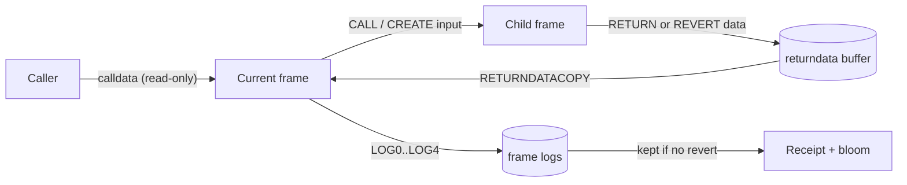

# 1.6 Calldata, returndata and logs

> [!abstract] In one minute
> - A call frame sees three byte buffers besides memory: **calldata** (read-only input), the **returndata buffer** (output of the last subcall or create), and **logs** (write-only output that ends up in the receipt).
> - `CALLDATALOAD`, `CALLDATACOPY` and `CODECOPY` never fail on out-of-range reads. They pad with zeros. `RETURNDATACOPY` is strict: reading past the end is an exceptional halt that burns all the frame's gas.
> - Each call-like opcode clears the returndata buffer and refills it with the callee's output. A successful `CREATE`/`CREATE2` leaves it empty; a failed one leaves the revert data.
> - `LOGn` costs 375 gas + 375 per topic + 8 per data byte + memory expansion. Topics are 32-byte words; at most four. `LOG` is forbidden under `STATICCALL`. Logs from a reverted frame disappear with it.
> - Contracts cannot read logs. Off-chain indexers read them via receipts and the 2,048-bit bloom filter. Indexed `string`, `bytes`, arrays and structs are stored as a keccak256 hash, so the value cannot be recovered from the topic.
> - The short-address attack exploited calldata zero-padding. Since Solidity 0.5.0 the ABI decoder reverts when calldata is too short.

**Prerequisites:** [[1.3 Execution model]], [[1.4 Memory]] · **Leads to:** [[2.5 ABI encoding and decoding]], [[3.7 External calls in assembly]], [[3.8 ABI, errors and events by hand]]

## Three buffers around a frame

Think of a call frame as a function in a sandbox. It has scratch memory ([[1.4 Memory]]), a stack, and persistent storage ([[1.5 Storage and transient storage]]). It also has three byte buffers that connect it to the outside world:

| Buffer | Direction | Who writes it | Lifetime | Read with |
|---|---|---|---|---|
| Calldata | In | The caller (transaction `data`, or the input range of a `CALL`) | Whole frame, immutable | `CALLDATALOAD`, `CALLDATASIZE`, `CALLDATACOPY` |
| Returndata buffer | In (from children) | The most recent subcall or create made by this frame | Until the next call-like opcode in this frame | `RETURNDATASIZE`, `RETURNDATACOPY` |
| Logs | Out | This frame, via `LOG0`–`LOG4` | Kept only if this frame and every ancestor succeed; then stored in the transaction receipt | Nothing on-chain; only off-chain readers |



The asymmetry matters. Calldata is forgiving: read anywhere, get zeros. Returndata is strict: read out of range and you die. Logs are a one-way street: the EVM can write them but never read them back.

## Calldata

### What it is

Calldata is the input byte array of the current frame. For the top-level frame it is the transaction's `data` field. For a subcall it is the memory range the caller passed to `CALL`, `STATICCALL`, `DELEGATECALL` or `CALLCODE`. It cannot be changed by the frame. In Solidity it is `msg.data`.

Calldata has no structure at the EVM level. The ABI (4-byte selector, then 32-byte words) is a convention that compilers impose on top; see [[2.5 ABI encoding and decoding]].

### Zero padding

`CALLDATALOAD(i)` pushes the 32 bytes starting at byte `i`. Any byte at or past `CALLDATASIZE` reads as zero. The offset can be any 256-bit number, even `2**256 - 1`. There is no failure mode. The execution specs implement this with a helper literally named `buffer_read`, which slices the buffer and right-pads with zero bytes.

`CALLDATACOPY(destOffset, offset, size)` copies `size` bytes into memory with the same rule: missing bytes become zeros. `CODECOPY` does the same over the running code. Both pay memory expansion for the destination, which is where the real cost of a huge copy lives.

Verified on py-evm (Prague) with calldata `0xaabbcc`:

```text
CALLDATALOAD(0)          -> aabbcc00...00
CALLDATALOAD(1)          -> bbcc0000...00
CALLDATALOAD(3)          -> 00...00        (exactly at the end)
CALLDATALOAD(1000)       -> 00...00
CALLDATALOAD(2**256-1)   -> 00...00        (no error)
CALLDATACOPY(0, 2, 32)   -> memory[0..32] = cc000000...00
CODECOPY(0, 0, 32) on 12-byte code -> the 12 code bytes, then 20 zero bytes
```

Zero padding is the root of the short-address attack (see [[#Pitfalls and incidents]]). It also means a hand-written decoder that skips the length check reads "missing" arguments as zero instead of failing.

### Calldata versus msg.data versus bytes calldata

- `msg.data` is the whole calldata, including the 4-byte selector. `msg.sig` is its first four bytes.
- A `bytes calldata` parameter is a pointer (offset and length) into calldata. Nothing is copied until you convert it to `memory`. Since Solidity 0.6.0 you can slice it: `blob[4:]` is another calldata pointer, no copy. Slices exist only for calldata arrays.
- `calldata` parameters are read-only, so they are cheaper than `memory` copies for large inputs that you only read. See [[2.2 Data locations]].

### Pricing (bridge)

Calldata is paid for in the transaction's intrinsic gas: 4 gas per zero byte and 16 per non-zero byte, with the EIP-7623 floor of 10/40 since Pectra. EIP-7976, scheduled for Glamsterdam, raises the floor to 64 gas per byte for both. The full model is in [[1.2 Transactions and fees]]. Inside the EVM, reading calldata is cheap: 3 gas per `CALLDATALOAD`.

## The returndata buffer

### Why it exists

Before Byzantium (16 Oct 2017), `CALL` wrote the callee's output into a memory range the caller chose up front. If the output was larger, it was cut off. If it was smaller, the rest of the range kept stale bytes, and the caller could not tell. Returning a dynamic `string` across contracts was effectively impossible.

EIP-211 added a per-frame **returndata buffer** and two opcodes. It shipped with EIP-140 (`REVERT`, which returns data on failure) and EIP-214 (`STATICCALL`). Together they made "call, then inspect whatever came back" the normal pattern.

### Lifecycle

Each new frame starts with an empty buffer. Every call-like opcode clears it before executing, then fills it with the child's output. "Call-like" means `CALL`, `CALLCODE`, `DELEGATECALL`, `STATICCALL`, `CREATE` and `CREATE2`.

| Event in this frame | Returndata buffer afterwards |
|---|---|
| Frame just started | Empty |
| Subcall returned with `RETURN` | The returned bytes |
| Subcall reverted with `REVERT` | The revert data (for example, an encoded custom error) |
| Subcall hit an exceptional halt (out of gas, invalid opcode, bad jump) | Empty |
| Call did not create a frame (insufficient balance for the value, depth limit) | Empty |
| Call to an account with no code | Empty (the frame runs and returns nothing) |
| `CREATE`/`CREATE2` succeeded | **Empty** (the deployed code is not in the buffer) |
| `CREATE`/`CREATE2` reverted | The revert data from the initcode |

Verified on py-evm: after a call returning 64 bytes `RETURNDATASIZE` was 64; after a call reverting with 4 bytes it was 4; after a call to a codeless account it was 0. A successful `CREATE` (preceded by a call that left 64 bytes) reset it to 0; a reverting `CREATE` left 4. The execution specs (Osaka `system.py`) set `evm.return_data = b""` on create success and `child_evm.output` otherwise.

The buffer persists until the next call-like opcode. You can call, do other work, and copy the data later. A Solidity `try`/`catch` relies on exactly this.

### Strict bounds

`RETURNDATACOPY(destOffset, offset, size)` checks `offset + size <= RETURNDATASIZE`. If the sum is larger, or overflows, the frame stops with an exceptional halt. EIP-211 words it as "the current call stops in an out-of-gas condition". The execution specs raise `OutOfBoundsRead`, a subclass of `ExceptionalHalt`, whose docstring says the halt ends execution "with all gas being consumed". Like any exceptional halt, the frame's state changes and logs are rolled back and its output is empty.

Two edge cases from EIP-211, both verified:

```text
returndata empty, RETURNDATACOPY(0, 0, 0) -> ok, 12 gas used (3 pushes + 3)
returndata empty, RETURNDATACOPY(0, 0, 1) -> OutOfBoundsRead, all 100,000 gas consumed
returndata empty, RETURNDATACOPY(0, 1, 0) -> OutOfBoundsRead (zero bytes, but offset is past the end)
```

Note the order in the spec: gas (including memory expansion) is charged first, then the bounds check. So an out-of-bounds copy can fail with a plain out-of-gas if the memory cost is too high, and with `OutOfBoundsRead` otherwise. Either way the frame loses everything.

> [!tip] Why the asymmetry?
> Calldata is fixed before the frame runs, so zero-padding is harmless. The returndata buffer changes during execution, and a lenient read would silently return zeros for a stale or missing result. EIP-211 chose to fail loudly.

> [!info]- Deep dive: RETURNDATASIZE as a cheap zero
> At the start of a frame, before any call, `RETURNDATASIZE` is guaranteed to push 0 for 2 gas. Before Shanghai added `PUSH0`, this was the cheapest way to push zero, which is why the EIP-1167 minimal proxy bytecode (`363d3d373d3d3d363d73…`) is full of `3d`. After Shanghai, `PUSH0` (also 2 gas) is clearer. The trick breaks as soon as a call has happened.

### Returndata bombs (bridge)

A callee chooses how much it returns. If the caller copies all of it into memory, the caller pays the memory expansion, which is quadratic. Solidity's `(bool ok, ) = t.call(data)` still copies the full buffer even though the bytes are discarded.

Measured with a callee that returns 100,000 zero bytes, 50,000 gas forwarded:

| Caller pattern | Gas used (legacy) | Gas used (via-IR) |
|---|---|---|
| `(ok, ) = t.call{gas: 50_000}("")` | 69,499 | 69,369 |
| Assembly `call` with out size 0, then copy at most 32 bytes | 29,001 | 28,873 |

The difference is the caller's own memory expansion and copy cost for 3,125 words. The callee's cost is capped by the gas you forward; the caller's copy is not. With the 63/64 rule leaving the caller little gas after a big forward, a bomb can make the caller run out before it records the failure. Defences and the `ExcessivelySafeCall` style are in [[3.7 External calls in assembly]] and [[5.7 Denial of service and griefing]].

## Opcode reference

Gas below is the Osaka schedule; none of these costs has changed since the opcode was introduced. "Copy" means 3 gas per 32-byte word, rounded up. "Mem" means memory expansion for the destination or source range ([[1.4 Memory]]).

| Opcode | Hex | Stack in → out | Gas | Edge behaviour |
|---|---|---|---|---|
| `CALLDATALOAD` | `0x35` | `i` → word | 3 | Bytes past the end read as zero; never fails |
| `CALLDATASIZE` | `0x36` | → size | 2 | |
| `CALLDATACOPY` | `0x37` | `dest, off, len` → | 3 + copy + mem | Zero-pads past the end; never fails on source range |
| `CODESIZE` | `0x38` | → size | 2 | Size of the code being executed |
| `CODECOPY` | `0x39` | `dest, off, len` → | 3 + copy + mem | Zero-pads past the end. Used to read constructor args and data appended to code |
| `RETURNDATASIZE` | `0x3d` | → size | 2 | 0 at frame start |
| `RETURNDATACOPY` | `0x3e` | `dest, off, len` → | 3 + copy + mem | `off + len > RETURNDATASIZE` is an exceptional halt; all frame gas consumed |
| `LOG0`–`LOG4` | `0xa0`–`0xa4` | `off, len, t1..tn` → | 375 + 375·n + 8·len + mem | Exceptional halt in a static context |

Verified gas by running bytecode: `LOG0` of 0 bytes = 375; `LOG3` of 32 bytes = 375 + 1,125 + 256 + 3 (memory) = 1,759; `LOG1` of 100 bytes = 375 + 375 + 800 + 12 (memory) = 1,562. Total frame gas matched these plus the `PUSH` costs.

## Logs

### Anatomy

A log entry has three fields: the emitting contract's **address** (`ADDRESS`, so under `DELEGATECALL` it is the proxy, not the implementation), a list of zero to four 32-byte **topics**, and an arbitrary-length **data** byte string taken from memory. `LOGn` pops `offset, size`, then `n` topics.

Topics are what nodes index. Data is cheap-ish bulk payload that you can only get after you have found the log.

### Gas

The execution specs charge `375 + 8 * size + 375 * num_topics + memory_expansion` in one step, before anything else. A topic costs as much as 46.875 bytes of data, so put a value in a topic only when someone needs to filter by it.

### When logs survive

Logs accumulate per frame. On success, the child's logs are appended to the parent's (`evm.logs += child_evm.logs` in the specs). On `REVERT` or an exceptional halt, the child's logs are discarded with its state changes. A transaction that fails at the top level has no logs in its receipt.

Verified: contract A calls B; B emits a log then reverts; A emits its own log and stops. Only A's log remained.

`LOG` is a state-modifying opcode for the purposes of EIP-214. Inside a `STATICCALL` context (at any depth), `LOGn` raises `WriteInStaticContext`, an exceptional halt. Verified: a `STATICCALL` with 50,000 gas into code that ran `LOG0` returned 0 and consumed all 50,000. This is why Solidity forbids `emit` in `view` functions.

### Receipts and the bloom filter

After each transaction, the client builds a receipt: success flag, cumulative gas used, the logs, and a **logs bloom**. The block header carries the OR of all receipt blooms. The receipts trie root in the header commits to every log.

The bloom is 2,048 bits (256 bytes). For each log, the address and each topic are added. Adding an item takes `keccak256(item)`, then the low 11 bits of each of the first three 16-bit pairs, and sets those three bits. Data bytes are never added. A client answering `eth_getLogs` can skip any block whose bloom lacks the bits for your address or topic. False positives are possible; false negatives are not.

Blooms are only a coarse filter. Busy blocks set so many bits that most queries match, so production indexers use their own databases rather than relying on blooms.

### Contracts cannot read logs

There is no opcode that reads a log, and the receipt does not exist until the transaction ends. A contract cannot even see logs it emitted a moment ago. If on-chain code needs a fact, store it. The Solidity docs note one escape hatch: an off-chain party can supply a Merkle proof of a receipt against a block header, and a contract can verify it, but `BLOCKHASH` only covers the last 256 blocks (see [[1.10 Block and chain context]]).

Logs are also not guaranteed to stay retrievable forever. Since 8 Jul 2025 all execution clients support dropping pre-Merge block bodies and receipts (partial history expiry). On-chain state is the source of truth; logs are a notification channel.

### Upcoming: protocol-emitted logs (Glamsterdam)

EIP-7708, scheduled for inclusion in Glamsterdam (Sepolia activated 6 Oct 2026, Hoodi 26 Oct 2026, mainnet date not yet set; the EIP is in Last Call until 1 Nov 2026), makes every non-zero ETH transfer emit a log. The log comes from the system address `0xffff…fffe`, uses the ERC-20 `Transfer(address,address,uint256)` topic0, and puts `from` and `to` in topics and the amount in data. Indexers that match `Transfer` by topic0 alone will start seeing these. Filter by emitting address.

## How Solidity maps events onto logs

### Topic 0 and the indexed values

For a normal event, topic0 is `keccak256` of the canonical signature, for example `keccak256("Transfer(address,address,uint256)") = 0xddf252ad1be2c89b69c2b068fc378daa952ba7f163c4a11628f55a4df523b3ef` (verified). Since 0.8.15 you can read it as `Transfer.selector`. Up to three parameters can be `indexed`; each fills one more topic. Everything else is ABI-encoded into data.

An indexed value type (`address`, `uintN`, `bool`, `bytesN`, …) goes in directly, padded to 32 bytes. Signed integers are sign-extended: an indexed `int8` of `-1` is `0xff…ff` (verified).

### Indexed dynamic and composite types

A topic holds one word. For `string`, `bytes`, arrays and structs, Solidity stores the keccak256 hash of a special **in-place encoding**, defined in the ABI spec:

| Type | Encoding hashed into the topic |
|---|---|
| `bytes`, `string` | The raw contents. No length prefix, no padding |
| Array (static or dynamic) | Concatenation of each element's encoding, each padded to a multiple of 32 bytes (even `bytes` and `string` elements), no length prefix |
| Struct | Concatenation of each member's encoding, each padded to a multiple of 32 bytes (even `bytes` and `string`) |
| `bytesNN` inside these | Right-padded |
| `uintNN`/`intNN` inside these | Left-padded; negative numbers sign-extended |

This is not `abi.encode`. It is closest to `abi.encodePacked` for a top-level string, but differs for arrays and structs because each element is padded to 32 bytes. Verified on a compiled contract:

```text
string  "hello"            -> keccak256("hello")
                              = 0x1c8aff950685c2ed4bc3174f3472287b56d9517b9c948127319a09a7a36deac8
bytes   0xaabbcc           -> keccak256(0xaabbcc)
uint16[] [1, 2]            -> keccak256(pad32(1) ++ pad32(2))
string[] ["ab", "c"]       -> keccak256("ab"++30 zero bytes ++ "c"++31 zero bytes)
Pair{uint256 a; string s}  -> keccak256(pad32(1) ++ "xyz"++29 zero bytes)
```

Two consequences:

1. **The value is gone.** An indexer can test "is topic1 equal to `keccak256("alice")`?" but cannot list which strings were emitted. If consumers need the value, emit it a second time as a non-indexed parameter.
2. **Collisions are possible.** The spec warns that the encoding of a struct with more than one dynamically sized array is ambiguous: different values can produce the same bytes. It says to re-check the event data rather than trusting a topic match.

### Anonymous events

`event E(...) anonymous;` drops topic0. That frees a slot, so an anonymous event may have four indexed parameters (`LOG4` with no signature). It saves 375 gas per emit. The price: you cannot filter by event name, only by address and topic values. The Solidity docs warn that an anonymous event can "fake" the signature of another event. Verified: an anonymous event whose first indexed argument is `Transfer.selector` produces a log byte-for-byte identical to a real ERC-20 `Transfer`.

> [!warning] Decoding needs the ABI
> A log stores no types. To decode it you must know the event, which parameters are indexed, and whether it is anonymous. ERC-20 and ERC-721 `Transfer` share the same topic0; they differ only in that ERC-721 indexes the third argument (`tokenId`), giving four topics instead of three. Indexers branch on topic count.

## Solidity and Yul in practice

### Events, indexed types and a hand-built Transfer

Compiles with 0.8.38. The Yul `log3` produces the same log as the Solidity `emit` (verified: identical address, topics and data). The full by-hand ABI treatment is in [[3.8 ABI, errors and events by hand]].

```solidity
// SPDX-License-Identifier: MIT
pragma solidity ^0.8.38;

contract EventLab {
    struct Pair { uint256 a; string s; }

    event Transfer(address indexed from, address indexed to, uint256 value);
    event IndexedString(string indexed s, string plain);   // hash in topic, value in data
    event IndexedPair(Pair indexed p);
    event Anon4(bytes32 indexed a, bytes32 indexed b, bytes32 indexed c, bytes32 indexed d) anonymous;

    function emitSome() external {
        emit IndexedString("hello", "hello");
        emit IndexedPair(Pair(1, "xyz"));
        emit Anon4(bytes32(uint256(1)), bytes32(uint256(2)), bytes32(uint256(3)), bytes32(uint256(4)));
    }

    function transferSol(address to, uint256 amount) external {
        emit Transfer(msg.sender, to, amount);
    }

    // Same Transfer log, built by hand.
    function transferYul(address to, uint256 amount) external {
        assembly ("memory-safe") {
            mstore(0x00, amount)                       // data = abi.encode(amount), in scratch space
            log3(
                0x00, 0x20,                            // memory offset, size
                0xddf252ad1be2c89b69c2b068fc378daa952ba7f163c4a11628f55a4df523b3ef, // topic0
                caller(),                              // topic1: from
                and(to, 0xffffffffffffffffffffffffffffffffffffffff) // topic2: to, upper bits cleaned
            )
        }
    }
}
```

Points to notice:

- `log3(offset, size, t1, t2, t3)` takes the memory range first, then topics. The data comes from memory, so you must `mstore` it first. Scratch space (`0x00`–`0x3f`) is safe for up to 64 bytes ([[2.4 Memory layout]]).
- Always clean address topics. A dirty upper 96 bits makes a different topic, and every indexer filtering by `to` will miss the log ([[3.9 Cleanup, dirty bits and safety]]).
- Hand-written assembly did not win here: the measured frame gas was 2,103 for `transferSol` and 2,128 for `transferYul`. The optimizer already emits a tight `LOG3`.

### Reading calldata safely

```solidity
// SPDX-License-Identifier: MIT
pragma solidity ^0.8.38;

contract CalldataLab {
    function info(address to, uint256 amount)
        external pure returns (uint256 len, bytes4 sel, address a, uint256 v)
    {
        return (msg.data.length, msg.sig, to, amount);
    }

    // A calldata slice is a pointer into calldata. No copy until `rest` is converted to memory.
    function head(bytes calldata blob) external pure returns (bytes4 sel, bytes memory rest) {
        sel = bytes4(blob[:4]);
        rest = blob[4:];
    }
}
```

Behaviour of the 0.8.38 ABI decoder on `info(address,uint256)`, verified:

| Calldata sent | Result |
|---|---|
| 68 bytes (selector + 2 words) | Decodes; `msg.data.length` = 68 |
| 67 bytes (one byte short) | Reverts, empty revert data |
| 69 bytes (one extra byte) | Decodes; extra byte ignored, `msg.data.length` = 69 |
| Address word with a non-zero byte in the top 12 bytes | Reverts (value does not fit `address`) |

The decoder checks that calldata is at least as long as the static head, that offsets and lengths of dynamic data stay inside `calldatasize()`, and (ABI coder v2, the default since 0.8.0) that each value fits its type. It does not reject trailing bytes. Some systems append data on purpose (for example ERC-2771 appends the original sender).

### Copying only the returndata you want

```solidity
// SPDX-License-Identifier: MIT
pragma solidity ^0.8.38;

contract BoundedCaller {
    function bounded(address t) external returns (bool ok, bytes32 head) {
        assembly ("memory-safe") {
            ok := call(50000, t, 0, 0, 0, 0, 0)   // out size 0: nothing is written to memory
            let n := returndatasize()
            if gt(n, 32) { n := 32 }              // cap the copy; never read past the end
            mstore(0x00, 0)
            returndatacopy(0x00, 0, n)
            head := mload(0x00)
        }
    }
}
```

Capping `n` with `returndatasize()` both prevents a returndata bomb and avoids the out-of-bounds halt.

## Pitfalls and incidents

| Date | Issue | What happened | Lesson |
|---|---|---|---|
| 13 Nov 2018 | Solidity 0.5.0 | Decoder starts reverting on too-short calldata and out-of-bounds offsets; also applies to `abi.decode` | The compiler, not each contract, owns length checks |
| 28 Jun 2017 | `onlyPayloadSize` breaks | CoinFabrik shows the exact-length `msg.data.length == size + 4` check rejects legitimate calls forwarded by the Parity multisig, which padded calldata | Exact-length checks are fragile; validate at the client and in the decoder |
| Apr 2017 | Short-address attack | Golem's team found exchanges that built `transfer` calldata from user-supplied addresses without validating length | Never build calldata from unvalidated input |

Other footguns:

> [!warning] Unbounded `RETURNDATACOPY` in assembly
> `returndatacopy(0, 0, 32)` after a call that returned fewer than 32 bytes (or reverted with nothing, or hit a codeless address) is an exceptional halt that burns all remaining gas. Always copy `min(returndatasize(), want)` or check `returndatasize()` first. This catches people integrating non-standard ERC-20s that return nothing ([[5.10 Token integration]]).

> [!warning] Stale returndata
> The buffer reflects the last call-like opcode only. A successful `CREATE` clears it. Code that does `create` and then reads "the result" from returndata reads nothing. Code that calls A, then B, then copies "A's error" gets B's output.

> [!warning] Logs as a security signal
> Anyone can emit any log from their own contract, including perfect fakes of `Transfer` via anonymous events. Off-chain systems (bridges, exchanges, airdrop scripts) must check the emitting address and, ideally, confirm against state. A deposit detector that matches topic0 alone is exploitable. After EIP-7708, system-address `Transfer` logs add another source to filter.
## Question ladder

> [!question]- **B** Can a contract read events emitted earlier?
> No. There is no opcode that reads logs, not even the current transaction's or the contract's own. Logs are written to a per-frame list that becomes part of the receipt only after the transaction finishes. The EVM has no access to receipts of earlier transactions or blocks either.
>
> What a contract can do:
> - **Store the fact.** If on-chain logic needs to know something happened, write it to storage (or transient storage within one transaction). Events are notifications for off-chain readers, not memory.
> - **Verify a proof.** Someone off-chain can supply a receipt plus a Merkle-Patricia proof against a block's `receiptsRoot`, and the block header. The contract checks the header hash with `BLOCKHASH`, which only covers the last 256 blocks. Beyond that you need a header oracle or a historical-hash mechanism. Receipt proofs are how some bridges and light clients work ([[5.12 Cross-chain and bridges]]).
>
> An interviewer listens for "events are write-only from the EVM's point of view" and "if contract logic needs it, store it".

> [!question]- **I** What happens when CALLDATALOAD reads past calldata, and when RETURNDATACOPY does?
> **`CALLDATALOAD`** never fails. It reads 32 bytes starting at the offset, and any byte at or past `CALLDATASIZE` is zero. With calldata `0xaabbcc`, `CALLDATALOAD(1)` returns `0xbbcc` followed by 30 zero bytes, and `CALLDATALOAD(2**256 - 1)` returns zero. `CALLDATACOPY` and `CODECOPY` follow the same zero-padding rule. Cost: 3 gas for the load; 3 + 3 per word + memory expansion for the copies.
>
> **`RETURNDATACOPY`** is strict. If `offset + size` exceeds `RETURNDATASIZE`, or overflows, the frame takes an exceptional halt. EIP-211 calls it "an out-of-gas condition"; the execution specs raise `OutOfBoundsRead`. All gas given to the frame is consumed, its state changes and logs are rolled back, and the caller sees failure with empty returndata. Even a zero-length copy fails if the offset is past the end: `RETURNDATACOPY(0, 1, 0)` on an empty buffer halts, while `RETURNDATACOPY(0, 0, 0)` succeeds. Gas and memory expansion are charged before the bounds check.
>
> Why the difference: calldata is fixed before execution, so padding is harmless. The returndata buffer changes after every call and create, so a silent zero read would hide bugs like reading a stale or missing result.
>
> Practical rule: in assembly, read `returndatasize()` and copy `min(size, want)`.

> [!question]- **I** How are indexed dynamic types (string, bytes, arrays) stored in topics?
> A topic is one 32-byte word, so Solidity stores `keccak256` of a special in-place encoding, not the value:
> - `string` and `bytes`: hash of the raw bytes, with no length prefix and no padding. An indexed `"hello"` is `keccak256("hello")`.
> - Arrays (static or dynamic): hash of the concatenation of the elements, each padded to a multiple of 32 bytes, no length prefix. `uint16[] [1, 2]` hashes two 32-byte words. `string[] ["ab", "c"]` hashes `"ab"` padded to 32 bytes followed by `"c"` padded to 32 bytes.
> - Structs: hash of the members' encodings concatenated, each padded to a multiple of 32 bytes.
> - Inside these, `uintN`/`intN` are left-padded (negatives sign-extended) and `bytesN` right-padded.
>
> I verified each of these against a contract compiled with 0.8.38.
>
> Consequences: you can filter for an exact known value by hashing it the same way, but you cannot recover or list the values from topics. The encoding is not `abi.encode`, so naive off-chain code that hashes `abi.encode(array)` will never match. Structs with two or more dynamic arrays have ambiguous encodings, so a match is not proof; check the data. If consumers need the value, also emit it as a non-indexed field (`event IndexedString(string indexed s, string plain)`), paying 8 gas per byte for the copy.

> [!question]- **A** How do you design events for indexers: topic choice, versioning, anonymous events with four topics?
> **Start from the queries.** Topics exist so a node can find logs without scanning data. Index the fields people filter by: account addresses, token or market ids, order ids, a referral or pool key. Leave amounts, prices and timestamps in data; nobody filters "amount == 1,234,567". You get three indexed slots (four for anonymous events), and each costs 375 gas versus 8 per data byte.
>
> **Dynamic types.** An indexed `string` becomes a hash. Good for exact-match filters on known keys ("all events for ENS name X"), useless for discovery. If both are needed, emit the value in data as well, or index a `bytes32` id and keep the string in data.
>
> **Emit complete, self-describing records.** Indexers should be able to rebuild state from events alone. Emit after the state change, on every path that changes state, with the final values (new balance, new shares) or unambiguous deltas. Include an id or nonce so consumers can de-duplicate across reorgs. Emit from the contract that holds the state; under a proxy the address is the proxy, which is what you want.
>
> **Versioning.** Changing an event's parameters changes its signature and topic0. Old decoders silently ignore the new event instead of misparsing it, which is the safe failure. Make that explicit with a new name (`DepositV2`) rather than reusing a name with different fields (overloaded events with the same name and different types are legal but confuse tooling). Keep emitting the old event during a migration window if downstream systems depend on it. Do not put a `version` field in data and expect indexers to branch on it; topic0 is the only thing every indexer reads.
>
> **Large data.** Logs cost 8 gas per byte plus memory expansion, and the bytes often already sit in calldata. Emit `keccak256(blob)` (indexed, so it is searchable) plus a pointer such as a URI or the transaction itself. Indexers can fetch the calldata from the transaction if they need the blob. Never emit unbounded arrays in a loop; it is a gas DoS vector.
>
> **Anonymous events with four topics.** Use them when you need four filterable fields or must shave 375 gas on a very hot path, and when consumers already filter by emitting address. Uniformity helps: a single contract with one anonymous event layout is easy to index. The cost: no name-based filtering, no self-description, explorers show raw topics, and any contract can emit an identical log (the first indexed argument can even equal another event's selector). Never let off-chain systems accept anonymous logs without checking the address.
>
> Example layout (compiles with 0.8.38):
>
> ```solidity
> // SPDX-License-Identifier: MIT
> pragma solidity ^0.8.38;
>
> interface IVaultEvents {
>     event Deposit(address indexed account, uint256 indexed marketId, uint256 assets, uint256 shares);
>     // New fields, new name, new topic0. Old decoders skip it instead of misreading it.
>     event DepositV2(address indexed account, uint256 indexed marketId, bytes32 indexed referral,
>                     uint256 assets, uint256 shares, uint64 nonce);
>     // Large blob: index its hash, keep a pointer in data.
>     event ConfigUpdated(bytes32 indexed configHash, string uri);
> }
> ```
>
> What an interviewer listens for: queries drive topic choice; topic0 is the version; events must allow full state reconstruction; anonymous events trade discoverability and spoof-resistance for one topic and 375 gas; off-chain consumers must authenticate the emitter.

> [!question]- **E** What was the short-address attack, and why does modern ABI decoding prevent it?
> **Mechanism.** `transfer(address,uint256)` calldata is 4 + 32 + 32 = 68 bytes. The address sits right-aligned in the first word; the amount fills the second. Suppose a client builds calldata from a user-supplied address that is one byte short (19 bytes) and does not check its length. Every later byte shifts left by one, and the calldata is 67 bytes. The EVM zero-pads `CALLDATALOAD`, so:
> - the address word now ends with the first byte of the amount word. That byte is the amount's high byte, almost always `0x00`. The attacker picks a vanity address ending in `00`, so the decoded recipient is exactly the attacker's address.
> - the amount is read one byte early with a zero appended, so it is multiplied by 256. A withdrawal of 2 tokens decodes as 512 (Eric Rafaloff's worked example).
>
> **History.** The Golem team described it in April 2017 after finding exchanges that built token-withdrawal calldata from unvalidated addresses. The fault was in the client (the exchange), but the contract and EVM let it through silently. Projects added `onlyPayloadSize` modifiers that required `msg.data.length == size + 4`. In June 2017 CoinFabrik showed these broke legitimate calls, for example from the Parity multisig, which forwarded padded calldata, and broke calls between contracts. They recommended removing the modifier and fixing validation at the exchange.
>
> **Why it is dead in Solidity.** Since 0.5.0 (13 Nov 2018) the ABI decoder "reverts at runtime if calldata is too short or points out of bounds", including in `abi.decode`. I checked 0.8.38: 67 bytes to `info(address,uint256)` reverts, 69 bytes decodes (trailing data is allowed, deliberately), and an address word with dirty upper bytes reverts because ABI coder v2 (default since 0.8.0) checks that each value fits its type. On the client side, modern libraries encode from typed values and refuse an address that is not 20 bytes, and EIP-55 checksums catch many typos.
>
> **Where it still bites (the expert part).**
> - Hand-written decoders in assembly, Huff or raw bytecode that use `calldataload` without checking `calldatasize()`. Zero-padding means missing arguments read as zero, not as an error ([[3.12 Beyond Yul - Huff and raw bytecode]]).
> - Packed or compressed calldata formats (L2 gas optimizations, custom routers, `abi.encodePacked` payloads decoded by hand). Without 32-byte alignment, the decoder must check every length itself.
> - Contracts that read trailing calldata as data (ERC-2771 appended sender, Clones-with-immutable-args). These accept extra bytes on purpose, so a short or long payload must be validated by the contract's own logic.
> - Off-chain services that build calldata from strings. Validation is still the client's job.
>
> An interviewer wants three things: the shift-and-multiply mechanism, the role of `CALLDATALOAD` zero-padding, and the observation that the fix moved into the decoder (length and range checks) rather than into each contract.

## Related notes

- [[1.2 Transactions and fees]] — how calldata bytes are priced (4/16, EIP-7623 floor, EIP-7976).
- [[1.3 Execution model]] — frames, exceptional halts and what "all gas consumed" means.
- [[1.4 Memory]] — memory expansion, which dominates the cost of large copies and logs.
- [[1.7 Message calls and precompiles]] — the call-like opcodes that fill the returndata buffer, and `STATICCALL`.
- [[1.8 Contract creation]] — why a successful `CREATE` leaves the buffer empty; `CODECOPY` of constructor arguments.
- [[1.10 Block and chain context]] — `BLOCKHASH` window for verifying receipt proofs.
- [[2.5 ABI encoding and decoding]] — the calldata layout and decoder validation in full.
- [[2.8 Errors and reverts]] — revert data that lands in the returndata buffer.
- [[3.7 External calls in assembly]] — bounded returndata copies and returndata bombs.
- [[3.8 ABI, errors and events by hand]] — building logs and errors in Yul.
- [[3.9 Cleanup, dirty bits and safety]] — cleaning address topics.
- [[5.7 Denial of service and griefing]] — returndata bombs and unbounded event loops.
- [[5.10 Token integration]] — tokens that return nothing and unsafe `returndatacopy`.

## Sources

- [EIP-211: RETURNDATASIZE and RETURNDATACOPY](https://eips.ethereum.org/EIPS/eip-211) — buffer lifecycle, CREATE behaviour, out-of-bounds "out-of-gas condition", zero-length edge cases, gas.
- [ethereum/execution-specs, Osaka fork](https://github.com/ethereum/execution-specs) — `vm/instructions/log.py` (LOG gas formula, static check), `environment.py` (`buffer_read` zero-padding, `returndatacopy` bounds check), `system.py` (returndata after CALL/CREATE), `exceptions.py` (`OutOfBoundsRead`, `WriteInStaticContext` are `ExceptionalHalt`), `interpreter.py` (halt sets gas left to 0), `bloom.py` (bloom construction), `gas.py` (constants), `transactions.py` (calldata token costs). Read from a local clone on 29 Oct 2026.
- [Solidity ABI specification](https://docs.soliditylang.org/en/latest/abi-spec.html) — events, indexed parameter encoding, struct ambiguity warning, strict mode note.
- [Solidity docs: Events (source)](https://github.com/argotorg/solidity/blob/develop/docs/contracts/events.rst) — logs not accessible from contracts, Merkle proofs, anonymous events and signature faking, `event.selector`.
- [Solidity Changelog](https://github.com/argotorg/solidity/blob/develop/Changelog.md) — 0.5.0 short-calldata revert, 0.6.0 calldata slices, 0.8.0 ABI coder v2 default, 0.8.15 `E.selector`.
- [EIP-7708: ETH transfers emit a log](https://eips.ethereum.org/EIPS/eip-7708) — system address, Transfer topic, Last Call status.
- [EIP-7773: Glamsterdam meta](https://eips.ethereum.org/EIPS/eip-7773) — EIP-7708 and EIP-7976 scheduled; Sepolia and Hoodi activation timestamps.
- [EIP-7976: Increase calldata floor cost](https://eips.ethereum.org/EIPS/eip-7976) — 64 gas per byte floor.
- [EIP-7904](https://eips.ethereum.org/EIPS/eip-7904) — confirms no change to LOG or copy opcode costs.
- [Partial history expiry (EF blog, 8 Jul 2025)](https://blog.ethereum.org/2025/07/08/partial-history-exp) — clients may prune pre-Merge bodies and receipts.
- [Eric Rafaloff, Analyzing the ERC20 Short Address Attack](https://ericrafaloff.com/analyzing-the-erc20-short-address-attack/) — mechanism, worked example (2 becomes 512), Golem April 2017 origin.
- [CoinFabrik, Smart Contract Short Address Attack Mitigation Failure](https://www.coinfabrik.com/blog/smart-contract-short-address-attack-mitigation-failure/) — `onlyPayloadSize` breaking multisig and internal calls, 28 Jun 2017.
- Local verification: py-evm 0.12.1b1 (Prague) runs of raw bytecode and contracts compiled with solc-js 0.8.38 (CALLDATALOAD/CALLDATACOPY/CODECOPY padding, RETURNDATACOPY halts, LOG gas, returndata after CALL/CREATE, LOG under STATICCALL, log rollback, indexed topic encodings, anonymous spoof, decoder length checks, returndata bomb gas).
