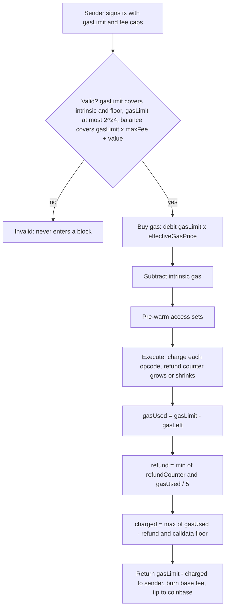

# 1.9 Gas accounting

> [!abstract] In one minute
> - A transaction buys a gas budget up front (`gasLimit`). It pays **intrinsic gas** (21,000 base + calldata + access list + creation + authorizations) before any opcode runs, then **execution gas** per opcode, then gets **refunds** (capped at 1/5 of gas used, EIP-3529). Since Prague, the total can never fall below the **calldata floor** (EIP-7623). Unused gas goes back to the sender.
> - Opcode costs have a **static** part (tiers: 0, 2, 3, 5, 8, 10) and a **dynamic** part: memory expansion, copy size, hash size, exponent bytes, log data, and above all **state access**.
> - EIP-2929 (Berlin): first touch of an address costs 2,600, first touch of a storage slot 2,100; every later touch in the same transaction costs 100. The "warm" sets start with `tx.origin`, `tx.to`, all precompiles, the coinbase (EIP-3651) and any access-list entries.
> - A calling frame can forward at most all but 1/64 of its gas (EIP-150). This is why a relayer must check `gasleft()` after a call it made on someone's behalf.
> - Mainnet today: block gas limit 60,000,000; per-transaction cap 16,777,216 (2^24, EIP-7825, Fusaka). Glamsterdam proposes large repricings (EIP-8037, EIP-8038 and others). Hardcoded gas numbers break when forks reprice.

**Prerequisites:** [[1.2 Transactions and fees]], [[1.3 Execution model]] · **Leads to:** [[4.10 Gas optimization]], [[5.7 Denial of service and griefing]], [[1.11 Hard forks that changed contract code]]

## Why gas exists

Every node re-executes every transaction. Gas is the meter that turns "how much work does this cost the network" into a number the sender pays for. It does three jobs:

1. **Halting.** The EVM is Turing complete, so you cannot know in advance if code ends. A finite gas budget forces it to end.
2. **Pricing resources.** Compute, memory, state reads, state writes, and data all cost different amounts. Gas prices are meant to track the real cost to a node. When they drift from reality (a slow opcode that is cheap), the result is a denial-of-service vector, and a hard fork reprices it.
3. **Capacity.** The block gas limit caps how much work one block can contain.

Gas units are not ETH. The price per unit is set by the fee market (base fee plus priority fee), covered in [[1.2 Transactions and fees]]. This note is about the **units**: how many get charged, when, and why.

## The gas lifecycle of a transaction



The same steps appear in the execution specs (`process_transaction` in `forks/osaka/fork.py`):

```text
gas            = tx.gas - intrinsic.regular            # what execution starts with
used_before    = tx.gas - gas_left_after_execution
refund         = min(used_before // 5, refund_counter)  # EIP-3529 cap
used_after     = max(used_before - refund, calldata_floor)  # EIP-7623 floor
returned_to_sender = (tx.gas - used_after) * effective_gas_price
tip_to_coinbase    = used_after * (effective_gas_price - base_fee)
block.gas_used    += used_after
```

### Intrinsic gas

Intrinsic gas is charged before the first opcode. If the gas limit cannot cover it, the transaction is invalid and cannot be included at all. Values below are current for Osaka (verified against `forks/osaka/vm/gas.py`):

| Component | Cost | Introduced by |
|---|---|---|
| Base cost | 21,000 | Frontier |
| Calldata, per zero byte | 4 | Frontier |
| Calldata, per nonzero byte | 16 | EIP-2028 (Istanbul, was 68) |
| Contract creation | 32,000 + 2 per 32-byte word of initcode | Homestead; EIP-3860 (Shanghai) for the word cost |
| Access list, per address | 2,400 | EIP-2930 (Berlin) |
| Access list, per storage key | 1,900 | EIP-2930 (Berlin) |
| EIP-7702 authorization, per tuple | 25,000 (12,500 refunded if the authority account already exists) | EIP-7702 (Prague) |

### The calldata floor (EIP-7623)

Since Prague (7 May 2025), calldata-heavy transactions pay a floor. Define `tokens = zero_bytes + 4 × nonzero_bytes`. The standard cost of calldata is `4 × tokens`. The floor is `21,000 + 10 × tokens`. The transaction pays the larger of (standard intrinsic + execution − refund) and the floor. The gas limit must be at least the floor, or the transaction is invalid.

Worked example: 1,000 nonzero bytes with almost no execution. Standard: 21,000 + 4 × 4,000 = 37,000. Floor: 21,000 + 10 × 4,000 = 61,000. The sender pays 61,000. A normal ERC-20 `transfer` (68 bytes of calldata, 158 tokens) has a floor of 22,580 and is far above it, so the floor only bites data-posting transactions. Note that refunds are subtracted **before** the floor is applied, so refunds cannot push a transaction below the floor.

### Refunds (EIP-3529)

Some operations add to a **refund counter** instead of costing less up front. Today the only real sources are SSTORE (clearing a slot, or restoring a slot to its value at the start of the transaction) and the EIP-7702 refund for authorities that already exist. SELFDESTRUCT refunds were removed by EIP-3529 (London, 5 Aug 2021). The same EIP lowered the cap from 1/2 to **1/5** of gas used and cut the clear refund from 15,000 to **4,800**. That killed GasToken, which minted storage when gas was cheap and cleared it for refunds when gas was expensive.

The refund is paid at the end of the transaction, not at the SSTORE. So it never helps you survive an out-of-gas inside the transaction. If a frame reverts, its refunds are discarded with its state changes.

### What the payer pays

The sender is debited `gasLimit × effectiveGasPrice` (plus blob fees) before execution. After execution they get back `(gasLimit − charged) × effectiveGasPrice`. Of the charged amount, the base fee part is burned and the priority part goes to the coinbase. Setting a generous gas limit costs nothing extra if the transaction succeeds, but an out-of-gas failure burns the whole limit. In ERC-4337 or EIP-7702 sponsored flows, the transaction sender (bundler or relayer) still pays the protocol; the user reimburses them inside execution. See [[4.5 Account abstraction and smart wallets]].

## Opcode costs: static tiers

Most opcodes have a fixed cost from a small set of tiers. Examples below were checked in `forks/osaka/vm/gas.py` and in a py-evm trace.

| Tier | Gas | Examples |
|---|---|---|
| zero | 0 | STOP, RETURN, REVERT |
| jumpdest | 1 | JUMPDEST |
| base | 2 | ADDRESS, CALLER, CALLVALUE, CALLDATASIZE, GAS, POP, PUSH0 |
| verylow | 3 | ADD, SUB, LT, EQ, ISZERO, AND, SHL, PUSH1–32, DUP, SWAP, MLOAD, MSTORE, CALLDATALOAD |
| low | 5 | MUL, DIV, MOD, SIGNEXTEND, SELFBALANCE, CLZ (Osaka) |
| mid | 8 | ADDMOD, MULMOD, JUMP |
| high | 10 | JUMPI |
| other fixed | 20 / 100 | BLOCKHASH 20; TLOAD and TSTORE 100 |

Stack work is cheap. In the ERC-20 transfer measured below, about 220 stack, jump and arithmetic opcodes cost 733 gas in total, while four storage operations cost 10,000. Optimizing arithmetic rarely matters; optimizing state access always does.

## Opcode costs: dynamic components

| Component | Formula | Notes |
|---|---|---|
| Memory expansion | total cost for `a` words = `3a + a²/512`; you pay the increase | 1 KiB costs 98 total, 32 KiB 5,120, 1 MiB 2,195,456. Quadratic, so large memory is a hard wall. See [[1.4 Memory]]. |
| Copies (CALLDATACOPY, CODECOPY, RETURNDATACOPY, MCOPY, EXTCODECOPY) | 3 per word copied, plus expansion | EXTCODECOPY also pays account access. |
| KECCAK256 | 30 + 6 per word | Every mapping lookup costs one 64-byte hash: 42 gas. |
| EXP | 10 + 50 per byte of the exponent | A 32-byte exponent costs 1,610. |
| LOGn | 375 + 375 per topic + 8 per data byte | A `Transfer` event (LOG3, 32 bytes of data) is 1,756. See [[1.6 Calldata, returndata and logs]]. |
| Account access (BALANCE, EXTCODESIZE, EXTCODEHASH, EXTCODECOPY, CALL family) | 2,600 cold, 100 warm | EIP-2929. |
| SLOAD | 2,100 cold, 100 warm | EIP-2929. |
| SSTORE | see table below | EIP-2200 + EIP-2929 + EIP-3529. See [[1.5 Storage and transient storage]]. |
| CALL extras | +9,000 if value > 0 (callee gets a free 2,300 stipend); +25,000 if value goes to an empty account | See [[1.7 Message calls and precompiles]]. |
| CREATE / CREATE2 | 32,000 + 2 per initcode word (+6 per word for CREATE2 hashing) + 200 per deployed byte | See [[1.8 Contract creation]]. |

### SSTORE in one table

SSTORE compares three values: the **original** value (at the start of the transaction), the **current** value, and the **new** value. Add 2,100 if the slot is cold. Checked against `forks/osaka/vm/instructions/storage.py`:

| Case | Gas (warm) | Refund change |
|---|---|---|
| `new == current` (no-op) | 100 | none |
| `original == current`, original is 0 (fresh write, zero → nonzero) | 20,000 | none |
| `original == current`, original nonzero (first change of an existing value) | 2,900 | +4,800 if `new == 0` |
| `original != current` (slot already dirty in this transaction) | 100 | adjustments: undo a clear refund, or refund 19,900 / 2,800 when restoring the original |
| Any SSTORE with `gasleft() <= 2,300` | fails (out of gas) | EIP-2200 "stipend sentry" |

The last row is why a 2,300-gas stipend can never write storage. TSTORE (100 gas) has no sentry and can.

## Access sets: warm and cold (EIP-2929)

**Intuition.** The first time a transaction touches an account or a slot, a node may have to read it from disk through the state trie. After that it is in a cache. EIP-2929 (Berlin, 15 Apr 2021) prices that difference. Each transaction keeps two sets: `accessed_addresses` and `accessed_storage_keys`. Touching something not in the set costs the cold price and adds it. Touching something already in the set costs 100.

**Scope.** The sets live for one **transaction**, not one call frame and not one block. A second call inside the same transaction is warm. The same call in the next transaction is cold again. If a frame reverts, everything it added to the sets is removed again (the execution specs roll the sets back with the frame's state).

**What starts warm.** Checked against `forks/osaka/utils/message.py`, `fork.py` and `interpreter.py`:

| Pre-warmed entry | Rule |
|---|---|
| `tx.origin` (the sender) | EIP-2929 |
| `tx.to`, or the new contract's address for a creation transaction | EIP-2929 |
| All precompiles (0x01–0x11 and 0x100 P256VERIFY in Osaka) | EIP-2929, extended as new precompiles were added |
| The block's coinbase | EIP-3651 (Shanghai, 12 Apr 2023) |
| Every address and every (address, slot) pair in the EIP-2930 access list | EIP-2930 |
| EIP-7702 authorities in a type-4 transaction | EIP-7702, step 4 of authorization processing |
| The delegate of `tx.to`, if `tx.to` is a 7702-delegated EOA | added without charge when the top-level code is resolved |

Not pre-warmed: system contracts such as the beacon-roots and history contracts, and any storage slot (all slots start cold unless listed). When a contract CALLs a 7702-delegated account, the delegate costs an **extra** 2,600 cold or 100 warm on top of the account itself.

**Access lists.** EIP-2930 lets a transaction prepay: 2,400 per address and 1,900 per slot. Each later access then costs 100. So an entry saves exactly 100 per address (2,600 vs 2,400 + 100) and 200 per slot (2,100 vs 1,900 + 100), and only if it is actually used. Listing `tx.to` wastes 2,400 because it is warm anyway, and a slot can only be listed under its address. The real value of access lists is not the saving. It is that pre-warmed accesses cost 100 during execution, which can rescue a call that has a fixed gas budget, like a 2,300 stipend.

## The 63/64 rule and the GAS opcode

`GAS` (2 gas) pushes the gas remaining **after** paying for itself. Solidity exposes it as `gasleft()`.

EIP-150 (Tangerine Whistle, 18 Oct 2016) changed CALL so the caller can forward at most "all but one 64th": `available − floor(available / 64)`. If you ask for more, you silently get the maximum. Two consequences:

- **Depth is bounded by gas.** Each nesting level keeps 1/64 back, so gas decays geometrically. The old 1,024-depth attack stopped being practical.
- **A caller always survives its callee's out-of-gas.** With 1,000,000 gas available, the child gets at most 984,375. The parent keeps at least 15,625 to handle the failure.

The second point creates a griefing hole for **relayed calls**. A relayer submits a user's signed request that says "call target with `gas` G." If the relayer supplies too little total gas, the inner call gets less than G and fails out of gas. The outer call survives on its 1/64, marks the request as used, and the relayer may collect a fee. The defense is to check after the call: if the callee had less than G, then `gasleft()` after the call is below G / 63. OpenZeppelin's `ERC2771Forwarder` does this and uses `invalid()` to burn all gas, so the relayer loses money instead of the user. See [[5.7 Denial of service and griefing]].

## Block gas limit and per-transaction cap

| Limit | Value | How set |
|---|---|---|
| Block gas limit, mainnet | 60,000,000 (Etherscan, block 26,293,332, 28 Oct 2026) | Validators move it by at most 1/1024 of the parent's limit per block. EIP-7935 (Fusaka) set the client default to 60M. |
| Per-transaction gas cap | 16,777,216 (2^24) | EIP-7825, Fusaka (3 Dec 2025). A transaction with a higher gas limit is invalid; blocks containing one are invalid. |
| Gas target | half the block limit | Base fee rises above the target and falls below it ([[1.2 Transactions and fees]]). |

The per-transaction cap matters for contract design. Before Fusaka, one transaction could use a whole block. Now anything that needs more than about 16.7M gas (giant batch mints, large deployments with heavy constructors, unbounded loops over storage) must be split across transactions. A loop that "fits in a block" may no longer fit in a transaction.

## Solidity and Yul in practice

### Measuring gas with `gasleft()`, and why it lies

```solidity
// SPDX-License-Identifier: MIT
pragma solidity 0.8.38;

contract GasMeter {
    uint256 public x = 1;

    /// Naive: measure a storage read with gasleft().
    function naive() external view returns (uint256 first, uint256 second) {
        uint256 g0 = gasleft();
        uint256 a = x;
        uint256 g1 = gasleft();
        uint256 b = x;
        uint256 g2 = gasleft();
        first = g0 - g1;
        second = g1 - g2;
        if (a + b == 0) revert();
    }

    /// Assembly: measure BALANCE of an address, cold then warm.
    function coldWarm(address who) external view returns (uint256 cold, uint256 warm) {
        assembly {
            let g0 := gas()
            let b1 := balance(who)
            let g1 := gas()
            let b2 := balance(who)
            let g2 := gas()
            cold := sub(g0, g1)
            warm := sub(g1, g2)
            // Use the results, or the compiler may delete the reads.
            if eq(add(b1, b2), not(0)) { revert(0, 0) }
        }
    }
}
```

Measured in py-evm (Prague rules), compiled with solc 0.8.38:

| Build | `naive()` first / second | `coldWarm()` cold / warm |
|---|---|---|
| Legacy, optimizer on | 2,115 / 115 | 2,605 / 105 |
| Legacy, optimizer off | 2,118 / 118 | 2,605 / 105 |
| via-IR, optimizer on | 2,107 / **5** | 2,608 / 108 |
| Legacy, written as `pop(balance(who))` | n/a | **2 / 2** |

What the numbers teach:

- You always measure the operation **plus** the next GAS opcode (2) **plus** stack shuffling. The 5 to 18 gas of overhead depends on the compiler.
- via-IR saw that `x` cannot change between the reads and reused the first value. The "second read" cost 5 gas because there was no second SLOAD. ([[3.11 Compiler IR and the optimizer]])
- With `pop(balance(who))`, the compiler removed the side-effect-free read entirely, even with the optimizer off (the peephole pass always runs). You measured nothing.
- Warm and cold state depends on what ran earlier **in the transaction**, so the same function measures differently when called first or after a multicall.
- Gas consumed by the callee's memory expansion, refunds (paid only at the end), and the intrinsic cost are all invisible to `gasleft()` deltas.

For benchmarking, use Foundry gas reports or snapshots and a full transaction trace ([[6.1 Foundry essentials]], [[6.6 Debugging and tracing]]), not in-contract `gasleft()` maths.

### Seeing warm vs cold from inside a contract

```solidity
// SPDX-License-Identifier: MIT
pragma solidity 0.8.38;

interface IERC20Like {
    function balanceOf(address) external view returns (uint256);
}

/// Measures the same external call twice in one transaction.
contract Probe {
    function twice(IERC20Like token, address who)
        external
        view
        returns (uint256 first, uint256 second)
    {
        uint256 g = gasleft();
        token.balanceOf(who);
        first = g - gasleft();

        g = gasleft();
        token.balanceOf(who);
        second = g - gasleft();
    }
}
```

Measured: `first = 5,396`, `second = 890`. The difference of 4,506 is 2,500 (cold account 2,600 vs warm 100 on the STATICCALL) plus 2,000 (cold slot 2,100 vs warm 100 on the SLOAD inside `balanceOf`), plus a few gas of first-time memory expansion.

### A relayer that cannot grief its users

```solidity
// SPDX-License-Identifier: MIT
pragma solidity 0.8.38;

contract Relay {
    /// Forward a call with an exact gas amount the signer asked for.
    function relay(address target, bytes calldata data, uint256 gasLimit)
        external
        returns (bool ok, bytes memory ret)
    {
        (ok, ret) = target.call{gas: gasLimit}(data);
        // EIP-150: the caller always keeps at least 1/64 of its gas.
        // If the callee failed because the relayer supplied too little gas,
        // gasleft() is now below gasLimit / 63. Burn everything so the
        // relayer cannot profit from griefing the user.
        if (gasleft() < gasLimit / 63) {
            assembly { invalid() }
        }
    }
}
```

This is a lower-bound check with a safety margin, not an exact gas calculation, so it survives repricing. Copying return data with `bytes memory ret` is itself a gas risk (a returndata bomb); see [[3.7 External calls in assembly]].

### Fixed stipends: the pattern to stop using

```solidity
// SPDX-License-Identifier: MIT
pragma solidity 0.8.38;

contract Payer {
    // Fragile: forwards a fixed 2,300 gas stipend.
    function payFragile(address payable to) external payable {
        to.transfer(msg.value);
    }

    // Robust: forward all but 1/64 and check the result.
    error PayFailed();
    function payRobust(address payable to) external payable {
        (bool ok, ) = to.call{value: msg.value}("");
        if (!ok) revert PayFailed();
    }
}
```

solc 0.8.38 warns: "'transfer' is deprecated and scheduled for removal." In a py-evm test, `payFragile` to a plain contract with an empty `receive()` succeeded, `payFragile` to an ERC-1967 proxy in front of the same contract **failed**, and the same call **succeeded** once the transaction carried an access list with the proxy's implementation slot and the implementation address. The proxy needs a cold SLOAD (2,100) and a cold DELEGATECALL (2,600): 4,700 gas, more than the stipend. This is exactly why contracts could not send ETH to Safe proxy wallets with `transfer()` after Berlin. Using `call` reopens reentrancy, so pair it with checks-effects-interactions or a guard ([[5.2 Reentrancy]]).

## Pitfalls and incidents

### Repricings that broke hardcoded gas (newest first)

| Date | Fork | EIP | Change | What broke or changed |
|---|---|---|---|---|
| Proposed (Glamsterdam) | Amsterdam | EIP-8037, EIP-8038, EIP-2780, EIP-7976, EIP-7981, EIP-7778 | State creation and state access repriced, intrinsic cost split, calldata floor raised | Proposals in Last Call; see the next table |
| 3 Dec 2025 | Fusaka (Osaka) | EIP-7825, EIP-7883 | Per-tx cap 2^24; MODEXP repriced upward | Single huge transactions; code with fixed gas for MODEXP calls |
| 7 May 2025 | Pectra (Prague) | EIP-7623, EIP-7702 | Calldata floor; delegated EOAs | Gas estimates for data-heavy txs; "EOAs have no code" assumptions |
| 12 Apr 2023 | Shanghai | EIP-3651, EIP-3860 | Coinbase warm; initcode metered and limited | Builder payments got cheaper; very large initcode rejected |
| 5 Aug 2021 | London | EIP-3529 | Refund cap 1/2 → 1/5; clear refund 15,000 → 4,800; no SELFDESTRUCT refund | GasToken and CHI became worthless; refund-based gas tricks |
| 15 Apr 2021 | Berlin | EIP-2929, EIP-2930 | Cold account 2,600, cold slot 2,100, warm 100 | `transfer()` into proxies (Safe wallets and others); hardcoded `gas:` on calls |
| 8 Dec 2019 | Istanbul | EIP-1884, EIP-2200 | SLOAD 200 → 800, BALANCE 400 → 700, EXTCODEHASH 400 → 700; SSTORE net metering with 2,300 sentry | Fallbacks that read storage under the 2,300 stipend, for example Aragon Vault and Agent apps behind old AppProxy contracts could no longer receive ETH from contracts |
| Jan 2019 (postponed) | Constantinople | EIP-1283 | Cheaper SSTORE for dirty slots | Would have let code under the 2,300 stipend write storage and re-enter; the fork was delayed and EIP-1283 removed |
| 18 Oct 2016 | Tangerine Whistle | EIP-150 | CALL 40 → 700, SLOAD 50 → 200, BALANCE 20 → 400, EXTCODE* 20 → 700; 63/64 rule | Call-depth attacks; code that assumed all gas is forwarded |

### Glamsterdam repricing proposals (not yet live)

> [!warning] Proposals, not mainnet rules
> As of 29 Oct 2026, EIP-7773 lists these as "Scheduled for Inclusion" in Glamsterdam. Each is in Last Call with a deadline of 1 Nov 2026, so numbers can still change. Glamsterdam went live on Sepolia (6 Oct 2026) and Hoodi (26 Oct 2026). No mainnet date is set.

| EIP | Proposal (Last Call text) |
|---|---|
| EIP-8038 State-access gas cost update | Cold account 2,600 → 3,000; cold slot stays 2,100; warm stays 100; new `STORAGE_WRITE` 10,000 for changing a slot (today the equivalent is 2,800); clear refund 4,800 → 11,616; access list 2,900 per address, 2,000 per key |
| EIP-8037 State creation gas cost increase | A second gas dimension, **state gas**. New slot about 97,920 state gas; new account about 183,600; code deposit about 1,530 per byte. The 2,300 SSTORE sentry checks regular gas only |
| EIP-2780 Resource-based intrinsic gas | Splits 21,000 into parts (12,000 base, 6,000 value transfer, plus recipient access). A value transfer to an existing EOA stays 21,000 |
| EIP-7976 Higher calldata floor | Floor 10 → 16 per token: 64 gas per calldata byte at the floor |
| EIP-7981 Access-list data cost | Adds 64 gas per access-list byte (1,280 per address, 2,048 per key) |
| EIP-7778 Block gas without refunds | Users still get refunds, but block gas usage no longer subtracts them |

If these ship as written, a nonzero-to-nonzero SSTORE goes from 2,900 to about 10,100 warm. Every number in this note's ERC-20 table moves. That is the strongest argument in this note against baking gas numbers into contracts.

> [!warning] Footguns
> - `transfer()` and `send()` forward 2,300 gas. Any recipient that is a proxy, emits events after reading storage, or is a 7702 account with logic can fail. Use `call` and handle reentrancy.
> - `addr.call{gas: 50_000}(...)` hardcodes a guess that a future fork can invalidate. If you must cap, make the cap configurable, or check `gasleft()` as a lower bound.
> - Unbounded loops: the per-tx cap of 16,777,216 means any loop that grows with user input will eventually brick the function. See [[5.7 Denial of service and griefing]].
> - Insufficient-gas griefing on relayed or "try and mark as done" logic: always check `gasleft()` after the inner call.
> - `eth_estimateGas` simulates against current state. Warm/cold, SSTORE zero/nonzero, and refunds all change if state changes before inclusion. Add a margin.

## Question ladder

> [!question]- **B** Why does the same call cost less the second time within one transaction?
> Because of the EIP-2929 access sets. The transaction keeps a set of touched addresses and a set of touched (address, slot) pairs. The first CALL/STATICCALL to a contract costs 2,600 for the account; every later one costs 100. The first SLOAD of a slot costs 2,100; later ones 100. The sets reset at the start of each transaction, and a reverted frame's additions are rolled back.
>
> Measured with the `Probe` contract above: calling `token.balanceOf(alice)` cost 5,396 the first time and 890 the second time, in one transaction. 2,500 of the 4,506 difference is the account (2,600 → 100) and 2,000 is the balance slot (2,100 → 100).
>
> Two smaller effects add to it. Memory already expanded in your frame is not paid for again. And writes are cheaper on dirty slots: a second SSTORE to the same slot costs 100, because the expensive part (20,000 or 2,900) was paid by the first write.
>
> The practical lesson: batching calls to the same contract in one transaction (multicall) saves real gas, and benchmarks must say whether they measure cold or warm.

> [!question]- **I** Estimate the gas of an ERC-20 `transfer` from scratch, line by line.
> Take a standard `transfer(to, amount)`: read sender balance, check, write sender balance, read-modify-write recipient balance, emit `Transfer`, return true. Called directly by an EOA, so the token is `tx.to` and already warm.
>
> | Step | Gas | Why |
> |---|---|---|
> | Base intrinsic | 21,000 | every transaction |
> | Calldata: 68 bytes = 4 selector + 32 address + 32 amount. Here 38 zero bytes × 4 + 30 nonzero × 16 | 632 | the count depends on how many zero bytes the address and amount contain |
> | Token address access | 0 | `tx.to` is pre-warmed |
> | Dispatch, ABI decode, `require`, arithmetic, jumps, return (about 220 cheap opcodes) | 733 | measured; budget 700–1,000 |
> | Mapping slot hashing: 3 × KECCAK256 of 64 bytes (30 + 6 × 2) | 126 | the compiler hashed the sender slot twice |
> | SLOAD `balanceOf[sender]`, cold | 2,100 | first touch |
> | SSTORE `balanceOf[sender]`, nonzero → nonzero, slot now warm | 2,900 | 5,000 − 2,100 |
> | SLOAD `balanceOf[to]`, cold | 2,100 | first touch |
> | SSTORE `balanceOf[to]`: nonzero → nonzero **or** zero → nonzero | 2,900 **or** 20,000 | new holder pays for state creation |
> | LOG3: 375 + 3 × 375 + 8 × 32 bytes | 1,756 | topics: signature, from, to; data: amount |
> | **Total, existing recipient** | **34,247** | |
> | **Total, new recipient** | **51,347** | +17,100 |
>
> I compiled this contract (`MiniERC20`, solc 0.8.38, optimizer on) and ran real signed type-2 transactions in py-evm's PragueVM. The receipts showed exactly 34,247 (recipient already holds tokens) and 51,347 (recipient held zero). Sending the **whole** balance (sender goes nonzero → 0) cost 34,259 before refund and 29,459 after the 4,800 clear refund; the 1/5 cap (6,851) did not bind. The EIP-7623 floor for 68 bytes of calldata is 22,580, so it did not bind either. Osaka-only changes (MODEXP, CLZ, the tx cap) do not touch any of these opcodes, so mainnet today should match.
>
> What moves the number in real tokens: OpenZeppelin-style hooks and extra checks (a few hundred gas), a proxy in front (USDC and most upgradeable tokens: about +4,800, see the next question), blocklist or pause checks (each a cold SLOAD: +2,100), fee-on-transfer logic (another SSTORE), and calling through a router so the token is no longer `tx.to` (+2,600). An interviewer wants to hear the dominant terms: 21,000 + two cold SLOADs + two SSTOREs + LOG3, and that the recipient's zero/nonzero state swings it by 17,100.

> [!question]- **A** How do proxies interact with warm/cold costs (implementation slot, implementation address)?
> A proxy adds state access on every call. For an ERC-1967 proxy (UUPS or Transparent), the fallback does `sload(IMPL_SLOT)` where `IMPL_SLOT = keccak256("eip1967.proxy.implementation") − 1 = 0x3608…2bbc` (checked by running keccak). That is a cold SLOAD: 2,100. Then it DELEGATECALLs the implementation, a different address, which is cold: 2,600. Overhead is about 4,700 plus a little for copying calldata and returndata. The storage reads inside the implementation are in the proxy's storage, so they cost the same as before.
>
> Measured in py-evm, same `transfer` to an existing holder:
>
> | Path | gasUsed | Overhead |
> |---|---|---|
> | Direct call to token | 34,247 | — |
> | ERC-1967 proxy | 39,042 | +4,795 |
> | ERC-1967 proxy + access list `[impl address]` | 38,942 | +4,695 (saves 100) |
> | ERC-1967 proxy + access list `[proxy: impl slot], [impl address]` | 41,242 | +6,995 (listing `tx.to` wastes 2,400) |
> | Beacon proxy | 43,988 | +9,741 |
>
> The beacon proxy pays more: cold SLOAD of the beacon slot (2,100), cold STATICCALL to the beacon (2,600), the beacon's own cold SLOAD of its implementation (2,100), and then the cold DELEGATECALL (2,600). That is about 9,400 plus call overhead.
>
> Other designs: an EIP-1167 clone stores the implementation in bytecode, so it pays only the cold 2,600, no SLOAD. OpenZeppelin v5's Transparent proxy keeps the admin in an `immutable`, so the admin check costs no SLOAD (v4 read the admin slot on every call). A Diamond (EIP-2535) pays a cold SLOAD for the selector-to-facet mapping plus a cold facet address. Delegated EOAs (EIP-7702) pay an extra 2,600 for the delegate when called.
>
> Second and later calls to the same proxy in a transaction are warm: about 200 gas of overhead instead of about 4,700. Access lists save only 100 per address and 200 per slot, but they matter far more for fixed budgets: the 2,300 stipend cannot cover 4,700 cold gas, so `transfer()` into a proxy fails, and it succeeds once the access list pre-warms the slot and implementation (verified above). Design consequences: put proxies where calls are batched, prefer clones for many small instances, and never send ETH to unknown contracts with a fixed stipend. See [[4.2 Upgradeability and proxies]] and [[5.9 Proxies, delegatecall and storage]].

> [!question]- **E** Why is logic based on `gasleft()` or hardcoded gas amounts fragile across hard forks?
> Gas costs are not part of any contract's interface. They are a protocol parameter, and Ethereum changes them whenever prices drift from real resource costs or become a DoS vector. Code that depends on exact numbers is betting the protocol will never reprice. History says it always does: EIP-150 (2016) raised CALL and SLOAD, EIP-1884 (2019) quadrupled SLOAD and broke fallbacks under the 2,300 stipend, EIP-2929 (2021) made first access 2,600/2,100 and broke `transfer()` into proxies, EIP-3529 (2021) cut refunds and erased GasToken's value, EIP-7623 (2025) and EIP-7825 (2025) changed data costs and the maximum transaction size. Glamsterdam's Last Call proposals would raise cold account access to 3,000, a storage write to about 10,000, and new storage to about 97,920 state gas.
>
> Failure modes an expert should name:
> - **Fixed stipends become too small.** The 2,300 stipend is a constant, but the recipient's costs are not. When costs rise, payments revert and funds can get stuck (Aragon 2019, Safe proxies 2021).
> - **Fixed stipends become too large.** When costs fall, code that was "safe because it cannot afford to write storage" can re-enter. EIP-1283 was pulled from Constantinople in Jan 2019 for exactly this reason. Gas is not a security boundary.
> - **Hardcoded call gas** (`call{gas: 100_000}`) fails when the callee's costs grow, or when the callee is upgraded, or sits behind a new proxy, or is a 7702 delegate.
> - **Exact `gasleft()` arithmetic** (refunds, metering, "reserve X gas for cleanup") drifts when opcode costs change. Under the EIP-8037 design, part of the cost is a separate state-gas dimension with its own reservoir, so "gas left" stops being one number you can reason about.
> - **Environment variance even without forks.** Warm/cold state depends on what ran before in the transaction; L2s and sidechains run different gas schedules; `eth_estimateGas` sees today's state; the 63/64 rule means "the gas I sent" and "the gas the callee got" differ.
>
> What holds up: forward all available gas (`call` without a `gas:` argument) and check the result; use reentrancy guards and checks-effects-interactions instead of gas limits as protection; use `gasleft()` only as a coarse lower bound with a wide margin, like the `gasLimit / 63` relayer check, which tests a ratio that EIP-150 defines rather than an opcode price; make any unavoidable gas constant settable by governance; and test against the next fork (Foundry's `evm_version`, client devnets) before it ships. The interviewer is listening for three things: that you know gas prices are mutable protocol policy, that you can name a concrete repricing that broke real code, and that you design so the code is correct for any gas schedule and merely cheaper or dearer.

## Related notes

- [[1.2 Transactions and fees]] — gas price, base fee, priority fee, and transaction types that carry the gas limit and access list.
- [[1.3 Execution model]] — the stack machine whose steps are metered here.
- [[1.4 Memory]] — the quadratic memory expansion formula in detail.
- [[1.5 Storage and transient storage]] — the SSTORE state machine, refunds, and TSTORE.
- [[1.7 Message calls and precompiles]] — CALL costs, the stipend, value transfer, and precompile pricing.
- [[1.8 Contract creation]] — CREATE costs, initcode metering, and code deposit.
- [[1.11 Hard forks that changed contract code]] — the full fork-by-fork story behind the repricing table.
- [[4.10 Gas optimization]] — turning these costs into design choices (packing, caching, batching).
- [[5.7 Denial of service and griefing]] — unbounded loops, 63/64 griefing, gas-based DoS.
- [[4.2 Upgradeability and proxies]] — proxy patterns whose overhead is measured above.
- [[5.2 Reentrancy]] — why gas stipends are not a reentrancy defense.

## Sources

- [EIP-2929: Gas cost increases for state access opcodes](https://eips.ethereum.org/EIPS/eip-2929) — 2,600 / 2,100 / 100, pre-warmed sender, recipient and precompiles, Berlin block 12,244,000.
- [EIP-2930: Optional access lists](https://eips.ethereum.org/EIPS/eip-2930) — 2,400 per address, 1,900 per key, motivation of mitigating EIP-2929 breakage.
- [EIP-3529: Reduction in refunds](https://eips.ethereum.org/EIPS/eip-3529) — 1/5 cap, 4,800 clear refund, SELFDESTRUCT refund removed, GasToken.
- [EIP-3651: Warm COINBASE](https://eips.ethereum.org/EIPS/eip-3651) — coinbase added to the warm set.
- [EIP-7623: Increase calldata cost](https://eips.ethereum.org/EIPS/eip-7623) — floor formula, token definition, validity rule.
- [EIP-7702: Set code for EOAs](https://eips.ethereum.org/EIPS/eip-7702) — authority warming, delegate access cost, per-authorization costs.
- [EIP-7825: Transaction gas limit cap](https://eips.ethereum.org/EIPS/eip-7825) — 16,777,216 cap, invalidity rule.
- [EIP-7607: Fusaka meta](https://eips.ethereum.org/EIPS/eip-7607) — EIP-7825, EIP-7883, EIP-7935 in Fusaka; activation 3 Dec 2025.
- [EIP-150](https://eips.ethereum.org/EIPS/eip-150) — repricing list and "all but one 64th".
- [EIP-1884: Repricing for trie-size-dependent opcodes](https://eips.ethereum.org/EIPS/eip-1884) — SLOAD 800, BALANCE 700, EXTCODEHASH 700, SELFBALANCE.
- [EIP-7773: Glamsterdam meta](https://eips.ethereum.org/EIPS/eip-7773) — scheduled EIPs; Sepolia and Hoodi activation; no mainnet date.
- [EIP-8038](https://eips.ethereum.org/EIPS/eip-8038), [EIP-8037](https://eips.ethereum.org/EIPS/eip-8037), [EIP-2780](https://eips.ethereum.org/EIPS/eip-2780), [EIP-7976](https://eips.ethereum.org/EIPS/eip-7976), [EIP-7981](https://eips.ethereum.org/EIPS/eip-7981), [EIP-7778](https://eips.ethereum.org/EIPS/eip-7778) — Glamsterdam repricing proposals, all Last Call to 1 Nov 2026.
- [ethereum/execution-specs, Osaka fork](https://github.com/ethereum/execution-specs/tree/master/src/ethereum/forks/osaka) — `fork.py` (refund, floor, coinbase warm, block gas), `utils/message.py` (pre-warmed set), `vm/interpreter.py` (7702 delegate warming), `vm/gas.py` (constants, 63/64, memory), `vm/instructions/storage.py` (SSTORE).
- [ethereum.org: History of Ethereum](https://ethereum.org/en/history/) — fork dates and block numbers.
- [Etherscan: blocks](https://etherscan.io/blocks) — 60,000,000 gas limit at block 26,293,332 (28 Oct 2026).
- [OpenZeppelin ERC2771Forwarder](https://github.com/OpenZeppelin/openzeppelin-contracts/blob/master/contracts/metatx/ERC2771Forwarder.sol) — `gasleft() < gas / 63` check with `invalid()`.
- [OpenZeppelin TransparentUpgradeableProxy](https://github.com/OpenZeppelin/openzeppelin-contracts/blob/master/contracts/proxy/transparent/TransparentUpgradeableProxy.sol) — immutable admin, no SLOAD on admin check.
- [Aragon: Impact of the Istanbul hard fork](https://blog.aragon.org/istanbul-hard-fork-impact/) — Vault and Agent apps behind old AppProxy could not receive ETH from contracts.
- [Consensys Diligence: Stop using Solidity's transfer() now](https://diligence.security/blog/2019/09/stop-using-soliditys-transfer-now/) — stipend fragility, Constantinople delay.
- [Safe Help Center: Why can't I transfer ETH from a contract into a Safe?](https://help.safe.global/en/articles/40813-why-can-t-i-transfer-eth-from-a-contract-into-a-safe) — Berlin breakage of `transfer()` into Safe proxies and the access-list fix.
- Local verification: solc-js 0.8.38 and py-evm 0.12.1b1 (PragueVM). Gas figures for `MiniERC20`, proxies, `Probe`, `GasMeter`, and the stipend test were measured, not computed.
