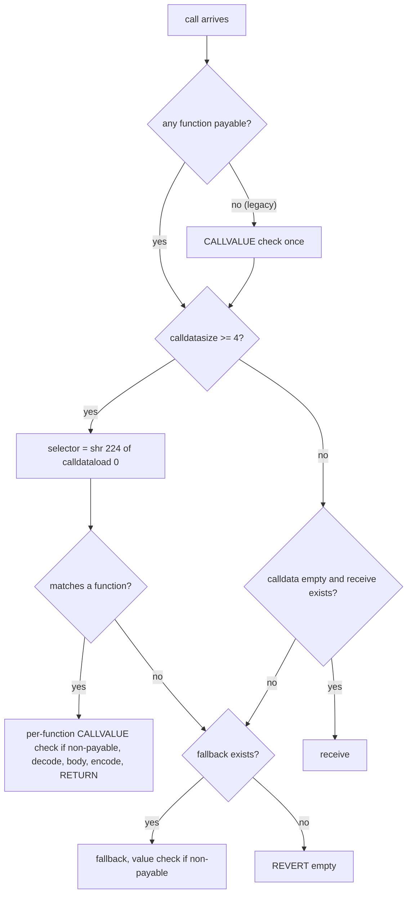

# 2.6 Functions, modifiers and special functions

> [!abstract] In one minute
> - **Visibility** decides who can call, not who can see. `external` = ABI only; `public` = ABI plus internal `JUMP`; `internal` = this contract and children; `private` = this contract only. `private` hides nothing: every storage slot and every byte of code is public on chain.
> - **Mutability** is checked by the compiler, not stored in bytecode. The only runtime guard is the caller's choice of `STATICCALL` (EIP-214), which solc emits for calls to `view`/`pure` functions when the target EVM is Byzantium or later. Library `view` functions are called with `DELEGATECALL` and have **no** runtime guard. A non-payable function starts with a `CALLVALUE` check (24 gas legacy, 15 gas via-IR in my tests).
> - **Modifiers are inlined.** Each `_` is replaced by the function body (or the next modifier). `return` in the body leaves the body only; code after `_` still runs. With `_` twice, legacy keeps the return variable between passes while via-IR resets it to zero.
> - **`receive`** runs only for empty calldata. **`fallback`** runs for everything else that matches no selector, including calldata shorter than 4 bytes, and for empty calldata when there is no `receive`. Value goes through only if the function that runs is `payable`. `fallback(bytes calldata) returns (bytes memory)` returns raw bytes, not ABI-encoded.
> - **Getters**: a public mapping takes its keys, an array takes `uint256` indexes, a struct getter returns its members **minus arrays and mappings** (`string`/`bytes` stay). Overloads get separate selectors; ambiguous calls and external-type clashes are compile errors.
> - **The dispatcher** compares the selector against each function in ascending selector order, 22 gas per comparison. Legacy splits the list in halves by selector value when `runs · 6 · (n − 4) > 3,400` (7+ functions at `runs = 200`). Via-IR in 0.8.38 never splits: in a 12-function contract the cheapest and dearest call differed by 239 gas via-IR and 111 gas legacy. Mining a low selector for a hot function moves it to the front.

**Prerequisites:** [[1.3 Execution model]], [[1.7 Message calls and precompiles]], [[2.5 ABI encoding and decoding]] · **Leads to:** [[2.7 Inheritance, interfaces and libraries]], [[2.8 Errors and reverts]], [[4.10 Gas optimization]], [[5.2 Reentrancy]]

Every behaviour, error message, selector and gas figure below came from compiling with solc-js 0.8.38 (`--optimize`, `runs = 200` unless stated, legacy and via-IR, default `osaka` target) and running the runtime code in py-evm 0.12.1b1 under Prague rules. Gas figures are execution gas of the message only, without the 21,000 base cost or calldata cost. Where the two pipelines differ, both numbers are shown.

## What a function is, from the EVM's point of view

The EVM has no functions. A contract is one byte string that starts executing at byte 0 on every call ([[1.3 Execution model]]). "Calling `transfer`" means sending calldata whose first 4 bytes are `transfer`'s selector ([[2.5 ABI encoding and decoding]]) and trusting the contract's own code to read those bytes and jump to the right place.

So a Solidity function exists at two levels:

1. **An internal function** is a block of code reached by `JUMP`. Arguments and return values live on the stack. There is no selector and no ABI. Calls cost a few dozen gas.
2. **An external entry point** is a selector the compiler adds to the dispatcher. On a match it decodes calldata, runs the internal body, ABI-encodes the result and `RETURN`s.

Visibility says which of the two a function gets. Mutability says what the body may do. Modifiers wrap the body in more code. `receive` and `fallback` are what the dispatcher runs when no selector matches. The rest of this note goes through each in turn and then looks at the dispatcher itself.



## Visibility

### The four levels

| Visibility | In the ABI / dispatcher | Callable from inside by name | Callable from derived contracts | Allowed on state variables |
|---|---|---|---|---|
| `external` | yes | no (only `this.f()`, a real message call) | only as `this.f()` | no (parse error) |
| `public` | yes | yes, by `JUMP` | yes | yes (generates a getter) |
| `internal` | no | yes | yes | yes (the default) |
| `private` | no | yes | **no** | yes |

Solidity 0.5.0 made visibility mandatory on functions. Before that a function with no keyword was `public`, which mattered a great deal in the Parity multisig hack ([Pitfalls and incidents](#pitfalls-and-incidents)).

Things I confirmed with the compiler:

- Calling an `external` function by bare name from inside the contract fails with `error 7576: Undeclared identifier. "e" is not (or not yet) visible at this point.` You must write `this.e()`, which is a real `CALL` to your own address. `msg.sender` becomes the contract itself.
- `uint external x;` fails with `Expected identifier but got 'external'`.
- `private` and `virtual` cannot be combined: `error 3942: "virtual" and "private" cannot be used together.` A private function is invisible to children, so there is nothing to override.

### `this.f()` is a message call, not a function call

`Vis` below has a `public` function called internally and an `external` one reached through `this`:

```solidity
// SPDX-License-Identifier: MIT
pragma solidity 0.8.38;

contract Vis {
    uint256 private secret = 42;          // slot 0: readable by anyone off-chain
    address public lastSender;

    function pub() public returns (address) { lastSender = msg.sender; return msg.sender; }
    function ext() external returns (address) { lastSender = msg.sender; return msg.sender; }

    function callPubInternally() external returns (address) { return pub(); }      // JUMP
    function callExtViaThis() external returns (address) { return this.ext(); }    // CALL to self
}
```

| Call | `msg.sender` seen inside | Gas, legacy | Gas, via-IR |
|---|---|---|---|
| `callPubInternally()` | the EOA (`0x1111…`) | 478 | 406 |
| `callExtViaThis()` | the contract itself (`0xdd…01`) | 1,154 | 1,078 |

The self-call costs about 670 more gas even though the contract's own address is already warm: `CALL` base cost, memory for the encoded arguments and the return data, a second dispatcher pass and a second ABI decode. It also changes `msg.sender`, which breaks `onlyOwner`-style checks in the callee. Use `this.f()` only when you need a new frame on purpose, for example to wrap the call in `try/catch` ([[2.8 Errors and reverts]]).

### What `private` does not hide

`private` is a compile-time namespace rule. It stops **other contracts' source code** from naming the variable. It does nothing on chain:

- **Storage is public.** `secret` above sits in slot 0 (from `storageLayout`). Anyone can read it with `eth_getStorageAt(address, 0)`; in py-evm `get_storage(addr, 0)` returned `42`. The layout rules in [[2.3 Storage layout]] tell an attacker exactly which slot to read.
- **Constructor arguments and transactions are public.** A "secret" set in a constructor or a setter is in the transaction's calldata forever.
- **Code is public.** A `private` function's body is in the runtime bytecode. It has no selector, but decompilers find it.
- **Immutables** are copied into the runtime code, so they are public too.

> [!warning] Secrets on chain
> Never store a password, a seed, an unrevealed answer or a "hidden" random value in contract state, `private` or not. Use commit-reveal (store `keccak256(secret, salt)`, reveal later) or keep the secret off chain and verify a signature ([[5.8 Signatures and replay]]).

### `external` versus `public` today

The old advice was "`external` is cheaper because `public` copies array arguments to memory". That was true when `public` functions could not take `calldata` parameters. Since 0.6.9 ("Permit calldata location for all variables", changelog) they can, and the cost follows the **data location**, not the visibility.

I compiled four versions of the same array sum:

```solidity
// SPDX-License-Identifier: MIT
pragma solidity 0.8.38;

contract ExtCalldata { function sum(uint[] calldata a) external pure returns (uint s) { for (uint i; i < a.length; ++i) s += a[i]; } }
contract PubCalldata { function sum(uint[] calldata a) public   pure returns (uint s) { for (uint i; i < a.length; ++i) s += a[i]; } }
contract ExtMemory   { function sum(uint[] memory a)   external pure returns (uint s) { for (uint i; i < a.length; ++i) s += a[i]; } }
contract PubMemory   { function sum(uint[] memory a)   public   pure returns (uint s) { for (uint i; i < a.length; ++i) s += a[i]; } }
```

| Variant | Gas, 0 / 10 / 100 elements (legacy) | Gas, 0 / 10 / 100 elements (via-IR) | Runtime size legacy / via-IR |
|---|---|---|---|
| `external`, `calldata` | 452 / 2,222 / 18,152 | 309 / 1,349 / 10,709 | 370 / 236 bytes |
| `public`, `calldata` | 452 / 2,222 / 18,152 | 309 / 1,349 / 10,709 | 370 / 236 bytes |
| `external`, `memory` | 584 / 3,204 / 26,805 | 432 / 2,182 / 17,953 | 478 / 335 bytes |
| `public`, `memory` | 584 / 3,204 / 26,805 | 432 / 2,182 / 17,953 | 478 / 335 bytes |

With the CBOR metadata stripped, the `external` and `public` runtimes were **byte-identical** in both pipelines. The `memory` versions cost 30–50% more because the decoder copies every element into memory before the body runs ([[2.2 Data locations]]).

The real differences between `external` and `public` are therefore about the language, not gas:

- A `public` function can be called internally; an `external` one cannot.
- A `public` function with a `calldata` parameter can only be called internally with a calldata argument. Passing a memory array fails: `error 9553: Invalid implicit conversion from uint256[] memory to uint256[] calldata requested.`
- `external` documents intent ("this is API, not a helper") and is required for interface functions, `receive` and `fallback`.

> [!tip] Rule of thumb for 0.8.x
> Pick `calldata` for read-only array, `bytes` and struct parameters whatever the visibility. Pick `external` for API functions you never call internally, `public` when you do. Do not expect gas savings from the keyword alone.

## State mutability

### The four levels

| Mutability | May read state | May write state | May receive ether | Called externally with |
|---|---|---|---|---|
| `pure` | no | no | no | `STATICCALL` |
| `view` | yes | no | no | `STATICCALL` |
| (non-payable, the default) | yes | yes | no, reverts if `msg.value > 0` | `CALL` |
| `payable` | yes | yes | yes | `CALL` |

Overrides may make mutability **stricter** (`nonpayable` → `view` → `pure`) but not looser. Loosening fails with `error 6959: Overriding function changes state mutability from "view" to "nonpayable".` Tightening is allowed since 0.7.0.

### What the compiler counts as "modifies the state"

The view/pure checker walks the body, including inline assembly. Every case below is a compile error in 0.8.38, all with code 8961 and the text **`Function cannot be declared as view because this expression (potentially) modifies the state.`**:

| Inside a `view` function | Result |
|---|---|
| `assembly { sstore(0, 1) }` | error 8961 |
| `assembly { tstore(0, 1) }` | error 8961 |
| `emit E();` | error 8961 |
| calling a non-view internal function | error 8961 |
| `t.call("")`, `t.delegatecall("")` | error 8961 |
| `assembly { call(...) }`, `assembly { delegatecall(...) }` | error 8961 |
| `t.staticcall("")`, `assembly { staticcall(...) }` | **compiles** |

For `pure`, reading is also forbidden. `assembly { sload(0) }`, `msg.sender` and even `assembly { staticcall(...) }` give `error 2527: Function declared as pure, but this expression (potentially) reads from the environment or state and thus requires "view".`

`msg.value` gets its own rule: in a non-payable public or external function it is `error 5887: "msg.value" and "callvalue()" can only be used in payable public functions. Make the function "payable" or use an internal function to avoid this error.` An `internal` helper may read `msg.value` freely, since it can be reached from a payable entry point.

### The only runtime guard is `STATICCALL`

Mutability keywords are **not in the bytecode**. Nothing in a deployed contract says "this function is view". The ABI JSON carries `"stateMutability": "view"`, but that is metadata for tools.

The runtime protection comes from the **caller**. When Solidity calls a function whose type is `view` or `pure` through an interface or contract type, it uses `STATICCALL` (EIP-214). The callee frame, and every frame below it, then fails on `SSTORE`, `TSTORE`, `LOG*`, `CREATE*`, `SELFDESTRUCT` or a value-carrying `CALL` ([[1.7 Message calls and precompiles]]).

When does solc emit `STATICCALL`? The 0.5.0 breaking-changes list says: "Pure and view functions are now called using the opcode `STATICCALL` instead of `CALL`." It depends on the target EVM, because `STATICCALL` arrived with Byzantium (16 Oct 2017). I compiled the same `view` interface call for several targets with 0.8.38:

| `evmVersion` | Opcode for `r.read()` where `read` is `view` | Note |
|---|---|---|
| `osaka` (default), `paris` | `STATICCALL` | |
| `byzantium`, `constantinople` | `STATICCALL` | warning: support for EVM versions older than london is deprecated |
| `spuriousDragon`, `homestead` | `CALL` | same warning; no runtime guard at all |

I then made the guard bite. `Liar` exposes `read()` but writes storage, and `Caller` calls it through an interface that claims `view`:

```solidity
// SPDX-License-Identifier: MIT
pragma solidity 0.8.38;

interface IReader { function read() external view returns (uint); }

// Lies about its interface: read() writes storage.
contract Liar {
    uint public hits;
    function read() external returns (uint) { hits += 1; return hits; }
}

contract Caller {
    // Compiled to STATICCALL because IReader.read is `view`.
    function viaView(IReader r) external view returns (uint) { return r.read(); }
    // Low-level call from a non-view function: plain CALL.
    function viaCall(address r) external returns (bool ok, bytes memory out) {
        (ok, out) = r.call(abi.encodeCall(IReader.read, ()));
    }
}
```

| Call (1,000,000 gas) | Opcode | Result | `Liar.hits` after |
|---|---|---|---|
| `viaView(liar)` | `STATICCALL` | revert, empty data, **984,457 gas used** | 0 |
| `viaCall(liar)` | `CALL` | success | 1 |

The `SSTORE` inside the static frame is an exceptional halt. It burns all the gas the child got (63/64 of what was left), and `Caller`'s decoder then sees empty returndata and reverts. A failing static write is therefore expensive, not a cheap revert ([[1.3 Execution model]]).

> [!warning] `view` is a promise from the callee and a guard only for the caller
> If an EOA (or a contract using `CALL`) calls a function that the ABI calls `view`, nothing stops it from writing. The guard exists only in frames entered through `STATICCALL`. "It's a view function, so it's safe to call" is a statement about the source code you audited, not about an address you were given.

### The non-payable `CALLVALUE` check

A non-payable function must reject ether. The compiler adds `CALLVALUE DUP1 ISZERO PUSH2 tag JUMPI PUSH0 PUSH0 REVERT` before decoding. I measured it with two one-function contracts that differ only in `payable`:

| | Gas, `payable` | Gas, non-payable | Check cost | Runtime size difference | Sending 1 wei to the non-payable one |
|---|---|---|---|---|---|
| Legacy | 190 | 214 | 24 gas | 11 bytes (95 vs 106) | reverts after 43 gas |
| Via-IR | 187 | 202 | 15 gas | 4 bytes (102 vs 106) | reverts after 74 gas |

The legacy pipeline hoists the check: if **no** function, `receive` or `fallback` is payable, one check sits before the dispatcher and covers everything. If any entry point is payable, each non-payable function gets its own check. Via-IR emits `if callvalue() { revert(0, 0) }` inside each `case` of its `switch`.

> [!tip] `payable` as a gas trick
> Marking admin functions `payable` saves 15–24 gas per call and a few bytes. Solady and some MEV bots do this. The price: anyone who sends ether by mistake loses it, and readers lose a signal. Use it only for functions guarded by access control, and say so in a comment ([[4.10 Gas optimization]]).

## Modifiers

### Intuition: a modifier is a code template

A modifier is not a function call. The compiler pastes the modifier's code around the function body, and every `_` marks where the body goes. With several modifiers, `_` in the first one stands for "the second modifier, whose `_` stands for the body", and so on, left to right.

Official rules, from the Solidity docs on function modifiers:

- "The `_` symbol can appear in the modifier multiple times. Each occurrence is replaced with the function body."
- "Explicit returns from a modifier or function body only leave the current modifier or function body."
- "Arbitrary expressions are allowed for modifier arguments."
- "Symbols introduced in the modifier are not visible in the function (as they might change by overriding)."

### A lab: `_` twice, an early `return`, side-effecting arguments

```solidity
// SPDX-License-Identifier: MIT
pragma solidity 0.8.38;

contract ModLab {
    uint[] public trace;   // what ran, in order
    uint public counter;

    function traceLen() external view returns (uint) { return trace.length; }

    function next() internal returns (uint) { counter += 1; trace.push(900 + counter); return counter; }

    // `_` appears twice; the modifier's local survives across both.
    modifier twice() {
        uint runs;               // modifier-local, invisible to the body
        trace.push(1);           // before first _
        _;
        runs++;
        trace.push(2);           // between the two _
        _;
        runs++;
        trace.push(3);           // after second _ (always runs)
        trace.push(10 + runs);   // 12 if both bodies ran
    }

    // A modifier argument: evaluated when?
    modifier tag(uint x) {
        trace.push(100 + x);
        _;
        trace.push(200 + x);
    }

    // The body returns early on the first pass only.
    function f() external twice returns (uint r) {
        trace.push(50);
        if (trace.length < 4) return 7;   // first pass: early return
        trace.push(60);                   // only on second pass
        r = r + 1000;                     // r is NOT reset between passes?
    }

    function g() external tag(next()) tag(next()) returns (uint) {
        trace.push(50);
        return counter;
    }

    function k() external twice tag(next()) returns (uint) {
        trace.push(50);
        return counter;
    }

    // A modifier that skips the body entirely.
    modifier never() { if (false) { _; } }
    function h() external never returns (uint r) { r = 42; }
}
```

Results, read back from `trace` after one call each on a fresh deployment:

| Call | `trace` | Return value, legacy | Return value, via-IR |
|---|---|---|---|
| `f()` | `[1, 50, 2, 50, 60, 3, 12]` | **1007** | **1000** |
| `g()` | `[901, 101, 902, 102, 50, 202, 201]` | 2 | 2 |
| `k()` | `[1, 901, 101, 50, 201, 2, 902, 102, 50, 202, 3, 12]` | 2 | 2 |
| `h()` | `[]` | 0, success | 0, success |

What each row shows:

1. **`return` leaves only the body.** On the first pass `f` hit `return 7` right after pushing `50`. Control went back into `twice` after the first `_`, which pushed `2`, ran the body again, then pushed `3` and `12`. So code after `_` always runs, even after an early `return`. This is the behaviour reentrancy guards rely on: `nonReentrant` resets its flag after `_` whatever path the body took.
2. **Return variables across passes differ by pipeline.** In legacy, `r` has one fixed stack slot. The first pass left `r = 7`; the second pass did `r = r + 1000` and returned **1007**. Via-IR implements each modifier as a real Yul function and re-initialises parameters and return variables before every `_`, so the second pass started at `r = 0` and returned **1000**. The docs list this under "IR-based Codegen Changes": "the effect on return variables is that they are reset to their default (zero) value for each execution." The function always returns the value from the **last** `_`.
3. **Modifier locals persist across `_`.** `runs` counted 2 by the end. The body could not see it.
4. **Modifier arguments are evaluated when that modifier is entered, not up front.** In `g()`, the first `next()` ran (901), then the first `tag` pushed 101, and only then did the second `next()` run (902). Post-`_` code unwinds in reverse order (202 then 201).
5. **Arguments of an inner modifier are re-evaluated on every pass.** In `k()`, `tag(next())` is part of what `twice`'s `_` stands for, so `next()` ran twice (901 and 902).
6. **A modifier can skip the body.** `never` never reaches `_`, so `h()` succeeds and returns the default `0`. The compiler's only hint was "Function state mutability can be restricted to pure". A modifier that forgets `_` on some path silently turns the function into a no-op that **succeeds**. That is worse than a revert.

### Other modifier rules (verified)

- `return` inside a modifier cannot carry a value: `modifier m() { return 5; _; }` gives `error 7552: Return arguments not allowed.` A bare `return;` before `_` skips the body and returns defaults.
- A modifier sees function parameters only if you pass them: `modifier pos() { require(amount > 0); _; }` on `f(uint amount)` gives `error 7576: Undeclared identifier.` Write `modifier pos(uint v)` and apply it as `pos(amount)`.
- Modifiers cannot be overloaded: a second `modifier m(uint a)` gives `error 2333: Identifier already declared.`
- `virtual` modifiers still compile but warn: `warning 8429: Virtual modifiers are deprecated and scheduled for removal.` (added in 0.8.31). Prefer a modifier that calls an internal `virtual` function, which children can override ([[2.7 Inheritance, interfaces and libraries]]).

### Cost: inlining means code size

Because the modifier body is pasted into every function that uses it, a ten-line `onlyRole` modifier on twenty functions is twenty copies in the legacy pipeline. The optimizer can deduplicate identical blocks, and via-IR keeps each modifier as a Yul function that the inliner may or may not inline. When contracts approach the 24,576-byte limit, the standard fix is to move the modifier's work into a `private` or `internal` function and have the modifier only call it:

```solidity
// SPDX-License-Identifier: MIT
pragma solidity 0.8.38;

contract SmallModifier {
    error NotOwner();
    address public owner = msg.sender;

    function _checkOwner() private view {
        if (msg.sender != owner) revert NotOwner();
    }

    // The modifier body is now a single internal call, cheap to duplicate.
    modifier onlyOwner() {
        _checkOwner();
        _;
    }

    function setOwner(address o) external onlyOwner { owner = o; }
}
```

OpenZeppelin's `Ownable` uses this shape (`modifier onlyOwner() { _checkOwner(); _; }`).

## `receive` and `fallback`

### Rules

Since 0.6.0 the old unnamed function `function() external payable` is split in two. Writing the old form now fails with `error 2915: ... use the "fallback" keyword or the "receive" keyword instead.`

| | `receive() external payable` | `fallback() external [payable]` |
|---|---|---|
| Runs when | calldata is **empty** | no selector matched, or calldata is shorter than 4 bytes, or calldata is empty and there is no `receive` |
| Must be | `external payable`, no parameters, no return values | `external`; payable optional |
| Can read `msg.data` | no (disallowed since 0.8.0) | yes |
| Alternative signature | none | `fallback(bytes calldata input) external [payable] returns (bytes memory output)` |
| Compile errors I hit | `receive() external {}` → `error 7793: Receive ether function must be payable, but is "nonpayable".`; adding `returns (uint)` → `error 6899: Receive ether function cannot return values.` | `fallback() public {}` → `error 1159: Fallback function must be defined as "external".`; any other parameter list → `error 5570: Fallback function either has to have the signature "fallback()" or "fallback(bytes calldata) returns (bytes memory)".` |

Both may be `virtual`, may be overridden and may have modifiers.

### The dispatch matrix (verified)

I built six contracts. Each has a non-payable `ping()` and some mix of `receive` and `fallback`, and each entry point records which one ran in slot 0. Then I called each with four kinds of calldata, with value 0 and with 1 wei. Legacy and via-IR gave identical results.

| Contract | empty, 0 | empty, 1 wei | 3 bytes, 0 | 3 bytes, 1 wei | unknown selector, 0 | unknown selector, 1 wei | `ping()`, 0 | `ping()`, 1 wei |
|---|---|---|---|---|---|---|---|---|
| `receive` + non-payable `fallback` | receive | receive | fallback | **REVERT** | fallback | **REVERT** | ping | REVERT |
| `receive` + payable `fallback` | receive | receive | fallback | fallback | fallback | fallback | ping | REVERT |
| payable `fallback` only | fallback | fallback | fallback | fallback | fallback | fallback | ping | REVERT |
| non-payable `fallback` only | fallback | **REVERT** | fallback | REVERT | fallback | REVERT | ping | REVERT |
| `receive` only | receive | receive | **REVERT** | REVERT | REVERT | REVERT | ping | REVERT |
| neither | REVERT | REVERT | REVERT | REVERT | REVERT | REVERT | ping | REVERT |

How to read it as rules:

1. **Empty calldata** goes to `receive` if it exists, else to `fallback`, else reverts.
2. **Non-empty calldata that matches no selector**, including 1–3 bytes, goes to `fallback`, else reverts. `receive` never sees non-empty calldata, so a contract with only `receive` rejects `0xabcdef` even with value 0.
3. **Value** is accepted only if the function that ends up running is `payable`. A non-payable `fallback` reverts on value; it does not hand the call to `receive`.
4. A known selector with value on a non-payable function reverts. It does not fall back.

The compiler warned once, for "payable `fallback` only": `This contract has a payable fallback function, but no receive ether function. Consider adding a receive ether function.` The contract works, but plain transfers then run whatever logic `fallback` has, which is easy to forget.

> [!note] Ways to get ether without any function running
> A contract with neither function still receives ether as a block's fee recipient, as a validator withdrawal target, and from `SELFDESTRUCT` (since Cancun only when it runs in the creating transaction or as a pure transfer). The docs list the first and last. So `address(this).balance` can never be assumed to equal the sum of deposits ([[1.11 Hard forks that changed contract code]], [[5.7 Denial of service and griefing]]).

### Gas available to `receive`

`transfer` and `send` (deprecated, warned on since 0.8.31) forward a 2,300-gas stipend. Under that stipend `receive` can emit a small event and use transient storage but can never `SSTORE`, because of the EIP-2200 sentry. The numbers are in [[1.7 Message calls and precompiles]]. Send ether with `call{value: v}("")` and a reentrancy guard ([[5.2 Reentrancy]]).

### `fallback(bytes calldata) returns (bytes memory)`: raw in, raw out

Added in 0.7.6. `input` is all of `msg.data`, selector included. `output` is copied to returndata **as is**: no offset, no length, no padding. This lets a contract act as a proxy or a router written in Solidity without assembly for the return path.

```solidity
// SPDX-License-Identifier: MIT
pragma solidity 0.8.38;

contract RawFallback {
    bytes public lastInput;
    // Echo: return the input with its first byte replaced, raw.
    fallback(bytes calldata input) external returns (bytes memory output) {
        lastInput = input;
        output = abi.encodePacked(uint32(0xdeadbeef), uint8(input.length));
    }
}
```

| Calldata sent | Returndata (both pipelines) | `lastInput` |
|---|---|---|
| (empty) | `deadbeef00` | (empty) |
| `010203` | `deadbeef03` | `010203` |
| `12345678aabb` | `deadbeef06` | `12345678aabb` |

Five bytes come back: no 32-byte padding, no `0x20` offset. A normal function returning `bytes` would have returned 96 bytes (offset, length, padded data). The JSON ABI records only `{"type": "fallback", "stateMutability": "nonpayable"}`; nothing tells a client what format the output has.

> [!tip] Forwarding returndata
> If a proxy's fallback calls `(bool ok, bytes memory ret) = impl.delegatecall(input)`, returning `ret` from this fallback form passes the implementation's ABI-encoded return value straight through, because "raw" here means "whatever bytes you hand back". It still copies returndata into memory (see the verified facts in [[2.5 ABI encoding and decoding]]); production proxies use assembly to avoid that and to bubble reverts ([[4.2 Upgradeability and proxies]], [[3.7 External calls in assembly]]).

## Overloading

A contract may have several functions with the same name and different parameter types. Each becomes a separate ABI entry and a separate selector, because the selector hashes the full signature:

```solidity
// SPDX-License-Identifier: MIT
pragma solidity 0.8.38;

contract Over {
    event Paid(address to, uint256 amount);
    function pay(address to) external payable { emit Paid(to, msg.value); }
    function pay(address to, uint256 amount) external { emit Paid(to, amount); }
    function pay(address[] calldata to) external payable { for (uint i; i < to.length; ++i) emit Paid(to[i], 0); }

    // The only way to name one overload's selector: hash the signature yourself.
    bytes4 public constant PAY2 = bytes4(keccak256("pay(address,uint256)"));
}
```

`methodIdentifiers` gave `0x0c11dedd pay(address)`, `0xc4076876 pay(address,uint256)` and `0x6d37aeb7 pay(address[])`. The ABI has three entries named `pay`, each with its own `stateMutability`.

### Resolution rules and the errors you get

The compiler picks the overload whose parameters accept the arguments by **implicit conversion**. If more than one does, the call is ambiguous. Each case below was compiled with 0.8.38:

| Code | Result |
|---|---|
| `f(uint8)` and `f(uint256)`, call `f(50)` | `error 4487: No unique declaration found after argument-dependent lookup.` (50 fits both) |
| same pair, call `f(256)` | compiles, picks `f(uint256)` (256 does not fit `uint8`) |
| `f(B b)` and `f(address a)` where `B` is a contract | `error 9914: Function overload clash during conversion to external types for arguments.` Both become `f(address)` in the ABI |
| two `f()` differing only in return type | `error 1686: Function with same name and parameter types defined twice.` |
| `this.f.selector` with `f` overloaded | `error 6675: Member "f" not unique after argument-dependent lookup in contract C.` |
| `abi.encodeCall(this.p, (address(0)))` with `p` overloaded | same `error 6675` |

Consequences for tooling and security:

- **You cannot take `.selector` of an overloaded function, and `abi.encodeCall` refuses it.** You fall back to `abi.encodeWithSignature("pay(address,uint256)", ...)` or a hand-hashed constant, both of which the compiler cannot type-check. One reason many style guides ban overloading in public APIs.
- **Clients must pick the overload explicitly.** In ethers v6, `contract.pay(...)` is ambiguous and you call `contract["pay(address,uint256)"](...)`. Etherscan shows each overload separately.
- **Overloads do not share access control.** Each is its own entry point. Auditors look for the overload that forgot the modifier.

## Auto-generated getters

### What the compiler generates

A `public` state variable gets an `external view` function with the same name. Parameters come from the type: one `uint256` per array dimension, one key per mapping level, in declaration order from the outside in. I compiled this contract and read the `abi` output:

```solidity
// SPDX-License-Identifier: MIT
pragma solidity 0.8.38;

contract Getters {
    struct Inner { uint64 a; bool b; }
    struct Pos {
        uint128 size;
        address owner;
        string label;                 // kept
        bytes blob;                   // kept
        Inner inner;                  // kept, as a tuple
        uint[] history;               // omitted
        uint[3] fixedArr;             // omitted
        mapping(uint => uint) marks;  // omitted
    }
    uint256 public total;
    uint256[] public list;
    uint256[2][] public pairs;
    mapping(address => uint256) public balanceOf;
    mapping(address => mapping(address => uint256)) public allowance;
    mapping(uint256 => Pos) public positions;
    Pos public main;
    mapping(bytes => uint) public byKey;
    mapping(uint => uint[]) public arrs;
    string public name;
    bytes32 public constant ROLE = keccak256("ROLE");
    address public immutable deployer = msg.sender;
}
```

| Declaration | Generated getter (from compiled `abi`) | Selector |
|---|---|---|
| `uint256 public total` | `total() returns (uint256)` | `0x2ddbd13a` |
| `uint256[] public list` | `list(uint256) returns (uint256)` | `0x80c9419e` |
| `uint256[2][] public pairs` | `pairs(uint256,uint256) returns (uint256)` | `0x675b4ef1` |
| `mapping(address => uint256) public balanceOf` | `balanceOf(address) returns (uint256)` | `0x70a08231` |
| `mapping(address => mapping(address => uint256)) public allowance` | `allowance(address,address) returns (uint256)` | `0xdd62ed3e` |
| `mapping(uint256 => Pos) public positions` | `positions(uint256) returns (uint128 size, address owner, string label, bytes blob, (uint64,bool) inner)` | `0x99fbab88` |
| `Pos public main` | `main() returns (uint128 size, address owner, string label, bytes blob, (uint64,bool) inner)` | `0xdffeadd0` |
| `mapping(bytes => uint) public byKey` | `byKey(bytes) returns (uint256)` | `0xc939b08d` |
| `mapping(uint => uint[]) public arrs` | `arrs(uint256,uint256) returns (uint256)` | `0x4f17c997` |
| `string public name` | `name() returns (string)` | `0x06fdde03` |
| `bytes32 public constant ROLE` | `ROLE() returns (bytes32)` | `0x9d53fe2b` |
| `address public immutable deployer` | `deployer() returns (address)` | `0xd5f39488` |

Rules this table shows:

- **Arrays never return whole.** `list` returns one element; there is no `list()` that returns the array. Write your own `function getList() external view returns (uint[] memory)` if you need it, and mind the gas for large arrays.
- **Struct getters return members as a flat list, minus arrays and mappings.** The docs say "The mapping and arrays (with the exception of byte arrays) in the struct are omitted". My test adds that **fixed-size arrays** (`uint[3]`) are omitted too, while `string`, `bytes` and nested structs stay. A nested struct comes back as a tuple.
- **The return values are not a struct.** `positions(1)` returns a tuple of five values, so an interface must declare `returns (uint128, address, string memory, bytes memory, Inner memory)`, not `returns (Pos memory)`.
- **`balanceOf` and `allowance` match ERC-20 exactly.** That is why `mapping(...) public balanceOf` satisfies `IERC20.balanceOf` with `override` ([[2.7 Inheritance, interfaces and libraries]], [[4.4 Token standards]]).
- **Constants and immutables get getters too**, read from code rather than storage.
- **Out-of-bounds index**: `list(5)` on an empty array reverted with **empty data** in both pipelines, not `Panic(0x32)`. (0.7.4 changed this getter from `INVALID` to `REVERT`.) An explicit `list[5]` in your own code gives `Panic(0x32)` ([[2.8 Errors and reverts]]).

A public getter is `external`, so inside the contract `name` means the variable, not the function; `this.name()` makes a message call.
