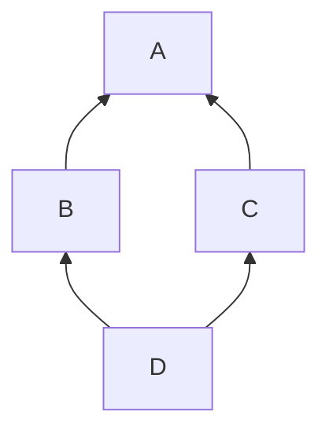

# 2.7 Inheritance, interfaces and libraries

> [!abstract] In one minute
> - Inheritance is a **compile-time** feature. `contract D is B, C` produces one bytecode blob. Bases are flattened by **C3 linearization**. You list bases from **"most base-like" to "most derived"**, the reverse of Python, so the rightmost base wins: `D is B, C` linearizes to `[D, C, B, A]`.
> - Virtual calls and **`super`** follow the linearization of the **most-derived** contract, not the parent you see in the source. Inside `D`, `B`'s `super.f()` calls **`C.f`**, a contract `B` never mentions. `super` is a JUMP, not a message call.
> - `virtual` allows overriding, `override(B, C)` must name **every base that defines the function** and is not already overridden by another base. Public state variables can override `external` functions but cannot themselves be overridden. Overrides may only widen `external`→`public` and tighten mutability.
> - Constructors run in linearized order, base first. Base arguments are evaluated **most derived to most base**. Via-IR initializes each contract's state variables **just before its own constructor**; legacy initializes **all** state variables first. Measured: the docs' example gives `y = 0` on legacy and `y = 42` on via-IR.
> - **Interfaces** declare only external functions (plus events, errors, structs, enums, UDVTs), can inherit only interfaces, and give `type(I).interfaceId` (XOR of the selectors declared in `I` itself). **Abstract contracts** may have state, constructors and partial implementations but cannot be deployed.
> - **Libraries**: `internal` functions are copied into the caller and reached by JUMP. `public`/`external` functions live at a deployed address, are reached by **DELEGATECALL**, and leave a 40-character link placeholder `__$<first 17 bytes of keccak256("file:Lib") in hex>$__` in the caller's bytecode. Non-view library functions refuse direct CALLs by comparing `ADDRESS` with the address baked into the code at deployment.

**Prerequisites:** [[1.7 Message calls and precompiles]], [[1.8 Contract creation]], [[2.3 Storage layout]], [[2.6 Functions, modifiers and special functions]] · **Leads to:** [[4.2 Upgradeability and proxies]], [[5.9 Proxies, delegatecall and storage]], [[4.4 Token standards]], [[3.11 Compiler IR and the optimizer]]

Everything here was checked with solc-js 0.8.38 (`--standard-json`, both pipelines, optimizer on unless stated) and by running the bytecode in py-evm 0.12.1b1 (`PragueVM`). Event logs emitted during construction and calls were captured to show real execution order. Compiler error messages are quoted exactly as 0.8.38 printed them.

## What inheritance compiles to

Solidity inheritance looks like class inheritance in Python or C++, but nothing of it exists at run time. When you deploy `D is B, C`, the compiler copies the code of every base into one contract, resolves every virtual call to a concrete function, and emits a single runtime blob with one dispatcher. There is no vtable, no "parent contract" on chain and no message call between levels. Calling a base function, explicitly (`B.f()`) or through `super.f()`, is an internal JUMP inside the same code.

Three consequences shape the rest of this note:

1. **One storage space.** The state variables of every base share the derived contract's storage. The compiler lays them out in linearized order, most-base first. [[2.3 Storage layout]] has the exact rules. That ordering is why inserting a base contract or a variable in a base breaks upgradeable contracts ([[4.2 Upgradeability and proxies]]).
2. **One order for everything.** The compiler computes one list, the **linearization**, and uses it for virtual lookup, `super`, constructor order, state-variable initialization and storage layout. Learn to compute it and you can predict all five.
3. **Libraries are the exception.** A library's `public`/`external` functions are real code at a separate address, reached by DELEGATECALL. Everything else in this note (bases, interfaces, abstract contracts, free functions, internal library functions) is compiled into the caller.

## C3 linearization

### The problem it solves

Take the classic diamond. `A` defines `f`. `B` and `C` both inherit `A` and override `f`. `D` inherits both.



Which `f` does `D` get? When `B.f` calls "the parent's `f`", should that be `A.f` or `C.f`? And `A` must appear only once: one copy of its state, one run of its constructor. C3 linearization answers all of this by turning the graph into a single ordered list, the **method resolution order**. Every class appears once. Each class comes before its bases. The order in which you list bases is respected.

### Solidity's order is the reverse of Python's

The docs say it plainly: "You have to list the direct base contracts in the order from 'most base-like' to 'most derived'. Note that this order is the reverse of the one used in Python."

So in `contract D is B, C`, `C` counts as **more derived** than `B`. When both define `f`, `C`'s version is "closer" to `D`. Python's `class D(B, C)` means the opposite: `B` is searched first.

| Source | Linearization (most derived first) |
|---|---|
| Solidity `contract D is B, C` | `[D, C, B, A]` |
| Python `class D(B, C)` | `[D, B, C, A]` |
| Solidity `contract E is C, B` | `[E, B, C, A]` |

The first and third rows are the compiler's `linearizedBaseContracts` from the 0.8.38 AST. To translate a Python MRO example into Solidity, reverse every base list.

The docs give a useful mental shortcut: when a function is defined in several bases, "the given bases are searched from right to left (left to right in Python) in a depth-first manner, stopping at the first match. If a base contract has already been searched, it is skipped."

### The algorithm

Write the bases of `X` as `X is P1, P2, …, Pn`. In Solidity's convention `Pn` is the most derived. Then

```text
L(X) = [X] + merge( L(Pn), …, L(P2), L(P1), [Pn, …, P2, P1] )
```

`merge` repeatedly takes the first list's head if that contract does not appear in the **tail** (any position after the first) of any list. If it does, it tries the next list's head. The chosen contract is removed from the front of every list. If no head qualifies, linearization is impossible.

Worked for `D is B, C` with `L(B) = [B, A]`, `L(C) = [C, A]`:

```text
merge([C, A], [B, A], [C, B])
  head C: not in any tail                 → take C   lists: [A] [B, A] [B]
  head A: in the tail of [B, A]           → skip
  head B: not in any tail                 → take B   lists: [A] [A] []
  head A: free                            → take A
L(D) = [D, C, B, A]
```

A larger check: Wikipedia's C3 example `class Z(K1, K2, K3)` with `K1(A, B, C)`, `K2(D, B, E)`, `K3(D, A)` has the MRO `Z, K1, K2, K3, D, A, B, C, E, O`. Written in Solidity with every base list reversed:

```solidity
// SPDX-License-Identifier: MIT
pragma solidity 0.8.38;
contract O {}
contract A is O {}
contract B is O {}
contract C is O {}
contract D is O {}
contract E is O {}
contract K1 is C, B, A {}
contract K2 is E, B, D {}
contract K3 is A, D {}
contract Z is K3, K2, K1 {}
```

solc 0.8.38 reports:

```text
K1 ['K1', 'A', 'B', 'C', 'O']
K2 ['K2', 'D', 'B', 'E', 'O']
K3 ['K3', 'D', 'A', 'O']
Z  ['Z', 'K1', 'K2', 'K3', 'D', 'A', 'B', 'C', 'E', 'O']
```

Identical to Python, as it should be once the lists are reversed.

### When it fails

C3 is monotonic: if `A` comes before `X` in some base's linearization, it must stay before `X` in every derived one. Contradictory requests are rejected:

```solidity
contract X {}
contract A is X {}
contract C is A, X {}   // compile error
```

```text
TypeError: Linearization of inheritance graph impossible
```

`C is A, X` says "`X` is more derived than `A`", but `A is X` already says `A` is more derived than `X`. The fix is the natural one: list the more general contract first (`C is X, A`), or drop the redundant `X`.

> [!tip] Read the linearization instead of computing it
> Request the AST in standard-json (`outputSelection: {"*": {"": ["ast"]}}`) and read each `ContractDefinition.linearizedBaseContracts` (node ids, most derived first). `forge inspect` and Slither's `inheritance-graph` printer expose the same information ([[6.3 Static analysis]]).

## Virtual dispatch and `super`

### The rule

A call to a virtual function `f()` (written as plain `f()` or `this`-less) resolves to the implementation in the **first** contract of the most-derived contract's linearization that defines `f`. `super.f()` inside contract `X` resolves to the next contract **after `X`** in that same list that defines `f`.

The phrase that trips people up is "that same list". The list belongs to the contract being deployed, not to the contract whose source you are reading. `B` is written against `A`, but when it is compiled into `D`, its `super` is whatever follows `B` in `L(D)`.

### Verified

Each `f()` emits a marker and calls `super.f()` (file `Lin.sol`):

```solidity
// SPDX-License-Identifier: MIT
pragma solidity 0.8.38;

contract A {
    event Log(string who);
    function f() public virtual { emit Log("A.f"); }
}
contract B is A {
    function f() public virtual override { emit Log("B.f"); super.f(); }
}
contract C is A {
    function f() public virtual override { emit Log("C.f"); super.f(); }
}
contract D is B, C {
    function f() public override(B, C) { emit Log("D.f"); super.f(); }
}
contract E is C, B {
    function f() public override(B, C) { emit Log("E.f"); super.f(); }
}
```

Deploying each contract and calling `f()` in py-evm, the logs came out in this order (identical on legacy and via-IR):

```text
A  A.f
B  B.f -> A.f
C  C.f -> A.f
D  D.f -> C.f -> B.f -> A.f
E  E.f -> B.f -> C.f -> A.f
```

So `super.f()` in `B` calls `A.f` when `B` is deployed on its own and `C.f` when `B` is part of `D`. The same source line, two targets. Every implementation in the diamond runs exactly once, and `A.f` runs last. This is the cooperative pattern that makes `super` chains safe: each override does its part and hands on.

### Explicit base calls are different

`B.f()` names a specific implementation. It is a non-virtual jump to `B`'s code. But `B`'s own `super` inside that code still follows `L(D)`. Mixing the two styles double-runs code:

```solidity
// SPDX-License-Identifier: MIT
pragma solidity 0.8.38;

event Log(string what);

contract A { function f() public virtual { emit Log("A.f"); } }
contract B is A { function f() public virtual override { emit Log("B.f"); super.f(); } }
contract C is A { function f() public virtual override { emit Log("C.f"); super.f(); } }

// Explicit base calls instead of super
contract D2 is B, C {
    function f() public override(B, C) { emit Log("D2.f"); B.f(); C.f(); }
}
```

Measured order:

```text
D2.f -> B.f -> A.f -> C.f -> B.f -> A.f
```

`L(D2) = [D2, C, B, A]`. `B.f()` runs `B`, whose `super` is `A`. `C.f()` runs `C`, whose `super` is `B`, whose `super` is `A`. `A.f` runs twice and `B.f` runs twice. If `A.f` were "mint the reward" or "increment the nonce", that is a bug. Use `super` consistently in a hierarchy, or call explicit bases only from leaves whose bases do not call `super`.

### Modifiers in a `super` chain

Modifiers wrap the function they are attached to, and each level of a `super` chain has its own. Adding `mA`…`mD` (each logs "in", runs `_`, logs "out") to the four `f`s above gives (both pipelines):

```text
mD in | D.f | mC in | C.f | mB in | B.f | mA in | A.f | mA out | mB out | mC out | mD out
```

The modifiers nest like the calls: outermost is the most-derived, innermost the most-base. Modifier semantics in detail (return-variable reset per `_`, placeholder rules) are in [[2.6 Functions, modifiers and special functions]].

## `virtual`, `override` and what an override may change

Since 0.6.0 overriding is explicit. A function can be overridden only if it (or the function it overrides) is marked `virtual`. An overriding function must say `override`. If it may be overridden again, it must also say `virtual`. Private functions cannot be virtual. Interface functions are implicitly virtual.

### When you must override, and what to list

The intuitive rule: **if a contract inherits the same function from more than one base and no single base already resolves it, the contract must override it and list every base that contributes a definition.**

The docs' formal version: overriding is not required when there is a base contract that lies on all override paths for the signature, and either (1) that base implements the function and no path from the current contract to it mentions another function with that signature, or (2) that base does not implement it and there is at most one mention of the function on all paths to it.

Cases checked against 0.8.38:

| Setup | Result |
|---|---|
| `B` and `C` both override `A.f`; `D is B, C` declares nothing | `TypeError: Derived contract must override function "f". Two or more base classes define function with same name and parameter types.` |
| Same, `D` writes `override(B)` | `TypeError: Function needs to specify overridden contract "C".` |
| Same, `D` writes `override(B, C)` | Compiles. Order inside the parentheses does not matter |
| **Only `B` overrides `A.f`**, `C is A` adds nothing, `D is B, C` | Still the "must override" error, listing definitions in `A` and `B`. The path `D→C→A` reaches `A.f`, the path `D→B` reaches `B.f`; no single resolution |
| Same with `D is C, B` | Same error. Base order does not help |
| `A.f` not `virtual`, `B` overrides | `TypeError: Trying to override non-virtual function. Did you forget to add "virtual"?` |
| `A.f virtual`, `B` redefines `f` without `override` | `TypeError: Overriding function is missing "override" specifier.` |
| One interface `I.f`; `C is I` implements `f` without `override` | Compiles. Since 0.8.8 a function that overrides only a single interface function needs no `override` |
| Two interfaces `I.f`, `J.f`; `C is I, J` implements without `override` | `TypeError: Function needs to specify overridden contracts "I" and "J".` |
| Abstract base `A.f()` unimplemented `virtual`; `C is A` implements without `override` | `TypeError: Overriding function is missing "override" specifier.` (the 0.8.8 exemption is for interfaces only) |
| `function f() private virtual` | `TypeError: "virtual" and "private" cannot be used together.` |

> [!note] Why the "only `B` overrides" case errors
> It surprises people because `D`'s linearization `[D, C, B, A]` would pick `B.f` without ambiguity. The compiler deliberately refuses to let linearization silently decide which of two independent definitions wins. You must restate the choice with `function f() public override(A, B) { super.f(); }`. (In this hierarchy `A` and `B` are the two contributors. Naming `C` gives `TypeError: Invalid contract specified in override list: "C".`, and `override(B)` alone gives `TypeError: Function needs to specify overridden contract "A".`)

### What an override may change

| Property | Allowed change | Verified error otherwise |
|---|---|---|
| Visibility | Only `external` → `public` | `public` → `external`, and `internal` → `public`: `TypeError: Overriding function visibility differs.` |
| Mutability | Only stricter: nonpayable → `view` → `pure` (`external view` → `public pure` compiled) | `payable` → anything: `TypeError: Overriding function changes state mutability from "payable" to "nonpayable".` |
| Parameters and returns | Must match exactly | Different types are overloads, not overrides |
| Data location of parameters | Must match for public/external | Changing `calldata` ↔ `memory` was wrongly accepted for internal/public overrides 0.6.9–0.8.13 (bug SOL-2022-3, fixed 0.8.14) |

### Public state variables as overrides

A `public` state variable generates a getter, and that getter can override an `external` function with the same signature:

```solidity
// SPDX-License-Identifier: MIT
pragma solidity 0.8.38;

interface IERC165 { function supportsInterface(bytes4 id) external view returns (bool); }

interface IVault is IERC165 {
    function totalAssets() external view returns (uint256);
    function deposit(uint256 assets) external returns (uint256);
}

contract Vault is IVault {
    uint256 public override totalAssets;           // public state variable implements an interface function
    function deposit(uint256 a) external returns (uint256) { totalAssets += a; return a; }
    function supportsInterface(bytes4 id) external pure returns (bool) {
        return id == type(IVault).interfaceId || id == type(IERC165).interfaceId;
    }
    function ids() external pure returns (bytes4, bytes4) { return (type(IVault).interfaceId, type(IERC165).interfaceId); }
}
```

The getter selector is `totalAssets()` = `0x01e1d114`, the same as the interface's. Rules checked against 0.8.38:

- The overridden function must be **external**. Overriding a `public` function with a state variable gives `TypeError: Public state variables can only override functions with external visibility.`
- A state variable **cannot be overridden**. A derived `function totalAssets() public view override` gives `TypeError: Cannot override public state variable.` (plus `DeclarationError: Identifier already declared.`).
- A state variable cannot be `virtual`. `uint256 public virtual x;` is a parse error: `ParserError: Expected identifier but got 'virtual'`.
- Shadowing is banned. Redeclaring a base's state variable with the same name (even private) gives `DeclarationError: Identifier already declared.` Shadowing has been an error since 0.6.0.

## Constructors and initialization order

[[1.8 Contract creation]] explains initcode: the constructor is code that runs once and returns the runtime code. With inheritance, the initcode of `D` contains the constructor of every base, in one frame, plus the inline initializers (`uint256 public a = …;`) of every base.

### Passing arguments to base constructors

There are two syntaxes, and you may use only one per base:

```solidity
// SPDX-License-Identifier: MIT
pragma solidity 0.8.38;

contract Base {
    uint256 x;
    constructor(uint256 x_) { x = x_; }
}
contract Derived1 is Base(7) {                    // inheritance list: fixed value
    constructor() {}
}
contract Derived2 is Base {
    constructor(uint256 y) Base(y * y) {}         // "modifier style": depends on the derived constructor's arguments
}
abstract contract Derived3 is Base {}             // leaves it open...
contract DerivedFromDerived is Derived3 {
    constructor() Base(10 + 10) {}                // ...for a later contract to fill in
}
```

Verified errors:

| Mistake | Error |
|---|---|
| Both `is A(1)` and `constructor() A(2)` | `DeclarationError: Base constructor arguments given twice.` |
| `contract B is A {}` when `A` needs arguments | `TypeError: No arguments passed to the base constructor. Specify the arguments or mark "B" as abstract.` |

In a diamond, `A`'s arguments must be supplied exactly once, anywhere in the hierarchy. In the experiment below `B` fixes them in its inheritance list and `D` does not repeat them.

### The order of events, measured

The docs give two orders. Legacy codegen: zero everything, evaluate base constructor arguments (most derived to most base), initialize **all** state variables (most base to most derived), then run all constructors (most base to most derived). Via-IR: zero everything, evaluate base constructor arguments (most derived to most base), then **for each contract from most base to most derived: initialize its state variables, then run its constructor**.

Here is a diamond that logs every step (file `Ctor.sol`). `note()` is a free function that emits a marker and returns its argument, so it can be used inside initializers and argument expressions.

```solidity
// SPDX-License-Identifier: MIT
pragma solidity 0.8.38;

event Log(string what);

function note(string memory s, uint256 v) returns (uint256) {
    emit Log(s);
    return v;
}

contract A {
    uint256 public a = note("init A.a", 1);
    constructor(uint256 x) { emit Log(x == 10 ? "ctor A(10)" : "ctor A(?)"); }
}

// A's argument given in B's inheritance list
abstract contract B is A(note("arg A, from B's list", 10)) {
    uint256 public b = note("init B.b", 2);
    constructor() { emit Log("ctor B"); }
}

abstract contract C is A {
    uint256 public c = note("init C.c", 3);
    constructor(uint256 y) { emit Log(y == 7 ? "ctor C(7)" : "ctor C(?)"); }
}

contract D is B, C {
    uint256 public d = note("init D.d", 4);
    modifier m1() { emit Log("m1 before _"); _; emit Log("m1 after _"); }
    modifier m2(uint256) { emit Log("m2 before _"); _; emit Log("m2 after _"); }
    // C's argument given modifier-style, between two real modifiers
    constructor() m1 C(note("arg C, from D's ctor", 7)) m2(note("arg m2", 0)) {
        emit Log("ctor D body");
    }
}
```

`L(D) = [D, C, B, A]`, so constructors run `A, B, C, D`. The logs from deploying `D` in py-evm (same with the optimizer off):

| # | Legacy | Via-IR |
|---|---|---|
| 1 | init A.a | arg C, from D's ctor |
| 2 | init B.b | arg A, from B's list |
| 3 | init C.c | init A.a |
| 4 | init D.d | ctor A(10) |
| 5 | arg C, from D's ctor | init B.b |
| 6 | arg A, from B's list | ctor B |
| 7 | ctor A(10) | init C.c |
| 8 | ctor B | ctor C(7) |
| 9 | ctor C(7) | init D.d |
| 10 | m1 before _ | m1 before _ |
| 11 | arg m2 | arg m2 |
| 12 | m2 before _ | m2 before _ |
| 13 | ctor D body | ctor D body |
| 14 | m2 after _ | m2 after _ |
| 15 | m1 after _ | m1 after _ |

What the table shows:

- **Constructors** run in reverse linearization order (`A, B, C, D`) on both pipelines. The order of base calls in `D`'s modifier list, and whether arguments come from the inheritance list or the constructor, changes nothing. The docs make the same point with `Derived3 is Base2, Base1 { constructor() Base1() Base2() {} }`: still `Base2, Base1, Derived3`.
- **Base constructor arguments** are evaluated most derived to most base: `C`'s argument (provided by `D`) before `A`'s (provided by `B`).
- **Via-IR interleaves**: each contract's initializers run immediately before its own constructor.
- **Legacy runs all initializers first**, and in 0.8.38 it does so **before** evaluating base constructor arguments (rows 1–6). The docs list argument evaluation as the step before initialization for legacy. The measured order disagrees, and the `Q`/`P` example below shows it with values.
- **Real modifiers on the derived constructor** (`m1`, `m2`) wrap only `D`'s body. They run after every base constructor has finished, in the order written, with base calls in the list skipped over. A modifier's own arguments are evaluated when that modifier is entered (`arg m2` appears after `m1 before _`), not with the base arguments.
- **Modifiers on a base constructor** run when that base constructor runs. In a variant where `A`'s and `C`'s constructors carry modifiers, the order was `A's modifier, ctor A, ctor B, C's modifier, ctor C, ctor D`.

### Values that differ between pipelines

The docs' example, run on both pipelines:

```solidity
// SPDX-License-Identifier: MIT
pragma solidity 0.8.38;

// Example from the docs ("Solidity IR-based Codegen Changes")
contract A {
    uint256 x;
    constructor() { x = 42; }
    function f() public view returns (uint256) { return x; }
}
contract B is A {
    uint256 public y = f();
}

// Base constructor argument that reads an inline-initialized base variable
contract P {
    uint256 public fee = 5;
    uint256 public seen;
    constructor(uint256 v) { seen = v; }
}
contract Q is P {
    constructor() P(fee * 100) {}
}
```

| | Legacy | Via-IR | Why |
|---|---|---|---|
| `B.y` | **0** | **42** | Legacy computes `y = f()` before `A`'s constructor sets `x`. Via-IR runs `A`'s constructor before `B`'s initializers |
| `Q.seen` | **500** | **0** | Via-IR evaluates `P(fee * 100)` before any initializer, so `fee` is still 0. Legacy had already run `fee = 5` |

`Q.fee` is 5 on both. Neither program has a compiler warning. Switching a codebase to `viaIR: true` can silently change constructor-time values, so tests should assert post-deployment state, not just "deploys".

### Virtual calls from a base constructor

A base constructor that calls a virtual function runs the **most-derived** override, before the derived constructor has run (file `Ctor2.sol`, abridged):

```solidity
// SPDX-License-Identifier: MIT
pragma solidity 0.8.38;

event Log(string what, uint256 v);

contract A {
    uint256 public seenByA;
    constructor() { seenByA = limit(); emit Log("ctor A, limit() =", seenByA); }
    function limit() internal view virtual returns (uint256) { return 1; }
}
contract B is A {}
contract C is A {}
contract D is B, C {
    uint256 public cap = 100;   // inline initializer in the most-derived contract
    function limit() internal view override returns (uint256) { return cap; }
}
```

`seenByA` after deploying `D`: **100 on legacy, 0 on via-IR**. Both pipelines call `D.limit()` (no C++-style "base version during construction"). Legacy has already run `cap = 100`; via-IR has not reached `D`'s initializers yet. The robust pattern: never call virtual functions from constructors whose overrides read derived state, or pass the value in as a constructor argument.

> [!info]- Deep dive: why via-IR changed the order
> The new order is what most programmers expect from other languages: a contract's own fields are ready when its constructor starts, and a derived class's fields are set up after the base is fully constructed. It also makes each contract's "initialize then construct" a self-contained step, which the IR codegen emits as one function per contract. The cost is a semantic difference that only shows up when an initializer or argument depends on another contract's constructor or initializer. The docs list it under "Semantic Only Changes": code that compiles on both pipelines and behaves differently.

### Upgradeable contracts have no constructors

Proxies run implementation code against proxy storage, so the implementation's constructor never touches the proxy. Upgradeable code replaces constructors with `initialize` functions, and the hierarchy must call each base's initializer exactly once, in linearized order. OpenZeppelin's `onlyInitializing` and `__X_init` / `__X_init_unchained` split exist because, without language support, a diamond calls a shared base's initializer twice. See [[4.2 Upgradeability and proxies]] and [[5.3 Access control and initialization]].

<!-- SECTION: abstract / interfaces / libraries -->
