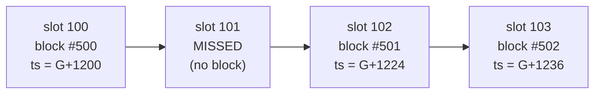

# 1.10 Block and chain context

> [!abstract] In one minute
> - Block context opcodes (`NUMBER`, `TIMESTAMP`, `PREVRANDAO`, `BASEFEE`, `BLOBBASEFEE`, `CHAINID`, `COINBASE`, `GASLIMIT`) cost 2 gas. They return the same value to every transaction in the block. `BLOCKHASH` costs 20 gas.
> - Since the Merge, `block.timestamp` is fixed by the slot: `genesis_time + slot × 12`. The proposer cannot pick it. A proposer can only skip its slot, and the next block then lands 24 seconds (or more) after the last one. `block.number` counts blocks, not slots.
> - `block.prevrandao` (the same opcode `0x44` as the old `block.difficulty`) is the beacon chain RANDAO mix after the parent block. Everyone knows it about one slot ahead. Each proposer gets 1 bit of bias by withholding its block, and the includer gets a second bit by choosing which block a transaction lands in.
> - `blockhash(n)` works only for the 256 blocks before the current one, and returns 0 outside that range. It never reverts. Since Prague (7 May 2025), the EIP-2935 contract at `0x0000F90827F1C53a10cb7A02335B175320002935` serves the last 8,191 block hashes and **reverts** when asked for anything outside that range.
> - L2s change these values. Arbitrum's `block.number` is an approximate L1 block number. OP Stack chains make a block every 2 seconds, and their `PREVRANDAO` is the L1 origin's value. ZKsync returns a constant. Any code that measures time in blocks, or takes randomness from block values, needs a check for each chain.
> - `block.slotnum` (EIP-7843, opcode `0x4b`) is in Solidity 0.8.37+ for the Amsterdam EVM version. That version is still experimental in 0.8.38, and Glamsterdam has no mainnet date yet.

**Prerequisites:** [[1.2 Transactions and fees]], [[1.3 Execution model]] · **Leads to:** [[1.11 Hard forks that changed contract code]], [[4.6 On-chain cryptography]], [[4.8 L2s and cross-chain]], [[5.6 MEV and transaction ordering]]

## The mental model: one header, read-only

Every opcode in this note reads one of two things. The first is the **block header** of the block being executed. The second is the **transaction envelope** of the transaction being executed. Neither can change during execution. All transactions in a block see the same `block.*` values. All call frames in a transaction see the same `tx.*` values. The exception is `gasleft()`, which reads the current frame's gas counter.

Contract code tends to make three mistakes with these values:

1. **Using them as a clock.** The values follow consensus rules, and those rules differ between L1 and each L2.
2. **Using them as randomness.** Every one of them is either public before your transaction runs or influenced by someone with a motive.
3. **Using them for authorization.** `tx.origin` and `block.coinbase` both show up in old access-control code, and both are unsafe there.

Who chooses each value matters most. On post-Merge Ethereum, the beacon chain proposer for a slot (or, with MEV-Boost, the builder it outsources to) builds the execution payload. But most header fields are *checked* against consensus rules, so the proposer has fewer choices than it seems.

## Reference table: every block and transaction context value

Order is by opcode. "Who controls it" means who can influence the value your contract reads.

| Solidity | Opcode (gas) | Introduced | Meaning on post-Merge mainnet | Who controls it | Safe uses |
|---|---|---|---|---|---|
| `tx.origin` | `ORIGIN` `0x32` (2) | Frontier | Signer of the transaction. Since EIP-7702 this account may have code. | Transaction sender | Analytics and events. **Never** authorization (see [[5.11 New attack surfaces - transient storage, EIP-7702, account abstraction]]). |
| `tx.gasprice` | `GASPRICE` `0x3a` (2) | Frontier | *Effective* price per gas: base fee + effective priority fee | Sender (within fee rules) | Refunding relayers. Measuring overpayment. |
| `blockhash(n)` | `BLOCKHASH` `0x40` (20) | Frontier | Hash of block `n` if `n` is one of the 256 blocks before the current block, otherwise `0` | Block contents (a builder can grind them) | Committing to recent history. Proving header fields. Not randomness. |
| `block.coinbase` | `COINBASE` `0x41` (2) | Frontier | Fee recipient chosen by the proposer. With MEV-Boost this is often the builder's address. Warm since Shanghai (EIP-3651). | Proposer or builder | Paying a builder directly ("coinbase transfer"). Never identity or auth. |
| `block.timestamp` | `TIMESTAMP` `0x42` (2) | Frontier | `genesis_time + slot × 12`: the start of the slot, in seconds | **The slot.** The proposer only chooses *whether* to propose. | Deadlines and accrual with tolerance of a slot or more. TWAP windows. |
| `block.number` | `NUMBER` `0x43` (2) | Frontier | Height of this block. It goes up by 1 per *proposed* block, not per slot. | Consensus (missed slots slow it) | Ordering. Snapshots. "At least k blocks later." Not wall time. |
| `block.prevrandao` (`block.difficulty` is a deprecated alias) | `PREVRANDAO` `0x44` (2) | Frontier as `DIFFICULTY`, new meaning from Paris (EIP-4399) | Beacon RANDAO mix after the parent block. Always greater than 2^64 under PoS. | Parent's proposer (1 bit by withholding). Known one slot ahead. | Low-stakes randomness with lookahead. A mixing input. |
| `block.gaslimit` | `GASLIMIT` `0x45` (2) | Frontier | Block gas limit. It can move by at most parent/1024 per block, by proposer vote. | Proposers collectively | Bounding loops conservatively. |
| `block.chainid` | `CHAINID` `0x46` (2) | Istanbul (EIP-1344) | Chain ID (1 on mainnet) | Fixed per chain. Changes only on a chain split. | EIP-712 domains. Replay protection ([[5.8 Signatures and replay]]). |
| `block.basefee` | `BASEFEE` `0x48` (2) | London (EIP-3198) | EIP-1559 base fee, set by formula from the parent's gas use | Protocol formula | Gas oracles. Refund math. Fee-aware keepers. |
| `blobhash(i)` | `BLOBHASH` `0x49` (3) | Cancun (EIP-4844) | Versioned hash of blob `i` *of the current transaction*, `0` if there is none | Transaction sender | Rollup batch verification |
| `block.blobbasefee` | `BLOBBASEFEE` `0x4a` (2) | Cancun (EIP-7516) | Blob gas price. Since Fusaka (EIP-7918) it has a floor tied to the execution base fee. | Protocol formula | Batcher cost accounting |
| `block.slotnum` | `SLOTNUM` `0x4b` (2) | Amsterdam (EIP-7843, scheduled) | Beacon slot number, `uint64` | Consensus layer | Schedules that keep working if slot length changes |
| `gasleft()` | `GAS` `0x5a` (2) | Frontier | Gas left in this frame after the `GAS` instruction | Caller (how much gas it forwards) | Guards before risky calls. 63/64 reasoning ([[1.9 Gas accounting]]). |
| *(contract)* | `STATICCALL` to `0x0000F908…2935` | Prague (EIP-2935) | Hash of any of the last 8,191 blocks | System write at the start of each block | Header proofs up to about 27 hours back |
| *(contract)* | `STATICCALL` to `0x000F3df6…Beac02` | Cancun (EIP-4788) | Parent beacon block root, looked up by timestamp, 8,191-entry buffer | System write at the start of each block | Proving consensus-layer state (validators, balances) |

Solidity versions: `block.chainid` 0.8.0, `block.basefee` 0.8.7, `block.prevrandao` 0.8.18, `blobhash` and `block.blobbasefee` 0.8.24, `block.slotnum` 0.8.37. With the default `osaka` target, `block.difficulty` still compiles to `0x44`, with the warning *"Since the VM version paris, 'difficulty' was replaced by 'prevrandao'"*. If you target a version before Paris, `block.prevrandao` is treated as `difficulty` (with a warning).

> [!info]- Deep dive: fork dates for the rows above (newest first)
> | Fork | Mainnet date | Block-context change |
> |---|---|---|
> | Glamsterdam (Amsterdam EL) | Not set. Sepolia 6 Oct 2026. Hoodi (26 Oct 2026) cancelled on 22 Oct 2026. | `SLOTNUM` (EIP-7843). ePBS (EIP-7732) also changes who builds payloads. |
> | Fusaka (Osaka) | 3 Dec 2025, block 23,935,694 | Blob base fee reserve price (EIP-7918) |
> | Pectra (Prague) | 7 May 2025, block 22,431,084 | EIP-2935 history contract. EIP-7702 (`tx.origin` may have code). |
> | Dencun (Cancun) | 13 Mar 2024, block 19,426,587 | `BLOBHASH`, `BLOBBASEFEE`, EIP-4788 beacon roots |
> | Paris (The Merge) | 15 Sep 2022, block 15,537,394 | `DIFFICULTY` becomes `PREVRANDAO`. Slot-locked timestamps. |
> | London | 5 Aug 2021, block 12,965,000 | `BASEFEE` |
> | Istanbul | 8 Dec 2019, block 9,069,000 | `CHAINID` |
> | Frontier | 30 Jul 2015 | Everything else |
>
> Full per-fork changes are in [[1.11 Hard forks that changed contract code]].

## Time: `block.timestamp`, `block.number` and slots

### Intuition

Proof-of-stake Ethereum runs on a fixed clock. Time is cut into 12-second **slots**, and every 32 slots make an **epoch** (6.4 minutes). Each slot has one chosen proposer. If that proposer publishes a block, the block belongs to that slot. If it does not, the slot stays empty, and the chain simply has no block for that time.

### Mechanism

The consensus spec (Bellatrix and later) checks this when it processes the execution payload:

```text
assert payload.timestamp == compute_time_at_slot(state.genesis_time, state.slot)
# compute_time_at_slot = genesis_time + slot * SLOT_DURATION_MS / 1000   (12,000 ms on mainnet)
```

Mainnet `genesis_time` is `1606824023` (1 Dec 2020 12:00:23 UTC). So slot 10,000,000 has timestamp `1606824023 + 120000000 = 1726824023`. The timestamp is a pure function of the slot. A block with any other timestamp is invalid.

> [!warning] Correction to a common claim
> "The proposer chooses `block.timestamp` within limits" was true under proof-of-work. Miners picked any timestamp greater than the parent's, and clients rejected blocks too far in the future (geth allowed 15 seconds). **After the Merge the proposer has no choice over the value.** It is exactly `genesis_time + 12 × slot`. What a proposer *can* do:
> - **Skip its slot.** The next block then has a timestamp 24 seconds (or more) after the parent, in steps of 12.
> - **Decide which slot your transaction lands in**, by including it or censoring it. A transaction that is delayed by k blocks sees a timestamp at least 12k seconds later.
>
> So timestamps on mainnet always go up in multiples of 12 seconds. The gap is exactly 12 seconds unless slots were missed.



`block.number` counts *blocks*. EIP-4399 puts missed proposals at about 1% on mainnet, so `block.number` grows a little slower than `slot`. Code that turns "N blocks" into time ("7,200 blocks is one day") is slightly wrong on L1 and badly wrong on L2s (see [the L2 question](#question-ladder)).

### Edge cases

- **Same value for the whole block.** Two transactions in one block see the same `block.timestamp`. A deadline check `block.timestamp <= deadline` cannot tell them apart. Neither can a rate limiter keyed on timestamps.
- **Slot length is not fixed forever.** Code that derives the slot as `(block.timestamp - genesis) / 12` hardcodes mainnet's genesis time and slot length. EIP-7843 exists because shorter slots have been proposed, and that formula would then break silently. `block.slotnum` gets the slot from the consensus layer instead.
- **Precision.** The timestamp is in seconds and counts the *start* of the slot. The block is built during the slot and usually published a few seconds in. Code cannot see that difference.

## Randomness from the beacon chain: `PREVRANDAO`

### Intuition

Every epoch, each proposer contributes a value it cannot choose: a BLS signature over the epoch number, called the **RANDAO reveal**. The beacon state keeps a running **mix** that each block's reveal updates. The value is unpredictable *until the relevant proposer publishes*. But every proposer has one real choice: publish (and the mix updates) or withhold (and it does not).

### Mechanism

- In beacon processing, each block XORs the hash of its proposer's reveal into the current epoch's mix: `mix = mix XOR sha256(randao_reveal)`. A BLS signature is deterministic for a given key and message, so a proposer cannot grind different reveals.
- The execution payload of block N must carry `prev_randao == get_randao_mix(state, current_epoch)`. This is checked *before* block N's own reveal is mixed in. So the value in block N is the mix after block N−1, which is why it is called *prev* RANDAO.
- EIP-4399 points opcode `0x44` at this header field (formerly `mixHash`) and leaves the gas cost unchanged (2). Under PoS the value is always greater than 2^64. That fact lets code detect PoS, because old `DIFFICULTY` values were much smaller.

### What each party knows and controls

| Party | What it knows | What it controls |
|---|---|---|
| Everyone | `prevrandao` of block N as soon as block N−1 is published, about 12 seconds ahead | Nothing |
| Builder or proposer of block N | The same value while building | Whether your transaction goes into block N or a later block. That is a second bit: "this value or the next one." EIP-4399 calls this nearly free. |
| Proposer of block N−1 | Its own reveal, so the mix that block N would see | Publish or withhold: 1 bit, at the cost of its block rewards and fees |
| An entity with k proposals in a row before the target | Up to 2^k possible mixes | Picks the best of them, losing rewards for each withheld block |

EIP-4399's advice is to commit first, then use a mix far in the future. It suggests at least four epochs of lookahead (128 slots, about 25.6 minutes), so the proposer set is still unknown when bets close. Missed proposals and validator-set churn then add entropy. It also says to keep the extra wait ε small (2 to 4 slots) after that.

## History: `blockhash`, EIP-2935 and EIP-4788

### `BLOCKHASH` (256 blocks)

`BLOCKHASH(n)` returns the hash for `block.number - 256 <= n < block.number` and **0 otherwise**. That includes the current block, future blocks and older blocks. It never reverts. I checked this in py-evm (Prague rules): age 1 and age 256 returned the real hash, and age 257 and `blockhash(block.number)` returned 0. A window of 256 blocks is 51.2 minutes on mainnet.

### EIP-2935 history contract (8,191 blocks)

Prague added a system contract. At the start of each block, before any transactions, the client calls it from `SYSTEM_ADDRESS = 0xff…fe` with the parent hash. The contract stores that hash at slot `(block.number - 1) % 8191`. Facts I checked against the final EIP and by running the bytecode:

| Item | Value |
|---|---|
| Address | `0x0000F90827F1C53a10cb7A02335B175320002935` (re-derived: `keccak(rlp([0x3462413A…D685, 0]))[12:]`) |
| Ring buffer | `HISTORY_SERVE_WINDOW = 8191` (`0x1fff` in the bytecode). About 27.3 hours of mainnet blocks. |
| Query (`get`) | Calldata = **exactly 32 bytes**, the big-endian block number. Returns 32 bytes. |
| Valid range | `block.number - 8191 <= n <= block.number - 1`. Anything else, or calldata of the wrong length, gives `revert(0, 0)`. |
| Backfill | None. Blocks before activation read as `0` until the buffer fills. |
| `BLOCKHASH` opcode | Unchanged: still 256 blocks |
| Gas | The system write does not warm the account or slot. A contract's first read costs 2,600 (cold account) + 2,100 (cold `SLOAD`) + a little overhead. |

The 83-byte runtime, disassembled (I ran it in py-evm):

```text
CALLER PUSH20 0xff..fe EQ PUSH1 0x46 JUMPI          ; system caller -> set
PUSH1 0x20 CALLDATASIZE SUB PUSH1 0x42 JUMPI        ; calldatasize != 32 -> revert
PUSH0 CALLDATALOAD PUSH1 1 NUMBER SUB DUP2 GT ...   ; n > number-1      -> revert
PUSH2 0x1fff DUP2 NUMBER SUB GT ...                 ; number-n > 8191   -> revert
PUSH2 0x1fff SWAP1 MOD SLOAD PUSH0 MSTORE PUSH1 0x20 PUSH0 RETURN
JUMPDEST PUSH0 PUSH0 REVERT
JUMPDEST PUSH0 CALLDATALOAD PUSH2 0x1fff PUSH1 1 NUMBER SUB MOD SSTORE STOP   ; set
```

In a py-evm run with 8,600 blocks, ages 1 and 8,191 returned the correct hashes and age 8,192 reverted with empty data. A 31-byte query also reverted.

> [!note] Cousin: EIP-4788 beacon roots
> `0x000F3df6D732807Ef1319fB7B8bB8522d0Beac02` stores parent *beacon* block roots, keyed by **timestamp**, in an 8,191-entry buffer. It reverts if the calldata is not 32 bytes, if the timestamp is 0, or if the stored timestamp does not match (a missed slot or an overwritten entry). Use it to prove consensus-layer facts with SSZ Merkle proofs: validator balances, withdrawal credentials, or the RANDAO mix of an epoch. Proof verification is covered in [[4.6 On-chain cryptography]].

## Solidity and Yul in practice

### Reading the context

This compiles with 0.8.38 (default `osaka`):

```solidity
// SPDX-License-Identifier: MIT
pragma solidity ^0.8.24;

contract ContextProbe {
    uint256 internal constant MAINNET_GENESIS_TIME = 1606824023; // beacon genesis, 1 Dec 2020
    uint256 internal constant SECONDS_PER_SLOT = 12;

    struct Ctx {
        uint256 number;
        uint256 timestamp;
        uint256 prevrandao;
        uint256 basefee;
        uint256 blobbasefee;
        uint256 chainid;
        address coinbase;
        uint256 gaslimit;
        bytes32 parentHash;
        uint256 gasLeft;
        address origin;
        uint256 gasPrice;
        bytes32 blob0;
    }

    function read() external view returns (Ctx memory c) {
        c.number = block.number;
        c.timestamp = block.timestamp;
        c.prevrandao = block.prevrandao; // same opcode (0x44) as block.difficulty
        c.basefee = block.basefee;
        c.blobbasefee = block.blobbasefee;
        c.chainid = block.chainid;
        c.coinbase = block.coinbase;
        c.gaslimit = block.gaslimit;
        c.parentHash = blockhash(block.number - 1);
        c.gasLeft = gasleft();
        c.origin = tx.origin;
        c.gasPrice = tx.gasprice; // effective price paid per gas
        c.blob0 = blobhash(0); // 0 unless this is a blob (type-3) transaction
    }

    /// Mainnet-only slot derivation that works today. It hardcodes the slot
    /// length, which is exactly what EIP-7843 (SLOTNUM) removes.
    function mainnetSlot() external view returns (uint256) {
        return (block.timestamp - MAINNET_GENESIS_TIME) / SECONDS_PER_SLOT;
    }

    /// Same reads in inline assembly.
    function readAsm() external view returns (uint256 n, uint256 t, uint256 r, uint256 id) {
        assembly {
            n := number()
            t := timestamp()
            r := prevrandao()
            id := chainid()
        }
    }
}
```

### `block.slotnum` (Amsterdam EVM version)

This compiles with 0.8.38 only when you pass `evmVersion: "amsterdam"` **and** `"experimental": true` in the standard-JSON settings. Without the flag, solc says *"EVM version 'amsterdam' is experimental and can only be used with the 'settings.experimental' option enabled."* With the default `osaka` target, you get *"'slotnum' is not supported by the VM version."* The type is `uint64`.

```solidity
// SPDX-License-Identifier: MIT
pragma solidity ^0.8.37;

// Needs evmVersion "amsterdam". In 0.8.38 that EVM version is still
// experimental: standard JSON needs "settings": {"experimental": true, ...}.
contract SlotProbe {
    function slot() external view returns (uint64) {
        return block.slotnum; // SLOTNUM, opcode 0x4b, 2 gas
    }

    function slotAsm() external view returns (uint256 s) {
        assembly {
            s := slotnum()
        }
    }
}
```

EIP-7843 is in **Last Call** (deadline 1 Nov 2026) and is scheduled for inclusion in Glamsterdam. That fork has no mainnet date yet. Do not deploy Amsterdam-targeted bytecode to mainnet: `0x4b` is an invalid opcode there today.

### Reading EIP-2935, with fallbacks

```solidity
// SPDX-License-Identifier: MIT
pragma solidity ^0.8.28;

/// Reads historical block hashes: BLOCKHASH for the last 256 blocks,
/// the EIP-2935 history contract for the last 8,191.
library BlockHistory {
    address internal constant HISTORY = 0x0000F90827F1C53a10cb7A02335B175320002935;
    uint256 internal constant WINDOW = 8191;

    error HashUnavailable(uint256 blockNumber);

    function hashOf(uint256 n) internal view returns (bytes32 h) {
        if (n >= block.number) revert HashUnavailable(n); // current or future block
        if (block.number - n <= 256) return blockhash(n); // cheap path: 20 gas opcode
        if (block.number - n > WINDOW) revert HashUnavailable(n);

        (bool ok, bytes memory ret) = HISTORY.staticcall(abi.encode(n));
        // ret.length check matters: a call to an address with no code SUCCEEDS
        // with empty returndata (chains without EIP-2935).
        if (!ok || ret.length != 32) revert HashUnavailable(n);
        h = abi.decode(ret, (bytes32));
        if (h == bytes32(0)) revert HashUnavailable(n); // slot never written (pre-fork)
    }

    /// Same query in inline assembly, using scratch space 0x00-0x1f.
    function hashOfAsm(uint256 n) internal view returns (bytes32 h) {
        assembly ("memory-safe") {
            mstore(0x00, n)
            let ok := staticcall(gas(), HISTORY, 0x00, 0x20, 0x00, 0x20)
            // Out of range -> the history contract reverts -> ok == 0.
            // No code at HISTORY -> ok == 1 but returndatasize() == 0.
            if iszero(and(ok, eq(returndatasize(), 0x20))) { revert(0x00, 0x00) }
            h := mload(0x00)
        }
    }
}
```

Why each check exists:

- **`n >= block.number`.** Both sources would give 0 or revert. Fail loudly instead.
- **The `<= 256` shortcut.** `BLOCKHASH` costs 20 gas. The history call costs about 4,800 gas cold. In py-evm, `hashOfAsm(5)` cost about 4,785 gas more than the `BLOCKHASH` path, end to end.
- **`returndatasize() == 32`.** This is the classic pitfall. `STATICCALL` to an address with no code *succeeds* and returns nothing. On a chain or test fork without EIP-2935, the naive `mload(0)` returns whatever was in scratch space. Here that is your own input `n`, which then looks like a "hash".
- **Zero check.** Within 8,191 blocks of activation, pre-fork slots were 0. Mainnet is long past that, but new chains and devnets are not.

### Proving a past block's `PREVRANDAO` with a header

`PREVRANDAO` can only be read for the *current* block. EIP-2935 lets anyone prove the value of an *earlier* block. Pass the RLP-encoded header, check `keccak256(header) == hashOf(n)`, then read field 13 (`prevRandao`, formerly `mixHash`). The value then depends only on the block's identity, not on which block the settling transaction happens to land in. That removes the includer's "censor until a good block" bit.

```solidity
// SPDX-License-Identifier: MIT
pragma solidity ^0.8.28;
// Paste the BlockHistory library from the previous snippet here;
// the two snippets together compile as one file.

/// Extracts prevRandao (header field 13, called mixHash before the Merge)
/// from an RLP-encoded execution block header.
library HeaderRandao {
    error BadHeader();

    function prevRandao(bytes calldata header) internal pure returns (bytes32 r) {
        uint256 off = _listPayloadStart(header);
        for (uint256 i; i < 13; ++i) off = _skipItem(header, off);
        if (off + 33 > header.length || uint8(header[off]) != 0xa0) revert BadHeader();
        r = bytes32(header[off + 1:off + 33]);
    }

    function _listPayloadStart(bytes calldata h) private pure returns (uint256) {
        uint256 b = uint8(h[0]);
        if (b < 0xf8) revert BadHeader(); // a header is always a long list
        uint256 lenOfLen = b - 0xf7;
        if (1 + lenOfLen + _be(h, 1, lenOfLen) != h.length) revert BadHeader();
        return 1 + lenOfLen;
    }

    function _skipItem(bytes calldata h, uint256 off) private pure returns (uint256) {
        uint256 b = uint8(h[off]);
        if (b < 0x80) return off + 1; // single byte
        if (b < 0xb8) return off + 1 + (b - 0x80); // short string
        if (b < 0xc0) {
            uint256 n = b - 0xb7; // long string
            return off + 1 + n + _be(h, off + 1, n);
        }
        revert BadHeader(); // fields 0..12 are never lists
    }

    function _be(bytes calldata h, uint256 off, uint256 n) private pure returns (uint256 v) {
        for (uint256 i; i < n; ++i) v = (v << 8) | uint8(h[off + i]);
    }
}

/// Seed = prevRandao of a block chosen in advance. Anyone can settle by
/// supplying that block's header, up to 8,191 blocks later.
contract RandaoSeed {
    uint256 public immutable targetBlock;
    bytes32 public seed;

    error AlreadySettled();
    error NotYet();
    error WrongHeader();

    constructor(uint256 delayBlocks) {
        targetBlock = block.number + delayBlocks;
    }

    function settle(bytes calldata header) external {
        if (seed != 0) revert AlreadySettled();
        if (block.number <= targetBlock) revert NotYet();
        if (keccak256(header) != BlockHistory.hashOf(targetBlock)) revert WrongHeader();
        seed = HeaderRandao.prevRandao(header);
    }
}
```

I tested this end to end in py-evm (Prague rules) with real 610-byte headers:

- `randaoOf(header)` matched the header's `mix_hash`.
- `settle` reverted with `NotYet` before the target block and with `WrongHeader` for another block's header.
- `settle` succeeded 381 blocks later, through the EIP-2935 path, and the seed matched.
- A second `settle` reverted with `AlreadySettled`.

> [!warning] Limits of the header trick
> - Settlement must happen within 8,191 blocks (about 27 hours). Add a fallback (refund, or the nearest provable block) for when nobody settles in time.
> - The header layout is L1's. L2 headers fill these fields differently. Do not use this on an L2 without reading that chain's header spec.
> - It only removes the includer's bit. The proposer of block `target − 1` can still withhold.
> - Cost: a full `settle` transaction measured about 64,000 gas in py-evm (Prague pricing). Most of that is the 21,000 base, the 610-byte header as calldata, and the 20,000-gas `SSTORE` of the seed.

## Pitfalls and incidents

| Date | Incident | What went wrong | Lesson |
|---|---|---|---|
| Jul 2018 | Fomo3D airdrop | The airdrop "random" seed hashed `block.timestamp`, `block.difficulty`, `block.coinbase`, `block.gaslimit`, `block.number` and `msg.sender`. An attacker contract computed the result inside its own transaction and only played when it would win. It also ground `CREATE` nonces to pick a winning `msg.sender`. | Anything readable in the same transaction can be computed by an attacker contract first |
| Oct 2017 | SmartBillions (about 400 ETH) | Bets were resolved against a future `blockhash`. The contract did not check the bet's age. After 256 blocks `blockhash` returns 0, so the attacker waited and then claimed a "winning" number that was known in advance. | `BLOCKHASH` gives 0 rather than reverting. Always handle the out-of-window case. |
| Recurring audit finding | `block.number` used as a clock on L2s | Vesting and emission schedules written as "blocks per day = 7,200" run about 6 times faster on a 2-second OP Stack chain. On Arbitrum they follow L1 blocks in jumps. | Use `block.timestamp` for time. Use block counts only for ordering. |

Other footguns:

- **`blockhash(block.number)` is always 0.** The current block's hash does not exist yet. Old contracts that used it as entropy were using a constant.
- **Caching `block.chainid`.** An EIP-712 domain separator stored as `immutable` is wrong after a chain split. OpenZeppelin's `EIP712` caches it but recomputes when `block.chainid` changes.
- **`block.coinbase` checks.** "Only the block producer can call" schemes break whenever builders, relays or L2 sequencers set the fee recipient. On ZKsync it is the bootloader (`0x8001`). On Scroll it is a fee vault.
- **Tight timestamp windows.** `require(block.timestamp == x)` holds for at most one block. On mainnet it holds for none if that slot is missed.
- **`gasleft()` before a call** does not tell you what the callee receives, because of the 63/64 rule. See [[1.9 Gas accounting]].

## Question ladder

> [!question]- **B** Why is `block.timestamp` unsuitable as a source of randomness?
> There are four separate reasons, and any one is enough to rule it out.
>
> 1. **It is predictable, exactly and far ahead.** On post-Merge Ethereum, `block.timestamp = 1606824023 + 12 × slot`. Anyone can compute the timestamp of any future slot today. There is no entropy at all.
> 2. **It is the same for the whole block.** Every transaction, and every attacker contract, in that block reads the same value. An attacker contract can run `uint(keccak256(abi.encode(block.timestamp, ...))) % N` itself, before calling your contract, and call you only when it wins. Otherwise it reverts and loses only gas. This is exactly the Fomo3D airdrop exploit.
> 3. **The block producer controls which timestamp a transaction sees.** The proposer cannot set the number post-Merge. But by including or delaying your transaction, the proposer or builder decides which slot it lands in. By skipping its own slot, it moves the next block's timestamp 12 seconds later. Under PoW it was worse: miners chose the value within a tolerance window.
> 4. **On L2s the sequencer sets it.** On Arbitrum it is the sequencer's clock, within 24 hours in the past and 1 hour in the future. On OP Stack chains it is `parent + 2 s`, fully deterministic.
>
> The interview answer: "Public before execution, identical for everyone in the block, and influenced by the party ordering transactions." Use a VRF or commit-reveal (see the E question).

> [!question]- **I** What is PREVRANDAO, and how much can a proposer bias it?
> **What it is.** Opcode `0x44` (formerly `DIFFICULTY`), 2 gas, read as `block.prevrandao`. After Paris (EIP-4399), it returns the header field `prevRandao`. That field must equal the beacon chain's RANDAO mix for the current epoch *before* the current block's reveal is applied, which is the mix after the parent block. Each beacon block updates the mix with `mix ⊕ sha256(randao_reveal)`. The reveal is the proposer's BLS signature over the epoch number. BLS signatures are deterministic, so the proposer has no freedom in what it contributes. It only chooses whether to contribute.
>
> **Bias.**
> - **1 bit per controlled slot (withholding).** The proposer of block N−1 knows which mix its block would produce. If it dislikes the outcome, it skips its slot. It loses that block's consensus reward, priority fees and MEV. The next proposer's block then carries the old mix. With k proposals in a row right before the target block, an attacker can choose among 2^k outcomes. Large staking entities sometimes get several slots in a row, so k > 1 does happen.
> - **A second bit (inclusion).** The builder or proposer of block N already knows `prevrandao` for N. EIP-4399 notes that it can censor a dice-rolling transaction into a later block whose mix it prefers, at negligible cost.
> - **No better than that.** One honest proposal after the attacker's run wipes out the attacker's control. The attacker can only choose among a few candidates. It cannot set an arbitrary value.
>
> **Predictability.** The value for block N is public about 12 seconds ahead, as soon as N−1 is published. So "read `block.prevrandao` in the same transaction that consumes it" lets bots and builders simulate the result and front-run, or skip, as they like.
>
> **How to use it, if at all.** Commit to a *future* block first (close bets in epoch K, then use a mix at least four epochs later, per EIP-4399). Make the value independent of when the settling transaction lands, for example with the EIP-2935 header proof above. Keep the prize small compared with what one proposer gives up by withholding a block. For anything valuable, use it only as one input among others.

> [!question]- **I** What are the limits of `blockhash`, and how does the EIP-2935 history contract extend them?
> **`BLOCKHASH` limits.**
> - It covers only the 256 most recent blocks before the current one: `block.number-256 <= n < block.number`, about 51 minutes on mainnet.
> - It returns `0` for the current block, future blocks and older blocks. It does not revert, so out-of-range bugs fail silently (SmartBillions).
> - It is **not randomness.** The hash depends on block contents that the builder chooses, so a builder can grind it. It is also public once the block exists.
>
> **EIP-2935 (Prague, 7 May 2025).**
> - A system contract at `0x0000F90827F1C53a10cb7A02335B175320002935`. At the start of each block, the client calls it from `0xff…fe`, and it stores `parent_hash` at slot `(block.number-1) % 8191`.
> - **Query:** `staticcall` with exactly 32 bytes of calldata, the block number as a big-endian `uint256` (`abi.encode(n)`). It returns 32 bytes.
> - **Window:** `[block.number - 8191, block.number - 1]`, about 27.3 hours. Out-of-window queries and wrong-length calldata **revert with empty data**, unlike `BLOCKHASH`'s silent 0. Slots for blocks before activation read 0, because nothing was backfilled.
> - **Cost:** about 4,800 gas cold (2,600 account + 2,100 slot + overhead), about 200 warm. The `BLOCKHASH` opcode itself was left at 256 blocks and 20 gas.
>
> **What it enables.** Header proofs (prove the state root, timestamp, base fee or `prevRandao` of a block up to 27 hours old) and storage proofs against that state root, without an oracle. It also gives stateless clients the recent history they need. For more than 8,191 blocks you still need EIP-4788 beacon roots plus SSZ proofs into `historical_summaries`, or an off-chain proof system.
>
> **Gotcha.** On a chain without the contract, `staticcall` *succeeds* with empty returndata. Always check `returndatasize() == 32`.

> [!question]- **A** How do `block.number` and `block.timestamp` behave on major L2s, and what breaks when code assumes mainnet behavior?
> Each rollup defines these opcodes itself. Facts below are from each chain's official docs as of Oct 2026.
>
> | Chain | `block.number` | `block.timestamp` | `block.prevrandao` | Block time / notes |
> |---|---|---|---|---|
> | **Arbitrum One / Nitro chains** | An *approximation of the L1 block number*. It updates in jumps (the docs give an example of syncing every 13 to 15 seconds, "occasionally longer"). The L2 number is `ArbSys(address(100)).arbBlockNumber()`. | Sequencer-chosen. It must be at least the previous L2 block's timestamp and within 24 hours in the past and 1 hour in the future. Not tied to L1 timestamps. | Constant `1` | Blocks are made only when there are transactions, sub-second when busy. `blockhash` returns an "insecure pseudo-random hash" for the last 256 (L1-numbered) blocks. The gas limit reads as 1,125,899,906,842,624. |
> | **OP Stack (OP Mainnet, Base)** | L2 block number | Exactly `parent + l2_block_time`. That is 2 s on OP Mainnet and Base, and the spec allows 1 or 2 s. It must also be at least the L1 origin's timestamp and stay within the max sequencer drift (1,800 s since Fjord). | The **L1 origin block's** `prevrandao`, so many L2 blocks share it and it is known in advance | L1 data via the `L1Block` predeploy `0x4200…0015`. `L1BlockNumber` at `0x4200…0013` is legacy. Base adds 200 ms Flashblocks *within* a 2-second block. `block.number` still advances per 2-second block. |
> | **ZKsync Era** | L2 block number (changed from L1 batch number in 2023) | L2 block timestamp | Constant `2500000000000000` | About 1-second L2 blocks, grouped into L1 batches. `block.coinbase` is the bootloader (`0x8001`). EVM-emulation mode does not support `BLOBHASH`/`BLOBBASEFEE`. |
> | **Scroll** | L2 block number | L2 block timestamp | Always `0` | `COINBASE` is a fee-vault predeploy. EIP-4788 is not supported. |
>
> **What breaks:**
> 1. **Block-count clocks.** `uint256 constant BLOCKS_PER_YEAR = 2_628_000` (12 s blocks) makes emissions, vesting cliffs, lockups and governance voting periods run 6 times faster on a 2-second OP Stack chain. On Arbitrum they follow L1 time, but in jumps, so "1 block later" can be many L2 transactions later or the same block. Fix: use `block.timestamp`, or make blocks-per-second a constructor parameter for each chain. Compound-style governors with block-based `votingPeriod` have been a repeated audit finding here.
> 2. **Same-block assumptions.** On Arbitrum, many L2 blocks share one `block.number`. Logic like "one action per block" or "flash-loan guard: `lastBlock != block.number`" lets many transactions through.
> 3. **Randomness.** On L2s, `PREVRANDAO` is constant (Arbitrum, ZKsync, Scroll) or an L1 value chosen by the sequencer's choice of L1 origin (OP Stack). The sequencer orders every transaction, so it controls the "includer bit" completely. `blockhash` on Arbitrum is explicitly insecure. Never use any of these as randomness on an L2.
> 4. **Timestamps the sequencer controls.** On Arbitrum, the sequencer can skew time within its bounds. On OP Stack, time is deterministic, but a sequencer outage stops it. When batches are forced in through L1 after the sequencing window (3,600 L1 blocks, about 12 hours), time can jump. Oracle staleness checks need a sequencer-uptime feed ([[4.7 Oracles and off-chain data]]).
> 5. **Precompiles and system contracts.** Code that calls EIP-2935, EIP-4788 or blob opcodes can hit empty addresses or invalid opcodes. Check that the chain supports them, and check returndata length.
>
> Cross-chain design is covered in [[4.8 L2s and cross-chain]].

> [!question]- **E** Design on-chain randomness for a high-value lottery: VRF vs commit-reveal vs RANDAO with lookahead.
> **What a good answer covers.** First name the threat model: players, the operator, block producers or sequencers, and the oracle. Then, for each design, ask who can **predict** the value, who can **bias** it (choose among outcomes), and who can **abort** (stop the draw). Then cover cost and liveness. The key point is that **abort is a form of bias**. Anyone who can see the outcome and then refuse to finish has 1 bit.
>
> | | Chainlink VRF (v2.5) | Commit-reveal (with bonds) | RANDAO + lookahead |
> |---|---|---|---|
> | Predict | Nobody before fulfillment. The output is a VRF proof checked on-chain against the oracle's key. | Nobody, as long as one participant's secret stays hidden | Everyone knows the value one slot before the target block |
> | Bias | The oracle cannot choose the output. It can **withhold** it. A block producer can reorg the request into another block to get a fresh output, which is why you set request confirmations. | **Last revealer** sees the others and can refuse to reveal: 1 bit per participant who may withhold | Tail proposers: 1 bit each by withholding (2^k with k slots in a row). Plus the includer bit unless you use a header proof. |
> | Abort and liveness | Depends on the oracle network and a funded subscription. If `fulfillRandomWords` reverts, it is **not retried**. | Needs participants to come back. You need timeouts and slashing. | Always live (blocks keep coming). Settling needs someone to call within 8,191 blocks, or you lose the header proof. |
> | Cost | Oracle fee + callback gas (premium in LINK or native) | Two transactions per participant + bond capital | Cheapest: the whole `settle` transaction above cost about 64,000 gas in py-evm, including the 21,000 base, about 650 bytes of header calldata and a 20,000-gas `SSTORE` |
> | Trust | Chainlink's key holders and node availability | Participants and the bond size | Ethereum validator set |
>
> **RANDAO alone is not enough for a high-value lottery.** The cost of bias is one forgone block reward (consensus reward + fees + MEV) per bit. The benefit is about `P × Δp`, where `P` is the prize and `Δp` the change in win probability. With one extra outcome to choose from, an attacker holding a share `q` of tickets raises its win chance from `q` to about `1-(1-q)²`, which is about `2q`. A prize far larger than a block reward makes withholding rational for any validator who also holds tickets, or who can be bribed by a ticket holder. On an L2 it is worse: the sequencer has full control.
>
> **Pure commit-reveal** among players fails the same way. The last revealer drops out when it would lose. A bond only helps if it is bigger than the expected gain from aborting, which grows with the prize. That ties up capital and griefs honest players.
>
> **VRF** gives the best unpredictability and no ability to bias. It moves the trust to liveness and key custody. The VRF security guide lists the rules an interviewer will listen for:
> - Stop accepting entries **before** requesting.
> - **Never** allow re-requests or cancellation after a request, because that turns withholding into a reroll.
> - Pick request confirmations that make reorgs too expensive for the prize.
> - Keep `fulfillRandomWords` minimal and non-reverting: store the words, then compute winners in a separate call.
> - Keep the subscription funded.
>
> **Recommended design for high value (on L1):**
> 1. **Close ticket sales** at a fixed time, enforced on-chain. Freeze the ticket set (store a Merkle root or a final count).
> 2. **Primary source: VRF**, requested in the closing transaction, with conservative confirmations and no re-request path.
> 3. **Mix in a second, independent source** so no single party controls the result: `seed = keccak256(vrfWord, prevRandao(targetBlock))`. Fix `targetBlock` at close time (at least 128 blocks later, per EIP-4399's four-epoch guidance) and prove it with the EIP-2935 header method. Chainlink then cannot predict the final seed when it signs, and validators cannot bias it without the VRF output. Either party can still *delay*, which leads to the next step.
> 4. **Liveness fallback without rerolls.** If VRF has not arrived by a deadline, do **not** request again. Either keep waiting (operations alerting, a funded subscription) or move to a **refund state** that returns ticket money. A refund removes the profit from aborting. A reroll would hand the aborter its bit.
> 5. **Settle permissionlessly.** Anyone can submit the header and finish the draw. Pay a small bounty so the 27-hour EIP-2935 window is never missed.
> 6. **If you must avoid oracles,** use commit-reveal by an operator with a bond, mixed with future RANDAO. The operator commits `H(secret)` before sales open and reveals after `targetBlock`. If it does not reveal, its bond is slashed to players and tickets are refunded. The operator's abort is then expensive and gains nothing. A validator's withhold bit changes only the RANDAO half, which the operator's secret (hidden until after the target) has already blinded.
>
> **On L2s:** use a VRF only. RANDAO-type values are constant or set by the sequencer.
>
> **Red flags an interviewer listens for:** randomness and outcome computed in the same transaction (simulate-and-revert attacks); "retry if the callback failed"; entries accepted after the request; no fallback; `block.prevrandao % n` with a 7-figure prize.

## Related notes
- [[1.2 Transactions and fees]] — where `basefee`, the effective `tx.gasprice` and blob fees come from
- [[1.3 Execution model]] — the execution context these opcodes read
- [[1.9 Gas accounting]] — `gasleft()`, 63/64 forwarding, and the cold costs of the history contract
- [[1.11 Hard forks that changed contract code]] — the per-fork history of `DIFFICULTY`→`PREVRANDAO`, EIP-2935 and `SLOTNUM`
- [[4.6 On-chain cryptography]] — VRF verification, RLP, SSZ and Merkle proofs against EIP-4788 roots
- [[4.7 Oracles and off-chain data]] — Chainlink VRF integration and sequencer-uptime feeds
- [[4.8 L2s and cross-chain]] — L2 block models, `ArbSys`, `L1Block`, address aliasing
- [[5.6 MEV and transaction ordering]] — the builder's "includer bit" and simulate-then-revert strategies
- [[5.8 Signatures and replay]] — `block.chainid` in EIP-712 domains
- [[5.11 New attack surfaces - transient storage, EIP-7702, account abstraction]] — why `tx.origin` is no longer an EOA check

## Sources
- [EIP-4399: Supplant DIFFICULTY opcode with PREVRANDAO](https://eips.ethereum.org/EIPS/eip-4399) — opcode semantics, values greater than 2^64, 1-bit bias by withholding, inclusion bit, four-epoch lookahead advice, about 1% missed proposals
- [EIP-2935: Serve historical block hashes from state](https://eips.ethereum.org/EIPS/eip-2935) — address, 8,191 window, get/set rules, revert behavior, no backfill, `BLOCKHASH` unchanged, deployment initcode (disassembled and run locally)
- [EIP-4788: Beacon block root in the EVM](https://eips.ethereum.org/EIPS/eip-4788) — address, 8,191 buffer, timestamp query and revert rules
- [EIP-7843: SLOTNUM opcode](https://eips.ethereum.org/EIPS/eip-7843) — `0x4b`, 2 gas, `uint64`, Last Call status (deadline 1 Nov 2026), rationale
- [EIP-7773: Glamsterdam meta](https://eips.ethereum.org/EIPS/eip-7773) — EIP-7843 and EIP-7732 scheduled; Sepolia and Hoodi dates; no mainnet date (EIP-7773's Hoodi row is stale: that activation was cancelled on 22 Oct 2026)
- [EIP-7516: BLOBBASEFEE](https://eips.ethereum.org/EIPS/eip-7516) and [EIP-7918](https://eips.ethereum.org/EIPS/eip-7918) — blob base fee opcode and Fusaka reserve price
- [Consensus specs, Bellatrix beacon chain](https://ethereum.github.io/consensus-specs/specs/bellatrix/beacon-chain/) — `payload.timestamp == compute_time_at_slot(...)`, `prev_randao == get_randao_mix(...)`
- [Consensus specs, Phase 0](https://ethereum.github.io/consensus-specs/specs/phase0/beacon-chain/) — `SLOT_DURATION_MS = 12000`, `SLOTS_PER_EPOCH = 32`, `MIN_SEED_LOOKAHEAD`
- [Beacon API genesis example (Alchemy)](https://www.alchemy.com/docs/chains/ethereum/ethereum-beacon-api-endpoints/ethereum-beacon-api-endpoints/v-1-beacon-genesis.md) — mainnet `genesis_time = 1606824023`
- [ethereum.org: history of Ethereum forks](https://ethereum.org/ethereum-forks/) — fork dates and block numbers
- [Solidity changelog](https://github.com/argotorg/solidity/blob/develop/Changelog.md) and [0.8.37 release](https://newreleases.io/project/github/argotorg/solidity/release/v0.8.37) — versions for `chainid`, `basefee`, `prevrandao`, `blobhash`, `blobbasefee`, `slotnum`
- [Arbitrum: block gas limit, numbers and time](https://docs.arbitrum.io/time) and [Arbitrum Solidity support](https://docs.arbitrum.io/solidity-support) — L1-approximate `block.number`, `ArbSys.arbBlockNumber`, timestamp bounds, `prevrandao = 1`, insecure `blockhash`
- [OP Stack: differences from Ethereum](https://docs.optimism.io/chain/differences), [derivation spec](https://specs.optimism.io/protocol/derivation.html), [configurability](https://specs.optimism.io/protocol/configurability.html), [predeploys](https://specs.optimism.io/protocol/predeploys.html) — `PREVRANDAO` from the L1 origin, timestamp rule, 1 or 2 s block time, max sequencer drift, `L1Block` address
- [Base Flashblocks FAQ](https://docs.base.org/base-chain/flashblocks/faq.md) — 2-second blocks made of 10 × 200 ms Flashblocks
- [ZKsync EVM instructions](https://docs.zksync.io/zksync-protocol/differences/evm-instructions), [blocks and batches](https://docs.zksync.io/zksync-protocol/era-vm/transactions/blocks), [2023 block.number change](https://github.com/zkSync-Community-Hub/zkync-developers/discussions/32), [EVM emulation differences](https://matter-labs.github.io/zksync-era/core/latest/specs/contracts/evm_emulation/differences_from_cancun_evm.html) — constant `PREVRANDAO`, bootloader coinbase, 1-second blocks, unsupported blob opcodes
- [Scroll: EVM differences](https://docs.scroll.io/en/technology/chain/differences) — `PREVRANDAO` = 0, fee-vault `COINBASE`
- [Chainlink VRF v2.5 security considerations](https://docs.chain.link/vrf/v2-5/security) — no re-request, confirmations, non-reverting callback, freeze inputs
- [Predicting random numbers in Ethereum smart contracts (Reutov)](https://securityboulevard.com/predicting-random-numbers-in-ethereum-smart-contracts/) — SmartBillions 256-block zero-hash exploit, `blockhash(block.number)` = 0
- [Randomness in smart contracts: Fomo3D, part 1](https://medium.com/@zhongqiangc/randomness-in-smart-contracts-is-predictable-and-vulnerable-fomo3d-part-1-4d500c628191) — airdrop seed inputs and exploit mechanics
