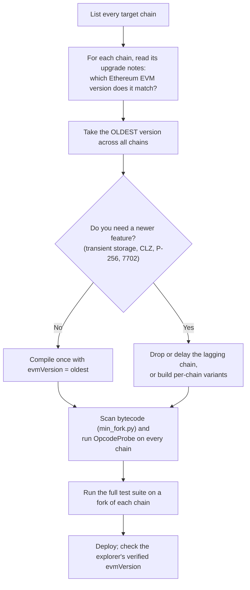

# 1.11 Hard forks that changed contract code

> [!abstract] In one minute
> - A hard fork can do three things to contract code: **add** opcodes or precompiles, **reprice** existing ones, or **change the meaning** of existing ones. Additions break only new code on old chains. Repricing and new meanings can break code that is already deployed.
> - Mainnet today (29 Oct 2026) runs **Osaka** (Fusaka, 3 Dec 2025). Solidity 0.8.38 defaults to `evmVersion: osaka`. Glamsterdam (Amsterdam EVM) is live on Sepolia (6 Oct 2026). Its Hoodi activation (26 Oct 2026) was **cancelled** on 22 Oct 2026 over EIP-8037. It has **no mainnet date**, and its EIPs are still in Last Call. The compiler's `amsterdam` target is experimental.
> - An opcode a chain does not know is an **exceptional halt**: the frame reverts and burns all of its gas. Code compiled for Shanghai or later contains `PUSH0` almost everywhere, so it fails at deployment on a pre-Shanghai chain. `MCOPY` is worse: the compiler emits it only on some code paths, so a contract can deploy and then fail later on one function.
> - Pick `evmVersion` from the **oldest chain you deploy to**, not from mainnet. Check each chain's own upgrade notes, scan your bytecode for new opcodes, and probe the chain. The evmVersion also changes the bytecode, so it changes `CREATE2` addresses.
> - L2s are mostly current in late 2026. Some still lack specific features: Polygon PoS left out `BLOBHASH` and `BLOBBASEFEE`, ZKsync's EVM emulator has no `SELFDESTRUCT`, `CALLCODE` or blob opcodes, and Avalanche C-Chain has no EIP-7702.

**Prerequisites:** [[1.3 Execution model]], [[1.9 Gas accounting]] · **Leads to:** [[2.10 Version map of 0.8.x features]], [[4.8 L2s and cross-chain]], [[4.3 Deterministic and cross-chain deployment]], [[6.7 Deployment and verification]]

## Why forks matter to contract developers

Contract code is immutable, but the machine it runs on is not. Every hard fork ships a new set of EVM rules, and every node switches to those rules at an agreed block or timestamp. Your bytecode stays the same. What it costs, what some opcodes mean, and which opcodes exist can all change under it.

There are three kinds of change, and they affect you differently.

1. **Additions.** A new opcode or precompile appears (`PUSH0`, `TSTORE`, `CLZ`, P-256 verification at `0x100`). Deployed code does not use it, so nothing breaks. But new code that uses it fails on a chain that has not adopted the fork. Before the fork, that byte was an undefined instruction.
2. **Repricing.** An existing operation costs more or less (EIP-150, EIP-1884, EIP-2929, EIP-3529, and next EIP-8037/EIP-8038). Deployed code that hard-coded gas amounts, relied on the 2,300-gas stipend, or measured `gasleft()` can break. Repricing is the most common cause of breakage after a fork.
3. **New meaning.** An opcode keeps its byte but its meaning changes: `DIFFICULTY` became `PREVRANDAO` (EIP-4399), `SELFDESTRUCT` stopped deleting accounts (EIP-6780), and an EOA can now have code (EIP-7702). Deployed code that relied on the old meaning is now wrong, often without anyone noticing.

The Solidity compiler deals with the first kind through the `evmVersion` setting. It tells the compiler which opcodes it may emit. The second and third kinds have no compiler setting. You catch them by reading the fork's EIPs and asking what they do to your contract.

> [!note] Fork names
> Since the Merge, each upgrade has two names: one for the execution layer (EL, a city: Shanghai, Cancun, Prague, Osaka, Amsterdam) and one for the consensus layer (a star: Capella, Deneb, Electra, Fulu, Gloas). The combined name is a blend (Shapella, Dencun, Pectra, Fusaka, Glamsterdam). Solidity's `evmVersion` uses the **EL name**, in lower case.

## The summary table

Newest first. Dates and block numbers are mainnet activations in UTC, from ethereum.org's history page and the meta EIPs. "evmVersion" is the name Solidity uses for that rule set. A dash means the fork changed nothing a contract can see, so the compiler has no target for it.

| Fork (EL name) | Mainnet activation (UTC) | Block / epoch | solc `evmVersion` | Contract-facing changes |
|---|---|---|---|---|
| **Glamsterdam** (Amsterdam) | **Not set.** Sepolia 6 Oct 2026 13:53:36; Hoodi 26 Oct 2026 17:42:48 **cancelled** | Sepolia epoch 353,024; Hoodi epoch 132,352 (cancelled) | `amsterdam` (**experimental** in 0.8.38) | Scheduled: `SLOTNUM` (EIP-7843), `DUPN`/`SWAPN`/`EXCHANGE` (EIP-8024), 64 KiB code limit (EIP-7954), ETH transfers emit logs (EIP-7708), state-gas repricing (EIP-8037, EIP-8038), no SELFDESTRUCT burn (EIP-8246), and more (see the Glamsterdam section below) |
| **Fusaka** (Osaka) | 3 Dec 2025 21:49:11 | block 23,935,694; epoch 411,392 | `osaka` | `CLZ` (EIP-7939); P-256 precompile at `0x100` (EIP-7951); 2^24 per-transaction gas cap (EIP-7825); MODEXP input bound (EIP-7823) and repricing (EIP-7883); 8 MiB RLP block size cap (EIP-7934); blob fee floor (EIP-7918); 60M default gas limit (EIP-7935). Blob-only forks BPO1 9 Dec 2025, BPO2 7 Jan 2026 |
| **Pectra** (Prague) | 7 May 2025 10:05:11 | block 22,431,084; epoch 364,032 | `prague` | Set-code transactions (EIP-7702); BLS12-381 precompiles `0x0b`–`0x11` (EIP-2537); block-hash history contract (EIP-2935); calldata cost floor (EIP-7623); more blobs (EIP-7691) |
| **Dencun** (Cancun) | 13 Mar 2024 13:55:35 | block 19,426,587; epoch 269,568 | `cancun` | `TLOAD`/`TSTORE` (EIP-1153); `MCOPY` (EIP-5656); `SELFDESTRUCT` only deletes in the creating transaction (EIP-6780); blobs, `BLOBHASH` and point-evaluation precompile `0x0a` (EIP-4844); `BLOBBASEFEE` (EIP-7516); beacon root contract (EIP-4788) |
| **Shapella** (Shanghai) | 12 Apr 2023 22:27:35 | block 17,034,870; epoch 194,048 | `shanghai` | `PUSH0` (EIP-3855); initcode limit 49,152 bytes and 2 gas per word (EIP-3860); warm `COINBASE` (EIP-3651); withdrawals (EIP-4895); `SELFDESTRUCT` deprecated (EIP-6049, a notice only) |
| **Paris** (The Merge) | 15 Sep 2022 06:42:42 | block 15,537,394 | `paris` | `DIFFICULTY` (`0x44`) becomes `PREVRANDAO` (EIP-4399); proof of stake (EIP-3675) |
| Gray Glacier, Arrow Glacier, Muir Glacier | 30 Jun 2022; 9 Dec 2021; 2 Jan 2020 | 15,050,000; 13,773,000; 9,200,000 | — | Difficulty-bomb delays only (EIP-5133, EIP-4345, EIP-2384) |
| **London** | 5 Aug 2021 12:33:42 | block 12,965,000 | `london` | Fee market (EIP-1559) and the `BASEFEE` opcode (**EIP-3198**); refunds cut (EIP-3529); new code may not start with `0xEF` (EIP-3541) |
| **Berlin** | 15 Apr 2021 10:07:03 | block 12,244,000 | `berlin` | Cold/warm access costs (EIP-2929); access lists (EIP-2930); typed transactions (EIP-2718); cheaper MODEXP (EIP-2565) |
| **Istanbul** | 8 Dec 2019 00:25:09 | block 9,069,000 | `istanbul` | `CHAINID` (EIP-1344); `SELFBALANCE` and `SLOAD` 200 → 800 (EIP-1884); net gas metering for `SSTORE` (EIP-2200); calldata 68 → 16 gas per nonzero byte (EIP-2028); BLAKE2f `0x09` (EIP-152); cheaper BN254 (EIP-1108) |
| **Constantinople + Petersburg** | 28 Feb 2019 19:52:04 | block 7,280,000 (both) | `constantinople`, `petersburg` | `SHL`/`SHR`/`SAR` (EIP-145); `CREATE2` (EIP-1014); `EXTCODEHASH` (EIP-1052). Petersburg removed EIP-1283 (EIP-1716) at the same block |
| **Byzantium** | 16 Oct 2017 05:22:11 | block 4,370,000 | `byzantium` | `REVERT` (EIP-140); `RETURNDATASIZE`/`RETURNDATACOPY` (EIP-211); `STATICCALL` (EIP-214); BN254 add, mul, pairing `0x06`–`0x08` (EIP-196, EIP-197); MODEXP `0x05` (EIP-198); receipt status (EIP-658) |
| **Spurious Dragon** | 22 Nov 2016 16:15:44 | block 2,675,000 | `spuriousDragon` | Empty-account rules, contracts start at nonce 1 (EIP-161); 24,576-byte code limit (EIP-170); `EXP` repriced (EIP-160); chain ID in signatures (EIP-155) |
| **Tangerine Whistle** | 18 Oct 2016 13:19:31 | block 2,463,000 | `tangerineWhistle` | IO repricing and the 63/64 call-gas rule (EIP-150) |
| DAO Fork | 20 Jul 2016 13:20:40 | block 1,920,000 | — | Irregular state change; no EVM change |
| **Homestead** | 14 Mar 2016 18:49:53 | block 1,150,000 | `homestead` (oldest solc accepts) | `DELEGATECALL` (EIP-7); creation fails on out-of-gas instead of leaving empty code, high-s transaction signatures invalid but `ecrecover` still accepts them (EIP-2) |
| Frontier | 30 Jul 2015 15:26:13 (thawing at block 200,000, 7 Sep 2015) | genesis | — (solc rejects `frontier`) | Original instruction set; precompiles `0x01`–`0x04` |

> [!warning] Corrections to the earlier outline
> `BASEFEE` is EIP-3198, not EIP-1559. Fusaka also bounded MODEXP inputs (EIP-7823), not only repriced it (EIP-7883). The compiler's `amsterdam` target exists (since 0.8.36) but is **experimental**: 0.8.38 rejects it unless you enable experimental mode.

## Fork by fork, newest first

### Glamsterdam (Amsterdam EVM): scheduled, not on mainnet

**Status on 29 Oct 2026.** The meta EIP (EIP-7773, itself in Review) lists 18 EIPs as **Scheduled for Inclusion**. The fork is live on Sepolia (6 Oct 2026). The Hoodi activation listed in EIP-7773 (26 Oct 2026) was cancelled on 22 Oct 2026; see the warning below. The mainnet row is blank. Most of the contract-facing EIPs below are in **Last Call**, with a deadline of 1 Nov 2026 (EIP-8246: 4 Nov 2026). So the specs can still change in small ways, and none of this is on mainnet. Treat the numbers as "very likely", not "final".

> [!warning] Hoodi activation cancelled (22 Oct 2026)
> The Ethereum Foundation cancelled Glamsterdam's Hoodi activation (set for 26 Oct 2026, epoch 132,352) after an All Core Developers call, together with a planned rise of Hoodi's block gas limit to 200 million. Developers want to study how **EIP-8037** (with EIP-8038) interacts with contracts already on mainnet.
> - **The finding.** A ChainSecurity assessment (13 Oct 2026) found contracts that decide whether a failed call is *retryable* by looking at how much gas is left. Little gas left → "the relayer underfunded us" → revert everything so the operation can be retried. Plenty left → "a genuine failure" → record it as failed and burn the nonce.
> - **Why EIP-8037 breaks it.** State gas lives in a separate reservoir. An inner call can fail for lack of *state* gas while the caller still holds plenty of *regular* gas, so the heuristic marks the operation as permanently failed instead of reverting. ChainSecurity reported 13 real-world examples under responsible disclosure. The EF also told developers to check contracts that forward fixed gas amounts, since a fresh storage slot with an empty reservoir rises from 22,100 to 110,020 gas.
> - **Status.** EIP-8037 is still listed as scheduled in EIP-7773, and EIP-7773's activation table still shows the old Hoodi row. No new Hoodi date or mainnet date is set. Mainnet dates of 1, 8 and 9 Dec 2026 had been discussed; they are now in doubt.

| EIP | What it does to contract code | Status |
|---|---|---|
| EIP-7843 `SLOTNUM` | New opcode `0x4b`, 2 gas, pushes the beacon slot number (uint64). Solidity 0.8.37+ exposes it as `block.slotnum` / `slotnum()` for `amsterdam` only. See [[1.10 Block and chain context]] | Scheduled; Last Call |
| EIP-8024 `DUPN` `SWAPN` `EXCHANGE` | Opcodes `0xe6`–`0xe8`, 3 gas each, with a one-byte immediate. `DUPN`/`SWAPN` reach stack depth 17 to 235, so compilers can avoid many "stack too deep" spills. Immediates are chosen so JUMPDEST analysis of old code does not change. Solidity 0.8.38 warns that `swapn`, `dupn` and `exchange` become reserved Yul names | Scheduled; Last Call |
| EIP-7954 code size | Runtime limit 24,576 → 65,536 bytes; initcode limit 49,152 → 131,072 bytes. See [[1.8 Contract creation]] | Scheduled; Last Call |
| EIP-7708 ETH transfer logs | Every nonzero ETH transfer to a different account (transaction value, `CALL`, `SELFDESTRUCT`, value-carrying `CREATE`) emits an ERC-20-shaped `Transfer(from, to, amount)` log from `0xff…fe`. Indexers get ETH movements without traces. See [[1.6 Calldata, returndata and logs]] | Scheduled; Last Call |
| EIP-8037 state creation gas | New storage slot 20,000 → 97,920 **state gas**; new account 25,000 → 183,600; code deposit 200 → 1,530 per byte. State gas is metered in a separate dimension with a reservoir. `GAS` (`gasleft()`) returns only the execution part. `gasleft()` deltas can go **negative** after a refill | Scheduled; Last Call |
| EIP-8038 state access gas | Cold account access 2,600 → 3,000; `SSTORE` write component about 2,800 → 10,000; `CALL` with value 9,000 → 11,300 (9,000 account write plus the 2,300 stipend); clear refund 4,800 → 11,616; access-list entries dearer. See [[1.9 Gas accounting]] | Scheduled; Last Call |
| EIP-2780 intrinsic gas | Splits the 21,000 base into 12,000 base, 3,000 recipient access and 6,000 value transfer. A value transfer to an existing EOA still costs 21,000. See [[1.2 Transactions and fees]] | Scheduled; Last Call |
| EIP-7976, EIP-7981 | Calldata floor to 64 gas per byte; access-list data surcharge | Scheduled |
| EIP-7778 | Refunds stop reducing block gas used (the user still gets them) | Scheduled |
| EIP-8246 | A same-transaction `SELFDESTRUCT` keeps the balance. The account keeps its ETH but gets nonce 0 and no code, so `CREATE2` can redeploy there and claim it | Scheduled; Last Call |
| EIP-7997 | Formalizes the `0x4e59b448…956C` CREATE2 factory on EVM chains (bytecode avoids `PUSH0`). See [[4.3 Deterministic and cross-chain deployment]] | Scheduled; Last Call |
| EIP-7928, EIP-7732, EIP-7688, EIP-8045, EIP-8061, EIP-8282 | Block-level access lists, ePBS, consensus changes. No direct contract-facing change | Scheduled |

**Declined or not scheduled.** The Glamsterdam repricing directory (EIP-8007) lists as **declined**: cheaper `TLOAD`/`TSTORE` with a transaction-wide limit (EIP-7971), memory limits (EIP-7686), page-based memory pricing (EIP-7923), code chunking (EIP-2926), storage-size-scaled `SSTORE` (EIP-8032) and others. EOF is not in Glamsterdam's scheduled list, and Solidity 0.8.36 removed its experimental EOF backend.

> [!warning] What Glamsterdam can break in deployed code
> EIP-8037 and EIP-8038 are the largest repricing since Berlin. A storage write to a fresh slot goes from 20,000 to about 100,000 gas in total. Any contract that hard-codes a gas forward (`call{gas: 50_000}`), measures gas with `gasleft()` differences (relayers, ERC-4337 paymasters, keeper bounties), or sizes batches against a gas budget needs a review. The EIP itself says contracts already deployed with gas-delta metering "cannot be fixed".

### Fusaka (Osaka EVM), 3 Dec 2025

The meta EIP is EIP-7607. Its core EIPs are 7594, 7823, 7825, 7883, 7917, 7918, 7934, 7939 and 7951. EIP-7935 (60M gas limit), EIP-7892 (blob-only forks), EIP-7642 and EIP-7910 are listed separately. These are the ones a contract can feel:

- **`CLZ` (EIP-7939).** Opcode `0x1e`, 5 gas. Pushes the number of leading zero bits of a 256-bit word, and 256 for zero. It replaces 20-plus-instruction binary searches in `log2`, `sqrt` seeding, bit-packing and fixed-point math libraries. Solidity exposes it only as the Yul builtin `clz` (0.8.31+, `osaka`); the compiler does not emit it on its own. See [[3.3 Opcodes by family]].
- **P-256 verification (EIP-7951).** Precompile at `0x100`, 6,900 gas, 160-byte input `h‖r‖s‖qx‖qy`, returns 32-byte `1` on success and **empty** returndata on failure. It never reverts. It keeps RIP-7212's address and format, so L2 code ports, but adds stricter checks and doubles the gas (RIP-7212 charged 3,450). This makes passkey and WebAuthn wallets practical on L1. See [[1.7 Message calls and precompiles]] and [[4.6 On-chain cryptography]].
- **Per-transaction gas cap (EIP-7825).** A transaction with a gas limit above 2^24 = 16,777,216 is invalid, even though blocks hold 60,000,000. Any single call path that needs more gas than that, such as a giant migration or an unbounded loop, can no longer run in one transaction. See [[1.2 Transactions and fees]].
- **MODEXP bound and repricing (EIP-7823, EIP-7883).** Each of base, exponent and modulus is capped at 1,024 bytes; larger inputs make the call fail. The minimum cost rises 200 → 500, the general cost triples (the `/ 3` divisor is gone), and inputs over 32 bytes cost twice as much. RSA verifiers and big-number libraries cost more.
- **Block size cap (EIP-7934).** An RLP-encoded block above 10 MiB minus a 2 MiB margin (8,388,608 bytes) is invalid. It limits the largest calldata or initcode a single block can carry.
- **Blob fee floor (EIP-7918) and BPO forks (EIP-7892).** `BLOBBASEFEE` can no longer fall to 1 wei while execution gas is expensive. Blob-only forks (BPO1 on 9 Dec 2025, BPO2 on 7 Jan 2026) changed blob capacity with no EVM change. Contracts that read `block.blobbasefee` for pricing see different numbers.

### Pectra (Prague EVM), 7 May 2025

- **EIP-7702 set-code transactions.** An EOA can sign an authorization that writes the 23-byte delegation indicator `0xef0100 || address` into its code. After that, calls to the EOA run the delegate's code in the EOA's context. `EXTCODESIZE` of such an account is 23, not 0, so `extcodesize == 0` and `msg.sender == tx.origin` no longer prove "this is a plain EOA". Delegate initialization can be front-run. See [[1.1 Accounts and world state]], [[4.5 Account abstraction and smart wallets]] and [[5.11 New attack surfaces - transient storage, EIP-7702, account abstraction]].
- **BLS12-381 precompiles (EIP-2537).** Seven precompiles at `0x0b`–`0x11`: G1/G2 add, multi-scalar multiplication, pairing, and map-to-curve. On-chain BLS signature checks and SNARKs over BLS12-381 become affordable. See [[1.7 Message calls and precompiles]].
- **Block-hash history (EIP-2935).** A system contract at `0x0000F90827F1C53a10cb7A02335B175320002935` serves the last 8,191 block hashes and reverts outside that range. The `BLOCKHASH` opcode itself still covers 256 blocks. See [[1.10 Block and chain context]].
- **Calldata floor (EIP-7623).** A transaction pays at least 21,000 plus 10 gas per calldata token (a zero byte is 1 token, a nonzero byte is 4). This hurts data-heavy, compute-light transactions, and changes gas estimates for batch posters. See [[1.2 Transactions and fees]].
- Also: more blobs (EIP-7691, which moves `BLOBBASEFEE`), and staking-related system contracts (EIP-6110, EIP-7002, EIP-7251, EIP-7685). Solidity's `prague` target unlocks **no** new language feature, because none of these is an opcode.

### Dencun (Cancun EVM), 13 Mar 2024

- **Transient storage (EIP-1153).** `TLOAD` (`0x5c`) and `TSTORE` (`0x5d`), 100 gas each, store values that are wiped at the end of the transaction. Cheap reentrancy locks and same-transaction callbacks (Uniswap v4 flash accounting) depend on them. `TSTORE` fits under the 2,300-gas stipend, which breaks the old "`transfer` is reentrancy-safe" assumption a second time. Solidity's `transient` state variables (0.8.28+) and the Yul builtins need `cancun`. See [[1.5 Storage and transient storage]].
- **`MCOPY` (EIP-5656).** Opcode `0x5e`: memory-to-memory copy for 3 gas plus 3 per word plus expansion. Since 0.8.25 the compiler uses it for byte-array copies when targeting `cancun` or later. See [[1.4 Memory]].
- **`SELFDESTRUCT` restricted (EIP-6780).** Outside the creating transaction, `SELFDESTRUCT` only sends the balance to the target. Code, storage and the account stay. Inside the creating transaction it still deletes everything. This killed the **metamorphic contract** pattern (destroy, then redeploy different code at the same `CREATE2` address), which the Tornado Cash governance attack of May 2023 relied on. Upgrade schemes and "kill switches" built on `SELFDESTRUCT` silently became no-ops. See [[1.8 Contract creation]] and [[4.2 Upgradeability and proxies]].
- **Blobs (EIP-4844, EIP-7516).** `BLOBHASH` (`0x49`) reads the versioned hash of the current transaction's blobs. `BLOBBASEFEE` (`0x4a`) reads the blob base fee. The point-evaluation precompile at `0x0a` checks a KZG proof. Rollup inboxes use all three.
- **Beacon roots (EIP-4788).** A system contract at `0x000F3df6D732807Ef1319fB7B8bB8522d0Beac02` exposes recent beacon block roots, for trust-minimized staking and bridge proofs.

### Shapella (Shanghai EVM), 12 Apr 2023

- **`PUSH0` (EIP-3855).** Opcode `0x5f`, 2 gas, pushes zero. Before it, compilers used `PUSH1 0x00` (2 bytes, 3 gas). Since 0.8.20 (default `shanghai`), solc uses `PUSH0` everywhere. My test contract shrank from 614 to 595 runtime bytes (19 bytes, so 3,800 gas less code deposit at 200 gas per byte). This single opcode caused most of the "invalid opcode" deployment failures on lagging L2s in 2023 and 2024.
- **Initcode limit and metering (EIP-3860).** Initcode above 49,152 bytes is rejected, and each 32-byte word costs 2 gas. Measured: the same 645-byte initcode cost 42 gas more under Shanghai than London (21 words × 2). See [[1.8 Contract creation]].
- **Warm `COINBASE` (EIP-3651).** The block builder's address starts warm, so paying `block.coinbase` costs 100 instead of 2,600 for access.

### Paris (The Merge), 15 Sep 2022

- **`PREVRANDAO` (EIP-4399).** Opcode `0x44` kept its byte but now returns the beacon chain's RANDAO mix instead of the proof-of-work difficulty. Old code that used `block.difficulty` as a "difficulty" number got a huge random value instead. Old code that used it as randomness kept working, but the value is still biasable by proposers. Solidity's `paris` target adds `block.prevrandao` and disallows `difficulty()` in assembly. See [[1.10 Block and chain context]].

### London, 5 Aug 2021

- **`BASEFEE` (EIP-3198)**, opcode `0x48`, exposes the EIP-1559 base fee to contracts (`block.basefee`).
- **Refund cut (EIP-3529).** The `SELFDESTRUCT` refund was removed, the storage-clear refund fell from 15,000 to 4,800, and the refund cap fell from one half to one fifth of gas used. GasToken and CHI lost their entire value overnight. See [[1.9 Gas accounting]].
- **`0xEF` ban (EIP-3541).** New code may not start with byte `0xEF`. This reserved the prefix that EOF planned to use and that EIP-7702's `0xef0100` delegation indicator now uses.

### Berlin, 15 Apr 2021

- **Cold and warm access (EIP-2929).** The first access to an account in a transaction costs 2,600, and to a storage slot 2,100. Later accesses cost 100. A `transfer()` into a proxy now failed, because the proxy's `DELEGATECALL` to a cold implementation address alone costs 2,600, more than the 2,300 stipend.
- **Access lists (EIP-2930)** let a transaction pre-pay to warm addresses and slots. **Typed transactions (EIP-2718)** opened the door to later transaction types (1559, 4844, 7702). See [[1.9 Gas accounting]] and [[1.2 Transactions and fees]].

### Istanbul, 8 Dec 2019

- **`CHAINID` (EIP-1344)** made replay protection inside signed messages possible (the EIP-712 domain separator). See [[5.8 Signatures and replay]].
- **EIP-1884** raised `SLOAD` from 200 to 800, and `BALANCE` and `EXTCODEHASH` from 400 to 700, and added `SELFBALANCE` (5 gas). Fallback functions that read storage under the 2,300 stipend started failing. This is the origin of "do not use `transfer`".
- **EIP-2200** brought back net gas metering for `SSTORE` with a sentry: `SSTORE` fails if 2,300 gas or less remains, so stipend-funded code can never write storage.
- **EIP-2028** cut nonzero calldata from 68 to 16 gas per byte. **EIP-152** added BLAKE2f (`0x09`).

### Constantinople and Petersburg, 28 Feb 2019

- **`CREATE2` (EIP-1014)** gives addresses that depend on deployer, salt and initcode hash, not on a nonce. Counterfactual wallets, deterministic factories and cross-chain same-address deployments all build on it. See [[1.8 Contract creation]] and [[4.3 Deterministic and cross-chain deployment]].
- **Shifts (EIP-145)** `SHL`, `SHR`, `SAR` replaced `MUL`/`DIV` by powers of two (3 gas instead of 5 or more).
- **`EXTCODEHASH` (EIP-1052)** gives a code hash without copying code.
- **Petersburg** activated at the same block and removed EIP-1283. ChainSecurity showed on 15 Jan 2019 that its cheap dirty-slot writes let code under the 2,300 stipend re-enter and change storage. See [[5.2 Reentrancy]].

### Byzantium, 16 Oct 2017

- **`REVERT` (EIP-140)** stops execution, returns data and refunds the remaining gas. Before it, `throw` used an invalid opcode and burned all gas. Custom errors and `require` messages all ride on `REVERT`. See [[2.8 Errors and reverts]].
- **Returndata (EIP-211)** let callers read dynamic return values of any length. **`STATICCALL` (EIP-214)** enforced `view` at the EVM level. See [[1.6 Calldata, returndata and logs]] and [[1.7 Message calls and precompiles]].
- **Precompiles** for BN254 (EIP-196, EIP-197) and MODEXP (EIP-198) made zk-SNARK verifiers and RSA checks possible.

### Spurious Dragon, Tangerine Whistle, Homestead, Frontier (2015–2016)

- **Spurious Dragon (EIP-161, EIP-170).** An account is "empty" when it has no code, nonce 0 and balance 0, and touched empty accounts are deleted. New contracts start at nonce 1. The 25,000-gas new-account charge applies only to value transfers into dead accounts. EIP-170 capped runtime code at 24,576 bytes, a limit every large protocol still designs around (Diamonds, libraries, splitting). See [[1.1 Accounts and world state]].
- **Tangerine Whistle (EIP-150).** After DoS attacks, it raised `CALL` from 40 to 700, `SLOAD` from 50 to 200, `EXTCODESIZE` from 20 to 700 and `BALANCE` from 20 to 400. It also introduced the **63/64 rule**: a call forwards at most `N - floor(N / 64)` of the remaining gas. That rule is why relayers must check `gasleft()` after a call. See [[1.9 Gas accounting]].
- **Homestead (EIP-2, EIP-7).** `DELEGATECALL` arrived, which made libraries and later proxies possible. Contract creation that cannot pay for its code now fails instead of leaving an empty contract. Transaction signatures with high `s` became invalid, but the `ecrecover` precompile **still accepts** them, which is why signature libraries must reject high-`s` themselves.
- **Frontier** shipped the original instruction set and precompiles `0x01`–`0x04` (ECRECOVER, SHA-256, RIPEMD-160, identity).

## Solidity `evmVersion` map

### Default target by compiler release

The default changes when the compiler team decides mainnet has moved. Verified against the Solidity changelog.

| solc release (date) | New default `evmVersion` |
|---|---|
| 0.8.31 (3 Dec 2025) | `osaka` (still the default in 0.8.38) |
| 0.8.30 (7 May 2025) | `prague` |
| 0.8.25 (14 Mar 2024) | `cancun` |
| 0.8.20 (10 May 2023) | `shanghai` |
| 0.8.18 (1 Feb 2023) | `paris` |
| 0.8.7 (11 Aug 2021) | `london` |
| 0.8.5 (10 Jun 2021) | `berlin` |
| 0.5.14 (9 Dec 2019) | `istanbul` |
| 0.5.5 (5 Mar 2019) | `petersburg` |
| 0.4.21 (7 Mar 2018) | `byzantium` (first release with the setting) |

Targets were added in: `paris` 0.8.18, `shanghai` 0.8.20, `cancun` 0.8.24, `prague` 0.8.27, `osaka` 0.8.29, `amsterdam` 0.8.36 (experimental). Support for `homestead`, `tangerineWhistle`, `spuriousDragon` and `byzantium` was deprecated in 0.8.22. Support for `constantinople`, `petersburg`, `istanbul` and `berlin` was deprecated in 0.8.37. Compiling for any target older than `london` with 0.8.38 prints "Support for EVM versions older than london is deprecated". The full per-release feature map is in [[2.10 Version map of 0.8.x features]].

### What each target lets codegen emit

There are two kinds of opcode. Some the compiler **emits on its own** when the target allows it, even if your source never asks. Others appear **only when you use them** (a global like `block.basefee`, a `transient` variable, or a Yul builtin). The first kind is the dangerous one, because nothing in your source warns you.

| `evmVersion` | Emitted automatically | Unlocked for your code (error on older targets) |
|---|---|---|
| `amsterdam` (experimental) | none observed | `block.slotnum`, `slotnum()` |
| `osaka` (default) | none new | Yul `clz()` |
| `prague` | none new | none |
| `cancun` | **`MCOPY`** for byte-array and string copies | `transient` variables, `tload`/`tstore`, `mcopy`, `blobhash`, `block.blobbasefee` |
| `shanghai` | **`PUSH0`** for every zero constant | none |
| `paris` | none | `block.prevrandao`, `prevrandao()` (`difficulty()` disallowed) |
| `london` | none | `block.basefee`, `basefee()` |
| `berlin` | none (gas estimates assume cold access) | none |
| `istanbul` | **`SELFBALANCE`** for `address(this).balance` | `block.chainid`, `chainid()`, `selfbalance()` |
| `constantinople` / `petersburg` | **`SHL`/`SHR`/`SAR`** for shifts and packing | `create2`, `extcodehash` |
| `byzantium` | **`STATICCALL`** for view calls, **`RETURNDATASIZE`/`RETURNDATACOPY`** | `returndatacopy`, `staticcall` |
| `homestead` … `spuriousDragon` | — | — |

I checked this by compiling the same contracts with solc-js 0.8.38 for each target and scanning the bytecode. A contract with a storage write and a `bytes.concat` gave: `london`/`paris` 614 bytes with no post-London opcodes; `shanghai` 595 bytes with 26 `PUSH0`; `cancun` and later 569 bytes with 27 `PUSH0` and 2 `MCOPY`. A contract reading `address(this).balance` used `BALANCE` for `petersburg` and `SELFBALANCE` for `istanbul`. Even a `homestead` build still contains `REVERT` (`0xfd`). On a pre-Byzantium chain that byte is undefined, so it still aborts the call, but it burns all the gas.

> [!tip] Errors you will see
> Using a feature above your target is a compile error, which is good. `clz` under `prague` gives: *The "clz" instruction is only available for Osaka-compatible VMs*. A `transient` variable under `shanghai` gives: *Transient storage is not supported by EVM versions older than cancun*. `block.slotnum` under `osaka` gives: *"slotnum" is not supported by the VM version*. Asking for `amsterdam` without experimental mode gives: *EVM version 'amsterdam' is experimental and can only be used with the 'settings.experimental' option enabled*.

## Solidity and Yul in practice

### Using a new opcode on purpose: `CLZ` for `log2`

```solidity
// SPDX-License-Identifier: MIT
pragma solidity ^0.8.38;

library Log2 {
    /// floor(log2(x)) using CLZ (EIP-7939). Needs evmVersion osaka or later.
    function floorLog2(uint256 x) internal pure returns (uint256 r) {
        require(x != 0, "log2(0)");
        assembly ("memory-safe") {
            r := sub(255, clz(x)) // clz(1) = 255, clz(2**255) = 0
        }
    }
}

contract UsesLog2 {
    function f(uint256 x) external pure returns (uint256) {
        return Log2.floorLog2(x);
    }
}
```

This compiles under the default `osaka` target and fails to compile under `prague`. That is the behavior you want. The risk is the other direction: the code compiles, you deploy it to a chain that has not activated Osaka, and every call to `f` hits an undefined opcode at run time. Libraries that want to run everywhere ship two versions or keep the old binary-search code.

### Reading a precompile that might not exist: P-256

```solidity
// SPDX-License-Identifier: MIT
pragma solidity ^0.8.38;

library P256 {
    address internal constant VERIFIER = address(0x100); // EIP-7951 / RIP-7212

    /// Returns true only if the precompile answered with exactly 32 bytes == 1.
    /// On a chain WITHOUT the precompile, 0x100 is an empty account: the call
    /// succeeds with empty returndata, so this returns false (fail closed).
    function verify(bytes32 h, bytes32 r, bytes32 s, bytes32 qx, bytes32 qy)
        internal view returns (bool ok)
    {
        (bool success, bytes memory ret) =
            VERIFIER.staticcall(abi.encode(h, r, s, qx, qy)); // 160 bytes
        ok = success && ret.length == 32 && abi.decode(ret, (uint256)) == 1;
    }
}

contract PasskeyGate {
    function check(bytes32 h, bytes32 r, bytes32 s, bytes32 qx, bytes32 qy)
        external view returns (bool)
    {
        return P256.verify(h, r, s, qx, qy);
    }
}
```

Precompiles fail differently from opcodes. A call to an address with no code **succeeds** and returns nothing. I ran `check` in py-evm's Prague VM, which has no `0x100` precompile. It returned `false` and used 3,443 gas. The length check makes this fail closed, which is safe. But it also means a valid passkey signature is rejected on that chain. Your users are locked out, not robbed. A wallet that depends on `0x100` should check for the precompile at deployment, by verifying a known-good test vector in the constructor, rather than learn about it from support tickets. Also note the gas: 3,450 on chains still running RIP-7212 pricing, 6,900 under EIP-7951. Do not hard-code the gas you forward to it.

### Setting the target in tools

```json
{
  "language": "Solidity",
  "settings": {
    "evmVersion": "cancun",
    "optimizer": { "enabled": true, "runs": 200 }
  }
}
```

That is standard JSON input. On the command line it is `solc --evm-version cancun`. In Foundry it is `evm_version = "cancun"` in `foundry.toml`, and in Hardhat it is `settings.evmVersion` under the compiler entry. Tools can set their own default, which may differ from solc's. Always set it explicitly, and check that the value lands in the verified metadata on the block explorer. See [[6.1 Foundry essentials]] and [[6.7 Deployment and verification]].

## Multi-chain deployment

### What actually happens on a chain that lags behind

I ran the same tiny programs on py-evm's Byzantium, Istanbul, London, Shanghai and Cancun VMs, each with 100,000 gas.

| Program | Byzantium | Istanbul | London | Shanghai | Cancun |
|---|---|---|---|---|---|
| `PUSH0 PUSH0 RETURN` | invalid opcode, 100,000 gas used | same | same | ok, 4 gas | ok, 4 gas |
| `TSTORE` then `TLOAD` | invalid | invalid | invalid | invalid at `0x5d` | ok, 220 gas |
| `MCOPY` 32 bytes | invalid | invalid | invalid | invalid at `0x5e` | ok, 20 gas |
| `BASEFEE` | invalid | invalid | ok, 17 gas | ok | ok |
| `CHAINID` | invalid | ok, 17 gas | ok | ok | ok |

An undefined opcode is an **exceptional halt**. The current frame's state changes are reverted, and **all gas given to that frame is consumed**. It is not a `REVERT`: there is no return data and no refund. To the caller it looks like a call that ran out of gas.

Two real failure modes follow from this.

1. **Fails at deployment.** Code built for `shanghai` or later has `PUSH0` within the first few dozen bytes of the initcode. On London rules my test contract's initcode died at byte 23 (`Invalid opcode 0x5f`) and used all 1,000,000 gas I gave it. You notice at once, and you pay for the gas.
2. **Fails later, on one path.** This one is far worse. I deployed the default (`osaka`) build to Shanghai rules. Deployment **succeeded**: the initcode and dispatcher only needed `PUSH0`. `set(uint256)` worked (22,331 gas). `copy(bytes)`, which reaches the compiler's `MCOPY`, failed with `Invalid opcode 0x5e` and burned all 200,000 gas. A contract like this passes a smoke test and breaks in production on whichever function copies memory.

> [!warning] The silent kind
> The compiler emits `MCOPY` and `PUSH0` **without any source-level hint**. A `transient` variable or `clz` at least fails to compile for an old target. `MCOPY` from a `bytes.concat` does not. If you compile for a newer target than the chain supports, only a bytecode scan or a test on the real chain will catch it.

### Chain support for recent features (checked late Oct 2026)

Dates are mainnet activations from each chain's own docs or governance posts. "Not verified" means I could not find it in official documentation. It does not mean the feature is missing. Probe the chain before relying on it.

| Chain | `PUSH0` | `TSTORE` / `MCOPY` | `BLOBHASH` / `BLOBBASEFEE` | EIP-7702 | P-256 at `0x100` | `CLZ` (Osaka) |
|---|---|---|---|---|---|---|
| Ethereum L1 | Shanghai, 12 Apr 2023 | Cancun, 13 Mar 2024 | Cancun | Prague, 7 May 2025 | Osaka, 3 Dec 2025 (6,900 gas) | Osaka, 3 Dec 2025 |
| Arbitrum One | ArbOS 11 (Foundation lists 24 Feb 2024) | ArbOS 20 Atlas, 14 Mar 2024 | not verified | ArbOS 40 Callisto, 17 Jun 2025 | RIP-7212 in ArbOS 31 Bianca, 3 Sep 2024; EIP-7951 checks in ArbOS 51 | ArbOS 51 Dia, 8 Jan 2026 |
| OP Mainnet (OP Stack) | Canyon, 11 Jan 2024 | Ecotone, 14 Mar 2024 | Ecotone; `BLOBBASEFEE` always 1, blob transactions disabled | Isthmus, 9 May 2025 | Fjord, 10 Jul 2024 (RIP-7212); 6,900 gas from Karst | Karst, 8 Jul 2026 (Jovian, 2 Dec 2025, explicitly did **not** activate Osaka) |
| Base | OP Stack upgrades before its own forks | OP Stack | OP Stack | OP Stack (Isthmus) | yes; 6,900 gas from Azul | Azul, live 28 May 2026 |
| Polygon PoS | not verified | Napoli, Mar 2024 | **excluded** ("no concept of beacon chain and blobs", PIP-31) | Bhilai, 1 Jul 2025 | Napoli, Mar 2024 (RIP-7212, PIP-27) | not verified: Madhugiri (Dec 2025) lists only EIP-7823, 7825, 7883 |
| BNB Smart Chain | Kepler, 23 Jan 2024 | Tycho/Haber, 20 Jun 2024 (BEP-342, BEP-343) | `BLOBBASEFEE` via BEP-345; blobs via BEP-336 | Pascal, Mar 2025 | Haber, 20 Jun 2024 (BEP-381) | Osaka/Mendel, 28 Apr 2026 |
| Avalanche C-Chain | Durango, 6 Mar 2024 | ACP-131 (Etna upgrade) | opcodes enabled by ACP-131, but blob transactions are invalid | **no**: ACP-209 is only "Proposed" | Granite, 19 Nov 2025 (ACP-204, 6,900 gas) | not verified |
| ZKsync Era (EVM emulator) | not listed as unsupported | not listed as unsupported | **unsupported** (also `CALLCODE`, `SELFDESTRUCT`) | not supported (ZKsync OS FAQ: "not yet") | not verified | not verified |

Notes that matter for contract code:

- **Arbitrum.** ArbOS 40 shipped EIP-2537 (BLS12-381) but **did not enable** it, and it skipped EIP-7623. ArbOS 51 proposed a 32-million-gas per-transaction cap, not Ethereum's 2^24. `PREVRANDAO` returns the constant 1, and `block.number` is an estimate of the L1 block number.
- **OP Stack.** Upgrade dates are for OP Mainnet. Other OP Stack chains can activate at different times. Karst also made deposits exempt from the 2^24 transaction cap.
- **Base** called Azul its "first independent" upgrade. Do not assume it will follow OP Stack timing from now on.
- **BNB Chain**'s Osaka/Mendel blog lists "a new opcode (CLZ)", secp256r1 gas changes, MODEXP bounds and transaction gas caps, but not EIP numbers. Pascal's post promises "the same smart contract wallet solution as EIP-7702" and includes BLS12-381 (BEP-439).
- **ZKsync Era** runs EraVM. Native contracts are compiled by `zksolc`, and EVM bytecode runs in an emulator that compares itself to Cancun. Its own docs list `CALLCODE`, `SELFDESTRUCT`, `BLOBHASH` and `BLOBBASEFEE` as unsupported, and RIPEMD-160 and BLAKE2f as missing. ZKsync OS, which aims at full equivalence, said "no public mainnet" when I checked. See [[4.8 L2s and cross-chain]].

> [!warning] Unverified
> I could not confirm from official docs: `PUSH0` on Polygon PoS (which fork), `CLZ` on Polygon PoS and Avalanche C-Chain, blob opcodes on Arbitrum, the exact Etna activation date on Avalanche, and P-256 on ZKsync Era. The Arbitrum Foundation page gives ArbOS 11 as "Thu, 2024-02-24", but 24 Feb 2024 was a Saturday, so treat that date as approximate. The BSC Haber docs and a Polyhedra post give 20 Jun 2024 06:05 UTC for the Haber/Tycho mainnet upgrade, and the Pascal date is "mid-March 2025". Base's pre-Azul dates are assumed to match OP Mainnet's Superchain activations; check Base's own docs.

### Tool 1: scan your bytecode

This script lists every post-Frontier opcode in a runtime bytecode and the oldest EVM version that can run it. Get the bytecode from your build output or from `eth_getCode` on the target chain.

```python
"""Find the oldest EVM version that can run a piece of bytecode.

Usage: python3 -I min_fork.py <hex bytecode>   (runtime code from eth_getCode)
Linear sweep: skips PUSH data and strips the solc CBOR metadata tail.
Data appended after the code can still produce false positives: treat hits as leads.
"""
import sys

ORDER = ["frontier", "homestead", "byzantium", "constantinople", "istanbul",
         "london", "paris", "shanghai", "cancun", "osaka", "amsterdam"]
INTRODUCED = {  # opcode byte -> (mnemonic, first fork where it is defined)
    0xF4: ("DELEGATECALL", "homestead"),
    0x3D: ("RETURNDATASIZE", "byzantium"), 0x3E: ("RETURNDATACOPY", "byzantium"),
    0xFA: ("STATICCALL", "byzantium"), 0xFD: ("REVERT", "byzantium"),
    0x1B: ("SHL", "constantinople"), 0x1C: ("SHR", "constantinople"),
    0x1D: ("SAR", "constantinople"), 0x3F: ("EXTCODEHASH", "constantinople"),
    0xF5: ("CREATE2", "constantinople"),
    0x46: ("CHAINID", "istanbul"), 0x47: ("SELFBALANCE", "istanbul"),
    0x48: ("BASEFEE", "london"),
    0x44: ("PREVRANDAO", "paris"),  # same byte as DIFFICULTY: meaning changed, not new
    0x5F: ("PUSH0", "shanghai"),
    0x49: ("BLOBHASH", "cancun"), 0x4A: ("BLOBBASEFEE", "cancun"),
    0x5C: ("TLOAD", "cancun"), 0x5D: ("TSTORE", "cancun"), 0x5E: ("MCOPY", "cancun"),
    0x1E: ("CLZ", "osaka"),
    0x4B: ("SLOTNUM", "amsterdam"),
    0xE6: ("DUPN", "amsterdam"), 0xE7: ("SWAPN", "amsterdam"), 0xE8: ("EXCHANGE", "amsterdam"),
}

def strip_metadata(code: bytes) -> bytes:
    """solc appends CBOR metadata, then its length as 2 big-endian bytes."""
    if len(code) > 2:
        n = int.from_bytes(code[-2:], "big")
        if n + 2 <= len(code) and 0xA1 <= code[-n - 2] <= 0xA5:  # CBOR map header
            return code[: -n - 2]
    return code

def scan(code: bytes):
    hits, i = {}, 0
    while i < len(code):
        op = code[i]
        if op in INTRODUCED and op != 0x44:  # 0x44 exists since Frontier
            hits.setdefault(op, []).append(i)
        if 0x60 <= op <= 0x7F:
            i += op - 0x5F                   # PUSH1..PUSH32 immediates
        elif op in (0xE6, 0xE7, 0xE8):
            i += 1                           # EIP-8024 one-byte immediate
        i += 1
    return hits

if __name__ == "__main__":
    code = strip_metadata(bytes.fromhex(sys.argv[1].removeprefix("0x")))
    hits = scan(code)
    for op in sorted(hits, key=lambda o: ORDER.index(INTRODUCED[o][1])):
        name, fork = INTRODUCED[op]
        print(f"{name:15} {fork:15} x{len(hits[op]):<3} first at 0x{hits[op][0]:04x}")
    forks = [INTRODUCED[o][1] for o in hits] or ["frontier"]
    print("minimum EVM version:", max(forks, key=ORDER.index))
```

Output on the test contracts (solc-js 0.8.38, optimizer on):

```text
== Plain, default evmVersion (osaka)
REVERT          byzantium       x8   first at 0x000e
SHR             constantinople  x1   first at 0x001d
SHL             constantinople  x1   first at 0x00c5
PUSH0           shanghai        x27  first at 0x000c
MCOPY           cancun          x2   first at 0x019b
minimum EVM version: cancun
== Plain, evmVersion paris
REVERT          byzantium       x8   first at 0x000f
SHR             constantinople  x1   first at 0x001f
SHL             constantinople  x1   first at 0x00ca
minimum EVM version: constantinople
== 0x7f followed by 32 bytes of 0x5f (PUSH32 data), then STOP
minimum EVM version: frontier
```

The last case shows why the sweep must skip `PUSH` data: thirty-two `0x5f` bytes inside a `PUSH32` are data, not `PUSH0`. A plain byte search (`grep 5f`) would give false alarms on almost every contract. The "minimum" the script prints is about opcodes only. It cannot see repricing (the `paris` build "runs" on Constantinople, but with Berlin-era gas assumptions) or semantic changes.

### Tool 2: ask the chain

The definitive test is to run the opcode on the chain itself. This probe uses `CREATE` to run a few bytes of initcode in a throwaway frame. An unknown opcode makes `CREATE` return `address(0)`. Compile the probe for an old target (`london`) so the probe itself runs everywhere, then call it with `eth_call` so nothing is kept.

```solidity
// SPDX-License-Identifier: MIT
pragma solidity ^0.8.38;

/// @notice Ask a chain, at run time, whether it knows an opcode.
/// Compile this contract for an OLD evmVersion (for example london) so the
/// probe itself runs everywhere. Call it with eth_call; nothing is kept.
contract OpcodeProbe {
    /// Runs `initcode` in a fresh CREATE frame. An unknown opcode makes the
    /// frame halt exceptionally, so CREATE returns address(0).
    function tryCreate(bytes memory initcode) public returns (bool ok) {
        address created;
        assembly ("memory-safe") {
            created := create(0, add(initcode, 0x20), mload(initcode))
        }
        ok = created != address(0);
    }

    // Each snippet uses the opcode once, then STOPs (empty runtime code).
    function hasPush0() external returns (bool) { return tryCreate(hex"5f00"); }                 // PUSH0 STOP
    function hasTstore() external returns (bool) { return tryCreate(hex"600160005d00"); }        // TSTORE(0,1) STOP
    function hasMcopy() external returns (bool) { return tryCreate(hex"6000600060005e00"); }     // MCOPY(0,0,0) STOP
    function hasClz() external returns (bool) { return tryCreate(hex"60001e00"); }               // CLZ(0) STOP
}
```

In py-evm it gave the expected answers: London `false` for all four; Shanghai only `PUSH0`; Cancun and Prague `PUSH0`, `TSTORE` and `MCOPY`. py-evm stops at Prague, so I could not see `hasClz()` return `true`. The failed child frame burns the gas it was given (63/64 of what is left), so give the `eth_call` a generous gas limit. To probe without deploying anything, most nodes also accept an `eth_call` with no `to` field, which runs the `data` as initcode. I did not test that against live RPCs here.

### A decision procedure



1. **List chains, then find the floor.** For each chain, find the latest Ethereum EVM version it fully matches. Look at opcodes *and* precompiles, from its own docs. The floor is the oldest of these.
2. **Compile once for the floor if you can.** One build means one bytecode, which means one `CREATE2` address on every chain (see below). You give up `PUSH0` savings (3% of code size in my test) and cheaper copies. For most protocols that is a small price.
3. **If you need a newer feature, decide per chain.** A `transient` reentrancy lock or a `CLZ` math library cannot fall back at compile time. Either leave out chains without it, or keep two builds (for example a `paris` build with a storage-based lock and a `cancun` build with a transient lock). Two builds mean two audits' worth of diff and two address sets.
4. **Check precompiles separately.** `evmVersion` says nothing about precompiles. P-256 lives at `0x100` on many chains with **different gas** (3,450 under RIP-7212, 6,900 under EIP-7951) and slightly different validation. BLS12-381 is present on L1, OP Stack and BNB Chain, but disabled on Arbitrum.
5. **Check semantics, not just opcodes.** `PREVRANDAO` is the constant 1 on Arbitrum. `block.number` means different things on different L2s. `SELFDESTRUCT` is unsupported on ZKsync's emulator. These are in [[1.10 Block and chain context]] and [[4.8 L2s and cross-chain]].
6. **Verify on the real chain.** Scan the bytecode, probe the chain, and run your tests on a fork of each chain. Then confirm the explorer shows the `evmVersion` you meant.

> [!warning] `evmVersion` changes `CREATE2` addresses
> The `CREATE2` address is `keccak256(0xff ‖ deployer ‖ salt ‖ keccak256(initcode))[12:]`. Changing `evmVersion` changes the initcode. My test contract's initcode was 597 bytes for `osaka` and 645 bytes for `paris`. If one chain gets a `cancun` build and another a `paris` build, the "same" contract lands at **different addresses**. Pin the compiler version, optimizer settings, `evmVersion` and metadata hash settings together. This is why EIP-7997's factory bytecode avoids `PUSH0`: one factory, same address, on every chain that has `CREATE2`. See [[4.3 Deterministic and cross-chain deployment]].

## Pitfalls and incidents

| When | Fork / change | What broke | Lesson |
|---|---|---|---|
| Upcoming (Glamsterdam) | EIP-8037, EIP-8038 | `gasleft()` deltas can go negative; storage writes cost about 3.5× more; hard-coded gas forwards will be too small | Never hard-code gas; never treat gas as a measurement of work |
| 2025 | Pectra EIP-7702 | `tx.origin == msg.sender` and `extcodesize == 0` stopped meaning "plain EOA"; delegate initializers front-run | Do not detect EOAs; see [[5.11 New attack surfaces - transient storage, EIP-7702, account abstraction]] |
| 2023–2024 | `PUSH0` after solc 0.8.20 | Deployments to chains without Shanghai failed with "invalid opcode", until each L2 upgraded | Set `evmVersion` explicitly for every chain |
| May 2023, then 2024 | Metamorphic contracts, then EIP-6780 | Tornado Cash governance was taken over by a proposal contract that was destroyed and redeployed with new code at the same address. Cancun closed that path | Code at an address could change before Cancun; check `EXTCODEHASH` if you rely on code staying put |
| 2021 | London EIP-3529 | GasToken and CHI lost their value; refund-based gas tricks ended | Refunds are a protocol detail, not an asset |
| 2021 | Berlin EIP-2929 | `transfer()` into proxies and other storage-reading `receive` functions began to run out of the 2,300 stipend | Use `call{value: …}("")` with reentrancy protection |
| 2019 | Istanbul EIP-1884 | Fallbacks that read storage under the stipend began to fail (`SLOAD` 200 → 800) | Gas costs are not stable; never design around a stipend |
| Jan 2019 | Constantinople EIP-1283 | Stipend reentrancy found before launch; fork delayed and EIP removed (Petersburg) | Cheaper gas can create attacks, not only remove them |
| 2016 | Homestead EIP-2 | High-`s` signatures banned for transactions but **still accepted by `ecrecover`** | Reject high-`s` in your own signature checks; see [[5.8 Signatures and replay]] |

More pitfalls:

- **Compiling with the default.** Every solc release that bumps the default can silently start emitting new opcodes in code you did not change. Upgrading from 0.8.24 to 0.8.25 added `MCOPY` to every contract that copies bytes. Pin both the compiler and `evmVersion`.
- **Testing on the wrong EVM.** Foundry, Hardhat and Anvil run tests with their own configured hardfork. Tests that pass on a local Osaka EVM say nothing about a chain that lags. Fork-test against the real chain's RPC.
- **Assuming one "L2 EVM".** Features arrive per chain and per feature. OP Stack's Jovian (Dec 2025) only prepared for L1's Fusaka; Osaka's opcodes reached OP Mainnet with Karst (Jul 2026).
- **Treating `amsterdam` as available.** In 0.8.38 it needs experimental mode, its EIPs are still in Last Call, and mainnet has no date. Do not ship `block.slotnum`.

## Question ladder

> [!question]- **B** (added) What does the EVM do when it meets an opcode byte it does not define? How is that different from `REVERT`?
> (added) It is an **exceptional halt**, the same class of failure as running out of gas or a stack underflow. The current frame stops, all of its state changes are rolled back, and **all the gas given to that frame is consumed**. There is no return data. The caller sees `success = false` from `CALL` (or `address(0)` from `CREATE`) and can continue with the gas it kept back under the 63/64 rule.
>
> `REVERT` (Byzantium, EIP-140) also rolls back state, but it **returns unused gas** and can return data (an error selector and arguments). That is why `require` and custom errors use `REVERT`, and why an exceptional halt looks like an out-of-gas error in traces.
>
> In py-evm, `PUSH0 PUSH0 RETURN` used 4 gas under Shanghai, and under London it failed with `Invalid opcode 0x5f` and used all 100,000 gas it had. Note also that `0xfe` (`INVALID`) is designated as undefined forever, so it always causes this kind of halt.

> [!question]- **I** Which fork introduced each opcode your contracts use? What breaks when you deploy to a chain that lags behind (for example, PUSH0 on an older L2)?
> **The opcodes that a modern Solidity contract actually contains**, and their forks:
>
> | Opcode(s) | Fork (date) | Emitted by solc |
> |---|---|---|
> | `SLOTNUM`, `DUPN`/`SWAPN`/`EXCHANGE` | Amsterdam (scheduled, no mainnet date) | only on request (`block.slotnum`) |
> | `CLZ` | Osaka (3 Dec 2025) | only via Yul `clz` |
> | `TLOAD`, `TSTORE`, `MCOPY`, `BLOBHASH`, `BLOBBASEFEE` | Cancun (13 Mar 2024) | `MCOPY` **automatically** for `cancun`+; the others on request |
> | `PUSH0` | Shanghai (12 Apr 2023) | **automatically**, everywhere, for `shanghai`+ |
> | `PREVRANDAO` (new meaning of `0x44`) | Paris (15 Sep 2022) | on request |
> | `BASEFEE` | London (5 Aug 2021) | on request |
> | `CHAINID`, `SELFBALANCE` | Istanbul (8 Dec 2019) | `SELFBALANCE` automatically for `address(this).balance` |
> | `SHL`, `SHR`, `SAR`, `CREATE2`, `EXTCODEHASH` | Constantinople (28 Feb 2019) | shifts automatically |
> | `REVERT`, `RETURNDATASIZE`, `RETURNDATACOPY`, `STATICCALL` | Byzantium (16 Oct 2017) | automatically |
> | `DELEGATECALL` | Homestead (14 Mar 2016) | for libraries and `delegatecall` |
>
> **To find out for your own contract**, scan the deployed bytecode with a disassembler that skips `PUSH` data (like `min_fork.py` above). A plain byte search gives false alarms.
>
> **What breaks.** The unknown opcode is an exceptional halt that burns the frame's gas. How you notice depends on where the opcode sits:
> - `PUSH0` is in the initcode's first instructions, so **deployment fails**. My Shanghai-target build died at byte 23 under London rules and used all 1,000,000 gas. You lose the gas, but at least you notice at once. This is what happened on many L2s between solc 0.8.20 (May 2023) and their Shanghai-equivalent upgrades (Arbitrum ArbOS 11, OP Stack Canyon in Jan 2024, BNB Kepler in Jan 2024, Avalanche Durango in Mar 2024).
> - `MCOPY` sits only on memory-copy paths, so **deployment succeeds and one function fails later**. My default build on Shanghai rules deployed, `set()` worked, and `copy(bytes)` burned all 200,000 gas at `0x5e`.
> - A precompile that is missing does not halt at all. The call succeeds with empty return data. Code that does not check `returndatasize` reads zeros, which for some precompiles means "verification failed" and for careless code might mean "verified".
>
> Interviewers listen for three things: knowing the difference between deploy-time and call-time failure, knowing that the compiler emits `PUSH0` and `MCOPY` on its own, and knowing that precompiles fail differently from opcodes.

> [!question]- **I** (added) Which forks changed the cost or meaning of code that was already deployed, and what broke?
> (added) Additions never break deployed code. Repricing and new meanings can.
>
> | Fork | Change | What deployed code it broke |
> |---|---|---|
> | Tangerine Whistle (2016), EIP-150 | `CALL` 40 → 700, `SLOAD` 50 → 200, 63/64 rule | Contracts that forwarded exact gas amounts; the 63/64 rule also means the callee may get less than requested, and relayers must check |
> | Istanbul (2019), EIP-1884 | `SLOAD` 200 → 800 | Fallbacks reading storage under the 2,300-gas stipend |
> | Berlin (2021), EIP-2929 | cold access 2,600 / 2,100 | `transfer()` to proxies; hard-coded gas limits on calls |
> | London (2021), EIP-3529 | refunds cut | GasToken-style refund schemes |
> | Paris (2022), EIP-4399 | `DIFFICULTY` → `PREVRANDAO` | Anything that read difficulty as difficulty |
> | Cancun (2024), EIP-6780 | `SELFDESTRUCT` no longer deletes | Metamorphic contracts, `selfdestruct`-based upgrades and kill switches (now only send ETH) |
> | Cancun (2024), EIP-1153 | `TSTORE` at 100 gas | The assumption that 2,300 gas cannot change state |
> | Prague (2025), EIP-7702 | EOAs can have code | `tx.origin` checks, `extcodesize == 0` EOA checks, "EOAs cannot re-enter" |
> | Osaka (2025), EIP-7825 | 2^24 per-transaction cap | Single transactions that needed more than 16,777,216 gas |
> | Amsterdam (scheduled), EIP-8037/8038 | state gas, `SSTORE` and cold access up | Gas-delta metering, tight gas forwards, batch sizing |
>
> The pattern: every time gas costs moved, code that treated a gas amount as a security boundary broke. The Constantinople delay in January 2019 is the clearest example. A price **cut** (EIP-1283) would have let stipend code write storage and re-enter, so the fork was postponed and the EIP removed.

> [!question]- **A** How do you choose the compiler's `evmVersion` for a multi-chain deployment?
> Set it to the **oldest EVM version among all target chains**, judged from each chain's own documentation and confirmed on the chain. Never leave it at the default.
>
> **Step by step.**
> 1. List chains. For each, find the newest Ethereum EVM version it fully matches. In late Oct 2026, most major chains have Cancun opcodes. Many have Prague's EIP-7702 (not Avalanche C-Chain). Osaka's `CLZ` is on L1, Arbitrum (ArbOS 51), OP Mainnet (Karst), Base (Azul) and BNB Chain (Mendel), but I could not confirm it on Polygon PoS or Avalanche. ZKsync's emulator lacks some Cancun features entirely.
> 2. Take the minimum. If any chain is not on Cancun, compile for `shanghai` or `paris`, and drop `transient` variables and `mcopy`.
> 3. If a feature is essential, use it only on chains that have it. Either make per-chain builds, or design the code so the feature is optional. For a precompile you can check at run time (call it and check `returndatasize`). For an opcode you cannot, because the code would not deploy.
> 4. Check precompiles separately (P-256 gas 3,450 vs 6,900; BLS12-381 disabled on Arbitrum) and check semantics (`PREVRANDAO`, `block.number`, `SELFDESTRUCT`).
> 5. Lock the whole build: compiler version, `evmVersion`, optimizer runs, `viaIR`, metadata settings. Any change alters the initcode and thus the `CREATE2` address.
> 6. Verify: scan the bytecode for opcodes above the floor, run an opcode probe on each chain, fork-test on each chain, then confirm the explorer shows the intended `evmVersion`.
>
> **Trade-offs.** One conservative build gives one bytecode, one audit and one address on every chain. It costs a little gas: in my test, the `osaka` build was 45 bytes smaller than the `paris` build (569 vs 614) and about 9,000 gas cheaper to deploy, and `MCOPY` makes copies cheaper. Per-chain builds get the newest features but double the audit and address surface. Most protocols choose one conservative build and raise the floor when the last chain upgrades.
>
> **What the interviewer listens for:** "the oldest chain sets the floor", "the compiler emits `PUSH0` and `MCOPY` on its own", "precompiles are a separate check", and "`evmVersion` changes `CREATE2` addresses".

> [!question]- **E** (added) Glamsterdam is on testnets. You run a protocol with a relayer that refunds users based on `gasleft()` deltas, an ERC-4337 paymaster, and some calls that forward fixed gas. What do you audit, and what can you not fix?
> (added) Start from the scheduled EIPs (EIP-7773) and their Last Call texts, since they can still change before 1 Nov 2026.
>
> **1. Gas measurement (EIP-8037).** State creation moves to a separate **state gas** dimension with a reservoir. `GAS` returns only `gas_left`, without the reservoir. State charges draw from the reservoir first. When state creation is undone, gas is refilled in LIFO order, `gas_left` first. So `gasStart - gasleft()` can be **negative**: under checked arithmetic it reverts, under `unchecked` it wraps to a huge number. A relayer that computes `refund = (gasStart - gasleft() + overhead) * tx.gasprice` either reverts or pays out a huge refund. The EIP states that contracts already deployed with gas-delta metering "cannot be fixed". If the relayer is behind a proxy, upgrade it to read the refund from an off-chain-signed quote or from receipts. If it is immutable, plan a migration and cap payouts before the fork.
>
> **1a. Retry-or-fail heuristics (the reason Hoodi was cancelled).** Look for any code that inspects `gasleft()` after a failed call to decide between "revert so it can be retried" and "record a permanent failure" (relayers, forwarders, keepers, cross-chain executors). Under EIP-8037 an inner call can run out of *state* gas while the caller still holds plenty of regular gas, so the check misclassifies an underfunded call as a genuine failure. ChainSecurity found 13 live examples. Fix it by having the signer specify a minimum gas and checking it before the call, or by making failed operations retryable rather than terminal.
>
> **2. ERC-4337.** The EIP notes that bundlers and EntryPoints cannot attribute reservoir-funded state gas from `gasleft()` deltas. They must track state-gas charges and refunds explicitly. Paymasters that settle per-operation costs from deltas will misprice operations that create storage or accounts. Expect EntryPoint and bundler updates, and do not deploy custom accounting until they exist.
>
> **3. Fixed gas forwards (EIP-8038 + EIP-8037).** Cold account access goes 2,600 → 3,000. A storage write component goes about 2,800 → 10,000. A new slot costs 97,920 state gas instead of 20,000. `CALL` with value goes 9,000 → 11,300. A `call{gas: 30_000}` that used to cover a cold call plus one fresh `SSTORE` will now fail. Find every literal gas value (`gas:` options, `gas()` arguments in assembly, `gasleft() > X` checks) and recompute it, or remove it and forward all-but-1/64.
>
> **4. Stipend behavior.** The 2,300 stipend is unchanged and the `SSTORE` sentry checks `gas_left` only, so stipend code still cannot write storage. `TSTORE` stays at 100 (EIP-7971, a cheaper `TSTORE`, was declined).
>
> **5. Opportunities and other changes.** EIP-7708 makes every ETH transfer emit a `Transfer` log from `0xff…fe`. Indexers that treated ERC-20 `Transfer` topics as tokens-only need a filter on the emitter. EIP-7954 raises the code limit to 64 KiB, but only for chains that adopt it. Do not rely on it for multi-chain bytecode. EIP-8246 means a same-transaction `SELFDESTRUCT` leaves a balance-only account that can be reclaimed via `CREATE2`, which matters for factories that are permissionless.
>
> **6. Process.** Run the full test suite against a Glamsterdam-configured client (Sepolia runs it; Hoodi's activation was cancelled on 22 Oct 2026). Compare gas snapshots per function before and after. Treat every diff above a threshold as a finding.
>
> **What the interviewer listens for:** that you name the negative-delta failure mode precisely, that you know which parts are fixable (proxies, off-chain config) and which are not (immutable gas-metering code), that you separate L1 timing from L2 timing, and that you say the EIPs are not final yet.

## Related notes
- [[1.1 Accounts and world state]] — EIP-161 empty accounts, EIP-7702 delegated EOAs, `EXTCODESIZE` = 23
- [[1.2 Transactions and fees]] — EIP-1559, EIP-7623 floor, EIP-7825 cap, EIP-2780
- [[1.4 Memory]] — `MCOPY` and memory expansion
- [[1.5 Storage and transient storage]] — EIP-2200, EIP-2929, EIP-3529, EIP-1153, EIP-8037/8038
- [[1.6 Calldata, returndata and logs]] — returndata (EIP-211), EIP-7708 transfer logs
- [[1.7 Message calls and precompiles]] — precompiles by fork, `STATICCALL`, 63/64 rule
- [[1.8 Contract creation]] — `CREATE2`, EIP-170, EIP-3860, EIP-3541, EIP-6780, EIP-7954
- [[1.9 Gas accounting]] — every repricing in one place
- [[1.10 Block and chain context]] — `PREVRANDAO`, `BASEFEE`, `BLOBBASEFEE`, `SLOTNUM`, L2 differences
- [[2.10 Version map of 0.8.x features]] — which solc release added which target and feature
- [[3.3 Opcodes by family]] — opcode reference including `CLZ`, `PUSH0`, `MCOPY`
- [[4.3 Deterministic and cross-chain deployment]] — `CREATE2` addresses and build pinning
- [[4.8 L2s and cross-chain]] — per-chain EVM differences beyond opcodes
- [[5.11 New attack surfaces - transient storage, EIP-7702, account abstraction]] — security fallout of Cancun and Prague
- [[6.7 Deployment and verification]] — setting and verifying `evmVersion`

## Sources
- [crypto.news: Ethereum postpones Glamsterdam after EIP-8037 raises security concerns](https://crypto.news/ethereum-glamsterdam-hoodi-upgrade-postponed/) — Hoodi activation cancelled 22 Oct 2026; ChainSecurity's 13 Oct assessment; no new dates
- [ForkLog: Ethereum developers delay Glamsterdam in Hoodi testnet to examine EIP-8037](https://forklog.com/en/ethereum-developers-delay-glamsterdam-in-hoodi-testnet-to-examine-eip-8037/) — EIP-8037/8038 failure-handling risk; 22,100 → 110,020 gas example
- [EIP-7773: Glamsterdam meta](https://eips.ethereum.org/EIPS/eip-7773) — 18 scheduled EIPs; Sepolia and Hoodi epochs and timestamps; mainnet blank (EIP-7773's Hoodi row is stale: that activation was cancelled on 22 Oct 2026)
- [EIP-7607: Fusaka meta](https://eips.ethereum.org/EIPS/eip-7607) — included EIPs; mainnet epoch 411,392 at 3 Dec 2025 21:49:11; BPO1 and BPO2 dates
- [EIP-8007: Glamsterdam gas repricings](https://eips.ethereum.org/EIPS/eip-8007) — considered and declined repricing EIPs (7971, 7686, 7923 and others)
- [ethereum.org: History of Ethereum](https://ethereum.org/en/history/) — activation dates, times, blocks and epochs; EIPs per fork
- [EIP-606](https://eips.ethereum.org/EIPS/eip-606), [EIP-608](https://eips.ethereum.org/EIPS/eip-608), [EIP-1716](https://eips.ethereum.org/EIPS/eip-1716) — Homestead and Tangerine Whistle contents; Petersburg removes EIP-1283 at block 7,280,000
- [EIP-2](https://eips.ethereum.org/EIPS/eip-2), [EIP-150](https://eips.ethereum.org/EIPS/eip-150), [EIP-161](https://eips.ethereum.org/EIPS/eip-161) — Homestead changes; Tangerine Whistle gas table and 63/64 rule; empty accounts
- [EIP-1884](https://eips.ethereum.org/EIPS/eip-1884), [EIP-3529](https://eips.ethereum.org/EIPS/eip-3529), [EIP-6780](https://eips.ethereum.org/EIPS/eip-6780) — Istanbul repricing; London refund cuts; Cancun `SELFDESTRUCT`
- [EIP-7939](https://eips.ethereum.org/EIPS/eip-7939), [EIP-7951](https://eips.ethereum.org/EIPS/eip-7951), [EIP-7883](https://eips.ethereum.org/EIPS/eip-7883), [EIP-7934](https://eips.ethereum.org/EIPS/eip-7934) — `CLZ` (0x1e, 5 gas, 256 for zero); P-256 (0x100, 6,900 gas, empty on failure, differences from RIP-7212); MODEXP repricing; block size cap
- [EIP-7843](https://eips.ethereum.org/EIPS/eip-7843), [EIP-8024](https://eips.ethereum.org/EIPS/eip-8024), [EIP-7954](https://eips.ethereum.org/EIPS/eip-7954), [EIP-7708](https://eips.ethereum.org/EIPS/eip-7708), [EIP-8246](https://eips.ethereum.org/EIPS/eip-8246), [EIP-7997](https://eips.ethereum.org/EIPS/eip-7997) — Glamsterdam opcode, size, log, SELFDESTRUCT and factory details; Last Call deadlines
- [EIP-8037](https://eips.ethereum.org/EIPS/eip-8037), [EIP-8038](https://eips.ethereum.org/EIPS/eip-8038), [EIP-2780](https://eips.ethereum.org/EIPS/eip-2780) — state gas, reservoir, negative `gasleft()` deltas; access repricing table; intrinsic gas split
- [Solidity docs: Setting the EVM version to target](https://docs.soliditylang.org/en/latest/using-the-compiler.html) — list of targets, default `osaka`, `amsterdam` experimental, per-target features
- [Solidity Changelog](https://github.com/argotorg/solidity/blob/develop/Changelog.md) — default `evmVersion` per release, targets added, deprecations in 0.8.22 and 0.8.37, `MCOPY` codegen in 0.8.25, `clz` in 0.8.31, `slotnum` in 0.8.37
- [Arbitrum: Solidity support](https://docs.arbitrum.io/solidity-support), [ArbOS 20](https://docs.arbitrum.io/run-arbitrum-node/arbos-releases/arbos20), [ArbOS 40](https://docs.arbitrum.io/run-arbitrum-node/arbos-releases/arbos40), [ArbOS 51](https://docs.arbitrum.io/run-arbitrum-node/arbos-releases/arbos51), [Arbitrum Foundation network upgrades](https://docs.arbitrum.foundation/network-upgrades) — opcode support by ArbOS version, BLS not enabled, activation dates, `PREVRANDAO` = 1
- [OP Stack network upgrades](https://docs.optimism.io/op-stack/protocol/network-upgrades.md), [Canyon](https://docs.optimism.io/op-stack/protocol/hardforks/canyon.md), [Ecotone](https://docs.optimism.io/op-stack/protocol/hardforks/ecotone.md), [Fjord](https://docs.optimism.io/op-stack/protocol/hardforks/fjord.md), [Isthmus](https://docs.optimism.io/op-stack/protocol/hardforks/isthmus.md), [Upgrade 17 Jovian](https://gov.optimism.io/t/upgrade-17-jovian-hardfork-and-fusaka-readiness/10400), [Upgrade 19b Karst](https://gov.optimism.io/t/upgrade-19b-karst-hardfork/10713) — OP Stack feature dates; Jovian without Osaka; Karst with Osaka
- [Base Azul upgrade](https://docs.base.org/base-chain/specs/upgrades/azul/overview.md) — CLZ, P-256 6,900 gas, 2^24 cap on Base; live 28 May 2026
- [Polygon PIP-31 Cancun EIPs](https://forum.polygon.technology/t/pip-31-cancun-eips/13406), [Napoli announcement](https://polygon.technology/blog/polygon-pos-is-cooking-the-napoli-upgrade-means-better-ux-the-mumbai-testnet-takes-a-bow), [Bhilai announcement](https://polygon.technology/blog/first-milestone-to-gigagas-1000-tps-with-bhilai-hardfork), [Madhugiri report](https://forklog.com/en/news/polygon-activates-madhugiri-hardfork) — Polygon PoS feature support
- [BSC Kepler](https://www.bnbchain.org/en/blog/bsc-kepler-hardfork-bsc-fast-finality-governance-and-evm-compatibility-of-ethereum-shanghai-upgrade), [Tycho FAQ](https://forum.bnbchain.org/t/faq-about-tycho-hard-fork-cancun-on-bsc/2620), [Haber](https://docs.bnbchain.org/announce/haber-bsc/), [Pascal](https://www.bnbchain.org/en/blog/bnb-chain-announces-pascal-hard-fork), [Osaka/Mendel](https://www.bnbchain.org/en/blog/osaka-mendel-hard-fork-strengthening-bnb-chain-after-sub-second-speed-gains) — BNB Chain feature support and dates
- [Avalanche Durango](https://www.avax.network/blog/durango-avalanche-warp-messaging-comes-to-the-evm), [ACP-131](https://docs.avax.network/docs/acps/131-cancun-eips), [ACP-204](https://docs.avax.network/docs/acps/204-precompile-secp256r1), [ACP-209](https://docs.avax.network/docs/acps/209-eip7702-style-account-abstraction), [Granite](https://docs.avax.network/blog/granite-upgrade) — Avalanche C-Chain feature support
- [ZKsync EVM emulator differences](https://docs.zksync.io/zksync-protocol/evm-emulator/evm-differences), [ZKsync OS FAQ](https://docs.zksync.io/zksync-network/zksync-os/faqs) — unsupported opcodes; EIP-7702 not yet supported
- Own runs: solc-js 0.8.38 compiles per `evmVersion` and bytecode scans; py-evm 0.12.1b1 executions of new opcodes on Byzantium through Prague VMs, deployment and call failures, P-256 call without the precompile
