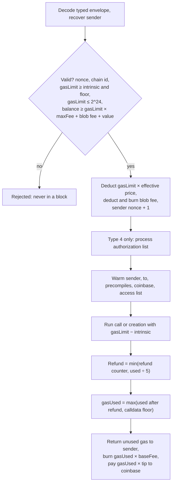

# 1.2 Transactions and fees

> [!abstract] In one minute
> - A transaction is a signed, typed envelope (EIP-2718). Live types: 0 legacy, 1 access list, 2 EIP-1559, 3 blob, 4 set-code (EIP-7702). Contracts see almost none of the envelope: `tx.origin`, `tx.gasprice`, calldata, and for blobs only `blobhash(i)`.
> - EIP-1559: you pay `gasUsed × (baseFee + tip)`, where `tip = min(maxPriorityFee, maxFee − baseFee)`. The base fee part is burned. Only the tip goes to the block's fee recipient. The base fee moves by at most 12.5% per block.
> - Intrinsic gas is charged before any opcode runs: 21,000 + calldata (4 per zero byte, 16 per nonzero byte) + 32,000 and 2 per initcode word for creation + 2,400 per access-list address and 1,900 per key + 25,000 per 7702 authorization.
> - Since Pectra (7 May 2025), EIP-7623 sets a floor: a transaction pays at least 21,000 + 10 gas per calldata token (10 per zero byte, 40 per nonzero byte). Data-heavy, compute-light transactions pay the floor.
> - Since Fusaka (3 Dec 2025), EIP-7825 caps every transaction's gas limit at 2^24 = 16,777,216 gas, and EIP-7918 puts a reserve price under blob fees.
> - Replay protection is layered: EIP-155 / typed-tx `chain_id` and the account nonce protect transactions; contracts must protect signed messages themselves (EIP-712 domain, nonces, deadlines).

**Prerequisites:** [[1.1 Accounts and world state]] · **Leads to:** [[1.9 Gas accounting]], [[1.3 Execution model]], [[5.8 Signatures and replay]], [[4.5 Account abstraction and smart wallets]]

## What a transaction is

A transaction is the only way the outside world changes Ethereum state. An externally owned account (EOA) signs a message that says: "from my account, at my next nonce, call this address with this data and value, and here is how much I will pay for gas." Three ideas carry most of this note:

1. **The envelope is typed.** Since Berlin (15 Apr 2021), EIP-2718 lets a transaction be `type_byte || payload`. The type byte is part of what is signed, so a signature for one type cannot be reinterpreted as another type. Legacy transactions (RLP lists with no type byte) are "type 0".
2. **Gas is bought up front.** Before execution, the sender must hold `gasLimit × maxFeePerGas` (plus blob fees and `value`). That gas is deducted, the work runs, and unused gas is returned at the end.
3. **Some gas is spent before the first opcode.** This is intrinsic gas: the fixed cost of having a transaction at all, plus the cost of its data, access list and authorizations. Execution gas (opcodes, memory, storage) is covered in [[1.9 Gas accounting]].

The lifecycle, in the order the execution specs apply it:



> [!note] Invalid is not the same as reverted
> An *invalid* transaction (bad nonce, gas limit above the cap, cannot afford gas) can never appear in a block and costs nothing. A *reverted* transaction is included, pays for the gas it used, bumps the nonce, and (for type 4) keeps its delegations. Contract code only ever experiences the second kind.

## Transaction types

| Type | EIP | Fork (mainnet date) | Fields added beyond legacy | What a contract can observe |
|---|---|---|---|---|
| `0x04` set-code | 7702 | Prague / Pectra (7 May 2025) | `authorization_list` of `[chain_id, address, nonce, y_parity, r, s]`; 1559 fee fields; `to` must not be empty | Delegated code at the authority (`0xef0100 ‖ address`, 23 bytes via EXTCODESIZE); `tx.origin` = sponsor, which may now be a delegated account |
| `0x03` blob | 4844 | Cancun / Dencun (13 Mar 2024) | `max_fee_per_blob_gas`, `blob_versioned_hashes` (at least 1); `to` must not be empty | `blobhash(i)` (BLOBHASH, `0x49`), `block.blobbasefee` (BLOBBASEFEE, `0x4a`). Never the blob bytes |
| `0x02` dynamic fee | 1559 | London (5 Aug 2021) | `max_priority_fee_per_gas`, `max_fee_per_gas`, `access_list`, `chain_id` | `tx.gasprice` = effective gas price, `block.basefee` |
| `0x01` access list | 2930 | Berlin (15 Apr 2021) | `access_list`, `chain_id`; still a single `gasPrice` | Only the gas effect (slots and addresses start warm) |
| `0x00` legacy | — / 155 | Frontier; EIP-155 at Spurious Dragon (22 Nov 2016) | none; chain id folded into `v` = `chainId × 2 + 35/36` | `tx.gasprice` = `gasPrice` |

Types 1 and 2 are `rlp([chainId, nonce, (fee fields), gasLimit, to, value, data, accessList, yParity, r, s])`; type 3 inserts `max_fee_per_blob_gas, blob_versioned_hashes` before the signature, type 4 inserts `authorization_list`. A type 3 transaction travels in a network wrapper with blobs, commitments and proofs; since Fusaka (EIP-7594) it has `wrapper_version = 1`, cell proofs and at most 6 blobs. The wrapper never reaches the EVM.

> [!tip] Legacy types are still valid
> Type 0 and type 1 transactions still work on mainnet. Type 0 also still accepts pre-EIP-155 signatures (`v` = 27 or 28) with no chain id at all. Many RPC nodes refuse to relay them by default, but they are valid in a block. This matters for replay (see [[#Pitfalls and incidents]]).

## EIP-1559: what you pay and what burns

### The formula

A type 2, 3 or 4 transaction states two numbers per unit of gas:

- `maxFeePerGas` — the most you will pay in total per gas.
- `maxPriorityFeePerGas` — the most you will tip the block producer per gas.

The block has a protocol-set `baseFeePerGas`. Then:

```text
require maxFeePerGas >= baseFeePerGas
priorityFeePerGas = min(maxPriorityFeePerGas, maxFeePerGas - baseFeePerGas)
effectiveGasPrice = baseFeePerGas + priorityFeePerGas

upfront reserve   = gasLimit × maxFeePerGas          (must be in balance)
sender pays       = gasUsed  × effectiveGasPrice
burned            = gasUsed  × baseFeePerGas
fee recipient     = gasUsed  × priorityFeePerGas
```

Legacy and type 1 transactions fit the same scheme with `maxFee = maxPriorityFee = gasPrice`. So their whole margin above the base fee becomes tip.

> [!example] Worked numbers (verified by script)
> Simple transfer: `gasUsed` = 21,000. Base fee 20 gwei, `maxFee` 30 gwei, `maxPriorityFee` 2 gwei.
> - Tip per gas = min(2, 30 − 20) = 2 gwei. Effective price = 22 gwei.
> - Burned: 21,000 × 20 gwei = 0.00042 ETH. Tip: 21,000 × 2 gwei = 0.000042 ETH. Total 0.000462 ETH.
> - Up front the sender needed 21,000 × 30 gwei = 0.00063 ETH; the unused 0.000168 ETH comes back.
> - If the base fee were 29 gwei, the tip would be capped at min(2, 30 − 29) = 1 gwei, and the effective price would be 30 gwei.
>
> In a py-evm Prague run, a call with base fee 202,248,046 wei, `maxFee` = base + 1 gwei and tip 3 gwei logged `tx.gasprice` = 1,202,248,046 wei: the tip was capped exactly as above.

### The base fee update rule

The base fee is computed from the parent block. The gas target is half the gas limit (`ELASTICITY_MULTIPLIER` = 2), and the change per block is at most 1/8 (`BASE_FEE_MAX_CHANGE_DENOMINATOR` = 8):

```text
target = parent.gasLimit / 2
if parent.gasUsed == target:  base = parent.base
if parent.gasUsed >  target:  base = parent.base + max(parent.base × (used − target) / target / 8, 1)
if parent.gasUsed <  target:  base = parent.base − parent.base × (target − used) / target / 8
```

With a 60,000,000 gas limit (mainnet reached 60 million in Nov 2025; check the current value) and a 20 gwei parent:

| Parent gas used | Next base fee |
|---|---|
| 60,000,000 (full) | 22.5 gwei (+12.5%) |
| 45,000,000 | 21.25 gwei (+6.25%) |
| 30,000,000 (target) | 20 gwei |
| 15,000,000 | 18.75 gwei |
| 0 (empty) | 17.5 gwei (−12.5%) |

Ten full blocks multiply the base fee by 1.125^10 ≈ 3.25. Wallets set `maxFee` near twice the base fee, which survives about six full blocks. (In py-evm, a 1 gwei genesis followed by an empty block gave 875,000,000 wei.)

### Why burn the base fee?

If the base fee went to the producer, a producer could stuff its own blocks to push the fee up at no cost. Burning makes the base fee a pure protocol price. The tip is the only part the producer can capture, which is why ordering games live in the tip and in off-chain payments. See [[5.6 MEV and transaction ordering]].

> [!info]- Deep dive: what `GASPRICE` means after London
> EIP-1559 says `GASPRICE` (`0x3a`) must return the effective gas price. Contracts cannot see `maxFeePerGas` or `maxPriorityFeePerGas`. `block.basefee` (`BASEFEE`, `0x48`, EIP-3198) sits with the other block fields in [[1.10 Block and chain context]].

## Intrinsic gas

Intrinsic gas is deducted before the first opcode. If `gasLimit` is below it, the transaction is invalid.

| Component | Gas | Fork | EIP |
|---|---|---|---|
| Per authorization tuple (type 4) | 25,000 (`PER_EMPTY_ACCOUNT_COST`); 12,500 goes to the refund counter if the authority already exists | Prague | 7702 |
| Access list, per address | 2,400 | Berlin | 2930 |
| Access list, per storage key | 1,900 | Berlin | 2930 |
| Initcode, per 32-byte word (creation only) | 2 | Shanghai | 3860 |
| Calldata, per nonzero byte | 16 (was 68) | Istanbul | 2028 |
| Calldata, per zero byte | 4 | Frontier | Yellow Paper |
| Contract creation (`to` empty) | +32,000 | Homestead | 2 |
| Every transaction | 21,000 | Frontier | Yellow Paper |

So a creation transaction with initcode `I` costs at least `21,000 + 32,000 + 4·zeros(I) + 16·nonzeros(I) + 2·ceil(len(I)/32)`. Initcode is capped at 49,152 bytes (EIP-3860). A creation transaction with longer initcode is invalid. A `CREATE` with longer initcode only fails that frame.

What the 21,000 covers is answered in the [[#Question ladder]]. Blob gas is *not* intrinsic gas: blobs have their own fee market (see [[#Blobs and what contracts see]]).

> [!example] Measured on py-evm (Prague rules)
> - Plain ETH transfer: `gasUsed` = 21,000.
> - Deploy of `FeeProbe` (333-byte initcode, 3 zero bytes, 330 nonzero): intrinsic = 21,000 + 32,000 + 12 + 5,280 + 22 = 58,314. Total `gasUsed` 119,423, the rest being constructor execution and the 200-gas-per-byte code deposit ([[1.8 Contract creation]]).

### The EIP-7623 calldata floor

Calldata is priced in **tokens**: a zero byte is 1 token, a nonzero byte is 4 tokens. The normal price is 4 gas per token, which is the familiar 4/16. EIP-7623 (Prague) adds a floor of 10 gas per token:

```text
tokens   = zeroBytes + 4 × nonzeroBytes
gasUsed  = 21000 + max(
             4 × tokens + executionGas + isCreate × (32000 + 2 × words(initcode)),
             10 × tokens )
valid only if gasLimit >= max(intrinsic, 21000 + 10 × tokens)
```

The floor is applied *after* refunds. You cannot use storage-clearing refunds to dip under it.

The floor binds when `executionGas + creationCost < 6 × tokens`, that is, when the transaction does less than 24 gas of work per nonzero byte (6 per zero byte). Ordinary contract calls do far more work than that and pay nothing extra. Transactions that mostly carry data pay up to 2.5 times the old price.

| Payload (sent to an EOA) | Old cost (4/16) | With floor | Paid |
|---|---|---|---|
| 1,000 nonzero bytes | 37,000 | 61,000 | 61,000 |
| 1,000 zero bytes | 25,000 | 31,000 | 31,000 |
| 100 KiB nonzero bytes | 1,659,400 | 4,117,000 | 4,117,000 |

The first two rows were measured in py-evm. Calldata layout is covered in [[1.6 Calldata, returndata and logs]].

### Access lists

An access list pre-declares addresses and storage keys. They are charged at intrinsic time and then start *warm*, so the first access costs the warm price (100 gas) instead of the cold price (2,600 for an account, 2,100 for a slot; see [[1.9 Gas accounting]]).

The arithmetic is tight:

| Item | Without list | With list | Saving |
|---|---|---|---|
| Other contract's address | 2,600 | 2,400 + 100 | 100 |
| Storage key in that contract | 2,100 | 1,900 + 100 | 100 |
| `tx.to`, sender, precompiles | already warm (EIP-2929) | 2,400 wasted | −2,400 |

Measured in py-evm: listing another contract and one of its slots saved exactly 200 gas; listing `tx.to` cost 2,400 more. Duplicates are allowed and charged each time.

## EIP-7702 set-code transactions

A type 4 transaction lets an EOA (the *authority*) point its code at a delegate contract. The account then runs the delegate's code in its own context, with its own storage and balance. The account model side (the 23-byte `0xef0100 ‖ address` indicator, what EXTCODE* return) is in [[1.1 Accounts and world state]]. Here we care about the transaction.

Processing order, from the EIP:

1. Normal validation. The sender's nonce is incremented.
2. For each authorization tuple `[chain_id, address, nonce, y_parity, r, s]`, in order:
   1. `chain_id` must be 0 or the current chain id.
   2. `nonce < 2^64 − 1`.
   3. Recover `authority = ecrecover(keccak(0x05 ‖ rlp([chain_id, address, nonce])), …)`, with `s ≤ secp256k1n/2`.
   4. Add `authority` to the warm address set.
   5. The authority's code must be empty or already a delegation.
   6. The authority's nonce must equal `nonce`.
   7. If the authority account exists, add 12,500 to the refund counter.
   8. Set code to `0xef0100 ‖ address` (or clear it if `address` is zero).
   9. Increment the authority's nonce.

   If any step fails, skip this tuple and go on. If the same authority appears twice, the last valid tuple wins.
3. Execute the call to `to`.

The tuple signer pays nothing. The transaction sender pays all gas, including 25,000 per tuple whether the tuple is valid or not. The list must not be empty, and `to` must not be empty, so a type 4 transaction cannot create a contract. Delegations survive a revert of the call.

## Blobs and what contracts see

A blob is 128 KiB of data (4,096 field elements of 32 bytes) attached to a type 3 transaction. It is propagated and stored by the consensus layer for about 18 days (4,096 epochs) and then pruned. The execution layer only records a **versioned hash** per blob: `0x01 ‖ sha256(kzg_commitment)[1:32]`.

Blob gas is its own resource:

- Each blob uses `GAS_PER_BLOB` = 131,072 blob gas.
- The blob base fee is `fake_exponential(1, excess_blob_gas, update_fraction)`, roughly `e^(excess/fraction)` wei, and `excess_blob_gas` tracks cumulative usage above target.
- The blob fee is paid up front, burned, and not refunded if the transaction fails. It does not count toward `gasUsed`.

In the py-evm run, a type 3 call with 2 blobs used 21,293 gas, and the sender was charged an extra 262,144 wei = 2 × 131,072 × 1 wei of blob fee, separately.

| Blob schedule (newest first) | Activation | Target / max per block | Update fraction | Full block | Empty block |
|---|---|---|---|---|---|
| BPO2 | 7 Jan 2026 | 14 / 21 | 11,684,671 | +8.2% | −14.5% |
| BPO1 | 9 Dec 2025 | 10 / 15 | 8,346,193 | +8.2% | −14.5% |
| Osaka (Fusaka) | 3 Dec 2025 | 6 / 9 | 5,007,716 | +8.2% | −14.5% |
| Prague (EIP-7691) | 7 May 2025 | 6 / 9 | 5,007,716 | +8.2% | −14.5% |
| Cancun (EIP-4844) | 13 Mar 2024 | 3 / 6 | 3,338,477 | +12.5% | −11.1% |

The percentages are per-block changes of the blob base fee, computed from `e^(±Δexcess/fraction)`. The BPO forks (EIP-7892) only change these parameters. `excess_blob_gas` never goes below zero, and since EIP-7918 (below) it also stops falling while the reserve price binds, so the empty-block column is a best case.

**EIP-7918 (Fusaka) changed blob pricing.** Before it, when execution gas was expensive and blob demand low, the blob base fee could fall to 1 wei and stay there, so rollups paid almost nothing for data. EIP-7918 adds `BLOB_BASE_COST` = 2^13 = 8,192. When `8,192 × baseFee > 131,072 × blobBaseFee` (the blob fee is below about 1/16 of the execution base fee), `excess_blob_gas` stops falling. The effect is a reserve price: a blob costs at least about 8,192 gas worth of execution base fee. At a 1 gwei base fee that is about 0.0625 gwei per blob gas, or about 0.0000082 ETH per blob.

## Per-transaction gas cap (EIP-7825)

Since Fusaka, a transaction whose **gas limit** exceeds 2^24 = 16,777,216 is invalid. It is dropped from the mempool, and a block containing it is invalid. This is a cap on what you *ask for*, not what you use. A transaction with a 20,000,000 gas limit that would use 50,000 gas is still rejected.

Reasons: bound the worst-case cost of one transaction (DoS), and make blocks splittable into independent pieces for parallel execution and the coming block-level access lists. With a 60 million gas block, at most three maximum-size transactions fit in a block.

Some numbers that follow from it (computed):

- Maximum calldata in one transaction under the EIP-7623 floor: (16,777,216 − 21,000) / 40 = 418,905 nonzero bytes (about 409 KiB), or 1,675,621 zero bytes.
- Fresh storage writes (20,000 + 2,100 cold) in one transaction: at most about 759, before any other overhead.
- A maximum-size 24,576-byte contract costs about 5.36 million gas of intrinsic gas plus code deposit, about 32% of the cap, before constructor logic.

## Glamsterdam: scheduled changes to transaction pricing

> [!warning] Scheduled, not yet mainnet rules
> As of 30 Oct 2026, Glamsterdam (Amsterdam EVM) is live on Sepolia (6 Oct 2026) only. Its Hoodi activation (26 Oct 2026) was cancelled on 22 Oct 2026 while developers study EIP-8037 (see [[1.11 Hard forks that changed contract code]]). Mainnet has no date. The EIPs below are "Scheduled for Inclusion" in the meta EIP-7773 and in Last Call (deadline 1 Nov 2026). Their numbers can still change.

| EIP | Change |
|---|---|
| 2780 | Resource-based intrinsic gas: `TX_BASE_COST` 12,000 replaces the flat 21,000. Touching the recipient adds 3,000 (always charged at the cold rate) and a nonzero value transfer adds 6,000, so a plain transfer to an existing EOA stays at 21,000. A creation is 24,000 intrinsic. New accounts are charged separately in state gas. |
| 7976 | Raises the calldata floor to 16 gas per token and counts every byte as 4 floor tokens: 64 gas per byte, zero or not. Maximum calldata under the cap drops to about 261,815 bytes. |
| 7981 | Access lists also pay a data cost of 64 gas per byte (1,280 per address, 2,048 per key) on top of 2,400 / 1,900. The spec and reference code disagree on how it meets the floor; read the final text. |
| 8037 | Splits gas into execution gas and *state gas*. Cost per state byte 1,530: code deposit becomes 1,530 state gas per byte, a new account 183,600, a new slot 97,920. State gas does not count against the 2^24 cap; `tx.gas` may go up to 2^32 − 1 to fund it. |
| 7778 | Refunds no longer reduce *block* gas used. Users still get refunds. |
| 7954 | Raises the code size limit to 65,536 bytes and initcode to 131,072 bytes. |

Solidity 0.8.37 already exposes `block.slotnum` (EIP-7843) for `evmVersion` Amsterdam, which is still experimental in 0.8.38 (it needs `settings.experimental`). Fork-by-fork effects on contract code are collected in [[1.11 Hard forks that changed contract code]].

## Solidity and Yul in practice

What Solidity exposes about the transaction and its fees:

| Solidity | Opcode | Gas | Meaning |
|---|---|---|---|
| `tx.gasprice` | `GASPRICE` `0x3a` | 2 | Effective gas price (base fee + tip actually paid) |
| `block.basefee` | `BASEFEE` `0x48` | 2 | Current block's base fee |
| `block.blobbasefee` | `BLOBBASEFEE` `0x4a` | 2 | Current block's blob base fee |
| `blobhash(i)` | `BLOBHASH` `0x49` | 3 | Versioned hash of blob `i` of *this* transaction, or zero |
| `tx.origin` | `ORIGIN` `0x32` | 2 | Signer of the outer transaction (the sponsor for type 4) |

```solidity
// SPDX-License-Identifier: MIT
pragma solidity 0.8.38;

contract FeeProbe {
    event Seen(
        uint256 gasPrice,     // effective gas price = base fee + tip
        uint256 baseFee,      // block base fee per gas
        uint256 blobBaseFee,  // block blob base fee per blob gas
        bytes32 blob0,        // versioned hash of blob 0, or zero
        address origin,       // signer of the outer transaction
        address sender        // immediate caller
    );

    function probe() external returns (uint256 tipPerGas) {
        emit Seen(
            tx.gasprice,
            block.basefee,
            block.blobbasefee,
            blobhash(0),
            tx.origin,
            msg.sender
        );
        // Under EIP-1559, GASPRICE returns the effective gas price,
        // so this difference is the priority fee per gas actually paid.
        tipPerGas = tx.gasprice - block.basefee;
    }

    // Same reads in inline assembly. Each opcode is cheap (2 or 3 gas).
    function probeAsm()
        external
        view
        returns (uint256 gp, uint256 bf, uint256 bbf, bytes32 h0, bytes32 h9)
    {
        assembly {
            gp := gasprice()      // 0x3a
            bf := basefee()       // 0x48
            bbf := blobbasefee()  // 0x4a
            h0 := blobhash(0)     // 0x49
            h9 := blobhash(9)     // out of range -> 0
        }
    }
}
```

Run in py-evm (Prague rules): in a type 2 call `blobhash(0)` returned zero. In a type 3 call with two versioned hashes, `probeAsm()` returned the first hash for `h0`, zero for `h9`, and `bbf` = 1 wei (excess blob gas zero). When the same contract was the delegate of a 7702 account, the event was emitted from the EOA's address and `tx.origin` was the sponsor, not the EOA.

> [!warning] Do not price logic on `tx.gasprice`
> The sender picks `tx.gasprice` by choosing the tip. A contract that repays a relayer `gasUsed × tx.gasprice` lets the relayer set any price it likes and bill the contract for it. If the relayer is the block producer, or works with one, the inflated tip flows back to it, so the "reimbursement" is profit taken from the contract. Cap reimbursements at `block.basefee + fixedTip`, or use a fixed fee.

## Pitfalls and incidents

| Date              | Incident / footgun                             | What went wrong                                                                                                                                                                                                                                     | Defense                                                                                                                                                                                        |
| ----------------- | ---------------------------------------------- | --------------------------------------------------------------------------------------------------------------------------------------------------------------------------------------------------------------------------------------------------- | ---------------------------------------------------------------------------------------------------------------------------------------------------------------------------------------------- |
| 3 Dec 2025 onward | Gas limits above 2^24                          | Deploy scripts, keepers and governance executors that set gas limit to "block gas limit" now produce invalid transactions. A governance action that needs more than 2^24 gas can never execute.                                                     | Keep every transaction under 16,777,216; design resumable batches (below)                                                                                                                      |
| 7 May 2025 onward | `msg.sender == tx.origin` as an "is EOA" check | With EIP-7702, `tx.origin` can be a delegated account running code, so the check no longer stops contracts or reentrancy                                                                                                                            | Use real reentrancy guards; see [[5.11 New attack surfaces - transient storage, EIP-7702, account abstraction]]                                                                                |
| 7 May 2025 onward | `chain_id = 0` authorizations                  | A 7702 authorization with chain id 0 is valid on every chain where the authority's nonce matches. Fresh accounts often have nonce 0 on many chains.                                                                                                 | Wallets should sign the specific chain id unless cross-chain delegation is the goal                                                                                                            |
| Jun 2022          | Wintermute 20M OP on Optimism                  | Attackers replayed a 2020 pre-EIP-155 (`v` = 27/28) Gnosis Safe factory deployment on Optimism, recreated the factory at its mainnet address, and deployed a Safe at Wintermute's address with themselves as owner. About 20 million OP were taken. | Never rely on "same address on another chain" without deploying there; avoid unprotected transactions except for deliberate keyless deploys ([[4.3 Deterministic and cross-chain deployment]]) |
| Jul 2016          | ETH / ETC split                                | Before EIP-155 existed, the same signed transaction was valid on both chains, so users' transfers were replayed                                                                                                                                     | EIP-155 chain id in the signature (22 Nov 2016)                                                                                                                                                |
| Any               | Access list including `tx.to`                  | Costs 2,400 gas with no benefit (measured)                                                                                                                                                                                                          | Only list *other* contracts and their slots; let `eth_createAccessList` suggest, then check                                                                                                    |
| Any               | Reading blob hashes later                      | BLOBHASH only works inside the blob transaction. A later transaction cannot ask for an old blob's hash                                                                                                                                              | Store the versioned hash in the same transaction                                                                                                                                               |

## Question ladder

> [!question]- **B** What does an EIP-1559 transaction pay, and which part is burned?
> It pays `gasUsed × effectiveGasPrice`, where `effectiveGasPrice = baseFee + min(maxPriorityFee, maxFee − baseFee)`. The `gasUsed × baseFee` part is burned. The `gasUsed × tip` part goes to the block's fee recipient (`block.coinbase`).
>
> Up front the sender must hold `gasLimit × maxFee` (plus `value`, plus blob fees for type 3). Gas not used is returned at the end, so `maxFee` is only a ceiling. If `maxFee < baseFee`, the transaction cannot be included in that block; it waits in the mempool.
>
> Example: 21,000 gas at base fee 20 gwei, max fee 30, tip 2. Effective price 22 gwei; 0.00042 ETH burned, 0.000042 ETH tip. The base fee moves up to ±12.5% per block. In the EVM, `tx.gasprice − block.basefee` is the tip actually paid. Type 3 adds a separate, also burned, blob fee: `blobs × 131,072 × blobBaseFee`.

> [!question]- **B** What is intrinsic gas, and what does the 21,000 base cover?
> Intrinsic gas is what a transaction costs before any opcode runs. It is subtracted from the gas limit first; if the limit is lower, the transaction is invalid and cannot be included.
>
> The parts: 21,000 base; calldata at 4 gas per zero byte and 16 per nonzero byte; for creation, 32,000 plus 2 gas per 32-byte word of initcode (EIP-3860); for an access list, 2,400 per address and 1,900 per storage key; for type 4, 25,000 per authorization tuple (12,500 of it later refunded if the authority account already existed). Since Prague there is also a minimum: the gas limit must cover `21,000 + 10 × calldata tokens` (EIP-7623).
>
> The 21,000 pays for work every transaction causes regardless of what it does: recovering the sender from the ECDSA signature, reading and writing the sender's nonce and balance, crediting the recipient's balance, and storing the transaction and its receipt. It is one launch-era number, not a sum of measured parts. EIP-2780 (scheduled for Glamsterdam, in Last Call) splits it into a 12,000 base, 3,000 for touching the recipient (always at the cold rate) and 6,000 for a nonzero value transfer. A plain ETH transfer stays at 21,000, while a zero-value call to an EOA drops to 15,000.

> [!question]- **I** How is calldata priced, and what did the EIP-7623 floor change for data-heavy transactions?
> Calldata is counted in tokens: zero byte = 1 token, nonzero byte = 4 tokens. The standard price is 4 gas per token, which gives the familiar 4 gas per zero byte and 16 per nonzero byte (16 since Istanbul, EIP-2028; it was 68 before).
>
> EIP-7623 (Pectra, 7 May 2025) added a floor of 10 gas per token. A transaction pays `21,000 + max(standard cost + execution gas, 10 × tokens)`. The floor is applied after refunds, and the gas limit must cover it up front.
>
> The floor wins only when execution plus creation gas is below `6 × tokens` (24 gas of work per nonzero byte). Swaps and transfers do far more and pay the same as before. Data-heavy transactions pay up to 2.5 times more: 1,000 nonzero bytes to an EOA went from 37,000 to 61,000 gas (measured).
>
> Why: it shrinks the worst-case block size while leaving normal calls alone, and pushes rollup data to blobs. For contracts that take large payloads (proofs, batched signatures, multiproofs), estimate with the floor and use compact encodings. EIP-7976 (scheduled for Glamsterdam, in Last Call) would raise the floor to 64 gas per byte for every byte.

> [!question]- **I** What does an access list do, and when does it actually save gas?
> An access list (type 1 and later) declares addresses and storage keys up front. Each costs intrinsic gas (2,400 per address, 1,900 per key) and then starts warm, so the first touch costs 100 instead of 2,600 (account) or 2,100 (slot).
>
> So each correctly listed item saves exactly 100 gas (2,600 vs 2,400 + 100; 2,100 vs 1,900 + 100), and only if it is really touched and not already warm. The sender, `tx.to`, precompiles and (since Shanghai) the coinbase are warm anyway; listing one wastes 2,400. In py-evm, one listed address plus slot saved 200 gas, and listing `tx.to` cost 2,400.
>
> When it pays off: routers touching several other contracts, and proxies (the implementation is a cold account). The original motivation was Berlin's EIP-2929 repricing, which broke calls that forwarded fixed gas, such as the 2,300 stipend, into code that now needed cold access; a list could pre-warm what they touched. A wrong slot costs 1,900 for nothing. `eth_createAccessList` suggests a list; check it is net positive. EIP-7981 (Glamsterdam, proposal) adds a 64-gas-per-byte charge that removes most of the margin.

> [!question]- **A** Walk through a type-4 transaction: the authorization list, nonce handling, who pays, and what happens when an authorization is invalid.
> **Shape.** A type 4 transaction is an EIP-1559 transaction plus `authorization_list`, a non-empty list of `[chain_id, address, nonce, y_parity, r, s]`. Each tuple is signed by an *authority* over `keccak(0x05 ‖ rlp([chain_id, address, nonce]))`. `to` must be set; no creation.
>
> **Order.** Sender nonce bumped, then each tuple runs the nine checks and writes listed in [[#EIP-7702 set-code transactions]], then the call to `to` runs.
>
> **Nonces.** Two nonces move: the sender's (once) and each successful authority's (once per applied tuple). If the sender is also the authority (self-sponsored), its nonce has already been bumped, so the tuple must carry `current nonce + 1`. In py-evm, a self-authorization with the current nonce was silently skipped (46,000 gas, no delegation); with nonce + 1 it applied, and the account's nonce moved by 2.
>
> **Who pays.** The transaction sender pays everything: 25,000 intrinsic gas per tuple, valid or not, plus calldata and execution. The authority pays nothing and needs no ETH. The 12,500 refund for existing accounts goes into the normal refund counter, so it is capped at one fifth of gas used.
>
> **Invalid tuples.** A failed check skips that tuple only. The transaction stays valid, the 25,000 is still charged, and execution continues with whatever code the authority had. For duplicates, the last valid tuple wins. Delegations that were applied are not undone if the call reverts.
>
> Measured in py-evm (Prague rules):
>
> | Case | Gas used | Outcome |
> |---|---|---|
> | Sponsored, existing authority, valid | 39,016 | 48,769 before refund; refund capped at 9,753 |
> | Same call, tuple with wrong nonce | 48,769 | Tuple skipped, still charged; old delegation used |
> | Self-sponsored, current nonce | 46,000 | Skipped |
> | Self-sponsored, nonce + 1 | 36,800 | Applied; refund capped at 9,200 |
> | `chain_id` 0, empty authority, call reverts | 46,187 | Transaction reverted, delegation kept |
>
> **What to say in an interview.** Delegation is a persistent state change, made by a signature the user may have given long ago, that survives reverts. Anyone holding a valid tuple can submit it, so initialization of the delegate's storage can be front-run unless the first call is bundled in the same transaction or checks a signature. `tx.origin` may now run code. And a `chain_id` 0 tuple replays wherever the nonce matches. Wallet design is in [[4.5 Account abstraction and smart wallets]].

> [!question]- **A** What can a contract see about blobs (BLOBHASH, BLOBBASEFEE), and what can it never see?
> **Can see.**
> - `blobhash(i)` (BLOBHASH, 3 gas): the versioned hash of blob `i` in the *current* transaction, `0x01 ‖ sha256(commitment)[1:]`. Out of range, or in a non-blob transaction, it returns zero. It works at any call depth within that transaction.
> - `block.blobbasefee` (BLOBBASEFEE, 2 gas): the current blob base fee, so a contract can, for example, reimburse a rollup batcher fairly.
> - Claims about blob contents, *if someone supplies them*: the point evaluation precompile at `0x0a` (50,000 gas) checks a KZG proof that the polynomial behind a versioned hash evaluates to `y` at point `z`. This is how fraud and validity proofs bind to blob data.
>
> **Can never see.**
> - The blob bytes. They live on the consensus layer and are pruned after about 18 days. No opcode loads them.
> - Blob hashes of any other transaction, past or present. If you need one later, store it now.
> - The number of blobs directly (you probe `blobhash(i)` until it returns zero), `max_fee_per_blob_gas`, or how much blob fee was paid. Blob gas is not part of `gasleft()` or `gasUsed`.
>
> **Pricing context.** Under BPO2 (target 14, max 21) a full blob block raises the blob base fee about 8.2%. EIP-7918 keeps a blob at no less than about 8,192 gas of execution base fee, and EIP-7594 limits a transaction to 6 blobs. Rollup design is in [[4.8 L2s and cross-chain]].

> [!question]- **E** How does a per-transaction gas cap change large deployments, migrations and batch operations?
> **The rule.** Since Fusaka (3 Dec 2025), EIP-7825 makes any transaction with `gasLimit > 16,777,216` invalid. It is a cap on the limit, not on use, so tools that set the gas limit to "the block gas limit" break even when real use is small. L2s set their own rules; check each chain.
>
> **Deployments.** A full 24,576-byte contract costs about 5.36 million gas of intrinsic gas plus code deposit, about a third of the cap, so single contracts fit. What breaks is the "deploy the whole system in one constructor" pattern: a factory that deploys several large contracts and wires them in one transaction. Split it into several transactions, and use CREATE2 so addresses are known before deployment ([[4.3 Deterministic and cross-chain deployment]]). Constructors that loop over large arrays also need splitting. Watch the proposals: EIP-7954 would allow 64 KiB contracts, which at today's 200 gas per byte deposit would use about 85% of the cap; EIP-8037 moves code deposit into state gas, which does not count against the cap.
>
> **Migrations and batches.** Any operation whose gas grows with data size needs a resumable design: process items until `gasleft()` drops below a reserve, store a cursor, return `done`. Make each step idempotent, so a retry after a partial run is safe, and keep invariants valid between steps, because other users transact between your batches. Rough capacity: about 759 fresh storage writes per transaction at 22,100 gas each; about 409 KiB of nonzero calldata under the floor.
>
> **Failure modes to name.**
> - Governance or timelock actions encoded as one call that needs more than 2^24 gas become impossible to execute. A stuck upgrade is worse than a failed one.
> - Liquidation or settlement loops over unbounded user lists stop fitting; this is the same lesson as [[5.7 Denial of service and griefing]], now enforced by the protocol.
> - Gas estimation that succeeds in a local fork with no cap and fails on mainnet. Configure tests with the Osaka EVM version.
>
> **What the interviewer listens for:** that you know it is a limit-level validity rule, that you design for bounded work per transaction anyway, and that you can explain the motivation: bounded worst case, and blocks splittable for parallel execution and block-level access lists (EIP-7928, Glamsterdam).

> [!question]- **E** Compare replay protection at the transaction level (EIP-155 chain id) with the contract level (EIP-712 domains, nonces).
> | | Transaction level | Contract level |
> |---|---|---|
> | What is signed | The transaction itself | An application message (permit, order, vote, meta-tx) |
> | Chain binding | EIP-155 folds the chain id into `v` (`chainId × 2 + 35/36`, so 37/38 on mainnet, verified); types 1–4 carry `chain_id` explicitly | EIP-712 domain `chainId`; also `verifyingContract`, `name`, `version`, optional `salt` |
> | One-time use | Account nonce, enforced by the protocol | The contract's own nonce map, or a used-hash set, or a bitmap (Permit2 style) |
> | Expiry | None (a signed transaction is valid until the nonce is used) | Deadline field, checked by the contract |
> | Who enforces | Every node, for free | Your code. If you forget a field, nothing else catches it |
> | Known gaps | Pre-155 legacy transactions (`v` = 27/28) are still valid and replay on any chain where the nonce matches (Wintermute, 2022); 7702 `chain_id` 0 authorizations replay by design | Missing `chainId` or `verifyingContract`; domain separator cached at deploy and not recomputed after a chain split; signature malleability; one signer owning several smart accounts (ERC-1271), where a signature for one account verifies on another |
>
> **Mechanism.** At the transaction level, the chain id makes the signed hash differ per chain, and the nonce makes each signed transaction usable once per account per chain. Note the "per chain": the same address has independent nonces on every chain, so an unprotected transaction is replayable on any chain where that account's nonce is still at the right value. That is exactly what keyless deployment (Nick's method) relies on, on purpose, and what the Wintermute attacker relied on by accident of history.
>
> At the contract level, the protocol gives you nothing. The `Vouchers` example below uses all four layers: domain with chain id and contract address, a nonce consumed before effects, a deadline, and a low-s check. It also recomputes the domain separator if `block.chainid` changes, so a signature from before a chain split does not verify on the other fork.
>
> **The 7702 angle.** With delegated EOAs, the same address can run the same wallet code on many chains. If that wallet's EIP-712 domain omits `chainId`, or uses `chain_id` 0 style "all chains" semantics, one signature authorizes actions everywhere. Nested-typed-data schemes such as ERC-7739 address the multi-account version of the problem.
>
> **What the interviewer listens for:** that transaction-level protection does not cover signed messages; which fields bind a signature to a chain, a contract, a signer and a single use; and the real incidents where one layer was missing. Detailed attack patterns are in [[5.8 Signatures and replay]].

### Code for the expert answers

Contract-level replay protection:

```solidity
// SPDX-License-Identifier: MIT
pragma solidity 0.8.38;

/// Contract-level replay protection: EIP-712 domain (chain id + this address)
/// plus a per-signer nonce plus a deadline.
contract Vouchers {
    bytes32 private constant DOMAIN_TYPEHASH = keccak256(
        "EIP712Domain(string name,string version,uint256 chainId,address verifyingContract)"
    );
    bytes32 private constant VOUCHER_TYPEHASH = keccak256(
        "Voucher(address to,uint256 amount,uint256 nonce,uint256 deadline)"
    );

    uint256 private immutable cachedChainId;
    bytes32 private immutable cachedDomainSeparator;

    mapping(address => uint256) public nonces;
    mapping(address => uint256) public credit;

    error Expired();
    error BadSignature();

    constructor() {
        cachedChainId = block.chainid;
        cachedDomainSeparator = _buildDomainSeparator();
    }

    function _buildDomainSeparator() private view returns (bytes32) {
        return keccak256(
            abi.encode(
                DOMAIN_TYPEHASH,
                keccak256("Vouchers"),
                keccak256("1"),
                block.chainid,
                address(this)
            )
        );
    }

    /// Recompute after a chain split, so a signature made for one fork
    /// does not verify on the other.
    function domainSeparator() public view returns (bytes32) {
        return block.chainid == cachedChainId
            ? cachedDomainSeparator
            : _buildDomainSeparator();
    }

    function redeem(
        address signer,
        address to,
        uint256 amount,
        uint256 deadline,
        uint8 v,
        bytes32 r,
        bytes32 s
    ) external {
        if (block.timestamp > deadline) revert Expired();
        uint256 nonce = nonces[signer]++; // consume before any external effect
        bytes32 structHash =
            keccak256(abi.encode(VOUCHER_TYPEHASH, to, amount, nonce, deadline));
        bytes32 digest =
            keccak256(abi.encodePacked("\x19\x01", domainSeparator(), structHash));
        address recovered = ecrecover(digest, v, r, s);
        if (recovered == address(0) || recovered != signer) revert BadSignature();
        // Reject high-s values (malleability), as OpenZeppelin ECDSA does.
        if (uint256(s) > 0x7FFFFFFFFFFFFFFFFFFFFFFFFFFFFFFF5D576E7357A4501DDFE92F46681B20A0) {
            revert BadSignature();
        }
        credit[to] += amount;
    }
}
```

A resumable migration that respects the per-transaction cap:

```solidity
// SPDX-License-Identifier: MIT
pragma solidity 0.8.38;

/// Resumable migration: each call does as much work as fits, then stores a
/// cursor. Under EIP-7825 no single transaction can carry more than 2**24 gas,
/// so "one giant loop" designs must be split like this.
contract Migrator {
    address public immutable owner;
    address[] public holders;
    mapping(address => uint256) public oldBalance;
    mapping(address => uint256) public newBalance;
    uint256 public cursor;

    error NotOwner();

    constructor() {
        owner = msg.sender;
    }

    function addHolders(address[] calldata batch, uint256[] calldata amounts) external {
        if (msg.sender != owner) revert NotOwner();
        for (uint256 i; i < batch.length; ++i) {
            holders.push(batch[i]);
            oldBalance[batch[i]] = amounts[i];
        }
    }

    /// @param minGasLeft stop when gasleft() falls below this reserve
    /// @return done true when every holder has been migrated
    function migrate(uint256 minGasLeft) external returns (bool done) {
        if (msg.sender != owner) revert NotOwner();
        uint256 i = cursor;
        uint256 n = holders.length;
        while (i < n && gasleft() > minGasLeft) {
            address h = holders[i];
            newBalance[h] = oldBalance[h];
            delete oldBalance[h];
            unchecked { ++i; }
        }
        cursor = i;
        return i == n;
    }
}
```

`minGasLeft` must cover the final `cursor` write and the return. Each step moves a balance, so the sum of old and new balances is conserved after every call, which keeps the system consistent between batches.

## Related notes
- [[1.1 Accounts and world state]] — nonces, balances and the 7702 delegation indicator in account code
- [[1.9 Gas accounting]] — execution gas, warm/cold pricing, refunds and the 63/64 rule
- [[1.6 Calldata, returndata and logs]] — how calldata is laid out and read
- [[1.8 Contract creation]] — creation transactions, initcode, code deposit
- [[1.10 Block and chain context]] — `block.basefee`, `block.blobbasefee`, `block.chainid` alongside other block fields
- [[1.11 Hard forks that changed contract code]] — fork-by-fork summary, including Fusaka and Glamsterdam
- [[5.8 Signatures and replay]] — signature replay attacks in depth
- [[4.5 Account abstraction and smart wallets]] — wallets built on 7702 and ERC-4337
- [[5.11 New attack surfaces - transient storage, EIP-7702, account abstraction]] — 7702 security
- [[5.6 MEV and transaction ordering]] — what tips buy and who captures them
- [[4.8 L2s and cross-chain]] — rollups as blob users
- [[4.3 Deterministic and cross-chain deployment]] — keyless deployment and same-address deployment across chains
- [[5.7 Denial of service and griefing]] — unbounded loops and gas griefing

## Sources
- [EIP-1559: Fee market change](https://eips.ethereum.org/EIPS/eip-1559) — fee formula, base fee update rule, burn, `GASPRICE` semantics
- [EIP-2930: Optional access lists](https://eips.ethereum.org/EIPS/eip-2930) — type 1 fields, 2,400 / 1,900 costs, duplicates charged
- [EIP-3860: Limit and meter initcode](https://eips.ethereum.org/EIPS/eip-3860) — 2 gas per word, 49,152-byte limit, invalid creation transactions
- [EIP-155: Simple replay attack protection](https://eips.ethereum.org/EIPS/eip-155) — `v` computation, block 2,675,000, legacy signatures still valid
- [EIP-4844: Shard blob transactions](https://eips.ethereum.org/EIPS/eip-4844) — type 3 fields, BLOBHASH, GAS_PER_BLOB, blob fee burn and no refund
- [EIP-7516: BLOBBASEFEE opcode](https://eips.ethereum.org/EIPS/eip-7516) — opcode `0x4a`, 2 gas
- [EIP-7623: Increase calldata cost](https://eips.ethereum.org/EIPS/eip-7623) — token definition, 10-gas floor, gas limit validity
- [EIP-7702: Set code for EOAs](https://eips.ethereum.org/EIPS/eip-7702) — type 4 payload, authorization processing, 25,000 / 12,500 costs, revert behavior
- [EIP-7825: Transaction gas limit cap](https://eips.ethereum.org/EIPS/eip-7825) — 2^24 cap on the gas limit, invalidity rules
- [EIP-7918: Blob base fee bounded by execution cost](https://eips.ethereum.org/EIPS/eip-7918) — BLOB_BASE_COST 2^13 and modified excess rule
- [EIP-7594: PeerDAS](https://eips.ethereum.org/EIPS/eip-7594) — 6 blobs per transaction, wrapper version 1 with cell proofs
- [EIP-7607: Fusaka meta](https://eips.ethereum.org/EIPS/eip-7607) — Fusaka EIP list, activation 3 Dec 2025, BPO dates
- [Fusaka mainnet announcement](https://blog.ethereum.org/2025/11/06/fusaka-mainnet-announcement) — BPO1 10/15 and BPO2 14/21 blob parameters
- [alloy-eips EIP-7892 blob params](https://docs.rs/crate/alloy-eips/2.0.2/source/src/eip7892.rs) — BPO update fractions 8,346,193 and 11,684,671
- [Execution specs, Osaka `fork.py`](https://ethereum.github.io/execution-specs/src/ethereum/forks/osaka/fork.py.html) — refund cap then floor ordering, blob fee deduction
- [EIP-7773: Glamsterdam meta](https://eips.ethereum.org/EIPS/eip-7773) — scheduled EIPs and testnet dates
- [EIP-2780](https://eips.ethereum.org/EIPS/eip-2780), [EIP-7976](https://eips.ethereum.org/EIPS/eip-7976), [EIP-7981](https://eips.ethereum.org/EIPS/eip-7981), [EIP-8037](https://eips.ethereum.org/EIPS/eip-8037), [EIP-7778](https://eips.ethereum.org/EIPS/eip-7778), [EIP-7954](https://eips.ethereum.org/EIPS/eip-7954) — Glamsterdam pricing changes (scheduled, Last Call)
- [Solidity docs: units and global variables](https://docs.soliditylang.org/en/latest/units-and-global-variables.html) — `tx.gasprice`, `block.basefee`, `block.blobbasefee`, `blobhash`, `block.slotnum`
- [SlowMist: theft of 20 million OP via transaction replay](https://slowmist.medium.com/slowmist-key-to-the-theft-of-20-million-op-tokens-transaction-replay-490baaf45f26) — Wintermute incident
- [ERC-7739: Readable typed signatures for smart accounts](https://ercs.ethereum.org/ERCS/erc-7739) — cross-account replay defense
- [Ethereum reaches 60M gas limit](https://coinmarketcap.com/academy/article/ethereum-reaches-60m-gas-limit-before-fusaka-upgrade) — gas limit used in the base fee example
