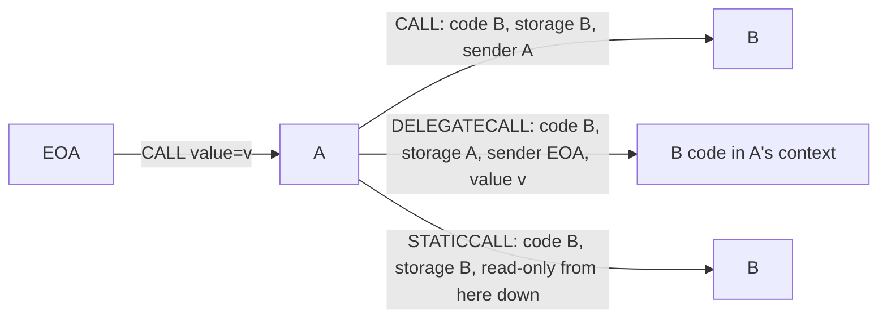

# 1.7 Message calls and precompiles

> [!abstract] In one minute
> - A message call opens a new execution frame with fresh memory and stack. `CALL` runs the target's code on the target's storage, with `msg.sender` = the caller. `DELEGATECALL` runs the target's code on the *caller's* storage and keeps the caller's `msg.sender` and `msg.value`. `STATICCALL` is `CALL` with value 0 and a read-only flag that propagates to every nested frame. `CALLCODE` is legacy.
> - Call gas = access (100 warm / 2,600 cold) + 9,000 if value > 0 + 25,000 if value > 0 and the target is empty + memory expansion. The callee gets at most all but 1/64 of what is left (EIP-150), plus a free 2,300 stipend when value > 0.
> - A call to an address with no code succeeds and returns no data. Solidity guards high-level calls with `EXTCODESIZE` only when it expects no return data; otherwise it relies on the ABI decoder failing on empty returndata (since 0.8.10).
> - Under the 2,300 stipend a callee can `TSTORE`, `SLOAD` once cold, and emit small logs. It can never `SSTORE` (the sentry), and it cannot call any cold address.
> - Mainnet after Fusaka has 18 precompiles: 0x01–0x11 plus P-256 verification at 0x100 (6,900 gas). `ecrecover` and P-256 signal failure by returning zero bytes, not by reverting.
> - In a static frame, `SSTORE`, `TSTORE`, `LOG*`, `CREATE*`, `SELFDESTRUCT` and value-carrying `CALL` are exceptional halts that burn all gas forwarded to that frame.

**Prerequisites:** [[1.3 Execution model]], [[1.1 Accounts and world state]], [[1.6 Calldata, returndata and logs]] · **Leads to:** [[1.9 Gas accounting]], [[3.7 External calls in assembly]], [[4.6 On-chain cryptography]], [[5.9 Proxies, delegatecall and storage]]

## The intuition: a call is a new frame with a borrowed context

Think of each call as a function call between processes. The caller packs arguments into its memory, names a target, decides how much gas to lend, and optionally attaches ether. The EVM then starts a child frame. The child gets an empty stack, empty memory, the calldata the caller chose, and a budget of gas. When the child stops, it hands back a success flag (1 or 0 on the caller's stack), any returndata, and its unused gas.

What differs between the call opcodes is *whose context* the child borrows. A context has four parts:

1. **Code**: which bytecode runs.
2. **Storage**: which account's storage `SLOAD` and `SSTORE` touch (also transient storage and `address(this)`).
3. **Sender**: what `CALLER` (`msg.sender`) returns.
4. **Value**: what `CALLVALUE` (`msg.value`) returns, and whether ether actually moves.

Everything else in this note is either a rule for mixing those four parts, a gas rule, or a special target (code-less accounts, EIP-7702 delegated EOAs, precompiles).

## The four call opcodes

### Stack arguments

| Opcode | Byte | Stack inputs (top first) | Output |
|---|---|---|---|
| `CALL` | `0xf1` | gas, address, value, argsOffset, argsSize, retOffset, retSize | 1 on success, 0 on failure |
| `CALLCODE` | `0xf2` | gas, address, value, argsOffset, argsSize, retOffset, retSize | same |
| `DELEGATECALL` | `0xf4` | gas, address, argsOffset, argsSize, retOffset, retSize | same |
| `STATICCALL` | `0xfa` | gas, address, argsOffset, argsSize, retOffset, retSize | same |

The output buffer (`retOffset`, `retSize`) receives at most `retSize` bytes. The full returndata stays available through `RETURNDATASIZE` and `RETURNDATACOPY` until the next call (see [[1.6 Calldata, returndata and logs]]).

### What each one keeps or changes

Assume an EOA calls contract **A**, and A's code executes the opcode against contract **B**.

| | `CALL` | `CALLCODE` (legacy) | `DELEGATECALL` | `STATICCALL` |
|---|---|---|---|---|
| Code executed | B's | B's | B's | B's |
| Storage and transient storage used | B's | **A's** | **A's** | B's (read only) |
| `address(this)` in the child | B | A | A | B |
| `msg.sender` in the child | A | A | **the EOA** (A's own caller) | A |
| `msg.value` in the child | value argument | value argument | **A's `msg.value`** (no ether moves) | 0 |
| Ether actually transferred | A → B | A → A (to itself) | none | none |
| State changes allowed | yes (unless already static) | yes (unless already static) | yes (unless already static) | **none**, in this frame and every frame below it |
| Introduced | Frontier | Frontier | Homestead (EIP-7) | Byzantium (EIP-214) |

I checked the `CALL`, `DELEGATECALL` and `STATICCALL` rows by running the `Probe` / `Caller` contracts below on an Osaka EVM. Under `CALL`, `Probe` saw `msg.sender = Caller`, `msg.value = 5`, `address(this) = Probe`, and incremented its own slot 0 to 1. Under `DELEGATECALL`, it saw `msg.sender = the EOA`, `msg.value = 7` (the outer value), `address(this) = Caller`, and incremented *Caller's* slot 0 from 100 to 101.

`CALLCODE` was the first try at "library code on my storage". Its flaw is that `msg.sender` becomes A, so a library could not see the real caller. `DELEGATECALL` fixed that in Homestead. Solidity removed `address.callcode` from the language long ago; only the Yul builtin `callcode(...)` still compiles in inline assembly. You will meet it in old contracts and EVM puzzles.



> [!note] Static is a property of the frame, not of the opcode
> The child's `is_static` flag is `params.is_staticcall or parent.is_static`. So once any frame is static, every frame beneath it is static too: a `CALL` with value 0 or a `DELEGATECALL` made inside a `STATICCALL` still cannot write. Solidity compiles calls to `view` and `pure` interface functions to `STATICCALL`.

## What a call costs

### The pieces

The execution-specs Osaka `call` function charges, in this order:

| Component | Gas | When |
|---|---|---|
| Account access (EIP-2929) | 100 warm, 2,600 cold | always; the target becomes warm |
| Delegate access (EIP-7702) | 100 warm, 2,600 cold | only if the target's code is a delegation indicator |
| Value transfer (`CALL_VALUE`) | 9,000 | `CALL` or `CALLCODE` with value > 0 |
| New account (`NEW_ACCOUNT`) | 25,000 | `CALL` with value > 0 to an account that is empty in the EIP-161 sense (no code, nonce 0, balance 0) |
| Memory expansion | per [[1.4 Memory]] | if the args or return buffers grow memory |
| Gas given to the child | min(requested, all but 1/64 of what is left) | always |
| Stipend (`CALL_STIPEND`) | +2,300 to the child, **not charged** to the caller | value > 0 |

`DELEGATECALL` and `STATICCALL` pay only access and memory, since they carry no value. `CALLCODE` can pay the 9,000 for value but never pays 25,000, because the "recipient" is the caller itself.

### The 63/64 rule

Since EIP-150 (Tangerine Whistle, 18 Oct 2016), the gas a call may forward is capped:

```text
available   = gas_left - memory_cost - extra_gas      (extra = access + value + new account)
max_forward = available - floor(available / 64)
child_gas   = min(requested_gas, max_forward) + (value > 0 ? 2300 : 0)
```

Asking for more than `max_forward` is not an error. The request is silently capped. That is why `call(gas(), ...)` works in assembly, and why a requested amount of `2^256 - 1` is fine. The rule gives two guarantees. The caller always keeps at least 1/64 to finish its own work after a child runs out of gas. And the call depth can never usefully reach 1,024 frames, since gas shrinks geometrically with depth.

### Worked examples (measured on an Osaka EVM)

I traced each `CALL` opcode in a test contract and recorded gas just before the opcode, the gas the child started with, and gas just after it returned.

**1. Forward "everything" to a cold contract, value 0.** Gas before `CALL`: 977,627.

```text
access (cold)            2,600     -> 975,027 left
floor(975,027 / 64)     15,234     retained by the caller
child starts with      959,793     (975,027 - 15,234), matches the trace exactly
```

**2. Send 1 wei to a fresh, empty, cold address with `gas = 0`.** The opcode charges 2,600 + 9,000 + 25,000 = 36,600. The child starts with 0 + 2,300 = 2,300. The child has no code, so all 2,300 comes back. Net cost seen by the caller: **34,300** (measured).

**3. Send 1 wei to the same address again in a later transaction.** It now has a balance, so it is not empty. The opcode charges 2,600 + 9,000 = 11,600, and 2,300 comes back. Net: **9,300** (measured). So the "real" price of a value transfer is 9,000 − 2,300 = 6,700 when the stipend goes unused.

**4. Value 0, warm target.** Net: **100** (measured). Cold, empty target, value 0: **2,600**. No new-account charge without value.

The gas schedule as a whole (intrinsic gas, refunds, memory, the access list) lives in [[1.9 Gas accounting]]. This note only needs the call-specific parts.

### Failures that do not burn gas

Two failure paths push 0 but hand the forwarded gas straight back to the caller: the call depth would exceed 1,024, or the caller's balance is less than `value`. In both cases returndata is set to empty and no child frame runs. Every other failure inside the child (out of gas, invalid opcode, static violation) is an exceptional halt that zeroes the child's gas. A `REVERT` in the child returns its unused gas and its revert data.

> [!warning] Glamsterdam may reprice calls (not on mainnet)
> The Glamsterdam meta-EIP (EIP-7773) lists EIP-8037 and EIP-8038 as scheduled. Both were in Last Call (deadline 1 Nov 2026) when I checked, and Glamsterdam had activated on Sepolia (6 Oct 2026) only. Its Hoodi activation (26 Oct 2026) was cancelled on 22 Oct 2026 to study EIP-8037, and no mainnet date is set. As drafted, EIP-8038 raises cold account access from 2,600 to 3,000 and defines `CALL_VALUE` as `ACCOUNT_WRITE + CALL_STIPEND` with `ACCOUNT_WRITE` going from 6,700 to 9,000 (so about 11,300). EIP-8037 moves the 25,000 new-account charge into a separate "state gas" dimension at 183,600. EIP-7708 makes value-carrying calls emit a `Transfer` log from a system address. Treat these numbers as drafts until the fork ships.

## Calling an address that has no code

The EVM has no "contract not found" error. If the target has empty code, the child frame starts, finds nothing to execute, and stops at once with success. Value moves, the success flag is 1, and returndata is empty. This is true for `CALL`, `STATICCALL`, `DELEGATECALL` and `CALLCODE`, and for EOAs, never-used addresses, and contracts that self-destructed (pre-Cancun) or are still being constructed.

That is correct behavior for paying an EOA. It is a trap everywhere else:

- A low-level `token.call(abi.encodeCall(IERC20.transferFrom, ...))` against address 0 "succeeds" without moving tokens. This is how the Qubit bridge was drained (see [[#Pitfalls and incidents]]).
- A proxy that `DELEGATECALL`s into an implementation that has no code (not yet deployed, wrong address, destroyed) "succeeds" while doing nothing. That is how 587 Parity multisig wallets froze. See [[5.9 Proxies, delegatecall and storage]].
- Code size 0 does not mean "EOA". A contract under construction has code size 0, and so does any address before it is deployed. After EIP-7702, an EOA can have code size 23. See [[1.1 Accounts and world state]] and [[1.8 Contract creation]].

## Calling an EIP-7702 delegated EOA

An EOA that signed an EIP-7702 authorization has code `0xef0100 || delegate` (23 bytes). The four call opcodes "follow the pointer" one hop:

- **Code executed** is the delegate's code. **Storage, balance and `address(this)`** are the EOA's. So a delegated EOA behaves like a proxy whose implementation is the delegate.
- **Extra gas**: the caller pays a second access charge for the delegate address, 2,600 if cold or 100 if warm, and the delegate becomes warm. I measured a value-0 `CALL` to a cold EOA with a cold delegate at **5,200** gas, and with an already-warm delegate at **2,700**.
- **Chains are not followed.** If the delegate itself holds a delegation indicator, its 23 bytes are executed as code (and `0xef` is an invalid opcode, so that frame halts).
- **Delegate is a precompile**: the spec says the precompile logic is *not* run. The call executes empty code and succeeds.
- `EXTCODESIZE` of the EOA returns 23, so Solidity's existence check (next section) passes. The cold delegate charge falls on the caller, not on the callee's stipend. A delegated wallet receiving `transfer()` still only gets 2,300 gas to run its `receive()`.

Wallet design on top of this is in [[4.5 Account abstraction and smart wallets]]. The security fallout (`tx.origin` no longer an EOA, front-run initialization) is in [[5.11 New attack surfaces - transient storage, EIP-7702, account abstraction]].

## What fits in the 2,300-gas stipend today

The stipend exists so that a plain ether transfer can run a tiny `receive()` (for example, emit an event) without the sender having to pass gas. Solidity's deprecated `transfer` and `send` pass `gas = 0` with nonzero value, so the callee gets exactly 2,300. (With value 0 they pass 2,300 explicitly. I confirmed this in the 0.8.38 IR: `if iszero(value) { gas := 2300 }`.)

Two rules decide what fits:

- **The SSTORE sentry (EIP-2200).** `SSTORE` fails with out-of-gas if `gas_left <= 2,300` *before any other check*. A frame that starts with exactly 2,300 can never store, whatever the slot's state.
- **Ordinary pricing.** Everything else is just arithmetic against 2,300 minus dispatch overhead.

| Action in a stipend-only frame | Cost | Fits? |
|---|---|---|
| `SSTORE` (any) | sentry | **Never** (measured: halts at `SSTORE` with 2,256 left) |
| `TSTORE` / `TLOAD` | 100 | **Yes** (measured, raw bytecode and a Solidity `receive()`) |
| `SLOAD` warm | 100 | Yes |
| `SLOAD` cold | 2,100 | Barely. A Solidity `receive()` with one cold `SLOAD` succeeded with 145 gas left |
| `LOG0`, no data | 375 | Yes (measured) |
| `LOG1` with 64 bytes of data (`event Got(address, uint256)`) | 375 + 375 + 8 × 64 = 1,262 | Yes (measured: 938 left) |
| `LOG2` with 32 bytes (`Received(address indexed, uint256)`) | 375 + 750 + 256 = 1,381 | Yes |
| `LOG4` with 64 bytes | 375 + 1,500 + 512 = 2,387 | **No** |
| Any call to a cold address, even value 0 | ≥ 2,600 | **No** (measured) |
| Any call with value | ≥ 9,000 | **No** (measured) |
| `BALANCE` / `EXTCODESIZE` of a cold address | 2,600 | No |
| Call back to a warm address (for example `msg.sender`), value 0 | 100 + whatever is forwarded | Yes, but the child gets under 2,200 gas and inherits the same limits |

> [!warning] "Stipend = reentrancy-safe" is out of date
> The old rule of thumb was: with 2,300 gas the callee cannot change state, so `transfer` cannot be reentered. Two things broke it. First, gas repricings (EIP-1884 in Istanbul, EIP-2929 in Berlin) made stipend-funded `receive()` functions fail, which is why the community moved to `call{value: ...}("")` plus reentrancy guards. Second, since Cancun (13 Mar 2024) a stipend-funded frame *can* write transient storage. A reentrant call back into a warm contract can therefore flip a `TSTORE`-based flag or cached value. Keep checks-effects-interactions and guards. See [[5.2 Reentrancy]] and [[5.11 New attack surfaces - transient storage, EIP-7702, account abstraction]]. Solidity 0.8.31 started warning that `send` and `transfer` are deprecated.

## Precompiles

A precompile is an address whose "code" is native client code with a fixed gas formula. You reach it with any call opcode. In practice you always use `STATICCALL`: precompiles are pure functions, and a static call makes that explicit. Precompile addresses are always warm (EIP-2929 pre-warms them), so the call costs 100 plus the precompile's own gas. I measured a `STATICCALL` to 0x100 at exactly 7,000 = 100 + 6,900.

### Every precompile on mainnet after Fusaka (3 Dec 2025)

Newest additions first. Gas values come from the Osaka execution-specs constants and the final EIPs.

| Address | Name | Fork (EIP) | Gas | Input → output | Typical use |
|---|---|---|---|---|---|
| `0x100` | P256VERIFY | Fusaka (EIP-7951) | 6,900 | 160 bytes `h‖r‖s‖qx‖qy` → 32-byte `1`, or **empty** | Passkeys, WebAuthn, secure-enclave keys |
| `0x11` | BLS12_MAP_FP2_TO_G2 | Pectra (EIP-2537) | 23,800 | Fp2 element → G2 point | Hash-to-curve for BLS signatures |
| `0x10` | BLS12_MAP_FP_TO_G1 | Pectra (EIP-2537) | 5,500 | Fp element → G1 point | Hash-to-curve |
| `0x0f` | BLS12_PAIRING_CHECK | Pectra (EIP-2537) | 32,600 × k + 37,700 | k (G1, G2) pairs → 32-byte bool | BLS signature verification, SNARKs over BLS12-381 |
| `0x0e` | BLS12_G2MSM | Pectra (EIP-2537) | k × 22,500 × discount / 1,000 | k (scalar, G2) pairs → G2 point | Aggregation, single multiplication when k = 1 |
| `0x0d` | BLS12_G2ADD | Pectra (EIP-2537) | 600 | two G2 points → G2 point | Point arithmetic |
| `0x0c` | BLS12_G1MSM | Pectra (EIP-2537) | k × 12,000 × discount / 1,000 | k (scalar, G1) pairs → G1 point | Multi-scalar multiplication |
| `0x0b` | BLS12_G1ADD | Pectra (EIP-2537) | 375 | two G1 points → G1 point | Point arithmetic |
| `0x0a` | KZG point evaluation | Cancun (EIP-4844) | 50,000 | 192 bytes (versioned hash, z, y, commitment, proof) → 64 bytes (4,096 and the BLS modulus) | Prove a blob contains value y at point z (rollups) |
| `0x09` | BLAKE2f | Istanbul (EIP-152) | 1 per round | exactly 213 bytes → 64-byte state | Zcash / Equihash interop |
| `0x08` | BN254 pairing (ecPairing) | Byzantium (EIP-197), repriced by EIP-1108 | 34,000 × k + 45,000 | k pairs → 32-byte bool | Groth16 / PLONK verifiers (Tornado-style, many zk rollups) |
| `0x07` | BN254 scalar mul (ecMul) | Byzantium (EIP-196) | 6,000 | point, scalar → point | Verifiers |
| `0x06` | BN254 add (ecAdd) | Byzantium (EIP-196) | 150 | two points → point | Verifiers |
| `0x05` | MODEXP | Byzantium (EIP-198), repriced by EIP-2565, then EIP-7883 and bounded by EIP-7823 in Fusaka | max(500, complexity × iterations) | base, exp, mod (each ≤ 1,024 bytes) → base^exp mod m | RSA verification, modular inverses, big-number math |
| `0x04` | Identity | Frontier | 15 + 3 per word | bytes → same bytes | Memory copy (MCOPY replaced most uses since Cancun) |
| `0x03` | RIPEMD-160 | Frontier | 600 + 120 per word | bytes → 20-byte hash left-padded to 32 | Bitcoin address derivation |
| `0x02` | SHA-256 | Frontier | 60 + 12 per word | bytes → 32-byte hash | WebAuthn, Bitcoin, beacon-chain SSZ proofs |
| `0x01` | ECRECOVER | Frontier | 3,000 | `hash‖v‖r‖s` (128 bytes) → 32-byte address, or **empty** | secp256k1 signatures: permits, EIP-712, meta-transactions |

The EIP-2537 MSM discount tables bottom out at 519 (G1) and 524 (G2) for k ≥ 128 pairs. The final EIP has no separate G1MUL or G2MUL precompile; multiplication is MSM with k = 1.

### Two failure styles

Precompiles fail in one of two ways. Your calling code has to handle both.

1. **Soft failure: success flag 1, empty returndata.** `ECRECOVER` returns nothing when `v` is not 27 or 28, when `r` or `s` is 0 or ≥ the curve order, or when recovery fails. `P256VERIFY` returns nothing for any invalid input or bad signature, and charges 6,900 either way. Neither reverts.
2. **Hard failure: exceptional halt.** Malformed input to MODEXP (a length above 1,024 bytes), BN254, BLAKE2f (length ≠ 213), KZG or BLS12-381 is an exceptional halt. The call returns 0 and **all forwarded gas is consumed**. If you call with `gas()`, a bad proof burns 63/64 of your remaining gas.

### MODEXP after Fusaka

EIP-7883 raised MODEXP prices. The minimum went from 200 to 500. The general divisor of 3 was dropped. Multiplication complexity is 16 for inputs ≤ 32 bytes and 2 × words² above that. The per-byte multiplier for exponents longer than 32 bytes went from 8 to 16. EIP-7823 caps each length at 1,024 bytes; above that the precompile halts. Computed with the spec formulas:

| Operation | Before Fusaka (EIP-2565) | After Fusaka |
|---|---|---|
| RSA-2048 verify, e = 65,537 (256-byte base and modulus, 3-byte exponent) | 5,461 | 32,768 |
| 256-bit modexp with a full 256-bit exponent (Fermat inverse) | 1,360 | 4,080 |

### P-256 and passkeys

Ethereum accounts use secp256k1. Phones, laptops and hardware security modules use NIST P-256 (secp256r1): it is the curve behind WebAuthn passkeys (algorithm ES256), Apple's Secure Enclave and Android's hardware keystores. Those chips generate a key that never leaves the device and sign on the user's behalf after a biometric check. They cannot sign with secp256k1.

Before Fusaka, a smart wallet that wanted to accept passkey signatures had to verify P-256 in Solidity. Daimo's verifier cost about 334,000 gas per signature. EIP-7951 makes it 6,900 gas at address 0x100. It is the same address and interface that many L2s already used under RIP-7212 (at 3,450 gas there). EIP-7951 also fixed two edge cases in RIP-7212: a missing point-at-infinity check, and the comparison is now `r' ≡ r (mod n)`.

How a passkey wallet uses it:

1. At registration, the wallet stores the passkey's public key `(qx, qy)`.
2. To authorize an action, the dApp sets the WebAuthn *challenge* to the hash being approved (for example an ERC-4337 user-operation hash). The authenticator signs `SHA-256(authenticatorData ‖ SHA-256(clientDataJSON))`.
3. On-chain, the wallet checks that `clientDataJSON` contains the expected challenge, rebuilds the message hash with the SHA-256 precompile (0x02), and calls 0x100 with `h, r, s, qx, qy`.

This works in an ERC-4337 account or in the delegate code of an EIP-7702 EOA. Details are in [[4.5 Account abstraction and smart wallets]] and [[4.6 On-chain cryptography]].

> [!warning] Three P-256 footguns
> - **Absent precompile looks like "invalid".** On a chain without 0x100, the call hits a code-less address: success = 1, empty returndata. Code that checks only the success flag accepts *every* signature. Always require `returndatasize() == 32` and the value 1.
> - **Malleability.** EIP-7951 does not enforce low-s. I verified that `(r, n − s)` also passes. Never use signature bytes as a replay key; use nonces. See [[5.8 Signatures and replay]].
> - **The hash is yours.** The precompile verifies whatever `h` you pass. If `h` is not bound to the action, chain ID and nonce, a valid signature can be replayed.

## Solidity and Yul in practice

### When Solidity inserts the existence check

For a high-level call such as `IThing(t).poke()`, Solidity can emit `EXTCODESIZE(t)` and revert if it is 0. The 0.8.10 changelog (9 Nov 2021): "Code Generator: Skip existence check for external contract if return data is expected." The current docs say the check "is skipped if the return data will be decoded after the call", because then "the ABI decoder will catch the case of a non-existing contract."

So the rule is:

| Call form | Existence check | What happens on a code-less target |
|---|---|---|
| High-level call, function **returns nothing** | `EXTCODESIZE` inserted | Reverts before the `CALL`, with empty revert data |
| High-level call, function **returns values** | skipped (since 0.8.10) | The call succeeds with 0 bytes; ABI decoding needs at least 32 and reverts with empty data |
| `try ext.f() returns (...)` on a code-less target | skipped | Decoding fails **in the caller's frame**, so `catch` does **not** run; the whole call reverts |
| Low-level `.call`, `.delegatecall`, `.staticcall` | never | Returns `true` with empty data |

I confirmed all four rows with solc 0.8.38 (legacy and via-IR): only the no-return function contains `EXTCODESIZE`, and the run results match the table. Skipping the check also made high-level calls to precompiles possible, since precompiles have no code but do return data.

```solidity
// SPDX-License-Identifier: MIT
pragma solidity ^0.8.38;

interface IThing {
    function poke() external;                        // no return data expected
    function read() external view returns (uint256); // return data expected
}

contract CodeCheck {
    // Reverts on a code-less target: the compiler inserts EXTCODESIZE before the CALL.
    function pokeIt(IThing t) external { t.poke(); }

    // Reverts on a code-less target too, but only because ABI decoding of 0 bytes fails.
    function readIt(IThing t) external view returns (uint256) { return t.read(); }

    // Low-level call: no check at all. Returns true for a code-less target.
    function rawPoke(address t) external returns (bool ok) {
        (ok, ) = t.call(abi.encodeCall(IThing.poke, ()));
    }
}
```

> [!tip] Defending low-level calls
> If you use a low-level call to a contract, check `t.code.length > 0` yourself when returndata is empty. OpenZeppelin's `Address.functionCall` and `SafeERC20` do exactly that. They accept empty returndata only if the target has code, which covers tokens like USDT that return nothing. See [[5.10 Token integration]].

### Seeing the context rules

```solidity
// SPDX-License-Identifier: MIT
pragma solidity ^0.8.38;

contract Probe {
    uint256 public slot0; // storage slot 0

    function where() external payable returns (address sender, uint256 value, address self, uint256 s0) {
        slot0 += 1; // writes slot 0 of whichever storage this frame uses
        return (msg.sender, msg.value, address(this), slot0);
    }

    function look() external view returns (address sender, address self) {
        return (msg.sender, address(this));
    }
}

contract Caller {
    uint256 public slot0 = 100; // same slot as Probe.slot0

    function viaCall(Probe p) external payable returns (address, uint256, address, uint256) {
        return p.where{value: msg.value}();
    }

    function viaDelegate(Probe p) external payable returns (address, uint256, address, uint256) {
        (bool ok, bytes memory ret) = address(p).delegatecall(abi.encodeCall(Probe.where, ()));
        require(ok);
        return abi.decode(ret, (address, uint256, address, uint256));
    }

    function viaStatic(Probe p) external view returns (address, address) {
        return p.look(); // view function on an interface => STATICCALL
    }

    function writeViaStatic(Probe p) external view returns (bool ok) {
        (ok, ) = address(p).staticcall(abi.encodeCall(Probe.where, ()));
    }
}
```

`viaDelegate` returns `(EOA, 7, Caller, 101)`: Probe's code incremented Caller's slot 0. That shared slot numbering is the whole basis of proxies, and of storage-collision bugs ([[2.3 Storage layout]], [[4.2 Upgradeability and proxies]]). `writeViaStatic` returns `false`, and the transaction used about 2.95 million of its 3 million gas: the static violation burned everything forwarded.

### Calling precompiles from Solidity and assembly

`sha256`, `ripemd160` and `ecrecover` are built-ins that call 0x02, 0x03 and 0x01. Everything else you call yourself. All of these compile with solc 0.8.38. I ran them on an Osaka EVM. All three SHA-256 paths returned `0xba7816bf…f20015ad` for `"abc"`. The P-256 functions returned `true` for a real signature and `false` after flipping one bit of `s`.

```solidity
// SPDX-License-Identifier: MIT
pragma solidity ^0.8.38;

/// Snippets used in note 1.7. Each precompile is reached with STATICCALL.
library Precompiles {
    address internal constant SHA256 = address(0x02);
    address internal constant P256_VERIFY = address(0x100);

    /// SHA-256 through a Solidity low-level staticcall.
    function sha256Low(bytes memory data) internal view returns (bytes32) {
        (bool ok, bytes memory out) = SHA256.staticcall(data);
        require(ok && out.length == 32, "sha256 failed");
        return abi.decode(out, (bytes32));
    }

    /// SHA-256 in inline assembly: no copy of the input, scratch space for output.
    function sha256Asm(bytes memory data) internal view returns (bytes32 h) {
        assembly ("memory-safe") {
            // input starts after the 32-byte length word
            if iszero(staticcall(gas(), 0x02, add(data, 0x20), mload(data), 0x00, 0x20)) {
                revert(0, 0)
            }
            h := mload(0x00)
        }
    }

    /// P-256 verify (EIP-7951). True only if the precompile returns 32 bytes equal to 1.
    function p256Verify(bytes32 h, bytes32 r, bytes32 s, bytes32 qx, bytes32 qy)
        internal view returns (bool)
    {
        (bool ok, bytes memory out) = P256_VERIFY.staticcall(abi.encode(h, r, s, qx, qy));
        return ok && out.length == 32 && abi.decode(out, (uint256)) == 1;
    }

    /// Same check in assembly. Builds the 160-byte input at the free memory pointer.
    function p256VerifyAsm(bytes32 h, bytes32 r, bytes32 s, bytes32 qx, bytes32 qy)
        internal view returns (bool valid)
    {
        assembly ("memory-safe") {
            let p := mload(0x40)
            mstore(p, h)
            mstore(add(p, 0x20), r)
            mstore(add(p, 0x40), s)
            mstore(add(p, 0x60), qx)
            mstore(add(p, 0x80), qy)
            mstore(0x00, 0) // clear the output slot: failure returns no data
            let ok := staticcall(gas(), 0x100, p, 0xa0, 0x00, 0x20)
            valid := and(ok, and(eq(returndatasize(), 0x20), eq(mload(0x00), 1)))
        }
    }

    /// Raw ecrecover: returns address(0) and false when the precompile returns no data.
    function ecrecoverRaw(bytes32 h, uint8 v, bytes32 r, bytes32 s)
        internal view returns (address signer, bool hadOutput)
    {
        assembly ("memory-safe") {
            let p := mload(0x40)
            mstore(p, h)
            mstore(add(p, 0x20), v)
            mstore(add(p, 0x40), r)
            mstore(add(p, 0x60), s)
            mstore(0x00, 0)
            pop(staticcall(gas(), 0x01, p, 0x80, 0x00, 0x20))
            hadOutput := eq(returndatasize(), 0x20)
            signer := mload(0x00)
        }
    }
}
```

Points worth noticing:

- **Clear the output word before the call.** A soft failure writes nothing, so whatever was at 0x00 would be read as the result. Checking `returndatasize()` is the robust test; zeroing is the belt to go with it.
- **Writing past the free memory pointer without bumping it is allowed** in a `memory-safe` block, because the region is only used temporarily. See [[3.5 Memory management in assembly]].
- **Forwarding `gas()` to a precompile is fine for fixed-cost ones.** For BN254, BLS or KZG with attacker-chosen inputs, a hard failure burns 63/64 of your gas. Consider a gas cap. More call patterns are in [[3.7 External calls in assembly]].

## Pitfalls and incidents

| Date | Incident | Call-level root cause |
|---|---|---|
| Late Jan 2022 (reported 28 Jan 2022) | **Qubit QBridge, about $80M.** | The deposit path called a home-grown `safeTransferFrom` with a plain `call()` on token address 0. A call to a code-less address succeeds, so the "deposit" passed and minted qXETH on BSC without any real deposit. |
| 8 Dec 2019 | **Istanbul / EIP-1884.** | `SLOAD` went from 200 to 800 gas. Some `receive()` and fallback functions that read storage no longer fit in 2,300. Contracts that paid them with `transfer` broke. EIP-2929 (Berlin, 15 Apr 2021) raised cold `SLOAD` to 2,100. |
| 6 Nov 2017 | **Parity multisig library, 513,774.16 ETH frozen in 587 wallets.** | Wallets `DELEGATECALL`ed all logic into one shared library. Someone initialized the unowned library, became its owner and self-destructed it. Delegatecalls into the now code-less address "succeeded" but did nothing, so no wallet could move funds. See [[5.9 Proxies, delegatecall and storage]] and [[5.14 Case studies]]. |

Other recurring call bugs:

- **Unchecked success flag.** `addr.call(...)` returns `false` instead of reverting. Ignoring it silently drops failures. The compiler warns on unused return values of low-level calls.
- **`ecrecover` returning `address(0)`.** If the expected signer can be zero (an uninitialized owner, a missing mapping entry), any garbage signature "matches". Also, the precompile accepts high-s signatures (I verified that `(r, n − s)` with `v` flipped recovers the same signer). Use OpenZeppelin's `ECDSA.recover`, which rejects both cases. See [[5.8 Signatures and replay]].
- **Insufficient-gas griefing via 63/64.** A relayer can choose a transaction gas limit so that the inner call runs out of gas while the outer frame still has its 1/64 to mark the request "done". Check `gasleft()` against the requested gas after the call, as EIP-2771 forwarders do. See [[5.7 Denial of service and griefing]].
- **Return bombs.** `(bool ok, bytes memory data) = t.call(...)` copies all returndata into memory, so a hostile callee can return megabytes and make the caller pay quadratic memory costs. Use assembly and copy a bounded amount. See [[3.7 External calls in assembly]].
- **`msg.sender == tx.origin` as an EOA check.** This was never a good idea, and EIP-7702 makes it false comfort. See [[1.1 Accounts and world state]].

## Question ladder

> [!question]- **B** Compare CALL, STATICCALL and DELEGATECALL by `msg.sender`, `msg.value`, storage context and code executed.
> Take an EOA → contract A → target B.
>
> | | `CALL` | `STATICCALL` | `DELEGATECALL` |
> |---|---|---|---|
> | `msg.sender` in B's code | A | A | the EOA (A's caller, preserved) |
> | `msg.value` | the value argument; ether moves A → B | 0, no ether moves | A's own `msg.value`, preserved; no ether moves |
> | Storage used | B's | B's, read only | **A's** |
> | `address(this)` | B | B | A |
> | Code executed | B's | B's | B's |
> | Can change state | yes | no, and neither can any frame it spawns | yes (unless already in a static frame) |
>
> A one-line mental model: `CALL` is "ask B to do something"; `STATICCALL` is "ask B a question, guaranteed side-effect free"; `DELEGATECALL` is "borrow B's code and run it as if it were mine". `DELEGATECALL` takes no value argument, which is why it has six stack inputs. That borrowing is the engine of proxies and libraries, and the source of storage-collision and selfdestruct-the-implementation bugs. `CALLCODE` is the legacy version of `DELEGATECALL` that set `msg.sender` to A and took a value; nothing new should use it.

> [!question]- **B** What happens when you call an address that has no code?
> The call succeeds. The EVM creates the child frame, finds no code, and stops immediately: success flag 1, returndata empty, all forwarded gas (and any stipend) returned. If value was attached, the ether moves; if the account was empty, the caller also paid 25,000 to create it. This holds for every call opcode and every kind of code-less address: EOAs, never-used addresses, contracts mid-construction, and destroyed contracts.
>
> Consequences: a low-level `.call` to a wrong token address reports success while moving nothing (Qubit, about $80M). A `DELEGATECALL` to a missing implementation silently does nothing (Parity, 513,774 ETH frozen). Solidity protects high-level calls (next question). Low-level calls you must protect yourself with `target.code.length > 0`. One special case: an EIP-7702 delegated EOA *does* have code (the 23-byte indicator), and calling it runs the delegate's code.

> [!question]- **I** When does Solidity insert an extcodesize check before a high-level call, and when does it skip it?
> Solidity inserts `EXTCODESIZE(target)` and reverts with empty data when it is 0, but only for **high-level** calls (via a contract or interface type) where **no return data will be decoded**: functions with no return values. Since **0.8.10** (changelog: "Skip existence check for external contract if return data is expected") it skips the check when the function returns something. In that case a code-less target returns 0 bytes, and the ABI decoder reverts because it needs at least 32. Low-level `.call`/`.delegatecall`/`.staticcall` are never checked.
>
> I confirmed on 0.8.38, legacy and via-IR. `function poke() external` compiles with one `EXTCODESIZE`. `function read() external view returns (uint256)` compiles with none. Run against an EOA, both revert with empty data, and a low-level call returns `true`.
>
> Two subtleties interviewers like:
> 1. With `try t.read() returns (uint x) {...} catch {...}`, the decoding failure happens **in the caller's frame after the call returned success**, so the `catch` clause does not run. The whole function reverts. I verified this.
> 2. The skip is what makes high-level calls to precompiles work: they have no code but return data, and the docs call this out explicitly. The check is also not very expensive when present. A cold `EXTCODESIZE` pays 2,600 and warms the address, so the `CALL` that follows pays only 100. The access cost is paid once either way, and the check adds the 100 plus a few opcodes.
> 3. The check passes for an EIP-7702 delegated EOA (code size 23), and for any contract with a fallback. It proves "some code exists", not "this is the contract I expect".

> [!question]- **I** What can and can't a callee do with the 2,300-gas stipend today?
> A callee reached by a value transfer with `gas = 0` (what `transfer`/`send` do) starts with exactly 2,300 gas.
>
> **Can:** `TSTORE`/`TLOAD` (100 each); warm `SLOAD` (100); one cold `SLOAD` (2,100), just barely (a Solidity `receive()` doing one cold read finished with 145 gas left); small events. `LOG1` with 64 bytes of data costs 1,262 and left 938 in my test. `LOG2` with 32 bytes costs 1,381. It can also call back into an already-warm address with value 0, but that child gets under about 2,200 gas.
>
> **Can't:** `SSTORE` of any kind. EIP-2200's sentry makes `SSTORE` fail whenever `gas_left <= 2,300`, so a stipend-only frame never stores. Any call to a cold address (2,600) or any call with value (9,000). Cold `BALANCE`/`EXTCODESIZE`. Large events: `LOG4` with 64 bytes is 2,387. Anything going through a proxy, since the proxy's `DELEGATECALL` to its implementation alone exceeds the budget unless the implementation is warm.
>
> Why it matters: `transfer`/`send` to smart wallets, proxies and some EIP-7702 delegates can fail. Solidity 0.8.31 deprecated both, and the standard advice is `call{value: v}("")` plus a reentrancy guard. And the old "stipend means no reentrancy" argument has a hole: transient storage is writable within the stipend.

> [!question]- **A** List today's precompiles and their uses. How does `ecrecover` signal failure?
> After Fusaka (3 Dec 2025) mainnet has 18 precompiles:
>
> - **0x01** `ECRECOVER` (3,000): secp256k1 public-key recovery, used for EIP-712, permits and meta-transactions.
> - **0x02** SHA-256 (60 + 12/word): WebAuthn, Bitcoin, SSZ proofs.
> - **0x03** RIPEMD-160 (600 + 120/word): Bitcoin addresses.
> - **0x04** identity (15 + 3/word): memory copy.
> - **0x05** MODEXP (max(500, complexity × iterations) after EIP-7883; inputs ≤ 1,024 bytes each since EIP-7823): RSA, modular inverses.
> - **0x06–0x08** BN254 add (150), mul (6,000), pairing (45,000 + 34,000 per pair): Groth16/PLONK verifiers.
> - **0x09** BLAKE2f (1 per round): Zcash interop.
> - **0x0a** KZG point evaluation (50,000): blob proofs for rollups.
> - **0x0b–0x11** BLS12-381 (EIP-2537, Pectra): G1ADD (375), G1MSM, G2ADD (600), G2MSM, PAIRING_CHECK (32,600k + 37,700), MAP_FP_TO_G1 (5,500), MAP_FP2_TO_G2 (23,800). Used for BLS signatures, beacon-chain light clients, and SNARKs over BLS12-381.
> - **0x100** P256VERIFY (6,900, EIP-7951): passkeys and secure enclaves.
>
> **`ecrecover` failure:** the precompile never reverts. When `v ∉ {27, 28}`, when `r` or `s` is outside `[1, n−1]`, or when no key can be recovered, it returns **zero bytes** and still charges 3,000. Solidity's built-in `ecrecover` emits `mstore(0, 0)` before `staticcall(gas(), 1, …, 0, 32)` and then reads `mload(0)`, so a soft failure yields `address(0)`. It only reverts if the staticcall itself fails, for example from out-of-gas. I verified this: `v = 0` gave `address(0)`, and the raw call showed `returndatasize() == 0`. Two follow-ups an interviewer listens for: (1) always reject `address(0)` explicitly, or an unset owner is impersonable; (2) the precompile does *not* enforce low-s. I verified `(r, n − s)` with `v` flipped recovers the same address, so signature bytes are malleable and must not be replay keys.

> [!question]- **A** How does a P-256 precompile enable passkey and secure-enclave wallets?
> Passkeys (WebAuthn ES256), Apple's Secure Enclave and Android hardware keystores sign only with NIST P-256. The key is generated in hardware and never exported, and signing is gated by a biometric check. So there is no seed phrase, and key theft needs the device. Ethereum's native signatures use secp256k1, so an EOA cannot be a passkey. A smart account can be, if it can verify P-256 cheaply. Before Fusaka that meant a Solidity verifier at about 334,000 gas (Daimo's figure), too expensive for every transaction on L1. EIP-7951 puts verification at 0x100 for 6,900 gas, the same interface as RIP-7212 on L2s (3,450 gas there).
>
> Flow: the wallet stores `(qx, qy)` at registration. To approve an action, the WebAuthn challenge is set to the operation hash. The authenticator signs `SHA-256(authenticatorData ‖ SHA-256(clientDataJSON))`. On-chain, the wallet parses `clientDataJSON` to confirm the challenge, recomputes the hash via 0x02, and calls 0x100 with 160 bytes `h‖r‖s‖qx‖qy`. A 32-byte `1` means valid; empty returndata means invalid. This logic lives in an ERC-4337 account's `validateUserOp` or in an EIP-7702 delegate, so even an existing EOA can add passkey signers.
>
> Expert caveats: check `returndatasize() == 32`, not just the success flag, because on a chain without the precompile the call succeeds with no data. Add your own low-s or nonce discipline, since EIP-7951 does not reject malleable signatures. Bind the challenge to chain ID, account and nonce. Recovery and multi-device are product problems: a passkey synced through a cloud keychain is only as safe as that account. Secure-enclave keys that are device-bound need a backup signer.

> [!question]- **E** A STATICCALL target attempts TSTORE, SSTORE, LOG and a value-carrying CALL. Which fail, and how?
> All four fail. Each is an **exceptional halt** (`WriteInStaticContext`, or out-of-gas for `SSTORE` under the sentry), not a revert:
>
> | Attempt in a static frame | What the spec does | Result |
> |---|---|---|
> | `TSTORE` | charges 100, then raises `WriteInStaticContext` (EIP-1153) | halt |
> | `SSTORE` | if `gas_left <= 2,300` → out-of-gas first (sentry); otherwise computes and charges the cost, then raises `WriteInStaticContext`. This happens even if the write would not change the value | halt |
> | `LOG0`–`LOG4` | charges log and memory gas, then raises `WriteInStaticContext`, even for `LOG0` with no data | halt |
> | `CALL` with value ≠ 0 | charges access + 9,000 (+ 25,000 if empty) first, then raises `WriteInStaticContext` | halt |
> | `CALL` with value 0, `DELEGATECALL`, `STATICCALL` | allowed; the child inherits `is_static` | runs read-only |
> | `CALLCODE` with value ≠ 0 | allowed: EIP-214 does not count it as state-changing, since the ether goes to self | runs |
> | `CREATE`, `CREATE2`, `SELFDESTRUCT` | `WriteInStaticContext` | halt |
>
> **What the caller sees:** an exceptional halt sets the child's gas to 0, discards its output and reverts its state changes. `STATICCALL` pushes 0 and `RETURNDATASIZE` is 0. The caller loses *everything it forwarded*. I measured a `STATICCALL` forwarding 100,000 gas to each of these callees: the opcode's net cost was exactly 102,600 (2,600 cold access + 100,000 burned) in every case. A callee that only did a cold `SLOAD` cost 4,705. A value-0 `CALL` from inside the static frame succeeded. In Solidity, a high-level `view` call bubbles up as a revert with **empty** data; `try/catch` lands in `catch` with empty bytes, so you cannot tell a static violation from out-of-gas or an invalid opcode.
>
> What an interviewer listens for:
> - **Static propagates down, not up.** It is a frame flag, OR-ed into every child. A contract cannot opt out of it, and it has no opcode to ask "am I static?". The only probe is to attempt a write in a sub-call and check the result, which costs gas.
> - **Gas risk.** Forwarding `gas()` into an untrusted `STATICCALL` lets the callee burn 63/64 of your gas by deliberately writing. Cap the gas for untrusted view calls (oracles, `isValidSignature`).
> - **`STATICCALL` does not prevent read-only reentrancy.** A view call can still observe a half-updated state in another contract. See [[5.2 Reentrancy]].
> - **Order details.** Gas is charged before the static check for `CALL`, `LOG` and `TSTORE`. The `SSTORE` sentry comes before both. None of this changes the outcome, since all forwarded gas is gone anyway, but it is the kind of spec-level precision that separates "I read the yellow paper once" from "I have read the execution-specs".

## Related notes
- [[1.1 Accounts and world state]] — code-less accounts, EIP-161 emptiness, and the EIP-7702 delegation indicator
- [[1.3 Execution model]] — frames, stack, halting versus reverting
- [[1.4 Memory]] — memory expansion cost charged by call arguments and return buffers
- [[1.6 Calldata, returndata and logs]] — how arguments and returndata move between frames
- [[1.8 Contract creation]] — code size 0 during construction, `CREATE` as the other way to open a frame
- [[1.9 Gas accounting]] — the full gas schedule, warm/cold sets and refunds
- [[1.11 Hard forks that changed contract code]] — EIP-150, EIP-1884, EIP-2929, Cancun, Fusaka
- [[3.7 External calls in assembly]] — call patterns, bounded returndata copying, gas caps
- [[4.5 Account abstraction and smart wallets]] — passkey wallets on ERC-4337 and EIP-7702
- [[4.6 On-chain cryptography]] — using ECRECOVER, P-256, BN254, BLS12-381 and KZG properly
- [[5.2 Reentrancy]] — why the stipend is not a reentrancy defense, and read-only reentrancy
- [[5.8 Signatures and replay]] — `address(0)` from `ecrecover`, malleability
- [[5.9 Proxies, delegatecall and storage]] — `DELEGATECALL` storage collisions and missing implementations
- [[5.11 New attack surfaces - transient storage, EIP-7702, account abstraction]] — `TSTORE` under the stipend, delegated EOAs

## Sources
- [ethereum/execution-specs, Osaka `vm/instructions/system.py`, `gas.py`, `storage.py`, `log.py`, `eoa_delegation.py`, `interpreter.py`, `precompiled_contracts/*`](https://github.com/ethereum/execution-specs/tree/master/src/ethereum/forks/osaka/vm) — call gas order and constants (100, 2,600, 9,000, 25,000, 2,300), the 63/64 formula, static checks, the SSTORE sentry, exceptional halt zeroing gas, the precompile address list and gas constants, ecrecover's empty output, MODEXP formula and the 1,024-byte bounds
- [EIP-7951: Precompile for secp256r1 Curve Support](https://eips.ethereum.org/EIPS/eip-7951) — Final; address 0x100, 6,900 gas, 160-byte input, empty output on failure, no low-s check, fixes over RIP-7212 (3,450 gas)
- [EIP-7883: ModExp Gas Cost Increase](https://eips.ethereum.org/EIPS/eip-7883) and [EIP-7823: Set upper bounds for MODEXP](https://eips.ethereum.org/EIPS/eip-7823) — Final; new MODEXP pricing and the 1,024-byte limit
- [EIP-7607: Fusaka meta](https://eips.ethereum.org/EIPS/eip-7607) — Fusaka EIP list and mainnet activation on 3 Dec 2025
- [EIP-2537: BLS12-381 precompiles](https://eips.ethereum.org/EIPS/eip-2537) — addresses 0x0b–0x11, gas, MSM discounts, no separate MUL
- [EIP-7702: Set EOA account code](https://eips.ethereum.org/EIPS/eip-7702) — delegated code execution, extra 2,600/100 delegate access, precompile delegates execute empty code
- [EIP-214: STATICCALL](https://eips.ethereum.org/EIPS/eip-214) — operations forbidden in static context; CALLCODE exception
- [EIP-150](https://eips.ethereum.org/EIPS/eip-150), [EIP-2929](https://eips.ethereum.org/EIPS/eip-2929), [EIP-2200](https://eips.ethereum.org/EIPS/eip-2200), [EIP-1153](https://eips.ethereum.org/EIPS/eip-1153), [EIP-1884](https://eips.ethereum.org/EIPS/eip-1884) — 63/64 rule, warm/cold access, SSTORE sentry, TSTORE in static context, Istanbul SLOAD repricing
- [EIP-7773: Glamsterdam meta](https://eips.ethereum.org/EIPS/eip-7773), [EIP-8038](https://eips.ethereum.org/EIPS/eip-8038), [EIP-8037](https://eips.ethereum.org/EIPS/eip-8037), [EIP-7708](https://eips.ethereum.org/EIPS/eip-7708) — upcoming repricing drafts (Last Call), testnet dates, no mainnet date
- [Solidity docs: external function calls](https://docs.soliditylang.org/en/latest/control-structures.html) — when the extcodesize check is skipped; precompiles and high-level calls
- [Solidity changelog](https://github.com/ethereum/solidity/blob/develop/Changelog.md) — 0.8.10 skip-existence-check entry; 0.8.31 `send`/`transfer` deprecation and default EVM version `osaka`
- [Daimo: P256Verifier](https://daimo.super.site/blog/p256verifier) — about 334,000 gas for a Solidity P-256 verification
- [Parity: postmortem on the multi-sig library self-destruct](https://medium.com/paritytech/a-postmortem-on-the-parity-multi-sig-library-self-destruct-63daca3a4cf7) — 6 Nov 2017, 513,774.16 ETH, 587 wallets
- [Halborn: Explained, the Qubit hack](https://halborn.com/explained-the-qubit-hack-january-2022/) and [The Block, 28 Jan 2022](https://www.theblock.co/news/defi/2022-01-28-qubit-finance-bridge-ethereum-bsc-exploited-lost-80-million-132157) — the call to the code-less address 0 and about $80M
- Local verification: solc-js 0.8.38 (all snippets compiled; `EXTCODESIZE` presence by function shape, legacy and via-IR) and `@ethereumjs/vm` 10.1.3 on the Osaka hardfork (call costs, 63/64, stipend budget, static-context halts, EIP-7702 delegate access, P-256 and ecrecover behavior)
