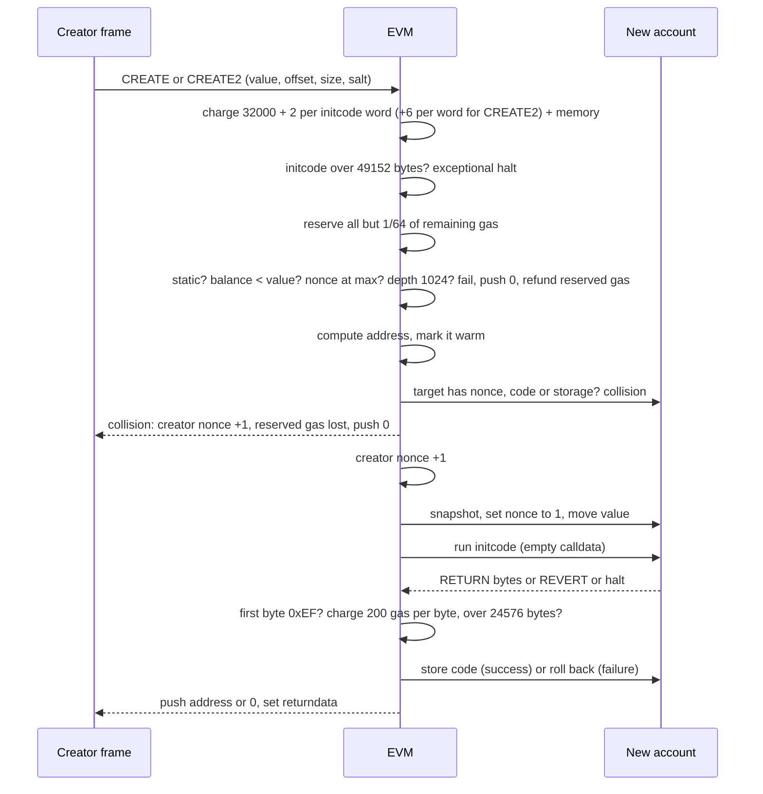

# 1.8 Contract creation

> [!abstract] In one minute
> - A deployment sends **initcode**. The EVM runs it once, and whatever it `RETURN`s becomes the account's permanent **runtime code**. The constructor, its arguments and the initcode itself are never stored.
> - Constructor arguments are ABI-encoded and **appended to the initcode**. The constructor reads them with `CODESIZE` and `CODECOPY`, because calldata is empty during creation. Solidity `immutable` values are **patched into the runtime code** in memory before it is returned.
> - `CREATE` address = `keccak256(rlp([sender, nonce]))[12:]`. `CREATE2` address = `keccak256(0xff ‖ sender ‖ salt ‖ keccak256(initcode))[12:]`. RLP gotcha: nonce 0 encodes as `0x80`, and nonces ≥ 128 get a length prefix.
> - Creation fails if the target already has a nonce, code or storage (EIP-684, EIP-7610). It also fails if the runtime is over 24,576 bytes (EIP-170), starts with `0xEF` (EIP-3541), or cannot pay 200 gas per byte to deposit. Initcode is capped at 49,152 bytes (EIP-3860).
> - Since Cancun, `SELFDESTRUCT` only deletes a contract created in the same transaction (EIP-6780). "Deploy, destroy, redeploy different code" across transactions is gone. CREATE3 (CREATE2 a tiny proxy, which then CREATEs at nonce 1) gives addresses that depend only on deployer and salt.
> - Glamsterdam is live on the Sepolia testnet (its 26 Oct 2026 Hoodi activation was cancelled on 22 Oct 2026) and has **no mainnet date yet**. It schedules EIP-7954 (64 KiB code, 128 KiB initcode) and EIP-8037 (code deposit priced as state gas). Both are scheduled and in Last Call; treat them as not yet live.

**Prerequisites:** [[1.1 Accounts and world state]], [[1.3 Execution model]], [[1.7 Message calls and precompiles]] · **Leads to:** [[4.3 Deterministic and cross-chain deployment]], [[4.2 Upgradeability and proxies]], [[3.10 Yul objects and standalone contracts]], [[3.12 Beyond Yul - Huff and raw bytecode]]

## Intuition: a program that writes a program

Think of a deployment as running an installer. The installer (initcode) runs once with full EVM powers. It can write storage, emit events, call other contracts and send ether. At the end it hands the EVM a blob of bytes and says "this is the program to install". The EVM checks the blob, charges for storing it, and writes it into the new account's `codeHash`. The installer is then thrown away.

This one idea explains most creation trivia:

- The constructor is not in the deployed code. That is why a verified contract's runtime never contains constructor logic.
- Initcode can return **any** bytes, not just "the rest of itself". A factory can return code copied from somewhere else. That is how metamorphic contracts and minimal proxies work.
- While the installer runs, the account exists but has no code yet. So `address(this).code.length == 0` inside a constructor, and any `extcodesize`-based "is this a contract?" check is fooled.

There are three ways to start an installer. Each produces a contract account as described in [[1.1 Accounts and world state]].

| Entry point | Who triggers it | Address derived from | Initcode comes from |
|---|---|---|---|
| Creation transaction (`to` empty) | An EOA (or a 7702-delegated EOA's own tx) | sender + nonce, as in `CREATE` | Transaction `data` |
| `CREATE` (0xF0) | Any contract | creator + creator's nonce | Memory slice |
| `CREATE2` (0xF5) | Any contract | creator + salt + `keccak256(initcode)` | Memory slice |

## The creation lifecycle, step by step

The execution specs ([`generic_create` and `process_create_message`](https://ethereum.github.io/execution-specs/diffs/prague/osaka/vm/interpreter.py.html)) define the order. This order matters. It decides which failures refund gas, which bump the nonce, and what `RETURNDATASIZE` shows afterwards.



### 1. Up-front charges and static checks

`CREATE` and `CREATE2` cost 32,000 gas base. EIP-3860 adds 2 gas per 32-byte word of initcode. `CREATE2` adds 6 gas per word to hash the initcode. Memory expansion for the initcode slice is charged too. If the initcode is longer than 49,152 bytes, the opcode halts exceptionally, "as if it runs out of gas". For a creation transaction the same limit makes the transaction **invalid**, so it never gets into a block. The initcode word cost then goes into intrinsic gas (21,000 + 32,000 + calldata + 2 per word).

### 2. Reserve gas, then the cheap failure checks

The EVM sets aside all but 1/64 of the remaining gas for the child (the EIP-150 rule, see [[1.9 Gas accounting]]). It then checks four things: a static context (`WriteInStaticContext` halts the caller), the creator's balance against `value`, the creator's nonce at the 2^64 − 1 cap (EIP-2681), and call depth 1024. If any of the last three fails, the opcode **pushes 0, returns the reserved gas, and does not touch the nonce**. Returndata is empty.

### 3. Address and collision check

The address is computed from the creator's **current** nonce, before the increment. It is added to the warm set (see [[1.9 Gas accounting]]). Then comes the collision rule. Creation fails if the target already has:

- a nonzero nonce, or
- nonempty code (EIP-684, applied retroactively), or
- nonempty storage (EIP-7610).

The Osaka spec checks all three (`account_has_code_or_nonce` or `account_has_storage`). A balance alone does **not** block deployment. Anyone can send ether to a future address, and creation will keep it. On collision the creator's nonce **is still incremented**, the reserved gas is **consumed**, and 0 is pushed. I confirmed both effects in py-evm (below).

> [!note] EIP-7610 status
> eips.ethereum.org still lists EIP-7610 as Last Call (deadline 20 Nov 2024). It is retroactive to genesis, and the Osaka execution specs already apply the storage check. In practice, only a handful of pre-Spurious-Dragon accounts ever had storage with zero nonce and no code. The rule exists so no client has to reason about "deploy on top of leftover storage".

### 4. Nonce bump, new frame, value transfer

The creator's nonce goes up by one. The EVM takes a snapshot, clears any leftover storage at the target, sets the new account's nonce to **1** (EIP-161, so a fresh contract's first `CREATE` uses nonce 1), and moves `value`. For a creation transaction, the sender's nonce was already bumped as part of transaction validity.

### 5. Initcode runs

The initcode runs as a normal frame with an empty calldata. `ADDRESS` is the new address. `CODESIZE` and `CODECOPY` see **the initcode**, not the account's code. `EXTCODESIZE(ADDRESS)` is 0. If anyone calls the new address during this frame, they hit an account with no code, so the call "succeeds" and does nothing.

### 6. Code deposit checks

When the frame `RETURN`s bytes `R`, three more checks run, in this order in the spec:

1. `R[0] == 0xEF` → `InvalidContractPrefix` (EIP-3541).
2. Charge `200 × len(R)` gas. Not enough gas → out of gas.
3. `len(R) > 24,576` → out of gas (EIP-170).

All three are **exceptional halts**. The frame's state is rolled back, **all its gas is consumed**, and returndata is empty. This is harsher than a `REVERT`, where unused gas comes back and returndata carries the revert payload.

### 7. Result

| Outcome | Stack | `RETURNDATASIZE` | Gas | Creator nonce |
|---|---|---|---|---|
| Success | new address | 0 | unused child gas returned | +1 |
| Initcode `REVERT` | 0 | revert payload length | unused child gas returned | +1 |
| Exceptional halt (invalid op, OOG, 0xEF, size, deposit) | 0 | 0 | child gas consumed | +1 |
| Collision | 0 | 0 | reserved gas consumed | +1 |
| Low balance, depth, nonce cap | 0 | 0 | reserved gas returned | unchanged |

A failed `CREATE` does **not** revert the caller. It pushes 0. Solidity's `new` checks for 0 and reverts, bubbling up the revert data when there is any.

> [!example] Verified in py-evm (Prague rules, which match Osaka for creation)
> A contract ran `create2` with the same salt and initcode twice. First call: address returned, 32,242 gas used, contract nonce 1 → 2. Second call: 0 returned, 962,708 gas consumed (nearly all of the forwarded gas), nonce 2 → 3. A `CREATE` whose initcode was `PUSH1 0x20 PUSH0 REVERT` returned 0 with `RETURNDATASIZE` = 32 and used only 32,025 gas. Initcode `0xFE` (INVALID) and initcode that returned `0xEF` both consumed about 963,000 gas with `RETURNDATASIZE` = 0.

### Size limits and deposit cost

| Limit | Value | EIP | Fork |
|---|---|---|---|
| Max runtime code (proposed) | 65,536 bytes (0x10000) | EIP-7954 | Glamsterdam, scheduled, not on mainnet |
| Max initcode (proposed) | 131,072 bytes (0x20000) | EIP-7954 | Glamsterdam, scheduled, not on mainnet |
| Max initcode | 49,152 bytes (2 × 24,576) | EIP-3860 | Shanghai (12 Apr 2023) |
| No code starting with `0xEF` | — | EIP-3541 | London (5 Aug 2021) |
| Max runtime code | 24,576 bytes (0x6000) | EIP-170 | Spurious Dragon (22 Nov 2016, block 2,675,000) |
| Code deposit | 200 gas per byte | Yellow Paper `G_codedeposit` | Frontier; failure on shortfall since Homestead (EIP-2) |

Deploying a maximum-size contract costs 200 × 24,576 = 4,915,200 gas in deposit alone. My py-evm run of an initcode returning exactly 24,576 zero bytes used **4,971,731 gas**. That is 21,000 + 32,000 + 68 calldata + 2 initcode-word + 3,461 execution (mostly memory expansion for 768 words) + 4,915,200 deposit. Returning 24,577 bytes failed with out of gas and consumed the whole 6,000,000 gas limit. A creation transaction with 49,153 bytes of initcode was rejected outright.

Why `0xEF`? EIP-3541 reserved the byte so new formats could be recognised by their first byte. EOF used `0xEF00` (EOF was later dropped, and Solidity 0.8.36 removed its EOF backend). EIP-7702 now uses it: a delegated EOA's code is `0xef0100 ‖ address`. Because no `CREATE` can ever produce code starting with `0xEF`, a delegation indicator can never be confused with a deployed contract. See [[1.11 Hard forks that changed contract code]].

## Address derivation

### CREATE: `keccak256(rlp([sender, nonce]))[12:]`

RLP (recursive length prefix) encodes a two-item list. The sender is a 20-byte string, so it encodes as `0x94 ‖ sender` (0x80 + 20). The nonce is an integer, encoded as its minimal big-endian bytes. Three cases trip people up:

| Nonce | RLP of nonce | Why |
|---|---|---|
| 0 | `0x80` | Integer 0 is the **empty** byte string, so it becomes `0x80`. Not `0x00`. |
| 1 … 127 | the byte itself (`0x01` … `0x7f`) | A single byte below 0x80 encodes as itself |
| 128 … 255 | `0x81 ‖ byte` | Needs a one-byte length prefix |
| 256 … 65,535 | `0x82 ‖ 2 bytes` | And so on, up to 8 bytes for 2^64 − 2 |

The list prefix is `0xc0 + payload length`. That is `0xd6` for nonces 0–127, `0xd7` for 128–255, `0xd8` for 256–65,535, and so on.

Worked example. I computed these with Python `rlp` + `eth-hash` and cross-checked against py-evm's `generate_contract_address`.

```python
import rlp
from eth_hash.auto import keccak

def create_addr(sender: bytes, nonce: int) -> bytes:
    return keccak(rlp.encode([sender, nonce]))[12:]

S = bytes.fromhex("6ac7ea33f8831ea9dcc53393aaa88b25a785dbf0")
```

| Nonce | RLP preimage | Address |
|---|---|---|
| 0 | `d6 94 6ac7…dbf0 80` | `0xcd234A471b72ba2F1Ccf0A70FCABA648a5eeCD8d` |
| 1 | `d6 94 6ac7…dbf0 01` | `0x343c43A37D37dfF08AE8C4A11544c718AbB4fCF8` |
| 127 | `d6 94 6ac7…dbf0 7f` | `0x06d9a77f5E4b311Bae8D559DB9CDB4dF94104aA0` |
| 128 | `d7 94 6ac7…dbf0 81 80` | `0x08e190dcB7b73F5fcDAbb43e102215c83659A76D` |
| 256 | `d8 94 6ac7…dbf0 82 01 00` | `0x3837C1Ae70354f670550C746580199Ac6a73Cb0a` |
| 65,536 | `d9 94 6ac7…dbf0 83 01 00 00` | `0xf666A819b370D38F44F2573464Da3FbA8479b917` |

CREATE addresses are **predictable but not portable**. They depend on how many times the sender has created or sent transactions. On a new chain, you only get the same address if you replay the same sequence of nonces from the same sender.

### CREATE2: `keccak256(0xff ‖ sender ‖ salt ‖ keccak256(initcode))[12:]`

EIP-1014 (Constantinople, 28 Feb 2019) hashes an 85-byte preimage: `0xff` (1 byte), the creator address (20), a 32-byte salt, and the 32-byte hash of the **full initcode**. The `0xff` prefix makes collisions with CREATE preimages impossible, because an RLP list prefix for this length is never `0xff`. The nonce is not an input, but CREATE2 still bumps the creator's nonce.

I verified the EIP-1014 test vectors by running the formula:

| Sender | Salt | Initcode | Address |
|---|---|---|---|
| `0x0000…0000` | `0x00…00` | `0x00` | `0x4D1A2e2bB4F88F0250f26Ffff098B0b30B26BF38` |
| `0xdeadbeef00000000000000000000000000000000` | `0x00…00` | `0x00` | `0xB928f69Bb1D91Cd65274e3c79d8986362984fDA3` |
| `0x00000000000000000000000000000000deadbeef` | `0x00…cafebabe` | `0xdeadbeef` | `0x60f3f640a8508fC6a86d45DF051962668E1e8AC7` |

> [!warning] "Initcode" includes the constructor arguments
> `keccak256(initcode)` covers the creation code **plus** the appended ABI-encoded arguments. Change one argument, one compiler setting or one byte of metadata, and the address changes. Bytecode metadata (the CBOR hash at the end) changes when comments or file paths change, unless you pin `bytecodeHash: "none"` or keep sources identical. This is the most common reason "my CREATE2 address differs on chain B". See [[4.3 Deterministic and cross-chain deployment]].

## Constructor arguments and immutables in real bytecode

Here is a minimal contract with one constructor argument and one immutable.

```solidity
// SPDX-License-Identifier: MIT
pragma solidity 0.8.38;

contract Capped {
    uint256 public immutable cap;

    constructor(uint256 cap_) {
        cap = cap_;
    }
}
```

Compiled with solc 0.8.38, `--optimize`, default EVM version (osaka): the creation code is **245 bytes (0xf5)** and the runtime is **152 bytes (0x98)**. So the constructor logic is 93 bytes (0x5d), and the runtime starts at offset 0x5d. The compiler reports `immutableReferences: {"3": [{"start": 46, "length": 32}]}`. That means the immutable lives at runtime bytes 46–77 (0x2e).

```text
0000  60a0      PUSH1 0xa0
0002  6040      PUSH1 0x40
0004  52        MSTORE            ; free memory pointer = 0xa0 (0x80..0x9f reserved for the immutable)
0005  34        CALLVALUE         ; non-payable constructor: revert if value != 0
0006  80        DUP1
0007  15        ISZERO
0008  600e      PUSH1 0x0e
000a  57        JUMPI
000b  5f5ffd    PUSH0 PUSH0 REVERT
000e  5b50      JUMPDEST POP
0010  6040 51   PUSH1 0x40 MLOAD  ; fmp = 0xa0
0013  6100f5    PUSH2 0x00f5      ; length of creation code = 245
0016  38        CODESIZE          ; 245 + length of appended args
0017  03        SUB               ; argsLen = CODESIZE - 245
0018  80        DUP1
0019  6100f5    PUSH2 0x00f5
001c  83        DUP4
001d  39        CODECOPY          ; memory[fmp..] = code[245 .. 245+argsLen]   <- constructor args
  ...                             ; ABI-decode one uint256 (checks argsLen >= 32)
002c  6080 52   PUSH1 0x80 MSTORE ; memory[0x80] = cap_ (immutable kept in memory during construction)
  ...
0049  6080 51   PUSH1 0x80 MLOAD  ; load the immutable value
004c  6098      PUSH1 0x98        ; runtime length = 152
004e  61005d    PUSH2 0x005d      ; runtime offset in this code = 93
0051  5f        PUSH0
0052  39        CODECOPY          ; memory[0..152] = code[93..245]              <- copy runtime
0053  5f 602e   PUSH0 PUSH1 0x2e
0056  01 52     ADD MSTORE        ; memory[0x2e..0x4e] = cap_                   <- patch immutable
0058  6098 5f   PUSH1 0x98 PUSH0
005b  f3        RETURN            ; deploy memory[0..152] as runtime
005c  fe        INVALID           ; separator, never executed
005d  6080...                     ; runtime code begins
```

Three moves to look for in any Solidity initcode:

1. **Constructor args via `CODESIZE`.** Calldata is empty during creation. The args sit after the creation code. The compiler knows its own length (0xf5) as a constant, so `CODESIZE − 0xf5` is the length of the args. `CODECOPY` pulls them into memory, then normal ABI decoding runs.
2. **Runtime via `CODECOPY`.** The runtime is embedded inside the creation code, at offset 0x5d. It is copied to memory offset 0.
3. **Immutable patching.** In the runtime, the getter contains `PUSH32 0x00…00` with the 32 data bytes at offset 0x2e. The initcode overwrites those 32 bytes in memory with `MSTORE`, then returns. Each reference to an immutable gets its own 32-byte slot. A value read in three functions is patched three times.

I deployed this in py-evm with `cap_ = 0x1234` appended. The stored runtime was the compiled runtime with exactly bytes 46–77 changed to `0x…1234`. `cap()` returned `0x1234`, and the new account's nonce was 1. Creation used 87,272 gas.

> [!info]- Deep dive: why immutables are not "free" and not secret
> Reading an immutable costs one `PUSH32` (3 gas). There is no `SLOAD`. But each reference adds 33 bytes of runtime code and 200 × 32 = 6,400 gas of deposit per reference. Immutables can be value types only. Their values are plainly visible in the runtime bytecode, so never put secrets there. Since 0.8.21, an immutable may be assigned more than once in the constructor and read before assignment (it reads as zero). The patching still happens once, at the end of construction. Proxies break immutables: the implementation's immutables are baked into **the implementation's** code, so every proxy that delegates to it sees the same values. That is the usual reason upgradeable contracts use `initialize` storage instead. See [[4.2 Upgradeability and proxies]].

## Getting past 24,576 bytes

| Technique | Mechanism | Cost and trade-offs |
|---|---|---|
| Compiler settings | Lower `optimizer.runs` (favours size over runtime gas), `viaIR`, custom errors instead of revert strings, fewer inlined modifiers | Free to try first. Lower runs raise runtime gas. via-IR has its own bug history and slower compiles. See [[3.11 Compiler IR and the optimizer]]. |
| External libraries | `public`/`external` library functions are deployed once and called with `DELEGATECALL` | Needs linking. Each call costs a `DELEGATECALL` (2,600 gas cold address) plus ABI encoding. See [[2.7 Inheritance, interfaces and libraries]]. |
| Split contracts / Diamond (EIP-2535) | A router's `fallback` looks up `msg.sig` and `DELEGATECALL`s a facet. Each facet stays under the limit. | Shared-storage discipline is required. Selector clashes and storage collisions are real risks. Tooling and verification are harder. |
| Proxy + implementations | The proxy is tiny. Logic lives in one or more implementations. | Adds upgrade governance risk and a `DELEGATECALL` per call. See [[4.2 Upgradeability and proxies]] and [[5.9 Proxies, delegatecall and storage]]. |
| SSTORE2 / data contracts | Large constant data (tables, SVGs) is deployed as the code of a data contract, prefixed with `0x00` (STOP) so it cannot be called. It is read with `EXTCODECOPY`. | Each data contract is itself capped at 24,576 bytes. Reads cost 2,600 gas cold plus copy costs. Writes are immutable. |
| Wait for EIP-7954 | 64 KiB runtime, 128 KiB initcode | **Scheduled** for Glamsterdam (Last Call), not yet live. Only on chains that activate it, so it breaks "same bytecode everywhere". |

> [!warning] Glamsterdam status (checked 29 Oct 2026)
> EIP-7773 (the Glamsterdam meta EIP) lists **EIP-7954 "Increase Maximum Contract Size"** as Scheduled for Inclusion. It is in Last Call (deadline 1 Nov 2026) and raises `MAX_CODE_SIZE` to 65,536 and initcode to 131,072. **EIP-7907 "Meter Contract Code Size"** is still Draft and is not on the scheduled list. It would add 2 gas per 32-byte word above 24 KiB when code is loaded cold. **EIP-8037 "State Creation Gas Cost Increase"** is also scheduled (Last Call). It would charge code deposit as **state gas** at 1,530 gas per byte (`CPSB`), plus 6 gas per word of hashing. At that rate, a 24,576-byte deposit would be 37,601,280 state gas, against 4,915,200 gas today. Glamsterdam activated on Sepolia (6 Oct 2026); its Hoodi activation (26 Oct 2026) was cancelled on 22 Oct 2026 over EIP-8037. Mainnet has no date. Do not assume any of these numbers on mainnet until clients ship a mainnet release.

## SELFDESTRUCT and creation: EIP-6780

Before Cancun (13 Mar 2024), `SELFDESTRUCT` deleted an account's code, storage and nonce at the end of the transaction. That made **metamorphic contracts** possible:

1. A CREATE2 factory deploys initcode `I` at address `A`. `I` does not contain the runtime. It fetches the runtime from somewhere mutable, such as the factory's storage.
2. Later, `A` self-destructs. Its code and nonce are gone.
3. The factory runs the same `I` with the same salt. Same hash, so same address `A`. But `I` now returns **different** runtime.

A variant uses CREATE2 for a deployer and CREATE for the child. Destroying the deployer resets its nonce to 0, so redeploying it and CREATE-ing again lands at the same child address with any code at all.

EIP-6780 changed `SELFDESTRUCT`. If the contract was created **earlier in the same transaction**, the old behaviour applies: delete everything, move the balance. Otherwise it only moves the balance and halts. Code, storage and nonce stay. "Created" starts when the create transaction or `CREATE*` frame begins, even if the address already held a balance.

I verified both branches in py-evm:

- Deploy a contract whose runtime is `CALLER SELFDESTRUCT` (`0x33ff`) via CREATE2. Call it in a **later** transaction. The code is still `0x33ff` and the nonce is still 1. A second CREATE2 with the same salt **collides** and returns 0.
- Do CREATE2 and the self-destruct call **inside one transaction**. After the transaction, the address has no code and nonce 0. A CREATE2 with the same salt in the next transaction succeeds at the same address.

So metamorphism still exists, but only for contracts that never survive past their creating transaction. Nobody can approve, audit or integrate code that dies before the transaction ends, so the governance-style attack is closed.

> [!note] EIP-8246 (Glamsterdam, scheduled)
> EIP-8246 "Remove SELFDESTRUCT Burn" (Last Call, deadline 4 Nov 2026) changes the same-transaction case. The account is no longer deleted. Its nonce is reset to 0 and its code and storage are cleared. Its balance is kept, even when the beneficiary is itself, so ether is no longer burnt. A zero-balance result is still removed as empty under EIP-161. The collision rules ignore balance, so redeploying at that address still works. This is a proposal until Glamsterdam reaches mainnet.

## CREATE3: addresses that ignore the initcode

CREATE2 binds the address to the initcode hash. That is a problem when you want the same address on many chains but the constructor arguments differ per chain, for example a different bridge or owner address. CREATE3 removes the initcode from the formula:

1. CREATE2 a fixed, tiny **proxy** with a salt. Its initcode is constant, so its address depends only on `deployer + salt`.
2. Call the proxy with the real initcode as calldata. The proxy runs `CREATE`. The proxy is a fresh contract with nonce 1, so the child address is `keccak256(rlp([proxy, 1]))[12:]` = `keccak256(0xd6 ‖ 0x94 ‖ proxy ‖ 0x01)[12:]`.

The final address therefore depends only on `deployer` and `salt`.

Solady's `CREATE3` library (and, per the 1inch analysis, CreateX and current 1inch deployers) uses the 16-byte proxy initcode `0x67363d3d37363d34f03d5260086018f3`. Its hash is `0x21c35dbe1b344a2488cf3321d6ce542f8e9f305544ff09e4993a62319a497c1f`. I recomputed this hash and it matches Solady's `PROXY_INITCODE_HASH`.

```text
Proxy initcode (16 bytes):
67 363d3d37363d34f0   PUSH8 <runtime>      ; the 8-byte runtime as a number
3d                    RETURNDATASIZE       ; 0
52                    MSTORE               ; memory[24..32] = runtime
6008                  PUSH1 8
6018                  PUSH1 24
f3                    RETURN               ; deploy memory[24..32]

Proxy runtime (8 bytes):
36 3d 3d 37           CALLDATACOPY(0, 0, CALLDATASIZE)   ; copy the real initcode
36 3d 34 f0           CREATE(CALLVALUE, 0, CALLDATASIZE) ; deploy it at nonce 1
```

I ran this end to end in py-evm. The EIP-7997 factory at `0x4e59b44847b379578588920cA78FbF26c0B4956C`, with salt `0x55…55`, deployed the proxy at `0x73a468BB50A87D003ecBdE0D8761cE3b2564471D`. Its runtime was `363d3d37363d34f0` and its nonce 1. Calling the proxy with my one-byte initcode created `0xA75EFC4201D753af8ea8c7Cb32701223C8AF6a90`, which equals `create_addr(proxy, 1)`.

| Implementation | Where | Salt handling |
|---|---|---|
| Solady `CREATE3` | Library inside **your** factory | Raw salt. Your wrapper must add access control. |
| CreateX | Shared factory at `0xba5Ed099633D3B313e4D5F7bdc1305d3c28ba5Ed` on many chains (a Base preinstall, for example) | `_guard` can mix `msg.sender` and/or `block.chainid` into the salt. Same user salt ≠ Solady address. |
| EIP-7997 factory | `0x4e59b44847b379578588920cA78FbF26c0B4956C` (Arachnid's keyless CREATE2 proxy) | CREATE2 only. Calldata = 32-byte salt ‖ initcode, returns 20 bytes. EIP-7997 (scheduled for Glamsterdam) would make it a required predeploy. |

Cross-chain use is covered in [[4.3 Deterministic and cross-chain deployment]].

## Solidity and Yul in practice

### Predicting addresses from Solidity

Both prediction functions below were compiled with 0.8.38 and checked in py-evm. `predict2` matched `deploy2`. `predict1` matched Python `rlp` for nonces 0, 1, 127, 128, 255, 256, 65,535, 65,536 and 2^64 − 2, and matched a real `new Capped(9)`.

```solidity
// SPDX-License-Identifier: MIT
pragma solidity 0.8.38;

import {Capped} from "./Capped.sol";

contract Factory {
    // CREATE2 via Solidity: `new` with a salt.
    function deploy2(bytes32 salt, uint256 cap) external returns (address a) {
        a = address(new Capped{salt: salt}(cap));
    }

    // Predict the CREATE2 address. The constructor argument is part of initcode.
    function predict2(bytes32 salt, uint256 cap) external view returns (address) {
        bytes32 initHash = keccak256(abi.encodePacked(type(Capped).creationCode, abi.encode(cap)));
        return address(uint160(uint256(
            keccak256(abi.encodePacked(bytes1(0xff), address(this), salt, initHash))
        )));
    }

    // CREATE via Solidity: plain `new`.
    function deploy1(uint256 cap) external returns (address a) {
        a = address(new Capped(cap));
    }

    // Predict a CREATE address: keccak256(rlp([deployer, nonce]))[12:].
    function predict1(address deployer, uint64 nonce) public pure returns (address) {
        bytes memory n;
        if (nonce == 0) {
            n = hex"80";                       // RLP of integer 0 is the empty string
        } else if (nonce < 0x80) {
            n = abi.encodePacked(uint8(nonce)); // a single byte below 0x80 encodes itself
        } else {
            uint256 len;
            for (uint256 t = nonce; t != 0; t >>= 8) len++;
            n = new bytes(len + 1);
            n[0] = bytes1(uint8(0x80 + len)); // short-string prefix
            for (uint256 i = 0; i < len; i++) {
                n[len - i] = bytes1(uint8(nonce >> (8 * i)));
            }
        }
        bytes memory payload = abi.encodePacked(bytes1(0x94), deployer, n); // 0x94 = 0x80 + 20
        return address(uint160(uint256(
            keccak256(abi.encodePacked(bytes1(uint8(0xc0 + payload.length)), payload))
        )));
    }
}
```

`type(C).creationCode` is the initcode **without** arguments. `type(C).runtimeCode` is the runtime, but it is unavailable for contracts with immutables, because the real runtime only exists after patching.

### Raw CREATE2 with correct failure handling

```solidity
// SPDX-License-Identifier: MIT
pragma solidity 0.8.38;

contract Deployer {
    error EmptyCreateFailure(); // collision, low balance, depth, or exceptional halt

    function deploy(bytes memory initcode, bytes32 salt) external payable returns (address a) {
        assembly ("memory-safe") {
            a := create2(callvalue(), add(initcode, 0x20), mload(initcode), salt)
            if iszero(a) {
                if returndatasize() {
                    // initcode executed REVERT: bubble its data up unchanged
                    returndatacopy(0, 0, returndatasize())
                    revert(0, returndatasize())
                }
                mstore(0, 0x594fb1b0) // EmptyCreateFailure()
                revert(0x1c, 0x04)
            }
        }
    }
}
```

Tested: the first call returned the address. The repeat with the same salt reverted with `0x594fb1b0` (a collision gives empty returndata). Initcode `PUSH1 0x20 PUSH0 REVERT` bubbled up its 32-byte payload. Writing scratch memory at offset 0 is fine here, because both branches end in `revert`. Rules for that are in [[3.5 Memory management in assembly]].

### The standalone Yul version

A Yul object makes the initcode/runtime split explicit. Objects are covered in [[3.10 Yul objects and standalone contracts]].

```yul
object "OneByte" {
    code {
        datacopy(0, dataoffset("runtime"), datasize("runtime"))
        return(0, datasize("runtime"))
    }
    object "runtime" {
        code { stop() }
    }
}
```

solc 0.8.38 (`--strict-assembly`, optimized) emits `600180600a5f395ff3fe00`. That is `PUSH1 1, DUP1, PUSH1 0x0a, PUSH0, CODECOPY, PUSH0, RETURN`, then an `INVALID` separator, then the one-byte runtime `00`.

## Pitfalls and incidents

| Date | Incident | Creation mechanism |
|---|---|---|
| 20 May 2023 | Tornado Cash governance takeover (attacker sold TORN for about 430 ETH, about $750K) | Metamorphic proposal. A CREATE2 deployer CREATE-d a benign proposal. Both self-destructed, the deployer was redeployed (nonce reset to 0), and malicious code was CREATE-d at the **approved** address. EIP-6780 now blocks this. |
| 5 Jun 2022 | Wintermute / Optimism, 20M OP (about $27.6M) | OP was sent to a Safe address that existed on mainnet but not yet on Optimism. The attacker replayed the pre-EIP-155 factory deployment on Optimism, then called the CREATE-based proxy factory repeatedly until its nonce produced the Safe's address. |

> [!warning] `extcodesize == 0` is not "is an EOA"
> During construction, the new account has no code. A contract can call your "EOA-only" function from its constructor and pass `address(msg.sender).code.length == 0`. EIP-7702 also lets EOAs have code. See [[5.3 Access control and initialization]] and [[5.11 New attack surfaces - transient storage, EIP-7702, account abstraction]].

> [!warning] `msg.sender` in the constructor is the factory
> Under any factory, CREATE2 proxy or CREATE3 proxy, `msg.sender` in the constructor is the factory or proxy, not your EOA. `owner = msg.sender` then hands ownership to a contract that may be permissionless. Pass the owner as a constructor argument instead. If you use CREATE2 that also changes the address, so that the argument is bound to the address.

> [!warning] Squatting and front-running deterministic addresses
> With a permissionless factory (the EIP-7997 factory, a public Solady wrapper), anyone can submit your salt first. With CREATE2 that is harmless if the initcode fully defines ownership, because they deploy exactly your contract. With CREATE3 it is fatal, because the address ignores the initcode, so a front-runner can put **their** code at your address. Bind `msg.sender` into the salt (CreateX's guarded salts do this) or restrict the factory.

> [!warning] Off-by-one nonces
> An EOA's first deployment uses nonce 0. A contract's first `CREATE` uses nonce **1** (EIP-161). Failed `CREATE`s from collisions and from initcode failures still consume a nonce. Early failures (low balance, depth) do not. If you precompute a CREATE address, also count these.

> [!warning] Hand-written `CODECOPY` offsets fail silently
> `CODECOPY` past the end of code pads with zeros. While testing, I wrote `CODECOPY` with offset `0x0b` instead of `0x0a` for a 10-byte header. The deployment **succeeded** and stored `0x00` instead of `0xfe`. No error. Always check the deployed code hash against your expectation.

- **Initcode reverts look like collisions** if you ignore returndata. Check `RETURNDATASIZE` to tell a `REVERT` (payload present) from a collision, halt or balance failure (empty).
- **Value is kept on failure paths.** Ether pre-sent to a future address survives creation and becomes the contract's balance. A constructor that assumes `address(this).balance == msg.value` is wrong.
- **Code size is checked on the returned bytes, not the initcode.** A 40 KB initcode that returns 20 KB is fine. Large constructor-only logic is "free" in code-size terms.

## Question ladder

> [!question]- **B** What is the difference between initcode and runtime code?
> **Initcode** is the program that runs exactly once, at deployment. It comes from the creation transaction's `data` or from the memory slice given to `CREATE`/`CREATE2`. It runs in a frame whose address is the new account, with empty calldata. `CODESIZE` and `CODECOPY` see the initcode itself. It can do anything a normal frame can, such as `SSTORE`, `LOG` and `CALL`. It ends with `RETURN(offset, size)`.
>
> **Runtime code** is the byte string that initcode returns. After checks (no leading `0xEF`, at most 24,576 bytes, 200 gas per byte deposit), it is stored as the account's code. Every later call executes it. The initcode is discarded, which is why constructor logic and constructor arguments never appear in on-chain code.
>
> In Solidity, the initcode is `type(C).creationCode` plus ABI-encoded arguments. It contains the constructor, then a `CODECOPY` of the runtime (embedded after an `INVALID` separator), immutable patching, and `RETURN`. The runtime is the dispatcher plus functions plus the CBOR metadata tail. For `Capped` above: 245 bytes of creation code, of which bytes 93–244 are the 152-byte runtime.
>
> What an interviewer listens for: "initcode returns the runtime, which need not be a copy of part of itself", and "`EXTCODESIZE(this)` is 0 during construction".

> [!question]- **B** Give the CREATE and CREATE2 address formulas.
> - **CREATE:** `address = keccak256(rlp([sender, nonce]))[12:]`. That is the last 20 bytes of the hash of the RLP list of the 20-byte sender and its **current** nonce (before the increment).
> - **CREATE2 (EIP-1014):** `address = keccak256(0xff ‖ sender ‖ salt ‖ keccak256(initcode))[12:]`. The preimage is 1 + 20 + 32 + 32 = 85 bytes.
>
> RLP details for CREATE: the sender encodes as `0x94 ‖ 20 bytes`. Nonce 0 encodes as `0x80` (empty string), not `0x00`. Nonces 1–127 are a single byte. 128–255 are `0x81 ‖ b`, 256–65,535 are `0x82 ‖ b1 b2`, and so on. The list prefix is `0xc0 + length`: `0xd6` for nonce ≤ 127, `0xd7` for 128–255, `0xd8` up to 65,535.
>
> Verified example: sender `0x6ac7ea33f8831ea9dcc53393aaa88b25a785dbf0`, nonce 0 → `0xcd234A471b72ba2F1Ccf0A70FCABA648a5eeCD8d`. EIP-1014 vector: sender `0x00…00`, salt 0, initcode `0x00` → `0x4D1A2e2bB4F88F0250f26Ffff098B0b30B26BF38`.
>
> Remember that the CREATE2 "initcode" includes constructor arguments. Also, CREATE2 still increments the creator's nonce even though the nonce is not an input.

> [!question]- **I** Where do constructor arguments live, and how are immutables implemented?
> **Constructor arguments** are ABI-encoded and appended to the end of the initcode. Calldata is empty during creation, so they cannot be there. The compiler emits its own creation-code length as a constant (0xf5 = 245 for `Capped`). The constructor computes `argsLen = CODESIZE − 245`, then runs `CODECOPY(fmp, 245, argsLen)` to put them in memory, then ABI-decodes them with the usual checks. That is why a CREATE2 address depends on constructor arguments: they are part of the hashed initcode. It is also why block explorers ask for "ABI-encoded constructor arguments" when you verify: they diff the creation transaction's input against the compiled creation code.
>
> **Immutables** are kept in memory during construction. In `Capped`, the value goes to `0x80` and the free memory pointer starts at `0xa0`. The runtime code contains a `PUSH32 0x00…00` placeholder at each place an immutable is read. The compiler records each placeholder's offset (`immutableReferences`, here byte 46, length 32). At the end of the constructor, the initcode `CODECOPY`s the runtime into memory, `MSTORE`s the value over each placeholder, and `RETURN`s the patched copy. Reads afterwards cost 3 gas (`PUSH32`). Each reference costs 33 bytes of code, and the value is public in the bytecode. In py-evm, deploying with `cap_ = 0x1234` changed exactly runtime bytes 46–77.
>
> Consequences: `type(C).runtimeCode` is unavailable when `C` has immutables. Immutables in an implementation are shared by every proxy. Immutables must be value types.

> [!question]- **I** Name four ways to get past the 24 KB code size limit and their trade-offs.
> 1. **Shrink the code** with compiler settings: low `optimizer.runs`, `viaIR`, custom errors instead of strings, internal functions instead of repeated modifiers. This has zero architectural cost but higher runtime gas, and via-IR has had its own bugs (0.8.37 fixed a via-IR spill-slot bug). It only goes so far.
> 2. **External libraries.** Move cold logic into `public`/`external` library functions. They are deployed separately and called via `DELEGATECALL`, so they share your storage. The costs are linking, an extra cold account access (2,600 gas) and ABI encoding per call, and one more deployment.
> 3. **Split into multiple contracts, or a Diamond (EIP-2535).** A router maps selectors to facets and `DELEGATECALL`s them. It is practically unbounded, but you take on storage-layout discipline (namespaced or diamond storage), selector-clash management, harder verification and a larger audit surface.
> 4. **Proxy + implementation(s).** The proxy is tiny and the logic lives elsewhere. Often combined with 3. This adds upgrade-key risk and a `DELEGATECALL` hop per call.
> 5. **SSTORE2 / data contracts** for large constant data. Store bytes as the code of a contract prefixed with `0x00` and read them with `EXTCODECOPY`. This only helps for data, not logic. Each blob is itself ≤ 24,576 bytes, and reads cost 2,600 gas cold.
>
> Mention the future: EIP-7954 (64 KiB) is scheduled for Glamsterdam but not on mainnet. Relying on it locks you to chains that adopt it.

> [!question]- **A** What happens on a CREATE2 address collision? Can you redeploy different code at the same address today?
> **Collision semantics.** The target "collides" if it has a nonzero nonce, nonempty code (EIP-684) or nonempty storage (EIP-7610). Balance does not count. On collision `CREATE2` pushes 0, `RETURNDATASIZE` is 0, the **creator's nonce is still incremented**, and the gas reserved for the child (all but 1/64) is **consumed**. In my py-evm test, a repeated `create2` burnt 962,708 of about 980,000 available gas, and the creator's nonce went 2 → 3. A creation **transaction** that collides fails and consumes its gas. Contrast this with an early failure (insufficient balance, depth 1024), which refunds the reserved gas and does not bump the nonce. Code that ignores the difference cannot tell a collision from a reverting constructor, except through returndata.
>
> **Redeploying different code at the same address.**
> - Across transactions: **no**, since Cancun. EIP-6780 means a contract that survives its creating transaction can never be removed. Its nonce stays ≥ 1 and its code stays nonempty, so every later CREATE/CREATE2 to that address collides. The classic metamorphic flow (deploy, `SELFDESTRUCT` in a later transaction, redeploy via the same CREATE2 initcode that fetches new runtime) is dead. So is the CREATE2-deployer-then-CREATE variant used against Tornado Cash governance, because the deployer's nonce can no longer be reset.
> - Within one transaction: **yes, technically.** A contract created and self-destructed in the same transaction is deleted at the end of that transaction. I verified that a later CREATE2 with the same salt succeeds at the same address. Because the address is bound to `keccak256(initcode)`, "different code" still needs initcode that returns code fetched from mutable state. Since such contracts never persist past the transaction, nobody can rely on them. This is no longer a real attack vector.
> - CREATE3 does not change this. Its proxy also persists, with nonce 2 after use, so the same salt cannot be reused.
> - Glamsterdam's EIP-8246 (scheduled) would keep a same-transaction-destroyed account if it has balance, with nonce 0 and no code or storage. That still passes the collision check, so the conclusion is the same.
>
> What an interviewer listens for: the nonce-or-code-or-storage rule, "gas is burnt on collision", and that EIP-6780 kills cross-transaction metamorphism while leaving the same-transaction case.

> [!question]- **A** What is the CREATE3 pattern, and why is it used for cross-chain deployments?
> CREATE2's address depends on `keccak256(initcode)`, which includes constructor arguments and compiler output. Across chains you often need **different** constructor arguments (a local bridge, endpoint or WETH address), or you upgrade the compiler between chain launches. CREATE2 then gives different addresses.
>
> CREATE3 adds one level of indirection:
> 1. `proxy = CREATE2(deployer, salt, PROXY_INITCODE)`. The proxy initcode is a constant 16 bytes, `0x67363d3d37363d34f03d5260086018f3`, so the proxy address depends only on deployer and salt.
> 2. Call the proxy with the real initcode. Its 8-byte runtime `363d3d37363d34f0` copies calldata and runs `CREATE`. A fresh contract has nonce 1, so `final = keccak256(0xd6 ‖ 0x94 ‖ proxy ‖ 0x01)[12:]`.
>
> So `final` is a function of `(deployer, salt)` only. Deploy the same factory at the same address on every chain, usually itself via the keyless EIP-7997/Arachnid CREATE2 factory at `0x4e59…956C`, or use the shared CreateX at `0xba5E…ba5Ed`. Then one salt gives one address everywhere, whatever bytecode you deploy. I ran this flow in py-evm and the final address matched `create_addr(proxy, 1)`.
>
> Trade-offs:
> - **Front-running is fatal.** The address does not commit to the code, so anyone who can call your factory with your salt first owns your address. Bind `msg.sender` into the salt (CreateX's guarded salts, or your own wrapper's access control).
> - **Implementations are not interchangeable.** CreateX transforms the salt in `_guard`, so the same user salt gives a different address than Solady. Older factories used other proxy bytecode.
> - **Constructor `msg.sender` is the proxy.** Pass owners explicitly.
> - **Cost.** It takes about one extra contract creation (32,000 base + deposit of the 8-byte proxy) and an extra call.
> - **Chain semantics must match.** A chain with different CREATE/CREATE2 derivation, missing `PUSH0` (irrelevant for this proxy, which avoids it) or a different nonce start breaks the guarantee. Test on each target.
> - **Verification.** Explorers see the proxy as creator. Make sure your verification tooling handles it.
>
> See [[4.3 Deterministic and cross-chain deployment]].

> [!question]- **E** Hand-write deployment bytecode that returns a one-byte runtime. Explain every opcode.
> The task: initcode that, when run, returns exactly one byte, which becomes the contract's code. I pick runtime `0x00` (`STOP`). That gives a contract that accepts any call or ether and does nothing. Here is a general template that works for any byte `X` except `0xEF`:
>
> ```text
> 60 XX    PUSH1 X        stack: [X]
> 5f       PUSH0          stack: [0, X]
> 53       MSTORE8        memory[0] = X (low byte of X); stack: []
> 60 01    PUSH1 1        stack: [1]
> 5f       PUSH0          stack: [0, 1]
> f3       RETURN         return memory[0 .. 0+1]  -> runtime = X
> ```
>
> With `X = 0x00`, the initcode is `0x60005f5360015ff3` (8 bytes).
>
> | Offset | Bytes | Opcode | Stack after (top first) | Gas | Why |
> |---|---|---|---|---|---|
> | 0 | `60 00` | PUSH1 0x00 | `0x00` | 3 | The byte to deploy |
> | 2 | `5f` | PUSH0 | `0, 0x00` | 2 | Memory offset 0 (`PUSH0`, Shanghai) |
> | 3 | `53` | MSTORE8 | — | 3 + 3 memory | `MSTORE8(offset=0, value)` writes one byte and expands memory to 1 word |
> | 4 | `60 01` | PUSH1 0x01 | `1` | 3 | Length of runtime |
> | 6 | `5f` | PUSH0 | `0, 1` | 2 | Offset of runtime in memory |
> | 7 | `f3` | RETURN | — | 0 | `RETURN(offset=0, size=1)`. The returned byte becomes code. |
>
> **Run result (py-evm, Prague rules):** the creation transaction succeeded. The new account's code was `0x00` and its nonce 1. A later call with 5 wei and calldata succeeded and the balance became 5. Gas used was **53,334**, which matches the hand count exactly: 21,000 base + 32,000 create + 116 calldata (7 nonzero bytes × 16 + 1 zero byte × 4) + 2 initcode word cost + 16 execution + **200 code deposit** (1 byte × 200). The same bytes with `X = 0xfe` deployed `0xfe` (53,346 gas). With `X = 0xef`, the transaction failed with "code begins with EIP3541 reserved byte", consumed **all** 100,000 gas, left no code, and still used up the sender's nonce.
>
> **Variants an expert should know:**
> - **4-byte trick for `STOP`:** `0x60015ff3` (`PUSH1 1, PUSH0, RETURN`). Fresh memory is already zero, so returning one byte of untouched memory deploys `0x00`. 53,274 gas.
> - **The `CODECOPY` pattern** is what compilers emit, and it works for runtimes of any length: `6001 600a 5f 39 6001 5f f3 | fe`. That is `PUSH1 1 (size), PUSH1 0x0a (code offset), PUSH0 (dest), CODECOPY, PUSH1 1, PUSH0, RETURN`, with the runtime byte appended at offset 10. solc's Yul object gives `600180600a5f395ff3fe00`, which saves a byte with `DUP1` and inserts an `INVALID` separator. Get the offset wrong and `CODECOPY` silently zero-pads. My test with offset `0x0b` "succeeded" and deployed `0x00` instead of `0xfe`.
> - **Pre-Shanghai chains** have no `PUSH0`. Use `PUSH1 0` (one byte longer, 1 more gas) or `RETURNDATASIZE` (`3d`, 2 gas, which is 0 before any call). Solady-style code uses the `3d` trick, as in the CREATE3 proxy.
> - **`MSTORE` vs `MSTORE8`:** `PUSH1 X PUSH0 MSTORE` would put X at byte 31. You would then need `RETURN(31, 1)`, which is the `PUSH1 0x1f` form the CREATE3 proxy uses with offset 24 for 8 bytes.
>
> What interviewers listen for: `RETURN`'s argument order (offset on top, then size), that the returned bytes are the code and are not executed during creation, the 200 gas/byte deposit, the `0xEF` rule, and the zero-padding behaviour of `CODECOPY`. Hand-assembly at scale is covered in [[3.12 Beyond Yul - Huff and raw bytecode]].

## Related notes
- [[1.1 Accounts and world state]] — the nonce, code hash and storage root that creation writes, and the empty-account rules
- [[1.3 Execution model]] — frames, the stack and exceptional halts that govern initcode execution
- [[1.7 Message calls and precompiles]] — the 63/64 rule and returndata, shared by CALL and CREATE
- [[1.9 Gas accounting]] — creation base cost, memory expansion, warm/cold addresses
- [[1.11 Hard forks that changed contract code]] — EIP-170, EIP-3541, EIP-3860 and EIP-6780 in fork context
- [[3.10 Yul objects and standalone contracts]] — `datacopy`, `dataoffset` and the object layout behind initcode
- [[3.12 Beyond Yul - Huff and raw bytecode]] — writing initcode and runtime by hand
- [[4.2 Upgradeability and proxies]] — proxies as a code-size workaround, and immutables under proxies
- [[4.3 Deterministic and cross-chain deployment]] — CREATE2/CREATE3 factories, salts, keyless deployers
- [[5.3 Access control and initialization]] — constructor vs initializer, `extcodesize` checks
- [[5.14 Case studies]] — Tornado Cash governance and Wintermute in depth

## Sources
- [EIP-1014: Skinny CREATE2](https://eips.ethereum.org/EIPS/eip-1014) — CREATE2 formula and test vectors (re-verified by running code)
- [EIP-170: Contract code size limit](https://eips.ethereum.org/EIPS/eip-170) — 0x6000 limit, out-of-gas failure, Spurious Dragon block 2,675,000
- [EIP-3860: Limit and meter initcode](https://eips.ethereum.org/EIPS/eip-3860) — 49,152-byte limit, 2 gas per word, invalid tx vs exceptional abort
- [EIP-3541: Reject new contract code starting with 0xEF](https://eips.ethereum.org/EIPS/eip-3541) — covered creation paths, all gas consumed
- [EIP-6780: SELFDESTRUCT only in same transaction](https://eips.ethereum.org/EIPS/eip-6780) — new semantics, definition of "created"
- [EIP-7610: Revert creation in case of non-empty storage](https://eips.ethereum.org/EIPS/eip-7610) — storage collision rule, Last Call, retroactive
- [EIP-7954: Increase Maximum Contract Size](https://eips.ethereum.org/EIPS/eip-7954) — 65,536 / 131,072 bytes, Last Call
- [EIP-7907: Meter Contract Code Size](https://eips.ethereum.org/EIPS/eip-7907) — Draft, cold-code metering above 24 KiB
- [EIP-8037: State Creation Gas Cost Increase](https://eips.ethereum.org/EIPS/eip-8037) — CPSB 1,530 state gas per byte for code deposit
- [EIP-8246: Remove SELFDESTRUCT Burn](https://eips.ethereum.org/EIPS/eip-8246) — same-transaction selfdestruct keeps balance, resets nonce
- [EIP-7997: Deterministic Factory Contract](https://eips.ethereum.org/EIPS/eip-7997) — factory address, runtime bytecode, interface
- [EIP-7773: Glamsterdam meta](https://eips.ethereum.org/EIPS/eip-7773) — scheduled EIPs, Sepolia and Hoodi activation, no mainnet date (EIP-7773's Hoodi row is stale: that activation was cancelled on 22 Oct 2026)
- [execution-specs: Osaka interpreter diff](https://ethereum.github.io/execution-specs/diffs/prague/osaka/vm/interpreter.py.html) — order of 0xEF / deposit / size checks, collision output
- [execution-specs: Osaka system.py](https://ethereum.github.io/execution-specs/src/ethereum/forks/osaka/vm/instructions/system.py.html) — `generic_create` order, nonce and gas on early failure and collision
- [execution-specs: Osaka state.py](https://ethereum.github.io/execution-specs/src/ethereum/forks/osaka/state.py.html) — `account_has_code_or_nonce`, `account_has_storage`
- [execution-specs: Amsterdam interpreter diff](https://ethereum.github.io/execution-specs/diffs/bpo5/amsterdam/vm/interpreter.py.html) — MAX_CODE_SIZE 0x10000 in the Amsterdam spec, state gas for new accounts
- [Solidity docs: Contracts (immutables, constructor arguments)](https://docs.soliditylang.org/en/latest/contracts.html) — patching of runtime code, 32 bytes per immutable, 0.8.21 relaxation, args appended
- [Solady CREATE3.sol](https://github.com/Vectorized/solady/blob/main/src/utils/CREATE3.sol) — proxy initcode, hash, address derivation
- [Solady SSTORE2.sol](https://github.com/Vectorized/solady/blob/main/src/utils/SSTORE2.sol) — STOP-prefixed data contracts
- [CreateX repository](https://github.com/pcaversaccio/createx) — CREATE/CREATE2/CREATE3 factory, salt guards
- [Base docs: preinstalls](https://docs.base.org/base-chain/specs/protocol/execution/evm/preinstalls) — CreateX and Arachnid factory addresses
- [1inch: CREATE3 in practice](https://1inch.com/blog/post/create3-in-practice) — shared proxy bytecode across Solady/CreateX/1inch, CreateX salt guard, pitfalls
- [Coinbase: Exploiting governance with metamorphic proposals](https://www.coinbase.com/blog/exploiting-governance-with-metamorphic-proposals) — Tornado Cash attack timeline (20 May 2023) and mechanism
- [rekt.news: Tornado Cash Governance](https://rekt.news/tornado-gov-rekt) — about 430 ETH profit, CREATE/CREATE2/selfdestruct flow
- [rekt.news: Wintermute](https://rekt.news/wintermute-rekt) — 20M OP, 5 Jun 2022, CREATE-nonce address takeover
- [KuCoin news: Glamsterdam final testnet phase](https://www.kucoin.com/news/flash/ethereum-s-glamsterdam-upgrade-enters-final-testnet-phase-ahead-of-q4-2026-mainnet-target) — Q4 2026 mainnet target, no fixed date (in doubt since the Hoodi cancellation on 22 Oct 2026)
