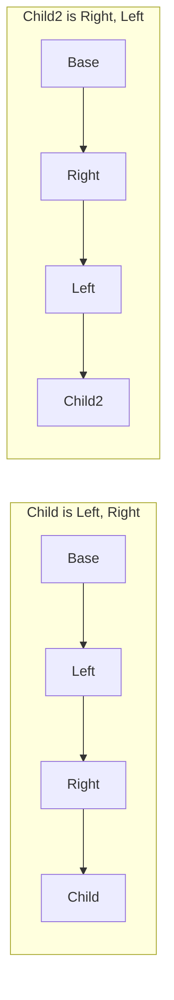

# 2.3 Storage layout

> [!abstract] In one minute
> - State variables get slots 0, 1, 2… in declaration order. Value types smaller than 32 bytes **pack** into one slot, the first one in the **lowest-order** bytes (right-aligned). A value that does not fit in what is left of a slot starts the next one. Inherited variables come first, **most-base contract first** in C3 order.
> - **Structs and fixed-size arrays** always start a new slot, and the variable after them starts a new slot too. Their members and elements pack inside them by the same rules.
> - A **mapping** at slot `p` leaves `p` empty and stores `m[k]` at `keccak256(h(k) ‖ p)`. `h` pads value-type keys to 32 bytes and leaves `string`/`bytes` keys unpadded. A **dynamic array** keeps its length at `p` and its elements from `keccak256(p)`, packed if small.
> - **`string`/`bytes`** of 31 bytes or less live in one slot: data left-aligned, `length × 2` in the lowest byte. Longer ones store `length × 2 + 1` at `p` and the data from `keccak256(p)`. The lowest bit tells them apart.
> - **Constants and immutables** take no slot. **Transient** variables get their own slot numbering from 0. **`layout at <expr>`** (0.8.29+) shifts the whole persistent layout of the most-derived contract; transient slots do not move.
> - Upgrade-safe layouts use **ERC-7201** namespaces (`keccak256(abi.encode(uint256(keccak256(id)) - 1)) & ~bytes32(uint256(0xff))`, `@custom:storage-location erc7201:<id>`) or older **storage gaps**. Reordering, retyping, inserting a parent or deleting a variable all shift or reinterpret slots.

**Prerequisites:** [[1.5 Storage and transient storage]], [[2.1 Types]], [[2.2 Data locations]] · **Leads to:** [[3.6 Storage, transient storage and bit packing]], [[4.2 Upgradeability and proxies]], [[5.9 Proxies, delegatecall and storage]], [[4.10 Gas optimization]]

Everything in this note was checked against solc-js 0.8.38 (`storageLayout` and `transientStorageLayout` from `--standard-json`) and, where it says so, by running the bytecode in py-evm 0.12.1b1 and reading the raw slots back.

## From the EVM's view to the compiler's

[[1.5 Storage and transient storage]] covers what the EVM gives a contract: 2^256 slots of 32 bytes, all zero until written, read with SLOAD and written with SSTORE, priced by warm/cold access and by whether a write creates, changes or clears a slot. The EVM has no idea what a "variable" is. It only sees 256-bit keys and 256-bit values.

Storage layout is the compiler's half of the contract: a fixed, documented rule that turns each state variable (and each mapping entry, array element and string byte) into a slot number and a byte offset inside that slot. The rule matters far beyond the compiler:

- **Off-chain readers** (indexers, `cast storage`, `eth_getProof` verifiers, auditors) use it to read "private" variables.
- **Proxies** run new code against old storage. The new code must agree with the old rule, slot for slot ([[4.2 Upgradeability and proxies]]).
- **Assembly and libraries** pass storage pointers around as raw slot numbers ([[3.6 Storage, transient storage and bit packing]]).

The Solidity docs call the layout part of the contract's external interface. Changing the rule would be a breaking change, so it has been stable for years. Two deliberate additions are recent: transient state variables (0.8.28) and the `layout at` specifier (0.8.29).

A useful picture: the compiler fills a big array from the left. Fixed-size things are placed one after another starting at slot 0, packed tightly where allowed. Anything whose size can change at runtime (mappings, dynamic arrays, long strings) keeps only a one-slot "anchor" in that sequence and puts its contents at a pseudo-random location far away, derived by hashing the anchor's slot number.

## Static variables: sequential slots and packing

### The rules

From the Solidity docs, each one confirmed in the compiler output below:

1. Variables are placed in declaration order, starting at slot 0.
2. Each value type uses only as many bytes as it needs.
3. The first item in a slot is stored **lower-order aligned**: in the rightmost bytes of the 32-byte word.
4. If a value type does not fit in the rest of the current slot, it goes to the next slot. A value never straddles two slots.
5. Structs and arrays always start a new slot, and the item after them also starts a new slot. Their contents pack by these same rules.
6. With inheritance, the order is C3 linearization, most-base contract first. Variables of different contracts can share a slot.

Byte sizes in storage (from `storageLayout.types[...].numberOfBytes`, 0.8.38):

| Type | Bytes | Notes |
|---|---|---|
| `bool`, `uint8`, `int8`, enum (up to 256 members) | 1 | |
| `uintN` / `intN` | N / 8 | signed values are stored as N-bit two's complement, not sign-extended into neighbors |
| `bytesN` | N | |
| `address`, `address payable`, contract types | 20 | |
| User-defined value type `type P is uint64` | size of the underlying type (8) | was wrong in 0.8.8, fixed 0.8.9 |
| internal function type | 8 | |
| external function type | 24 | address (20) + selector (4) |
| `uint256`, `bytes32` | 32 | a full slot |
| mapping, dynamic array, `string`, `bytes` | 32 | one anchor slot |

### Example: the two halves and the sandwich

```solidity
// SPDX-License-Identifier: MIT
pragma solidity ^0.8.28;

contract TwoHalves { uint128 a; uint128 b; }
contract Sandwich  { uint128 a; uint256 b; uint128 c; }
```

solc 0.8.38 `storageLayout`:

```text
TwoHalves  slot 0 off  0  a  uint128
           slot 0 off 16  b  uint128
Sandwich   slot 0 off  0  a  uint128
           slot 1 off  0  b  uint256
           slot 2 off  0  c  uint128
```

`a` and `b` share slot 0: `a` in bytes 0–15 counting from the right (the low 128 bits), `b` in bytes 16–31 (the high 128 bits). In the sandwich, `b` needs a whole slot, so it cannot join `a`, and `c` cannot go back to fill slot 0. Three slots, 16 bytes wasted twice.

"Offset" in the compiler output means bytes from the **right** (low-order) end of the word. To extract a field: `(slotValue >> (8 × offset)) & mask`.

```text
slot 0 of the same layout (uint128 a; uint128 b) after a = 9, b = 6, read back in py-evm:
0x00000000000000000000000000000006 00000000000000000000000000000009
  └──────── b (offset 16) ───────┘ └──────── a (offset 0) ─────────┘
```

### A bigger example

```solidity
// SPDX-License-Identifier: MIT
pragma solidity ^0.8.28;

contract Mixed {
    struct S { uint8 x; uint256 y; uint8 z; }   // badly ordered: 3 slots
    bool flag;
    address owner;
    uint64 nonce;
    S s;
    uint8 afterStruct;
    uint8[3] small;
    uint8 afterArray;
    uint256[] dyn;
    mapping(address => uint256) m;
    bytes5[8] five;
    bytes32 constant C = keccak256("c");
    uint256 immutable I = 1;
    uint256 transient t1;
    uint8 last;
    bool transient t2;
    function(uint) internal fi;
    function(uint) external fe;
    enum E { A, B } E e;
}
```

```text
storageLayout (solc 0.8.38)
slot  0 off  0  flag         bool                        1
slot  0 off  1  owner        address                    20
slot  0 off 21  nonce        uint64                      8    -> 29 of 32 bytes used
slot  1 off  0  s            struct Mixed.S             96    -> slots 1, 2, 3
slot  4 off  0  afterStruct  uint8                       1    -> new slot after a struct
slot  5 off  0  small        uint8[3]                   32    -> array starts a new slot
slot  6 off  0  afterArray   uint8                       1    -> and so does the next item
slot  7 off  0  dyn          uint256[]                  32    dynamic_array (length)
slot  8 off  0  m            mapping(address => uint256) 32   mapping (always zero)
slot  9 off  0  five         bytes5[8]                  64    -> 6 per slot, 2 slots
slot 11 off  0  last         uint8                       1
slot 11 off  1  fi           function (uint256)          8
slot 12 off  0  fe           function (uint256) external 24
slot 12 off 24  e            enum Mixed.E                1

transientStorageLayout
slot  0 off  0  t1           uint256
slot  1 off  0  t2           bool
```

Points to notice:

- `C` (constant) and `I` (immutable) are absent. `t1` and `t2` are absent from the persistent layout and numbered separately.
- `S` wastes two slots because `uint256 y` sits between two `uint8`s. Reordering it to `{ uint8 x; uint8 z; uint256 y; }` makes it 64 bytes.
- `bytes5[8]` fits 6 elements in a slot (30 bytes) and leaves 2 bytes unused, because elements never straddle slots. 8 elements need 2 slots.
- `last` (slot 11) does not join `afterArray`'s slot 6, even though `dyn`, `m` and `five` sit between them. The layout is strictly sequential; nothing back-fills holes.

### Fixed-size arrays and structs are inline

A fixed-size array or struct is just a block of consecutive slots in the static area. No hashing. Elements pack inside the block, but each nested array or struct starts its own slot:

```text
uint8[2][3] grid;   -> slots 0, 1, 2   (3 inner arrays, each starts a new slot: 96 bytes)
uint8[6]    flat;   -> slot 3          (6 bytes, one slot)
```

So `uint8[2][3]` costs three slots, not one. Inside each inner array, `grid[i][j]` is at slot `i`, offset `j`.

### What packing buys and costs

Packing is a gas tool, not a correctness rule. It pays when fields are read or written together, because one SLOAD or SSTORE moves all of them. Measured on py-evm (Prague rules), execution gas of one call writing two fresh `uint128` values from zero:

| Layout | Legacy pipeline, optimizer on | via-IR, optimizer on |
|---|---|---|
| `uint128 a; uint128 b;` (one slot) | 22,538 | 22,409 |
| `uint256 a; uint256 b;` (two slots) | 44,621 | 44,486 |

The packed version pays one 22,100 cold fresh set; the unpacked one pays two. The cost of packing is code: writing one field means load the slot, clear the field with a mask, OR in the new value, store. Reading means shift and mask. If two packed fields are written in different transactions, each write still pays a full SSTORE, plus that read-modify-write work.

Read-modify-write also means a write to one field never disturbs its neighbors. In py-evm, a slot holding `uint8 a = 0xAA; int24 tick; uint8 b = 0xBB` went from `...bb000000aa` to `...bbffffffaa` after `tick = -1`: three bytes of two's complement, neighbors intact.

> [!tip] Packing rule of thumb
> Pack fields that are read and written together on the hot path (a position's size and timestamp, an order's amount and owner). Do not pack a hot counter with a cold config value: every counter write becomes a read-modify-write of config bits, and every config change dirties the counter's slot. Bit-level packing by hand is in [[3.6 Storage, transient storage and bit packing]]; design rules in [[4.10 Gas optimization]].

## Inheritance: linearized, most-base first

With inheritance, the compiler takes the C3 linearization of the most-derived contract ([[2.7 Inheritance, interfaces and libraries]]), reverses it so the most-base contract comes first, and lays out each contract's own variables in turn. Packing continues across contract boundaries.

```solidity
// SPDX-License-Identifier: MIT
pragma solidity ^0.8.28;

contract Base  { uint8 baseVar; }
contract Left  is Base { uint8 leftVar; }
contract Right is Base { uint16 rightVar; }
contract Child  is Left, Right { uint256 childVar; uint8 tail; }
contract Child2 is Right, Left { uint256 childVar; }
```



```text
Child                                   Child2
slot 0 off 0  baseVar   uint8           slot 0 off 0  baseVar   uint8
slot 0 off 1  leftVar   uint8           slot 0 off 1  rightVar  uint16
slot 0 off 2  rightVar  uint16          slot 0 off 3  leftVar   uint8
slot 1 off 0  childVar  uint256         slot 1 off 0  childVar  uint256
slot 2 off 0  tail      uint8
```

Three consequences:

- `Base` appears once (C3 removes duplicates), at the start.
- Swapping the order in `is Left, Right` changes the layout. In an upgrade, that alone corrupts storage.
- Variables from three contracts share slot 0. A parent's small variable can pack into the same slot as a child's. That is how the Audius exploit happened (see [[#Pitfalls and incidents]]).

The `contract` field of each `storageLayout` entry names the contract being compiled, not the contract that declared the variable. To find the declaring contract, follow `astId` into the AST.

## Mappings

### The formula

A mapping declared at slot `p` occupies `p` but never writes to it. The slot stays zero forever. It exists only so that two mappings declared next to each other have different `p`, and so different hash inputs.

The value for key `k` is at:

```text
slot(m[k]) = keccak256( h(k) ‖ p )        ‖ = byte concatenation, p as a 32-byte word
```

If the value is itself a static type wider than one slot (a struct, a fixed array), `slot(m[k])` is where it starts, and members follow at `+1`, `+2`… with normal packing. If the value is a mapping, apply the formula again with `slot(m[k])` as the new `p`. If the value is a dynamic array or string, `slot(m[k])` is its anchor slot, and its data is at `keccak256(slot(m[k]))`.

### How keys are encoded: `h(k)`

| Key type | `h(k)` | Example key | 32 bytes hashed before `p` |
|---|---|---|---|
| `uintN`, enum | left-padded with zeros (big-endian number) | `uint8 200` | `0x00…00c8` |
| `intN` | sign-extended to 32 bytes | `int8 -1` | `0xff…ff` |
| `bool` | 0 or 1, left-padded | `true` | `0x00…01` |
| `address`, contract | left-padded 20 bytes | `0xABcd…abCD` | `0x000000000000000000000000abcd…abcd` |
| `bytesN` | **right**-padded (left-aligned), like in memory | `bytes4 0x12345678` | `0x12345678 00…00` |
| UDVT | as its underlying type | | |
| `string`, `bytes` | **unpadded raw bytes**, any length | `"abc"` | `0x616263` (3 bytes, not 32) |

So `h(k)` is "the key as it would sit in a memory word", except dynamic keys, which go in as raw bytes. In Solidity: `keccak256(abi.encode(k, p))` for value-type keys and `keccak256(abi.encodePacked(k, p))` for `string`/`bytes` keys (with `p` as `uint256`).

### Verified on py-evm

The test contract declared one mapping per key type, wrote one entry each, and a spy on py-evm's `set_storage` recorded every slot written. Every slot matched the Python prediction, and no other slots were written (19 predicted, 19 written).

| Variable (slot) | Entry | Predicted and observed slot |
|---|---|---|
| `mapping(address => mapping(uint256 => uint256)) balances` (0) | `balances[0xABcdEFABcdEFabcdEfAbCdefabcdeFABcDEFabCD][7]` | `0xff4c11ec6a75bdc006d477580db40c933bbc7112c518cd4dcf9eb672d2a85b54` |
| `mapping(uint8 => uint256)` (2) | `[200]` | `0xec56eb74d500f9b1bf8f0c5cc42ff5ed51e8d9e3a2ebb6e83a26383f297e0f1e` |
| `mapping(int8 => uint256)` (3) | `[-1]` | `0xb1ee3b3d0d99532dd9f14b22c0b908d4eec0e052c3827bbed2d6c3986954d08c` |
| `mapping(bool => uint256)` (4) | `[true]` | `0xabd6e7cb50984ff9c2f3e18a2660c3353dadf4e3291deeb275dae2cd1e44fe05` |
| `mapping(bytes4 => uint256)` (5) | `[0x12345678]` | `0x819e92e97628c2e288a6484d2b2c89ac2dc3b35cb18e86c4bbcb77aaa596ed4f` |
| `mapping(string => uint256)` (6) | `["abc"]` | `0xc40200de306afd0f12d4484923ae7e41d6285ed64a65b7a8070305be7df663c3` |
| `mapping(bytes => uint256)` (7) | `[hex"0102"]` | `0x45bbab6ab5867ba5a09aee22d9d076f878b4614e2a958bfa7071a68cc4770032` |

The nested one, step by step:

```text
k     = 0xABcdEFABcdEFabcdEfAbCdefabcdeFABcDEFabCD, j = 7, balances at slot 0

inner = keccak256( 000000000000000000000000abcdefabcdefabcdefabcdefabcdefabcdefabcd   <- h(k)
                   0000000000000000000000000000000000000000000000000000000000000000 ) <- p = 0
      = 0x16477b3185ed4a460762e3ff3d867553f5653b06d2cdd5697f9ced2b03b2cc11       (slot of balances[k], never written)

outer = keccak256( 0000000000000000000000000000000000000000000000000000000000000007   <- h(j)
                   16477b3185ed4a460762e3ff3d867553f5653b06d2cdd5697f9ced2b03b2cc11 ) <- inner as p
      = 0xff4c11ec6a75bdc006d477580db40c933bbc7112c518cd4dcf9eb672d2a85b54       (slot of balances[k][7])
```

Note the order: **key first, slot second**. Getting it backwards is the most common hand-computation mistake. For a nested mapping, the outer key is hashed first and the inner key last.

### Why hashing is safe

Every mapping entry lands at a pseudo-random point in a 2^256 space. Two different (key, slot) pairs collide only if keccak256 collides, which is treated as impossible. Hashed locations also cannot land in the low static area (slots 0, 1, 2…) except with negligible probability. The cost is that a mapping cannot be enumerated: storage has no "list keys" operation, and the anchor slot holds nothing. To iterate, keep a separate array of keys, or index events off-chain.

## Dynamic arrays

A dynamic array `T[] a` at slot `p`:

- stores `a.length` at `p`;
- stores its elements as if they were a static array `T[length]` starting at `keccak256(p)`.

So for element `i`:

| Element size | Slot | Offset (bytes from the right) |
|---|---|---|
| ≤ 16 bytes (packs `n = floor(32 / size)` per slot) | `keccak256(p) + floor(i / n)` | `(i mod n) × size` |
| 17–32 bytes (`address`, `bytes20`, `uint256`…): one per slot | `keccak256(p) + i` | 0 |
| `s` slots per element (structs, static arrays) | `keccak256(p) + i × s` | then add the member's slot and offset |

> [!note] Small types pack, even an `address`
> Any element type of 16 bytes or less packs. An `address` (20 bytes) does not: only one fits in 32 bytes, so `address[]` uses one slot per element. `uint128[]` fits two per slot, `uint16[]` 16 per slot, `bool[]` and `uint8[]` 32 per slot. `bytes5[]` fits 6 per slot with 2 bytes unused.

### Verified on py-evm

Same test contract, continued:

```text
Item[] items at slot 1, struct Item { uint128 a; uint64 b; uint256 c; }   (2 slots per Item)
  slot 1 (length)              = 4
  keccak256(1)                 = 0xb10e2d527612073b26eecdfd717e6a320cf44b4afac2b0732d9fcbe2b7fa0cf6
  items[3] word 0 (= +3*2)     = 0xb10e…0cfc  value 0x0000000000000000000000000000000200000000000000000000000000000000
                                                      (b = 2 at offset 16; a = 0 at offset 0)
  items[3].c  (= +3*2 + 1)     = 0xb10e…0cfd  value 3

uint16[] packed at slot 8, 17 elements 1..17
  slot 8 (length)              = 0x11 (17)
  keccak256(8)                 = 0xf3f7a9fe364faab93b216da50a3214154f22a0a2b415b23a84c8169e8b636ee3
  word 0 (elements 0..15)      = 0x0010000f000e000d000c000b000a000900080007000600050004000300020001
  word 1 (element 16)          = 0x0000000000000000000000000000000000000000000000000000000000000011

uint256[][] nested at slot 9: nested.length at 9; nested[i] is itself an anchor at keccak256(9) + i
  keccak256(9)                 = 0x6e1540171b6c0c960b71a7020d9f60077f6af931a8bbf590da0223dacf75c7af
  nested[1].length at          = 0x6e15…c7b0   value 2
  nested[1][0] at keccak256(0x6e15…c7b0)     = 0x9a90097965d2af7f0af1f03fccb0b5919feff3c512936b97ccb5807555d9cc2e  value 10
  nested[1][1] at that + 1                    = 0x9a90…cc2f  value 11

mapping(uint256 => uint256[]) mapOfArr at slot 10
  mapOfArr[5].length at keccak256(h(5) ‖ 10) = 0xf35035bc2b01d44bd35a1dcdc552315cffb73da35cfd60570b7b777f98036f9f
  mapOfArr[5][0]  at keccak256(that)          = 0xaa3bdbeaf10f0421f9516f6d1f090045f3e363b5ad3b5ec88f82c51b441f0965
```

Read the packed word right to left: element 0 (`0x0001`) is in the lowest two bytes, element 15 (`0x0010`) in the highest. Same right-alignment rule as for state variables.

Two more facts about arrays:

- **Bounds checks.** `a[i]` with `i >= a.length` reverts with `Panic(0x32)` (checked: a `.slot` lookup of `items[3]` on an empty array reverted with `0x4e487b71…32`). Raw `sload` in assembly has no such check.
- **Shrinking clears.** `pop()`, `delete` and assigning a shorter array zero the freed slots (and earn the clear refund). That loop is what [[#Pitfalls and incidents|SOL-2025-1]] broke for arrays that wrap around the end of storage.

## `bytes` and `string`

`bytes` and `string` use the same encoding. It has two forms, chosen by length, and the anchor slot `p` says which one is in use.

| Length | Slot `p` holds | Data | Lowest bit of `p` |
|---|---|---|---|
| 0–31 bytes (**short**) | data left-aligned in the high bytes, `length × 2` in the lowest byte | inside `p` | 0 |
| ≥ 32 bytes (**long**) | `length × 2 + 1` | from `keccak256(p)`, left-aligned, 32 bytes per slot, last slot zero-padded | 1 |

Raw slots from py-evm, `string s` at slot 0, each value written with a setter:

```text
"hello" (5)
  slot 0       0x68656c6c6f00000000000000000000000000000000000000000000000000000a   0x0a = 5*2
31 x "a"
  slot 0       0x616161616161616161616161616161616161616161616161616161616161613e   0x3e = 31*2
32 x "a"
  slot 0       0x0000000000000000000000000000000000000000000000000000000000000041   0x41 = 32*2+1
  keccak(0)+0  0x6161616161616161616161616161616161616161616161616161616161616161
"The quick brown fox jumps over the lazy dog" (43)
  slot 0       0x0000000000000000000000000000000000000000000000000000000000000057   0x57 = 43*2+1
  keccak(0)+0  0x54686520717569636b2062726f776e20666f78206a756d7073206f7665722074
  keccak(0)+1  0x6865206c617a7920646f67000000000000000000000000000000000000000000
then "hi" (2)
  slot 0       0x6869000000000000000000000000000000000000000000000000000000000004   0x04 = 2*2
  keccak(0)+0  0x0000…0000   (cleared)
  keccak(0)+1  0x0000…0000   (cleared)
```

Both pipelines (legacy and via-IR, optimizer on) produced identical slots. Going from long back to short zeroed the old data slots.

Why `× 2`? The extra bit is the flag. A short string's length byte is even (at most 62 = 0x3e). A long string's anchor is odd. One SLOAD tells the reader which form it has, and for short strings, gives the data too. The short form saves a whole SLOAD and a 20,000-gas fresh set for every string under 32 bytes, which covers most names and symbols.

Decoding by hand:

```text
v = SLOAD(p)
if v & 1 == 0:  length = (v & 0xff) / 2       data = high `length` bytes of v
else:           length = (v - 1) / 2          data = slots keccak256(p) .. + ceil(length/32) - 1
```

> [!warning] Invalid encodings revert
> If the anchor is odd but says length < 32, or even but says length ≥ 32, the slot is malformed. The docs say via-IR code panics on it. In 0.8.38 both pipelines did: with slot 0 set by assembly to `7` (long flag, length 3) or `80` (short flag, length 40), `get()` and `bytes(s).length` reverted with `Panic(0x22)` (`0x4e487b71…22`, "incorrectly encoded storage byte array"). This shows up after a bad upgrade, or when assembly writes a string slot by hand.

## What takes no slot: constants and immutables

- **`constant`** values are substituted into code at compile time. No slot, no SLOAD.
- **`immutable`** values are computed in the constructor and written into the runtime bytecode before it is returned ([[1.8 Contract creation]]). No slot. Checked: in a contract with `address immutable deployer = msg.sender; uint256 x = 7;`, `storageLayout` listed only `x` at slot 0, the deployer address appeared inside the deployed runtime code, and slot 1 stayed 0.

Two consequences for upgradeable systems. Adding or removing a constant or immutable never shifts the layout. But an immutable lives in the **implementation's** code, so a proxy running that code sees the value set when the implementation was deployed, not anything in the proxy's storage. That is fine for true constants of the deployment (a chain ID, a fixed token address) and a bug for anything meant to be per-proxy.

## Transient state variables

Since 0.8.28 (9 Oct 2024), value-type state variables can be declared `transient` ([[1.5 Storage and transient storage]] covers TLOAD/TSTORE semantics). For layout:

- Transient variables use the **same rules** (declaration order, packing, inheritance order) with **their own counter** starting at 0. The compiler reports them in a separate `transientStorageLayout` output (also new in 0.8.28).
- Transient and persistent variables can be interleaved freely. Neither shifts the other.
- Only value types. `mapping(uint => uint) transient m;` fails with `UnimplementedFeatureError: Transient data location is only supported for value types.`
- `layout at` does **not** move transient variables.

```solidity
// SPDX-License-Identifier: MIT
pragma solidity ^0.8.29;

contract Base { uint128 transient lockA; uint256 total; }
contract Tr is Base layout at 100 {
    uint256 x;
    uint128 transient lockB;   // packs with lockA in transient slot 0
    address transient caller;  // transient slot 1
    uint8 y;
}
```

```text
storageLayout              transientStorageLayout
slot 100  total            slot 0 off  0  lockA
slot 101  x                slot 0 off 16  lockB
slot 102  y                slot 1 off  0  caller
```

> [!warning] Transient slot 0 is shared under DELEGATECALL
> A proxy and its implementation share one transient space, exactly as they share persistent storage. Because Solidity always numbers transient variables from 0 (even under `layout at`), a proxy's own transient variables and the implementation's will collide. Keep transient state either in only one of the two, or use hashed transient slots in assembly ([[3.6 Storage, transient storage and bit packing]], [[5.11 New attack surfaces - transient storage, EIP-7702, account abstraction]]).

## Custom storage layout: `layout at`

### What it does

Since 0.8.29 (12 Mar 2025) a contract can move its whole persistent layout:

```text
contract C is A, B layout at 42 { ... }      // syntax sketch
```

Every static slot of `C`, including inherited variables, is shifted by the base value: the variable that would have been at slot `n` is at slot `42 + n`. Offsets inside slots do not change. Mappings and dynamic arrays move "indirectly": their anchors move, so `keccak256(h(k) ‖ p)` and `keccak256(p)` change too.

```solidity
// SPDX-License-Identifier: MIT
pragma solidity ^0.8.35;

uint256 constant BASE = erc7201("example.main");   // erc7201 builtin: 0.8.35+

contract Token {
    uint256 totalSupply;
    mapping(address => uint256) balanceOf;
}

// The specifier may go before or after `is`, at most once, only on the most derived contract.
contract Relocated is Token layout at BASE {
    address owner;
    bool transient entered;            // transient: not moved, still slot 0

    function slots() external pure returns (uint256 s, uint256 b, uint256 o, uint256 t) {
        assembly {
            s := totalSupply.slot
            b := balanceOf.slot
            o := owner.slot
            t := entered.slot
        }
    }
}
```

`slots()` returned, on py-evm:

```text
totalSupply.slot  0x183a6125c38840424c4a85fa12bab2ab606c4b6d0e7cc73c0c06ba5300eab500
balanceOf.slot    0x183a6125c38840424c4a85fa12bab2ab606c4b6d0e7cc73c0c06ba5300eab501
owner.slot        0x183a6125c38840424c4a85fa12bab2ab606c4b6d0e7cc73c0c06ba5300eab502
entered.slot      0x0   (transient)
```

### Restrictions, each one tested on 0.8.38

| Rule | What the compiler says |
|---|---|
| Base must be a compile-time constant expression | `layout at block.number` → `TypeError: The base slot of the storage layout must be a compile-time constant expression.` |
| …that the constant evaluator supports: integer literals and arithmetic, file-level or global `constant`s (0.8.31+), the `erc7201` builtin (0.8.35+), signed but positive expressions like `-(-5)` (0.8.37+) | `layout at uint256(keccak256("x"))` and `layout at uint8(5)` → `TypeError: The base slot expression contains elements that are not yet supported by the internal constant evaluator…`. A `bytes32 constant K = keccak256(...)` does not work either. Use a hex literal or `erc7201(...)` |
| Must be an integer in `uint256` range | `-1` → `…evaluates to -1, which is outside the range of type uint256.`; `2**256` → `…outside the range…`; `1.5` → `…must evaluate to an integer.` |
| The static area must not run past the end of storage | `layout at 2**256 - 1 { uint256 a; }` → `TypeError: Contract extends past the end of storage when this base slot value is specified.` In 0.8.38 the static area has to end at or before slot 2^256 − 2: one `uint256` at `2**256 - 2` compiles, at `2**256 - 1` it does not |
| Near the end: warning | Bases in roughly the last 2^64 slots compile with `Warning: This contract is very close to the end of storage. This limits its future upgradability.` (`2**256 - 2**65` gave no warning) |
| Only on the most-derived contract | If `A layout at 10` and `C is A` → `TypeError: Cannot inherit from a contract with a custom storage layout.` So a layout-bearing contract is always a leaf |
| Not on abstract contracts, interfaces, libraries | `abstract contract A layout at 10` → `TypeError: Storage layout cannot be specified for abstract contracts.`; interfaces and libraries → `ParserError` (the grammar does not allow it) |
| At most once | `layout at 1 layout at 2` → `ParserError: More than one storage layout definition.` |
| The contract's own constants cannot be used | `contract C layout at BASE { uint256 constant BASE = 5; }` → `DeclarationError: Undeclared identifier.` (declare it at file level) |
| Does not affect transient variables | confirmed above |
| Hashed data areas are not range-checked | only the static area is checked; mapping and dynamic-array data can be anywhere anyway |
| `layout` and `at` are not yet keywords | since 0.8.35 the compiler warns when they are used as identifiers, because they will be reserved |

`layout at 0` is legal and is the same as no specifier.

### Version history

| Version (date) | Change |
|---|---|
| 0.8.37 (10 Sep 2026) | Base slot may be a signed expression if it evaluates to a positive value |
| 0.8.36 (9 Jul 2026) | Fixed SOL-2026-3 (medium): emitting the "close to end of storage" warning reversed the stored inheritance order, which could miscompile initialization order, constructor order and virtual resolution. Affected 0.8.29–0.8.35, only when that warning was printed. Also fixed a segfault on that warning for contracts with no storage variables |
| 0.8.35 (29 Apr 2026) | `erc7201(string)` builtin, usable in compile-time context, so `layout at erc7201("…")` works. Warning for `layout`/`at` as identifiers |
| 0.8.31 (3 Dec 2025) | `constant` state variables allowed in the base expression |
| 0.8.29 (12 Mar 2025) | `layout at` introduced |

### What it is for, and what it is not

`layout at` is for contracts that must keep their state away from slot 0, mostly code that runs behind a proxy or under EIP-7702 delegation ([[4.5 Account abstraction and smart wallets]]). A 7702-delegated EOA runs your code against the EOA's own storage, and a user may switch delegates. Moving each wallet implementation's layout to a distinct, hashed base makes it far less likely that the next implementation misreads the last one's state.

It is not a replacement for ERC-7201 namespaces. `layout at` moves the **whole** linearized layout as one block. So it does nothing to stop a base contract's new variable from shifting a derived contract's variables in an upgrade: the inner order is the same as without the specifier. ERC-7201 gives **each** module its own independent base. The two can be combined (`layout at erc7201("app.v1")`), but they solve different problems.

> [!warning] Moving the base is itself an upgrade-breaking change
> Adding, removing or changing `layout at` on an already-deployed upgradeable contract moves every variable. Treat the base value as frozen once deployed.

## ERC-7201 namespaced storage

### The idea

Sequential layout couples every contract in an inheritance tree: a variable added to a base contract shifts every variable after it. ERC-7201 (Final, created 20 Jun 2023, by Francisco Giordano, Hadrien Croubois, Ernesto García and Eric Lau) breaks that coupling. Each module keeps its state in a struct placed at a root slot derived from a string id. Modules no longer share a counter, so they can grow independently.

```text
erc7201(id) = keccak256( abi.encode( uint256(keccak256(bytes(id))) - 1 ) ) & ~bytes32(uint256(0xff))
```

- The inner `keccak256(id) - 1` is a location "unused by Solidity". It has no known keccak preimage, so no Solidity mapping or array hash can produce it.
- It is not the final location, because a namespace spans several slots and slots `keccak256(id) - 1 + 1, + 2…` could be hit by someone's `keccak256(something) + i`. Hashing again moves the root to a fresh random point.
- `& ~0xff` clears the low byte so the root is a multiple of 256. The EIP gives this as a possible future gas optimization: in Verkle or binary state trees, groups of 256 consecutive slots may share one cold access ([[1.1 Accounts and world state]]). A namespace's first 256 slots then sit in one group.

### Worked: "example.main"

Computed in Python with `eth_hash`:

```text
keccak256("example.main")        = 0xb0ae1bb16fc1b16f3e2fb344bef6b08581bbec9f0228f7dd5fd38a8c141b3425
minus 1                          = 0xb0ae1bb16fc1b16f3e2fb344bef6b08581bbec9f0228f7dd5fd38a8c141b3424
keccak256(abi.encode(that))      = 0x183a6125c38840424c4a85fa12bab2ab606c4b6d0e7cc73c0c06ba5300eab5da
& ~0xff                          = 0x183a6125c38840424c4a85fa12bab2ab606c4b6d0e7cc73c0c06ba5300eab500
```

That is exactly the constant in the EIP's example contract. In Solidity, the formula written out, the `erc7201("example.main")` builtin (0.8.35), and the literal all compared equal on py-evm.

Other roots in production use, computed the same way:

| Namespace id | Root slot |
|---|---|
| `openzeppelin.storage.Initializable` | `0xf0c57e16840df040f15088dc2f81fe391c3923bec73e23a9662efc9c229c6a00` |
| `openzeppelin.storage.Ownable` | `0x9016d09d72d40fdae2fd8ceac6b6234c7706214fd39c1cd1e609a0528c199300` |
| `openzeppelin.storage.ReentrancyGuard` | `0x9b779b17422d0df92223018b32b4d1fa46e071723d6817e2486d003becc55f00` |

### The pattern

```solidity
// SPDX-License-Identifier: MIT
pragma solidity ^0.8.20;

contract Example {
    /// @custom:storage-location erc7201:example.main
    struct MainStorage {
        uint256 x;
        uint256 y;
    }

    // keccak256(abi.encode(uint256(keccak256("example.main")) - 1)) & ~bytes32(uint256(0xff))
    bytes32 private constant MAIN_STORAGE_LOCATION =
        0x183a6125c38840424c4a85fa12bab2ab606c4b6d0e7cc73c0c06ba5300eab500;

    function _getMainStorage() private pure returns (MainStorage storage $) {
        assembly {
            $.slot := MAIN_STORAGE_LOCATION
        }
    }

    function setY(uint256 v) external {
        _getMainStorage().y = v;       // writes slot ...b501
    }

    function formulaMatches() external pure returns (bool) {
        return keccak256(abi.encode(uint256(keccak256("example.main")) - 1)) & ~bytes32(uint256(0xff))
            == MAIN_STORAGE_LOCATION;
    }
}
```

On py-evm, `setY(5)` wrote 5 to `0x183a…b501` and `formulaMatches()` returned true.

How it works: the struct's members are laid out from the root by the ordinary rules (`x` at root + 0, `y` at root + 1, mappings inside the struct hash from their member slot). The `$.slot := …` assignment points a storage reference at the root. The `@custom:storage-location erc7201:<id>` NatSpec annotation (the general form is `@custom:storage-location <formula-id>:<namespace-id>`) is how tools find the namespace: the compiler's `storageLayout` output for this contract is **empty**, because the struct is not a state variable. OpenZeppelin's upgrades plugins read the annotation to check namespaced layouts across upgrades (they need Solidity 0.8.20 or later for this).

Rules for evolving a namespace: inside the struct, the usual sequential rules apply. Append new members at the end; never reorder, retype or delete. A new module gets a new id. Never reuse an id for a different struct.

### Who uses it

OpenZeppelin Contracts Upgradeable uses namespaced storage starting with version 5.0. Each contract (`OwnableUpgradeable`, `ERC20Upgradeable`, …) has its own `openzeppelin.storage.<Name>` namespace, so OpenZeppelin can add variables in a minor release without breaking your derived contract's layout.

## Storage gaps

Before namespaces, the standard way to let a base contract grow was a gap: an unused fixed-size array at the end of the base that reserves slots.

```solidity
// SPDX-License-Identifier: MIT
pragma solidity ^0.8.28;

// Version 1 of an upgradeable base: 1 used slot + 49 reserved = 50.
contract FeesV1 {
    uint256 feeBps;
    uint256[49] private __gap;
}

// Version 2 adds a variable and shrinks the gap by one.
contract FeesV2 {
    uint256 feeBps;
    address feeRecipient;
    uint256[48] private __gap;
}

contract AppV1 is FeesV1 { uint256 appState; }   // appState at slot 50
contract AppV2 is FeesV2 { uint256 appState; }   // still slot 50
```

```text
AppV1                                  AppV2
slot  0  feeBps       uint256          slot  0  feeBps        uint256
slot  1  __gap        uint256[49]      slot  1  feeRecipient  address
slot 50  appState     uint256          slot  2  __gap         uint256[48]
                                       slot 50  appState      uint256
```

The derived contract's `appState` stays at slot 50. The common convention (OpenZeppelin 4.x) sizes each gap so that the contract's used slots plus its gap total 50. The OpenZeppelin plugins recognize arrays named `__gap` or starting with `__gap_` and check that the gap shrank by the right amount.

Gap hazards:

- **Arithmetic in slots, not variables.** A new `address` and a new `uint96` may pack into one slot; shrink by the slots actually used. A new struct or fixed array starts a new slot and makes the next item start one too. Compare `storageLayout` outputs rather than counting by eye.
- **Packing across the gap boundary.** A new small variable added just before the gap could pack into the last used slot instead of taking a new one. Then the gap must not shrink at all.
- **Gaps in every base.** Each base in the tree needs its own gap; one missing gap in a mid-level base breaks everything below it.
- Namespaces remove this bookkeeping, which is why they replaced gaps in OpenZeppelin 5.x.

## Reading storage from outside

Nothing in storage is private. `private` and `internal` only stop *other contracts* from reading a variable through Solidity. Anyone can call `eth_getStorageAt(address, slot, block)` on any node, and `eth_getProof` proves the value against a state root ([[1.1 Accounts and world state]]). Foundry's `cast` wraps the arithmetic ([[6.1 Foundry essentials]]):

| Task | Command | Notes |
|---|---|---|
| Read a slot | `cast storage <ADDRESS> <SLOT> --rpc-url $RPC [--block N]` | returns the raw 32-byte word |
| Mapping entry slot | `cast index <KEY_TYPE> <KEY> <SLOT>` | `keccak256(h(key) ‖ slot)`; nest by passing the result as the next slot |
| Hash for array data | `cast keccak 0x<32-byte slot>` | a `0x` input is hashed as bytes |
| ABI-encode words to hash | `cast abi-encode "f(uint256)" 4` | output has no selector |
| ERC-7201 root | `cast index-erc7201 <ID>` | |
| Convert | `cast to-dec`, `cast to-ascii`, `cast to-base` | |

Foundry was not installable in this environment, so the outputs shown with these commands in this note were computed in Python with the same formulas and cross-checked against py-evm and against Solidity's own `.slot` values.

Generating the layout instead of deriving it: `solc --storage-layout`, the standard-JSON `storageLayout` / `transientStorageLayout` outputs, or `forge inspect <Contract> storageLayout`. The JSON lists each variable's `slot` (a decimal string, since it can be huge), `offset` (bytes from the right), `type` id, and a `types` table with `encoding` (`inplace`, `mapping`, `dynamic_array`, `bytes`), `numberOfBytes`, and `key`/`value`/`base`/`members` where relevant. The format is documented as experimental and may change in non-breaking releases.

## Solidity and Yul in practice

### Slot math in Solidity, checked against the compiler

```solidity
// SPDX-License-Identifier: MIT
pragma solidity ^0.8.28;

contract SlotMath {
    struct Item { uint128 a; uint64 b; uint256 c; }            // 2 slots: [a|b] [c]
    mapping(address => mapping(uint256 => uint256)) balances;  // slot 0
    Item[] items;                                              // slot 1
    mapping(string => uint256) byName;                         // slot 2
    uint64 small;                                              // slot 3, offset 0
    uint128 other;                                             // slot 3, offset 8

    // balances[k][j]: hash the key with the mapping's slot, twice.
    function balanceSlot(address k, uint256 j) public pure returns (bytes32) {
        bytes32 inner = keccak256(abi.encode(k, uint256(0)));    // slot of balances[k]
        return keccak256(abi.encode(j, inner));                  // slot of balances[k][j]
    }

    // items[i].b: data starts at keccak256(1), each Item is 2 slots, b sits at byte 16.
    function itemBSlot(uint256 i) public pure returns (uint256 slot, uint256 byteOffset) {
        uint256 data = uint256(keccak256(abi.encode(uint256(1))));
        return (data + i * 2, 16);
    }

    // String keys are hashed unpadded: keccak256(bytes(key) ‖ uint256(slot)).
    function nameSlot(string memory k) public pure returns (bytes32) {
        return keccak256(abi.encodePacked(k, uint256(2)));
    }

    // Ask the compiler: .slot and .offset in inline assembly.
    function compilerSays(uint256 i) external view
        returns (bytes32 itemSlot, uint256 smallSlot, uint256 smallOff, uint256 otherOff)
    {
        Item storage it = items[i];            // bounds-checked
        assembly {
            itemSlot := it.slot
            smallSlot := small.slot
            smallOff := small.offset
            otherOff := other.offset
        }
    }
}
```

On py-evm, `balanceSlot(0xABcd…abCD, 7)` returned `0xff4c11ec…5b54`, `itemBSlot(3)` returned `(0xb10e…0cfc, 16)`, `nameSlot("abc")` returned `keccak256("abc" ‖ uint256(2)) = 0x31f76c90c4bd232b01bb0bd40689518175171c0bb64d053d77a6e90319d96718`, all equal to the Python values. After pushing four items, the compiler's own `it.slot` for `items[3]` was the same `0xb10e…0cfc`, and `small.offset`/`other.offset` were 0 and 8.

What `.slot` and `.offset` mean in inline assembly ([[3.4 Interop with Solidity]]):

- For a **state variable**, `x.slot` and `x.offset` are compile-time constants from the layout. They are read-only: `x.slot := 5` fails with `TypeError: State variables cannot be assigned to - you have to use "sstore()" or "tstore()".`
- For a **local storage pointer** (`Item storage it`), `it.slot` is a runtime value and *can* be assigned. That is how the ERC-7201 accessor points a struct at its root. Reference types always start a slot, so their offset is always 0.
- For **transient** state variables, `.slot` is the transient slot (used with `tload`/`tstore`).

### Reading and writing a packed field by hand

```solidity
// SPDX-License-Identifier: MIT
pragma solidity ^0.8.28;

contract PackedRead {
    uint64 small = 41;      // slot 0, offset 0
    uint128 other = 7;      // slot 0, offset 8

    function readOther() external view returns (uint128 v) {
        assembly {
            let word := sload(other.slot)
            v := and(shr(mul(other.offset, 8), word), 0xffffffffffffffffffffffffffffffff)
        }
    }

    function writeOther(uint128 v) external {
        assembly {
            let shift := mul(other.offset, 8)
            let mask := shl(shift, 0xffffffffffffffffffffffffffffffff)
            let word := sload(other.slot)
            sstore(other.slot, or(and(word, not(mask)), shl(shift, v)))
        }
    }
}
```

py-evm: slot 0 started as `0x…0000000000000007 0000000000000029` (`other` = 7 at byte 8, `small` = 41 at byte 0). `writeOther(0x1234)` changed it to `0x…0000000000001234 0000000000000029`, leaving `small` intact. This is exactly what the compiler emits for a packed write. Doing it by hand only makes sense when you combine several field updates into one SSTORE that the compiler would not merge. Skipping the `and` with `not(mask)` is the classic bug: an OR without clearing corrupts the old bits. More in [[3.6 Storage, transient storage and bit packing]] and [[3.9 Cleanup, dirty bits and safety]].

### Cost of a far-away base

`layout at` turns small slot constants into 32-byte constants. Compiling a small contract (two `uint256`s and a mapping, one function touching all three) with 0.8.38, optimizer on, legacy pipeline:

| Specifier | Runtime code | Gas of the function call |
|---|---|---|
| none | 281 bytes | 66,936 |
| `layout at 42` | 282 bytes | 66,937 |
| `layout at erc7201("example.main")` | 391 bytes | 66,937 |

Gas is essentially unchanged (1 gas apart; PUSH32 costs the same 3 gas as PUSH1). The price is code size: each distinct slot constant is now a 33-byte PUSH32, about 110 extra bytes here. That matters near the 24,576-byte limit.

## Pitfalls and incidents

| Date | Incident / issue | Layout lesson |
|---|---|---|
| 9 Jul 2026 | SOL-2026-3 `InheritanceOrderReversalOnStorageEndWarning` (medium), 0.8.29–0.8.35, fixed in 0.8.36 | When `layout at` put the static area within the last 2^64 slots, emitting the warning reversed the compiler's stored linearization in place. Later phases saw the inheritance order backwards: state-variable initialization, constructor order and virtual resolution could be miscompiled. Treat that warning as a red flag on older compilers |
| 18 Feb 2026 | SOL-2026-1 `TransientStorageClearingHelperCollision` (high), 0.8.28–0.8.33, via-IR, fixed in 0.8.34 | Persistent and transient variables at the same slot number shared one `set_to_zero` helper by name, so `delete` on one could clear the other. The bug existed because the two slot spaces reuse the same numbers |
| 18 Dec 2025 | SOL-2025-1 `LostStorageArrayWriteOnSlotOverflow` (low), all versions to 0.8.31, fixed in 0.8.32 | Arrays that straddle slot 2^256 − 1 and wrap to 0: clearing loops ran zero times, so `delete`/`pop()`/shrinking left data behind. Only reachable with unusual layouts, which `layout at` makes easier to build; the compiler now rejects static areas that run off the end |
| 23 Jul 2022 | Audius governance takeover: 18,564,497 AUDIO moved from the treasury (reported as about $6M; the attacker sold for about $1.08M) | The proxy stored `proxyAdmin` (an address) in slot 0. OpenZeppelin's `Initializable` kept `initialized` and `initializing` (bools) in bytes 0 and 1 of slot 0. The admin address's low bytes (`0xac`, `0xab`) were nonzero, so both flags read true, and `initializer` functions could be called again. The attacker re-initialized governance and staking and passed a malicious proposal |
| 29 Sep 2021 | 0.8.9 fixes the user-defined value type layout bug (0.8.8 only) | UDVTs with underlying types shorter than 32 bytes took a full slot instead of packing. A layout that depends on the compiler version is an upgrade hazard: re-check layouts when bumping compilers across known-bug boundaries |

> [!warning] Footguns
> - **"private" is not secret.** Every slot is world-readable. Hashing a low-entropy secret (`keccak256("hunter2")`) does not help: it is brute-forced in seconds. Use commit-reveal with a random salt, or keep secrets off-chain.
> - **Offsets count from the right.** The first variable in a slot is in the lowest bytes. An inherited `bool` before an `address` puts the address at offset 1, not 0.
> - **Key before slot.** `keccak256(h(k) ‖ p)`, never `keccak256(p ‖ k)`. For `string`/`bytes` keys, use the raw bytes (`abi.encodePacked`), not `abi.encode`.
> - **Proxy + implementation share slots** under DELEGATECALL, both persistent and transient. A proxy that declares ordinary state variables at slot 0 collides with the implementation's slot 0 (Audius). Proxy-owned state belongs in EIP-1967 slots (implementation at `0x360894a13ba1a3210667c828492db98dca3e2076cc3735a920a3ca505d382bbc` = `keccak256("eip1967.proxy.implementation") - 1`, admin at `0xb53127684a568b3173ae13b9f8a6016e243e63b6e8ee1178d6a717850b5d6103`). See [[5.9 Proxies, delegatecall and storage]].
> - **Namespaced structs are invisible to `storageLayout`.** Layout-diff tooling that only reads the compiler JSON will miss changes inside ERC-7201 structs. Use tooling that understands the annotation.
> - **Immutables in implementations** are fixed per implementation, not per proxy.
> - **Hand-written string slots** must keep the short/long encoding valid, or every read reverts with `Panic(0x22)`.

## Question ladder

> [!question]- **B** How are two `uint128` variables laid out? A `uint128`, then a `uint256`, then a `uint128`?
> **Two `uint128`s share one slot.** `uint128 a; uint128 b;` puts both in slot 0. `a` is first, so it is lower-order aligned: offset 0, the low 16 bytes of the word. `b` is at offset 16, the high 16 bytes. solc 0.8.38 reports `a` slot 0 offset 0, `b` slot 0 offset 16. With `a = 9, b = 6` the raw slot is `0x00000000000000000000000000000006_00000000000000000000000000000009`.
>
> **`uint128, uint256, uint128` takes three slots.** `a` goes to slot 0, offset 0. `uint256 b` needs 32 bytes, only 16 are free, so it starts slot 1. `uint128 c` cannot fit in slot 1 (full) and the compiler never goes back to fill slot 0's free half, so `c` starts slot 2. Reported layout: slots 0, 1, 2, all at offset 0. Sixteen bytes are wasted in slot 0 and in slot 2.
>
> **Why it matters.** Writing `a` and `b` for the first time costs one fresh set when packed and two when not: measured 22,538 vs 44,621 execution gas on py-evm (legacy pipeline, optimizer on). The fix is ordering: `uint128 a; uint128 c; uint256 b;` uses two slots. The same reasoning applies inside structs (a `{uint8, uint256, uint8}` struct is 3 slots, `{uint8, uint8, uint256}` is 2).
>
> **Follow-ups an interviewer may ask.** Packing is not free: writing only one packed field is a read-modify-write (SLOAD, mask, OR, SSTORE), and reading needs a shift and mask. If two fields are always updated in different transactions, packing them saves nothing on writes. And packing order is part of the upgrade contract: you cannot later "fix" a wasteful order in a deployed upgradeable contract.

> [!question]- **I** Compute the slot of `arr[i].field` and of `map[k][j]`.
> **General formulas.** Let `p` be the declared slot of the variable.
>
> | Expression | Slot | Byte offset |
> |---|---|---|
> | `arr[i]` for `T[] arr`, `T` occupying `s` whole slots | `keccak256(p) + i·s` | 0 |
> | `arr[i]` for small `T` (size `z` ≤ 16 bytes, `n = floor(32/z)` per slot) | `keccak256(p) + floor(i/n)` | `(i mod n)·z` |
> | `arr[i].field` (struct element) | `keccak256(p) + i·s + fieldSlot` | `fieldOffset` |
> | `fixedArr[i]` for `T[N]` | `p + i·s` (inline, no hash) | as above |
> | `map[k]` | `keccak256(h(k) ‖ p)` | 0 for the start of the value |
> | `map[k][j]` | `keccak256(h(j) ‖ keccak256(h(k) ‖ p))` | 0 |
>
> `fieldSlot` and `fieldOffset` come from the struct's own layout (the `members` list in `storageLayout`).
>
> **Worked example 1: `items[3].b`.** `struct Item { uint128 a; uint64 b; uint256 c; }` has `a` at (0, 0), `b` at (0, 16), `c` at (1, 0), so `s = 2`. `Item[] items` is at slot 1.
>
> ```text
> keccak256(uint256(1)) = 0xb10e2d527612073b26eecdfd717e6a320cf44b4afac2b0732d9fcbe2b7fa0cf6
> + 3 * 2 + 0           = 0xb10e2d527612073b26eecdfd717e6a320cf44b4afac2b0732d9fcbe2b7fa0cfc   offset 16
> ```
>
> After `items[3].b = 2` that slot held `0x…0002` followed by 16 zero bytes: `2 << 128`. `items[3].c` is the next slot, `…0cfd`.
>
> **Worked example 2: `balances[0xABcd…abCD][7]`** for `mapping(address => mapping(uint256 => uint256)) balances` at slot 0:
>
> ```text
> inner = keccak256(pad32(0xABcdEFABcdEFabcdEfAbCdefabcdeFABcDEFabCD) ‖ pad32(0))
>       = 0x16477b3185ed4a460762e3ff3d867553f5653b06d2cdd5697f9ced2b03b2cc11
> outer = keccak256(pad32(7) ‖ inner)
>       = 0xff4c11ec6a75bdc006d477580db40c933bbc7112c518cd4dcf9eb672d2a85b54
> ```
>
> Both values were written by the compiled contract on py-evm at exactly these slots, and Solidity's own `.slot` values agreed. With Foundry:
>
> ```text
> $ cast index address 0xABcdEFABcdEFabcdEfAbCdefabcdeFABcDEFabCD 0
> 0x16477b3185ed4a460762e3ff3d867553f5653b06d2cdd5697f9ced2b03b2cc11
> $ cast index uint256 7 0x16477b3185ed4a460762e3ff3d867553f5653b06d2cdd5697f9ced2b03b2cc11
> 0xff4c11ec6a75bdc006d477580db40c933bbc7112c518cd4dcf9eb672d2a85b54
> $ cast keccak 0x0000000000000000000000000000000000000000000000000000000000000001
> 0xb10e2d527612073b26eecdfd717e6a320cf44b4afac2b0732d9fcbe2b7fa0cf6
> ```
>
> (Outputs computed in Python; Foundry was not available here.) Then add `3 × 2` to the last value: `…0cf6 + 6 = …0cfc`.
>
> **Traps.** Key first, slot second. The outer key is hashed first. `string`/`bytes` keys are hashed raw (`keccak256("abc" ‖ pad32(p))`). `int` keys are sign-extended (`-1` → 32 bytes of `0xff`). `bytesN` keys are left-aligned. For packed element arrays, use the floor/mod formula, not `+ i`. And for `arr[i]` with a struct element, `s` must count whole slots, including members that start new slots.

> [!question]- **I** How does the short vs long `string` encoding work, and how do you tell them apart from the slot value?
> A `string` or `bytes` variable at slot `p` has two encodings.
>
> **Short (0–31 bytes):** everything lives in slot `p`. The bytes are left-aligned (high-order end), and the lowest byte holds `length × 2`. `"hello"` is `0x68656c6c6f00…000a`: five data bytes, zeros, then `0x0a = 10 = 5 × 2`. The maximum is 31 bytes with `0x3e` at the end.
>
> **Long (32 bytes or more):** slot `p` holds `length × 2 + 1`, and the data starts at `keccak256(p)`, filling consecutive slots left-aligned, the last one zero-padded. A 43-byte string at slot 0 stores `0x57` (87 = 43 × 2 + 1) at slot 0, then 32 bytes at `keccak256(0)` and 11 bytes plus padding at `keccak256(0) + 1`. These exact raw slots came out of py-evm for both pipelines.
>
> **Telling them apart:** look at the lowest bit of slot `p`. 0 means short: `length = (v & 0xff) / 2`, data in the high bytes. 1 means long: `length = (v − 1) / 2`, data at `keccak256(p)`, `ceil(length / 32)` slots. The compiler reads it the same way and checks consistency: an odd value with length < 32, or an even value claiming length ≥ 32, is invalid. In 0.8.38, legacy and via-IR code both reverted with `Panic(0x22)` on such slots.
>
> **Why the design:** most strings (names, symbols) are short, and the short form costs one slot and one SLOAD. The factor of 2 frees the low bit as a flag without a separate length slot. Moving from long to short (assigning `"hi"` after the 43-byte value) zeroes the old data slots; py-evm showed both `keccak256(0)` slots cleared.

> [!question]- **A** Which upgrade changes break layout: reordering, changing types, adding a parent contract, removing a variable?
> An upgrade keeps the proxy's storage and swaps the code. The new code must read every existing slot with the same meaning. Using the layouts solc 0.8.38 printed for a `VaultV1 is OwnableLike { uint128 cap; uint128 used; mapping(address => uint256) bal; }` (owner at slot 0, `cap|used` in slot 1, `bal` at slot 2):
>
> | Change in V2 | New layout | Verdict |
> |---|---|---|
> | **Reorder** `used` before `cap` | slot 1: `used` offset 0, `cap` offset 16 | **Breaks.** Same slot, swapped halves: `cap` now reads the old `used` value and vice versa. Nothing fails loudly |
> | **Widen a type** `uint128 cap` → `uint256 cap` | `cap` slot 1 (whole), `used` slot 2, `bal` slot 3 | **Breaks.** `cap` reads the packed `cap|used` word as one number; `used` reads `bal`'s anchor (0); every balance moves to `keccak256(k ‖ 3)` and reads as 0 |
> | **Same-size type change** `uint256` → `int256`, `uint160` ↔ `address` | same slots | Layout-compatible but reinterprets bits: a large `uint256` becomes a negative `int256`. Safe only if all stored values mean the same thing in both types |
> | **Add a parent** with a full-slot variable (`is OwnableLike, FeeLike`) | `feeBps` at slot 1; `cap|used` slot 2; `bal` slot 3 | **Breaks.** Parents come first in the linearization, so everything after them shifts |
> | **Add a parent** with a small variable (`is OwnableLike, PausableLike`) | `paused` packs into slot 0 at offset 20; rest unchanged | Happens to work, because bytes 20–31 of slot 0 were zero. Fragile: one byte of change elsewhere, and it breaks. Changing the order of existing parents breaks too |
> | **Remove** `cap` | `used` slot 1 offset 0; `bal` slot 2 | **Breaks.** `used` now reads old `cap`. Removing the *last* variable does not shift anything, but its old value stays in storage, and the next variable added there inherits it |
> | **Append** a variable at the end of the most-derived contract | new slot after the last | Safe |
> | **Add a variable to a base contract** | everything in derived contracts shifts | **Breaks**, unless the base has a gap (shrink it) or uses an ERC-7201 namespace |
> | **Append a struct member** where the struct is a mapping value | each value's area is hashed apart | Safe for the mapping. **Breaks** if the struct is a static variable followed by others, or an array element (the stride `s` grows, so `arr[i]` moves for all `i > 0`) |
> | **Change a fixed array length** `uint8[3]` → `uint8[40]` | grows from 1 to 2 slots | **Breaks** everything after it |
> | Rename a variable; add/remove a `constant` or `immutable`; change functions | unchanged | Safe for layout (immutables still bind to the implementation's code) |
> | Change or add `layout at` | every static slot moves | **Breaks** |
>
> **The two most dangerous properties of these bugs:** they are silent (no revert, just wrong numbers), and they can be exploitable. A shifted layout can make an `owner` or `initialized` flag read a different variable's bits. That is the Audius pattern: an address and two bools that were never meant to share slot 0 did, and `initializer` stopped protecting anything.
>
> **How teams catch it.** Diff `storageLayout` (`forge inspect V1 storageLayout` vs V2) in CI; use OpenZeppelin's upgrades plugin validation, which also understands `__gap` and `@custom:storage-location`; keep each module in its own ERC-7201 namespace; and add a fork test that upgrades a live proxy and re-reads key invariants. Details of proxy patterns are in [[4.2 Upgradeability and proxies]]; the attack side is in [[5.9 Proxies, delegatecall and storage]].

> [!question]- **A** What does `contract C layout at X` change, and what restrictions apply?
> **What it changes.** Since 0.8.29, `layout at X` adds `X` to the slot of every persistent state variable in `C`'s whole inheritance tree. Relative order, packing and offsets are unchanged. Mappings and dynamic arrays move indirectly, because their hash inputs use the moved anchor slots. Verified: with `contract C is A, B layout at 42`, `A.a` went to 42 and `B`'s and `C`'s variables followed at 43, 44…; with `layout at erc7201("example.main")`, `totalSupply.slot` in assembly returned `0x183a…b500`.
>
> **What it does not change.** Transient variables (still numbered from 0). Constants and immutables (no slots). The ABI. Gas, essentially (PUSH32 costs the same as PUSH1), though runtime code grows: about 110 bytes in a small test contract with a hashed base.
>
> **Restrictions (all reproduced with solc 0.8.38):**
>
> - `X` must be a compile-time constant the constant evaluator understands: literals and arithmetic, file-level `constant`s (0.8.31+), `erc7201("id")` (0.8.35+), and signed expressions that end up positive (0.8.37+). `keccak256(...)`, casts such as `uint8(5)`, and `block.number` are rejected.
> - `X` must be an integer in `uint256` range: `-1`, `2**256` and `1.5` are errors.
> - The static area must fit below the end of storage. The compiler errors with "Contract extends past the end of storage" (in 0.8.38 the last usable slot is 2^256 − 2), and warns in roughly the last 2^64 slots.
> - Only on the most-derived contract. A contract with a layout specifier cannot be inherited from, and abstract contracts, interfaces and libraries cannot declare one. So reusable base contracts cannot pin their own location; the leaf decides.
> - At most one specifier, placed before or after the `is` list.
> - Hashed data areas are not checked (they can be anywhere anyway).
>
> **What an expert adds.** Use it for code that must coexist with other code's storage, especially EIP-7702 wallet implementations that run on a user's EOA storage and may be swapped. Know that it does not isolate base contracts from each other like ERC-7201 does. Treat the base as frozen once deployed. And check the compiler: 0.8.29–0.8.35 had SOL-2026-3, where the near-end warning reversed the inheritance order used by codegen.

> [!question]- **E** Read a private variable of any deployed contract with `cast storage`, computing every slot by hand.
> **Setup.** The target, deployed and filled on py-evm (compiled with 0.8.38):
>
> ```solidity
> // SPDX-License-Identifier: MIT
> pragma solidity ^0.8.28;
>
> contract Pausable2 { bool private paused; }
>
> contract SecretVault is Pausable2 {
>     struct Position { uint128 shares; uint64 lastUpdate; bool frozen; uint256 debt; }
>
>     uint256 public constant VERSION = 2;          // no slot
>     address private immutable deployer;           // no slot (in bytecode)
>     address private owner;                        // slot 0, offset 1 (after paused)
>     uint64  private nonce;                        // slot 0, offset 21
>     bytes32 private secretHash;                   // slot 1
>     string  private name;                         // slot 2
>     mapping(address => Position) private positions; // slot 3
>     address[] private users;                      // slot 4
>
>     constructor() {
>         deployer = msg.sender;
>         owner = 0x00000000000000000000000000000000000B0b00;
>         nonce = 41;
>         secretHash = keccak256("hunter2");
>         name = "Secret Vault, the long-named edition";
>         address u = 0x0000000000000000000000000000000000A11ce0;
>         positions[u] = Position(1_000e6, 1_761_800_000, true, 25e18);
>         users.push(u);
>         users.push(owner);
>     }
> }
> ```
>
> **Step 0: get the layout, do not guess it.** If the source is verified, compile it with the same compiler and read `storageLayout` (`forge inspect SecretVault storageLayout`). Inheritance matters: `Pausable2.paused` comes first, so `owner` is at offset 1, not 0. If the target is a proxy, read the implementation address from the EIP-1967 slot (`cast storage $PROXY 0x360894a13ba1a3210667c828492db98dca3e2076cc3735a920a3ca505d382bbc`), take the layout from the implementation, but read slots **from the proxy address**. Without source: trace a transaction that touches the variable (`cast run <txhash>` or `debug_traceTransaction`) and read the KECCAK256 inputs (`key ‖ slot`) and SLOAD/SSTORE keys; or scan slots 0…N; or use a decompiler.
>
> **Step 1: slot 0 holds three packed fields.**
>
> ```text
> $ cast storage $VAULT 0 --rpc-url $RPC
> 0x000000000000000000002900000000000000000000000000000000000b0b0000
>   byte 0       (offset 0)    paused = 0x00                                  -> false
>   bytes 1..20  (offset 1)    owner  = 0x00000000000000000000000000000000000b0b00
>   bytes 21..28 (offset 21)   nonce  = 0x29                                  -> 41
> ```
>
> Extract with `(v >> (8·offset)) & mask`: owner = `(v >> 8) & (2^160 − 1)`, nonce = `(v >> 168) & (2^64 − 1)`.
>
> **Step 2: slot 1 is a plain `bytes32`.** `0x8a6ddee3fb2508ff4a5b02b48e9bc4566d0f3e11f306b0f75341bf235662a9e3`, which is `keccak256("hunter2")`: a dictionary attack finds it immediately.
>
> **Step 3: slot 2 is a string; check the low bit first.**
>
> ```text
> $ cast storage $VAULT 2
> 0x0000000000000000000000000000000000000000000000000000000000000049   -> odd: long form, length (0x49 - 1) / 2 = 36
> $ cast keccak 0x0000000000000000000000000000000000000000000000000000000000000002
> 0x405787fa12a823e0f2b7631cc41b3ba8828b3321ca811111fa75cd3aa3bb5ace
> $ cast storage $VAULT 0x405787fa12a823e0f2b7631cc41b3ba8828b3321ca811111fa75cd3aa3bb5ace
> 0x536563726574205661756c742c20746865206c6f6e672d6e616d656420656469
> $ cast storage $VAULT 0x405787fa12a823e0f2b7631cc41b3ba8828b3321ca811111fa75cd3aa3bb5acf
> 0x74696f6e00000000000000000000000000000000000000000000000000000000
> ```
>
> Concatenate, keep 36 bytes, `cast to-ascii`: `Secret Vault, the long-named edition`.
>
> **Step 4: slot 3 is a mapping to a two-slot struct.** Alice is `0x0000000000000000000000000000000000A11ce0`.
>
> ```text
> $ cast index address 0x0000000000000000000000000000000000A11ce0 3
> 0x38d4cfdf2c7c660ff11a19343fef98625555487f730edbe3da42aaa99b2fa7d2
> $ cast storage $VAULT 0x38d4cfdf2c7c660ff11a19343fef98625555487f730edbe3da42aaa99b2fa7d2
> 0x0000000000000001000000006902ef400000000000000000000000003b9aca00
>   offset 0,  16 bytes  shares     = 0x3b9aca00 = 1,000,000,000
>   offset 16,  8 bytes  lastUpdate = 0x6902ef40 = 1,761,800,000
>   offset 24,  1 byte   frozen     = 0x01       = true
> $ cast storage $VAULT 0x38d4cfdf2c7c660ff11a19343fef98625555487f730edbe3da42aaa99b2fa7d3
> 0x0000000000000000000000000000000000000000000000015af1d78b58c40000   debt = 25 * 10^18
> ```
>
> **Step 5: slot 4 is a dynamic array of addresses (one per slot).**
>
> ```text
> $ cast storage $VAULT 4                 -> 0x…02 (length 2)
> $ cast keccak 0x0000000000000000000000000000000000000000000000000000000000000004
> 0x8a35acfbc15ff81a39ae7d344fd709f28e8600b4aa8c65c6b64bfe7fe36bd19b
> users[0] at …d19b = 0x…a11ce0      users[1] at …d19c = 0x…0b0b00
> ```
>
> Every value above was read with `get_storage` from py-evm's state after deployment (the same data `eth_getStorageAt` returns) and decoded with the formulas shown; the hash outputs are Python's keccak, the same as `cast keccak`/`cast index` produce.
>
> **What is not in storage.** `VERSION` is inlined in the code. `deployer` is an immutable: it sits in the runtime bytecode at the positions listed in the compiler's `immutableReferences` output, so read it with `cast code` and slice. Transient variables are gone after each transaction; to see them, trace the transaction that set them. ERC-7201 namespaced state is at `erc7201(id)` + member offsets, which `storageLayout` does not list; find the id in the `@custom:storage-location` NatSpec or the accessor's constant.
>
> **What an interviewer listens for:**
>
> - **Exactness about offsets and order.** Offsets from the right, inheritance first, key-then-slot hashing, struct strides, the string low bit.
> - **Block pinning and proofs.** Pass `--block` (an archive node for old blocks) so multi-slot reads are consistent, and use `eth_getProof` when the value must be trusted against a state root ([[1.1 Accounts and world state]]).
> - **Unknown layouts.** Traces of KECCAK256 inputs reveal keys; known roots (EIP-1967, ERC-7201 ids like `openzeppelin.storage.Ownable` → `0x9016…9300`) are recognizable on sight.
> - **The security conclusion.** `private` is a compiler visibility rule, not confidentiality. Anything secret needs commit-reveal with a high-entropy salt, encryption off-chain, or must not be on-chain at all.

## Related notes
- [[1.5 Storage and transient storage]] — the EVM side: slots, SLOAD/SSTORE/TLOAD/TSTORE pricing and semantics
- [[1.1 Accounts and world state]] — the storage trie, `eth_getStorageAt` and `eth_getProof`
- [[2.1 Types]] — byte sizes of value types, UDVTs, enums, function types
- [[2.2 Data locations]] — storage references, `storage` pointers versus copies
- [[2.4 Memory layout]] — the memory counterpart, and why mapping keys are "padded as in memory"
- [[2.7 Inheritance, interfaces and libraries]] — C3 linearization, which fixes the inherited layout order
- [[3.6 Storage, transient storage and bit packing]] — hand-written slot math, masks, hashed transient slots
- [[3.4 Interop with Solidity]] — `.slot` and `.offset` in inline assembly
- [[4.2 Upgradeability and proxies]] — proxy patterns, EIP-1967, gaps versus namespaces in practice
- [[4.5 Account abstraction and smart wallets]] — EIP-7702 delegates sharing an EOA's storage, a use case for `layout at`
- [[4.10 Gas optimization]] — packing and slot reuse as design rules
- [[5.9 Proxies, delegatecall and storage]] — storage collisions and their exploits
- [[6.1 Foundry essentials]] — `cast storage`, `cast index`, `forge inspect … storageLayout`

## Sources
- [Solidity docs: Layout of State Variables in Storage and Transient Storage](https://docs.soliditylang.org/en/latest/internals/layout_in_storage.html) — packing, struct/array rules, inheritance order, mapping and dynamic-array formulas, key padding, `bytes`/`string` encoding, `layout at` example, JSON output format
- [Solidity docs: Contracts (Custom Storage Layout, Transient Storage)](https://docs.soliditylang.org/en/latest/contracts.html) — `layout at` restrictions (most-derived only, no abstract contracts, compile-time constant, no wrap-around, transient unaffected), transient value-type restriction
- [Solidity docs: Units and Global Variables](https://docs.soliditylang.org/en/latest/units-and-global-variables.html) — `erc7201(string memory id) returns (uint)` builtin
- [Solidity Changelog](https://github.com/argotorg/solidity/blob/develop/Changelog.md) — 0.8.28 transient variables and `transientStorageLayout`, 0.8.29 `layout at`, 0.8.31 constants in base expression, 0.8.32/0.8.34/0.8.36 fixes, 0.8.35 `erc7201` builtin, 0.8.37 signed base expressions, 0.8.9 UDVT layout fix
- [Solidity bugs.json](https://github.com/argotorg/solidity/blob/develop/docs/bugs.json) — SOL-2026-3, SOL-2026-1, SOL-2025-1 descriptions, affected versions and severities
- [Solidity blog: Inheritance order reversal on storage end warning bug (9 Jul 2026)](https://blog.soliditylang.org/2026/07/09/inheritance-order-reversal-on-storage-end-warning-bug/) — SOL-2026-3
- [Solidity blog: Transient storage clearing helper collision bug (18 Feb 2026)](https://blog.soliditylang.org/2026/02/18/transient-storage-clearing-helper-collision-bug/) — SOL-2026-1
- [Solidity blog: Lost storage array write on slot overflow bug (18 Dec 2025)](https://blog.soliditylang.org/2025/12/18/lost-storage-array-write-on-slot-overflow-bug/) — SOL-2025-1
- [ERC-7201: Namespaced Storage Layout](https://eips.ethereum.org/EIPS/eip-7201) — formula, `@custom:storage-location` annotation, `example.main` constant, rationale for `- 1` and `& ~0xff`
- [OpenZeppelin: Writing Upgradeable Contracts](https://docs.openzeppelin.com/upgrades-plugins/writing-upgradeable) — rules on modifying state variables, `__gap` naming, namespaced storage in Contracts Upgradeable from 5.0, 0.8.20 requirement for plugin support
- [Audius: Governance Takeover Post-Mortem 7/23/22](https://blog.audius.co/posts/audius-governance-takeover-post-mortem-7-23-22) — `proxyAdmin` in slot 0 colliding with `Initializable` flags, 18,564,497 AUDIO
- [Cointelegraph: Hacker drains $1.08M from Audius](https://cointelegraph.com/news/hacker-drains-1-08m-from-audius-following-passing-of-malicious-proposal) — amount realized by the attacker
- [Foundry reference: cast index](https://www.getfoundry.sh/reference/cast/index-cmd), [cast storage](https://01dcf1f6.foundry-book.pages.dev/reference/cli/cast/storage.html), [cast index-erc7201](https://getfoundry.sh/reference/cast/index-erc7201) — command syntax
- [EIP-1967: Proxy Storage Slots](https://eips.ethereum.org/EIPS/eip-1967) — implementation and admin slot definitions (values recomputed here)
- solc-js 0.8.38 (`--standard-json` with `storageLayout`/`transientStorageLayout`) and py-evm 0.12.1b1 (`PragueVM`) — every layout table, raw slot dump, gas figure and compiler error message in this note
