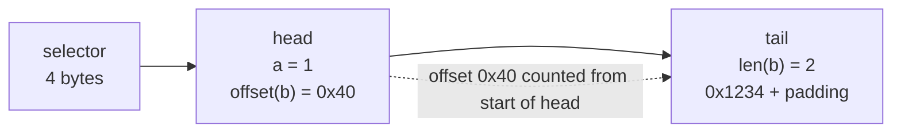

# 2.5 ABI encoding and decoding

> [!abstract] In one minute
> - A **function selector** is the first 4 bytes of `keccak256` of the canonical signature: function name, then parameter types in canonical form (`uint256`, not `uint`; structs as tuples `(address,uint256[])`), comma-separated, no spaces, no names, no return types. `transfer(address,uint256)` → `0xa9059cbb`.
> - Arguments are encoded as a **tuple** of 32-byte words. **Static** types sit in the head in place. **Dynamic** types (`bytes`, `string`, `T[]`, and any tuple or fixed array that contains one) put an **offset** in the head and their data in the tail. Every offset is measured from the start of the tuple that encloses it, never from the start of calldata.
> - `abi.encode` is the standard encoding. `abi.encodePacked` concatenates without padding or lengths: it is ambiguous (`("a","bc")` and `("ab","c")` give the same bytes) and has no decoder. `abi.encodeCall` (0.8.11) is the only call builder the compiler type-checks.
> - ABI coder v2 (default since 0.8.0) validates inputs: short calldata, out-of-bounds offsets and lengths, and values that do not fit narrow types (`uint8`, `address`, `bool`, `enum`, `bytesN`, signed sign-extension) all revert **with empty data**, never a Panic. It does not enforce canonical ("strict") encoding, does not reject trailing bytes, and checks `calldata` array elements only when you read them.
> - Revert data uses the same encoding: `Error(string)` = `0x08c379a0` + `abi.encode(reason)`, `Panic(uint256)` = `0x4e487b71` + code (`0x01` assert, `0x11` overflow, `0x12` divide by zero, `0x21` bad enum, `0x32` index out of bounds).
> - Selectors are only 32 bits. Any-pair collisions take about 2^16 hashes; hitting a chosen selector takes about 2^32. Solc rejects collisions inside one contract, but not between a proxy and its implementation, across diamond facets, or in routers that authorize by selector (Poly Network, Aug 2021).

**Prerequisites:** [[1.6 Calldata, returndata and logs]], [[2.1 Types]], [[2.2 Data locations]] · **Leads to:** [[2.8 Errors and reverts]], [[3.8 ABI, errors and events by hand]], [[3.9 Cleanup, dirty bits and safety]], [[5.9 Proxies, delegatecall and storage]]

All encodings, selectors and decoder behaviours in this note were produced by compiling with solc-js 0.8.38 (`--optimize`, legacy and via-IR) and running the bytecode in py-evm (Prague rules), or by hashing with `eth-hash`. Both pipelines gave identical results in every test.

## Why an ABI exists

[[1.6 Calldata, returndata and logs|Calldata]] is a flat byte array. The EVM gives it no structure: `CALLDATALOAD(i)` reads 32 bytes at `i` and pads with zeros past the end. Something has to tell the callee which function the caller wants and where each argument lives. That something is the **Contract Application Binary Interface (ABI)**. It is a convention, enforced by compilers and client libraries, not by the protocol.

The ABI answers four questions:

1. **Which function?** The first 4 bytes, the selector.
2. **Where is each argument?** A head/tail layout of 32-byte words.
3. **How is each value written?** Padding and sign rules per type.
4. **What does a failure look like?** Revert data uses the same encoding, with `Error(string)`, `Panic(uint256)` or a custom error as the "function".

The same rules encode return data, revert data, event data, and the arguments of `abi.encode`. Learn the tuple encoding once and you can read all of them.

## Function selectors

### The rule

```text
selector = bytes4(keccak256("name(type1,type2,...)"))
```

The string inside is the **canonical signature**:

- The function name, then the parameter types in parentheses.
- Types in **canonical** form: `uint256`, `int256`, never the aliases `uint` / `int`.
- A single comma between types. **No spaces.** **No parameter names.** **No data locations** (`memory`, `calldata`).
- **Return types are excluded.** That is why Solidity cannot overload on return type alone.

The hash is sensitive to every byte, so a sloppy signature is a different function:

| String hashed | Selector | Note |
|---|---|---|
| `transfer(address,uint256)` | `0xa9059cbb` | Correct: the ERC-20 `transfer` |
| `transfer(address,uint)` | `0x6cb927d8` | Alias not expanded: a function nobody implements |
| `transfer(address, uint256)` | `0x9d61d234` | One space breaks it |
| `f(uint256,bytes)` | `0xcdc9dc79` | Used in the worked examples below |
| `Error(string)` | `0x08c379a0` | Revert reason |
| `Panic(uint256)` | `0x4e487b71` | Compiler-inserted failure |

(All computed with `eth_hash.auto.keccak`.)

### Solidity types to ABI types

The canonical signature uses **ABI types**, which are not always the Solidity type you wrote. Verified from `evm.methodIdentifiers` in 0.8.38:

| Solidity type | ABI type in the signature | Example from the compiler |
|---|---|---|
| `uint`, `int` | `uint256`, `int256` | `shortName(uint256,int256,(uint8))` |
| `address payable` | `address` | `oracle(address,address,uint128)` |
| Contract or interface type (`IOracle`) | `address` | same |
| User-defined value type (`type Price is uint128`) | Underlying type, `uint128` | same |
| `enum` | `uint8` (for up to 256 members) | `place(...,uint8)` |
| `struct Order { address maker; uint256[] amounts; bytes sig; }` | Tuple `(address,uint256[],bytes)` | `place((address,uint256[],bytes),uint8)` |
| Fixed array, nested dynamic array | `uint256[3]`, `bytes32[][]` | `grid(uint256[3],bytes32[][])` |
| External function type | `function` (encoded as `bytes24`: address then selector) | `cb(function)` |

> [!info]- Deep dive: library selectors are not canonical
> External functions of a **library** are called with `DELEGATECALL` and may take `storage` references, which the ABI cannot express. So solc builds library selectors from internal type names. Verified:
>
> ```text
> libStorage(L.S storage,L.K)   0xe0a57e8d
> libMem(L.S,IOracle)           0x6b939a58
> ```
>
> A struct becomes `L.S` (not a tuple), an enum keeps its name `L.K` (not `uint8`), a storage pointer gets the suffix ` storage`, and an interface keeps its name. If you call a deployed library from off-chain tooling, take the selector from the compiler output, not from a canonical-signature hasher. More in [[2.7 Inheritance, interfaces and libraries]].

### Getting selectors in code

| Expression | Value | Notes |
|---|---|---|
| `this.f.selector`, `C.f.selector`, `I.f.selector` | `bytes4` | Compile-time constant |
| `msg.sig` | first 4 bytes of calldata | Whatever the caller sent |
| `E.selector` for an event | `bytes32` topic0 | Since 0.8.15 |
| `MyError.selector` | `bytes4` | Custom errors, see [[2.8 Errors and reverts]] |
| `bytes4(keccak256("f(uint256)"))` | `bytes4` | Works, but a typo is silent |

In assembly the dispatcher reads `shr(224, calldataload(0))`: load 32 bytes at offset 0 and shift right by 224 bits, leaving the top 4 bytes. If calldata is shorter than 4 bytes, the missing bytes read as zero ([[1.6 Calldata, returndata and logs]]). Solidity's dispatcher checks `calldatasize() < 4` first and goes straight to `fallback` (or reverts). Verified: 3 bytes of calldata to a contract with no fallback reverts with empty data.

## Static and dynamic types

The whole encoding hangs on one distinction.

| Static (fixed size, encoded in place) | Dynamic (size known only at run time) |
|---|---|
| `uintN`, `intN`, `address`, `bool`, `bytesN` (1–32), `enum`, `function` | `bytes`, `string` |
| `T[k]` when `T` is static (`uint256[3]`) | `T[]` for any `T` |
| Tuples (structs) whose members are all static | `T[k]` when `T` is dynamic (`string[2]`, `bytes[3]`) |
| | Tuples with at least one dynamic member |

The rule is recursive: **a container is dynamic if anything inside it is dynamic**. `string[2]` has a fixed element count but is dynamic, because each string is.

Static values take `32 * (number of words)` bytes in the head. A `uint256[3]` takes 96 bytes of head. A static struct `Pair { uint256 a; address b; }` takes 64. Each dynamic value takes exactly one word of head (its offset), whatever its size.

## Head/tail encoding

### The formal rule, in words

To encode a tuple `(X1, ..., Xk)`:

1. Lay out a **head** with one slot per element. A static element writes its encoding directly. A dynamic element writes a 32-byte **offset**.
2. After the head, append the **tail**: the encodings of the dynamic elements, in order.
3. Each offset is the distance in bytes **from the start of this tuple's encoding** to the start of that element's tail.

The ABI spec says: "The value of `head(X(i))` is the offset of the beginning of `tail(X(i))` relative to the start of `enc(X)`."

Then, per dynamic type:

| Type | Encoding |
|---|---|
| `bytes`, `string` | Length word (number of bytes), then the content, **right-padded** with zeros to a multiple of 32 |
| `T[]` (dynamic array) | Length word (number of elements), then the elements encoded **as if they were a k-element tuple** |
| `T[k]` with dynamic `T` | No length word. The elements encoded as a k-element tuple |
| Tuple with dynamic members | Head/tail, recursively |

The phrase "as if they were a tuple" is the trap. For `T[]`, element offsets are relative to the **first word after the length**, not to the length word and not to the start of calldata.

For function calls, the argument list is one tuple, and calldata is `selector ++ enc(args)`. So offsets in calldata are relative to **byte 4**, the first byte after the selector. Return data and `abi.encode` have no selector, so offsets start from byte 0.



### Padding rules per type

Every value fills whole 32-byte words. Verified from `abi.encode(uint8(1), int8(-1), bytes3(0xabcdef), true, address(0xBEEF), Pair(7, address(0xCAFE)))`:

```text
0x000  0000000000000000000000000000000000000000000000000000000000000001  uint8 1: left-padded with zeros
0x020  ffffffffffffffffffffffffffffffffffffffffffffffffffffffffffffffff  int8 -1: sign-extended
0x040  abcdef0000000000000000000000000000000000000000000000000000000000  bytes3: right-padded
0x060  0000000000000000000000000000000000000000000000000000000000000001  bool true: 1
0x080  000000000000000000000000000000000000000000000000000000000000beef  address: left-padded, 12 zero bytes
0x0a0  0000000000000000000000000000000000000000000000000000000000000007  Pair.a  (static struct, in place)
0x0c0  000000000000000000000000000000000000000000000000000000000000cafe  Pair.b
```

| Type | Padding |
|---|---|
| `uintN`, `enum` | Left, with zeros |
| `intN` | Left, by sign extension (`0xff…` for negatives) |
| `address`, contract types | Left, 12 zero bytes, then 20 bytes |
| `bool` | `0` or `1`, left-padded |
| `bytesN` | **Right**, with zeros |
| `function` | 24 bytes (address then selector), right-padded |
| `bytes`, `string` content | Right, to the next multiple of 32; no padding if already a multiple (an empty value is just the length word `0`) |

The mnemonic: **numbers pad left, byte strings pad right.** A number's least significant byte ends the word. A byte string starts the word, as you would read it.

### Example: a dynamic struct

`abi.encode(uint256(7), Order(address(0xBEEF), [9], hex"abcd"))`, verified:

```text
0x000  ...0007   7
0x020  ...0040   offset of Order, from 0x000          -> Order starts at 0x040
0x040  ...beef   Order.maker                          (Order's own head starts here)
0x060  ...0060   offset of amounts, from 0x040        -> 0x0a0
0x080  ...00a0   offset of sig, from 0x040            -> 0x0e0
0x0a0  ...0001   amounts.length
0x0c0  ...0009   amounts[0]
0x0e0  ...0002   sig.length
0x100  abcd00..  sig content, right-padded
```

Inside `Order`, the offsets `0x60` and `0xa0` are counted from `0x040`, where `Order` begins. That is "relative to the enclosing tuple".

### Example: a fixed-size array of dynamic values

`abi.encode(uint256[2] [1, 2], string[2] ["a", "b"])`, verified:

```text
0x000  ...0001   st[0]   uint256[2] is static: inline, no offset, no length
0x020  ...0002   st[1]
0x040  ...0060   offset of s (string[2] is dynamic) -> 0x060
0x060  ...0040   offset of s[0], from 0x060 -> 0x0a0   (no length word: the size is fixed)
0x080  ...0080   offset of s[1], from 0x060 -> 0x0e0
0x0a0  ...0001   s[0].length
0x0c0  6100..    "a"
0x0e0  ...0001   s[1].length
0x100  6200..    "b"
```

### Canonical ("strict") encoding

Solidity's encoder always produces the canonical form: tails in the same order as their heads, no gaps, no overlap, offsets as small as possible. The ABI spec calls this **strict mode** and says: "The Solidity ABI decoder currently does not enforce strict mode, but the encoder always creates data in strict mode." So many byte strings decode to the same values. This matters for hashing and signatures; see [[#Decoder validation]].

## The encoding functions

| Function | Since | Output | Type-checked against a function? | Decodable with `abi.decode`? |
|---|---|---|---|---|
| `abi.encode(...)` | 0.4.22 | Standard tuple encoding | No | Yes |
| `abi.encodePacked(...)` | 0.4.22 | Non-standard packed bytes | No | No (ambiguous) |
| `abi.encodeWithSelector(bytes4, ...)` | 0.4.22 | `selector ++ abi.encode(...)` | No | Yes, after stripping 4 bytes |
| `abi.encodeWithSignature(string, ...)` | 0.4.22 | `bytes4(keccak256(sig)) ++ abi.encode(...)` | No, and the string is not checked either | Same |
| `abi.encodeCall(fn, (...))` | 0.8.11 (`Contract.fn` form 0.8.12) | `fn.selector ++ abi.encode(...)` | **Yes**: count and types | Same |
| `bytes.concat(...)` | 0.8.4 | Concatenation of `bytes` / `bytesN` | n/a | No |
| `string.concat(...)` | 0.8.12 (fixed then) | Concatenation of strings | n/a | No |
| `abi.decode(bytes, (T1, ...))` | 0.5.0 | Values | n/a | It is the decoder |

Dates: 0.4.22 was released 16 Apr 2018, 0.5.0 on 13 Nov 2018, 0.8.4 on 21 Apr 2021, 0.8.11 on 20 Dec 2021, 0.8.12 on 16 Feb 2022 (Solidity changelog).

### Three ways to build the same call

All three produced the identical 132 bytes for `f(1, hex"1234")`:

```solidity
abi.encodeCall(this.f, (1, hex"1234"));
abi.encodeWithSelector(this.f.selector, uint256(1), hex"1234");
abi.encodeWithSignature("f(uint256,bytes)", uint256(1), hex"1234");
```

They fail differently when you make a mistake:

- `abi.encodeWithSignature("transfer(address,uint)", to, 5)` compiled and produced selector `0x6cb927d8`. The target has no such function. The call goes to `fallback` or reverts with no reason.
- `abi.encodeWithSignature("f(uint256)", 1, 2, 3)` compiled without a warning. It appends three words where the callee reads one. The callee ignores trailing bytes, so the extra arguments disappear silently.
- `abi.encodeWithSelector(I.f.selector, ...)` gets the selector right but does not check arguments. Passing a `uint128` where `f` wants an `address` compiles.
- `abi.encodeCall(IToken.transfer, (to, "5"))` is a compile error:

```text
TypeError: Cannot implicitly convert component at position 1 from "literal_string "5"" to "uint256".
```

> [!tip] Default to `abi.encodeCall`
> Use `abi.encodeCall` for every low-level call, `delegatecall` payload, multicall entry and proxy initializer whose target interface you know. Keep `encodeWithSelector` for selectors you only have as data, and avoid `encodeWithSignature` outside scripts.

### Packed mode and its collisions

`abi.encodePacked` is a different format. The ABI spec calls it the **non-standard packed mode**:

- Value types shorter than 32 bytes are concatenated with **no padding and no sign extension**: `int8(-1)` is one byte `ff`.
- `bytes` and `string` are written raw, **without a length** and without padding.
- **Array elements are padded to 32 bytes** each, still without a length.
- Structs and nested arrays are not supported. `abi.encodePacked(new uint256[][](1))` and `abi.encodePacked(P(1))` both fail with `TypeError: Type not supported in packed mode.`

Verified outputs:

```text
abi.encodePacked(uint8(1), int8(-1), uint16(0x0203), bytes3(0x0a0b0c), true, address(0xBEEF), "hi")
  = 01 ff 0203 0a0b0c 01 000000000000000000000000000000000000beef 6869     (30 bytes)

abi.encodePacked(uint8[] [1, 2])
  = 0000…0001 0000…0002                                                     (64 bytes: elements padded)

abi.encodePacked("a", "bc") = 616263
abi.encodePacked("ab", "c") = 616263          keccak256 equal: true

abi.encodePacked(address[] [0xAA], address[] [])  = 0000…00aa
abi.encodePacked(address[] [], address[] [0xAA])  = 0000…00aa              (32 bytes each: same)
```

The collision comes from the missing length fields. With two dynamic arguments next to each other, bytes can move from one to the other without changing the output. The spec's rule: if you hash packed data for signatures, authentication or integrity, use the same types every time and **at most one dynamic argument**. Otherwise use `abi.encode`.

> [!warning] Packed hashes as keys and signed messages
> `keccak256(abi.encodePacked(name, symbol))` as a registry key lets `("ab","c")` and `("a","bc")` share an entry. `keccak256(abi.encodePacked(addrs, amounts))` over two arrays lets an attacker shift an element from one array to the other under the same signature. Use `abi.encode`, or EIP-712 typed data ([[5.8 Signatures and replay]]).

`bytes.concat(a, b, ...)` and `string.concat(...)` are restricted, honestly named versions of packed mode for byte strings. They accept only `bytes`, `bytesNN`, and literals (`string` for `string.concat`). Verified: `bytes.concat(bytes2(0x1234), hex"56", "ab")` = `0x1234566162`, `string.concat("ab","c")` = `"abc"`. They are what you want for building strings and byte blobs. They have the same ambiguity if hashed.

### abi.decode

`abi.decode(data, (uint256, address, bytes))` runs the same decoder as external function parameters, over memory. It is strict about bounds and value ranges and lax about canonical form, exactly like the calldata decoder. See the next section.

## Decoder validation

ABI coder v2 has been the default since 0.8.0 (16 Dec 2020). You can still select v1 with `pragma abicoder v1;`, but 0.8.38 warns "ABI coder v1 is deprecated and scheduled for removal". Everything below is v2 unless marked. The checks run in three places: external function parameters, `abi.decode`, and the return data of high-level external calls.

### What is checked (verified)

I compiled a `Decoder` contract and sent hand-built calldata in py-evm. Legacy and via-IR behaved the same.

| Input | Parameter type | Result |
|---|---|---|
| `0x…0100` | `uint8` | Revert, empty data |
| Non-zero top byte | `uint8` | Revert, empty |
| `0x…0080` (not sign-extended) | `int8` | Revert, empty |
| `0xff…ff` | `int8` | OK, `-1` |
| Non-zero byte in the top 12 | `address` | Revert, empty |
| `2` | `bool` | Revert, empty |
| `3` | `enum Color {Red, Green, Blue}` | Revert, **empty** (not Panic `0x21`) |
| Non-zero low 28 bytes | `bytes4` | Revert, empty |
| Selector only, or 31 bytes | `uint256` | Revert, empty |
| Offset `0x1000` past the end | `bytes calldata` | Revert, empty |
| Offset `2**64` | `bytes calldata` | Revert, empty |
| Length larger than the remaining calldata | `bytes calldata` | Revert, empty |
| Length `2**64` | `bytes calldata` | Revert, empty |
| Array length `2**63` | `uint8[] calldata` | Revert, empty |
| Dirty element | `uint8[] memory` | Revert, empty (checked while copying) |
| Inner offset out of bounds | `bytes[] memory` | Revert, empty |
| `abi.decode(d, (uint8))` with `d` = `0x…0107` | memory | Revert, empty |
| `abi.decode` of 31 bytes as `(uint8)` | memory | Revert, empty |
| `abi.decode(d, (bool))`, `(Color)`, `(address)` with bad values | memory | Revert, empty |
| `abi.decode(d, (bytes))` with offset or length past `d.length` | memory | Revert, empty |
| High-level call to `transfer` that returns `2`, nothing, or 31 bytes, decoded as `bool` | return data | Revert, empty |

The pattern: **every decoder failure is a bare `revert(0, 0)`**. There is no `Error(string)` and no `Panic`. A Panic `0x21` happens only on an explicit conversion like `Color(x)` in your code (verified), never in the decoder.

ABI coder v1 is different, which matters when you audit old code. Verified on 0.8.38 with `pragma abicoder v1`:

| Input | v2 | v1 |
|---|---|---|
| `uint8` = `0x107` | Revert, empty | Accepted, **silently masked to 7** |
| Dirty `address` | Revert, empty | Accepted, masked |
| `bool` = `2` | Revert, empty | Accepted as `true` |
| `enum` = `3` | Revert, empty | Panic `0x21` |

### What is left unchecked (verified)

| Input | Result | Why it matters |
|---|---|---|
| 33 bytes for a `uint256` param (one trailing byte) | Accepted | Trailing data is allowed. ERC-2771 relies on it; hashes of `msg.data` are malleable |
| `bytes` offset `0` (points at its own offset word, read as length 0) | Accepted, empty `bytes` | Non-canonical offsets decode |
| `bytes` offset `0x21` (not a multiple of 32) | Accepted | Alignment is not checked |
| Two `bytes` params whose offsets point to the **same** tail | Accepted, both equal | Aliasing is allowed |
| `bytes` content with dirty padding bytes after it | Accepted (calldata and memory) | Padding is not checked |
| `bytes` of length 2 with the final padding word missing | Accepted | The decoder checks `offset + 32 + length <= size`, not padding |
| Dirty element in `uint8[] calldata`, reading `xs.length` or a clean element | Accepted | Calldata arrays are **lazily** validated |
| Same array, reading the dirty element | Revert, empty | Validation happens at access |
| Out-of-bounds inner offset in `bytes[] calldata`, reading `xs.length` | Accepted | Same laziness |
| Same, reading `xs[0].length` | Revert, empty | |
| Semantic values: zero address, amount ranges, array lengths that match | Never checked | Your `require`s |

The key insight: **decoding is a function, not a bijection.** Many byte strings map to the same values. Anything that hashes or signs raw calldata (`keccak256(msg.data)` as a request ID, a signature over packed calldata) can be replayed with a different byte string that decodes identically. Sign and hash the **decoded values** (EIP-712) instead.

> [!note] Lazy calldata validation is a feature
> For a `bytes[] calldata` or `uint8[] calldata` parameter, the decoder checks only the outer offset and length up front. Element values and inner offsets are checked when your code reads them. That is why calldata parameters are cheap. It also means a function that forwards `xs` untouched (for example `abi.encodeCall(target.g, (xs))`) may forward bytes it never validated. The re-encoder reads the elements and so validates them, but a raw `msg.data[4:]` forward does not.

## Revert data on the wire

Revert data is encoded **as if it were a call** to a function named after the error. The full treatment of `require`, `revert`, custom errors and `try/catch` is in [[2.8 Errors and reverts]]; here is the byte level.

### Error(string)

`revert("Nope")` produced 100 bytes:

```text
08c379a0                                                          selector of Error(string)
0000000000000000000000000000000000000000000000000000000000000020  offset of reason (from byte 4)
0000000000000000000000000000000000000000000000000000000000000004  reason.length = 4
4e6f706500000000000000000000000000000000000000000000000000000000  "Nope", right-padded
```

`require(x > 10, "x too small")` gives the same shape with length `0x0b`. Size is `4 + 32 + 32 + 32 * ceil(len / 32)`, so 100 bytes for any reason of 1 to 32 bytes (68 bytes for an empty string).

### Panic(uint256)

Always 36 bytes: selector `4e487b71` and one word with the code. Codes verified by running are marked.

| Code | Cause | Verified |
|---|---|---|
| `0x00` | Generic compiler-inserted panic | docs |
| `0x01` | `assert(false)` | run |
| `0x11` | Arithmetic overflow or underflow outside `unchecked` (`uint8(255) + 1`) | run |
| `0x12` | Division or modulo by zero | run |
| `0x21` | Converting an out-of-range value to an enum (`Color(3)`) | run |
| `0x22` | Reading an incorrectly encoded storage byte array | docs |
| `0x31` | `.pop()` on an empty array | docs |
| `0x32` | Array, `bytesN` or slice index out of bounds | run |
| `0x41` | Allocating too much memory or too large an array | docs |
| `0x51` | Calling a zero-initialized internal function pointer | docs |

```text
4e487b71
0000000000000000000000000000000000000000000000000000000000000011     overflow
```

### Custom errors and empty reverts

`error InsufficientBalance(uint256 have, uint256 want); revert InsufficientBalance(1, 2);` produced `cf479181` followed by two words, 68 bytes in total. A bare `revert()`, `require(cond)` without a message, and every decoder failure produce **zero bytes** of revert data.

> [!warning] Never trust error data
> Revert data bubbles up through call chains, so you can receive an error from a contract you never called directly. Any contract can return bytes that look like `Error(string)`, `Panic(uint256)` or your own custom error. The ABI spec says it plainly: "Never trust error data." Use error data for display and coarse routing, not for decisions that move funds.

## Event encoding (brief)

Events reuse the tuple encoding for their **non-indexed** parameters. The log mechanics, gas and the in-place encoding of indexed dynamic types are in [[1.6 Calldata, returndata and logs]]. Verified on a compiled contract:

```text
event Filled(address indexed maker, uint256 indexed id, string note);
emit Filled(address(0xBEEF), 7, "hi");

topic0 = keccak256("Filled(address,uint256,string)") = 0x9096037b3091e46b540bb886319a68b34cbb4f762f8f99569a983b07d0a82b7e
topic1 = 0x…beef           indexed value type: padded like an argument
topic2 = 0x…07
data   = 0x…20 | 0x…02 | 6869…   abi.encode(note): offset, length, content

event Tagged(string indexed tag, uint256 amount);
emit Tagged("hi", 5);

topic1 = keccak256("hi") = 0x7624778dedc75f8b322b9fa1632a610d40b85e106c7d9bf0e743a9ce291b9c6f
data   = 0x…05
```

Two rules to remember. Topic0 is the full 32-byte hash of the canonical event signature, not a 4-byte selector. An indexed `string`, `bytes`, array or struct is stored as a keccak256 hash, so the value is gone from the log; emit it again as a non-indexed parameter if consumers need it.

## The JSON ABI

The compiler also emits a **JSON ABI**: a machine-readable list of every function, event, error, constructor, `fallback` and `receive`. Client libraries (ethers, viem, web3.py), explorers and wallets use it to build calldata and decode results. It is not stored on-chain. Excerpt from 0.8.38 for the `Canon` contract:

```json
[
  {
    "type": "function", "name": "place", "stateMutability": "nonpayable", "outputs": [],
    "inputs": [
      { "name": "o", "type": "tuple", "internalType": "struct Canon.Order",
        "components": [
          { "name": "maker",   "type": "address",   "internalType": "address" },
          { "name": "amounts", "type": "uint256[]", "internalType": "uint256[]" },
          { "name": "sig",     "type": "bytes",     "internalType": "bytes" }
        ] },
      { "name": "s", "type": "uint8", "internalType": "enum Canon.Side" }
    ]
  },
  {
    "type": "event", "name": "Filled", "anonymous": false,
    "inputs": [
      { "name": "maker", "type": "address", "indexed": true,  "internalType": "address" },
      { "name": "id",    "type": "uint256", "indexed": true,  "internalType": "uint256" },
      { "name": "note",  "type": "string",  "indexed": false, "internalType": "string" }
    ]
  },
  {
    "type": "error", "name": "BadSide",
    "inputs": [ { "name": "side", "type": "uint8", "internalType": "enum Canon.Side" } ]
  }
]
```

(Reformatted for width; field values are exactly what the compiler produced.)

How to read it:

- `type` is the **ABI type**, the one that goes into the selector and the encoding. `internalType` is the Solidity type, for display and code generation only. The enum is `uint8` on the wire; `enum Canon.Side` is a hint.
- A struct is `"type": "tuple"` with `components`. Arrays of structs are `"tuple[]"`. Tools rebuild the canonical signature `place((address,uint256[],bytes),uint8)` from this.
- Events carry `indexed` per input and an `anonymous` flag. Errors look like functions without outputs.
- Parameter names are in the JSON but not in the selector. Renaming a parameter changes nothing on-chain; renaming a function or changing a type changes the selector.

## Solidity and Yul in practice

### Building, catching and forwarding calls

Compiles with 0.8.38. Verified in py-evm, both pipelines: `tryDeposit` emitted kind `1` with reason `"closed"`, kind `2` with code `0x12`, and kind `3` with the raw custom error `0x9e87fac8` (`Paused()`) for the three failure modes; `forward` re-threw the `Error("closed")` bytes unchanged.

```solidity
// SPDX-License-Identifier: MIT
pragma solidity ^0.8.38;

interface IVault {
    function deposit(uint256 assets, address receiver) external returns (uint256 shares);
}

contract Caller {
    event Failed(uint8 kind, uint256 code, string reason, bytes raw);

    // Type-checked calldata: wrong types or arity are compile errors.
    function depositData(uint256 assets) external view returns (bytes memory) {
        return abi.encodeCall(IVault.deposit, (assets, msg.sender));
    }

    // Classify a failure by its revert data.
    function tryDeposit(IVault v, uint256 assets) external returns (uint256) {
        try v.deposit(assets, msg.sender) returns (uint256 shares) {
            return shares;
        } catch Error(string memory reason) {        // selector 0x08c379a0
            emit Failed(1, 0, reason, "");
        } catch Panic(uint256 code) {                // selector 0x4e487b71
            emit Failed(2, code, "", "");
        } catch (bytes memory raw) {                 // custom error, empty data, or junk
            emit Failed(3, 0, "", raw);
        }
        return 0;
    }

    // Forward a call and re-throw the callee's revert data unchanged.
    function forward(address target, bytes calldata data) external returns (bytes memory) {
        (bool ok, bytes memory ret) = target.call(data);
        if (!ok) {
            assembly ("memory-safe") {
                revert(add(ret, 0x20), mload(ret))   // skip the length word, revert with the bytes
            }
        }
        return ret;
    }

    // Read the selector of revert data without decoding the rest.
    function errorSelector(bytes memory ret) external pure returns (bytes4 sel) {
        if (ret.length >= 4) sel = bytes4(ret);
    }
}

contract BadVault is IVault {
    error Paused();
    uint256 public mode;
    function setMode(uint256 m) external { mode = m; }
    function deposit(uint256 assets, address) external view returns (uint256) {
        if (mode == 1) revert("closed");
        if (mode == 2) return assets / 0 + 1;
        if (mode == 3) revert Paused();
        return assets;
    }
}
```

Points to notice:

- `try/catch` dispatches on the first 4 bytes of revert data. `catch (bytes memory raw)` gets everything else, including empty data from a decoder failure in the callee. Per the Solidity docs, if the **success** return data fails to decode, the error is not caught; your own frame reverts.
- In `forward`, `ret` is a `bytes memory`: a length word, then content. `add(ret, 0x20)` points at the content. This is the standard bubble-up idiom; [[3.8 ABI, errors and events by hand]] builds errors and events from scratch in Yul.
- `(bool ok, bytes memory ret) = target.call(data)` copies all return data into memory. A hostile callee can make that expensive ([[1.6 Calldata, returndata and logs]], returndata bombs).

### Encoders side by side

Compiles with 0.8.38; the outputs quoted throughout this note come from this contract.

```solidity
// SPDX-License-Identifier: MIT
pragma solidity ^0.8.38;

interface IToken {
    function transfer(address to, uint256 amount) external returns (bool);
}

contract Encoders {
    function f(uint256 a, bytes calldata b) external {}

    function standard() external pure returns (bytes memory) {
        return abi.encode(uint256(1), hex"1234");             // 128 bytes, no selector
    }
    function asCall() external view returns (bytes memory) {
        return abi.encodeCall(this.f, (1, hex"1234"));       // 0xcdc9dc79 ++ standard()
    }
    function wrongSig() external pure returns (bytes memory) {
        // compiles; selector 0x6cb927d8 matches nothing
        return abi.encodeWithSignature("transfer(address,uint)", address(0xBEEF), uint256(5));
    }
    function nested() external pure returns (bytes memory) {
        bytes[] memory arr = new bytes[](2);
        arr[0] = hex"aabb";
        arr[1] = hex"0102030405060708091011121314151617181920212223242526272829303132333435";
        return abi.encode(arr);
    }
    function packedCollision() external pure returns (bool) {
        return keccak256(abi.encodePacked("a", "bc")) == keccak256(abi.encodePacked("ab", "c")); // true
    }
    function concat() external pure returns (bytes memory, string memory) {
        return (bytes.concat(bytes2(0x1234), hex"56", "ab"), string.concat("ab", "c"));
    }
    function roundTrip(bytes memory data) external pure returns (uint256 a, bytes memory b) {
        (a, b) = abi.decode(data, (uint256, bytes));          // reverts (empty) on malformed input
    }
}
```

## Pitfalls and incidents

| Date | Incident or change | What happened | Lesson |
|---|---|---|---|
| 10 Aug 2021 | Poly Network, over $610M | `EthCrossChainManager` built a selector from a user-supplied method name plus the fixed `(bytes,bytes,uint64)`. The attacker used the name `f1121318093`, whose selector `0x41973cd9` equals `putCurEpochConPubKeyBytes(bytes)` on `EthCrossChainData`. Manager owned Data, so the privileged call succeeded and the attacker installed his own keeper key | Never let users choose a selector for a privileged caller; allowlist target and selector together |
| 16 Dec 2020 | Solidity 0.8.0 | ABI coder v2 becomes the default; dirty inputs revert instead of being masked | Old v1 code silently accepted out-of-range values |
| 19 Jul 2019 | OpenZeppelin forum, "Beware of the proxy" | Demonstrated a proxy whose `collate_propagate_storage(bytes16)` shares selector `0x42966c68` with the token's `burn(uint256)`; a user calling `burn` through the proxy instead transfers 1,000 tokens to the owner | A proxy's own functions shadow the implementation's |
| 13 Nov 2018 | Solidity 0.5.0 | Decoder reverts on too-short calldata and out-of-bounds offsets, also in `abi.decode` | The short-address attack is closed at the compiler level ([[1.6 Calldata, returndata and logs]]) |
| 1 Jun 2018 | Nomic Labs, "Malicious backdoors in Ethereum proxies" | Patricio Palladino describes selector clashing as a way to hide backdoors in proxies; motivates the Transparent proxy | Review the proxy's ABI as well as the implementation's |

Other footguns:

> [!warning] Hand-computed selectors
> `bytes4(keccak256("transfer(address,uint)"))`, a stray space, or a parameter name inside the string all compile and give the wrong selector. Use `I.f.selector` or `abi.encodeCall`. In tests, assert selectors against `forge inspect` / `methodIdentifiers` output.

> [!warning] Mismatched return types
> The selector ignores return types, so an interface that declares `returns (bool)` will happily call a token whose `transfer` returns nothing. The high-level call then reverts in the decoder (verified: empty, 31-byte and `2` return data all revert). This is why USDT-style tokens need `SafeERC20` ([[5.10 Token integration]]).

> [!warning] Hashing `msg.data`
> Because the decoder accepts non-canonical encodings and trailing bytes, `keccak256(msg.data)` is not a unique identifier of the decoded call. Dedup keys, meta-transaction IDs and signatures should cover `abi.encode` of the decoded arguments (or EIP-712 structs).

> [!warning] Off-chain selector lookups
> Explorers and wallets often name a function by looking up its 4 bytes in a public signature database. Those databases contain many colliding entries (`transferFrom(address,address,uint256)` and `gasprice_bit_ether(int128)` are both `0x23b872dd`). A phishing contract can expose a function whose selector decodes as something harmless. Verify against the contract's verified source, not the 4-byte name.

## Question ladder

> [!question]- **B** How is a function selector computed? Why must you write `uint256` rather than `uint`?
> Take the function's **canonical signature**: its name, then its parameter types in parentheses, separated by single commas, with no spaces, no parameter names, no data locations, and no return types. Hash it with keccak256 and keep the first 4 bytes. For ERC-20 `transfer`: `keccak256("transfer(address,uint256)")` starts with `a9059cbb`, so calldata starts `0xa9059cbb`.
>
> "Canonical" means every type is written in its ABI form. `uint` and `int` are Solidity aliases; the ABI only knows `uint256` and `int256`. Structs become tuples (`(address,uint256[],bytes)`), enums become `uint8`, contracts and `address payable` become `address`, and user-defined value types become their underlying type.
>
> The hash does not understand any of that. It just hashes bytes. So `keccak256("transfer(address,uint)")` gives `0x6cb927d8`, a function that no ERC-20 implements. The compiler normalizes types when it computes `I.transfer.selector`, but it does **not** normalize the string you pass to `abi.encodeWithSignature`. A call built with `"transfer(address,uint)"` compiles, sends the wrong selector, and lands in the target's `fallback` or reverts with no reason. The same goes for a stray space (`0x9d61d234`).
>
> In practice: get selectors from `I.f.selector` or build calls with `abi.encodeCall`, and only hash strings yourself in tooling where you test the output.

> [!question]- **I** Encode `f(uint256 a, bytes b)` by hand for given arguments.
> Take `a = 1`, `b = 0x1234`.
>
> **Step 1: selector.** `keccak256("f(uint256,bytes)")` starts `cdc9dc79`.
>
> **Step 2: head.** The arguments are one tuple of two elements. `a` is static: it goes in place. `b` is dynamic: its head slot holds an offset. The head is two words, 64 bytes, so `b`'s tail starts right after it, at offset `0x40` **from the start of the arguments** (byte 4 of calldata, not byte 0).
>
> **Step 3: tail.** `b` is encoded as its length (2) and its content right-padded to 32 bytes.
>
> ```text
> calldata    args
> offset      offset
> 0x00        -       cdc9dc79                                                          selector
> 0x04        0x00    0000000000000000000000000000000000000000000000000000000000000001  a = 1
> 0x24        0x20    0000000000000000000000000000000000000000000000000000000000000040  offset of b = 0x40
> 0x44        0x40    0000000000000000000000000000000000000000000000000000000000000002  b.length = 2
> 0x64        0x60    1234000000000000000000000000000000000000000000000000000000000000  b content, right-padded
> ```
>
> Total: 4 + 4 × 32 = 132 bytes. Verified: `abi.encodeCall(this.f, (1, hex"1234"))`, `abi.encodeWithSelector` and `abi.encodeWithSignature("f(uint256,bytes)", ...)` all produced exactly these 132 bytes, and `abi.encode(uint256(1), hex"1234")` produced the last 128.
>
> Checks an interviewer looks for: `1` is left-padded, `0x1234` is right-padded; the offset is `0x40`, not `0x44`; the padding fills the last word fully. If `b` were 33 bytes, the tail would be the length word plus two content words (96 bytes), and the total 164 bytes.

> [!question]- **I** What do `Error(string)` and `Panic(uint256)` revert data look like on the wire?
> Both are encoded exactly like calldata for a function of that name: selector, then the ABI-encoded arguments.
>
> **`Error(string)`**, from `revert("Nope")` or `require(cond, "Nope")`. Selector `0x08c379a0`. The single argument is dynamic, so: offset `0x20`, length, padded content. Verified output, 100 bytes:
>
> ```text
> 08c379a0
> 0000000000000000000000000000000000000000000000000000000000000020   offset of the string
> 0000000000000000000000000000000000000000000000000000000000000004   length 4
> 4e6f706500000000000000000000000000000000000000000000000000000000   "Nope"
> ```
>
> **`Panic(uint256)`**, inserted by the compiler for "should never happen" failures. Selector `0x4e487b71`, then one static word with the code, 36 bytes. Verified by running: `assert(false)` → `0x01`, `uint8(255) + 1` → `0x11`, `1 / 0` → `0x12`, `Color(3)` → `0x21`, `new uint256[](1)[5]` → `0x32`.
>
> ```text
> 4e487b71
> 0000000000000000000000000000000000000000000000000000000000000011   arithmetic overflow
> ```
>
> Two more shapes complete the picture. A custom error `InsufficientBalance(1, 2)` is its own selector (`0xcf479181`) plus `abi.encode(1, 2)`, 68 bytes. A bare `revert()`, `require(cond)` with no message, or any ABI decoder failure is **empty**: zero bytes.
>
> To decode off-chain or in `catch (bytes memory raw)`: read the first 4 bytes; if `08c379a0`, `abi.decode(raw[4:], (string))`; if `4e487b71`, `abi.decode(raw[4:], (uint256))`; otherwise match against known custom errors. Remember that any callee can forge any of these.

> [!question]- **A** Encode a nested dynamic array, such as `bytes[]`, showing every offset.
> Call `g(bytes[] xs)` with `xs = [0xaabb, 0x0102…35]`, where the second element is 35 bytes (more than one word). Selector: `keccak256("g(bytes[])")` → `ec259696`.
>
> There are **three levels** of tuple, and each level counts its offsets from its own start:
>
> 1. The argument tuple `(xs)`, starting at args offset `0x000`.
> 2. The array `xs`: a length word, then its elements encoded **as a 2-tuple** starting at args offset `0x040` (the word after the length).
> 3. Each `bytes` element: a length word and padded content.
>
> Verified output of `abi.encode(xs)` (the arguments part of calldata; add 4 to get calldata positions):
>
> ```text
> args   word                                                               meaning
> 0x000  0000000000000000000000000000000000000000000000000000000000000020   offset of xs, from 0x000 -> 0x020
> 0x020  0000000000000000000000000000000000000000000000000000000000000002   xs.length = 2
> 0x040  0000000000000000000000000000000000000000000000000000000000000040   offset of xs[0], from 0x040 -> 0x080
> 0x060  0000000000000000000000000000000000000000000000000000000000000080   offset of xs[1], from 0x040 -> 0x0c0
> 0x080  0000000000000000000000000000000000000000000000000000000000000002   xs[0].length = 2
> 0x0a0  aabb000000000000000000000000000000000000000000000000000000000000   xs[0] content
> 0x0c0  0000000000000000000000000000000000000000000000000000000000000023   xs[1].length = 35
> 0x0e0  0102030405060708091011121314151617181920212223242526272829303132   xs[1] bytes 0..31
> 0x100  3334350000000000000000000000000000000000000000000000000000000000   xs[1] bytes 32..34, padded
> ```
>
> 288 bytes of arguments, 292 bytes of calldata.
>
> How to derive the offsets:
>
> - The element head area has two words (`0x040`–`0x07f`). `xs[0]`'s tail starts right after it: `0x080 - 0x040 = 0x40`.
> - `xs[0]` takes 64 bytes (length + one padded word), so `xs[1]` starts at `0x0c0`: `0x0c0 - 0x040 = 0x80`.
>
> The classic mistakes: counting element offsets from the length word (you would write `0x60` and `0xa0`), from the start of calldata (forgetting the selector), or from the start of the arguments (`0x80` and `0xc0`). A decoder makes the same calculation: `CALLDATALOAD(4 + 0x40 + offset_i)` gives the length of element `i`.
>
> Contrast with a fixed `string[2]`: there is no length word, so the element offsets count from the first word of the array itself (verified in [[#Example: a fixed-size array of dynamic values]]). And a `uint256[2][]` has static elements, so they are inline with no inner offsets at all.

> [!question]- **A** What does `abi.decode` validate, and what does it leave unchecked?
> `abi.decode`, external parameters and high-level call return data all use the ABI coder v2 decoder (default since 0.8.0). I tested it by sending malformed inputs to a compiled 0.8.38 contract in py-evm, both pipelines.
>
> **It validates bounds:**
> - The data is at least as long as the static head. 31 bytes decoded as `(uint8)` reverts; one word decoded as `(uint256, uint256)` reverts.
> - Every offset and every length stays inside the buffer, and neither exceeds 2^64. Offset `0x1000`, offset `2**64`, length past the end and length `2**64` all revert.
>
> **It validates value ranges** for types narrower than a word: `uint8` with any bit above bit 7 set, `address` with a non-zero top 12 bytes, `bool` other than 0 or 1, an `enum` beyond its last member, `bytes4` with non-zero low bytes, and `int8` that is not properly sign-extended (`0x80` instead of `0xff…80`). All revert.
>
> **Every failure is an empty revert.** No `Error(string)`, no `Panic`. Even an out-of-range enum reverts empty in the decoder; Panic `0x21` comes only from an explicit `Color(x)` conversion in your code. Under the deprecated `pragma abicoder v1`, the same inputs were silently masked (`0x107` became `7`, `bool` 2 became `true`), and the enum gave Panic `0x21`.
>
> **It leaves unchecked:**
> - **Trailing bytes.** 33 bytes decode fine as `(uint256)`. Calldata can carry extra data (ERC-2771 appends the sender this way).
> - **Canonical form.** Offset `0` (aliasing its own head word as a zero length), offset `0x21` (unaligned), two `bytes` offsets pointing to the same tail, and gaps between tails all decode. The ABI spec says the Solidity decoder "does not enforce strict mode".
> - **Padding.** Dirty bytes after a `bytes` value's content are ignored; a missing final padding word is accepted as long as `offset + 32 + length` fits.
> - **Calldata arrays, until you read them.** A `uint8[] calldata` with a dirty element passes until that element is accessed; a `bytes[] calldata` with a bad inner offset passes until `xs[i]` is read. Memory decoding (`uint8[] memory`, `bytes[] memory`, `abi.decode`) copies everything and so checks everything up front.
> - **Meaning.** Zero addresses, amount limits, matching array lengths, and deadlines are your job.
>
> Why an interviewer asks: the unchecked list is where bugs live. Non-canonical encodings make `keccak256(msg.data)` malleable, so never use it as a replay key or sign raw calldata; sign decoded values with EIP-712. Lazy calldata validation means code that forwards raw slices can pass on bytes it never validated. And custom hand-written decoders in assembly ([[3.8 ABI, errors and events by hand]]) get none of these checks for free; see [[3.9 Cleanup, dirty bits and safety]].

> [!question]- **E** How would you find two function signatures with the same selector, and what does that mean for proxies and routers?
> **The search.** A selector is 32 bits of keccak256 output, so collisions are cheap. Two different problems:
>
> | Goal | Expected work | Measured here |
> |---|---|---|
> | Any two signatures that collide (birthday) | About 2^16 = 65,536 hashes (about 77,000 for a 50% chance) | Found `transfer_3691(uint256)` and `transfer_105996(uint256)`, both `0x90f8813f`, after 105,997 hashes, 1.1 s in single-core Python |
> | A signature matching a **chosen** selector (second preimage) | About 2^32 = 4.29 billion hashes | Python managed about 77,000 hashes per second per core, so about 15.5 core-hours. A 24-bit version (match `a9059c`, the first 3 bytes of `transfer`) took 42.6 million trials and 174 s on 2 cores (expected about 16.8 million; luck varies) |
>
> The method is a loop: vary the function name (`f1121318093`, `clash550254402`), keep the parameter list you need, hash, compare. A chosen target is the dangerous case because it lets you hit an existing privileged function. Native code on GPUs is orders of magnitude faster than Python, so treat a chosen 4-byte collision as something any motivated attacker can buy.
>
> **Real collisions** (all verified by hashing):
>
> | Selector | Signature A | Signature B |
> |---|---|---|
> | `0x42966c68` | `burn(uint256)` | `collate_propagate_storage(bytes16)` |
> | `0x23b872dd` | `transferFrom(address,address,uint256)` | `gasprice_bit_ether(int128)` |
> | `0x025313a2` | `proxyOwner()` | `clash550254402()` |
> | `0x41973cd9` | `putCurEpochConPubKeyBytes(bytes)` | `f1121318093(bytes,bytes,uint64)` (Poly Network) |
>
> **Within one contract**, solc refuses. Putting `burn(uint256)` and `collate_propagate_storage(bytes16)` in one contract gives:
>
> ```text
> TypeError: Function signature hash collision for collate_propagate_storage(bytes16)
> ```
>
> This covers every external function of the final contract, inherited ones included (verified: `Base` with `burn` and `Child is Base` with `collate_propagate_storage` fails with the same error). It does **not** cover two separately compiled contracts, which is exactly the situation in proxies, diamonds and routers.
>
> **Proxies.** A proxy runs its own dispatcher first. If it has an external function whose selector equals one of the implementation's, the proxy's function wins and the implementation's is unreachable through the proxy. A malicious deployer can hide a backdoor this way (Palladino, 2018; the OpenZeppelin `burn` / `collate_propagate_storage` demo, 2019). The attack-side view, together with storage collisions, is in [[5.9 Proxies, delegatecall and storage]].
> - **Transparent proxy** (OpenZeppelin): route by caller, not by selector. Calls from the admin can only hit the upgrade function; everyone else is always forwarded to the implementation, even for selectors that match the proxy's. In OZ 5.x the proxy deploys a dedicated `ProxyAdmin` and exposes only `upgradeToAndCall`, dispatched inside `_fallback` with no normal external functions, so there is nothing to clash with for users. The cost: the admin account cannot use the app through the proxy, and every call pays for the admin check.
> - **UUPS**: the proxy has no external functions at all. Upgrade logic lives in the implementation, so all selectors are in one compiled contract and solc's check applies. The risk moves to "implementation forgot the upgrade function" and initializer issues ([[4.2 Upgradeability and proxies]]).
> - **Diamonds (EIP-2535)**: many facets share one selector table in the diamond. Solc cannot see across facets, so the standard puts the check at run time: `diamondCut` with action Add must "revert instead" if a selector already has a facet, and Replace must revert if the selector is unset or already points to the same facet. A clash then fails the cut loudly instead of silently overwriting a function. Audit the cut scripts and loupe output, because a clash still blocks deploying the facet you wanted.
> - Tooling: compare the proxy's and implementation's `methodIdentifiers` in CI; Slither's upgradeability checks detect proxy/implementation function-ID collisions.
>
> **Routers and allowlists.** Anything that authorizes by selector is exposed:
> - **User-chosen method names.** Poly Network (10 Aug 2021, over $610M) built `bytes4(keccak256(abi.encodePacked(method, "(bytes,bytes,uint64)")))` from attacker input. The attacker searched for a name whose selector matched `putCurEpochConPubKeyBytes(bytes)` on a contract the router owned. The parameter list did not even need to match; only the 4 bytes did.
> - **Selector-only allowlists.** A permission like "this caller may call selector X" that is not scoped to a target lets X mean different functions on different contracts. Always key permissions on `(target, selector)`, as OpenZeppelin's `AccessManager` does, and prefer an explicit list of targets.
> - **Off-chain decoding.** Wallets and explorers that name calls via 4-byte databases can show the wrong function. Signers should check the target's verified ABI.
>
> **What the interviewer listens for:** you distinguish birthday (about 2^16) from chosen-target (about 2^32) cost and know both are cheap; you know solc's check is per contract and why the Transparent pattern routes by caller; you mention EIP-2535's add/replace rules; and you never authorize by selector without the target. Bonus points: custom error selectors are 4 bytes too and can collide or be forged, and full 32-byte event topics are not practically collidable, which is why logs use the full hash.

## Related notes

- [[1.6 Calldata, returndata and logs]] — the raw buffers the ABI sits on, short-address attack, event logs and indexed encoding.
- [[2.1 Types]] — value ranges and widths that the decoder enforces.
- [[2.2 Data locations]] — `calldata` versus `memory` parameters, which decides lazy versus eager validation.
- [[2.4 Memory layout]] — where `abi.encode` builds its output and how `bytes memory` is laid out.
- [[2.6 Functions, modifiers and special functions]] — the dispatcher, `fallback`, `receive` and visibility.
- [[2.7 Inheritance, interfaces and libraries]] — interface selectors and library calling conventions.
- [[2.8 Errors and reverts]] — `require`, custom errors, `try/catch` semantics.
- [[3.8 ABI, errors and events by hand]] — writing encoders, decoders, reverts and logs in Yul.
- [[3.9 Cleanup, dirty bits and safety]] — why narrow types must be cleaned, and what happens when assembly forgets.
- [[4.2 Upgradeability and proxies]] — Transparent, UUPS, Beacon and Diamond patterns.
- [[5.8 Signatures and replay]] — EIP-712 instead of packed hashing.
- [[5.9 Proxies, delegatecall and storage]] — selector clashes and storage collisions as attack surfaces.
- [[5.10 Token integration]] — tokens whose return data does not match the interface.

## Sources

- [Solidity docs: Contract ABI Specification](https://docs.soliditylang.org/en/latest/abi-spec.html) — selector rule, canonical types and type mapping, head/tail offsets relative to `enc(X)`, strict mode statement, non-standard packed mode rules and collision warning, error encoding and "Never trust error data", indexed event encoding.
- [Solidity docs: Expressions and Control Structures](https://docs.soliditylang.org/en/latest/control-structures.html) — Panic codes, `Error(string)` encoding, `try/catch` behaviour on decoding failures.
- [Solidity Changelog](https://github.com/argotorg/solidity/blob/develop/Changelog.md) — encoding functions (0.4.22), `abi.decode` and short-calldata revert (0.5.0), ABI coder v2 default (0.8.0), `bytes.concat` (0.8.4), `abi.encodeCall` (0.8.11), `string.concat` fix and `Contract.fn` in `encodeCall` (0.8.12).
- [OpenZeppelin Contracts 5.x: Proxy API](https://docs.openzeppelin.com/contracts/5.x/api/proxy) — Transparent proxy routing, `ProxyAdmin`, `upgradeToAndCall` via `_fallback`, selector-clash rationale.
- [EIP-2535: Diamonds](https://eips.ethereum.org/EIPS/eip-2535) — `diamondCut` add/replace revert rules, definition of a selector clash.
- [Nomic Labs: Malicious backdoors in Ethereum proxies (Palladino, 1 Jun 2018)](https://medium.com/nomic-labs-blog/malicious-backdoors-in-ethereum-proxies-62629adf3357) — proxy selector clashing as a backdoor; motivation for Transparent proxies.
- [OpenZeppelin forum: Beware of the proxy: learn how to exploit function clashing (19 Jul 2019)](https://forum.openzeppelin.com/t/beware-of-the-proxy-learn-how-to-exploit-function-clashing/1070) — the `burn(uint256)` / `collate_propagate_storage(bytes16)` demo.
- [Kraken: How the Poly Network hack actually happened](https://blog.kraken.com/post/11078/abusing-smart-contracts-to-steal-600-million-how-the-poly-network-hack-actually-happened/) — date, amount, `f1121318093` selector collision with `putCurEpochConPubKeyBytes`.
- Local verification: solc-js 0.8.38 (`--optimize`, legacy and via-IR) and py-evm 0.12.1b1 (Prague) for every encoding, revert payload, Panic code and decoder case; `eth-hash` for every selector and collision.
