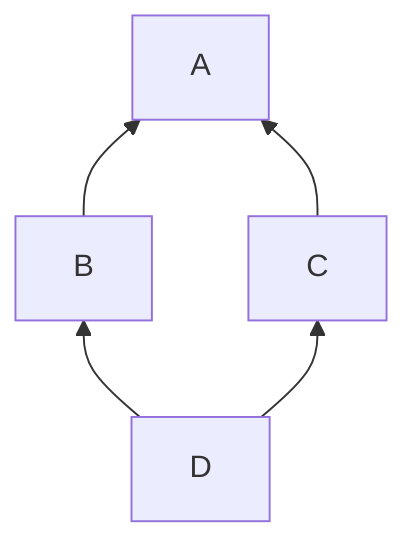

# 2.7 Inheritance, interfaces and libraries

> [!abstract] In one minute
> - Inheritance is a **compile-time** feature. `contract D is B, C` produces one bytecode blob. Bases are flattened by **C3 linearization**. You list bases from **"most base-like" to "most derived"**, the reverse of Python, so the rightmost base wins: `D is B, C` linearizes to `[D, C, B, A]`.
> - Virtual calls and **`super`** follow the linearization of the **most-derived** contract, not the parent you see in the source. Inside `D`, `B`'s `super.f()` calls **`C.f`**, a contract `B` never mentions. `super` is a JUMP, not a message call.
> - `virtual` allows overriding, `override(B, C)` must name **every base that defines the function** and is not already overridden by another base. Public state variables can override `external` functions but cannot themselves be overridden. Overrides may only widen `external`→`public` and tighten mutability.
> - Constructors run in linearized order, base first. Base arguments are evaluated **most derived to most base**. Via-IR initializes each contract's state variables **just before its own constructor**; legacy initializes **all** state variables first. Measured: the docs' example gives `y = 0` on legacy and `y = 42` on via-IR.
> - **Interfaces** declare only external functions (plus events, errors, structs, enums, UDVTs), can inherit only interfaces, and give `type(I).interfaceId` (XOR of the selectors declared in `I` itself). **Abstract contracts** may have state, constructors and partial implementations but cannot be deployed.
> - **Libraries**: `internal` functions are copied into the caller and reached by JUMP. `public`/`external` functions live at a deployed address, are reached by **DELEGATECALL**, and leave a 40-character link placeholder `__$<first 17 bytes of keccak256("file:Lib") in hex>$__` in the caller's bytecode. Non-view library functions refuse direct CALLs by comparing `ADDRESS` with the address baked into the code at deployment.

**Prerequisites:** [[1.7 Message calls and precompiles]], [[1.8 Contract creation]], [[2.3 Storage layout]], [[2.6 Functions, modifiers and special functions]] · **Leads to:** [[4.2 Upgradeability and proxies]], [[5.9 Proxies, delegatecall and storage]], [[4.4 Token standards]], [[3.11 Compiler IR and the optimizer]]

Everything here was checked with solc-js 0.8.38 (`--standard-json`, both pipelines, optimizer on unless stated) and by running the bytecode in py-evm 0.12.1b1 (`PragueVM`). Event logs emitted during construction and calls were captured to show real execution order. Compiler error messages are quoted exactly as 0.8.38 printed them.

## What inheritance compiles to

Solidity inheritance looks like class inheritance in Python or C++, but nothing of it exists at run time. When you deploy `D is B, C`, the compiler copies the code of every base into one contract, resolves every virtual call to a concrete function, and emits a single runtime blob with one dispatcher. There is no vtable, no "parent contract" on chain and no message call between levels. Calling a base function, explicitly (`B.f()`) or through `super.f()`, is an internal JUMP inside the same code.

Three consequences shape the rest of this note:

1. **One storage space.** The state variables of every base share the derived contract's storage. The compiler lays them out in linearized order, most-base first. [[2.3 Storage layout]] has the exact rules. That ordering is why inserting a base contract or a variable in a base breaks upgradeable contracts ([[4.2 Upgradeability and proxies]]).
2. **One order for everything.** The compiler computes one list, the **linearization**, and uses it for virtual lookup, `super`, constructor order, state-variable initialization and storage layout. Learn to compute it and you can predict all five.
3. **Libraries are the exception.** A library's `public`/`external` functions are real code at a separate address, reached by DELEGATECALL. Everything else in this note (bases, interfaces, abstract contracts, free functions, internal library functions) is compiled into the caller.

## C3 linearization

### The problem it solves

Take the classic diamond. `A` defines `f`. `B` and `C` both inherit `A` and override `f`. `D` inherits both.



Which `f` does `D` get? When `B.f` calls "the parent's `f`", should that be `A.f` or `C.f`? And `A` must appear only once: one copy of its state, one run of its constructor. C3 linearization answers all of this by turning the graph into a single ordered list, the **method resolution order**. Every class appears once. Each class comes before its bases. The order in which you list bases is respected.

### Solidity's order is the reverse of Python's

The docs say it plainly: "You have to list the direct base contracts in the order from 'most base-like' to 'most derived'. Note that this order is the reverse of the one used in Python."

So in `contract D is B, C`, `C` counts as **more derived** than `B`. When both define `f`, `C`'s version is "closer" to `D`. Python's `class D(B, C)` means the opposite: `B` is searched first.

| Source | Linearization (most derived first) |
|---|---|
| Solidity `contract D is B, C` | `[D, C, B, A]` |
| Python `class D(B, C)` | `[D, B, C, A]` |
| Solidity `contract E is C, B` | `[E, B, C, A]` |

The first and third rows are the compiler's `linearizedBaseContracts` from the 0.8.38 AST. To translate a Python MRO example into Solidity, reverse every base list.

The docs give a useful mental shortcut: when a function is defined in several bases, "the given bases are searched from right to left (left to right in Python) in a depth-first manner, stopping at the first match. If a base contract has already been searched, it is skipped."

### The algorithm

Write the bases of `X` as `X is P1, P2, …, Pn`. In Solidity's convention `Pn` is the most derived. Then

```text
L(X) = [X] + merge( L(Pn), …, L(P2), L(P1), [Pn, …, P2, P1] )
```

`merge` repeatedly takes the first list's head if that contract does not appear in the **tail** (any position after the first) of any list. If it does, it tries the next list's head. The chosen contract is removed from the front of every list. If no head qualifies, linearization is impossible.

Worked for `D is B, C` with `L(B) = [B, A]`, `L(C) = [C, A]`:

```text
merge([C, A], [B, A], [C, B])
  head C: not in any tail                 → take C   lists: [A] [B, A] [B]
  head A: in the tail of [B, A]           → skip
  head B: not in any tail                 → take B   lists: [A] [A] []
  head A: free                            → take A
L(D) = [D, C, B, A]
```

A larger check: Wikipedia's C3 example `class Z(K1, K2, K3)` with `K1(A, B, C)`, `K2(D, B, E)`, `K3(D, A)` has the MRO `Z, K1, K2, K3, D, A, B, C, E, O`. Written in Solidity with every base list reversed:

```solidity
// SPDX-License-Identifier: MIT
pragma solidity 0.8.38;
contract O {}
contract A is O {}
contract B is O {}
contract C is O {}
contract D is O {}
contract E is O {}
contract K1 is C, B, A {}
contract K2 is E, B, D {}
contract K3 is A, D {}
contract Z is K3, K2, K1 {}
```

solc 0.8.38 reports:

```text
K1 ['K1', 'A', 'B', 'C', 'O']
K2 ['K2', 'D', 'B', 'E', 'O']
K3 ['K3', 'D', 'A', 'O']
Z  ['Z', 'K1', 'K2', 'K3', 'D', 'A', 'B', 'C', 'E', 'O']
```

Identical to Python, as it should be once the lists are reversed.

### When it fails

C3 is monotonic: if `A` comes before `X` in some base's linearization, it must stay before `X` in every derived one. Contradictory requests are rejected:

```solidity
contract X {}
contract A is X {}
contract C is A, X {}   // compile error
```

```text
TypeError: Linearization of inheritance graph impossible
```

`C is A, X` says "`X` is more derived than `A`", but `A is X` already says `A` is more derived than `X`. The fix is the natural one: list the more general contract first (`C is X, A`), or drop the redundant `X`.

> [!tip] Read the linearization instead of computing it
> Request the AST in standard-json (`outputSelection: {"*": {"": ["ast"]}}`) and read each `ContractDefinition.linearizedBaseContracts` (node ids, most derived first). `forge inspect` and Slither's `inheritance-graph` printer expose the same information ([[6.3 Static analysis]]).

## Virtual dispatch and `super`

### The rule

A call to a virtual function `f()` (written as plain `f()` or `this`-less) resolves to the implementation in the **first** contract of the most-derived contract's linearization that defines `f`. `super.f()` inside contract `X` resolves to the next contract **after `X`** in that same list that defines `f`.

The phrase that trips people up is "that same list". The list belongs to the contract being deployed, not to the contract whose source you are reading. `B` is written against `A`, but when it is compiled into `D`, its `super` is whatever follows `B` in `L(D)`.

### Verified

Each `f()` emits a marker and calls `super.f()` (file `Lin.sol`):

```solidity
// SPDX-License-Identifier: MIT
pragma solidity 0.8.38;

contract A {
    event Log(string who);
    function f() public virtual { emit Log("A.f"); }
}
contract B is A {
    function f() public virtual override { emit Log("B.f"); super.f(); }
}
contract C is A {
    function f() public virtual override { emit Log("C.f"); super.f(); }
}
contract D is B, C {
    function f() public override(B, C) { emit Log("D.f"); super.f(); }
}
contract E is C, B {
    function f() public override(B, C) { emit Log("E.f"); super.f(); }
}
```

Deploying each contract and calling `f()` in py-evm, the logs came out in this order (identical on legacy and via-IR):

```text
A  A.f
B  B.f -> A.f
C  C.f -> A.f
D  D.f -> C.f -> B.f -> A.f
E  E.f -> B.f -> C.f -> A.f
```

So `super.f()` in `B` calls `A.f` when `B` is deployed on its own and `C.f` when `B` is part of `D`. The same source line, two targets. Every implementation in the diamond runs exactly once, and `A.f` runs last. This is the cooperative pattern that makes `super` chains safe: each override does its part and hands on.

### Explicit base calls are different

`B.f()` names a specific implementation. It is a non-virtual jump to `B`'s code. But `B`'s own `super` inside that code still follows `L(D)`. Mixing the two styles double-runs code:

```solidity
// SPDX-License-Identifier: MIT
pragma solidity 0.8.38;

event Log(string what);

contract A { function f() public virtual { emit Log("A.f"); } }
contract B is A { function f() public virtual override { emit Log("B.f"); super.f(); } }
contract C is A { function f() public virtual override { emit Log("C.f"); super.f(); } }

// Explicit base calls instead of super
contract D2 is B, C {
    function f() public override(B, C) { emit Log("D2.f"); B.f(); C.f(); }
}
```

Measured order:

```text
D2.f -> B.f -> A.f -> C.f -> B.f -> A.f
```

`L(D2) = [D2, C, B, A]`. `B.f()` runs `B`, whose `super` is `A`. `C.f()` runs `C`, whose `super` is `B`, whose `super` is `A`. `A.f` runs twice and `B.f` runs twice. If `A.f` were "mint the reward" or "increment the nonce", that is a bug. Use `super` consistently in a hierarchy, or call explicit bases only from leaves whose bases do not call `super`.

### Modifiers in a `super` chain

Modifiers wrap the function they are attached to, and each level of a `super` chain has its own. Adding `mA`…`mD` (each logs "in", runs `_`, logs "out") to the four `f`s above gives (both pipelines):

```text
mD in | D.f | mC in | C.f | mB in | B.f | mA in | A.f | mA out | mB out | mC out | mD out
```

The modifiers nest like the calls: outermost is the most-derived, innermost the most-base. Modifier semantics in detail (return-variable reset per `_`, placeholder rules) are in [[2.6 Functions, modifiers and special functions]].

## `virtual`, `override` and what an override may change

Since 0.6.0 overriding is explicit. A function can be overridden only if it (or the function it overrides) is marked `virtual`. An overriding function must say `override`. If it may be overridden again, it must also say `virtual`. Private functions cannot be virtual. Interface functions are implicitly virtual.

### When you must override, and what to list

The intuitive rule: **if a contract inherits the same function from more than one base and no single base already resolves it, the contract must override it and list every base that contributes a definition.**

The docs' formal version: overriding is not required when there is a base contract that lies on all override paths for the signature, and either (1) that base implements the function and no path from the current contract to it mentions another function with that signature, or (2) that base does not implement it and there is at most one mention of the function on all paths to it.

Cases checked against 0.8.38:

| Setup | Result |
|---|---|
| `B` and `C` both override `A.f`; `D is B, C` declares nothing | `TypeError: Derived contract must override function "f". Two or more base classes define function with same name and parameter types.` |
| Same, `D` writes `override(B)` | `TypeError: Function needs to specify overridden contract "C".` |
| Same, `D` writes `override(B, C)` | Compiles. Order inside the parentheses does not matter |
| **Only `B` overrides `A.f`**, `C is A` adds nothing, `D is B, C` | Still the "must override" error, listing definitions in `A` and `B`. The path `D→C→A` reaches `A.f`, the path `D→B` reaches `B.f`; no single resolution |
| Same with `D is C, B` | Same error. Base order does not help |
| `A.f` not `virtual`, `B` overrides | `TypeError: Trying to override non-virtual function. Did you forget to add "virtual"?` |
| `A.f virtual`, `B` redefines `f` without `override` | `TypeError: Overriding function is missing "override" specifier.` |
| One interface `I.f`; `C is I` implements `f` without `override` | Compiles. Since 0.8.8 a function that overrides only a single interface function needs no `override` |
| Two interfaces `I.f`, `J.f`; `C is I, J` implements without `override` | `TypeError: Function needs to specify overridden contracts "I" and "J".` |
| Abstract base `A.f()` unimplemented `virtual`; `C is A` implements without `override` | `TypeError: Overriding function is missing "override" specifier.` (the 0.8.8 exemption is for interfaces only) |
| `function f() private virtual` | `TypeError: "virtual" and "private" cannot be used together.` |

> [!note] Why the "only `B` overrides" case errors
> It surprises people because `D`'s linearization `[D, C, B, A]` would pick `B.f` without ambiguity. The compiler deliberately refuses to let linearization silently decide which of two independent definitions wins. You must restate the choice with `function f() public override(A, B) { super.f(); }`. (In this hierarchy `A` and `B` are the two contributors. Naming `C` gives `TypeError: Invalid contract specified in override list: "C".`, and `override(B)` alone gives `TypeError: Function needs to specify overridden contract "A".`)

### What an override may change

| Property | Allowed change | Verified error otherwise |
|---|---|---|
| Visibility | Only `external` → `public` | `public` → `external`, and `internal` → `public`: `TypeError: Overriding function visibility differs.` |
| Mutability | Only stricter: nonpayable → `view` → `pure` (`external view` → `public pure` compiled) | `payable` → anything: `TypeError: Overriding function changes state mutability from "payable" to "nonpayable".` |
| Parameters and returns | Must match exactly | Different types are overloads, not overrides |
| Data location of parameters | Must match for public/external | Changing `calldata` ↔ `memory` was wrongly accepted for internal/public overrides 0.6.9–0.8.13 (bug SOL-2022-3, fixed 0.8.14) |

### Public state variables as overrides

A `public` state variable generates a getter, and that getter can override an `external` function with the same signature:

```solidity
// SPDX-License-Identifier: MIT
pragma solidity 0.8.38;

interface IERC165 { function supportsInterface(bytes4 id) external view returns (bool); }

interface IVault is IERC165 {
    function totalAssets() external view returns (uint256);
    function deposit(uint256 assets) external returns (uint256);
}

contract Vault is IVault {
    uint256 public override totalAssets;           // public state variable implements an interface function
    function deposit(uint256 a) external returns (uint256) { totalAssets += a; return a; }
    function supportsInterface(bytes4 id) external pure returns (bool) {
        return id == type(IVault).interfaceId || id == type(IERC165).interfaceId;
    }
    function ids() external pure returns (bytes4, bytes4) { return (type(IVault).interfaceId, type(IERC165).interfaceId); }
}
```

The getter selector is `totalAssets()` = `0x01e1d114`, the same as the interface's. Rules checked against 0.8.38:

- The overridden function must be **external**. Overriding a `public` function with a state variable gives `TypeError: Public state variables can only override functions with external visibility.`
- A state variable **cannot be overridden**. A derived `function totalAssets() public view override` gives `TypeError: Cannot override public state variable.` (plus `DeclarationError: Identifier already declared.`).
- A state variable cannot be `virtual`. `uint256 public virtual x;` is a parse error: `ParserError: Expected identifier but got 'virtual'`.
- Shadowing is banned. Redeclaring a base's state variable with the same name (even private) gives `DeclarationError: Identifier already declared.` Shadowing has been an error since 0.6.0.

## Constructors and initialization order

[[1.8 Contract creation]] explains initcode: the constructor is code that runs once and returns the runtime code. With inheritance, the initcode of `D` contains the constructor of every base, in one frame, plus the inline initializers (`uint256 public a = …;`) of every base.

### Passing arguments to base constructors

There are two syntaxes, and you may use only one per base:

```solidity
// SPDX-License-Identifier: MIT
pragma solidity 0.8.38;

contract Base {
    uint256 x;
    constructor(uint256 x_) { x = x_; }
}
contract Derived1 is Base(7) {                    // inheritance list: fixed value
    constructor() {}
}
contract Derived2 is Base {
    constructor(uint256 y) Base(y * y) {}         // "modifier style": depends on the derived constructor's arguments
}
abstract contract Derived3 is Base {}             // leaves it open...
contract DerivedFromDerived is Derived3 {
    constructor() Base(10 + 10) {}                // ...for a later contract to fill in
}
```

Verified errors:

| Mistake | Error |
|---|---|
| Both `is A(1)` and `constructor() A(2)` | `DeclarationError: Base constructor arguments given twice.` |
| `contract B is A {}` when `A` needs arguments | `TypeError: No arguments passed to the base constructor. Specify the arguments or mark "B" as abstract.` |

In a diamond, `A`'s arguments must be supplied exactly once, anywhere in the hierarchy. In the experiment below `B` fixes them in its inheritance list and `D` does not repeat them.

### The order of events, measured

The docs give two orders. Legacy codegen: zero everything, evaluate base constructor arguments (most derived to most base), initialize **all** state variables (most base to most derived), then run all constructors (most base to most derived). Via-IR: zero everything, evaluate base constructor arguments (most derived to most base), then **for each contract from most base to most derived: initialize its state variables, then run its constructor**.

Here is a diamond that logs every step (file `Ctor.sol`). `note()` is a free function that emits a marker and returns its argument, so it can be used inside initializers and argument expressions.

```solidity
// SPDX-License-Identifier: MIT
pragma solidity 0.8.38;

event Log(string what);

function note(string memory s, uint256 v) returns (uint256) {
    emit Log(s);
    return v;
}

contract A {
    uint256 public a = note("init A.a", 1);
    constructor(uint256 x) { emit Log(x == 10 ? "ctor A(10)" : "ctor A(?)"); }
}

// A's argument given in B's inheritance list
abstract contract B is A(note("arg A, from B's list", 10)) {
    uint256 public b = note("init B.b", 2);
    constructor() { emit Log("ctor B"); }
}

abstract contract C is A {
    uint256 public c = note("init C.c", 3);
    constructor(uint256 y) { emit Log(y == 7 ? "ctor C(7)" : "ctor C(?)"); }
}

contract D is B, C {
    uint256 public d = note("init D.d", 4);
    modifier m1() { emit Log("m1 before _"); _; emit Log("m1 after _"); }
    modifier m2(uint256) { emit Log("m2 before _"); _; emit Log("m2 after _"); }
    // C's argument given modifier-style, between two real modifiers
    constructor() m1 C(note("arg C, from D's ctor", 7)) m2(note("arg m2", 0)) {
        emit Log("ctor D body");
    }
}
```

`L(D) = [D, C, B, A]`, so constructors run `A, B, C, D`. The logs from deploying `D` in py-evm (same with the optimizer off):

| # | Legacy | Via-IR |
|---|---|---|
| 1 | init A.a | arg C, from D's ctor |
| 2 | init B.b | arg A, from B's list |
| 3 | init C.c | init A.a |
| 4 | init D.d | ctor A(10) |
| 5 | arg C, from D's ctor | init B.b |
| 6 | arg A, from B's list | ctor B |
| 7 | ctor A(10) | init C.c |
| 8 | ctor B | ctor C(7) |
| 9 | ctor C(7) | init D.d |
| 10 | m1 before _ | m1 before _ |
| 11 | arg m2 | arg m2 |
| 12 | m2 before _ | m2 before _ |
| 13 | ctor D body | ctor D body |
| 14 | m2 after _ | m2 after _ |
| 15 | m1 after _ | m1 after _ |

What the table shows:

- **Constructors** run in reverse linearization order (`A, B, C, D`) on both pipelines. The order of base calls in `D`'s modifier list, and whether arguments come from the inheritance list or the constructor, changes nothing. The docs make the same point with `Derived3 is Base2, Base1 { constructor() Base1() Base2() {} }`: still `Base2, Base1, Derived3`.
- **Base constructor arguments** are evaluated most derived to most base: `C`'s argument (provided by `D`) before `A`'s (provided by `B`).
- **Via-IR interleaves**: each contract's initializers run immediately before its own constructor.
- **Legacy runs all initializers first**, and in 0.8.38 it does so **before** evaluating base constructor arguments (rows 1–6). The docs list argument evaluation as the step before initialization for legacy. The measured order disagrees, and the `Q`/`P` example below shows it with values.
- **Real modifiers on the derived constructor** (`m1`, `m2`) wrap only `D`'s body. They run after every base constructor has finished, in the order written, with base calls in the list skipped over. A modifier's own arguments are evaluated when that modifier is entered (`arg m2` appears after `m1 before _`), not with the base arguments.
- **Modifiers on a base constructor** run when that base constructor runs. In a variant where `A`'s and `C`'s constructors carry modifiers, the order was `A's modifier, ctor A, ctor B, C's modifier, ctor C, ctor D`.

### Values that differ between pipelines

The docs' example, run on both pipelines:

```solidity
// SPDX-License-Identifier: MIT
pragma solidity 0.8.38;

// Example from the docs ("Solidity IR-based Codegen Changes")
contract A {
    uint256 x;
    constructor() { x = 42; }
    function f() public view returns (uint256) { return x; }
}
contract B is A {
    uint256 public y = f();
}

// Base constructor argument that reads an inline-initialized base variable
contract P {
    uint256 public fee = 5;
    uint256 public seen;
    constructor(uint256 v) { seen = v; }
}
contract Q is P {
    constructor() P(fee * 100) {}
}
```

| | Legacy | Via-IR | Why |
|---|---|---|---|
| `B.y` | **0** | **42** | Legacy computes `y = f()` before `A`'s constructor sets `x`. Via-IR runs `A`'s constructor before `B`'s initializers |
| `Q.seen` | **500** | **0** | Via-IR evaluates `P(fee * 100)` before any initializer, so `fee` is still 0. Legacy had already run `fee = 5` |

`Q.fee` is 5 on both. Neither program has a compiler warning. Switching a codebase to `viaIR: true` can silently change constructor-time values, so tests should assert post-deployment state, not just "deploys".

### Virtual calls from a base constructor

A base constructor that calls a virtual function runs the **most-derived** override, before the derived constructor has run (file `Ctor2.sol`, abridged):

```solidity
// SPDX-License-Identifier: MIT
pragma solidity 0.8.38;

event Log(string what, uint256 v);

contract A {
    uint256 public seenByA;
    constructor() { seenByA = limit(); emit Log("ctor A, limit() =", seenByA); }
    function limit() internal view virtual returns (uint256) { return 1; }
}
contract B is A {}
contract C is A {}
contract D is B, C {
    uint256 public cap = 100;   // inline initializer in the most-derived contract
    function limit() internal view override returns (uint256) { return cap; }
}
```

`seenByA` after deploying `D`: **100 on legacy, 0 on via-IR**. Both pipelines call `D.limit()` (no C++-style "base version during construction"). Legacy has already run `cap = 100`; via-IR has not reached `D`'s initializers yet. The robust pattern: never call virtual functions from constructors whose overrides read derived state, or pass the value in as a constructor argument.

> [!info]- Deep dive: why via-IR changed the order
> The new order is what most programmers expect from other languages: a contract's own fields are ready when its constructor starts, and a derived class's fields are set up after the base is fully constructed. It also makes each contract's "initialize then construct" a self-contained step, which the IR codegen emits as one function per contract. The cost is a semantic difference that only shows up when an initializer or argument depends on another contract's constructor or initializer. The docs list it under "Semantic Only Changes": code that compiles on both pipelines and behaves differently.

### Upgradeable contracts have no constructors

Proxies run implementation code against proxy storage, so the implementation's constructor never touches the proxy. Upgradeable code replaces constructors with `initialize` functions, and the hierarchy must call each base's initializer exactly once, in linearized order. OpenZeppelin's `onlyInitializing` and `__X_init` / `__X_init_unchained` split exist because, without language support, a diamond calls a shared base's initializer twice. See [[4.2 Upgradeability and proxies]] and [[5.3 Access control and initialization]].

## Abstract contracts

An abstract contract is a contract that cannot be deployed on its own. It must be marked `abstract` (explicit since 0.6.0). It is required when the contract has at least one unimplemented function, or when it does not pass arguments to all base constructors. It is allowed even when everything is implemented, to say "this is a building block".

What it may contain: everything a contract can, including state variables, a constructor, modifiers and implemented functions. An unimplemented function must be `virtual`, since otherwise nothing could implement it.

Checked against 0.8.38:

| Situation | Result |
|---|---|
| `contract A { function f() public virtual; }` | `TypeError: Contract "A" should be marked as abstract.` |
| `contract C is I {}` without implementing `I.f` | `TypeError: Contract "C" should be marked as abstract.` |
| `new A()` for abstract `A` | `TypeError: Cannot instantiate an abstract contract.` |
| `type(A).creationCode` for abstract `A` | `TypeError: Member "creationCode" not found or not visible after argument-dependent lookup in type(contract A).` (`type(A).name` and `interfaceId`-style metadata remain) |
| Abstract `B is A` re-declares `A.f` unimplemented with `virtual override` | Compiles. Useful to tighten a declaration without implementing it |
| Constructor with a `storage` reference parameter | Only possible in an abstract contract: such arguments can only come from a derived constructor |

The classic use is the **template method**: the abstract base implements the public flow and calls internal virtual hooks (`_beforeTokenTransfer`, `_authorizeUpgrade`) that the leaf must provide. OpenZeppelin's `UUPSUpgradeable` leaves `_authorizeUpgrade` unimplemented so that forgetting access control is a compile error, not a deployment ([[4.2 Upgradeability and proxies]]).

## Interfaces

An interface is a pure declaration of an external API. It compiles to no bytecode. Its job is to give the compiler selectors, argument types and return types, so that `IERC20(token).transfer(to, amount)` can be ABI-encoded and its result decoded ([[2.5 ABI encoding and decoding]]).

| Rule | 0.8.38 error if broken |
|---|---|
| Functions have no body | `Functions in interfaces cannot have an implementation.` |
| Functions must be `external` | `Functions in interfaces must be declared external.` |
| No state variables, not even constants | `Variables cannot be declared in interfaces.` |
| No constructor | `Constructor cannot be defined in interfaces.` |
| No modifiers | `Modifiers cannot be defined or declared in interfaces.` |
| May inherit only interfaces (since 0.6.2) | `Interfaces can only inherit from other interfaces.` |
| May declare events, errors, structs, enums, user-defined value types, `receive`/`fallback` | Compiles |
| Functions are implicitly `virtual` | An implementing contract can override them; since 0.8.8 the `override` keyword is optional when only one interface declares the function |

### `type(I).interfaceId`

ERC-165 identifies an interface by the XOR of its function selectors. `type(I).interfaceId` (0.6.7+) computes it at compile time, but only over the functions **declared in `I` itself**, not the inherited ones. In the `Vault` example, `IVault is IERC165` declares `totalAssets()` (`0x01e1d114`) and `deposit(uint256)` (`0xb6b55f25`):

```text
type(IVault).interfaceId  = 0xb7548e31 = 0x01e1d114 ^ 0xb6b55f25   (supportsInterface not included)
type(IERC165).interfaceId = 0x01ffc9a7
```

So a contract that implements `IVault` must report `IERC165` separately in `supportsInterface`, as the example does. The same detail is in [[2.1 Types]]; how standards use it is in [[4.4 Token standards]].

> [!warning] An interface is a promise, not a check
> Casting an address to `IERC20` checks nothing on chain. If the target has a different function with the same selector, or returns a different type, or is not a contract, behavior depends on the decoder: empty returndata makes a high-level call with return values revert, but a call with no return values to an account with code that ignores the selector "succeeds". Interfaces do not protect against fee-on-transfer tokens, missing return values (USDT's `transfer`) or malicious tokens. See [[5.10 Token integration]].

## Libraries

A library is a contract-like unit of code that has no storage of its own and is meant to be **called into** rather than called. The keyword `library` gives you three things that a plain contract does not: compile-time restrictions, `using for` attachment, and (for `public`/`external` functions) linking with call protection.

### Restrictions

The docs list four: libraries "cannot have state variables", "cannot inherit nor be inherited", "cannot receive Ether" and "cannot be destroyed". In 0.8.38:

| Attempt | Error |
|---|---|
| `uint256 x;` in a library | `TypeError: Library cannot have non-constant state variables` (constants are fine) |
| `function f() external payable` | `TypeError: Library functions cannot be payable.` |
| `receive() external payable` | `DeclarationError: Libraries cannot have receive ether functions.` |
| `fallback() external` | `TypeError: Libraries cannot have fallback functions.` |
| `library L is M` or `contract C is L` | `TypeError: Libraries cannot be inherited from.` |
| `constructor() {}` | `TypeError: Constructor cannot be defined in libraries.` |
| `super` inside a library | Not available (0.8.0 changelog) |

Libraries **can** declare structs, enums, events, errors and constants, emit events, and read `msg.sender`/`msg.value` (an `external view` library function using `msg.value` compiles). Under DELEGATECALL those are the caller's values.

"No state variables" does not mean "no storage access". A library function can take `S storage self` and read and write it. Through DELEGATECALL (or inlining) that is the **caller's** storage.

### Two kinds of library function, two deployment models

| | `internal` (and `private`) | `public` / `external` |
|---|---|---|
| Where the code lives | Copied into every contract that uses it | Once, at the library's own address |
| How it is reached | JUMP, like any internal function | DELEGATECALL from the caller |
| Arguments | Passed on the stack; memory and storage references passed as pointers (no copying) | ABI-encoded into memory, `storage` references encoded as the slot number |
| Needs deployment and linking | No | Yes |
| Gas overhead | None beyond the JUMPs | Call, account access, encoding and decoding |
| Effect on caller size | Grows it | Keeps it small (a way around the 24,576-byte limit) |

A `public` library function called from **inside the library** (for example from an internal library function) is a JUMP, so a contract that only uses internal functions needs no linking even if those call public ones. Verified: `K1` calling `P.pub(x)` directly had a link reference; `K2` calling the internal `P.usesPub(x)`, which calls `pub(x)`, had none.

The test library for the rest of this section (file `Lib.sol`):

```solidity
// SPDX-License-Identifier: MIT
pragma solidity 0.8.38;

library Counter {
    struct Data { uint256 n; }

    // internal: copied into the caller's code, reached by JUMP
    function bumpInternal(Data storage d) internal { d.n += 1; }

    // external, state-changing: reached by DELEGATECALL, needs linking
    function bump(Data storage d, uint256 by) external { d.n += by; }

    // external, view
    function twice(uint256 x) external pure returns (uint256) { return 2 * x; }
}

contract User {
    using Counter for Counter.Data;
    Counter.Data public data;

    function a() external { data.bumpInternal(); }
    function b(uint256 by) external { data.bump(by); }
    function c(uint256 x) external pure returns (uint256) { return Counter.twice(x); }
    function sels() external pure returns (bytes4, bytes4) {
        return (Counter.bump.selector, Counter.twice.selector);
    }
}
```

Facts from compiling and running it:

- `User`'s runtime code contains **two DELEGATECALL** opcodes (for `b` and `c`), no CALL and no STATICCALL. A `pure` library function is reached with DELEGATECALL too. Library calls have used DELEGATECALL since 0.3.0 (Mar 2016), so the library sees the caller's `msg.sender`, `msg.value` and storage. Before that they used CALLCODE.
- `a()` contains the `bumpInternal` code inline: calling it changed `data.n` with no external call.
- `User` has one EXTCODESIZE check, for `b` (which returns nothing). `c` returns a value, and since 0.8.10 the decoder's check on empty returndata replaces the EXTCODESIZE check ([[2.5 ABI encoding and decoding]]). With the library address linked to `0x00…00` or to an EOA, both `b(5)` and `c(5)` reverted on both pipelines. Without the check, DELEGATECALL to an empty account would succeed and `b` would silently do nothing.
- Gas (legacy, py-evm, with storage and accounts already warm): `a()` 453, `b(1)` 1,212. The first `b` call in a frame paid 2,500 more (3,712), the cold-account surcharge for the library address (2,600 cold vs 100 warm, see [[1.9 Gas accounting]]). Via-IR measured 355 for a warm `a()` and 3,548 for a first-time `b(1)`. (The harness keeps warm/dirty state across calls, so treat these as relative numbers, not transaction costs.)

### Selectors for library functions

External library functions accept types the contract ABI does not, such as storage pointers and recursive structs. Their selectors therefore use an internal naming scheme. From `methodIdentifiers`:

```text
bump(Counter.Data storage,uint256)  0x74235457
twice(uint256)                      0x3cf3bbf4
```

`keccak256("bump(Counter.Data storage,uint256)")[0:4]` recomputed to `0x74235457`, and `Counter.bump.selector` returned the same value on chain. Rules from the docs: value types, non-storage `string`/`bytes` and arrays use ABI names; non-storage structs use their fully qualified name (`C.S`); storage pointers append ` storage`; storage mappings are `mapping(K => V) storage`. A storage pointer argument is ABI-encoded as a `uint256` slot number. The docs say this calling convention is "internal to Solidity and not the same as specified for the regular contract ABI", so do not build off-chain callers against it.

### Linking and the placeholder

When the compiler emits a DELEGATECALL to a library, it does not know the library's address. It writes a 20-byte placeholder where the address goes (as the operand of a PUSH20) and tells you where:

```text
User linkReferences (legacy):  {"Lib.sol": {"Counter": [{"start": 233, "length": 20}, {"start": 359, "length": 20}]}}
User linkReferences (via-IR):  {"Lib.sol": {"Counter": [{"start":  99, "length": 20}, {"start": 324, "length": 20}]}}
placeholder in the hex:        __$14dbd44843a54a719833270316c48c4bf7$__
keccak256("Lib.sol:Counter")[0:17] = 14dbd44843a54a719833270316c48c4bf7
```

The format is `__$` + 34 hex characters + `$__`: 40 characters, which is exactly the hex width of an address, so linking is a plain string replacement in the hex. The 34 characters are the first 17 bytes of `keccak256` of the fully qualified library name `sourceUnit:LibraryName`. Since 0.5.0 the hash replaced the old scheme, which embedded the (truncated) name itself and could collide or be ambiguous across files. The placeholder is not valid hex. A bytecode with an unlinked placeholder cannot be deployed by most tools, which is a deliberate safety catch.

Ways to link:

| Method | How |
|---|---|
| Compile-time | standard-json `settings.libraries: {"Lib.sol": {"Counter": "0x…"}}` or `solc --libraries "Lib.sol:Counter=0x…"`; the compiler emits final bytecode |
| Post-compile | `solc --link --libraries …` on the hex, or the tool replaces the bytes at each `linkReferences` offset |
| Frameworks | Foundry: `libraries = ["src/Lib.sol:Counter:0x…"]` in `foundry.toml` or `--libraries`; without it, `forge script`/`forge create` deploys missing libraries first. Hardhat: `libraries` option on the contract factory |

In py-evm, replacing the placeholder with the deployed library's address and deploying `User` made `b(5)` set `data.n = 5` in **User's** storage, and the library's own storage stayed empty.

> [!note] Linking and verification
> The linked library address is part of the runtime bytecode, so it is part of what a block explorer verifies. Verification needs the same library addresses ([[6.7 Deployment and verification]]). Deterministic deployment of libraries (CREATE2 with a fixed salt) keeps addresses identical across chains ([[4.3 Deterministic and cross-chain deployment]]).

### Call protection: how a library refuses direct calls

The danger: a library's `external` state-changing function, called **directly** with CALL, would run against the library's own storage, which nobody intended to exist. With `selfdestruct` that once bricked every wallet that depended on a shared code contract (Parity, below). Since 0.4.20 (14 Feb 2018) the compiler adds call protection. The docs: "if a library's code is executed using a CALL instead of a DELEGATECALL or CALLCODE, it will revert unless a view or pure function is called."

The EVM has no "am I being delegatecalled?" opcode. The trick is that `ADDRESS` returns the address of the account **whose storage and identity** the code runs in. Under DELEGATECALL that is the caller, not the library. So the library remembers its own address at deployment and compares.

**Legacy pipeline.** The runtime code starts with a PUSH20 of twenty zero bytes. The initcode overwrites those bytes in memory with `ADDRESS` before returning the code, so the stored code differs from the compiler's `deployedBytecode`. Disassembly of `Counter` (legacy, optimizer on):

```text
0000 PUSH20 0x0000000000000000000000000000000000000000   ; compiler output: zeros
0015 ADDRESS
0016 EQ                    ; flag = 1 if running at the library's own address (CALL / STATICCALL)
0017 PUSH1 0x80            ; usual free memory pointer setup
0019 PUSH1 0x40
001b MSTORE
...                        ; selector dispatch
002a PUSH4 0x3cf3bbf4      ; twice(uint256)                       -> 0x0043 (no check)
0035 PUSH4 0x74235457      ; bump(Counter.Data storage,uint256)   -> 0x0068
...
0068 JUMPDEST              ; bump:
0069 DUP2                  ; copy the flag computed at offset 0x16
006a DUP1
006b ISZERO
006c PUSH2 0x0073
006f JUMPI                 ; flag == 0 (delegatecalled) -> continue at 0x73
0070 PUSH0
0071 PUSH0
0072 REVERT                ; flag == 1 (direct call) -> revert with no data
```

On chain (deployed by its initcode at `0xdd…dd01` in py-evm) the first bytes read `73 dddddddddddddddddddddddddddddddddddddd01 30`: PUSH20 *own address*, ADDRESS.

**Via-IR pipeline.** There is no prologue. The address is an immutable named `library_deploy_address`. The Yul IR shows both halves:

```yul
// constructor
setimmutable(_1, "library_deploy_address", address())
// runtime, in each non-view, non-pure function
let called_via_delegatecall := iszero(eq(loadimmutable("library_deploy_address"), address()))
```

and the optimized bytecode for `bump` is:

```text
002e JUMPDEST
002f ADDRESS
0030 PUSH32 0x0000000000000000000000000000000000000000000000000000000000000000   ; immutable slot
0051 EQ
0052 PUSH1 0x87
0054 JUMPI                 ; equal (direct call) -> 0x87: PUSH0 DUP1 REVERT
```

On chain, the deployed library's address sat at offset `0x3d`, the low 20 bytes of that PUSH32. So the docs' sentence "the runtime code of a library always starts with a push instruction" describes the **legacy** pipeline. Via-IR does the same check with an immutable placed inside the function's code path.

**Measured behavior** of the deployed library, on both pipelines:

| Direct call to the library address | Result |
|---|---|
| `twice(21)` (pure) | Succeeds, returns 42 (329 gas legacy, 183 via-IR) |
| `bump(slot 0, 5)` (state-changing) | Reverts with empty returndata |
| Same `bump(5)` through `User.b` (DELEGATECALL) | Succeeds, writes User's slot 0 |

View and pure functions are allowed directly so that off-chain callers (`eth_call`) and other contracts can use them as utilities.

> [!warning] Call protection only exists for the `library` keyword
> A **contract** used as shared logic (an implementation behind proxies, a "library" in the architectural sense) has no such check. Anyone can call it directly, and any `initialize` or `selfdestruct`-reachable function runs against the implementation's own storage. That is the Parity bug and the reason implementations call `_disableInitializers()` in their constructor ([[5.3 Access control and initialization]], [[5.9 Proxies, delegatecall and storage]]).

## `using for`

`using A for B` attaches functions to a type as member functions. The value you call on becomes the first argument: `data.bump(by)` is `Counter.bump(data, by)`. It is pure syntax; the call compiles exactly as the explicit form would (JUMP for internal, DELEGATECALL for external).

| Form | Meaning | Where allowed |
|---|---|---|
| `using L for T;` | Attach all non-private functions of library `L` to `T`. Type compatibility is checked per call | Contract level or file level |
| `using L for *;` | Attach all of `L`'s functions to **every** type | Contract level only. At file level: `SyntaxError: The type has to be specified explicitly at file level (cannot use '*').` |
| `using {f, g, L.h} for T;` (0.8.13+) | Attach a list of free and/or library functions. `T` must convert implicitly to each first parameter, checked even if never called | Contract or file level |
| `using {f, …} for T global;` (0.8.13+) | As above, but effective everywhere `T` is visible, including other files | File level only, and only for a user-defined type (struct, enum, UDVT) defined in the same file. On `uint256`: `TypeError: Can only use "global" with user-defined types.` Inside a contract: `SyntaxError: "global" can only be used at file level.` |
| `using {add as +, eq as ==} for T global;` (0.8.19+) | User-defined operators | Only for UDVTs, only `pure` free functions, must be `global` |

**Scope is not inherited.** A `using L for uint256;` in contract `A` does not apply in `B is A`. Verified: calling `uint256(1).z()` in `B` gave `TypeError: Member "z" not found or not visible after argument-dependent lookup in uint256.` (Before 0.7.0 the directive was inherited.) Each contract states its own `using`, or the type uses `global`.

A combined example (compiles and runs: `g()` returned `(2, true, 5, true)`):

```solidity
// SPDX-License-Identifier: MIT
pragma solidity 0.8.38;

type Wad is uint256;

function add(Wad a, Wad b) pure returns (Wad) { return Wad.wrap(Wad.unwrap(a) + Wad.unwrap(b)); }
function eq(Wad a, Wad b) pure returns (bool) { return Wad.unwrap(a) == Wad.unwrap(b); }
function raw(Wad a) pure returns (uint256) { return Wad.unwrap(a); }

// file level, global: applies wherever Wad is used, even in other files
using {add as +, eq as ==, raw} for Wad global;

library Search {
    function indexOf(uint256[] memory xs, uint256 x) internal pure returns (uint256) {
        for (uint256 i; i < xs.length; ++i) if (xs[i] == x) return i;
        return type(uint256).max;
    }
    function isZero(uint256 x) internal pure returns (bool) { return x == 0; }
}

contract C {
    using Search for *;   // attach every Search function to every matching first-parameter type

    function g() external pure returns (uint256, bool, uint256, bool) {
        uint256[] memory xs = new uint256[](3);
        xs[0] = 4; xs[1] = 9; xs[2] = 7;
        Wad w = Wad.wrap(2) + Wad.wrap(3);
        return (xs.indexOf(7), uint256(0).isZero(), w.raw(), w == Wad.wrap(5));
    }
}
```

> [!tip] Prefer explicit lists over `for *`
> `using L for *` makes every function of `L` a candidate on every type, so overload resolution can pick a function you did not mean, and readers cannot see what is attached. Use `using {f, g} for T` or `global` on your own UDVTs. Operator overloading on a UDVT is only as safe as the free function behind it: `+` defined with `unchecked` silently wraps ([[2.9 Arithmetic and numeric pitfalls]]).

## Free functions

Since 0.7.1, functions can be declared at file level, outside any contract. They "behave much like internal library functions" (0.7.1 changelog):

- Always internal. Writing a visibility is an error: `SyntaxError: Free functions cannot have visibility.`
- Compiled into each contract that calls them. No deployment, no linking.
- No implicit access to any contract's state: a free function mentioning a state variable `x` gives `DeclarationError: Undeclared identifier.` They can still take `storage` references as parameters, read file-level constants, emit file-level events (events at file level since 0.8.22) and call other free functions. `note()` in the constructor experiment above is a free function that emits.
- They can be attached with `using {f} for T` and are the only functions usable as UDVT operators.

When to use which: a free function for a stateless helper used in one project; an internal library for a reusable bundle (and when you want `using L for T` attaching a whole set); an external library only when you need to share deployed code or shrink a contract under the size limit.

## Solidity and Yul in practice

**Cooperative hooks across a hierarchy.** Every override calls `super` exactly once and the leaf lists every contributing base. This is how OpenZeppelin 5.x composes ERC-20 extensions through `_update`:

```solidity
// SPDX-License-Identifier: MIT
pragma solidity 0.8.38;

abstract contract Token {
    mapping(address => uint256) public balanceOf;
    function _update(address from, address to, uint256 v) internal virtual {
        if (from != address(0)) balanceOf[from] -= v;
        if (to != address(0)) balanceOf[to] += v;
    }
}
abstract contract Pausable is Token {
    bool public paused;
    error Paused();
    function _update(address f, address t, uint256 v) internal virtual override {
        if (paused) revert Paused();
        super._update(f, t, v);
    }
}
abstract contract Capped is Token {
    uint256 public supply;
    uint256 public constant CAP = 1_000;
    error Cap();
    function _update(address f, address t, uint256 v) internal virtual override {
        super._update(f, t, v);
        if (f == address(0)) { supply += v; if (supply > CAP) revert Cap(); }
    }
}
contract MyToken is Pausable, Capped {
    // L = [MyToken, Capped, Pausable, Token]: Capped runs first, calls Pausable, then Token.
    function _update(address f, address t, uint256 v) internal override(Pausable, Capped) {
        super._update(f, t, v);
    }
    function mint(address to, uint256 v) external { _update(address(0), to, v); }
}
```

The leaf's `override(Pausable, Capped)` is required. Reversing the base list (`is Capped, Pausable`) changes the order of the checks, not whether they run.

**Reading the address a library will see.** Inside a library function, `address(this)` is the caller under DELEGATECALL and the library under a direct view call. This is the whole basis of call protection, and you can observe it:

```solidity
// SPDX-License-Identifier: MIT
pragma solidity 0.8.38;

library Where {
    function here() external view returns (address) { return address(this); }
}
contract Probe {
    function viaLib() external view returns (address) { return Where.here(); }   // returns address(Probe)
}
```

**Calling a library function by hand.** The selector is `L.f.selector`, and storage pointers travel as slot numbers. From assembly you would DELEGATECALL the library address with `selector ‖ slot ‖ args` ([[3.7 External calls in assembly]]). That is exactly what the compiler emits, plus the EXTCODESIZE check for no-return functions.

## Pitfalls and incidents

| Date | Incident / issue | Lesson |
|---|---|---|
| 9 Jul 2026 | SOL-2026-3 `InheritanceOrderReversalOnStorageEndWarning` (medium), 0.8.29–0.8.35, fixed in 0.8.36 | Emitting the `layout at` "close to end of storage" warning reversed `linearizedBaseContracts` in place. Initialization order, constructor order and virtual resolution could be miscompiled: the linearization is load-bearing for everything in this note. See [[2.3 Storage layout]] |
| 17 May 2022 (0.8.14) | SOL-2022-3 `DataLocationChangeInInternalOverride` (very low), 0.6.9–0.8.13 | Overrides could change `calldata` ↔ `memory` for internal and public functions, so a call through the base could pass the wrong encoding |
| 2020 | SOL-2020-5 `ImplicitConstructorCallvalueCheck` (very low), 0.4.5–0.6.7 | A contract with no constructor but a base with a non-payable constructor accepted ETH at creation |
| 2020 | SOL-2020-2 `privateCanBeOverridden` (low), 0.3.0–0.5.16 | Private functions could be overridden by derived contracts. Today `private` + `virtual` is an error |
| 14 Feb 2018 | Solidity 0.4.20 | "Prevent non-view functions in libraries from being called directly (as opposed to via delegatecall)": the call-protection prologue |
| 6 Nov 2017 | Parity multisig library self-destruct | The shared `WalletLibrary` was an ordinary **contract**, not a Solidity `library`, and was never initialized. User `devops199` initialized themselves as owner and called its kill function. 587 wallets that delegated to it froze 513,774.16 ETH (Parity postmortem). The fix redeployed after the 19 Jul 2017 hack was the code with this hole |

> [!warning] Footguns
> - **Base order is backwards from Python.** `is B, C` makes `C` win. Put general contracts (`Ownable`, `Context`) first and specific ones last.
> - **`super` is not "my parent".** It is the next contract in the deployed contract's linearization, which a base author cannot see. A base whose `super` call skips, repeats or reorders logic only shows the bug in a particular composition. Test the leaf, not the bases.
> - **Mixing `super` and explicit `Base.f()` calls** in a diamond runs shared bases twice (measured above).
> - **Via-IR changes constructor-time values** when an initializer or base argument depends on another contract's constructor or initializer. Assert post-deployment state when switching pipelines.
> - **Virtual calls from base constructors** run the most-derived override before the derived constructor, and on via-IR before its initializers.
> - **Inheritance order is storage order.** Adding a base, or reordering the `is` list, moves every later variable. That is a breaking upgrade ([[4.2 Upgradeability and proxies]]).
> - **Unlinked or mislinked libraries.** A wrong address in `settings.libraries` deploys fine. Calls revert if the address has no code, but a wrong library *with code* runs arbitrary logic against your storage via DELEGATECALL. Verify linked addresses as carefully as proxy implementations.
> - **`interfaceId` excludes inherited functions.** `supportsInterface` must list parent interfaces too.
> - **Virtual modifiers are deprecated** (warning since 0.8.31: `Virtual modifiers are deprecated and scheduled for removal.`). Use a virtual internal function called from a non-virtual modifier instead.

## Question ladder

> [!question]- **B** Compare interface, abstract contract and library.
> All three are building blocks you do not deploy as a normal standalone contract, but they answer different needs.
>
> | | Interface | Abstract contract | Library |
> |---|---|---|---|
> | Purpose | Describe an external API | Partial implementation to inherit | Reusable code to call into |
> | Function bodies | None | Some or all | All |
> | Function visibility | `external` only | Any | Any except that `external`/`public` ones need deployment |
> | State variables | No (not even constants) | Yes | Constants only |
> | Constructor | No | Yes | No |
> | Modifiers | No | Yes | Yes (but not `virtual`) |
> | Inheritance | Only from interfaces | From anything except libraries | Cannot inherit or be inherited |
> | Bytecode | None | None by itself; compiled into the derived contract | Internal functions inlined into callers; public/external deployed once |
> | Receives ether | n/a | Through the derived contract | Never (`payable`, `receive` are errors) |
> | Used via | Casting an address: `IERC20(t).transfer(…)` | `contract X is A` | `L.f(x)` or `using L for T` |
> | Run-time call | Regular CALL/STATICCALL to the target | None (JUMP) | JUMP (internal) or DELEGATECALL (external) |
>
> **How to choose.** Use an interface for anything that talks to another deployed contract, and for ERC-165 ids. Use an abstract contract when bases need state, constructors, or template-method hooks that the leaf must implement. Use a library for stateless or storage-pointer-based logic shared across unrelated contracts, especially with `using for` (SafeERC20, Math, EnumerableSet). Use an external library only when you need to share deployed code or reduce contract size, accepting a DELEGATECALL per call and a linking step.
>
> **What an interviewer listens for.** That libraries run in the caller's context (storage, `msg.sender`, `msg.value`), that interfaces are compile-time descriptions with no on-chain enforcement, and that abstract contracts force the missing pieces at compile time.

> [!question]- **I** For `contract D is B, C`, what is the linearization, and what does `super.f()` call in each contract?
> Assume `B is A`, `C is A`, and each of `A`, `B`, `C`, `D` defines `f()`; `B`, `C`, `D` call `super.f()`.
>
> **Linearization.** Solidity lists bases from most base-like to most derived, so `C` is more derived than `B`. C3 gives
> ```text
> L(D) = [D] + merge([C, A], [B, A], [C, B]) = [D, C, B, A]
> ```
> (Python's `class D(B, C)` would give `[D, B, C, A]`.) The 0.8.38 AST reports `linearizedBaseContracts` = `D, C, B, A`.
>
> **`super.f()` in each contract, when deployed as `D`:**
>
> | Code in | `super.f()` calls |
> |---|---|
> | `D` | `C.f` |
> | `C` | `B.f` |
> | `B` | `A.f` |
> | `A` | (no super) |
>
> The measured log for `D.f()` was `D.f -> C.f -> B.f -> A.f`. The key point is the `C` row: `C`'s source only knows `A`, yet its `super` goes to `B`, because `super` follows the most-derived contract's linearization. Deployed alone, `C`'s `super` is `A` (measured `C.f -> A.f`).
>
> **Follow-ups.** With `contract E is C, B` everything flips: `[E, B, C, A]`, log `E.f -> B.f -> C.f -> A.f`. `D` must declare `override(B, C)`, and even if only `B` overrode `f`, `D` would still have to override (listing `A, B`). Replacing `super.f()` in `D` with `B.f(); C.f();` runs `A.f` twice, because `C`'s `super` is still `B`.

> [!question]- **I** Internal vs external library functions: how is each deployed and called?
> **Internal (and private).** Not deployed separately. The compiler copies the function's code into every contract (or library) that calls it, and calls it with a JUMP, exactly like an internal function of the contract itself. Arguments go on the stack; `memory` and `storage` arguments are passed by reference (a memory pointer or a slot number), so there is no copying. No address, no linking, no call overhead. It grows the caller's bytecode. Verified: `User.a()` modified its own storage through `bumpInternal` with no external call, and a contract using only internal library functions has empty `linkReferences`.
>
> **Public and external.** Compiled once into the library's own runtime code, which is deployed at its own address. A caller reaches it with DELEGATECALL: the arguments are ABI-encoded (storage pointers as `uint256` slot numbers) with a selector from the library's internal signature scheme (`bump(Counter.Data storage,uint256)` = `0x74235457`). Because of DELEGATECALL, the library code runs with the caller's storage, `msg.sender` and `msg.value`. Even `view`/`pure` library functions are called with DELEGATECALL (two DELEGATECALLs, no STATICCALL, in `User`).
>
> **Deployment and linking.** The caller's bytecode holds a placeholder `__$14dbd44843a54a719833270316c48c4bf7$__` (the first 17 bytes of `keccak256("Lib.sol:Counter")`) at the offsets listed in `linkReferences`. You deploy the library first, then replace the placeholder with its address, either at compile time (`settings.libraries`) or afterwards (`solc --link`, framework support). The compiler also emits an EXTCODESIZE check before calls that return no data, so a wrongly linked empty address reverts.
>
> **Trade-off.** Internal costs nothing per call but adds bytes everywhere it is used. External costs per call (measured about 760 gas more than the inlined version with everything warm, plus 2,500 the first time the library address is touched) but lets many contracts share one copy and helps stay under the 24,576-byte code size limit.

> [!question]- **A** How do libraries protect against direct calls to state-changing functions?
> **The threat.** A library's state-changing function is written to work on the *caller's* storage through DELEGATECALL. Called directly with CALL, it would run on the library's own storage. That is at best meaningless, and if anything reachable could destroy or take over the code, every contract linked to it would break (the Parity freeze). So since 0.4.20 non-view, non-pure library functions revert unless they are delegatecalled.
>
> **The mechanism.** The EVM cannot tell a callee how it was called, but `ADDRESS` reveals whose context the code runs in: under DELEGATECALL it is the caller's address, under CALL/STATICCALL it is the library's. So the library records its own address at deployment and compares at run time.
>
> - *Legacy pipeline*: the runtime code begins `PUSH20 0x00…00 ADDRESS EQ`. The initcode patches the 20 zero bytes with `ADDRESS` before returning the runtime code, so the on-chain code differs from `deployedBytecode` (on chain it began `73 dddd…dd01 30`). The `EQ` result is a flag kept on the stack. Every non-view function's branch checks it (`DUP2 DUP1 ISZERO PUSH2 0x0073 JUMPI PUSH0 PUSH0 REVERT`). View and pure branches ignore it.
> - *Via-IR*: no prologue. The constructor does `setimmutable("library_deploy_address", address())`, and each non-view function computes `iszero(eq(loadimmutable("library_deploy_address"), address()))`. In bytecode: `ADDRESS PUSH32 <address> EQ PUSH1 0x87 JUMPI`, with `0x87` being `PUSH0 DUP1 REVERT`. The address sits in the PUSH32's low 20 bytes (offset `0x3d` in the test library).
>
> **Measured.** Direct `CALL` to the deployed library: `twice(21)` (pure) returned 42; `bump(slot, 5)` reverted with empty returndata, on both pipelines. Through `User.b(5)` (DELEGATECALL) it succeeded and wrote User's storage.
>
> **Edges an expert mentions.**
> - The protection is per function: view/pure functions stay callable directly so they can be used as on-chain or `eth_call` utilities. They then read the library's (empty) storage.
> - It only exists for the `library` keyword. Implementation contracts behind proxies have no such guard, which is why they disable initializers in their constructor and why EIP-6780 (Cancun) removing most of SELFDESTRUCT's power matters for shared code.
> - Because the on-chain code includes the deploy address, the library's on-chain code hash depends on where it was deployed. Bytecode verification tools know to account for this.
> - CALLCODE also passes (it runs in the caller's context, so `ADDRESS` is the caller), which is why the docs mention it.

> [!question]- **E** Predict the exact execution order of constructors and modifiers in a diamond-shaped hierarchy.
> **Method.** (1) Compute the linearization of the most-derived contract. (2) Apply the pipeline's initialization rules. (3) Place modifiers: a constructor's modifiers wrap only that constructor's body. (4) Watch for expressions with side effects in initializers, base arguments and modifier arguments.
>
> **The hierarchy** (the `Ctor.sol` experiment): `A(uint x)` with initializer `a`; `abstract B is A(arg_A)` with initializer `b`; `abstract C is A` with `constructor(uint y)` and initializer `c`; `contract D is B, C` with initializer `d` and `constructor() m1 C(arg_C) m2(arg_m2) { body }`. `L(D) = [D, C, B, A]`.
>
> **Rules that hold on both pipelines.**
> - Constructors run in reverse linearization: `A, B, C, D`. Neither the order of `is`-list arguments nor the order of base calls in the constructor header changes that.
> - Base constructor arguments are evaluated most derived to most base: `arg_C` (from `D`) before `arg_A` (from `B`).
> - Each base appears once. `A`'s constructor runs once even though two paths reach it, and its arguments must be given exactly once in the whole hierarchy.
> - Real modifiers on `D`'s constructor run after all base constructors, in the order written, nested around `D`'s body. Base-constructor calls in the same header are not modifiers and do not run there. A modifier's arguments are evaluated when that modifier is entered.
> - Modifiers on a base's constructor run when that base's constructor runs.
>
> **Where the pipelines differ: initializers.**
>
> | Step | Legacy (measured) | Via-IR (measured) |
> |---|---|---|
> | 1 | init `A.a`, `B.b`, `C.c`, `D.d` | `arg_C`, `arg_A` |
> | 2 | `arg_C`, `arg_A` | init `A.a`, ctor `A` |
> | 3 | ctor `A`, ctor `B`, ctor `C` | init `B.b`, ctor `B` |
> | 4 | | init `C.c`, ctor `C` |
> | 5 | | init `D.d` |
> | 6 | `m1` before, `arg_m2`, `m2` before, `D` body, `m2` after, `m1` after | same |
>
> Note the legacy row 1–2 order: in 0.8.38 the legacy pipeline ran all initializers *before* evaluating base constructor arguments, while the IR-changes docs page lists argument evaluation first for legacy too. The `Q is P { constructor() P(fee * 100) {} }` test confirms it with values: legacy passes 500, via-IR passes 0.
>
> **Consequences you should be able to name.**
> - An initializer that reads a value set in a base constructor: `y = f()` gives 0 on legacy and 42 on via-IR (docs example, measured).
> - A base argument that reads a base's initialized variable: 500 vs 0 (above).
> - A base constructor calling a virtual function overridden in the leaf: the leaf's override runs on both pipelines, but it sees the leaf's initialized state only on legacy (measured 100 vs 0).
> - Modifiers on the leaf constructor see fully constructed bases; modifiers on a base constructor see only the bases before it in the order.
>
> **What an interviewer listens for.** Linearization drives everything; constructors base-first; arguments derived-first; the legacy/via-IR initializer split with a concrete example; and the practical advice: keep constructor-time expressions free of cross-contract dependencies, avoid virtual calls in constructors, and when migrating to via-IR, diff the post-deployment state of every contract. For upgradeable code the same reasoning applies to initializer chains, where nothing enforces "exactly once" except `initializer`/`onlyInitializing` modifiers.

## Related notes
- [[1.7 Message calls and precompiles]] — DELEGATECALL semantics: caller's storage, `msg.sender`, `msg.value`, and what `ADDRESS` returns
- [[1.8 Contract creation]] — initcode, how the constructor returns the runtime code, and why the library can patch its own code
- [[1.9 Gas accounting]] — cold/warm account access behind the external library call cost
- [[2.3 Storage layout]] — inherited state variables are laid out in linearized order, most-base first; SOL-2026-3
- [[2.5 ABI encoding and decoding]] — encoding of library call arguments, the EXTCODESIZE vs decoder check
- [[2.6 Functions, modifiers and special functions]] — visibility, mutability, modifier semantics and `receive`/`fallback`
- [[2.1 Types]] — function types, UDVTs, `type(I).interfaceId`
- [[2.9 Arithmetic and numeric pitfalls]] — operators defined on UDVTs with `using … global`
- [[3.11 Compiler IR and the optimizer]] — the via-IR pipeline whose semantics differ here
- [[4.2 Upgradeability and proxies]] — initializers instead of constructors, storage across inheritance, adding bases safely
- [[4.4 Token standards]] — ERC-165 and composing token extensions with `super` hooks
- [[5.3 Access control and initialization]] — uninitialized implementations, `_disableInitializers`
- [[5.9 Proxies, delegatecall and storage]] — DELEGATECALL to shared code, Parity-style failures
- [[6.7 Deployment and verification]] — linking libraries and verifying linked bytecode

## Sources
- [Solidity docs: Inheritance](https://github.com/argotorg/solidity/blob/develop/docs/contracts/inheritance.rst) — linearization order (reverse of Python), right-to-left depth-first explanation, "Linearization of inheritance graph impossible" example, override rules (formal multiple-base rule, visibility and mutability changes), public state variables overriding external functions, base constructor arguments in two places, constructor order example, deprecated virtual modifiers
- [Solidity docs: Libraries](https://github.com/argotorg/solidity/blob/develop/docs/contracts/libraries.rst) (docs.soliditylang.org could not be fetched; the source `.rst` was read) — restrictions, internal vs external calls, function signatures and selectors in libraries, call protection description
- [Solidity docs: Using For](https://github.com/argotorg/solidity/blob/develop/docs/contracts/using-for.rst) — forms of `using`, `*` only inside contracts, `global` rules, operator table
- [Solidity docs: Interfaces](https://github.com/argotorg/solidity/blob/develop/docs/contracts/interfaces.rst) and [Abstract Contracts](https://github.com/argotorg/solidity/blob/develop/docs/contracts/abstract-contracts.rst) — restrictions
- [Solidity docs: Solidity IR-based Codegen Changes](https://docs.soliditylang.org/en/latest/ir-breaking-changes.html) — documented legacy and new initialization orders, `y = f()` example
- [Solidity Changelog](https://github.com/argotorg/solidity/blob/develop/Changelog.md) — 0.3.0 library calls use DELEGATECALL; 0.4.20 call protection; 0.5.0 hashed link placeholder; 0.6.0 `virtual`/`override`, explicit `abstract`, shadowing disallowed, public variables overriding external functions; 0.6.2 interfaces inherit; 0.6.7 `interfaceId`; 0.7.1 free functions; 0.8.8 optional `override` for single interface functions; 0.8.13 `using` at file level and `global`; 0.8.19 user-defined operators; 0.8.22 file-level events; 0.8.31 virtual modifier deprecation warning
- [Solidity bugs.json](https://github.com/argotorg/solidity/blob/develop/docs/bugs.json) — SOL-2026-3, SOL-2022-3, SOL-2020-5, SOL-2020-2
- [Parity: A Postmortem on the Parity Multi-Sig Library Self-Destruct](https://medium.com/paritytech/a-postmortem-on-the-parity-multi-sig-library-self-destruct-63daca3a4cf7) — 6 Nov 2017, 587 wallets, 513,774.16 ETH, library was a regular contract left uninitialized
- [Wikipedia: C3 linearization](https://en.wikipedia.org/wiki/C3_linearization) — the `Z, K1, K2, K3` example reproduced above
- solc-js 0.8.38 (`--standard-json`: `ast` `linearizedBaseContracts`, `methodIdentifiers`, `linkReferences`, `ir`, bytecode) and py-evm 0.12.1b1 (`PragueVM`) — every linearization, call order, constructor log, initialization value, disassembly, gas figure and error message in this note
