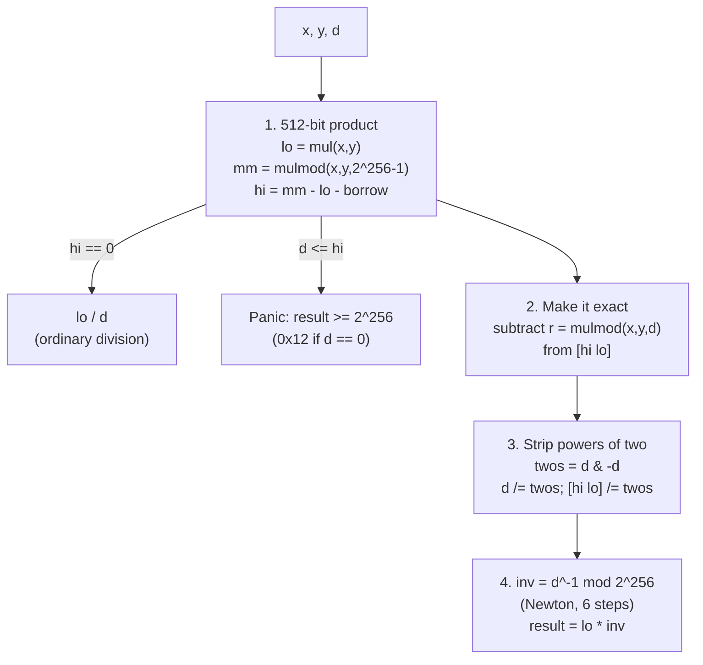

# 2.9 Arithmetic and numeric pitfalls

> [!abstract] In one minute
> - Since 0.8.0, `+ - * / % **`, unary `-`, `++`, `--` and the compound assignments are **checked**: overflow reverts with `Panic(0x11)`, division or modulo by zero with `Panic(0x12)`. Shifts, bitwise operators and explicit conversions are **never** checked; they truncate silently.
> - `unchecked { }` turns the overflow checks off for the code written inside it, and only that code: called functions keep their own mode, and the division-by-zero check stays on. Since 0.8.22 the `++i`/`i++` of a simple `for (…; i < n; …)` loop is unchecked automatically.
> - Division truncates **toward zero**, also for signed numbers: `-7 / 2 == -3`, not `-4`. Modulo takes the sign of the dividend: `-7 % 2 == -1`, `7 % -2 == 1`. `type(int256).min / -1` is the one division that overflows: `Panic(0x11)` when checked, `type(int256).min` when unchecked.
> - Multiply before you divide to keep precision, but `a * b` can overflow when the final `a * b / d` would fit. Full-precision `mulDiv` (Remco Bloemen, used by Uniswap, OpenZeppelin and Solady) builds the 512-bit product with `mul`/`mulmod`, makes the division exact, strips powers of two, and multiplies by the inverse of the odd denominator mod 2^256 (Newton iteration).
> - Every division rounds. Choose the direction on purpose: round so the **protocol** wins, never the caller. ERC-4626 makes this a rule (`convertTo*` and deposit/redeem round down, mint/withdraw round up). Wrong-direction rounding repeated many times is how Balancer V2 lost over $125M on 3 Nov 2025.

**Prerequisites:** [[1.3 Execution model]], [[2.1 Types]] · **Leads to:** [[2.8 Errors and reverts]], [[3.3 Opcodes by family]], [[4.9 DeFi math and primitives]], [[4.10 Gas optimization]], [[5.4 Arithmetic, rounding and precision]]

Everything in this note was checked with solc-js 0.8.38 (default EVM version `osaka`, optimizer on, 200 runs) in **both** pipelines (legacy and via-IR), by running the bytecode in py-evm with Prague rules. Every edge-case result below was identical in the two pipelines unless a table says otherwise. Gas figures are execution gas for a whole call: they leave out the 21,000 intrinsic cost and calldata, so use the differences, not the totals.

## The machine underneath

The EVM has no overflow. Every stack word is a 256-bit unsigned number, and `ADD`, `SUB`, `MUL` and `EXP` simply wrap modulo 2^256 ([[1.3 Execution model]]). Signed numbers are two's complement inside the same bits, so the EVM has separate signed opcodes: `SDIV`, `SMOD`, `SLT`, `SGT`, `SAR` and `SIGNEXTEND`. `DIV`, `SDIV`, `MOD` and `SMOD` by zero return 0 instead of failing. `ADDMOD` and `MULMOD` compute `(a + b) mod n` and `(a * b) mod n` **without** losing the high bits of the intermediate sum or product; that one fact is what makes full-precision `mulDiv` possible later in this note.

So every safety property you get from Solidity is software the compiler adds around these opcodes. This note is about that software: what it checks, what it does not, what it costs, and the numeric traps that remain even with perfect overflow checks. The opcodes themselves, with gas costs and stack effects, are catalogued in [[3.3 Opcodes by family]]. How narrow types like `uint8` sit inside a 256-bit word, and how the compiler keeps their high bits clean, is in [[2.1 Types]].

| Opcode | Gas | What it does on the edge |
|---|---|---|
| `ADD`, `SUB` | 3 | wraps mod 2^256 |
| `MUL`, `DIV`, `SDIV`, `MOD`, `SMOD`, `SIGNEXTEND` | 5 | `MUL` wraps; division and modulo by 0 return 0; `SDIV(min, -1)` returns `min` |
| `ADDMOD`, `MULMOD` | 8 | exact intermediate (up to 257 or 512 bits); modulus 0 returns 0 |
| `EXP` | 10 + 50 per byte of the exponent | wraps; `EXP(0, 0) = 1` |
| `SHL`, `SHR`, `SAR` | 3 | shift ≥ 256 gives 0 (or −1 for negative `SAR`) |

## Checked arithmetic since 0.8.0

Before 0.8.0 (16 Dec 2020) Solidity arithmetic wrapped like the opcodes, and safe code used the `SafeMath` library (`a.add(b)`). Since 0.8.0 the compiler inserts the check itself, and OpenZeppelin later dropped `SafeMath` (Contracts 5.0). The docs put it plainly: "Since Solidity 0.8.0, all arithmetic operations revert on over- and underflow by default."

A failed check reverts with `Panic(uint256)` data, never with `INVALID` (that changed in 0.8.0 too): the 4-byte selector `0x4e487b71` followed by the code as a 32-byte word. The two arithmetic codes are:

| Code | Meaning | Disabled by `unchecked`? |
|---|---|---|
| `0x11` | Arithmetic overflow or underflow outside `unchecked` | yes |
| `0x12` | Division or modulo by zero | **no** |

The full Panic table and how callers decode it are in [[2.8 Errors and reverts]].

### What is checked, operator by operator

I compiled one function per operator and ran it at the boundary. Results were identical under legacy and via-IR.

| Expression (checked) | Input | Result | Same code inside `unchecked` |
|---|---|---|---|
| `a + b` | `max + 1` | `Panic(0x11)` | 0 |
| `a - b` | `0 - 1` | `Panic(0x11)` | `2^256 - 1` |
| `a * b` | `2^128 * 2^128` | `Panic(0x11)` | 0 |
| `a++` (`uint8`) | 255 | `Panic(0x11)` | 0 |
| `--a` (`uint8`) | 0 | `Panic(0x11)` | — |
| `a += b` (`uint8`) | 200 + 100 | `Panic(0x11)` | — |
| `-a` (`int256`) | `type(int256).min` | `Panic(0x11)` | `type(int256).min` |
| `-a` (`int8`) | −128 | `Panic(0x11)` | — |
| `a ** b` | `2 ** 256` | `Panic(0x11)` | 0 |
| `a ** b` (`uint8`) | `2 ** 8` | `Panic(0x11)` | — |
| `a ** b` (`int256`) | `(-2) ** 255` | `type(int256).min` (fits) | — |
| `a ** b` (`int256`) | `(-2) ** 256`, `2 ** 255` | `Panic(0x11)` both | — |
| `a / b` (`int256`) | `min / -1` | `Panic(0x11)` | `type(int256).min` |
| `a * b` (`int8`) | `-128 * -1` | `Panic(0x11)` | — |
| `a % b` (`int256`) | `min % -1` | 0 (no overflow) | 0 |
| `a / b`, `a % b` | `x / 0`, `x % 0` | `Panic(0x12)` | **`Panic(0x12)`** |
| `x << n`, `~x`, `x & y` | any | never reverts | same |
| `uint128(x)`, `int8(x)` | out of range | truncates, never reverts | same |

The checks are per type, not per word. A `uint8` addition panics above 255 even though the EVM word could hold 256. Implicit conversions never need a check, because Solidity only allows implicit conversions that widen (`uint8 → uint16`, `uint16 → uint256`), and widening cannot lose information.

> [!warning] The operation happens in the operand type, not the result type
> `uint128 a; uint128 b; uint256 c = a * b;` multiplies in `uint128` and then widens. With `a = b = 2^64` this reverted with `Panic(0x11)` in both pipelines, even though `2^128` fits easily in `c`. Write `uint256(a) * b`. The same trap exists for `uint8` counters, `uint32` timestamps and `uint96` amounts. Before 0.8.0 this wrapped silently instead.

### How the compiler implements a check

The via-IR code generator makes the helpers easy to read. These are taken straight from the `ir` output of 0.8.38:

```yul
function checked_add_t_uint256(x, y) -> sum {
    x := cleanup_t_uint256(x)
    y := cleanup_t_uint256(y)
    sum := add(x, y)
    if gt(x, sum) { panic_error_0x11() }        // wrapped iff the sum got smaller
}
function checked_add_t_uint8(x, y) -> sum {
    x := cleanup_t_uint8(x)
    y := cleanup_t_uint8(y)
    sum := add(x, y)
    if gt(sum, 0xff) { panic_error_0x11() }      // narrow type: compare with the type's max
}
function checked_mul_t_uint256(x, y) -> product {
    x := cleanup_t_uint256(x)
    y := cleanup_t_uint256(y)
    let product_raw := mul(x, y)
    product := cleanup_t_uint256(product_raw)
    // overflow, if x != 0 and y != product/x
    if iszero(or(iszero(x), eq(y, div(product, x)))) { panic_error_0x11() }
}
function checked_div_t_int256(x, y) -> r {
    x := cleanup_t_int256(x)
    y := cleanup_t_int256(y)
    if iszero(y) { panic_error_0x12() }
    // overflow for minVal / -1
    if and(eq(x, 0x8000000000000000000000000000000000000000000000000000000000000000),
           eq(y, sub(0, 1))) { panic_error_0x11() }
    r := sdiv(x, y)
}
function panic_error_0x11() {
    mstore(0, 35408467139433450592217433187231851964531694900788300625387963629091585785856)
    mstore(4, 0x11)
    revert(0, 0x24)
}
```

The big decimal constant is `0x4e487b71` shifted to the top of a word. Three patterns cover almost everything:

- **Unsigned add:** the sum wrapped exactly when it is smaller than an operand.
- **Multiply:** the product wrapped exactly when dividing it by `x` does not give back `y`. That costs a `DIV`, which is why checked `*` is the most expensive of the three basic operators.
- **Signed add:** overflow if `x >= 0` and `sum < y`, underflow if `x < 0` and `sum >= y`. Signed checks need `SLT`, so they cost a little more than unsigned ones.

## `unchecked` blocks

`unchecked { … }` (also new in 0.8.0) gives you the old wrapping behaviour for the arithmetic written inside the braces. You use it when you have **proved** that a value cannot overflow and want to save gas, or when you **want** modular arithmetic (hashing, the inverse in `mulDiv`, ring buffers, timestamps that wrap).

The docs list exactly which operators it affects: `++`, `--`, `+`, binary `-`, unary `-`, `*`, `/`, `%`, `**`, and the compound assignments `+=`, `-=`, `*=`, `/=`, `%=`. For `/` it only removes the `min / -1` check; the zero check stays.

### The scoping rules, verified

| Rule | What happened in 0.8.38 |
|---|---|
| Not inherited by called functions | `unchecked { return _sub(0, 1); }`, where `_sub` is an internal function doing `a - b`, reverted with `Panic(0x11)` in both pipelines. The callee is compiled once, in its own mode. |
| Division and modulo by zero stay checked | `unchecked { a / 0 }`, `a % 0`, and their signed forms all gave `Panic(0x12)` |
| Cannot be nested | `SyntaxError: "unchecked" blocks cannot be nested.` |
| Must sit inside a block | `if (a > 0) unchecked { … }` gives `ParserError: "unchecked" blocks can only be used inside regular blocks.` Write `if (a > 0) { unchecked { … } }`. |
| No modifier placeholder inside | `modifier m() { unchecked { _; } }` gives `SyntaxError: The placeholder statement "_" cannot be used inside an "unchecked" block.` Otherwise the function body would silently become unchecked. |
| User-defined operators | The operator function's own body decides. See [[2.1 Types]]: an `unchecked` around a user-defined `-` still panicked. |

The first rule is the one that matters in audits. `unchecked` is lexical. It never reaches into a library call, an internal function, or a modifier. The reverse is the danger: a helper written with `unchecked` inside is unchecked for **every** caller, however careful the caller is.

### The for-loop increment (0.8.22)

The classic gas idiom was:

```solidity
// SPDX-License-Identifier: MIT
pragma solidity 0.8.38;

contract Loops {
    function manual(uint256 n) external pure returns (uint256 x) {
        for (uint256 i; i < n;) {
            x ^= i;
            unchecked { ++i; }   // the pre-0.8.22 idiom
        }
    }

    function automatic(uint256 n) external pure returns (uint256 x) {
        for (uint256 i; i < n; ++i) {   // since 0.8.22 this ++i is compiled without a check
            x ^= i;
        }
    }
}
```

Since 0.8.22 the compiler removes the overflow check from the loop increment by itself. The release post lists the exact conditions: the condition is `i < …` on a local variable of a built-in integer type, compared in the counter's own type; the loop expression is `i++` or `++i`; and `i` is not modified in the condition or the body. Only the built-in `<` counts: "Operator <= and others are intentionally excluded". The optimization runs even with the optimizer disabled. It can be switched off only through standard JSON (`settings.optimizer.details.simpleCounterForLoopUncheckedIncrement: false`).

I measured the cost of one loop iteration (body `x ^= i`, difference between `n = 100` and `n = 0`, divided by 100):

| Loop header | Auto-unchecked? | Legacy gas/iteration | Via-IR gas/iteration |
|---|---|---|---|
| `for (uint256 i; i < n; ++i)` | yes | 55 | 59 |
| `for (uint256 i; i < n; i++)` | yes | 55 | 59 |
| `for (uint256 i; i < n;) { …; unchecked { ++i; } }` | (manual) | 55 | 59 |
| `for (uint256 i; i < n; i += 1)` | **no** | 129 | 84 |
| `for (uint256 i; i != n; ++i)` | **no** (not `<`) | 114 | 83 |
| `for (uint256 i; i < n; ++i) { …; i = i; }` | **no** (modified) | 117 | 83 |
| `for (uint8 i; i < n; ++i)` (`n` is `uint8`) | yes | 79 | 76 |
| `for (uint8 i; i < n; i += 1)` | **no** | 168 | 98 |

So the manual `unchecked { ++i; }` idiom is now dead weight for simple loops: it cost exactly the same as plain `++i`. The table also shows how much a checked increment cost: 74 gas per iteration on legacy and 25 on via-IR in this loop. A down-counting `--i` loop is not covered.

## Division and modulo

### Truncation toward zero

Integer division in Solidity (and in `DIV`/`SDIV`) **truncates toward zero**. For positive numbers that is the same as rounding down. For negative results it rounds **up**, toward zero. The docs' example: "`int256(-5) / int256(2) == int256(-2)`".

Modulo is defined to match: `a == (a / n) * n + a % n`, so the remainder has the sign of the dividend (the left operand), or is zero.

| Expression | Solidity (measured) | Floor division (Python `//`) |
|---|---|---|
| `-7 / 2` | −3 | −4 |
| `7 / -2` | −3 | −4 |
| `-7 / -2` | 3 | 3 |
| `-7 % 2` | −1 | 1 |
| `7 % -2` | 1 | −1 |
| `-7 % -2` | −1 | −1 |
| `-7 >> 1` (arithmetic shift) | **−4** | −4 |

The last row is a trap of its own. A signed right shift `x >> k` is **not** `x / 2**k` for negative `x`. The docs: "`x >> y` is equivalent to the mathematical expression `x / 2**y`, rounded towards negative infinity." So the compiler cannot replace a signed division by a power of two with `SAR`, and you cannot either.

If you need floor division on signed values, adjust after dividing:

```solidity
// SPDX-License-Identifier: MIT
pragma solidity 0.8.38;

library SignedFloor {
    /// floor(a / b) for signed integers. Solidity's `/` truncates toward zero.
    function divFloor(int256 a, int256 b) internal pure returns (int256 q) {
        q = a / b;                                   // checked: b == 0 -> 0x12, min / -1 -> 0x11
        if ((a % b != 0) && ((a < 0) != (b < 0))) q -= 1;
    }
}

contract SignedFloorDemo {
    function divFloor(int256 a, int256 b) external pure returns (int256) { return SignedFloor.divFloor(a, b); }
}
```

Measured: `divFloor(-7, 2) = -4`, `divFloor(7, -2) = -4`, `divFloor(-6, 2) = -3`, `divFloor(-7, -2) = 3`.

### Division by zero

`Panic(0x12)` for `/` and `%`, signed and unsigned, checked **and** unchecked. The docs: "It is not possible to disable the check for division by zero or modulo by zero using the unchecked block." If you really want the EVM's "x / 0 = 0", write `div(x, 0)` in inline assembly. Assembly is never checked.

### The one overflowing division: `type(int256).min / -1`

Two's complement is asymmetric: `int256` runs from −2^255 to 2^255 − 1. So `-(−2^255)` = 2^255 does not fit, and neither does `type(int256).min / -1`. The docs: "The expression `type(int).min / (-1)` is the only case where division causes an overflow. In checked arithmetic mode, this will cause a failing assertion, while in wrapping mode, the value will be `type(int).min`."

Verified, both pipelines:

| Expression | Checked | Unchecked |
|---|---|---|
| `type(int256).min / -1` | `Panic(0x11)` | `type(int256).min` |
| `int8(-128) / int8(-1)` | `Panic(0x11)` | −128 |
| `-type(int256).min` | `Panic(0x11)` | `type(int256).min` |
| `int8(-128) * int8(-1)` | `Panic(0x11)` | — |
| `type(int256).min % -1` | 0 | 0 |

Note that the "failing assertion" in the docs is `Panic(0x11)`, not `Panic(0x01)`. The checked helper above tests exactly for `x == 0x80…00 && y == -1` before `SDIV`. Unsigned negation is not a thing at all: `-d` for a `uint256` is a compile error, "Unary negation is only allowed for signed integers." Old Uniswap V3 code that used `-denominator & denominator` (compiled with 0.7) had to become `(0 - denominator) & denominator` inside `unchecked` for 0.8; outside `unchecked`, `0 - d` panics for every nonzero `d` (measured: `Panic(0x11)`).

## Exponentiation

`a ** b` takes an unsigned exponent only; `uint ** int` fails with "Exponentiation power is not allowed to be a signed integer type." The result has the type of the **base**. `0 ** 0` is 1, as defined by the EVM (measured).

Checking `**` for overflow is harder than checking `*`, because `EXP` wraps and you cannot undo it. The 0.8.38 helper `checked_exp_unsigned` handles it in tiers:

1. Exponent 0 → 1; base 0 → 0; base 1 → 1.
2. Base 2: panic if the exponent is over 255, else one `EXP`.
3. Small base and exponent, where no overflow is possible in 256 bits: `(base < 11 && exponent < 78) || (base < 307 && exponent < 32)` → one `EXP` plus a comparison with the type's max.
4. Otherwise a square-and-multiply loop (`checked_exp_helper`) that checks each squaring and each multiplication.

So checked `**` cost depends on the operands. Measured whole-call gas (one function `f(a, b) returns a ** b`):

| Call | Legacy checked | Legacy unchecked | Via-IR checked | Via-IR unchecked |
|---|---|---|---|---|
| `a ** b` with `10 ** 18` (tier 3) | 608 | 318 | 386 | 209 |
| `a ** b` with `7 ** 40` (tier 3) | 608 | 318 | 386 | 209 |
| `a ** b` with `3 ** 100` (loop) | 1,421 | 318 | 1,102 | 209 |
| `2 ** b` with `b = 100` (literal base 2) | 505 | 323 | 174 | 149 |

The docs add: "For the cases of `x**3`, the expression `x*x*x` might be cheaper." Unchecked `**` is a single `EXP`: 10 + 50 gas per byte of the exponent. Inside `unchecked`, `3 ** 200` returned `3^200 mod 2^256` without complaint. Literal-only expressions such as `10**18` are computed at compile time and cost nothing at run time ([[2.1 Types]]).

## Shifts

Shifts are bit operations, so they are never checked. The docs: "The result of a shift operation has the type of the left operand, truncating the result to match the type", and "Overflow checks are never performed for shift operations as they are done for arithmetic operations. Instead, the result is always truncated." The shift amount must be unsigned: `a << n` with `int256 n` fails with "Built-in binary operator << cannot be applied to types uint256 and int256."

| Expression | Result (both pipelines) |
|---|---|
| `uint8(0x81) << 1` | 2 (the top bit fell off) |
| `uint8(1) << 8` | 0 |
| `uint256(1) << 256` | 0 |
| `uint256(3) << 255` | `2^255` (one bit lost) |
| `int256(-7) >> 1` | −4 (rounds toward −∞) |
| `int256(-1) >> 300` | −1 |

`x << k` looks like "multiply by 2^k" and is often used that way in fixed-point code (Q64.96, Q128.128). It is a multiply **without** the overflow check. If the high bits matter, check them yourself first: `require(x <= type(uint256).max >> k)`. That is exactly the check the Cetus code on Sui got wrong (see [[#Pitfalls and incidents]]).

One more subtlety from [[2.1 Types]]: in the legacy pipeline the bits shifted past a narrow type's width stay in the stack word until the next cleanup. Solidity code never sees them, but inline assembly that reads the variable can.

## Conversions: truncation and reinterpretation

Explicit conversions never revert (except integer → enum, which gives `Panic(0x21)`). The docs: "Explicit type conversions will always truncate and never cause a failing assertion." Since 0.8.0 one conversion may change only one of sign, width or category, so the meaning of each step is clear ([[2.1 Types]] has the rules and the `int8 → uint16` example).

Verified values:

| Conversion | Input | Output | What happened |
|---|---|---|---|
| `uint128(x)` | `2^128 + 5` | 5 | top 128 bits dropped |
| `uint128(x)` | `2^256 − 1` | `2^128 − 1` | low 128 bits kept |
| `uint8(x)` | 300 | 44 | 300 mod 256 |
| `int8(x)` (from `int256`) | 200 | −56 | low byte `0xc8`, read as signed |
| `int8(x)` (from `int256`) | −129 | 127 | low byte `0x7f` |
| `int256(x)` (from `uint256`) | `2^256 − 1` | −1 | same bits, signed view |
| `int256(x)` (from `uint256`) | `2^255` | `type(int256).min` | same bits |
| `uint256(x)` (from `int256`) | −1 | `2^256 − 1` | same bits |
| `uint8(x)` (from `int8`) | −1 | 255 | same bits |

Two kinds of silent change hide here:

- **Downcasts** (`uint256 → uint128`, `int256 → int64`) keep the low bits. A balance of `2^128 + 5` becomes 5.
- **Sign changes at the same width** keep every bit and change the meaning. A negative `int256` PnL cast to `uint256` becomes a number near 2^256. A huge `uint256` cast to `int256` becomes negative.

Packing values into storage is the usual reason to downcast ([[2.3 Storage layout]]). Use a checked cast. OpenZeppelin's `SafeCast` (v5.6) does it with a comparison and a custom error, for example:

```solidity
// SPDX-License-Identifier: MIT
pragma solidity 0.8.38;

/// Same shape as OpenZeppelin SafeCast (v5.x).
library Cast {
    error SafeCastOverflowedUintDowncast(uint8 bits, uint256 value);
    error SafeCastOverflowedIntToUint(int256 value);

    function toUint128(uint256 value) internal pure returns (uint128) {
        if (value > type(uint128).max) revert SafeCastOverflowedUintDowncast(128, value);
        return uint128(value);
    }

    function toUint256(int256 value) internal pure returns (uint256) {
        if (value < 0) revert SafeCastOverflowedIntToUint(value);
        return uint256(value);
    }
}

contract Packed {
    uint128 public reserve0;
    uint128 public reserve1;

    function set(uint256 r0, uint256 r1) external {
        reserve0 = Cast.toUint128(r0);   // reverts instead of storing r0 mod 2^128
        reserve1 = Cast.toUint128(r1);
    }
}
```

Note the error type: a failed `SafeCast` reverts with a **custom error**, not a Panic. Tests that expect `Panic(0x11)` for "overflow" will not match it.

## What the checks cost

Checked arithmetic is not free, and the price depends heavily on the pipeline. Each row is a contract with one function `f(uint256 a, uint256 b)` that returns the expression, so dispatch is identical and the difference is the check.

| Expression | Legacy checked | Legacy unchecked | Legacy cost of check | Via-IR checked | Via-IR unchecked | Via-IR cost of check |
|---|---|---|---|---|---|---|
| `a + b` | 357 | 258 | 99 | 180 | 152 | 28 |
| `a - b` | 357 | 261 | 96 | 180 | 152 | 28 |
| `a * b` | 373 | 260 | 113 | 205 | 154 | 51 |
| `a / b` | 337 | 306 | 31 | 176 | 176 | 0 |
| `a ** b` (3 ** 100) | 1,421 | 318 | 1,103 | 1,102 | 209 | 893 |

Why legacy is so much worse: the legacy code generator emits the check as a shared internal routine reached by `JUMP`s, with the panic path laid out separately. Via-IR emits Yul helpers that the optimizer inlines into a compare and a conditional jump. On via-IR the check on `+` costs about the same as nine `ADD`s; on legacy, about 33. For `/` the zero check is never removable, so `unchecked` buys nothing on via-IR. (Legacy unchecked `/` still came out 31 gas cheaper in this measurement; the generated code differs in layout, not in the check.)

> [!tip] When `unchecked` is worth it
> Only inside a hot path, and only after you can write down the proof of the bound in a comment. Good cases: loop counters that are not covered by 0.8.22, `a - b` right after `require(a >= b)` or `if (a < b) revert`, sums of values that are each bounded by a total supply that itself fits, modular arithmetic on purpose. Bad case: "it saves 28 gas" on an amount the user controls. Part 4's [[4.10 Gas optimization]] discusses where these savings matter.

## Precision: multiply before you divide

Integers have no fraction, so every `/` throws information away. The amount thrown away is up to one unit of the **result**. If you then multiply, you multiply the error too.

```solidity
// SPDX-License-Identifier: MIT
pragma solidity 0.8.38;

contract Fees {
    // Wrong order: the division throws away up to 9,999 units before the multiply.
    function feeDivFirst(uint256 amount, uint256 bps) external pure returns (uint256) {
        return amount / 10_000 * bps;
    }
    // Right order: one rounding step at the very end, error < 1 unit of the result.
    function feeMulFirst(uint256 amount, uint256 bps) external pure returns (uint256) {
        return amount * bps / 10_000;
    }
}
```

Measured, both pipelines:

| Call | `feeDivFirst` | `feeMulFirst` | Exact value |
|---|---|---|---|
| amount 9,999, 30 bps | **0** | 29 | 29.997 |
| amount 123,456,789, 30 bps | 370,350 | 370,370 | 370,370.367 |

The rule: **one division, last**. Rearrange `a / b * c` to `a * c / b`, and `(a / b) / c` to `a / (b * c)`. Scale up before dividing when you need a fraction (`a * 1e18 / b` gives an 18-decimal result).

### When multiplying first overflows

The cost of the rule is that the intermediate product `a * c` must fit in 256 bits even when the final result is small. `2^256` is about `1.16 × 10^77`.

| Product | Size | Fits? |
|---|---|---|
| Two 18-decimal amounts of 10^9 tokens (`1e27 * 1e27`) | 10^54 | yes |
| WAD × WAD × WAD (`1e18` cubed, as in `x * y * z / 1e36`) | 10^54 for unit values | yes, but only 23 digits of headroom |
| RAY cubed (`1e27` each) | 10^81 | **no**, `Panic(0x11)` |
| `amount * bps` with `amount > max / bps` | — | **no** |
| `2^200 * 2^100 / 2^100` | 2^300 intermediate, result 2^200 | **no** with `*` and `/`; yes with `mulDiv` |

The last row was measured: the naive `x * y / d` reverted with `Panic(0x11)`; the `mulDiv` below returned exactly 2^200. With checked arithmetic an overflow is a revert, not a wrong number, so the failure mode is **denial of service**: a vault or pool that stops working once balances grow, or a liquidation that cannot execute. Before 0.8, it was a silently wrong number (see Truebit below).

There are three classic fixes, in order of preference:

1. **Full-precision `mulDiv`**, which keeps the 512-bit product. It costs a few hundred gas and is exact.
2. **Restructure** so the large factors cancel first (`a * (c / g) / (b / g)` with a known common factor `g`), when the math allows it exactly.
3. **Divide first and accept the precision loss**, only when you can bound the loss and it favours the protocol.

## Full-precision `mulDiv`

`mulDiv(x, y, d)` returns `floor(x * y / d)` exactly, for any 256-bit `x`, `y`, `d`, as long as the **result** fits in 256 bits. Remco Bloemen published the algorithm in his "Mathemagic" posts (the "muldiv" post is dated 6 Jul 2018). Uniswap V3's `FullMath`, OpenZeppelin's `Math.mulDiv` and Solady's `FixedPointMathLib.fullMulDiv` all implement it. It has four steps.



### Step 1: the 512-bit product, by the Chinese remainder theorem

Write the true product as `P = hi · 2^256 + lo`, with `hi` and `lo` each below 2^256. `MUL` gives `lo = P mod 2^256` directly. `MULMOD` computes with an exact 512-bit intermediate, so `mm = mulmod(x, y, 2^256 − 1) = P mod (2^256 − 1)` is also cheap.

Now use `2^256 ≡ 1 (mod 2^256 − 1)`. Then `P = hi · 2^256 + lo ≡ hi + lo (mod 2^256 − 1)`, so `hi ≡ mm − lo (mod 2^256 − 1)`. The moduli 2^256 and 2^256 − 1 are coprime, which is the Chinese remainder theorem part: the two residues determine `P` uniquely. In code, the subtraction `mm − lo` is done in 256-bit wrapping arithmetic and corrected by one when it borrows:

```text
mm := mulmod(x, y, not(0))      // not(0) = 2^256 - 1
lo := mul(x, y)
hi := sub(sub(mm, lo), lt(mm, lo))
```

Three opcodes (13 gas for the arithmetic) give the full 512-bit product. I checked `hi · 2^256 + lo == x · y` against Python big integers for 2,000 inputs per pipeline: 0 mismatches.

### Step 2: make the division exact

If `hi == 0` the product fits in a word and plain `lo / d` is the answer. If `d <= hi`, the quotient is at least 2^256, so the function must revert; this test also catches `d == 0`. Otherwise compute the remainder `r = mulmod(x, y, d)` and subtract it from the 512-bit `[hi lo]`, borrowing from `hi` if `r > lo`. Now `[hi lo]` is an exact multiple of `d`, and the floor has already been taken.

### Step 3: factor out powers of two

The trick in step 4 needs an **odd** `d`, because only odd numbers have an inverse modulo 2^256. `twos = d & (0 − d)` isolates the lowest set bit of `d` (the largest power of two that divides it). Divide `d` and `lo` by `twos`, then move the low bits of `hi` into the top of `lo`: `lo |= hi * (2^256 / twos)`. You cannot write `2^256` in a word, so the code computes it as `(0 − twos) / twos + 1`. After this step the exact quotient is unchanged, `d` is odd, and since the quotient is below 2^256 only the low word is needed.

### Step 4: divide by multiplying with the modular inverse

When `d` is odd there is a unique `inv` with `d · inv ≡ 1 (mod 2^256)`. Because the division is exact, `quotient = lo · inv mod 2^256`. Finding `inv` uses Newton–Raphson in modular form (Hensel lifting):

> if `d · x ≡ 1 (mod 2^k)`, then `x' = x · (2 − d · x)` satisfies `d · x' ≡ 1 (mod 2^(2k))`.

Proof in one line: write `d · x = 1 + e` with `e ≡ 0 (mod 2^k)`. Then `d · x' = (1 + e)(1 − e) = 1 − e²`, and `e² ≡ 0 (mod 2^(2k))`. Each step doubles the number of correct low bits.

The seed is `inv = (3 * d) ^ 2`. In Solidity `^` is **XOR**, not power, and `*` binds tighter, so this is `(3·d) XOR 2`. The OpenZeppelin and Remco comments say the seed is "correct for four bits", and the six iterations are labelled 2^8, 2^16, 2^32, 2^64, 2^128, 2^256.

I checked this by running it, and the seed is in fact a little better than the comment says:

- Exhaustive check over all odd residues: `d · ((3d) XOR 2) ≡ 1` holds mod 2^4 and mod **2^5** for every odd `d`, but not mod 2^6.
- On-chain run of the seed and six Newton steps for 2,000 random odd 256-bit `d`: the minimum number of correct low bits after each stage was **5, 10, 20, 40, 80, 160, 256**.
- So five steps are not enough (only 160 bits guaranteed), and six are: 5 · 2^6 = 320 ≥ 256. The commented 4 → 8 → … → 256 chain is a safe lower bound.
- The tempting misreading `(3d)**2` (power) is **not** a valid seed: it fails mod 16.

### My implementation

This is my own commented version of the same algorithm. It compiles with 0.8.38 in both pipelines.

```solidity
// SPDX-License-Identifier: MIT
pragma solidity 0.8.38;

/// floor(x * y / d) and ceil(x * y / d) with a 512-bit intermediate product.
/// Same algorithm as Remco Bloemen's mulDiv (Uniswap FullMath, OpenZeppelin Math, Solady),
/// rewritten with comments for teaching.
library FullMath {
    /// @dev [hi lo] = x * y as a 512-bit number: x * y = hi * 2^256 + lo.
    function mul512(uint256 x, uint256 y) internal pure returns (uint256 hi, uint256 lo) {
        assembly ("memory-safe") {
            // mm = x*y mod (2^256 - 1), lo = x*y mod 2^256.
            // Chinese remainder theorem: hi = (mm - lo) mod (2^256 - 1),
            // which is (mm - lo - borrow) in 256-bit wrapping arithmetic.
            let mm := mulmod(x, y, not(0))
            lo := mul(x, y)
            hi := sub(sub(mm, lo), lt(mm, lo))
        }
    }

    function mulDiv(uint256 x, uint256 y, uint256 d) internal pure returns (uint256 result) {
        unchecked {
            (uint256 hi, uint256 lo) = mul512(x, y);

            // Fast path: the product fits in 256 bits. Solidity's `/` panics with 0x12 on d == 0,
            // even inside `unchecked`.
            if (hi == 0) return lo / d;

            // The quotient fits in 256 bits only if d > hi. This also rejects d == 0.
            if (d <= hi) {
                assembly ("memory-safe") {
                    mstore(0x00, 0x4e487b71) // Panic(uint256) selector
                    mstore(0x20, add(0x11, iszero(d))) // 0x12 if d == 0, else 0x11
                    revert(0x1c, 0x24)
                }
            }

            assembly ("memory-safe") {
                // 1. Make the division exact: subtract r = x*y mod d from [hi lo].
                let r := mulmod(x, y, d)
                hi := sub(hi, gt(r, lo)) // borrow from hi if lo < r
                lo := sub(lo, r)

                // 2. Factor out the largest power of two dividing d. twos = d & -d (lowest set bit).
                let twos := and(d, sub(0, d))
                d := div(d, twos)          // d is now odd
                lo := div(lo, twos)        // lo >> k
                // flip = 2^256 / twos, computed as (2^256 - twos) / twos + 1 without a 257-bit literal
                let flip := add(div(sub(0, twos), twos), 1)
                lo := or(lo, mul(hi, flip)) // bring the low k bits of hi into the top of lo

                // 3. Inverse of odd d mod 2^256 by Newton-Raphson (Hensel lifting).
                //    Seed: (3*d) XOR 2 is correct mod 2^4 (in fact mod 2^5). Each step doubles the correct bits.
                let inv := xor(mul(3, d), 2)
                inv := mul(inv, sub(2, mul(d, inv))) // mod 2^8
                inv := mul(inv, sub(2, mul(d, inv))) // mod 2^16
                inv := mul(inv, sub(2, mul(d, inv))) // mod 2^32
                inv := mul(inv, sub(2, mul(d, inv))) // mod 2^64
                inv := mul(inv, sub(2, mul(d, inv))) // mod 2^128
                inv := mul(inv, sub(2, mul(d, inv))) // mod 2^256

                // 4. The division is exact and the quotient is < 2^256, so quotient = lo * inv mod 2^256.
                result := mul(lo, inv)
            }
        }
    }

    function mulDivUp(uint256 x, uint256 y, uint256 d) internal pure returns (uint256 result) {
        result = mulDiv(x, y, d);
        // mulDiv already reverted for d == 0, so mulmod is safe here.
        if (mulmod(x, y, d) != 0) result += 1; // checked: panics if floor was type(uint256).max
    }
}

contract FullMathHarness {
    function mulDiv(uint256 x, uint256 y, uint256 d) external pure returns (uint256) { return FullMath.mulDiv(x, y, d); }
    function mulDivUp(uint256 x, uint256 y, uint256 d) external pure returns (uint256) { return FullMath.mulDivUp(x, y, d); }
}
```

Points to notice:

- The whole body is `unchecked` or assembly on purpose. The modular inverse **relies** on wrapping multiplication. A checked `*` in step 4 would panic on almost every input.
- The rounding-up variant adds 1 when `mulmod(x, y, d) != 0`. That is the same rule OpenZeppelin uses (`mulDiv(x, y, d) + (roundsUp && mulmod(x, y, d) > 0 ? 1 : 0)`). The `+= 1` stays **checked**, so a floor of exactly `type(uint256).max` with a remainder panics instead of wrapping to 0.
- Do not round up with `(x * y + d − 1) / d`. The `+ d − 1` can overflow by itself, and it hides the product's overflow problem.
- OpenZeppelin 5.x reports `d == 0` as `Panic(0x12)` and a too-large result as `Panic(0x11)`, via its `Panic` library. Uniswap V3's `FullMath` uses `require(denominator > prod1)`, which reverts with empty data. Mine mimics OpenZeppelin.

### Differential test results

I compiled the harness with both pipelines and compared every call with Python's exact integers (`x * y // d`, and the ceiling version). The input set had 5,190 triples:

- the 13 × 13 × 10 grid of edge values `0, 1, 2, 3, 2^256 − 1, 2^256 − 2, 2^128, 2^128 ± 1, 2^255, 2^64, 10^18, 10^27` against denominators `1, 2, 3, 7, max, max − 1, 2^128, 2^128 + 1, 2^255, 10^18`;
- 300 products just above 2^256, each with a denominator slightly larger than `hi` (result fits) and one equal to `hi` (must overflow);
- 300 denominators rich in powers of two (`odd << k`, `k` up to 155), to exercise step 3;
- 2,500 random triples with mixed bit lengths (1 to 256 bits), about 1% zero denominators.

| Check | Legacy | Via-IR |
|---|---|---|
| `mulDiv` calls matching Python (value or expected Panic) | 5,190 / 5,190 | 5,190 / 5,190 |
| `mulDivUp` calls matching Python | 5,190 / 5,190 | 5,190 / 5,190 |
| Triples that took the full 512-bit path | 1,590 | 1,590 |
| Triples whose result is ≥ 2^256 (`Panic(0x11)` expected and got) | 1,113 | 1,113 |
| Zero denominators (`Panic(0x12)` expected and got) | 137 | 137 |
| `mul512` products checked, mismatches | 2,000, 0 | 2,000, 0 |

Targeted checks, both pipelines: `mulDiv(max, max, max) = max`; `mulDiv(max, max, max − 1)` gives `Panic(0x11)`; `mulDiv(5, 7, 0)` gives `Panic(0x12)`; and for `x = 2^256 − 2`, `y = 2^255 + 1`, `d = 2^255` the floor is exactly `2^256 − 1` with a nonzero remainder, so `mulDiv` returned `max` and `mulDivUp` reverted with `Panic(0x11)`.

Gas (whole call through the harness):

| Call | Legacy | Via-IR |
|---|---|---|
| Naive checked `x * y / d`, small inputs | 570 | 441 |
| `mulDiv`, product fits (`hi == 0` fast path) | 637 | 470 |
| `mulDiv`, full 512-bit path | 922 | 689 |

So on via-IR the fast path costs about 30 gas more than the naive expression, and the full path about 250 more. That is cheap insurance anywhere an intermediate product can be large.

## Rounding direction

Precision says how big the error is. Rounding direction says **who pays it**. In a protocol every division has a winner and a loser, and over many operations the bias adds up. The rule auditors use:

> Round so that the protocol (the pool, the vault, the remaining users) never loses. Round **down** what you pay out or credit. Round **up** what you charge or debit.

Three habits make that rule work in real formulas:

1. **Decide for each quantity, not for each function.** A swap computes "amount in" and "amount out". Out must round down, in must round up, even inside the same function.
2. **Propagate through fractions.** To round `q = a / b` down, round `a` down and `b` **up**. A value rounded down that later sits in a denominator pushes the final result **up**. This is where Balancer V2 went wrong (see below).
3. **Signed values do not round "down".** `/` truncates toward zero, so a negative quotient is rounded **up**. A loss of −3.5 units becomes −3: the trader loses less than they should. If you need a consistent direction for signed values, use explicit floor or ceiling helpers like `divFloor` above.

### ERC-4626 as the reference example

ERC-4626 (Final) writes these directions into the standard. Its security section says implementers "should be aware of the need for specific, opposing rounding directions", and that "it is considered most secure to favor the Vault itself during calculations over its users".

| Function | Computes | Required direction | OpenZeppelin 5.x |
|---|---|---|---|
| `convertToShares(assets)` | shares for assets | down ("MUST round down towards 0") | `Floor` |
| `convertToAssets(shares)` | assets for shares | down | `Floor` |
| `previewDeposit(assets)` | shares minted | "no more than" the exact shares → down | `Floor` |
| `previewMint(shares)` | assets the user pays | "no fewer than" → up | `Ceil` |
| `previewWithdraw(assets)` | shares burned | "no fewer than" → up | `Ceil` |
| `previewRedeem(shares)` | assets paid out | "no more than" → down | `Floor` |

OpenZeppelin computes all four with `assets.mulDiv(totalSupply() + 10 ** _decimalsOffset(), totalAssets() + 1, rounding)` (and the inverse), which adds **virtual shares and assets** as a defence against the inflation attack. The proof that these directions favour the vault is the Expert answer in the ladder below. The token-standard side of ERC-4626 is in [[4.4 Token standards]]; vault and AMM math in general is in [[4.9 DeFi math and primitives]].

## Solidity and Yul in practice

**Bounded `unchecked` after a check.** The compiler cannot see that a `require` already proves the bound, so you write the check once and skip the second one:

```solidity
// SPDX-License-Identifier: MIT
pragma solidity 0.8.38;

contract Balances {
    mapping(address => uint256) public balanceOf;
    error Insufficient(uint256 have, uint256 want);

    function _debit(address from, uint256 amount) internal {
        uint256 bal = balanceOf[from];
        if (bal < amount) revert Insufficient(bal, amount);
        unchecked {
            balanceOf[from] = bal - amount; // safe: bal >= amount was just checked
        }
    }

    function burn(uint256 amount) external { _debit(msg.sender, amount); }
}
```

**Signed rounding in tick math.** Uniswap V3's `TickBitmap` needs floor division of a signed tick by the tick spacing, and writes it out by hand: `int24 compressed = tick / tickSpacing; if (tick < 0 && tick % tickSpacing != 0) compressed--;` with the comment "round towards negative infinity". Without the correction, ticks −1 … −(spacing − 1) would fall into word 0 together with ticks 0 … spacing − 1.

**Arithmetic in inline assembly is never checked.** `add`, `mul`, `sub` and `exp` wrap, and `div(x, 0)` is 0. Narrow types are not cleaned for you ([[3.9 Cleanup, dirty bits and safety]]). An overflow check by hand looks like the compiler's:

```solidity
// SPDX-License-Identifier: MIT
pragma solidity 0.8.38;

contract AsmMath {
    function addChecked(uint256 a, uint256 b) external pure returns (uint256 s) {
        assembly {
            s := add(a, b)
            if lt(s, a) {                        // wrapped
                mstore(0x00, 0x4e487b71)         // Panic(uint256)
                mstore(0x20, 0x11)
                revert(0x1c, 0x24)
            }
        }
    }

    function divOrZero(uint256 a, uint256 b) external pure returns (uint256 q) {
        assembly { q := div(a, b) }              // EVM semantics: b == 0 gives 0, no Panic
    }
}
```

**Testing numeric code.** Differential tests against a big-integer model (as above) and fuzzed invariants such as `previewRedeem(previewDeposit(a)) <= a` catch most rounding bugs. [[6.2 Unit, fuzz and invariant testing]] shows how to set these up in Foundry; [[6.5 Formal verification]] covers proving them.

## Pitfalls and incidents

- **Narrow operand types.** `uint128 * uint128` overflows at 2^128 even when assigned to `uint256`. Widen one operand first.
- **Assuming `unchecked` is inherited, or that it is not.** It is lexical. A helper that is unchecked inside is unchecked for every caller.
- **Silent downcasts.** `uint128(x)`, `uint64(block.timestamp * 1000)`, `int256(uintValue)`. Use `SafeCast` or an explicit bound check.
- **Shifts as multiplication.** `x << 96` drops high bits without a revert. Check `x >> (256 − 96) == 0` first.
- **`a / b * c`.** Divide last. A fee of 30 bps on 9,999 units came out as 0.
- **Overflow of the intermediate product.** `x * y / d` reverts for large balances even when the result fits; use `mulDiv`. Plan for it in any formula with three or more scaled factors (RAY³ already overflows).
- **Signed truncation.** `-7 / 2 == -3`. Negative PnL, funding and tick math round toward zero, which is "up" for losses.
- **`type(int256).min`.** Negating it or dividing it by −1 panics in checked code and silently stays negative in `unchecked`. `abs()` written as `x < 0 ? -x : x` panics on it; OpenZeppelin's `SignedMath.abs` returns `uint256` for this reason.
- **Rounding toward the user.** Any conversion that rounds in the user's favour can be repeated until it pays.
- **`^` is XOR.** `2 ^ 8` is 10, not 256.

| Date | Incident | Numeric root cause |
|---|---|---|
| 8 Jan 2026 | Truebit, about $26M (8,535 ETH) | Contract compiled with Solidity 0.6.10, no default overflow checks. In the bonding-curve price function one addition in the numerator used plain `+` while neighbouring steps used `SafeSub`/`SafeDiv`. A huge purchase amount wrapped the numerator to a small value, so the price truncated to 0 ETH. |
| 3 Nov 2025 | Balancer V2 Composable Stable Pools and forks, over $125M across several chains | `_upscale` used `mulDown` regardless of swap direction. In `GIVEN_OUT` swaps the rounded-down scaled amount fed the `amountIn` calculation, so the trader paid slightly too little. Inside one `batchSwap` the attacker pushed a token balance to a rounding boundary (amounts of 8–9 wei) and repeated the swap many times, deflating the invariant `D` and so the BPT price, then bought BPT cheaply. |
| 22 May 2025 | Cetus (Sui, Move; not EVM), about $223M | The overflow check in `checked_shlw` compared against `0xffffffffffffffff << 192` instead of `1 << 192`. Values above 2^192 passed, the 64-bit left shift truncated them, and a huge liquidity position needed almost no deposit. The same bug class exists for any hand-written check in front of an EVM `SHL`. |
| Apr 2018 | BeautyChain (BEC), pre-0.8 | `batchTransfer` computed `amount = cnt * _value` without a check; choosing `_value = 2^255` with two receivers wrapped `amount` to 0 and minted huge balances. The canonical reason checked arithmetic became the default. |

The longer catalogue of rounding and precision exploits, including ERC-4626 inflation variants, is in [[5.4 Arithmetic, rounding and precision]] and [[5.14 Case studies]].

## Question ladder

> [!question]- **B** What happens on overflow in 0.8.x, and how does `unchecked` change it?
> Since 0.8.0 the arithmetic operators `+`, `-`, `*`, `/`, `%`, `**`, unary `-`, `++`, `--` and the compound assignments are checked against the **operand type's** range. On overflow or underflow the call reverts with `Panic(0x11)`: the data is `0x4e487b71` followed by `0x…11` as a 32-byte word. Division or modulo by zero reverts with `Panic(0x12)`. A `REVERT` returns unused gas; it is not the pre-0.8 `INVALID`.
>
> Inside `unchecked { … }` the same operators wrap modulo 2^N, as the EVM does: `max + 1 == 0`, `0 - 1 == max`, `uint8(255) + 1 == 0`, `-type(int256).min == type(int256).min`, `type(int256).min / -1 == type(int256).min`. Three things do **not** change: division and modulo by zero still panic with `0x12`; shifts, bitwise operators and explicit conversions were never checked anyway; and functions called from inside the block keep their own mode, because `unchecked` is lexical (verified: an internal `_sub(0, 1)` called inside `unchecked` still panicked). It cannot be nested, cannot replace a block (`if (c) unchecked {}` is a parser error), and cannot contain a modifier's `_`.
>
> Why use it: the check costs 28 gas for `+` on via-IR and 99 on legacy in my measurements, and `**` checks can cost over 1,000. Since 0.8.22 the common case, `for (…; i < n; ++i)`, is unchecked for you.

> [!question]- **I** Why multiply before dividing, and when does that overflow?
> Each integer division discards up to one unit of its result. If a multiplication follows, the discarded part is multiplied too. `amount / 10_000 * 30` lost the whole fee for 9,999 units (0 instead of 29), while `amount * 30 / 10_000` is off by less than one unit. So the rule is to do all multiplications first and a single division last, and to scale up (`* 1e18`) before dividing when you need a fraction.
>
> The price is that the intermediate product must fit in 256 bits (about 1.16 × 10^77), even when the final quotient is small. It overflows when `a * b ≥ 2^256`: for example `2^200 * 2^100 / 2^100` (result `2^200` fits, but the naive expression reverted with `Panic(0x11)`), three RAY (10^27) factors (10^81), or `amount * bps` once `amount > max / bps`. Under 0.8 that is a revert, so the risk is a denial of service that appears only once balances grow; before 0.8, or inside `unchecked`, it is a silently wrong price (Truebit, Jan 2026).
>
> The fix is a full-precision `mulDiv(a, b, d)`, which keeps the 512-bit product and reverts only if the **result** exceeds 2^256. It costs about 30 extra gas on the fast path and about 250 on the full path (via-IR, measured). Also watch the narrow-operand variant: `uint128 * uint128` overflows at 2^128 even when the result is assigned to `uint256`.

> [!question]- **I** What does `-7 / 2` return, and why does that matter for signed price math?
> It returns **−3**. Solidity (and `SDIV`) truncates toward zero, not toward negative infinity, so negative quotients round **up**. Python's `-7 // 2` is −4. The remainder takes the sign of the dividend: `-7 % 2 == -1`, `7 % -2 == 1`. A signed right shift does the opposite: `-7 >> 1 == -4`, because `SAR` rounds toward −∞. All of these were measured on 0.8.38, both pipelines.
>
> Why it matters:
>
> - **Direction is not consistent.** "Division rounds down, so the protocol wins" is true only for non-negative values. For a trader's loss of −3.5, truncation gives −3: the trader is charged less. For funding payments, PnL, interest on negative balances or signed price deltas you must pick floor or ceiling explicitly, per quantity.
> - **Bucketing breaks around zero.** Uniswap V3 compresses ticks with `tick / tickSpacing` and then subtracts one when `tick < 0` and the remainder is nonzero, "round towards negative infinity". Without that, ticks −59 … −1 and 0 … 59 (spacing 60) map to the same bucket, so the tick bitmap and price ranges would be wrong.
> - **Do not swap `/ 2**k` for `>> k` on signed values.** They differ for every negative odd input.
> - **Edge value.** `type(int256).min / -1` is the one overflowing division: `Panic(0x11)` checked, `type(int256).min` unchecked.
>
> A helper such as `divFloor` (`q = a / b; if (a % b != 0 && (a < 0) != (b < 0)) q -= 1;`) makes the intent explicit.

> [!question]- **A** Explain how full-precision `mulDiv` computes a 512-bit product and divides it.
> Goal: `floor(x · y / d)` for any 256-bit inputs, reverting only if the result is ≥ 2^256.
>
> **1. The 512-bit product.** Write `x · y = hi · 2^256 + lo`. `lo = mul(x, y)` is the product mod 2^256. `mm = mulmod(x, y, not(0))` is the product mod 2^256 − 1 (`MULMOD` has an exact intermediate). Since `2^256 ≡ 1 (mod 2^256 − 1)`, `mm ≡ hi + lo`, so `hi = mm − lo`, minus one if that subtraction borrowed: `hi := sub(sub(mm, lo), lt(mm, lo))`. The moduli are coprime, so by the Chinese remainder theorem this pair of residues determines the product.
>
> **2. Range and fast path.** If `hi == 0`, return `lo / d`. If `d <= hi`, the quotient would be ≥ 2^256 (and this also catches `d == 0`): revert. OpenZeppelin uses `Panic(0x12)` for zero and `Panic(0x11)` otherwise.
>
> **3. Exact division.** Subtract `r = mulmod(x, y, d)` from `[hi lo]` with a borrow. Now `d` divides the 512-bit number exactly, and the floor is already taken.
>
> **4. Make `d` odd.** `twos = d & (0 − d)` is the largest power of two dividing `d`. Divide `d` and `lo` by it, and shift the low bits of `hi` into `lo` by multiplying `hi` with `2^256 / twos`, computed as `(0 − twos) / twos + 1`. Because the quotient is below 2^256, the low word now carries all of it.
>
> **5. Divide by multiplying.** An odd `d` has an inverse mod 2^256. Seed `inv = (3·d) XOR 2` (Solidity's `^` is XOR), correct mod 2^4 according to the comments, and mod 2^5 in my exhaustive check. Newton–Raphson `inv = inv · (2 − d · inv)` doubles the correct bits each time (`d·x = 1 + e` gives `d·x' = 1 − e²`). Six steps reach 256 bits; measured minimum correct bits per stage over 2,000 random `d`: 5, 10, 20, 40, 80, 160, 256, so five steps would not be enough. Then `result = lo · inv mod 2^256`, which is exact because the division is exact.
>
> **Round up:** add 1 if `mulmod(x, y, d) != 0`, with a checked add so that `floor == max` panics.
>
> All of this must run with wrapping arithmetic (`unchecked`/assembly). My implementation matched Python big integers on 5,190 triples × 2 functions × 2 pipelines with zero mismatches, including 1,590 full-path cases, 1,113 overflow cases and 137 zero denominators. Cost: 470 gas on the fast path and 689 on the full path for a whole call on via-IR. What an interviewer listens for: why `mulmod` with 2^256 − 1, why the remainder is subtracted first, why `d` must be odd, why the seed works, and how many iterations are needed.

> [!question]- **E** Prove the rounding direction of a share-conversion function and show which party it favors.
> **Setup.** A vault holds `A > 0` assets and has `S > 0` shares outstanding; the price per share is `p = A / S`. Deposit uses `s = ⌊a · S / A⌋`. The only fact needed is `z − 1 < ⌊z⌋ ≤ z`.
>
> **Claim 1: the depositor never gets more than they paid.** From `s ≤ aS/A` we get `sA ≤ aS`. The depositor's claim right after the deposit is `s · (A + a) / (S + s)`, and
> `s(A + a) ≤ a(S + s)` ⇔ `sA ≤ aS`, which holds. So their claim is at most `a`.
>
> **Claim 2: existing holders never lose.** The new price is `p' = (A + a)/(S + s) ≥ (A + a)/(S + aS/A) = (A + a) / (S (A + a)/A) = A/S = p`. The price per share can only go up, so every existing holder's position keeps or gains value.
>
> **Claim 3: the loss is bounded.** Since `s > aS/A − 1`, the depositor gives up less than one share's worth, `p'`. The vault keeps that dust.
>
> If the vault rounded **up** (`s = ⌈aS/A⌉`), every inequality flips. A depositor could gain up to one share's worth per call, paid by the other holders, and repeat it in a loop. Rounding in the user's favour is a value leak with a per-call bound, and per-call bounds are what loops, `batchSwap`s and flash loans multiply.
>
> **The same argument for all four entry points** (this is exactly ERC-4626's table):
>
> | Operation | User gives | User gets | Rounding that favours the vault |
> |---|---|---|---|
> | `deposit(a)` | `a` assets | `⌊aS/A⌋` shares | down (`previewDeposit` ≤ actual) |
> | `mint(s)` | `⌈sA/S⌉` assets | `s` shares | up (`previewMint` ≥ actual) |
> | `withdraw(a)` | `⌈aS/A⌉` shares | `a` assets | up (`previewWithdraw` ≥ actual) |
> | `redeem(s)` | `s` shares | `⌊sA/S⌋` assets | down (`previewRedeem` ≤ actual) |
>
> `convertToShares` and `convertToAssets` "MUST round down". In my run of OpenZeppelin-style formulas over 300 random vault states, neither deposit → redeem nor mint → redeem ever returned more assets than were put in.
>
> **Where the bound fails: the inflation attack.** "Less than one share's worth" is only small if one share is worth little. In an empty vault without protection, an attacker deposits 1 wei (1 share) and donates 10^18 directly, so `A = 10^18 + 1`, `S = 1`. A victim depositing 10^18 gets `⌊10^18 · 1 / (10^18 + 1)⌋ = 0` shares (measured), and the attacker's single share now owns everything. The rounding direction is correct; the **unit** is the problem. Defences: OpenZeppelin's virtual shares and assets (`S + 10^offset`, `A + 1`). With offset 0 in my run the attacker spent 10^18 + 1 and could redeem only about 0.667 × 10^18, so the attack loses money (the victim still lost a third); with offset 6 the victim's loss fell to about 2.5 × 10^-7 of the deposit. Other defences: dead shares minted at creation (Uniswap V2's 1,000 `MINIMUM_LIQUIDITY`), a minimum-shares-out slippage check, and internal accounting instead of `balanceOf`.
>
> **Where it fails in multi-step math: Balancer V2 (3 Nov 2025).** Each sub-step must round in the direction that makes the **final** result favour the pool. A value rounded down that feeds the "amount in" calculation makes the user pay less. Balancer's `_upscale` always used `mulDown`; in `GIVEN_OUT` swaps that under-charged by a few wei, and a `batchSwap` repeated it many times at a rounding boundary to deflate the invariant and the BPT price. Over $125M was lost across Balancer and forks.
>
> **What an interviewer listens for:** the floor inequality and the price-monotonicity argument; that the direction is chosen per quantity (out down, in up) and propagated through denominators; that the error bound is in units of the output, so its value depends on the exchange rate; and how you would test it (fuzzed round-trip invariants, differential tests against exact arithmetic). More in [[5.4 Arithmetic, rounding and precision]] and [[4.9 DeFi math and primitives]].

## Related notes

- [[1.3 Execution model]] — 256-bit words, wrapping opcodes, how a checked add looks in a trace
- [[2.1 Types]] — integer widths, conversion rules, literal arithmetic, dirty bits after `unchecked` and shifts
- [[2.8 Errors and reverts]] — the full `Panic(uint256)` code table and how callers decode it
- [[2.10 Version map of 0.8.x features]] — 0.8.0 checked arithmetic, 0.8.22 loop increments
- [[3.3 Opcodes by family]] — `ADD`, `SDIV`, `SMOD`, `ADDMOD`, `MULMOD`, `EXP`, `SAR`, `SIGNEXTEND` in detail
- [[3.9 Cleanup, dirty bits and safety]] — unchecked arithmetic in assembly and narrow types
- [[4.4 Token standards]] — ERC-4626 interface and decimals
- [[4.9 DeFi math and primitives]] — fixed-point libraries, AMM invariants, `mulDiv` in context
- [[4.10 Gas optimization]] — when `unchecked` is worth it
- [[5.4 Arithmetic, rounding and precision]] — the security catalogue: rounding exploits, inflation attacks, precision loss
- [[5.14 Case studies]] — Balancer V2, Truebit and others in depth
- [[6.2 Unit, fuzz and invariant testing]] — differential and invariant tests for numeric code

## Sources

- [Solidity docs: Types — Integers](https://docs.soliditylang.org/en/latest/types.html) — division toward zero (`-5 / 2 == -2`), `type(int).min / (-1)` as the only overflowing division, modulo sign, shifts truncate and are never checked, `>>` rounds toward −∞, exponent rules and `0**0 == 1`, `x*x*x` advice
- [Solidity docs: Control structures — Checked or unchecked arithmetic](https://docs.soliditylang.org/en/latest/control-structures.html) — `unchecked` operators, no nesting, not inherited by called functions, no `_` inside, division by zero not disableable, explicit conversions truncate; Panic code table
- [Solidity 0.8.22 release announcement](https://soliditylang.org/blog/2023/10/25/solidity-0.8.22-release-announcement) — conditions for the automatic unchecked loop increment and the `simpleCounterForLoopUncheckedIncrement` setting
- [OpenZeppelin Contracts `Math.sol` (v5.6.0)](https://github.com/OpenZeppelin/openzeppelin-contracts/blob/master/contracts/utils/math/Math.sol) — `mul512`, `mulDiv` steps, seed "correct for four bits", six Newton steps, Panic choice, rounding variant
- [OpenZeppelin Contracts `SafeCast.sol`](https://github.com/OpenZeppelin/openzeppelin-contracts/blob/master/contracts/utils/math/SafeCast.sol) — `toUint128` pattern and custom errors
- [OpenZeppelin Contracts `ERC4626.sol`](https://github.com/OpenZeppelin/openzeppelin-contracts/blob/master/contracts/token/ERC20/extensions/ERC4626.sol) — `Floor`/`Ceil` per preview function, virtual shares and `_decimalsOffset`
- [Remco Bloemen, "Mathemagic finale: muldiv"](https://xn--2-umb.com/21/muldiv) — original algorithm, Hensel lifting, seed and six iterations; also [Full Multiplication](https://medium.com/wicketh/mathemagic-full-multiply-27650fec525d), [512-bit Division](https://medium.com/wicketh/mathemagic-512-bit-division-in-solidity-afa55870a65), [Multiplicative Inverses](https://medium.com/wicketh/mathemagic-multiplicative-inverses-b093e2a0a6d3)
- [EIP-4626: Tokenized Vaults](https://eips.ethereum.org/EIPS/eip-4626) — rounding requirements for `convertTo*` and previews, "favor the Vault" security consideration
- [OpenZeppelin, "Understanding the Balancer V2 exploit" (7 Nov 2025)](https://www.openzeppelin.com/news/understanding-the-balancer-v2-exploit) — `_upscale` with `mulDown` regardless of direction, `batchSwap` triplets, ComposableStablePool
- [BlockSec, "In-depth analysis: the Balancer V2 exploit"](https://blocksec.com/blog/in-depth-analysis-the-balancer-v2-exploit) — over $125M, `_swapGivenOut` rounding, 8/9 wei boundary, invariant `D` and BPT price
- [BlockSec, "In-depth analysis: the Truebit incident"](https://blocksec.com/blog/in-depth-analysis-the-truebit-incident) — 8 Jan 2026, 8,535 ETH, Solidity 0.6.10, unchecked numerator addition in `_getPurchasePrice`
- [BlockSec, "Cetus incident: one unchecked shift drains $223M"](https://blocksec.com/blog/blog-4cetus-incident-one-unchecked-shift-drains-223m-in-the-largest-defi-hack-of-2025) — wrong mask in `checked_shlw`, 22 May 2025
- Compiler and EVM runs (solc-js 0.8.38, legacy and via-IR, py-evm Prague) — every Panic code, edge value, conversion, shift, gas figure, the `mulDiv` differential test and the Newton bit counts in this note

