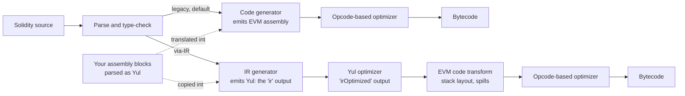
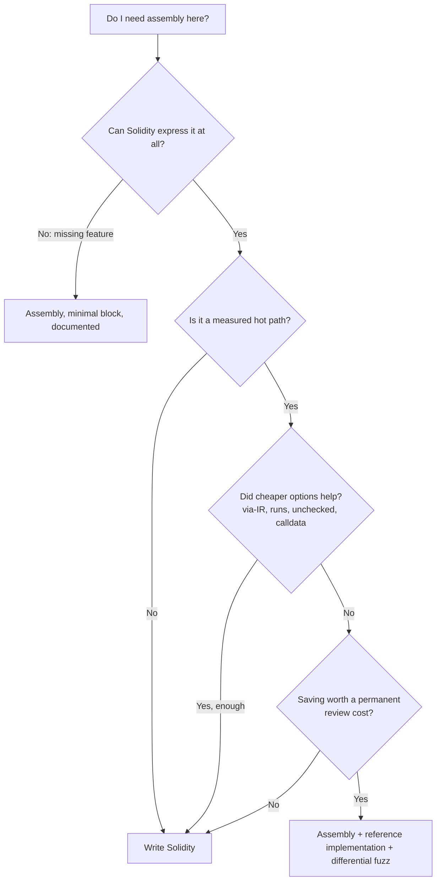
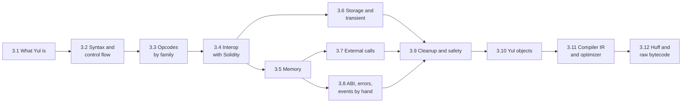

# 3.1 What Yul is and when to use it

> [!abstract] In one minute
> - **Yul is the Solidity compiler's own intermediate language.** It looks like a tiny functional language: `let`, `if`, `switch`, `for`, user functions, and every EVM opcode as a built-in function (`add(a, b)`, `sstore(slot, v)`). There are no operators, no `DUP`/`SWAP`/`JUMP`, and only one type: the 256-bit word.
> - **You meet Yul in three places:** inline `assembly { }` blocks inside Solidity, standalone Yul **objects** compiled on their own (`solc --strict-assembly`, standard-JSON `"language": "Yul"`), and the compiler's `ir` / `irOptimized` output.
> - **Two pipelines.** Legacy (still the default in 0.8.38) goes Solidity → EVM assembly directly and only translates your assembly blocks. Via-IR (stable since 0.8.13) goes Solidity → Yul → optimized Yul → bytecode, so your assembly is optimized together with the compiler's code.
> - **The optimizer sees assembly differently per pipeline.** Legacy runs the Yul optimizer only on blocks that touch no Solidity variable, *in isolation* (the root of the InlineAssemblyMemorySideEffects bug, 0.8.13–0.8.14). Via-IR optimizes the whole program, but one unannotated memory-touching block disables the stack-to-memory mover for the whole contract.
> - **Good reasons** for assembly: a measured hot path, a feature Solidity cannot express, precise control of memory or returndata. **Bad reasons**: style, "it must be cheaper", or skipping checks you have not reasoned about. Measured on 0.8.38: assembly hashing saves 81–97 gas per call; an assembly `max` saves 3–7; assembly `add` gives the same size and gas as `unchecked { a + b }` (byte-identical code under via-IR), so its "saving" over checked Solidity is the overflow check.
> - **Reviewable assembly** is small, isolated in `internal` library functions, annotated `memory-safe` only when true, commented with its memory map, and fuzzed against a plain-Solidity reference implementation on the exact compiler settings you deploy with.

**Prerequisites:** [[1.3 Execution model]], [[1.4 Memory]], [[2.4 Memory layout]], [[2.10 Version map of 0.8.x features]] · **Leads to:** [[3.2 Syntax and control flow]], [[3.3 Opcodes by family]], [[3.4 Interop with Solidity]], [[3.11 Compiler IR and the optimizer]]

## Intuition: the compiler's workbench

Think of the Solidity compiler as a workshop. Solidity is the order form: you say *what* you want ("store `v + 1` in `x`, and revert on overflow"). EVM bytecode is the finished part: a flat list of opcodes that juggle a stack. Between the two, the compiler needs a workbench, a form that is low enough to map almost one-to-one onto opcodes but high enough that a program (or a person) can still reason about it. That workbench is **Yul**.

Yul keeps the parts of bytecode that matter: every opcode is still there, and you choose exactly which ones run. It drops the parts that make bytecode unreadable:

- You never write `DUP3` or `SWAP2`. You name values with `let` and the compiler arranges the stack.
- You never write `JUMP` or `JUMPDEST`. You write `if`, `switch`, `for` and functions, and the compiler lays out the jumps.
- You never nest instructions by hand. You write `mstore(0x00, add(a, b))` and the compiler pushes the arguments in the right order.

What it does **not** do is anything Solidity does for you. There is no type system beyond "256-bit word", no overflow checks, no bounds checks, no ABI decoding, no free memory pointer management, and no protection against reading dirty bits. When you write `assembly { }` you take over those jobs yourself. That is the whole trade: precision and control in exchange for every safety net. [[#What assembly turns off]] lists each lost guarantee.

The same Yul has two jobs in the toolchain:

1. **The language of `assembly { }` blocks.** You write it by hand inside Solidity functions.
2. **The compiler's intermediate representation (IR).** Under via-IR, the compiler translates your whole contract into Yul, optimizes that Yul, and only then emits bytecode.

Because both are the same language, the assembly you write and the code the compiler generates can be optimized together, and you can read the compiler's output as if a person had written it.

> [!info]- Deep dive: where the name came from
> The language started life as **JULIA**, was briefly called **IULIA**, and became **Yul** in 0.5.0 (13 Nov 2018), when the `--julia` command-line option was renamed to `--yul`. Inline assembly before that was a looser language with raw stack instructions and jump labels. The same 0.5.0 release "disallow[ed] 'loose assembly' syntax entirely": jump labels, jumps and non-functional instructions such as a bare `dup1`. 0.7.0 then renamed `x_slot`/`x_offset` to `x.slot`/`x.offset` and disallowed `pc()`. If you see `jump`, `dup1`, labels or `x_slot` in an assembly block, the code predates 0.5 or 0.7 (all from the Solidity changelog).

## What Yul is, precisely

The Solidity docs describe Yul as "an intermediate language that can be compiled to bytecode for different backends". Its design goals, paraphrased from the docs:

- **Readable, even when generated.** Compiler output should be something a reviewer can follow.
- **Easy to translate to bytecode.** Each built-in maps to one opcode; control flow maps to a small, fixed set of jump patterns.
- **Easy to optimize.** The language is small (blocks, variable declarations, assignments, `if`, `switch`, `for`, `break`, `continue`, `leave`, function definitions, calls and literals), so optimizer steps can be stated as simple rewrites.
- **Suitable for whole-program optimization.** Functions and control flow are explicit, so the optimizer can inline, hoist and eliminate across functions.

"Pure" Yul has no built-in functions and no types at all. A **dialect** supplies them. Solidity ships with one dialect today: the **EVM dialect**, where the built-ins are the EVM opcodes and the only type is `u256`.

### Dialects, then and now

| Dialect / mode | Status in 0.8.38 | Where it is used | What it adds or lacks |
|---|---|---|---|
| EVM dialect, inline flavour | Current | `assembly { }` inside Solidity | Opcodes as built-ins, plus access to Solidity variables (`x`, `x.slot`, `x.offset`, `cd.length` and so on). **No** object built-ins: `datasize`, `memoryguard`, `verbatim_…`, `loadimmutable`, `linkersymbol` are all `DeclarationError: Function "…" not found.` |
| EVM dialect with objects | Current | Standalone Yul (`solc --strict-assembly`, standard-JSON `"language": "Yul"`) and the compiler's own IR | Adds `datasize`, `dataoffset`, `datacopy`, `setimmutable`, `loadimmutable`, `linkersymbol`, `memoryguard`, `verbatim_<n>i_<m>o` |
| Typed Yul (`--yul`) | **Removed in 0.8.27** (4 Sep 2024) | Was an experiment with types such as `u32`, `bool` | Writing a type now fails: `ParserError: Types are not supported in untyped Yul.` |
| EWasm dialect | **Removed in 0.8.21** (19 Jul 2023) | Was for the abandoned eWASM target | Gone with the EWasm backend |

I checked each row with solc-js 0.8.38: the object built-ins fail inside a Solidity `assembly` block and compile in a standalone object, and `let x:u256 := 1` in a standalone object gives the parser error above. The docs still describe `u256` as "the only type available in this dialect" that "can be omitted"; in 0.8.38 you *must* omit it.

> [!note] Fork-gated built-ins
> The EVM dialect follows your `evmVersion`. `tload` compiled for `shanghai` fails with `TypeError: The "tload" instruction is only available for Cancun-compatible VMs (you are currently compiling for "shanghai").` `clz` needs `osaka` (the 0.8.38 default). The Amsterdam opcodes `dupn`, `swapn`, `exchange` (EIP-8024, scheduled for Glamsterdam) are reserved names from 0.8.38 on. [[2.10 Version map of 0.8.x features]] has the full table.

## Your first Yul program, byte by byte

Here is a complete contract written in Yul alone. It adds the two 32-byte words after the selector and returns the sum. It is the smallest useful thing you can deploy, and every line is readable after this section.

```yul
object "Adder" {
    code {
        // Deploy code: copy the runtime object into memory and return it.
        datacopy(0, dataoffset("runtime"), datasize("runtime"))
        return(0, datasize("runtime"))
    }
    object "runtime" {
        code {
            // add(uint256,uint256) with no selector check: read two words, return their sum.
            mstore(0x00, add(calldataload(4), calldataload(36)))
            return(0x00, 0x20)
        }
    }
}
```

How to read it:

- `object "Adder" { code { … } object "runtime" { … } }` is the shape of every deployable Yul contract. The outer `code` is the **initcode** that runs once at deployment ([[1.8 Contract creation]]). The inner object is the **runtime code** that the initcode returns. [[3.10 Yul objects and standalone contracts]] teaches objects in full.
- `datacopy`, `dataoffset` and `datasize` are object built-ins: "copy the bytes of the sub-object called `runtime` into memory".
- `calldataload(4)` is the `CALLDATALOAD` opcode with argument 4. Every opcode is called like a function, and its result is the value it would push.
- `mstore(0x00, …)` writes one word at memory address 0. `return(0x00, 0x20)` ends the call and returns 32 bytes from address 0.

I compiled it with solc-js 0.8.38 (standard-JSON `"language": "Yul"`, optimizer on, `evmVersion` prague), deployed it in py-evm and called it with the calldata of `add(7, 35)`. It returned `0x…2a` (42) and used **28 gas** of execution.

```text
initcode (23 bytes): 600d80600a5f395ff3fe | 602435600435015f5260205ff3
runtime  (13 bytes): 602435600435015f5260205ff3
```

The runtime, opcode by opcode (stack shown top first):

```text
pc  bytes  opcode         stack after                 gas  note
00  6024   PUSH1 0x24     [0x24]                        3
02  35     CALLDATALOAD   [b]                           3  b = calldata[36..67]
03  6004   PUSH1 0x04     [0x04, b]                     3
05  35     CALLDATALOAD   [a, b]                        3  a = calldata[4..35]
06  01     ADD            [a+b]                         3  wraps on overflow, no check
07  5f     PUSH0          [0, a+b]                      2
08  52     MSTORE         []                            6  3 + 3 for the first memory word
09  6020   PUSH1 0x20     [0x20]                        3
0b  5f     PUSH0          [0, 0x20]                     2
0c  f3     RETURN         returns memory[0x00..0x1f]    0
                                               total = 28
```

Two things to notice already:

1. **Arguments are evaluated right to left.** The source says `add(calldataload(4), calldataload(36))`, but the bytecode loads offset 36 *first*. That way the first argument ends up on top of the stack, which is where `ADD` expects it. This matters when arguments have side effects; [[3.2 Syntax and control flow]] covers evaluation order.
2. **Nothing is checked.** There is no selector match (any calldata "works"), no `CALLVALUE` check, no calldata length check, no overflow check, no metadata. Compare the Solidity version, `function add(uint256 a, uint256 b) external pure returns (uint256) { unchecked { return a + b; } }`, compiled via-IR with the optimizer: **121 bytes and 152 gas**. Of those 121 bytes, 53 are the CBOR metadata trailer; the other 68 are the dispatcher, the `callvalue` check, the calldata-size check and ABI return encoding. All of that is what Solidity gives you, and what Yul makes you write yourself.

## Inline assembly and standalone Yul objects

The same language appears in two very different containers.

**Inline assembly** is a Yul block inside a Solidity function:

```solidity
// SPDX-License-Identifier: MIT
pragma solidity 0.8.38;

contract C {
    function hashPair(bytes32 a, bytes32 b) external pure returns (bytes32 h) {
        assembly ("memory-safe") {
            mstore(0x00, a)          // scratch space word 0
            mstore(0x20, b)          // scratch space word 1
            h := keccak256(0x00, 0x40)
        }
    }
}
```

Solidity still owns everything around the block: the dispatcher, ABI decoding of `a` and `b`, ABI encoding of `h`, the free memory pointer, storage layout. The block can read and assign Solidity local variables by name (`a`, `b`, `h` here), and it must cooperate with Solidity's conventions: scratch space `0x00–0x3f`, the free memory pointer at `0x40`, the zero slot at `0x60` ([[2.4 Memory layout]]). The `("memory-safe")` annotation is a promise that the block respects those conventions; [[3.4 Interop with Solidity]] teaches exactly what the promise covers.

Memory after the block runs, for `a = 0x11…11`, `b = 0x22…22`:

```text
0x0000: 1111111111111111111111111111111111111111111111111111111111111111  a  (scratch)
0x0020: 2222222222222222222222222222222222222222222222222222222222222222  b  (scratch)
0x0040: 0000000000000000000000000000000000000000000000000000000000000080  free pointer, untouched
h = keccak256(memory[0x00..0x3f]) = 0x3e92e0db88d6afea…
```

**A standalone Yul object** is a whole contract (or several, nested) with no Solidity at all, like `Adder` above. You own everything: the dispatcher, ABI handling, deploy code, immutables, memory conventions. Nobody else uses memory, so you can use it however you like.

| | Inline assembly | Standalone Yul object |
|---|---|---|
| Container | `assembly { }` inside a Solidity function | `object "Name" { code { } object "runtime" { … } }` |
| Compiled with | The Solidity file (`solc`, `--via-ir` optional) | `solc --strict-assembly`, standard-JSON `"language": "Yul"` |
| Who writes the dispatcher, ABI, deploy code | Solidity | You |
| Access to Solidity variables | Yes: locals by name, `.slot`/`.offset` for storage, `.offset`/`.length` for calldata | None; there is no Solidity |
| Object built-ins (`datasize`, `dataoffset`, `datacopy`, `setimmutable`, `loadimmutable`, `memoryguard`, `verbatim_…`) | Not available | Available |
| Namespace | Each block is separate: a Yul function or variable in one block is invisible to the next | One namespace per `code` block of the object |
| Memory rules | Must respect Solidity's model if annotated `memory-safe`; otherwise disables via-IR memory optimizations | Your own. No free pointer unless you keep one |
| Optimizer | Legacy: only isolated blocks get the Yul optimizer. Via-IR: optimized with the whole contract | The Yul optimizer runs on the whole object (`--optimize`) |
| Typical use | Hot paths and missing features inside a normal codebase | Size-critical contracts, minimal proxies, research, compiler tests, learning |
| Tooling | Full: Foundry, Slither, verification on explorers | Thin: explorers verify Yul, but fewer analyzers understand it |

Nearly all production assembly is inline. Standalone Yul is rare in protocols; it shows up in specialized contracts (tiny forwarders, gas-golfed MEV contracts, deployers) and it is the cleanest way to *learn* what the EVM does, because nothing is hidden. The third place you meet Yul, the compiler's own IR, comes in the next section but one.

Two rows of that table are worth proving, because people get them wrong.

**Blocks share no namespace.** This is a deliberate compile error in 0.8.38:

```solidity
// Deliberate compile error
contract T {
    function f() external pure returns (uint256 r) {
        assembly { function g() -> x { x := 1 } }
        assembly { r := g() }
    }
}
```

```text
DeclarationError: Function "g" not found.
```

**`verbatim` exists only in standalone Yul.** `verbatim_<n>i_<m>o(hex"…")` injects raw bytecode with *n* stack inputs and *m* outputs. Inside inline assembly it gives `DeclarationError: Function "verbatim_0i_1o" not found.` In a standalone object it works; this one compiles (optimizer on) to four bytes, `5f5f5500` = `PUSH0 PUSH0 SSTORE STOP`:

```yul
object "V" {
    code {
        let x := verbatim_0i_1o(hex"5f")   // raw PUSH0
        sstore(0, x)
    }
}
```

### The inline-assembly header

An inline block takes an optional dialect string and an optional flag list (all three forms compile in 0.8.38):

```solidity
assembly { ... }                          // plain
assembly ("memory-safe") { ... }          // promise: respects Solidity's memory model
assembly "evmasm" ("memory-safe") { ... } // explicit dialect; "evmasm" is the only one
```

The older comment form, `/// @solidity memory-safe-assembly` on the line above a plain block, exists for libraries that must also compile before 0.8.13; it warns as deprecated since 0.8.31 (see [[#Where production assembly lives]]). The promise is not checked by the compiler. What it covers is the subject of [[3.4 Interop with Solidity]] and [[3.5 Memory management in assembly]].

## What assembly turns off

Inside a block you leave Solidity's safety net behind. Run this table before writing any block.

| Solidity gives you | Inside assembly | Where it is covered |
|---|---|---|
| Types (`uint8`, `address`, `bool`, structs) with clean high bits | One type, the 256-bit word. A `bool` is any word (zero is false); you may produce or receive dirty bits | [[3.9 Cleanup, dirty bits and safety]] |
| Checked `+ - *` (`Panic(0x11)`) | `add`, `sub`, `mul` wrap modulo 2^256, silently | [[3.3 Opcodes by family]], [[2.9 Arithmetic and numeric pitfalls]] |
| `x / 0` reverts with `Panic(0x12)` | `div(x, 0)` and `mod(x, 0)` return 0 | [[3.3 Opcodes by family]] |
| Operators, `else`, `while` | Only calls (`add`, `lt`, `eq`, `and`) and `if` (no `else`), `switch`, `for` | [[3.2 Syntax and control flow]] |
| Memory managed through the free pointer | Raw `mload`/`mstore` at any offset | [[3.5 Memory management in assembly]] |
| Storage layout computed for you | `sload`/`sstore` on slot numbers you compute | [[3.6 Storage, transient storage and bit packing]] |
| Failed high-level calls revert and bubble data | `call` returns 0 or 1; you check it | [[3.7 External calls in assembly]] |
| `return` leaves the current function | The `return(p, s)` opcode ends the **whole call** | [[3.4 Interop with Solidity]] |
| `view`/`pure` checked | **Still checked**: `sstore` in a `view` function gives `TypeError: Function cannot be declared as view because this expression (potentially) modifies the state.` | [[2.6 Functions, modifiers and special functions]] |
| Reentrancy, access control, events | Unchanged: your responsibility in both worlds | [[5.2 Reentrancy]] |

The `return` row surprises people, so here is a run. `inner()` is an *internal* function, but its `return` opcode ends the external call:

```solidity
// SPDX-License-Identifier: MIT
pragma solidity 0.8.38;

contract R {
    uint256 public after_;

    function inner() internal pure returns (uint256) {
        assembly {
            mstore(0, 42)
            return(0, 32) // ends the whole call, not just inner()
        }
    }

    function outer() external returns (uint256) {
        uint256 x = inner();
        after_ = 1;      // never runs
        return x + 1;    // never runs
    }
}
```

In py-evm (Prague rules), on both pipelines, `outer()` succeeds, returns **42** (not 43), and slot 0 (`after_`) stays **0**. The compiler warns `Unreachable code.` here only because the `return` is unconditional; inside an `if` there is no warning.

## Two pipelines: legacy and via-IR

[[2.10 Version map of 0.8.x features]] already compared the two pipelines release by release. Here is the picture you need to place Yul in it.



- **Legacy** ("evmasm") generates EVM assembly straight from the Solidity AST. It parses your assembly blocks as Yul and translates them into the instruction stream. Some compiler helpers (for example the ABI coder v2 routines) are generated as Yul and translated the same way. Then the opcode-based optimizer works on basic blocks of opcodes.
- **Via-IR** (`--via-ir`, standard-JSON `"viaIR": true`) first translates the *entire* contract into Yul. Your assembly blocks are pasted into that Yul, with variables renamed. The Yul optimizer then works on the whole program across functions, the code transform assigns stack slots (moving variables to memory if the stack is too deep and the contract allows it), and the opcode optimizer makes a final pass.

Via-IR lost its "experimental" label in 0.8.13 (16 Mar 2022). In 0.8.38 legacy is still the default; you opt into via-IR.

### What generated Yul looks like

Take the smallest interesting contract:

```solidity
// SPDX-License-Identifier: MIT
pragma solidity 0.8.38;

contract C {
    uint256 public x;
    function set(uint256 v) external {
        x = v + 1;
    }
}
```

With `"viaIR": true`, optimizer on, and output selection `["ir", "irOptimized"]`, the compiler printed 269 lines of `ir` and 50 lines of `irOptimized`. The unoptimized `ir` is a literal translation: every Solidity expression becomes a call to a small generated helper. This is the body of `set`, copied from the `ir` output (shown as plain text because it calls helpers defined elsewhere in the 269 lines):

```text
/// @src 0:95:154  "function set(uint256 v) external {..."
function fun_set_15(var_v_5) {

    /// @src 0:142:143  "v"
    let _1 := var_v_5
    let expr_9 := _1
    /// @src 0:146:147  "1"
    let expr_10 := 0x01
    /// @src 0:142:147  "v + 1"
    let expr_11 := checked_add_t_uint256(expr_9, convert_t_rational_1_by_1_to_t_uint256(expr_10))

    /// @src 0:138:147  "x = v + 1"
    update_storage_value_offset_0_t_uint256_to_t_uint256(0x00, expr_11)
    let expr_12 := expr_11

}
```

and one of its helpers, which is where checked arithmetic really lives:

```text
function checked_add_t_uint256(x, y) -> sum {
    x := cleanup_t_uint256(x)
    y := cleanup_t_uint256(y)
    sum := add(x, y)

    if gt(x, sum) { panic_error_0x11() }

}
```

After the Yul optimizer, all of those helpers are inlined and folded. This is the complete runtime object from `irOptimized`, and you can now read every line of it:

```yul
object "C_16_deployed" {
    code {
        {
            /// @src 0:56:156  "contract C {..."
            let _1 := memoryguard(128)
            mstore(64, _1)
            if gt(calldatasize(), 3)
            {
                switch shr(224, calldataload(0))
                case 0x0c55699c {
                    if callvalue() { revert(0, 0) }
                    if slt(add(calldatasize(), not(3)), 0) { revert(0, 0) }
                    mstore(_1, sload(0))
                    return(_1, 32)
                }
                case 0x60fe47b1 {
                    if callvalue() { revert(0, 0) }
                    if slt(add(calldatasize(), not(3)), 32) { revert(0, 0) }
                    let value := calldataload(4)
                    let sum := add(value, 1)
                    if gt(value, sum)
                    {
                        mstore(0, shl(224, 0x4e487b71))
                        mstore(4, 0x11)
                        revert(0, 0x24)
                    }
                    sstore(0, sum)
                    return(0, 0)
                }
            }
            revert(0, 0)
        }
    }
    data ".metadata" hex"a2646970667358221220a40b8ceae317b740ada2ed8e9b2b6fff5ef61c14112faaf00be8489d7d13fa0464736f6c63430008260033"
}
```

Line by line: set the free memory pointer (`memoryguard(128)` becomes `0x80` unless variables are spilled to memory, see [[2.4 Memory layout]]); if there are at least 4 bytes of calldata, take the selector with `shr(224, …)`; `0x0c55699c` is `x()` and `0x60fe47b1` is `set(uint256)`; reject ETH; reject short calldata (`calldatasize() - 4 < 32`, written as a signed comparison); add with an overflow check that reverts with `Panic(0x11)` ([[2.8 Errors and reverts]]); `sstore` to slot 0; return nothing. The `/// @src` comments map Yul back to byte ranges of `C.sol`, which is how debuggers and source maps work.

> [!tip] `ir` is available even for legacy builds
> Requesting `ir` or `irOptimized` with `"viaIR": false` still returns Yul (I checked: the output is present), but the legacy bytecode was **not** produced from it. Read IR output only when you build with via-IR, or you will be reading code that is never deployed.

The same contract in four configurations (execution gas of `set(7)` on a fresh contract, which includes a cold zero-to-nonzero `SSTORE` of 22,100 gas):

| Pipeline | Optimizer | Runtime size | `set(7)` gas |
|---|---|---|---|
| Legacy | off | 428 B | 22,699 |
| Legacy | on, 200 runs | 220 B | 22,398 |
| Via-IR | off | 634 B | 23,034 |
| Via-IR | on, 200 runs | 179 B | 22,285 |

Unoptimized via-IR is the *largest* output, because the IR generator relies on the optimizer to collapse its helpers. Never ship via-IR with the optimizer off. [[3.11 Compiler IR and the optimizer]] goes inside the optimizer steps, `runs`, and the code transform.

### How your assembly block is pasted in

Now add an assembly block:

```solidity
// SPDX-License-Identifier: MIT
pragma solidity 0.8.38;

contract C {
    function add3(uint256 a) external pure returns (uint256 r) {
        assembly {
            r := add(a, 3)
        }
    }
}
```

In the unoptimized `ir`, the block appears verbatim inside its own `{ }`, with Solidity names replaced by the compiler's (`var_a_3`, `var_r_6`):

```text
function fun_add3_10(var_a_3) -> var_r_6 {
    /// @src 0:122:131  "uint256 r"
    let zero_t_uint256_1 := zero_value_for_split_t_uint256()
    var_r_6 := zero_t_uint256_1
    /// @src 0:143:190  "assembly {..."
    { var_r_6 := add(var_a_3, 3) }
}
```

In `irOptimized`, function, dispatcher and ABI decoder are inlined into one block, and your `add(a, 3)` has become `add(calldataload(4), 3)` written straight into the return buffer:

```yul
// via-IR irOptimized, runtime object (excerpt, @src comments removed)
let _1 := memoryguard(128)
mstore(64, _1)
if gt(calldatasize(), 3)
{
    if eq(0x36005839, shr(224, calldataload(0)))
    {
        if callvalue() { revert(0, 0) }
        if slt(add(calldatasize(), not(3)), 32) { revert(0, 0) }
        mstore(_1, add(calldataload(4), 3))
        return(_1, 32)
    }
}
revert(0, 0)
```

This is the most useful learning trick for Part 3: **write a small Solidity function, ask for `irOptimized`, and read what the compiler wrote.** You pick up idioms (`shr(224, calldataload(0))` for the selector, `slt(add(calldatasize(), not(3)), 32)` for the length check) faster than from any tutorial. Command line: `solc --via-ir --optimize --ir-optimized C.sol`; Foundry: `forge inspect C irOptimized`; standard JSON: see [[#Look at generated Yul yourself]].

## How the optimizer treats an assembly block

This is the part people get wrong in interviews, so it is worth stating precisely. The short version: **assembly is not a black box to the optimizer, but how much the optimizer sees depends on the pipeline.** The deep mechanics belong to [[3.11 Compiler IR and the optimizer]]; this section gives you the model.

### Legacy pipeline: two optimizers, two views

1. **The opcode-based optimizer sees everything.** Your block becomes ordinary EVM instructions in the same stream as the compiler's own code. The optimizer splits that stream into basic blocks at `JUMP`/`JUMPDEST` and simplifies each one (constant folding, common subexpressions, dead stores it can prove dead, peephole rules). It does not know or care which instructions came from assembly.
2. **The Yul optimizer sees only isolated blocks.** If, and only if, a block refers to **no Solidity local variable**, legacy runs the Yul optimizer on that block *by itself*, as if it were a whole program. A block that touches any Solidity variable is not Yul-optimized at all.

I tested rule 2 directly. Two contracts with the same assembly body: a Yul helper `sq(v)`, a dead `mstore(0x00, 1)`, then the real result. One ends with `return(0x00, 0x20)` (no Solidity variable); the other assigns `r := mload(0x00)` (touches the return variable `r`). I compiled each with the optimizer on and `optimizer.details.yul` set to `false` and then `true`:

| Block | Pipeline | `yul: false` size / gas | `yul: true` size / gas | Effect of the Yul optimizer |
|---|---|---|---|---|
| Touches no Solidity variable | Legacy | 132 B / 134 | 130 B / 127 | Changed: the block was Yul-optimized in isolation |
| Assigns `r` | Legacy | 120 B / 156 | 120 B / 156 | None: the code was identical apart from the metadata hash |
| Touches no Solidity variable | Via-IR | 124 B / 170 | 109 B / 113 | Optimized with the whole contract |
| Assigns `r` | Via-IR | 146 B / 239 | 111 B / 127 | Optimized with the whole contract |

Both versions returned 49. The opcode optimizer had already folded `sq(7)` to `0x31` and dropped the dead store in every legacy build; the Yul optimizer only tidied stack shuffling in the isolated block. The difference is small here, but the *rule* has real consequences: a Yul optimizer that sees one block in isolation cannot know that a later block reads the memory this one wrote. That is exactly the InlineAssemblyMemorySideEffects bug (see [[#Pitfalls and incidents]]).

### Via-IR: one program

Under via-IR, your block is pasted into the generated Yul and optimized with everything else. Constants flow into it, its results flow out, functions containing it can be inlined, and dead branches inside it are removed. In this test, a Solidity constant decides a `switch` inside assembly:

```solidity
// SPDX-License-Identifier: MIT
pragma solidity 0.8.38;

contract C {
    uint256 constant MODE = 6;
    function f(uint256 v) external pure returns (uint256 r) {
        uint256 k = MODE;
        assembly {
            switch k
            case 6 { r := add(v, 1) }
            default { r := mul(v, 1000) }
        }
    }
}
```

The via-IR `irOptimized` for the whole function body is one line; the `switch` and the `mul` branch are gone, and the assembly's `add` has merged with the ABI code around it:

```yul
// via-IR irOptimized (excerpt): free pointer setup, then the whole body of the f(uint256) case
let _1 := memoryguard(128)
mstore(64, _1)
mstore(_1, /** @src 0:196:317  "assembly {..." */ add(/** @src 0:56:325  "contract C {..." */ calldataload(4), 1))
return(_1, 32)
```

(Legacy also removed the dead branch here, because after constant folding the jump became unconditional: 153 bytes and 239 gas against via-IR's 120 bytes and 149 gas. Neither bytecode contains `0x03e8`.)

> [!info]- Deep dive: a Solidity local seeding a Yul loop
> Two contracts square and sum 1..3 in a Yul loop and store 14. The second starts the loop from a Solidity local `k = 1`, so legacy will not hand its block to the Yul optimizer:
>
> ```solidity
> // SPDX-License-Identifier: MIT
> pragma solidity 0.8.38;
>
> contract SelfContained {
>     function f() external {
>         assembly {
>             function sq(x) -> y { y := mul(x, x) }
>             let s := 0
>             for { let i := 1 } lt(i, 4) { i := add(i, 1) } { s := add(s, sq(i)) }
>             sstore(0, s)
>         }
>     }
> }
>
> contract TouchesLocal {
>     function f() external {
>         uint256 k = 1;
>         assembly {
>             function sq(x) -> y { y := mul(x, x) }
>             let s := 0
>             for { let i := k } lt(i, 4) { i := add(i, 1) } { s := add(s, sq(i)) }
>             sstore(0, s)
>         }
>     }
> }
> ```
>
> | Pipeline (optimizer on, 200 runs) | SelfContained runtime | TouchesLocal runtime | What happened |
> |---|---|---|---|
> | Legacy | 136 B | 137 B | `k` stays a live stack slot around the loop |
> | Via-IR | 130 B | 130 B | `k = 1` is propagated into the loop; the two runtimes are identical apart from the metadata |
>
> Neither pipeline unrolled the loop into `sstore(0, 14)`: the optimizer is good, not magic.

The flip side of "one program" is that via-IR has to *trust* your block. Two constraints follow:

- **`msize` is forbidden when the Yul optimizer is on.** In 0.8.38, on both pipelines: `SyntaxError: The msize instruction cannot be used when the Yul optimizer is activated because it can change its semantics.` The optimizer moves and removes memory accesses, which would change what `msize` returns.
- **Memory-touching blocks must be `memory-safe` or the stack-to-memory mover switches off.** Via-IR can escape "stack too deep" by moving variables into a reserved memory region. It may only do that if no assembly in the contract can touch that region. The docs: moving stack variables to memory and additional memory optimizations are "globally disabled in the presence of any inline assembly block that contains a memory operation or assigns to Solidity variables in memory". A block with no memory operations "is automatically considered memory-safe and does not need to be annotated".

I reproduced the second constraint with a function of 18 `uint256` parameters that sums and multiplies them, plus one line of assembly, `z := mload(0x40)`:

| Variant | Legacy | Via-IR |
|---|---|---|
| No assembly | Stack too deep | Compiles (434 B) |
| `assembly ("memory-safe") { z := mload(0x40) }` | Stack too deep | Compiles (434 B) |
| `assembly { z := mload(0x40) }` (unannotated) | Stack too deep | `YulException: Cannot swap Variable value0 with Slot RET[fun_f]: too deep in the stack by 2 slots …` followed by `No memoryguard was present. Consider using memory-safe assembly only and annotating it via 'assembly ("memory-safe") { ... }'.` |

One unannotated `mload` turned a compiling contract into a compile error. The annotation does nothing for legacy, which has no stack-to-memory mover. What the annotation promises, and what happens if the promise is false, is the core of [[3.4 Interop with Solidity]] and [[3.5 Memory management in assembly]].

## The same function, written twice

Here is the measurement the "assembly is cheaper" folklore should be judged against. Three functions, each written in plain Solidity and in inline assembly, each compiled into its own one-function contract (so bytecode size compares like with like), optimizer on with 200 runs, `evmVersion` prague, solc-js 0.8.38, executed in py-evm. Gas is execution gas of the whole call (dispatcher included, 21,000 intrinsic excluded). Sizes include the 53-byte metadata trailer.

**`hashPair(a, b)`: hash two words.**

```solidity
// Solidity version
function hashPair(bytes32 a, bytes32 b) external pure returns (bytes32) {
    return keccak256(abi.encode(a, b));
}
```

The assembly version is the one shown in [[#Inline assembly and standalone Yul objects]]: write `a` and `b` into scratch space and hash 64 bytes.

| Version | Pipeline | Runtime size | Gas | Saving vs Solidity |
|---|---|---|---|---|
| `keccak256(abi.encode(a, b))` | Legacy | 200 B | 417 | — |
| Assembly, scratch space | Legacy | 170 B | 320 | 97 gas, 30 B |
| `keccak256(abi.encode(a, b))` | Via-IR | 181 B | 288 | — |
| Assembly, scratch space | Via-IR | 128 B | 207 | 81 gas, 53 B |

All four returned the same hash. The saving comes from memory, not from hashing. The via-IR `irOptimized` for the Solidity version shows why: `abi.encode` builds a real `bytes` object at the free pointer (a length word plus two words), checks the new pointer against 2^64 for `Panic(0x41)`, bumps the free pointer, and only then hashes. The assembly version writes two words to scratch space and hashes them; it never allocates.

```yul
// via-IR irOptimized, Solidity version (excerpt, @src comments removed)
let _1 := memoryguard(128)
let _2 := add(_1, 32)
mstore(_2, calldataload(4))
mstore(add(_1, 64), calldataload(36))
mstore(_1, 64)                                   // bytes length word
let newFreePtr := add(_1, 96)
if or(gt(newFreePtr, 0xffffffffffffffff), lt(newFreePtr, _1)) { /* abridged: revert with Panic(0x41) */ }
mstore(64, newFreePtr)                           // allocation that is never freed
mstore(newFreePtr, keccak256(_2, mload(_1)))
return(newFreePtr, 32)
```

```yul
// via-IR irOptimized, assembly version (excerpt, @src comments removed)
let _1 := memoryguard(128)
mstore(64, _1)
mstore(0, calldataload(4))
mstore(32, calldataload(36))
mstore(_1, keccak256(0, 64))
return(_1, 32)
```

**`add(a, b)`: add two numbers.**

| Version | Pipeline | Runtime size | Gas `add(7, 35)` | `add(2^256 − 1, 2)` |
|---|---|---|---|---|
| `return a + b;` (checked) | Legacy | 208 B | 357 | Reverts `Panic(0x11)` |
| `unchecked { return a + b; }` | Legacy | 160 B | 258 | Returns 1 |
| `assembly { c := add(a, b) }` | Legacy | 160 B | 258 | Returns 1 |
| `return a + b;` (checked) | Via-IR | 149 B | 180 | Reverts `Panic(0x11)` |
| `unchecked { return a + b; }` | Via-IR | 121 B | 152 | Returns 1 |
| `assembly { c := add(a, b) }` | Via-IR | 121 B | 152 | Returns 1 |

The assembly `add` and Solidity's `unchecked` add produce the same size and gas on both pipelines, and under via-IR the code is byte-for-byte identical once the metadata is stripped. The entire "assembly saving" over checked Solidity is the overflow check, and with it the guarantee that `2^256 − 1 + 2` does not silently become 1.

**`max(a, b)`: compare and select.**

```solidity
// SPDX-License-Identifier: MIT
pragma solidity 0.8.38;

contract MaxSol {
    function h(uint256 a, uint256 b) external pure returns (uint256) {
        return a > b ? a : b;
    }
}

contract MaxAsm {
    function h(uint256 a, uint256 b) external pure returns (uint256 r) {
        assembly {
            r := a
            if gt(b, a) { r := b }
        }
    }
}
```

| Version | Pipeline | Runtime size | Gas `h(7, 35)` | Saving vs Solidity |
|---|---|---|---|---|
| `a > b ? a : b` | Legacy | 181 B | 315 | — |
| Assembly `gt` + `if` | Legacy | 177 B | 308 | 7 gas, 4 B |
| `a > b ? a : b` | Via-IR | 133 B | 177 | — |
| Assembly `gt` + `if` | Via-IR | 132 B | 174 | 3 gas, 1 B |

Comparison and selection are already near-optimal in Solidity. The assembly version saves 3–7 gas, which never pays for the review it needs.

> [!example] What these three tables teach
> - Assembly wins where it changes **what the program does with memory** (no allocation, scratch space reuse). The `hashPair` saving of about 80–100 gas per call is real, and in a function hashing in a loop (Merkle proofs, mapping slot computation) it multiplies.
> - Assembly gains almost nothing for arithmetic and control flow (`max`: 3–7 gas), and nothing at all where Solidity already has an equivalent (`unchecked`). Writing `add` in assembly only hides the fact that you removed a check.
> - Switching pipelines moved gas more than assembly did: via-IR cut the Solidity `hashPair` from 417 to 288 gas and the Solidity `max` from 315 to 177, a 138-gas drop, about twenty times the assembly rewrite. Re-test everything when you switch, because the pipelines differ in semantics ([[2.10 Version map of 0.8.x features]]). Measure the cheap options (pipeline, `runs`, `unchecked`, `calldata` instead of `memory`) before reaching for assembly. [[4.10 Gas optimization]] has the full ordering.

## When assembly is justified, and when it is not

A useful test: **can you name the opcode-level fact that Solidity gets wrong for you here, and did you measure it?** If not, write Solidity.

### Good reasons

| Reason | What Solidity cannot do (0.8.38) | Typical example |
|---|---|---|
| A measured hot path | Avoid allocation, reuse scratch space, skip redundant cleanup or re-checks you have proven unnecessary | Hashing two words (above), `mulDiv` with 512-bit intermediates, bit tricks (`log2`, `sqrt`), Merkle proof loops |
| A missing feature | Bounded returndata copy (`(bool ok, ) = t.call(…)` still copies all returndata: the returndata-bomb vector of [[5.7 Denial of service and griefing]]), forwarding raw returndata or revert data unchanged, `create`/`create2` from arbitrary initcode bytes, a revert with arbitrary bytes from a `bytes` buffer, transient mappings, arrays or structs (`transient` takes value types only: `UnimplementedFeatureError: Transient data location is only supported for value types.`), transient storage at a computed slot, reading a storage slot by number, `extcodecopy` of another contract's code | Proxies and forwarders ([[4.2 Upgradeability and proxies]]), "safe" token transfers that tolerate missing return values ([[3.7 External calls in assembly]]), factories, transient reentrancy maps ([[3.6 Storage, transient storage and bit packing]]) |
| Precise memory control | Write a payload in place without copies; keep a buffer for a whole loop; return a hand-built ABI blob | Calldata builders for multicall, custom ABI encoders/decoders ([[3.8 ABI, errors and events by hand]]), returning large arrays without re-encoding |
| Size-critical code | Drop dispatcher and ABI scaffolding entirely | Minimal proxies, deployers, contracts near the 24,576-byte limit (standalone Yul or Huff, [[3.12 Beyond Yul - Huff and raw bytecode]]) |
| Fork features ahead of the language | New opcodes appear as Yul built-ins before Solidity wraps them | `tload`/`tstore` in 0.8.24, four releases before the `transient` keyword in 0.8.28; `clz` in 0.8.31 |

### Bad reasons

| Reason | Why it is bad |
|---|---|
| Style or signalling ("serious protocols use assembly") | Reviewers spend the most time on the least necessary code. Every block is a place Solidity's checks are absent |
| Premature optimization | Unmeasured. As above, assembly `add` equals `unchecked`; a pipeline switch can save more than the rewrite |
| Skipping checks you have not proven redundant | The checks exist for inputs you did not think of. Inside a block there is no overflow, bounds or cleanup check, and reading calldata yourself also skips ABI validation. Nothing warns you |
| "Stack too deep" | Assembly adds no stack slots, and unannotated assembly makes via-IR's stack problems *worse*. Restructure the function, use structs, or use via-IR with `memory-safe` blocks |
| Copying a snippet you cannot explain | Library assembly relies on context (who owns memory, what is clean, which compiler version). The same lines in a different function can be wrong |
| Saving a few gas in rarely called admin code | The audit and maintenance cost per line is the same; the saving is not |
| Hiding logic from reviewers or tools | Analyzers understand assembly poorly. The SMTChecker (0.8.38, CHC engine) warns `Inline assembly may cause SMTChecker to produce spurious warnings (false positives).` and, for `r := add(a, 1)` followed by `assert(r > a)`, reported the impossible counterexample `a = 0, r = 0`. Hidden logic is unreviewed logic |



## Where production assembly lives

Read real code to calibrate what "good" looks like. I pulled the current sources (1 Nov 2026) and counted assembly blocks:

| Codebase | File | Blocks | What the assembly does |
|---|---|---|---|
| Solady | `utils/SafeTransferLib.sol` | 24 | ETH and ERC-20 transfers with hand-built calldata in scratch space, tolerant of tokens that return nothing |
| Solady | `utils/FixedPointMathLib.sol` | 71 | `mulDiv`, `sqrt`, `log2`, `exp`/`ln`, rounding helpers; almost every function is one assembly block |
| Uniswap v4-core | `libraries/Lock.sol` | 3 | A transient-storage unlock flag at a fixed slot (`tstore`/`tload`) |
| Uniswap v4-core | `libraries/CustomRevert.sol` | 8 | Reverting with custom errors built in scratch space (`mstore(0, selector) revert(0, 0x04)`) |
| Uniswap v4-core | `libraries/TickMath.sol`, `SqrtPriceMath.sol` | 17, 7 | Bit-level price/tick math |
| Uniswap v4-core | `types/Currency.sol` | 2 | Native/ERC-20 transfer with returndata handling |
| OpenZeppelin (v5.6/v5.7 headers) | `utils/math/Math.sol` | 11 | `add512`, `mul512`, the remainder and power-of-two steps inside `mulDiv`, `tryModExp` via the precompile, `clz` |
| OpenZeppelin | `token/ERC20/utils/SafeERC20.sol` | 4 | `_safeTransfer`, `_safeTransferFrom`, `_safeApprove`: calldata in scratch space, `call`, then accept `true` or empty returndata from an address with code |

Patterns worth noticing:

- **Every Uniswap and OpenZeppelin block in these files uses `assembly ("memory-safe")`.** Solady (pragma `^0.8.4`, older than the 0.8.13 annotation syntax) uses the comment form `/// @solidity memory-safe-assembly` before a plain `assembly {` block, 24 and 71 times in the two files. 0.8.31 deprecated that comment form: compiling `SafeTransferLib.sol` with 0.8.38 gave 24 warnings, one per block, each reading `Natspec memory-safe-assembly special comment for inline assembly is deprecated and scheduled for removal. Use the memory-safe block annotation instead.`
- **Assembly lives in `internal` library functions with a narrow job**, not in business logic. The protocol code calls `Lock.unlock()` or `token.safeTransfer(…)`; the assembly is a few lines behind that name.
- **Scratch space and restore.** OpenZeppelin's `_safeTransfer` writes the calldata at `0x00–0x43`, which overlaps the free memory pointer at `0x40`, so it saves `fmp := mload(0x40)` first and writes it back at the end with `mstore(0x40, fmp)`. That is the "borrow and restore" rule from [[2.4 Memory layout]], applied in a library millions of transfers go through.
- **Fork features first.** Uniswap's `Lock` library comment says it is "temporary" until Solidity's `transient` keyword is usable. The assembly was the only way to use EIP-1153 when v4 was written.

## How Part 3 fits together

Part 3 takes you from "I can read the 13-byte `Adder`" to "I can write and review production assembly". Each note owns one slice:



| Note | You learn | Builds on |
|---|---|---|
| [[3.2 Syntax and control flow]] | The whole grammar: literals, `let`, scopes, `if`/`switch`/`for`, functions, `leave`, evaluation order | This note |
| [[3.3 Opcodes by family]] | What each built-in does on edge inputs, and what it costs | [[1.3 Execution model]], [[1.9 Gas accounting]] |
| [[3.4 Interop with Solidity]] | How assembly sees Solidity variables (`.slot`, `.offset`, `.length`, memory pointers), `return` vs `leave`, the `memory-safe` contract | [[2.2 Data locations]], [[2.4 Memory layout]] |
| [[3.5 Memory management in assembly]] | Free pointer, allocation, scratch space, zero slot, returning dynamic data | [[1.4 Memory]] |
| [[3.6 Storage, transient storage and bit packing]] | `sload`/`sstore`/`tload`/`tstore`, slot math, masks, namespaces | [[1.5 Storage and transient storage]], [[2.3 Storage layout]] |
| [[3.7 External calls in assembly]] | `call`/`staticcall`/`delegatecall`/`create`, returndata, bubbling, safe ERC-20 | [[1.7 Message calls and precompiles]] |
| [[3.8 ABI, errors and events by hand]] | Encoding and decoding by hand, custom errors, `log0`–`log4` | [[2.5 ABI encoding and decoding]], [[2.8 Errors and reverts]] |
| [[3.9 Cleanup, dirty bits and safety]] | Cleanup rules, dirty high bits, compiler bugs, the audit checklist | 3.4–3.8 |
| [[3.10 Yul objects and standalone contracts]] | Objects, `datasize`/`dataoffset`/`datacopy`, immutables, a standalone ERC-20 | [[1.8 Contract creation]] |
| [[3.11 Compiler IR and the optimizer]] | Legacy vs via-IR internals, optimizer steps, `runs`, stack-to-memory, recent optimizer bugs | This note, [[2.10 Version map of 0.8.x features]] |
| [[3.12 Beyond Yul - Huff and raw bytecode]] | Huff, hand-written bytecode, EIP-1167 clones, verification | 3.10 |

A reasonable path for a first pass: 3.2 → 3.3 → 3.4 → 3.5, then whichever of 3.6–3.8 your work needs, then 3.9 before you ship anything.

## Solidity and Yul in practice

### Habits that keep assembly reviewable

Codebases that use a lot of assembly well (Solady, Uniswap v4, OpenZeppelin's `Math` and `SafeERC20`) share a handful of habits. They separate "assembly an auditor can sign off" from "assembly an auditor marks high risk on principle".

1. **Wrap every block in a small `internal` function with a Solidity signature.** The signature documents the types; callers never see raw words.
2. **Comment memory and stack effects, not what the opcode does.** "`mstore(0x20, b)`: scratch word 1; overwrites nothing Solidity owns" is useful. "store b" is noise.
3. **Annotate `memory-safe` only when you can say why**, and write the reason down. If you cannot, leave it off and accept the via-IR consequence.
4. **Clean every input you did not produce.** Mask addresses to 160 bits, normalize booleans with `iszero(iszero(x))` ([[3.9 Cleanup, dirty bits and safety]]).
5. **Keep a reference implementation in Solidity and differential-fuzz against it**, including 0, `type(uint256).max` and dirty upper bits. The example below is the template.
6. **Prefer audited building blocks** (Solady `SafeTransferLib`, OpenZeppelin `SafeERC20`, `Math.mulDiv`) over writing your own.
7. **Mark reviewed blocks so tooling stays useful.** Foundry's linter flags every `assembly` block (lint `inline-assembly`, severity Info). A `// forge-lint: disable-next-line(inline-assembly)` comment above a block records that a human reviewed this one, and keeps new, unreviewed blocks visible.

### A reviewable assembly function: reference, optimized version, property

This is the shape to copy whenever you write assembly for speed. The plain-Solidity version is the specification. The assembly version sits next to it with its memory use stated in a comment. A property contract lets any fuzzer compare the two.

```solidity
// SPDX-License-Identifier: MIT
pragma solidity 0.8.38;

library PairHash {
    /// Reference implementation: the spec, in plain Solidity.
    function hashRef(bytes32 a, bytes32 b) internal pure returns (bytes32) {
        return keccak256(abi.encode(a, b));
    }

    /// Optimised implementation. Uses scratch space 0x00-0x3f only.
    /// Memory: 0x00 = a, 0x20 = b. Free memory pointer untouched.
    function hash(bytes32 a, bytes32 b) internal pure returns (bytes32 h) {
        assembly ("memory-safe") {
            mstore(0x00, a)
            mstore(0x20, b)
            h := keccak256(0x00, 0x40)
        }
    }
}

/// Differential property: a fuzzer (Foundry, Echidna, Medusa) calls this
/// with random inputs; any mismatch fails the assert with Panic(0x01).
contract PairHashProperties {
    function prop_matchesReference(bytes32 a, bytes32 b) external pure {
        assert(PairHash.hash(a, b) == PairHash.hashRef(a, b));
    }
}
```

I compiled it on both pipelines (0.8.38, optimizer on, no warnings) and called `prop_matchesReference` with 500 random input pairs on each: **0 failures**. The same property written for the assembly `add` against checked `a + b` fails on the first input near the top of the range: `add(2^256 − 1, 2)` returns 1 in assembly and reverts with `Panic(0x11)` in Solidity. That is the property doing its job: it shows that the two functions are not equivalent, and forces you to decide whether the difference is intended. [[6.2 Unit, fuzz and invariant testing]] covers how to run such properties in Foundry.

### Look at generated Yul yourself

Standard-JSON input for the same `set(uint256)` contract as above (pipe it into `solcjs --standard-json` or `solc --standard-json`). Because the source is on one line, the byte offsets in the `@src` comments differ from the listing above; the code does not:

```json
{
  "language": "Solidity",
  "sources": { "C.sol": { "content": "// SPDX-License-Identifier: MIT\npragma solidity 0.8.38;\ncontract C { uint256 public x; function set(uint256 v) external { x = v + 1; } }" } },
  "settings": {
    "viaIR": true,
    "optimizer": { "enabled": true, "runs": 200 },
    "evmVersion": "prague",
    "outputSelection": { "C.sol": { "C": ["ir", "irOptimized", "evm.deployedBytecode.object"] } }
  }
}
```

For a standalone object, change `"language"` to `"Yul"`, put the object source under a `.yul` file name, and select `evm.bytecode.object`. The native binary does the same with `solc --strict-assembly --optimize File.yul`, and `solc --via-ir --optimize --ir --ir-optimized C.sol` prints both IR stages for a Solidity file. Ask only for the outputs you need: `ir` for a real contract runs to thousands of lines.

### Reading assembly in someone else's code: a first checklist

When you meet an `assembly` block in a review before you have finished Part 3, ask five questions. Each one is taught properly later.

1. **Which memory does it touch?** Scratch space only, memory above the free pointer, or Solidity objects? Is it annotated `memory-safe`, and is that true? ([[3.4 Interop with Solidity]], [[3.5 Memory management in assembly]])
2. **Which storage slots does it write, and how were they computed?** ([[3.6 Storage, transient storage and bit packing]])
3. **Does it call out, and what does it do with returndata and failure?** ([[3.7 External calls in assembly]])
4. **Are all inputs clean?** Addresses masked to 160 bits, small types cleaned, lengths bounded? ([[3.9 Cleanup, dirty bits and safety]])
5. **Does it end the call (`return`, `revert`, `stop`) from inside a function**, skipping Solidity code after it? ([[3.4 Interop with Solidity]])

## Pitfalls and incidents

### Compiler bugs that involved assembly or the Yul optimizer

From `bugs.json` in the compiler repository (downloaded 1 Nov 2026), filtered to entries whose description involves inline assembly, Yul or the Yul optimizer and that can affect contract code. Newest first. "Affected" is the range of releases that have the bug (the fix version is the first release without it).

| Bug (`uid`) | Severity | Affected | What happened | Assembly angle |
|---|---|---|---|---|
| **YulOptimizerKnowledgeBaseStaleBookkeeping** (SOL-2026-7) | low | 0.8.19–0.8.37 (fixed 0.8.38) | `LoadResolver`/`EqualStoreEliminator` kept stale knowledge after a base variable of an address was reassigned: loads replaced by old values, needed stores removed, wrong `keccak256` | Via-IR: any code. Legacy: "only inline assembly that does not refer to any Solidity variables or functions and compiler-generated Yul utility functions" |
| **VerbatimInvalidDeduplication** (SOL-2023-3) | low | 0.8.5–0.8.22 | The opcode optimizer's block deduplicator treated all `verbatim` blocks as identical | Standalone Yul only: `verbatim` does not exist in inline assembly |
| **StorageWriteRemovalBeforeConditionalTermination** (SOL-2022-7) | medium/high | 0.8.13–0.8.16 | A storage write before a call to a function that *may* `return(…)`/`stop()` in assembly was removed | Via-IR: any such function. Legacy: only one large block that touches no Solidity variable, with a user-defined Yul function that terminates |
| **InlineAssemblyMemorySideEffects** (SOL-2022-4) | medium | 0.8.13–0.8.14 | A memory write in an isolated assembly block, never read *in that block*, was removed even though a later block read it | Legacy only: via-IR never optimizes blocks in isolation |
| **SignedImmutables** (SOL-2021-3) | very low | 0.6.5–0.8.8 | Signed immutables shorter than 256 bits could carry dirty high bits | Only visible when read in inline assembly |
| **KeccakCaching** (SOL-2021-1) | medium | all versions before 0.8.3 | The opcode optimizer reused a `keccak256` result for the same memory but a different length (lengths that round up to the same multiple of 32) | "You maybe affected if you compute multiple Keccak-256 hashes of the same content, but with different lengths inside inline assembly" |
| **YulOptimizerRedundantAssignmentBreakContinue** (SOL-2020-1) | medium (0.6.0), low (0.5.8–0.5.15) | 0.6.0; 0.5.8–0.5.15 | Assignments to variables declared inside `for` loops removed when `break`/`continue` were used | "Unlikely to be affected if you do not use inline assembly with for loops and continue and break statements" |

Three lessons stand out. First, the 0.8.13 release (via-IR stable, new `UnusedStoreEliminator`) produced two medium-or-worse bugs in assembly-adjacent code within six months. Second, the *legacy* pipeline is not immune just because it is old: its habit of Yul-optimizing isolated blocks is exactly what SOL-2022-4 broke. Third, because via-IR turns *everything* into Yul, Yul-level bugs reach contracts with no assembly at all: besides SOL-2026-7, 0.8.37 fixed a via-IR bug where mutually recursive functions could share a spill slot. Knowing Yul is how you read those reports and decide whether your code is exposed ([[3.11 Compiler IR and the optimizer]], [[5.13 Toolchain, dependencies and operations]]).

### Reproduction: InlineAssemblyMemorySideEffects

The Solidity team's example, reported by John Toman (Certora) on 5 Jun 2022 and published 15 Jun 2022:

```solidity
// SPDX-License-Identifier: MIT
pragma solidity >=0.8.13;
contract C {
    function f() external pure returns (uint256 x) {
        assembly { mstore(0, 0x42) }   // touches no Solidity variable
        assembly { x := mload(0) }     // reads it back in a second block
    }
}
```

I installed solc-js 0.8.14 (npm package `solc@0.8.14-fixed`; the plain `solc@0.8.14` package failed to load for me with a missing module) and compiled with the optimizer on, 200 runs, `evmVersion` london:

| Compiler | Pipeline | `f()` returns |
|---|---|---|
| 0.8.14 | Legacy | **`0x0`**: the `mstore` was deleted |
| 0.8.14 | Via-IR | `0x42` |
| 0.8.38 | Legacy | `0x42` |
| 0.8.38 | Via-IR | `0x42` |

The first block refers to no Solidity variable, so legacy optimized it alone, saw a memory write nobody in *that program* read, and removed it. The dangerous real-world shapes named in the advisory: a helper that writes fixed memory in one block for a later block to read, and a modifier that "reserves" memory by bumping `mstore(0x40, …)` in its own block. It was rare in practice, because most blocks touch a Solidity variable (so legacy does not optimize them in isolation), consume the memory they write, or end the call.

### Reproduction: StorageWriteRemovalBeforeConditionalTermination

The advisory's example (found by differential fuzzing on 5 Sep 2022, published 8 Sep 2022):

```solidity
// SPDX-License-Identifier: MIT
pragma solidity >=0.8.13;
contract C {
    uint public x;
    function f(bool a) public {
        x = 1; // removed by the bug when g terminates
        g(a);
        x = 2;
    }
    function g(bool a) internal {
        if (a) return;
        assembly { return(0, 0) }
    }
}
```

`f(false)` should leave `x == 1`, because `g` ends the call before `x = 2`. Optimizer on, `evmVersion` london:

| Compiler | Pipeline | `x` after `f(false)` |
|---|---|---|
| 0.8.16 | Legacy | 1 |
| 0.8.16 | Via-IR | **0**: the `x = 1` store was removed |
| 0.8.38 | Legacy | 1 |
| 0.8.38 | Via-IR | 1 |

The optimizer reasoned "`x = 1` is overwritten by `x = 2` on every path", which is true for every path that *returns* from `g`. It forgot the path where assembly ends the whole call. This is why ending the call from inside a function (`return` in assembly instead of `leave`) is listed as a review question above and taught in [[3.4 Interop with Solidity]].

### Other pitfalls

> [!warning] Assembly removes checks silently
> Inside a block, `add` wraps, `div` by zero returns 0, `mload` past an object reads whatever is there, `sstore` writes any slot, and nothing cleans dirty high bits. The compiler gives no warning. The measured `add(2^256 − 1, 2) = 1` above is the gentlest version of this. [[3.3 Opcodes by family]] lists every edge case; [[3.9 Cleanup, dirty bits and safety]] covers dirty bits.

> [!warning] A false `memory-safe` annotation is undefined behaviour
> The compiler does not check the annotation. If a block marked `memory-safe` writes the via-IR spill area or leaves the free pointer wrong, the docs promise "incorrect and undefined behavior". [[2.4 Memory layout]] showed a silently wrong result from exactly this. Annotate only what you have checked against the rules in [[3.4 Interop with Solidity]].

> [!warning] Passing values between blocks through fixed memory
> Writing to `0x00` in one block and reading it in the next is the SOL-2022-4 pattern, and it is fragile even without the bug: any Solidity statement between the blocks may use scratch space. Pass values through a Solidity local declared before both blocks (`uint256 t; assembly { t := … } assembly { … t … }` compiles and works on both pipelines), or keep the write and the read in one block.

- **`return`/`revert` opcodes inside an internal function.** They skip the rest of every caller: storage writes, events, a reentrancy-guard reset ([[#What assembly turns off]]). Assign named returns or use `leave`; reserve the opcodes for fallbacks and dispatchers.
- **Trusting tools on assembly.** Slither, the SMTChecker and most linters give weaker results inside blocks (see the spurious SMTChecker counterexample in [[#Bad reasons]]). Compensate with manual review, differential fuzzing and bytecode-level tools ([[6.5 Formal verification]]).
- **Fork-gated opcodes.** A block using `tload`, `mcopy` or `clz` compiles only for an `evmVersion` that has it, and deploys only to chains that activated that fork. Check the target chain, not just mainnet ([[1.11 Hard forks that changed contract code]], [[4.8 L2s and cross-chain]]).
- **`msize` and the optimizer.** Code that relies on `msize` cannot be compiled with the Yul optimizer on; old code ported to a new compiler can hit this as a hard error.
- **Reading the wrong IR.** `ir`/`irOptimized` are produced even for legacy builds. Review the IR only if the deployed bytecode came from via-IR.
- **Compiler settings are part of the code.** The two reproductions above depend on pipeline and optimizer. Audit and test with the exact `solc` version, `viaIR`, `optimizer.runs` and `evmVersion` you will deploy with ([[5.13 Toolchain, dependencies and operations]]).

> [!warning] The optimizer does not preserve gas side effects
> Yul's optimizer treats gas as unobservable. A block written to "pre-warm" a slot with `assembly { pop(sload(5)) }` contained **no `SLOAD` at all** after compilation, on both pipelines, even with the optimizer *disabled* (the docs: "even when the optimizer is not turned on, the unused pruner step will be run"). `let v := sload(5)` with `v` unused and `if sload(5) { }` were removed the same way. The call cost 97 gas instead of the 2,100 a cold `SLOAD` costs. Only when the value was used (`sstore(6, sload(5))`) did the `SLOAD` survive. Do not write assembly whose purpose is its gas cost.

## Question ladder

> [!question]- **B** What is Yul, and how does it relate to the via-IR pipeline?
> **Yul** is the intermediate language of the Solidity compiler. It is a small structured language (`let`, `if`, `switch`, `for`, functions, `break`/`continue`/`leave`) whose built-in functions, in the EVM dialect, are the EVM opcodes. There is one type, the 256-bit word, and there are no operators, no stack instructions and no jumps: the compiler assigns stack slots and lays out jumps for you. The same language serves two roles: you write it inside `assembly { }` blocks, and the compiler uses it as its IR.
>
> **The via-IR pipeline** (`--via-ir`, standard-JSON `"viaIR": true`, stable since 0.8.13, not the default in 0.8.38) is the pipeline that actually uses Yul as an IR:
>
> 1. The IR generator translates the whole contract into Yul. This is the `ir` output, a literal translation in which `x = v + 1` becomes calls to helpers like `checked_add_t_uint256` and `update_storage_value_offset_0_t_uint256_to_t_uint256`.
> 2. The Yul optimizer rewrites the whole program: inlining helpers, folding constants, removing dead code and redundant loads and stores. This is `irOptimized`. For the tiny `set(uint256)` contract above, 269 lines of `ir` became 50 lines of `irOptimized`.
> 3. The EVM code transform turns Yul into stack code. If the stack is too deep, the stack limit evader can move variables to memory, provided all assembly is memory-safe.
> 4. The opcode-based optimizer makes a final pass, and the bytecode is assembled.
>
> The **legacy pipeline** does not go through Yul for Solidity code: it emits EVM assembly directly from the AST. It still parses your assembly blocks as Yul and translates them, and some compiler helpers are generated as Yul. So Yul exists in both pipelines, but only via-IR treats the whole contract as one Yul program.
>
> Why it matters: via-IR optimizes across function boundaries and around your assembly, often making smaller and cheaper code (the tiny contract: 179 bytes via-IR against 220 legacy; `hashPair` in Solidity: 288 gas against 417). The cost is longer compile times, a few semantic differences from legacy (state variable initialization order, modifiers with multiple `_`), and an optimizer that is newer and has had more recent bugs ([[2.10 Version map of 0.8.x features]]). A good answer also says that unoptimized via-IR output is the largest of all (634 bytes for the same contract), because the IR generator relies on the optimizer, and that you can watch your own inline block being pasted into the compiler's Yul (in its own `{ }`, variables renamed to `var_a_3` and the like) and then merged with the dispatcher: `solc --via-ir --optimize --ir-optimized`, or `forge inspect C irOptimized`.

> [!question]- **B** What is the difference between inline assembly and a standalone Yul object?
> Same language, different container and different owner of the program.
>
> **Inline assembly** is a Yul block inside a Solidity function. Solidity still generates the dispatcher, ABI decoding and encoding, deploy code and storage layout. The block can name Solidity local variables (and use `.slot`, `.offset`, `.length` on them), and it shares memory with Solidity, so it must respect scratch space, the free memory pointer at `0x40` and the zero slot at `0x60`. It cannot use object built-ins: `datasize`, `dataoffset`, `datacopy`, `setimmutable`, `loadimmutable`, `linkersymbol`, `memoryguard` and `verbatim_…` all fail with `DeclarationError: Function "…" not found.` in 0.8.38. Each block is its own namespace: a Yul function defined in one block cannot be called from the next (the same `DeclarationError`). The header takes an optional dialect string (`"evmasm"`, the only one) and the `("memory-safe")` flag.
>
> **A standalone Yul object** is an entire contract written in Yul: `object "Name" { code { …initcode… } object "runtime" { code { … } } }`, compiled with `solc --strict-assembly` or standard-JSON `"language": "Yul"`. You write the deploy code (typically `datacopy` + `return`), the dispatcher, ABI handling and memory conventions yourself, and you get the object built-ins, including `verbatim_<n>i_<m>o` for raw bytecode: `object "V" { code { let x := verbatim_0i_1o(hex"5f") sstore(0, x) } }` compiles to the four bytes `5f5f5500`. The Yul optimizer always sees the whole object.
>
> The cost difference is stark for small code. The `Adder` object in this note is 13 bytes of runtime and costs 28 gas to call; the Solidity `unchecked` equivalent compiled via-IR is 121 bytes (68 without metadata) and 152 gas. The difference is everything Solidity checks for you: selector, `callvalue`, calldata length, ABI-encoded return. Use inline assembly to fix a specific part of a Solidity contract; use a standalone object when the entire contract must be minimal or unusual (minimal proxies, deployers, size-limited contracts) and you accept owning every byte. [[3.10 Yul objects and standalone contracts]] teaches objects in full.

> [!question]- **I** List three situations where assembly is justified and three where it is not.
> **Justified:**
> 1. **A measured hot path where assembly changes the memory behaviour.** Hashing two words in scratch space instead of `keccak256(abi.encode(a, b))` saved 97 gas (legacy) and 81 gas (via-IR) per call in my measurement, because Solidity allocates a 96-byte `bytes` object, checks it against `Panic(0x41)` and bumps the free pointer. In a Merkle proof loop that saving is paid per level.
> 2. **A feature Solidity cannot express.** Examples in 0.8.38: copying only a bounded amount of returndata (`(bool ok, ) = t.call(…)` still copies all of it, which enables returndata bombs, [[5.7 Denial of service and griefing]]), forwarding raw returndata from a `delegatecall` in a proxy, deploying arbitrary initcode with `create2`, reverting with a raw byte buffer, transient mappings or arrays (`transient` accepts value types only), or using an opcode before the language wraps it (`tstore` from 0.8.24, before the `transient` keyword in 0.8.28; `clz` since 0.8.31).
> 3. **Precise memory control in shared infrastructure.** Building calldata in place without copies, as OpenZeppelin's `SafeERC20._safeTransfer` does in scratch space (saving and restoring `0x40` because the 68-byte payload overlaps it), or keeping one buffer for a whole loop instead of leaking allocations.
>
> **Not justified:**
> 1. **Arithmetic and simple control flow.** `assembly { c := add(a, b) }` gave the same size and gas as `unchecked { return a + b; }` on both pipelines (byte-identical code under via-IR); its only "saving" over checked Solidity is the overflow check, which you have now hidden. An assembly `max` saved 3–7 gas, while merely compiling the Solidity `max` via-IR saved 138 gas, about twenty times more.
> 2. **Working around "stack too deep".** An unannotated assembly block that touches memory *disables* via-IR's stack-to-memory mover; in my test one `mload(0x40)` turned a compiling 18-parameter function into a `YulException`. Restructure the code or use via-IR with memory-safe blocks.
> 3. **Style, signalling or unmeasured guesses**, especially in cold paths such as admin setters, and copying library snippets you cannot explain. These add audit surface, remove checks and save nothing measurable.
>
> An interviewer listens for: "I measured it", "I know what Solidity was doing that I removed", and "there is a Solidity reference implementation and a differential test". The short rule: assembly pays off when it changes memory handling or reaches a missing feature, almost never for arithmetic.

> [!question]- **A** How does the optimizer treat a Solidity function that contains an assembly block?
> It depends on the pipeline, and on what the block touches.
>
> **Legacy pipeline.**
> - The block is parsed and analysed as Yul, then translated into EVM assembly in the same instruction stream as the compiler's code. The **opcode-based optimizer** treats those instructions like any others: it works per basic block (split at `JUMP`/`JUMPDEST`), folds constants, removes provably dead stores and applies peephole rules. In my test it folded a Yul helper `sq(7)` to `0x31` and dropped a dead `mstore` with the Yul optimizer turned off.
> - The **Yul optimizer** runs on a block *only if the block refers to no Solidity local variable*, and then it optimizes the block **in isolation**, as if it were a whole program. Measured: toggling `optimizer.details.yul` changed an isolated block (132 → 130 bytes, 134 → 127 gas) and left a block that assigned the return variable byte-identical (120 bytes, 156 gas). Likewise, a Yul loop seeded from a Solidity local `k = 1` kept `k` as a live stack slot (137 bytes against 136 for the self-contained loop).
> - Isolation is dangerous because the optimizer cannot see what happens after the block. InlineAssemblyMemorySideEffects (SOL-2022-4, medium, 0.8.13–0.8.14) removed memory writes "never read" in the block even though the next block read them. I reproduced it: `f()` returned `0x0` instead of `0x42` with 0.8.14 legacy.
>
> **Via-IR pipeline.**
> - The block is copied into the generated Yul and optimized **as part of the whole program**. Constants propagate into it, functions containing it can be inlined, dead branches inside it disappear (a `switch` on a Solidity constant compiled to a single `add(calldataload(4), 1)`), and loads and stores are eliminated across the boundary. The same `k = 1` loop compiled to the same code as the self-contained one (130 bytes each), and `r := add(a, 3)` collapsed to `mstore(_1, add(calldataload(4), 3))` inside the dispatcher. Blocks are never optimized in isolation, which is why SOL-2022-4 did not affect via-IR.
> - The flip side is trust. The optimizer reasons with Yul's semantic model, so anything outside that model is unsafe: `msize` is a compile error with the Yul optimizer on; gas is unobservable (an unused `sload` is deleted, even with the optimizer off); and a function that may end the call with assembly `return` is subtle enough that StorageWriteRemovalBeforeConditionalTermination (SOL-2022-7, medium/high, 0.8.13–0.8.16) deleted a preceding storage write. I reproduced that too: `x` stayed 0 instead of 1 with 0.8.16 via-IR.
> - **Memory safety is global.** If any block in the contract contains a memory operation (or assigns a Solidity memory variable) and is not `memory-safe`, the compiler disables moving stack variables to memory and "additional memory optimizations" for the whole contract. Blocks with no memory access count as memory-safe automatically. In my test an unannotated `z := mload(0x40)` produced `No memoryguard was present. Consider using memory-safe assembly only…`, and annotating it made the contract compile. The annotation is not checked, so a false one is undefined behaviour.
>
> **What an expert adds:** how to check, not just recite: compare `ir` with `irOptimized`, look for `memoryguard` (present only when every block is memory-safe), and differential-test the function across both pipelines. Also: the opcode-based optimizer also runs at the end of via-IR; the latest Yul optimizer bug (SOL-2026-7, fixed 0.8.38) again affected legacy only through isolated assembly blocks and compiler Yul helpers; and the practical consequence is to test with the exact pipeline and optimizer settings you deploy. Details of the optimizer steps and the stack limit evader are in [[3.11 Compiler IR and the optimizer]]; the `memory-safe` rules are in [[3.4 Interop with Solidity]].

> [!question]- **E** Argue for or against assembly in a protocol about to be audited. How do you keep it reviewable?
> **Position: against assembly by default, for it where it is the only correct tool or where measurements show a material saving in a hot path, and then only in a form an auditor can check mechanically.**
>
> **The case against.** Assembly removes the checks auditors otherwise get for free: overflow, bounds, cleanup of dirty bits, ABI validation, memory management. Each block becomes a small manual proof, and assembly bugs are disproportionately severe: memory corruption, wrong slot writes and skipped checks tend to be "all funds" bugs. Static analyzers understand it poorly (the SMTChecker itself warns of false positives inside inline assembly), so more of the review is human. The compiler does not verify `memory-safe`. The optimizer treats assembly in ways that have produced real bugs: two medium-or-worse bugs (SOL-2022-4 and SOL-2022-7) in the six months after 0.8.13, both reproduced in this note, and assembly in legacy builds was the only legacy exposure to SOL-2026-7. And the savings are usually small: 81–97 gas for `hashPair`, about 0.4–0.5% of the 21,000 intrinsic gas of a plain transfer, and zero for `add` beyond deleting a check. Before an audit, scope is cost: every unnecessary block is review time not spent on business logic.
>
> **The case for.** Some things are impossible or wrong without assembly: bounded returndata handling against returndata bombs, raw returndata forwarding in proxies, `create2` from arbitrary initcode, tolerant ERC-20 calls (OpenZeppelin's `SafeERC20` itself is assembly). Some hot paths really matter: a DEX's tick math or a `mulDiv` runs in every swap, and Uniswap v4 and OpenZeppelin `Math` both use assembly there. Using a heavily reviewed library (OpenZeppelin, Solady) is usually *safer* than reimplementing the same thing in Solidity.
>
> **How to keep it reviewable:**
> 1. **Prefer audited libraries** over your own assembly. If Solady or OpenZeppelin has the function, use it; pin the version.
> 2. **Isolate.** Put every block in a small `internal` function in a library, with a name that says what it does (`PairHash.hash`). No assembly in business logic, modifiers or storage-heavy functions.
> 3. **Ship a reference implementation** in plain Solidity next to it and a **differential property** (`assert(hash(a, b) == hashRef(a, b))`) that Foundry, Echidna or Medusa fuzzes. The property in this note ran 500 random cases per pipeline with no failures; the same property for an assembly `add` fails immediately on overflow, which is exactly the kind of finding you want before the audit.
> 4. **Write the memory and stack contract in comments**: which addresses are written ("scratch `0x00–0x3f` only, free pointer untouched"), whether `0x40` is borrowed and restored, which slots are touched, which inputs are assumed clean. OpenZeppelin's `tryModExp` has a full offset table in its comments; that is the standard.
> 5. **Annotate `memory-safe` only when true**, and say why in the comment. Never annotate to silence "stack too deep".
> 6. **Ban fragile patterns** in review: values handed between blocks through fixed memory, assembly `return`/`stop` from inside internal functions, `msize`, code whose purpose is its gas cost, unmasked `address` or small-type inputs.
> 7. **Justify each block with numbers**: a gas snapshot before and after, under the deployment settings, against a threshold set *before* the audit. One I would defend: if a block is not needed for a missing feature and saves under about 1% of the function's gas or roughly 100 gas per call, it goes. The number is a policy, not a law; the point is to apply one rule to every block instead of arguing each one during the audit.
> 8. **Freeze and test the toolchain**: exact `solc` version, `viaIR`, `optimizer.runs`, `evmVersion`; check `bugs.json` for that version (0.8.38 has no known bugs; 0.8.37 and 0.8.38 both fixed Yul-level bugs); run the full test suite on those exact settings. Both reproduced bugs depended on pipeline and optimizer, not on source alone.
> 9. **Give the auditors a map**: an assembly inventory in the audit scope document listing every block's file, function, purpose, gas saved, invariants and tests, so each block is reviewed deliberately rather than discovered. Foundry's `inline-assembly` lint, with `// forge-lint: disable-next-line(inline-assembly)` on reviewed blocks, keeps the inventory honest: any new block shows up in CI.
>
> What an interviewer listens for: a policy rather than taste; you neither ban assembly nor romanticize it; you know that the risk sits in memory safety, cleanup and optimizer interaction rather than in opcode syntax; you name concrete defenses (reference implementation plus differential fuzzing, narrow library functions, exact compiler settings); and you can quote a real measurement of what the assembly bought.

## Related notes
- [[1.3 Execution model]] — the stack machine that Yul hides: stack depth, `DUP`/`SWAP`, jumps
- [[1.4 Memory]] — memory expansion cost, the reason scratch-space tricks save gas
- [[2.4 Memory layout]] — scratch space, free memory pointer, zero slot; the conventions inline assembly must respect
- [[2.10 Version map of 0.8.x features]] — pipeline and optimizer history, full bug table
- [[3.2 Syntax and control flow]] — the full Yul grammar, scoping and evaluation order
- [[3.3 Opcodes by family]] — the semantics and gas of every built-in
- [[3.4 Interop with Solidity]] — accessing Solidity variables, `memory-safe`, `return` vs `leave`
- [[3.5 Memory management in assembly]] — allocation and scratch patterns in depth
- [[3.9 Cleanup, dirty bits and safety]] — cleanup rules and the assembly audit checklist
- [[3.10 Yul objects and standalone contracts]] — objects, `datasize`/`dataoffset`/`datacopy`, immutables
- [[3.11 Compiler IR and the optimizer]] — legacy vs via-IR internals, optimizer steps, stack limit evader
- [[3.12 Beyond Yul - Huff and raw bytecode]] — what lies below Yul
- [[4.10 Gas optimization]] — where assembly sits among cheaper optimizations
- [[5.7 Denial of service and griefing]] — returndata bombs, a reason for bounded copies in assembly
- [[5.13 Toolchain, dependencies and operations]] — pinning compiler settings and tracking compiler bugs
- [[6.2 Unit, fuzz and invariant testing]] — running differential properties against assembly
- [[6.5 Formal verification]] — bytecode-level tools where source analyzers stop inside assembly
- [[6.9 Audit process]] — scoping and preparing code, including assembly, for review

## Sources
- [Solidity docs: Yul](https://docs.soliditylang.org/en/latest/yul.html) — Yul as an intermediate language, design goals, the single EVM dialect with type `u256`, objects, `--strict-assembly` and stand-alone optimizer use
- [Solidity docs: Inline Assembly](https://docs.soliditylang.org/en/latest/assembly.html) — inline assembly "bypasses several important safety features", when it is useful, access to local variables, memory safety rules, automatic memory safety of blocks without memory access, deprecated comment annotation
- [Solidity docs: The Optimizer](https://docs.soliditylang.org/en/latest/internals/optimizer.html) — opcode-based vs Yul-based optimizer, basic blocks, legacy vs IR pipelines, unused pruner running even with the optimizer off
- [Solidity `bugs.json`](https://github.com/argotorg/solidity/blob/develop/docs/bugs.json) — names, uids, severities, version ranges and descriptions of every bug in the incident table (downloaded 1 Nov 2026)
- [Solidity changelog](https://github.com/argotorg/solidity/blob/develop/Changelog.md) — JULIA/IULIA to Yul rename (0.5.0), loose assembly removal (0.5.0), `x.slot` and `pc()` changes (0.7.0), `memory-safe` annotation (0.8.13), EWasm removal (0.8.21), typed dialect removal (0.8.27), comment-annotation deprecation (0.8.31)
- [Solidity blog: Inline assembly memory side effects bug](https://www.soliditylang.org/blog/2022/06/15/inline-assembly-memory-side-effects-bug/) — example, discoverer and date, legacy-only isolated optimization, dangerous patterns
- [Solidity blog: Storage write removal before conditional termination](https://www.soliditylang.org/blog/2022/09/08/storage-write-removal-before-conditional-termination/) — example contract, discovery by differential fuzzing, via-IR vs legacy exposure
- [Solidity blog: Yul optimizer knowledge base stale bookkeeping bug](https://blog.soliditylang.org/2026/10/22/yul-optimizer-knowledge-base-stale-bookkeeping-bug/) — SOL-2026-7 advisory, linked from `bugs.json`
- [Solidity blog: A closer look at via-IR (12 Jul 2024)](https://soliditylang.org/blog/2024/07/12/a-closer-look-at-via-ir/) — pipeline stages; the IR generator defers optimization to the Yul optimizer
- [Solidity blog: 0.8.13 release announcement (16 Mar 2022)](https://soliditylang.org/blog/2022/03/16/solidity-0.8.13-release-announcement/) — `memory-safe` annotation; one unsafe block disables the stack-to-memory mover
- [OtterSec: Solidity compilers — memory safety](https://osec.io/blog/2023-07-28-solidity-compilers-memory-safety) — `memoryguard` and what memory safety means in practice
- [Solidity 0.8.38 release](https://github.com/argotorg/solidity/releases/tag/v0.8.38) — compiler used for every test; reserved Amsterdam Yul names; Yul optimizer stale-knowledge fix
- [Solidity 0.8.37 announcement](https://forum.soliditylang.org/t/solidity-0-8-37-is-released/3753) — via-IR spill-slot fix for mutually recursive functions
- [Foundry lint: inline-assembly](https://www.getfoundry.sh/forge/linting/inline-assembly) and [Foundry linting](https://www.getfoundry.sh/forge/linting) — lint id and severity; `forge-lint: disable-next-line(…)` suppression syntax
- [Solady `SafeTransferLib.sol`](https://github.com/Vectorized/solady/blob/main/src/utils/SafeTransferLib.sol) and [`FixedPointMathLib.sol`](https://github.com/Vectorized/solady/blob/main/src/utils/FixedPointMathLib.sol) — block counts, comment-form `memory-safe` annotation
- [Uniswap v4-core `src/libraries`](https://github.com/Uniswap/v4-core/tree/main/src/libraries) — `Lock`, `CustomRevert`, `TickMath`, `SqrtPriceMath`, and `src/types/Currency.sol`: block counts and patterns
- [OpenZeppelin `SafeERC20.sol`](https://github.com/OpenZeppelin/openzeppelin-contracts/blob/master/contracts/token/ERC20/utils/SafeERC20.sol) and [`Math.sol`](https://github.com/OpenZeppelin/openzeppelin-contracts/blob/master/contracts/utils/math/Math.sol) — scratch-space calldata with free pointer restore, `mulDiv`/`tryModExp` assembly
- Local verification: solc-js 0.8.38 (legacy and via-IR, optimizer on and off, `optimizer.details.yul` toggled, SMTChecker with the CHC engine), solc-js 0.8.14 and 0.8.16 for the two bug reproductions, and py-evm 0.12.1b1 (Prague rules) for every gas figure, return value, memory dump, compile error, IR excerpt and bytecode size in this note (re-run 2 Nov 2026 for the merged material)
