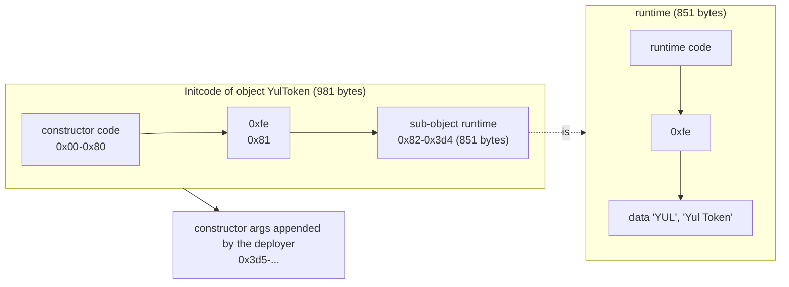

# 3.10 Yul objects and standalone contracts

> [!abstract] In one minute
> - A **Yul object** is a named bundle of one `code` block plus any number of sub-objects and `data` sections: `object "C" { code { … } object "runtime" { code { … } } data "D" hex"…" }`. The compiler lays it out as `code ‖ 0xfe ‖ sub-objects and data`. Only the items your code actually references end up in the bytecode.
> - The outer `code` is the **initcode**. It must leave the runtime bytes in memory and `return(offset, size)` them. Usually: `datacopy(0, dataoffset("runtime"), datasize("runtime"))` then `return(0, datasize("runtime"))`. `datasize`/`dataoffset` compile to plain `PUSH` constants. `datacopy` is `CODECOPY`.
> - **Constructor arguments** are appended after the initcode. `datasize("C")` (the object's own name) is the initcode length, so the arguments are `codecopy(0, datasize("C"), sub(codesize(), datasize("C")))`. Validate length and dirty address bits yourself if you want Solidity's behaviour.
> - **Immutables**: `loadimmutable("x")` in the runtime becomes a zero `PUSH32`. `setimmutable(p, "x", v)` in the initcode writes `v` into the copied runtime at memory `p + position`. `memoryguard(0x80)` promises the optimizer that you only use `[0, 0x80)` and memory from the free pointer up, which lets it move variables to memory to avoid "stack too deep". It is silently dropped if nothing reads the free pointer.
> - This note's **ERC-20 in pure Yul** matched OpenZeppelin 5.6.1 exactly on 10,000 random calls: same return data, revert data, logs and storage. It is 851 bytes of runtime against 1,764 for OZ, and a first transfer costs 29,468 gas against 29,981 (legacy) and 29,605 (via-IR).
> - Against **Solady** the honest gap is small. A Yul token with Solady's semantics saved 259 gas on a transfer (29,203 vs 29,462) and 178 on `transferFrom`. Storage, hashing and logs are 28,928 gas of both. Everything Yul can win lives in the other 1–2%: dispatch order, decoding and call overhead.

**Prerequisites:** [[1.8 Contract creation]], [[3.1 What Yul is and when to use it]], [[3.2 Syntax and control flow]], [[3.5 Memory management in assembly]], [[3.8 ABI, errors and events by hand]] · **Leads to:** [[3.11 Compiler IR and the optimizer]], [[3.12 Beyond Yul - Huff and raw bytecode]], [[4.3 Deterministic and cross-chain deployment]], [[4.4 Token standards]], [[6.7 Deployment and verification]]

All measurements in this note: solc-js 0.8.38, standard-JSON input, optimizer on with runs 200 unless stated, `evmVersion` prague, run in py-evm with Prague rules. Gas is **execution gas** only. It excludes the 21,000 intrinsic gas, calldata cost, and, for deployments, the 32,000 creation charge and initcode word cost. Every call is a separate transaction, so storage and accounts start cold.

## Intuition: a contract is a program that prints a program

[[1.8 Contract creation]] showed that a deployment runs **initcode**, and whatever bytes the initcode `RETURN`s become the contract's code. Solidity hides this. You write a constructor, and the compiler builds an initcode that runs it, copies the runtime out of its own tail, patches immutables, and returns.

A Yul object makes every one of those steps yours. Think of the object as a **zip file** of byte blobs. The `code` block is the program that runs first. Sub-objects are other programs, already compiled. `data` sections are raw bytes. Three built-ins let the program find things inside its own zip file: `dataoffset("x")` is where blob `x` starts, `datasize("x")` is how long it is, and `datacopy` copies it into memory. Deploying a contract is then "copy blob `runtime` into memory, return it".

Nothing else happens. There is no dispatcher, no ABI decoder, no `callvalue` check, no free memory pointer, no metadata. [[3.1 What Yul is and when to use it]] measured what that buys on a toy contract. This note builds a real one, an ERC-20, and measures it honestly against OpenZeppelin and Solady.

## Anatomy of an object

### Grammar

The whole object language is five rules (from the Solidity docs, "Specification of Yul Object"):

```text
Object     = 'object' StringLiteral '{' Code ( Object | Data )* '}'
Code       = 'code' Block
Data       = 'data' StringLiteral ( HexLiteral | StringLiteral )
HexLiteral = 'hex' ('"' ([0-9a-fA-F]{2})* '"' | '\'' ([0-9a-fA-F]{2})* '\'')
StringLiteral = '"' ([^"\r\n\\] | '\\' .)* '"'
```

So an object has exactly one `code` block, first, followed by any mix of nested objects and data sections. A `code` block is an ordinary Yul block ([[3.2 Syntax and control flow]]): its functions, variables and scopes are private to it. Code in a sub-object cannot see a variable of its parent. I got `DeclarationError: Identifier "x" not found.` when a runtime block used a `let x` from the constructor block.

| Element | Example | What ends up in bytecode |
|---|---|---|
| Top object | `object "YulToken" { … }` | The whole thing is the initcode. Its name is what standard JSON reports as the "contract" name. |
| `code` | `code { … }` | The object's own instructions, at offset 0 of the object |
| Sub-object | `object "runtime" { code { … } }` | Its full assembled bytecode (including its own sub-objects and data), placed after the parent's code |
| String data | `data "name" "Yul Token"` | The raw UTF-8 bytes (9 bytes here), no padding, no length prefix |
| Hex data | `data "table" hex"4123"` | The raw bytes `0x41 0x23` |
| `.metadata` | `data ".metadata" hex"…"` | Always appended at the very end. Not accessible from code. |

A bare block `{ … }` is accepted where an object is expected. `{ mstore(0, 1) return(0, 32) }` compiled to `60015f5260205ff3`. It is an object with no sub-objects, and you cannot deploy something meaningful from it unless you hand-write the runtime.

### Names and paths

- Object and data names are string literals. A name may contain a dot, but then nothing can refer to it, because the dot is the **path separator**: `datasize("Child.runtime")` means "the sub-object `runtime` of my sub-object `Child`". A data section named `"x.y"` compiled, but `datasize("x.y")` gave `TypeError: Unknown data object "x.y".`
- Code can name **itself**, its **direct children**, and **descendants by dotted path**. It cannot name its parent or a sibling. A runtime object that asked for `datasize("T")`, where `T` was data of the parent, failed with `TypeError: Unknown data object "T".`
- Arguments must be literals. `let n := "runtime"` then `datasize(n)` gave `TypeError: Function expects direct literals as arguments.`
- Names starting with `.` are reserved for special sections. Today only `.metadata` has a meaning. `datasize(".metadata")` failed with `Unknown data object ".metadata".`
- A sub-object whose name ends in `_deployed` is treated as deployed code by the optimizer's gas heuristic. Solidity's own IR names its runtime `C_deployed`. In this note's ERC-20 the name made **no difference**: renaming `runtime` to `YulToken_deployed` gave byte-identical output at runs 1 and 200.

### Layout: what the bytecode looks like



The assembler puts the object's code first, then an `INVALID` (`0xfe`) byte, then the sub-objects and data. The `0xfe` stops execution from falling into data if the code ever runs off its end. Each sub-object is laid out by the same rule, recursively.

Two facts I only learned by compiling:

1. **Unreferenced items are dropped.** An object with `data "D" "abc"` that never named `D` compiled to code plus `0xfe` and no `abc`. With the optimizer off it was the same. A sub-object `B` whose initcode was never referenced, while `B.runtime` was, contributed only `B.runtime` (1 byte). So do not expect `codesize()` to include a blob you never name.
2. **The order of data is not source order.** The ERC-20 runtime declares `name` then `symbol`, but its last 12 bytes are `YUL` then `Yul Token`. Always use `dataoffset`, never your own arithmetic.

## `datasize`, `dataoffset`, `datacopy` at the opcode level

These are not runtime functions. The assembler knows every offset when it lays out the object, so `datasize("runtime")` and `dataoffset("runtime")` become `PUSH` constants, and `datacopy(t, f, l)` is exactly `CODECOPY(t, f, l)` (the docs say so, and the disassembly agrees). Here is the end of the ERC-20's initcode:

```text
005f  610353   PUSH2 0x0353     ; datasize("runtime")   = 851
0062  80       DUP1
0063  610082   PUSH2 0x0082     ; dataoffset("runtime") = 130
0066  5f       PUSH0            ; destination 0
0067  39       CODECOPY         ; memory[0..851) = code[130..981)
0068  5f       PUSH0
0069  f3       RETURN           ; return memory[0..851): this is the deployed code
...
0081  fe       INVALID          ; separator
0082  34       CALLVALUE        ; first byte of the runtime object
```

And its very first instructions use `datasize("YulToken")`, the object's own size:

```text
0004  6103d5   PUSH2 0x03d5     ; datasize("YulToken") = 981 = initcode length
0007  6040     PUSH1 0x40
0009  81       DUP2
000a  38       CODESIZE         ; 981 + length of the appended arguments
000b  03       SUB              ; argsLen = CODESIZE - 981
000c  10       LT               ; argsLen < 64 ?
000d  607d     PUSH1 0x7d
000f  57       JUMPI            ; -> revert(0, 0)
```

Inside **runtime** code, `dataoffset` is relative to the runtime object, and `datacopy` copies from the runtime's own code. That is how the ERC-20 serves `name()` from a data section with one `CODECOPY` (136 gas) instead of two cold `SLOAD`s (OpenZeppelin: 3,086 gas).

> [!note] Object built-ins exist only in standalone Yul
> `datasize`, `dataoffset`, `datacopy`, `setimmutable`, `loadimmutable`, `memoryguard`, `linkersymbol` and `verbatim_<n>i_<m>o` belong to the "EVM dialect with objects". In inline assembly they are `DeclarationError: Function "…" not found.` ([[3.1 What Yul is and when to use it]]). Solidity code gets the same effect through `type(C).creationCode` and `type(C).runtimeCode` ([[4.3 Deterministic and cross-chain deployment]]).

## What the constructor code must do

The initcode has one job: put the runtime bytes somewhere in memory and `RETURN` them. The EVM takes the returned bytes as the new contract's code ([[1.8 Contract creation]] covers the deposit checks: first byte not `0xef`, at most 24,576 bytes, 200 gas per byte). Everything else is optional:

| Step | Solidity does it for you | In a Yul object |
|---|---|---|
| Reject ETH if the constructor is not payable | Yes | `if callvalue() { revert(0, 0) }` |
| Find and decode constructor arguments | Yes, with length and cleanliness checks | `codecopy` from `datasize("Self")`, check yourself |
| Run constructor logic, write initial storage, emit events | Yes | Plain Yul: `sstore`, `log3` |
| Set the free memory pointer | Yes (`mstore(0x40, 0x80)` or `memoryguard`) | Only if you use it |
| Copy the runtime | `CODECOPY` from its own tail | `datacopy(0, dataoffset("runtime"), datasize("runtime"))` |
| Patch immutables | Yes | `setimmutable` |
| Return the runtime | Yes | `return(0, datasize("runtime"))` |
| Append CBOR metadata | Yes (53 bytes in this note's contracts) | No (unless you add a `.metadata` data section) |

If the initcode returns zero bytes, the account exists with empty code. If it reverts, the deployment fails and the revert data comes back to the creator. In the ERC-20 below, deploying with `to = address(0)` reverted with `0xec442f05` followed by a zero word, exactly as OpenZeppelin's `ERC20InvalidReceiver(address(0))`.

### Constructor arguments

A creation transaction has **no calldata** for the initcode to read. By convention, the deployer appends the ABI-encoded arguments to the initcode, so they sit in **code** after the object's last byte. The object knows its own length as `datasize("<own name>")`:

```yul
object "Capped" {
    code {
        // constructor(uint256 cap): the argument is appended after the initcode.
        if lt(sub(codesize(), datasize("Capped")), 0x20) { revert(0, 0) }
        codecopy(0, datasize("Capped"), 0x20)
        let cap := mload(0)

        // Copy the runtime to memory offset 0, patch the immutable, deploy.
        let size := datasize("runtime")
        datacopy(0, dataoffset("runtime"), size)
        setimmutable(0, "cap", cap)
        return(0, size)
    }
    object "runtime" {
        code {
            // cap(): no selector check, for brevity.
            mstore(0, loadimmutable("cap"))
            return(0, 0x20)
        }
    }
}
```

The whole initcode is 77 bytes. With `0x…1234` appended, deployment succeeded, the stored runtime held `0x1234` in its `PUSH32`, and a call returned `0x…1234` for 16 gas. With no argument it reverted with empty data. Disassembled:

```text
0000  604d      PUSH1 0x4d       ; datasize("Capped") = 77
0002  6020      PUSH1 0x20
0004  81        DUP2
0005  38        CODESIZE
0006  03        SUB              ; argsLen
0007  10        LT               ; argsLen < 32 ?
0008  6021      PUSH1 0x21
000a  57        JUMPI            ; -> revert
000b  6020 90 5f 39             ; CODECOPY(0, 77, 32): the argument
0010  5f 51     PUSH0 MLOAD      ; cap
0012  6027      PUSH1 0x27       ; datasize("runtime") = 39
0014  90 81
0016  6026      PUSH1 0x26       ; dataoffset("runtime") = 38
0018  5f 39     PUSH0 CODECOPY   ; runtime -> memory[0..39)
001a  5f 6001 01 52             ; MSTORE(0 + 1, cap): setimmutable patches byte 1..32
001f  5f f3     PUSH0 RETURN
0021  5b 5f 80 fd               ; revert(0, 0)
0025  fe                        ; separator
0026  7f 00…00 5f 52 6020 5f f3 ; runtime: PUSH32 <placeholder> PUSH0 MSTORE PUSH1 0x20 PUSH0 RETURN
```

Compare the Solidity `Capped` in [[1.8 Contract creation]]: 245 bytes of initcode and 152 of runtime for the same behaviour plus a dispatcher, a `callvalue` check and metadata. The three moves are identical: `CODESIZE − own length`, `CODECOPY` the runtime, `MSTORE` the immutable into the copy.

> [!warning] Hard-coded offsets break silently
> Some public Yul ERC-20 examples hard-code the initcode length in the `codecopy` that reads arguments, and their README tells you to update it after every change. Any edit then shifts the arguments and the contract decodes garbage without reverting. `datasize("<own name>")` is computed by the assembler and is always right. In this note's tests it equalled `codesize()` exactly when no arguments were appended (13 = 13 for a small object).

Dynamic arguments (`string`, `bytes`, arrays) follow the ABI head/tail rules of [[2.5 ABI encoding and decoding]]: the head holds an offset **relative to the start of the arguments**, and every offset and length must be bounds-checked against `argsLen`. The A-level question below parses `(uint256, string)` with full checks.

## Immutables: `setimmutable` and `loadimmutable`

Solidity's immutables are not storage. They are 32-byte constants written into the runtime code at deployment ([[1.8 Contract creation]]). Standalone Yul exposes the same mechanism:

- `loadimmutable("x")` in runtime code compiles to `PUSH32 0x00…00`, a placeholder.
- `setimmutable(offset, "x", value)` in creation code assumes the runtime was copied to memory at `offset`, and writes `value` over **every** placeholder for `x` in that copy.

What I verified in 0.8.38:

| Experiment | Result |
|---|---|
| `Capped` above, deployed with `0x1234` | Stored runtime `7f…1234 5f 52 6020 5f f3`. Call returns `0x…1234`, 16 gas. |
| Runtime with two `loadimmutable("x")` | The optimizer merged them into one `PUSH32` and a `DUP1`, so one patch. Both words returned `0xabcd`. |
| `setimmutable` for a name never loaded | Compiles. The write is removed (no `MSTORE` in the output). |
| `loadimmutable("x")` in **creation** code | Internal compiler error: `YulAssertion` "Leftover immutables." (optimizer on and off). Immutables only exist in the runtime. |

The `offset` argument is the classic mistake. If you copy the runtime to memory `0x80` but call `setimmutable(0, …)`, the compiler writes the value into the wrong bytes and deploys an unpatched runtime. Nothing checks this. Always pass the same `offset` you gave `datacopy`.

> [!tip] When to use an immutable in Yul
> Use it for values fixed at deployment that the runtime reads often: an owner, a token address, a decimals value, a domain separator. Each read is a 3-gas `PUSH32` instead of a 2,100-gas cold `SLOAD`. Each **reference** costs 33 bytes of runtime and so 6,600 gas of deposit (33 × 200). The value is public: anyone can read it in the code.

## Nested objects, data sections and factories

An object can contain objects to any depth. The typical reason is a **factory**: a contract whose runtime deploys other contracts. The child's whole initcode (its code plus its own runtime sub-object) is a sub-object of the factory's runtime, so the factory can copy it into memory and pass it to `create` or `create2` ([[3.7 External calls in assembly]] covers the creation opcodes' failure handling).

```yul
object "Factory" {
    code {
        datacopy(0, dataoffset("runtime"), datasize("runtime"))
        return(0, datasize("runtime"))
    }
    object "runtime" {
        code {
            // Any call deploys a new Child with CREATE2 (salt = first calldata word)
            // and returns its address. The Child's initcode is a sub-object of this runtime.
            let size := datasize("Child")
            datacopy(0, dataoffset("Child"), size)
            let child := create2(0, 0, size, calldataload(0))
            if iszero(child) {
                returndatacopy(0, 0, returndatasize())   // bubble the revert reason, if any
                revert(0, returndatasize())
            }
            mstore(0, child)
            return(0, 0x20)
        }
        object "Child" {
            code {
                datacopy(0, dataoffset("runtime"), datasize("runtime"))
                return(0, datasize("runtime"))
            }
            object "runtime" {
                code {
                    // Returns the data section "hello", left-aligned in one word.
                    datacopy(0, dataoffset("greeting"), datasize("greeting"))
                    return(0, 0x20)
                }
                data "greeting" "hello"
            }
        }
    }
}
```

Note the two objects called `runtime`. Names only need to be unique among siblings: inside `Child`, `"runtime"` means `Child`'s own runtime. From the factory's runtime the child's runtime is reachable as `"Child.runtime"`.

Results (factory deployed by `0x1010…10` at nonce 0, address `0x2bda4a99…2feb`):

```text
factory runtime (59 bytes):
601a8060215f395f35905f80f580156018575f5260205ff35b3d5f803e3d5ffd fe   <- factory code, separator
601080600a5f395ff3 fe 6005600b5f3960205ff3 fe 68656c6c6f              <- Child initcode (26 bytes)
                       |-- Child.runtime --------------------------|  "hello"

call with salt 7  -> 0x6ae9ecd933eab42d97b297fc15147f181475d741   (35,292 gas)
predicted keccak256(0xff ‖ factory ‖ salt ‖ keccak256(childInitcode))[12:]
                  =  0x6ae9ecd933eab42d97b297fc15147f181475d741   (match)
child code        = 6005600b5f3960205ff3fe68656c6c6f
child returns     = 0x68656c6c6f000000…00 ("hello", left-aligned)
same salt again   -> revert with empty data (CREATE2 collision returns 0, no returndata)
```

The child's **deployed** code still contains `fe 68656c6c6f`. A data section is part of the code of the object that declares it, so `hello` costs 200 gas per byte of deposit in every child. That is the standard trick for constant tables and strings: a data section read with `codecopy` costs 3 gas per word plus memory, against 2,100 gas for a cold `SLOAD` ([[1.5 Storage and transient storage]]). SSTORE2-style libraries take the same idea further by deploying a data-only contract and reading it with `extcodecopy`.

> [!info]- Deep dive: how Solidity's own IR uses objects
> Ask solc for `ir` on any contract (via-IR) and you get the same shape: `object "C_12" { code { … } object "C_12_deployed" { code { … } data ".metadata" hex"…" } }`. A contract that does `new D()` gets `D`'s whole object nested inside `C_12_deployed`, and `type(D).creationCode` is `datacopy` of that sub-object. Libraries called externally become `linkersymbol("file.sol:Lib")`, which compiles to `PUSH20` of a placeholder: in 0.8.38 the bytecode was `73__$53aea86b7d70b31448b230b20ae141a537$__5f5260205ff3` with a `linkReferences` entry at byte 1, length 20. [[3.11 Compiler IR and the optimizer]] reads that IR in detail.

## `memoryguard` in standalone Yul

`let ptr := memoryguard(size)` is a promise from you to the optimizer: "my code only uses memory in `[0, size)` and from `ptr` upward". The optimizer may then reserve memory in `[size, ptr)` for its own use, mainly the **stack limit evader**, which moves variables that are too deep in the stack into fixed memory slots. If it reserves nothing, `ptr == size`. Solidity emits `mstore(64, memoryguard(128))` when every assembly block is `memory-safe` ([[3.4 Interop with Solidity]]). In standalone Yul you write it yourself, or you do not get the evader.

```yul
object "Deep" {
    code {
        datacopy(0, dataoffset("runtime"), datasize("runtime"))
        return(0, datasize("runtime"))
    }
    object "runtime" {
        code {
            mstore(0x40, memoryguard(0x80))   // free pointer; the optimizer may raise the 0x80
            work()
            let out := mload(0x40)
            mstore(out, sload(9))
            return(out, 0x20)

            function work() {
                let a := sload(100) let b := sload(101) let c := sload(102) let d := sload(103)
                let e := sload(104) let s := sload(105) let g := sload(106) let h := sload(107)
                let i := sload(108) let j := sload(109) let k := sload(110) let l := sload(111)
                let m := sload(112) let n := sload(113) let o := sload(114) let p := sload(115)
                let q := sload(116) let r := sload(117)
                sstore(0, mul(a, r)) sstore(1, mul(b, q)) sstore(2, mul(c, p)) sstore(3, mul(d, o))
                sstore(4, mul(e, n)) sstore(5, mul(s, m)) sstore(6, mul(g, l)) sstore(7, mul(h, k))
                sstore(8, mul(i, j))
                sstore(9, add(add(add(a, b), add(c, d)), add(add(e, s), add(g, h))))
                sstore(10, add(add(add(i, j), add(k, l)), add(add(m, n), add(add(o, p), add(q, r)))))
            }
        }
    }
}
```

| Variant | Result in 0.8.38 |
|---|---|
| Without the `memoryguard` line | `StackTooDeepError`: `Variable o is 1 too deep in the stack [ b k i j l m n o c a … ]` followed by `No memoryguard was present. Consider using memory-safe assembly only and annotating it via 'assembly ("memory-safe") { ... }'.` |
| With it | Compiles (286-byte runtime). The optimized IR starts `let _1 := memoryguard(0x0240)`: the evader reserved 0x1c0 bytes (14 words) at `0x80…0x23f` and moved 14 of the 18 loads there. The call stored the correct 11 values and returned `sload(9)` from memory at the new free pointer `0x240`. |
| `memoryguard` written but the free pointer never read (`mstore(0x40, memoryguard(0x80))` then only `sstore`) | The optimizer deleted the `mstore` as an unused store, and the `memoryguard` with it. Any later stack-too-deep then reports "No memoryguard was present". Read the free pointer somewhere. |
| Non-literal argument `memoryguard(x)` | `TypeError: Function expects direct literals as arguments.` |
| Two different literals in one object (`0x80` and `0xa0`) | Compiled without a diagnostic; the docs require the same literal within one sub-object. Treat it as undefined. |

The promise is unchecked, exactly like `memory-safe` ([[3.5 Memory management in assembly]]). If your code writes a fixed address such as `mstore(0x100, x)` while the optimizer has parked a variable at `0x100`, you corrupt that variable with no error. So in an object with `memoryguard(0x80)`, use only scratch space `0x00–0x3f`, the free pointer word, and memory you allocate from `mload(0x40)`. The ERC-20 below does **not** use `memoryguard`: it only touches `0x00–0x63`, never allocates, and is nowhere near the stack limit.

## Compiling a Yul object

| Route | Command or input | Status here |
|---|---|---|
| Native solc CLI | `solc --strict-assembly --optimize --evm-version prague --bin YulToken.yul` (add `--ir-optimized` to see the optimized Yul, `--asm` for assembly) | Not run: native binaries are blocked in this environment |
| Standard JSON | `{"language": "Yul", "sources": {"YulToken.yul": {"content": "…"}}, "settings": {"optimizer": {"enabled": true, "runs": 200, "details": {"yul": true}}, "evmVersion": "prague", "outputSelection": {"*": {"*": ["evm.bytecode.object", "evm.deployedBytecode.object", "irOptimized"]}}}}` | Run with solc-js 0.8.38 for every object in this note |
| solc-js CLI | `solcjs --standard-json < input.json` (solc-js has no `--strict-assembly` flag) | Run |

What came back for the ERC-20:

- `contracts["C.yul"]` has a single key, `"YulToken"`: only the **top** object is reported. `evm.bytecode` is the initcode (981 bytes). `evm.deployedBytecode` is the sub-object the compiler treats as deployed code (851 bytes, the `runtime` object).
- No ABI, no metadata, no warnings. Requesting `abi` and `metadata` for a Yul source returned nothing. You write the ABI by hand (or a Solidity `interface`) for tools.
- `evm.deployedBytecode.immutableReferences` works and is keyed by the immutable's name: for `Capped` it was `{"cap": [{"start": 1, "length": 32}]}`, matching the `PUSH32` at runtime byte 0.

> [!warning] The Yul optimizer can make code bigger
> For this ERC-20, the optimized runtime was **larger** than the unoptimized one: 851 bytes (runs 200 and 10,000), 820 bytes (runs 1), 788 bytes (optimizer off). The optimizer specialized small helpers per call site (`requireArgs_329`, `requireArgs_331`, `returnUint_336`…) and inlined others. Gas went the other way, but only slightly: a transfer cost 29,468 optimized and 29,534 unoptimized. For the lean variant the unoptimized build was even cheaper (29,174 vs 29,203). Measure both settings for hand-written Yul; [[3.11 Compiler IR and the optimizer]] explains the step sequence.

## Deploying the bytecode with Foundry

Foundry is blocked in this environment, so nothing in this section's CLI or cheatcode calls was run; the Solidity test file below was compiled with 0.8.38 and its `create` path run in py-evm.

**Does `forge build` compile `.yul` files?** Yes, according to the source of `foundry-compilers` 0.21.0 (the latest release on crates.io on 1 Nov 2026): `SOLC_EXTENSIONS = ["sol", "yul"]`, and a file whose extension is `yul` is sent to solc with `SolcLanguage::Yul`. So a `src/YulToken.yul` should be compiled with standard JSON `"language": "Yul"` and produce an artifact for the object `YulToken` with bytecode but no ABI. Older tutorials (2022) say Foundry choked on `.yul` in `src` and paste hex into tests instead; that advice predates this support.

Three ways to get the token into a test or a chain:

| Route | How | Runs the constructor? | Status |
|---|---|---|---|
| `vm.deployCode` | `vm.deployCode("YulToken.yul:YulToken", abi.encode(to, supply))`. Overloads take `value` and `salt`. Accepts `path:Name`, an artifact JSON path, or a bare unambiguous name. | Yes: Foundry appends the args and runs `CREATE`/`CREATE2` | Not run |
| `create` from the test | Paste or load the initcode (`vm.readFile` + `vm.parseBytes`, or a hex literal), append `abi.encode(args)`, `create` in assembly | Yes | Compiled and run in py-evm (below) |
| `vm.etch(addr, runtime)` | Writes **runtime** bytes to an address | **No**: no constructor, so no mint and no immutables. Use `vm.store` for the storage you need. | Not run |
| On a chain | `cast send --create <CODE> [SIG] [ARGS]` with `--rpc-url`, `--private-key`/`--account`. Simplest is to concatenate yourself: `cast send --create "$(cat YulToken.bin)$(cast abi-encode 'f(address,uint256)' $TO $SUPPLY \| cut -c3-)"` | Yes | Not run |

`forge create` deploys a named contract from your project and encodes `--constructor-args` from the ABI. A Yul artifact has no ABI, so I would not rely on `--constructor-args` for it; `cast send --create` with pre-encoded bytes avoids the question. This is my inference, not a tested fact.

```solidity
// SPDX-License-Identifier: MIT
pragma solidity 0.8.38;

/// The two cheatcodes this test uses, declared locally so the file compiles without forge-std.
interface Vm {
    function deployCode(string calldata artifactPath, bytes calldata constructorArgs) external returns (address);
    function etch(address target, bytes calldata newRuntimeBytecode) external;
}

interface IERC20 {
    function balanceOf(address) external view returns (uint256);
    function transfer(address, uint256) external returns (bool);
    function totalSupply() external view returns (uint256);
}

contract YulTokenDeployer {
    /// Deploy any initcode with ABI-encoded constructor arguments appended. Bubbles a revert.
    function deploy(bytes memory initcode, bytes memory args) public returns (address t) {
        bytes memory code = bytes.concat(initcode, args);
        assembly ("memory-safe") {
            t := create(0, add(code, 0x20), mload(code))
            if iszero(t) {
                returndatacopy(0, 0, returndatasize())
                revert(0, returndatasize())
            }
        }
    }
}

contract YulTokenTest is YulTokenDeployer {
    Vm constant vm = Vm(address(uint160(uint256(keccak256("hevm cheat code")))));
    IERC20 token;

    /// Route 1 (Foundry compiles src/YulToken.yul itself): token = IERC20(vm.deployCode("YulToken.yul:YulToken", args)).
    /// Route 2 (works anywhere, including this py-evm run): paste the solc output and CREATE it.
    function setUpWith(bytes memory initcode) public {
        token = IERC20(deploy(initcode, abi.encode(address(this), 1_000e18)));
    }

    function testTransfer() public {
        require(token.totalSupply() == 1_000e18, "supply");
        require(token.transfer(address(0xBEEF), 1e18), "transfer");
        require(token.balanceOf(address(0xBEEF)) == 1e18, "balance");
        require(token.balanceOf(address(this)) == 999e18, "sender balance");
    }
}
```

In py-evm: `setUpWith(<981-byte initcode>)` succeeded (272,064 gas, including the token's deployment), and `testTransfer()` passed. Calling `deploy` with `to = address(0)` reverted with `ec442f05` and a zero word: the Yul constructor's error bubbled through the `create`. In a real Foundry project you would rename `setUpWith` to `setUp()` and take the initcode from `vm.deployCode` or a file.

## Solidity and Yul in practice

### A complete ERC-20 in Yul

The specification: behave **exactly** like OpenZeppelin Contracts 5.6.1 `ERC20` with name "Yul Token", symbol "YUL", 18 decimals, and a constructor `(address to, uint256 supply)` that mints. "Exactly" means the same return data, the same revert data (OZ's custom errors with their arguments, and empty reverts wherever Solidity's ABI decoder rejects input), the same logs, and the same storage layout (`_balances` at slot 0, `_allowances` at slot 1, `_totalSupply` at slot 2). That is a stricter target than "an ERC-20", and it is what makes a differential test possible.

```yul
// YulToken: an ERC-20 written entirely in Yul.
// Behaves like OpenZeppelin 5.x ERC20 (same storage layout, return data, revert data, logs).
// Constructor arguments (ABI-encoded, appended to the initcode): (address to, uint256 supply).
object "YulToken" {
    code {
        // ---- constructor ---------------------------------------------------
        if callvalue() { revert(0, 0) }                       // non-payable

        // The arguments sit after the last byte of this object.
        let argsStart := datasize("YulToken")
        if lt(sub(codesize(), argsStart), 0x40) { revert(0, 0) }
        codecopy(0, argsStart, 0x40)
        let to := mload(0x00)
        let supply := mload(0x20)
        if shr(160, to) { revert(0, 0) }                      // dirty address: same as Solidity's decoder

        // _mint(to, supply)
        if iszero(to) {
            mstore(0x00, shl(224, 0xec442f05))                // ERC20InvalidReceiver(address)
            mstore(0x04, 0)
            revert(0x00, 0x24)
        }
        sstore(2, supply)                                     // _totalSupply (slot 2)
        mstore(0x00, to)
        mstore(0x20, 0)                                       // _balances is slot 0
        sstore(keccak256(0x00, 0x40), supply)
        mstore(0x00, supply)
        log3(0x00, 0x20,
             0xddf252ad1be2c89b69c2b068fc378daa952ba7f163c4a11628f55a4df523b3ef, 0, to)

        // Deploy the runtime object.
        datacopy(0, dataoffset("runtime"), datasize("runtime"))
        return(0, datasize("runtime"))
    }

    object "runtime" {
        code {
            if callvalue() { revert(0, 0) }                   // every function is non-payable
            if lt(calldatasize(), 4) { revert(0, 0) }         // no fallback

            switch shr(224, calldataload(0))
            case 0x06fdde03 /* name() */ {
                returnString(dataoffset("name"), datasize("name"))
            }
            case 0x95d89b41 /* symbol() */ {
                returnString(dataoffset("symbol"), datasize("symbol"))
            }
            case 0x313ce567 /* decimals() */ {
                returnUint(18)
            }
            case 0x18160ddd /* totalSupply() */ {
                returnUint(sload(2))
            }
            case 0x70a08231 /* balanceOf(address) */ {
                requireArgs(1)
                returnUint(sload(balanceSlot(argAddress(0))))
            }
            case 0xdd62ed3e /* allowance(address,address) */ {
                requireArgs(2)
                returnUint(sload(allowanceSlot(argAddress(0), argAddress(1))))
            }
            case 0xa9059cbb /* transfer(address,uint256) */ {
                requireArgs(2)
                transferTokens(caller(), argAddress(0), calldataload(0x24))
                returnUint(1)
            }
            case 0x095ea7b3 /* approve(address,uint256) */ {
                requireArgs(2)
                let spender := argAddress(0)
                let value := calldataload(0x24)
                // owner = caller() is never zero, so only the spender is checked.
                if iszero(spender) { revertWithAddress(0x94280d62, 0) }   // ERC20InvalidSpender
                sstore(allowanceSlot(caller(), spender), value)
                mstore(0x00, value)
                log3(0x00, 0x20,
                     0x8c5be1e5ebec7d5bd14f71427d1e84f3dd0314c0f7b2291e5b200ac8c7c3b925,
                     caller(), spender)
                returnUint(1)
            }
            case 0x23b872dd /* transferFrom(address,address,uint256) */ {
                requireArgs(3)
                let from := argAddress(0)
                let to := argAddress(1)
                let value := calldataload(0x44)
                spendAllowance(from, caller(), value)
                transferTokens(from, to, value)
                returnUint(1)
            }
            default { revert(0, 0) }

            // ---- storage layout (identical to OpenZeppelin ERC20) ----------
            // slot 0: mapping(address => uint256) _balances
            // slot 1: mapping(address => mapping(address => uint256)) _allowances
            // slot 2: uint256 _totalSupply
            function balanceSlot(account) -> slot {
                mstore(0x00, account)
                mstore(0x20, 0)
                slot := keccak256(0x00, 0x40)
            }
            function allowanceSlot(owner, spender) -> slot {
                mstore(0x00, owner)
                mstore(0x20, 1)
                mstore(0x20, keccak256(0x00, 0x40))
                mstore(0x00, spender)
                slot := keccak256(0x00, 0x40)
            }

            // ---- token logic ----------------------------------------------
            function transferTokens(from, to, value) {
                if iszero(from) { revertWithAddress(0x96c6fd1e, 0) }      // ERC20InvalidSender
                if iszero(to) { revertWithAddress(0xec442f05, 0) }        // ERC20InvalidReceiver
                let fromSlot := balanceSlot(from)
                let fromBalance := sload(fromSlot)
                if lt(fromBalance, value) {
                    revertWith3(0xe450d38c, from, fromBalance, value)      // ERC20InsufficientBalance
                }
                sstore(fromSlot, sub(fromBalance, value))
                let toSlot := balanceSlot(to)                             // re-read: from may equal to
                sstore(toSlot, add(sload(toSlot), value))
                mstore(0x00, value)
                log3(0x00, 0x20,
                     0xddf252ad1be2c89b69c2b068fc378daa952ba7f163c4a11628f55a4df523b3ef,
                     from, to)
            }
            function spendAllowance(owner, spender, value) {
                let slot := allowanceSlot(owner, spender)
                let current := sload(slot)
                if not(current) {                                         // current != type(uint256).max
                    if lt(current, value) {
                        revertWith3(0xfb8f41b2, spender, current, value)   // ERC20InsufficientAllowance
                    }
                    // OZ calls _approve(owner, spender, current - value, false), which checks owner.
                    if iszero(owner) { revertWithAddress(0xe602df05, 0) } // ERC20InvalidApprover
                    sstore(slot, sub(current, value))
                }
            }

            // ---- calldata decoding ----------------------------------------
            function requireArgs(n) {
                if lt(calldatasize(), add(4, mul(n, 0x20))) { revert(0, 0) }
            }
            function argAddress(i) -> a {
                a := calldataload(add(4, mul(i, 0x20)))
                if shr(160, a) { revert(0, 0) }                           // reject dirty upper bits
            }

            // ---- return and revert helpers ---------------------------------
            function returnUint(v) {
                mstore(0x00, v)
                return(0x00, 0x20)
            }
            function returnString(offset, length) {                       // length <= 32
                mstore(0x00, 0x20)
                mstore(0x20, length)
                mstore(0x40, 0)
                datacopy(0x40, offset, length)
                return(0x00, 0x60)
            }
            function revertWithAddress(sel, a) {
                mstore(0x00, shl(224, sel))
                mstore(0x04, a)
                revert(0x00, 0x24)
            }
            function revertWith3(sel, a, b, c) {
                mstore(0x00, shl(224, sel))
                mstore(0x04, a)
                mstore(0x24, b)
                mstore(0x44, c)
                revert(0x00, 0x64)
            }
        }
        data "name" "Yul Token"
        data "symbol" "YUL"
    }
}
```

Design decisions, each one forced by the "behave like OZ" target:

- **One `callvalue` check before the `switch`.** Every OZ function is non-payable, so any ETH must revert with empty data. Doing it once is cheaper than per case and gives the same result.
- **`if lt(calldatasize(), 4)` before decoding the selector.** Calldata shorter than 4 bytes is padded with zeros by `calldataload`, so `0x06fdde` could otherwise look like selector `0x06fdde00`. OZ has no fallback, so it reverts empty.
- **`requireArgs(n)`** reverts empty when the calldata is shorter than `4 + 32·n`, like Solidity's decoder. Extra trailing bytes are accepted, also like Solidity ([[2.5 ABI encoding and decoding]]).
- **`argAddress` rejects dirty upper bits** with an empty revert, like Solidity's decoder. Without it, see the pitfall below: tokens disappear.
- **Storage slots follow Solidity's mapping rule** ([[2.3 Storage layout]]): `keccak256(key ‖ slot)`, nested for allowances. That costs two 64-byte hashes for an allowance; Solady's layout needs one 52-byte hash (see the E answer).
- **Errors are encoded by hand** as in [[3.8 ABI, errors and events by hand]]: selector in the first 4 bytes, arguments as words from `0x04`.
- **The `transferFrom` edge case.** OZ's `_spendAllowance` calls `_approve(owner, spender, current - value, false)`, and `_approve` checks `owner != 0` **before** `_transfer` checks the sender. So `transferFrom(address(0), x, 0)` reverts with `ERC20InvalidApprover(address(0))` (`0xe602df05`), not `ERC20InvalidSender`. The Yul version reproduces that order. The differential test would have caught the other order.
- **`name()`/`symbol()` come from data sections.** The ABI encoding of a short string is three words: offset `0x20`, length, bytes left-aligned. `returnString` writes the first two words, zeroes the third, then `datacopy`s the bytes over it.
- **Self-transfer.** `transferTokens` re-reads the receiver's balance after writing the sender's, so `from == to` leaves the balance unchanged, as in OZ.
- **No free memory pointer, no `memoryguard`.** The token never allocates. It uses `0x00–0x63` as scratch, and every path ends in `return` or `revert`.

### Differential test against OpenZeppelin

Method: deploy both tokens in one py-evm state with the same constructor arguments, then send each random call to both, from the same sender, and compare `success`, the full return or revert data, and the logs (topics and data). At the end, compare every balance slot, every allowance slot among the six addresses, and `_totalSupply`. The OZ reference is `contract OZToken is ERC20 { constructor(address to, uint256 supply) ERC20("Yul Token", "YUL") { _mint(to, supply); } }` compiled from the npm package `@openzeppelin/contracts` 5.6.1 (legacy, runs 200).

The call generator mixes transfers, approvals, `transferFrom`s, views and metadata calls, with 8% zero addresses, 4% dirty address words, values of 0, `type(uint256).max` and the full supply, truncated calldata, random garbage, trailing bytes, and ETH attached to 2% of calls.

| Seed | Calls | Succeeded | Reverted with data | Reverted empty | With logs | Mismatches |
|---|---|---|---|---|---|---|
| 1 | 2,000 | 1,082 | 661 | 257 | 755 | 0 |
| 2 | 2,000 | 1,085 | 636 | 279 | 759 | 0 |
| 3 | 2,000 | 1,083 | 667 | 250 | 759 | 0 |
| 4 | 2,000 | 1,117 | 635 | 248 | 797 | 0 |
| 5 | 2,000 | 1,078 | 623 | 299 | 719 | 0 |

Targeted cases, all identical between the two tokens (supply 1,000 minted to `A`):

| Case | Result (both tokens) | Yul gas | OZ gas |
|---|---|---|---|
| `transfer(B, 10)` | `true`, `Transfer(A, B, 10)` | 29,468 | 29,981 |
| `transfer(B, 1001)` | `ERC20InsufficientBalance(A, 990, 1001)`, 100 bytes `e450d38c…` | 2,615 | 2,892 |
| `transfer(0, 1)` | `ERC20InvalidReceiver(0)`, 36 bytes `ec442f05…` | 403 | 554 |
| `approve(0, 1)` | `ERC20InvalidSpender(0)`, `94280d62…` | 395 | 538 |
| `transferFrom(A, C, 51)` by `B` with allowance 50 | `ERC20InsufficientAllowance(B, 50, 51)`, `fb8f41b2…` | 2,785 | 2,959 |
| `transferFrom(0, C, 0)` | `ERC20InvalidApprover(0)`, `e602df05…` | 2,782 | 2,976 |
| `transferFrom` with max allowance | succeeds, allowance stays `2^256 − 1`, no `Approval` log | 14,782 | 15,320 |
| `balanceOf` with a dirty address word | empty revert | 258 | 266 |
| `transfer` with 36 bytes of calldata | empty revert | 244 | 247 |
| Unknown selector `0xdeadbeef` | empty revert | 247 | 210 |
| `name()` | `0x20`, `9`, `"Yul Token"` (96 bytes) | 136 | 3,086 |
| Constructor with `to = 0` | revert `ERC20InvalidReceiver(0)` | | |
| Constructor with 32 bytes of args, a dirty `to`, or 1 wei attached | empty revert | | |

The unknown selector is the one case where Yul is more expensive: it walks all nine `case`s (22 gas each) before the `default`, while Solidity's dispatcher found the miss faster.

### Size and gas against OpenZeppelin and Solady

Solady 0.1.26 (npm package `solady`) compiles standalone with solc-js 0.8.38. Its `ERC20` is abstract, so the reference is `contract SoladyToken is ERC20` with the same constructor and `name()`/`symbol()` returning the same strings as `pure` functions. Solady enables Permit2 infinite allowance by default; `SoladyTokenNoPermit2` overrides `_givePermit2InfiniteAllowance()` to return `false`. "Yul lean" is a second Yul object with **Solady's** semantics and storage scheme (4-byte errors, no zero-address checks, seeded slots, hot functions first, no Permit2 and no EIP-2612). It matched `SoladyTokenNoPermit2` on 6,000 random calls with zero mismatches in return data, revert data, logs and storage.

| Contract | Runtime bytes | Deploy gas | `balanceOf` | `transfer` new | `transfer` existing | `approve` | `transferFrom` | `transferFrom` max | `name` |
|---|---|---|---|---|---|---|---|---|---|
| Yul, OZ-compatible (this note) | 851 | 216,603 | 2,461 | 29,468 | 12,368 | 24,393 | 34,854 | 14,782 | 136 |
| Yul, OZ-compatible, optimizer off | 788 | 203,987 | 2,500 | 29,534 | 12,434 | 24,432 | 34,946 | 14,874 | 136 |
| Yul, OZ-compatible, hot cases first | 851 | 216,603 | 2,417 | 29,336 | 12,236 | 24,305 | 34,703 | 14,631 | 290 |
| Yul lean (Solady semantics) | 711 | 188,547 | 2,335 | 29,203 | 12,103 | 24,157 | 34,408 | 14,356 | 270 |
| OpenZeppelin 5.6.1, legacy | 1,764 | 445,159 | 2,559 | 29,981 | 12,881 | 24,734 | 35,657 | 15,320 | 3,086 |
| OpenZeppelin 5.6.1, via-IR | 1,542 | 400,393 | 2,512 | 29,605 | 12,505 | 24,322 | 35,020 | 14,789 | 2,672 |
| Solady 0.1.26, legacy | 2,017 | 450,342 | 2,519 | 29,521 | 12,421 | 24,439 | 34,806 | 14,768 | 405 |
| Solady 0.1.26, via-IR | 1,921 | 431,073 | 2,504 | 29,462 | 12,362 | 24,258 | 34,620 | 14,568 | 398 |
| Solady, no Permit2, legacy | 1,850 | 416,894 | 2,519 | 29,521 | 12,421 | 24,385 | 34,784 | 14,746 | 405 |
| Solady, no Permit2, via-IR | 1,764 | 399,632 | 2,504 | 29,462 | 12,362 | 24,203 | 34,586 | 14,534 | 398 |

Settings: optimizer runs 200 everywhere; Solidity runtimes include the 53-byte CBOR metadata; Yul has none. "Deploy gas" is the execution gas of the creation message: constructor (two zero-to-nonzero `SSTORE`s and a log) plus 200 gas per runtime byte. `transfer` new = first transfer to an address with zero balance; existing = a second transfer to the same address. `approve` = new allowance. `transferFrom` = finite allowance, decremented. Calls run cold.

Where the gas goes, from an opcode trace of the same transfer (`storage+hash+log` = all `SLOAD`, `SSTORE`, `KECCAK256` and `LOG3` gas):

| Contract | `transfer` total | Opcodes | Jumps | Storage + hash + log | Everything else |
|---|---|---|---|---|---|
| Yul lean | 29,203 | 88 | 6 | 28,928 | 275 |
| Yul OZ-compatible | 29,468 | 147 | 22 | 28,940 | 528 |
| Solady no Permit2, via-IR | 29,462 | 148 | 17 | 28,928 | 534 |
| Solady no Permit2, legacy | 29,521 | 181 | 17 | 28,928 | 593 |
| OpenZeppelin, via-IR | 29,605 | 179 | 19 | 28,982 | 623 |
| OpenZeppelin, legacy | 29,981 | 309 | 26 | 28,982 | 999 |

| Contract | `transferFrom` total | Opcodes | Jumps | Storage + hash + log | Everything else |
|---|---|---|---|---|---|
| Yul lean | 34,408 | 138 | 10 | 33,970 | 438 |
| Yul OZ-compatible | 34,854 | 236 | 34 | 34,024 | 830 |
| Solady no Permit2, via-IR | 34,586 | 183 | 17 | 33,970 | 616 |
| Solady with Permit2, via-IR | 34,620 | 192 | 19 | 33,970 | 650 |
| OpenZeppelin, via-IR | 35,020 | 266 | 23 | 34,150 | 870 |
| OpenZeppelin, legacy | 35,657 | 473 | 38 | 34,150 | 1,507 |

The E answer below explains every row. The one-line version: **storage, hashing and the log are 96–99% of a transfer, and all four implementations pay almost the same bill for them**. Yul wins only the remaining few hundred gas, and wins it mostly by doing less work in the dispatcher and the decoder.

## Pitfalls and incidents

I found no well-known exploit that came from the object mechanics themselves. The risks are the ones every hand-written contract has, because the compiler no longer adds the checks. The first one is the most instructive.

**1. Dirty address bits send tokens into a slot nobody owns.** I deleted the one line `if shr(160, a) { revert(0, 0) }` from `argAddress` and sent `transfer` with the receiver word `0x…dead…0011` (address `0x…11` with junk above bit 160):

```text
call succeeded, returned true
Transfer topics: from 0x…10, to 0x00000000000000000000dead0000000000000000000000000000000000000011
balanceOf(0x…10) = 900          balanceOf(0x…11) = 0          totalSupply = 1000
```

The 100 tokens were credited to `keccak256(dirtyWord ‖ 0)`, a slot no clean address hashes to. They are gone, the sum of balances no longer equals the supply, and an indexer that reads the topic as an address (taking the low 20 bytes) shows `0x…11` receiving 100 tokens that `balanceOf` denies. OpenZeppelin's version reverted with empty data. [[3.9 Cleanup, dirty bits and safety]] has the general rule: clean or reject every value that comes from outside before you hash, compare or log it.

**2. Other checks you now own.**

| Missing check | What happens | Defense |
|---|---|---|
| `callvalue()` | ETH sent with any call is kept, and a token with no withdraw function locks it forever | One `if callvalue() { revert(0, 0) }` before the dispatcher, or per case for payable functions |
| Calldata length | `calldataload` past the end reads zeros, so a truncated `transfer(to)` moves 0 tokens, and a truncated `transferFrom` can use `to = 0` | `requireArgs(n)` before decoding |
| `calldatasize() < 4` | Bytes `06fdde` decode as selector `0x06fdde00` | Check before the `switch`, or have no selector ending in `00` and accept the risk knowingly |
| Selector collisions | Solidity rejects two functions with one selector. In Yul two equal `case` literals fail with `DeclarationError: Duplicate case "0x42966c68" defined.`, but only if you typed the real selector, so a wrong hand-computed selector slips through | Generate selectors with a tool and test every function through its real signature |
| `if not(x)` | `not` is bitwise. `if not(x)` is true for every `x` except `2^256 − 1`. That is correct in `spendAllowance` ("allowance is not infinite") and a bug anywhere you meant "x is zero" | Use `iszero` for "is zero"; comment every `not` used as a condition |

**3. Object mechanics.**

- **Hard-coded argument offsets** instead of `datasize("Self")` decode garbage after any edit (see the warning above).
- **`setimmutable` with the wrong `offset`** patches the wrong bytes and deploys a zero immutable. Nothing checks it.
- **`memoryguard` that the optimizer deletes**, or a false memory promise, as shown in the `memoryguard` section.
- **Data you never reference is not in the bytecode**, and data order is not source order. Read blobs only through `dataoffset`/`datasize`.
- **No ABI and no metadata.** Wallets, explorers and Foundry's `--constructor-args` need an ABI, and verification services cannot match a Yul object to a Solidity source. Ship a hand-written interface, publish the exact compiler input, and see [[3.12 Beyond Yul - Huff and raw bytecode]] and [[6.7 Deployment and verification]] for verification.
- **Size limits still apply**: 24,576 bytes of runtime and 49,152 bytes of initcode on mainnet ([[1.8 Contract creation]]). A factory's runtime contains the child's whole initcode, so the child's bytes count toward the factory's 24,576-byte runtime limit, and again toward the factory's initcode limit. Glamsterdam's EIP-7954 is scheduled to raise the limits to 64 KiB of code and 128 KiB of initcode; it has no mainnet date.
- **The optimizer is not always a size win** for hand-written Yul (851 bytes optimized vs 788 unoptimized here). Measure both.

**4. Review cost.** A pure-Yul contract has no types, no compiler-generated checks and no ABI. Every line is an audit item, and the test suite must include a differential reference like the one above. [[3.1 What Yul is and when to use it]] has the decision rule: write a whole object only when the saving is large or the result is unusual (proxies, deployers, size-bound code), and keep normal contracts in Solidity with small assembly blocks.

## Question ladder

> [!question]- **B** Describe the structure of a Yul object and what the constructor code must return.
> An object is `object "Name" { code { … } <sub-objects and data sections> }`. It has exactly one `code` block, which comes first, then any number of `object "…" { … }` and `data "…" hex"…"` or `data "…" "string"` entries, nested to any depth. The assembler lays it out as **code, then a `0xfe` separator, then the sub-objects and data that the code references** (unreferenced ones are dropped). Code finds its pieces with `dataoffset("x")` and `datasize("x")`, which become `PUSH` constants, and copies them with `datacopy`, which is `CODECOPY`. Code may name itself, its children, and descendants by dotted path (`"Child.runtime"`), but not its parent or siblings.
>
> For a deployable contract, the **top object's code is the initcode** and its sub-object (by convention `runtime`, or `Name_deployed`) is the runtime. The constructor code must end with `return(p, n)` where `memory[p, p+n)` holds **the exact bytes to store as the contract's code**. The minimal version is:
>
> ```yul
> object "Minimal" {
>     code {
>         datacopy(0, dataoffset("runtime"), datasize("runtime"))
>         return(0, datasize("runtime"))
>     }
>     object "runtime" {
>         code { stop() }
>     }
> }
> ```
>
> Before that `return` it may do anything a constructor does: reject ETH, read appended arguments from code (`codecopy` from `datasize("Minimal")`), write storage, emit events, patch immutables with `setimmutable`. If it reverts, the deployment fails and the revert data goes back to the creator. If it returns zero bytes, the account has no code. The returned bytes must pass the deposit checks: at most 24,576 bytes, first byte not `0xef`, 200 gas per byte. The minimal object above compiles to `600180600a5f395ff3fe00`: `PUSH1 1, DUP1, PUSH1 0x0a, PUSH0, CODECOPY, PUSH0, RETURN, INVALID`, then the one-byte runtime `00`.

> [!question]- **I** Write an ERC-20 entirely in Yul with a `switch` dispatcher on the selector.
> The complete, compiled and tested contract is the `YulToken` object in [[#A complete ERC-20 in Yul]]. Its skeleton is:
>
> ```yul
> object "Skeleton" {
>     code {
>         datacopy(0, dataoffset("runtime"), datasize("runtime"))
>         return(0, datasize("runtime"))
>     }
>     object "runtime" {
>         code {
>             if callvalue() { revert(0, 0) }                 // all functions non-payable
>             if lt(calldatasize(), 4) { revert(0, 0) }       // no fallback
>             switch shr(224, calldataload(0))                // selector = first 4 bytes
>             case 0x70a08231 /* balanceOf(address) */ {
>                 if lt(calldatasize(), 0x24) { revert(0, 0) }
>                 let owner := calldataload(4)
>                 if shr(160, owner) { revert(0, 0) }         // dirty address
>                 mstore(0x00, owner)
>                 mstore(0x20, 0)                             // mapping at slot 0
>                 mstore(0x00, sload(keccak256(0x00, 0x40)))
>                 return(0x00, 0x20)
>             }
>             // case 0xa9059cbb transfer, 0x095ea7b3 approve, 0x23b872dd transferFrom,
>             // 0xdd62ed3e allowance, 0x18160ddd totalSupply, 0x313ce567 decimals, ...
>             default { revert(0, 0) }
>         }
>     }
> }
> ```
>
> What makes it correct, not just working:
> - **Same observable behaviour as a reference.** I targeted OpenZeppelin 5.6.1 byte for byte: its custom errors with arguments, its storage layout, its quirks (`transferFrom(0, x, 0)` reverts with `ERC20InvalidApprover(0)`), and Solidity's decoder behaviour (empty revert on short calldata, dirty addresses, ETH, unknown selectors; trailing bytes accepted). 10,000 random calls and every balance, allowance and supply slot matched.
> - **Events**: `Transfer` and `Approval` are `log3(ptr, 32, sig, from, to)` with the amount as data ([[3.8 ABI, errors and events by hand]]). `transferFrom` emits no `Approval`, like OZ 5.x. The constructor emits `Transfer(0, to, supply)`.
> - **Infinite allowance** (`2^256 − 1`) is not decremented.
> - **The dispatcher is linear.** Each `case` that does not match costs 22 gas (`DUP1 PUSH4 EQ PUSH2 JUMPI`) and 11 bytes, so put the hot functions first: moving `transfer` from 7th to 1st saved exactly 132 gas. With dozens of functions, use a binary split on the selector or a jump table.
> - **Cost**: 851 bytes of runtime and 29,468 gas for a first transfer, against 1,764 bytes and 29,981 gas for OZ (legacy). See the size and gas table.

> [!question]- **A** Parse constructor arguments in a Yul object.
> The deployer appends the ABI-encoded arguments to the initcode, so during construction they are **code**, not calldata. Their start is the object's own size, `datasize("<own name>")`, and their length is `codesize() − datasize(...)`. Copy them to memory with `codecopy`, then decode them with the normal ABI rules, treating every offset as **relative to the start of the arguments** and checking every offset and length against the arguments' length, because the deployer controls these bytes.
>
> Fixed-size arguments are one word each (the ERC-20 constructor above reads `(address, uint256)` with `codecopy(0, argsStart, 0x40)` and rejects short input and dirty addresses). Here is a dynamic one, `constructor(uint256 cap, string name)`, storing the string with Solidity's short-string encoding so a Solidity reader would agree:
>
> ```yul
> object "Named" {
>     code {
>         // constructor(uint256 cap, string name)  -- name must be at most 32 bytes here.
>         let argsStart := datasize("Named")
>         let argsLen := sub(codesize(), argsStart)
>         if lt(argsLen, 0x40) { revert(0, 0) }                   // two head words
>         codecopy(0, argsStart, argsLen)                          // args now at memory[0, argsLen)
>         let cap := mload(0x00)
>         let off := mload(0x20)                                   // offset of the string, relative to args start
>         if gt(off, sub(argsLen, 0x20)) { revert(0, 0) }          // length word must be inside the args
>         let len := mload(off)
>         if gt(len, 32) { revert(0, 0) }                          // this contract's own limit
>         if gt(add(add(off, 0x20), len), argsLen) { revert(0, 0) } // bytes must be inside the args
>         // keep only `len` bytes of the word (zero the padding, which may be dirty)
>         let word := and(mload(add(off, 0x20)), not(shr(mul(len, 8), not(0))))
>         sstore(0, cap)
>         sstore(1, or(word, mul(len, 2)))                        // Solidity short-string encoding
>         datacopy(0, dataoffset("runtime"), datasize("runtime"))
>         return(0, datasize("runtime"))
>     }
>     object "runtime" {
>         code {
>             mstore(0x00, sload(0))
>             mstore(0x20, sload(1))
>             return(0x00, 0x40)
>         }
>     }
> }
> ```
>
> Tested in py-evm with `(500, "Yul Token")` appended: slot 0 = `0x1f4`, slot 1 = `0x59756c20546f6b656e00…0012`. A Solidity contract `constructor(uint256 c, string memory n) { cap = c; name = n; }` stored exactly the same two words. Every malformed input reverted with empty data: an offset of `0x1000`, an offset of `2^256 − 1`, a 33-byte name, and arguments truncated by one word.
>
> Points an interviewer listens for:
> - **Why not `calldataload`?** Calldata is empty during creation. Arguments live in code after the initcode.
> - **Why `datasize(self)`?** The assembler computes it, so it never goes stale. Hard-coding the initcode length is the classic bug.
> - **Bounds checks in the right order and without overflow**: the offset must leave room for the length word; `offset + 32 + length` must fit in `argsLen`. Check before you `mload`, and make sure each sum cannot wrap (here `len ≤ 32` and `off ≤ argsLen` keep it small).
> - **Dirty padding**: the bytes after the string in its last word are not guaranteed zero. Mask them before storing (the `and(…, not(shr(mul(len, 8), not(0))))`).
> - **Memory cost** is proportional to the arguments. Copying all of them is fine for a constructor, but copy only what you need when arguments can be large.
> - **Immutables**: if an argument becomes an immutable, pass it to `setimmutable(offset, "name", value)` with the **same** `offset` you used for `datacopy` of the runtime.
> - **CREATE2 addresses depend on the arguments**, because they are part of the initcode hash ([[4.3 Deterministic and cross-chain deployment]]).

> [!question]- **E** Compare your Yul ERC-20's gas and size with Solady's and explain every difference.
> **First, make the comparison fair.** My OZ-compatible Yul token and Solady's `ERC20` do not have the same behaviour, so comparing them directly mixes "Yul vs Solidity" with "OZ semantics vs Solady semantics". So I measured four things: OZ 5.6.1, Solady 0.1.26 (with and without its default Permit2 infinite allowance), my OZ-compatible Yul token, and a **lean** Yul token that reproduces Solady's semantics (4-byte errors, no zero-address checks, Solady's seeded storage slots, no EIP-2612). The lean token matched `SoladyTokenNoPermit2` on 6,000 random calls with zero mismatches. Numbers are in [[#Size and gas against OpenZeppelin and Solady]]; settings: solc-js 0.8.38, runs 200, Prague rules, execution gas only, cold accounts.
>
> **Headline.** Same semantics, Yul lean vs Solady (no Permit2, via-IR, its best build): transfer 29,203 vs 29,462 (−259, −0.9%); `transferFrom` 34,408 vs 34,586 (−178); `approve` 24,157 vs 24,203 (−46); `balanceOf` 2,335 vs 2,504; runtime 711 vs 1,764 bytes; deploy 188,547 vs 399,632 gas. My OZ-compatible token costs about the same as default Solady (via-IR) on a transfer (29,468 vs 29,462) and 234 gas more on `transferFrom` (34,854 vs 34,620).
>
> **The floor nobody can beat.** A first transfer is: cold `SLOAD` of the sender (2,100), `SSTORE` nonzero to nonzero (2,900), cold `SLOAD` of the receiver (2,100), `SSTORE` zero to nonzero (20,000), `LOG3` with 32 bytes of data (375 + 3 × 375 + 8 × 32 = 1,756), and two slot hashes. That is 28,856 + hashing. The trace shows 28,928 for both Solady and Yul lean, so 99% of the transfer is identical. Only the other 275 to 534 gas differs.
>
> **Every difference, with its size:**
>
> | # | Difference | Effect (measured) |
> |---|---|---|
> | 1 | **Slot derivation.** Solidity mappings hash `key ‖ slot` (64 bytes, 42 gas), and a nested allowance hashes twice (84). Solady packs a 4-byte seed next to the address and hashes 32 bytes (36 gas) for a balance and 52 bytes (42 gas) for an allowance. | OZ-compatible Yul pays +12 on transfer, +54 on `transferFrom` (34,024 vs 33,970 in the storage column). OZ pays more: it hashes the sender's slot twice in `_update` and the allowance slot twice (read in `allowance`, write in `_approve`): +54 on transfer, +180 in total on `transferFrom`. |
> | 2 | **Dispatcher.** Yul `switch` is linear: 22 gas and 11 bytes per earlier `case`. Solidity's legacy dispatcher splits large selector sets into a binary search. | Moving `transfer` from 7th to 1st: −132 gas. `transferFrom` from 9th to 2nd: −151. `name` from 1st to 8th: +154. Unknown selector: Yul 247 vs OZ 210. |
> | 3 | **ABI decoding.** Solidity calls generic decoder and validator helpers (jumps, stack shuffles). Hand-written Yul checks length and address bits inline. | Transfer: 88 opcodes and 6 jumps (lean) vs 148 and 17 (Solady via-IR), 181 and 17 (Solady legacy), 309 and 26 (OZ legacy). |
> | 4 | **Internal function calls in my OZ-compatible Yul.** Each Yul function that is not inlined costs a jump in, a jump out and stack shuffling. | 22 jumps on a transfer vs 6 for the lean version; together with #1 and #2, 528 vs 275 gas outside storage. |
> | 5 | **Memory.** Solidity writes the free pointer (`mstore(0x40, 0x80)`) and ABI-encodes the return value at `0x80`, so it expands memory to 5 words. Yul uses `0x00–0x3f`. | Memory-op gas on a transfer: 30 (Yul lean) vs 39 (Solady via-IR) vs 54 (OZ legacy). |
> | 6 | **Permit2 infinite allowance** (Solady default). `approve` checks for the Permit2 address, `transferFrom` skips the allowance when the caller is Permit2. | +54 to +55 gas on `approve`, +22 to +34 on `transferFrom`, 0 on `transfer`; +167 bytes (legacy) or +157 (via-IR). Semantics change too: Permit2's allowance is always `2^256 − 1`. |
> | 7 | **Features.** Solady has EIP-2612 `permit`, `nonces`, `DOMAIN_SEPARATOR` and hooks; my tokens do not. | Most of the size gap: Solady no-Permit2 via-IR is 1,764 bytes (1,711 without metadata) vs 711. |
> | 8 | **Metadata.** Solidity appends 53 bytes of CBOR; Yul appends none. | 53 bytes = 10,600 gas of deposit. |
> | 9 | **Error encoding and checks.** OZ: 100-byte errors with arguments and zero-address checks. Solady: 4-byte errors, no zero-address checks (a transfer to `address(0)` credits the zero address and does not reduce supply). | My OZ-compatible token pays a few gas for the checks on every transfer and more bytes per error site; revert paths cost more (2,615 for an insufficient-balance revert). |
> | 10 | **`name()`.** Data section + `codecopy` vs Solady's `pure` function that builds a string in memory and ABI-encodes it vs OZ's two cold `SLOAD`s. | 136 (first case) or 270 (8th case) vs 398 vs 2,672–3,086. |
> | 11 | **Deployment.** Deposit is 200 gas per byte and dominates. | Lean: 711 × 200 = 142,200 of 188,547. Solady no-Permit2 via-IR: 1,764 × 200 = 352,800 of 399,632. |
> | 12 | **Optimizer behaviour on hand-written Yul.** The Yul optimizer specialized helpers and grew the code. | OZ-compatible: 851 bytes optimized vs 788 unoptimized; the lean token's transfer was 29 gas cheaper unoptimized. |
>
> **What this means.** Solady already writes the hot paths in assembly with the cheapest storage scheme, so a pure-Yul rewrite wins only the Solidity scaffolding around them: dispatch, decoding and memory. That is about 1% of a transfer and about half the deployment cost. Against OpenZeppelin the gain is larger (778 gas on a transfer against legacy, 1,249 on `transferFrom`), but most of that comes from the storage scheme (#1) and the decoder, which you can also get by using Solady.
>
> **What an interviewer listens for:**
> - You separate **semantics** from **implementation** before comparing, and you notice Permit2 is on by default in Solady.
> - You know the **storage floor** (cold `SLOAD` 2,100, `SSTORE` 20,000 / 2,900, `LOG3` 1,756) and can say what fraction is left to optimize.
> - You name the specific levers: slot scheme, dispatcher order, decoder overhead, memory expansion, metadata, deposit cost, and you know the optimizer can make hand-written Yul larger.
> - You weigh the cost: no ABI, no compiler checks, harder verification, a full differential test suite, and every byte audited. A 259-gas saving rarely pays for that on a token; a deployer, proxy or very hot path might.
> - You state your benchmark conditions: cold vs warm, first transfer vs repeat (12,103 vs 29,203), execution gas without the 21,000 intrinsic, compiler version and runs.

## Related notes
- [[1.8 Contract creation]] — initcode, code deposit, constructor arguments and immutables in Solidity's bytecode, CREATE and CREATE2 addresses
- [[2.3 Storage layout]] — the mapping slot formula the OZ-compatible token reproduces
- [[2.5 ABI encoding and decoding]] — head/tail encoding used for constructor arguments and return data, and what Solidity's decoder rejects
- [[3.1 What Yul is and when to use it]] — inline assembly vs standalone objects, and when a whole object is justified
- [[3.2 Syntax and control flow]] — `switch`, functions and scoping used throughout the token
- [[3.4 Interop with Solidity]] — the `memory-safe` contract that produces Solidity's `memoryguard`
- [[3.5 Memory management in assembly]] — scratch space and free-pointer rules that a `memoryguard` object must follow
- [[3.7 External calls in assembly]] — `create`/`create2` failure handling used by the factory and the test deployer
- [[3.8 ABI, errors and events by hand]] — encoding custom errors and `log3` events
- [[3.9 Cleanup, dirty bits and safety]] — why the dirty-address check matters, and the assembly audit checklist
- [[3.11 Compiler IR and the optimizer]] — Solidity's own objects (`C_deployed`), optimizer steps and why they can grow hand-written Yul
- [[3.12 Beyond Yul - Huff and raw bytecode]] — the next step down, and verifying non-Solidity bytecode
- [[4.3 Deterministic and cross-chain deployment]] — CREATE2 factories, `creationCode`, initcode hashes
- [[4.4 Token standards]] — ERC-20 semantics, Permit, Permit2
- [[4.10 Gas optimization]] — where the storage floor and dispatch tricks fit in a gas budget
- [[6.1 Foundry essentials]] — cheatcodes such as `deployCode` and `etch`
- [[6.7 Deployment and verification]] — deploying and verifying contracts without a Solidity source

## Sources
- [Solidity docs: Yul, "Specification of Yul Object"](https://docs.soliditylang.org/en/latest/yul.html) — object grammar, `_deployed` suffix, `.metadata`, dotted paths, `datasize`/`dataoffset`/`datacopy` (= `codecopy`), `setimmutable`/`loadimmutable`, `linkersymbol`, `memoryguard` contract (literal argument, same literal per sub-object, `[size, ptr)` reserved for the optimizer), `verbatim`
- [Solidity 0.8.38 release](https://github.com/argotorg/solidity/releases/tag/v0.8.38) — the compiler used for every test
- [OpenZeppelin Contracts 5.6.1, `ERC20.sol`](https://github.com/OpenZeppelin/openzeppelin-contracts/blob/master/contracts/token/ERC20/ERC20.sol) — reference semantics, storage order, `_spendAllowance`/`_approve` order, custom errors (source used from the npm package `@openzeppelin/contracts` 5.6.1)
- [Solady `ERC20.sol`](https://github.com/Vectorized/solady/blob/main/src/tokens/ERC20.sol) — seeded storage slots, 4-byte errors, Permit2 infinite allowance enabled by default via `_givePermit2InfiniteAllowance()` (source used from the npm package `solady` 0.1.26)
- [foundry-compilers 0.21.0 on crates.io](https://crates.io/crates/foundry-compilers) — source: `SOLC_EXTENSIONS = ["sol", "yul"]`, `.yul` files compiled as `SolcLanguage::Yul`
- [Foundry cheatcode `deployCode`](https://www.getfoundry.sh/reference/cheatcodes/deploy-code) — overloads and accepted artifact paths
- [Foundry cheatcode `etch`](https://getfoundry.sh/cheatcodes/etch) — sets runtime code, constructor not run
- [Foundry `cast send --create`](https://www.getfoundry.sh/reference/cast/send/--create) — `cast send --create [OPTIONS] <CODE> [SIG] [ARGS]...`
- [Foundry `cast send`](https://getfoundry.sh/reference/cast/send) — `--rpc-url`, `--private-key`, `--account`, `--unlocked`
- [goncaloMagalhaes/erc20-low-level](https://github.com/goncaloMagalhaes/erc20-low-level) — example of a Yul ERC-20 kept outside `src`, with a hard-coded argument offset and pasted bytecode in Foundry tests
- [EIP-20: Token Standard](https://eips.ethereum.org/EIPS/eip-20) — the interface implemented
- [EIP-1014: CREATE2](https://eips.ethereum.org/EIPS/eip-1014) — the factory's address formula, checked against py-evm
- [EIP-2612: Permit](https://eips.ethereum.org/EIPS/eip-2612) — the extension Solady includes and the Yul tokens omit
- [EIP-7954](https://eips.ethereum.org/EIPS/eip-7954) — scheduled Glamsterdam code-size increase (64 KiB code, 128 KiB initcode)
- Local verification: solc-js 0.8.38 (standard JSON, `"language": "Yul"` and `"Solidity"`, legacy and via-IR, runs 1/200/10,000 and optimizer off, `evmVersion` prague) and py-evm (Prague rules) for every bytecode listing, error message, return and revert value, log, storage slot, size and gas figure in this note; a 10,000-call differential test against OZ 5.6.1 and a 6,000-call one against Solady 0.1.26; an opcode-level gas trace for the per-category breakdown
