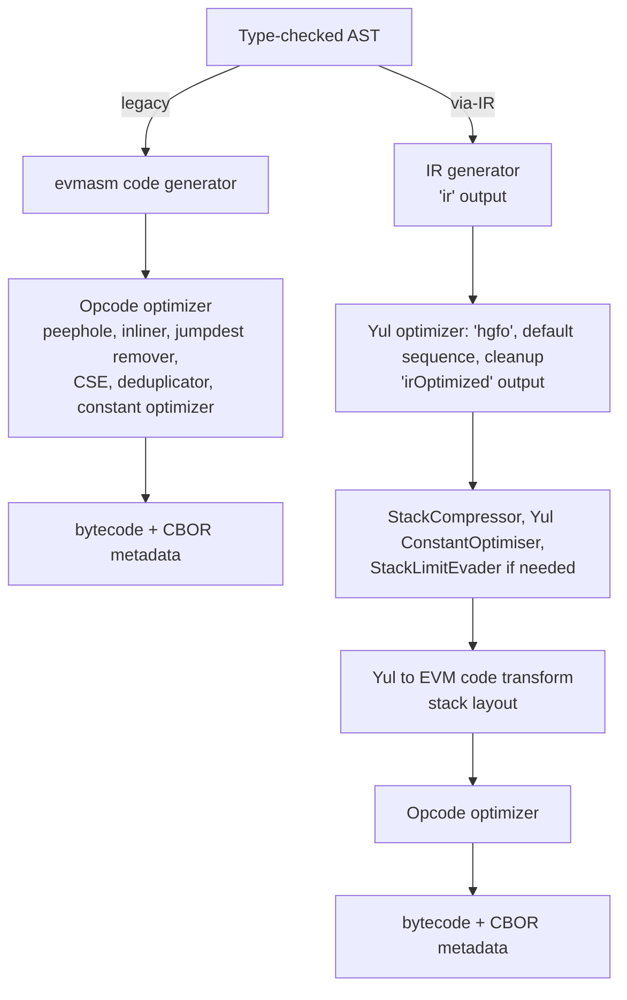
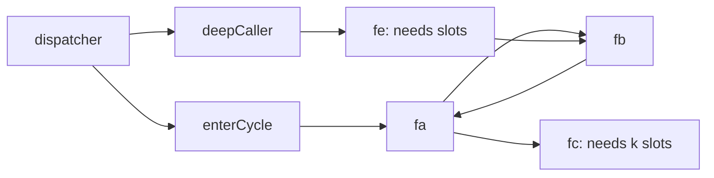

# 3.11 Compiler IR and the optimizer

> [!abstract] In one minute
> - **Two pipelines.** Legacy turns the Solidity AST straight into EVM assembly and optimizes opcodes. Via-IR turns the whole contract into Yul (`ir`), runs the Yul optimizer on it (`irOptimized`), lays out the stack (moving variables to memory if needed), then runs the opcode optimizer too. Legacy still uses the Yul optimizer, but only on isolated assembly blocks and compiler helpers.
> - **The Yul optimizer is a sequence of small rewrites**, each named by one letter. The 0.8.38 default is `dfDvulfnTUtnIf xa[r]EscLM Vcul [j] Trpeul xa[r]cL vifM CTUca[r]LSsTFOtfDnca[r]Iulc scCTUt vifM x[scCTUt] TOntnfDIul vifM jmul[jul] VcTOcul jmul`, cleanup `fDnTOcmuO`. `x` splits expressions, `a` makes SSA, `c` is CSE, `L` resolves loads, `i` is the full inliner, `u` the unused pruner, `S` the unused store eliminator.
> - **`runs` is not an iteration count.** It is "how many times will each opcode execute": low favours small code (cheap deploy), high favours cheap execution. On one contract, runs 10,000 cost about 62,000 more deploy gas than runs 200 (legacy) to save 22–58 gas on most calls, and one call got 23 gas dearer. The clearest single effect: `Error(string)`'s selector is `PUSH3 0x461bcd PUSH1 0xe5 SHL` (6 bytes, 9 gas) at runs 1 and 200, and a 33-byte `PUSH32` (3 gas) at runs 10,000.
> - **The stack-to-memory mover** (the "stack limit evader") runs only in via-IR, after the optimizer, and only in a code object whose `memoryguard` call survived. It gives each unreachable variable a fixed 32-byte slot above `0x80` and bumps the `memoryguard` literal. It refuses recursive functions. It silently does nothing if the `memoryguard` is gone, which happens not only with unannotated assembly but also when **nothing in the object reads the free memory pointer** (the 17-variable puzzle from [[3.2 Syntax and control flow|3.2]]).
> - **Recent optimizer bugs:** 0.8.38 fixed stale knowledge after a Yul variable is reassigned (loads replaced with old values); 0.8.37 fixed spill slots shared across mutual recursion. I reproduced both on the previous compiler. Switching pipelines or compiler versions is a code change: re-run the whole test suite.

**Prerequisites:** [[3.1 What Yul is and when to use it]], [[3.4 Interop with Solidity]], [[2.4 Memory layout]], [[1.3 Execution model]] · **Leads to:** [[3.12 Beyond Yul - Huff and raw bytecode]], [[4.10 Gas optimization]], [[5.13 Toolchain, dependencies and operations]], [[6.7 Deployment and verification]]

Every result in this note comes from solc-js 0.8.38 unless I name another version (0.8.36 and 0.8.37 were installed from npm to reproduce old bugs), with `evmVersion` `prague`, and from running the bytecode in py-evm under Prague rules. Gas figures are **execution gas only**: no 21,000 intrinsic gas, no calldata cost. Optimizer on with 200 runs unless stated.

## Intuition: a compiler is a chain of rewrites

A compiler does not "translate and then optimize". It runs a chain of small, separately correct rewrites. Each one takes a program and returns an equivalent program that is a bit simpler, a bit smaller or a bit cheaper. The optimizer is not one clever pass but dozens of dumb ones, run in a fixed order, some of them in loops until nothing changes.

That picture explains the three things this note is about:

- **What you can inspect.** Via-IR has two checkpoints you can print: the Yul right after code generation (`ir`) and after the Yul optimizer (`irOptimized`). Reading them is the most direct way to learn what your Solidity really does.
- **What you can tune.** `runs` changes the cost model some rewrites use. `optimizerSteps` changes which rewrites run.
- **Where bugs come from.** Each rewrite has preconditions ("this variable is never reassigned", "this function is not recursive"). When a rewrite's bookkeeping is wrong, the output is a different program, and nothing warns you. The two newest compiler bugs are exactly this.

## The two pipelines, inside

[[3.1 What Yul is and when to use it|3.1]] drew the two pipelines and showed what generated Yul looks like; [[2.10 Version map of 0.8.x features|2.10]] lists when each feature arrived. Here is the same picture with the optimizer components named, because questions like "does `runs` matter for via-IR?" and "does the Yul optimizer run on legacy?" are answered by which box runs where.



| Component | Works on | Legacy | Via-IR | Uses `runs`? |
|---|---|---|---|---|
| Opcode peephole optimizer | Short opcode windows | Yes | Yes (final pass) | No |
| Opcode inliner | Jumps to small blocks | Yes | Yes | Yes (body size vs runs) |
| Jumpdest remover | Unused `JUMPDEST`s | Yes | Yes | No |
| Common subexpression eliminator (opcode) | Basic blocks between jumps | Yes | Yes | No |
| Block deduplicator | Identical blocks | Yes | Yes | No |
| Constant optimizer | How each big constant is written | Yes | Yes | **Yes** |
| Dispatcher splitting | The selector ladder | Yes (`runs · 6 · (n − 4) > 3,400`, see [[2.6 Functions, modifiers and special functions|2.6]]) | Never splits | Yes |
| Yul optimizer (step sequence) | Yul AST | Only on assembly blocks that reference no Solidity variable, and on generated ABI helpers ([[3.1 What Yul is and when to use it|3.1]]) | The whole contract | Indirectly (its constant step) |
| StackLimitEvader (stack-to-memory mover) | Yul AST before code transform | No | Yes, if `memoryguard` survives | No |

The `settings.optimizer.details` keys in standard JSON map one-to-one to the opcode components (`peephole`, `inliner`, `jumpdestRemover`, `orderLiterals`, `deduplicate`, `cse`, `constantOptimizer`, `simpleCounterForLoopUncheckedIncrement`) plus `yul` and `yulDetails` (`stackAllocation`, `optimizerSteps`). `enabled: true` only changes their defaults. In the 0.8.38 source, the "standard" preset turns all of them on; the "minimal" preset used when the optimizer is off still runs the peephole optimizer, the jumpdest remover and the unchecked loop increment.

> [!note] Via-IR with the optimizer off is still optimized a little
> Via-IR with `enabled: false` still runs the Yul optimizer with a one-step sequence, `u` (UnusedPruner), with stack allocation optimization on, and so still runs the stack-to-memory mover (the 0.8.38 source comments this as "the minimum necessary to avoid running into 'Stack too deep' constantly"; the mover became default "whenever possible" in 0.8.21). That is why [[3.4 Interop with Solidity|3.4]]'s 20-local function compiled with the optimizer off. But the result is huge: [[3.1 What Yul is and when to use it|3.1]] measured 634 bytes unoptimized against 179 optimized for a three-line contract. Never ship via-IR unoptimized.

## Reading `ir` and `irOptimized`

### How to get them

| Tool | Unoptimized IR | Optimized IR | Notes |
|---|---|---|---|
| `solc` CLI | `--ir` | `--ir-optimized` (add `--optimize`) | Add `--via-ir` if you want the bytecode built from it |
| Standard JSON | `outputSelection: {"*": {"*": ["ir"]}}` | `["irOptimized"]` | `settings.viaIR: true`; solc-js output is cut at 64 KiB, so ask only for what you need |
| Foundry | `forge inspect C ir` | `forge inspect C irOptimized` | Uses your `foundry.toml` settings |

[[3.1 What Yul is and when to use it|3.1]] already warned that `ir` is returned even for a legacy build, but legacy bytecode was not produced from it.

### A worked example

```solidity
// SPDX-License-Identifier: MIT
pragma solidity 0.8.38;

contract Vault {
    error Zero();
    event Deposit(address indexed who, uint256 amount);

    mapping(address => uint256) public balances;
    uint256 public total;

    function deposit(uint256 amount) external {
        if (amount == 0) revert Zero();
        balances[msg.sender] += amount;
        total += amount;
        emit Deposit(msg.sender, amount);
    }
}
```

Via-IR printed 407 lines of `ir` and 87 lines of `irOptimized`; the runtime is 362 bytes. In `ir`, `deposit` is a function `fun_deposit_45` that calls helpers for every operation:

```text
/// @src 0:285:296  "amount == 0"
let expr_22 := eq(cleanup_t_uint256(expr_20), convert_t_rational_0_by_1_to_t_uint256(expr_21))
/// @src 0:281:311  "if (amount == 0) revert Zero()"
if expr_22 {
...
/// @src 0:321:341  "balances[msg.sender]"
let _6 := mapping_index_access_t_mapping$_t_address_$_t_uint256_$_of_t_address(expr_27_slot,expr_29)
/// @src 0:321:351  "balances[msg.sender] += amount"
let _7 := read_from_storage_split_offset_0_t_uint256(_6)
let expr_32 := checked_add_t_uint256(_7, expr_31)
```

In `irOptimized`, `fun_deposit_45` no longer exists. It was inlined into the dispatcher's `case`, and every helper except `checked_add_uint256` (used twice) was inlined and folded. This is the whole `deposit` case, copied from the output:

```text
case 0xb6b55f25 {
    if callvalue() { revert(0, 0) }
    if slt(add(calldatasize(), not(3)), 32) { revert(0, 0) }
    let value_1 := calldataload(4)
    /// @src 0:281:311  "if (amount == 0) revert Zero()"
    if /** @src 0:285:296  "amount == 0" */ iszero(value_1)
    /// @src 0:281:311  "if (amount == 0) revert Zero()"
    {
        /// @src 0:305:311  "Zero()"
        mstore(/** @src 0:57:427  "contract Vault {..." */ 0, /** @src 0:305:311  "Zero()" */ shl(224, 0xf4560403))
        revert(/** @src 0:57:427  "contract Vault {..." */ 0, 4)
    }
    mstore(0, /** @src 0:330:340  "msg.sender" */ caller())
    /// @src 0:57:427  "contract Vault {..."
    mstore(32, 0)
    let dataSlot := keccak256(0, 64)
    sstore(dataSlot, /** @src 0:321:351  "balances[msg.sender] += amount" */ checked_add_uint256(/** @src 0:57:427  "contract Vault {..." */ sload(/** @src 0:321:351  "balances[msg.sender] += amount" */ dataSlot), value_1))
    /// @src 0:57:427  "contract Vault {..."
    sstore(1, /** @src 0:361:376  "total += amount" */ checked_add_uint256(/** @src 0:57:427  "contract Vault {..." */ sload(1), /** @src 0:361:376  "total += amount" */ value_1))
    /// @src 0:391:418  "Deposit(msg.sender, amount)"
    let _4 := /** @src 0:57:427  "contract Vault {..." */ mload(64)
    mstore(_4, value_1)
    /// @src 0:391:418  "Deposit(msg.sender, amount)"
    log2(_4, /** @src 0:57:427  "contract Vault {..." */ 32, /** @src 0:391:418  "Deposit(msg.sender, amount)" */ 0xe1fffcc4923d04b559f4d29a8bfc6cda04eb5b0d3c460751c2402c5c5cc9109c, /** @src 0:330:340  "msg.sender" */ caller())
    /// @src 0:57:427  "contract Vault {..."
    return(0, 0)
}
```

### Decoding `/// @src`

The annotation is `@src <source index>:<start>:<end>`, byte offsets into the source file, **start and end, not start and length**. I checked this by slicing the file: bytes 281 to 311 are exactly `if (amount == 0) revert Zero()`, 30 characters. The source index `0` refers to the `@use-src 0:"C.sol"` line at the top of each object. The text in quotes is only a preview; tools use the numbers. `/** @src … */` inline comments set the location of a sub-expression; `///` comments set it for the following statements.

| `@src` | Line of `Vault.sol` | Source text | What the optimized Yul does there |
|---|---|---|---|
| `0:285:296` | 12 | `amount == 0` | `iszero(value_1)`: `eq(x, 0)` simplified |
| `0:305:311` | 12 | `Zero()` | `mstore(0, shl(224, 0xf4560403))`, `revert(0, 4)`: custom error in scratch space |
| `0:330:340` | 13 | `msg.sender` | `caller()`, used twice (also the indexed topic) |
| `0:321:351` | 13 | `balances[msg.sender] += amount` | Mapping slot `keccak256(0, 64)` inlined; `checked_add_uint256` kept as a function |
| `0:361:376` | 14 | `total += amount` | `sstore(1, checked_add_uint256(sload(1), value_1))` |
| `0:391:418` | 15 | `Deposit(msg.sender, amount)` | `log2(ptr, 32, topic0, caller())`: the event signature hash is topic 0 |
| `0:57:427` | 4 | the whole contract | Code with no better location: dispatcher, ABI decoding, `mload(64)` |
| `0:202:222` | 9 | `uint256 public total` | The getter's `sload(1)` |

Three habits for reading optimized IR:

1. **Find the `case` for your selector**, not the `fun_` name: small functions are inlined into the dispatcher.
2. **Ignore locations on the contract (`0:57:427`)**: they mean "compiler glue", not your code.
3. **Read data flow, not names**: `value_1` is the decoded `amount`; the names come from the optimizer's `NameSimplifier`, not from you.

## The Yul optimizer step by step

### The sequence

The optimizer is driven by a string of one-letter step names. From `libsolidity/interface/OptimiserSettings.h` at tag `v0.8.38` (identical in v0.8.36 and v0.8.37), with the source's own comments:

```text
"dfDvulfnTUtnIf"               // None of these can make stack problems worse
"xa[r]EscLM"                   // Turn into SSA and simplify
"Vcul [j]"                     // Reverse SSA
"Trpeul"                       // Run functional expression inliner
"xa[r]cL"                      // Turn into SSA again and simplify
"vifM"                         // Run full inliner
"CTUca[r]LSsTFOtfDnca[r]Iulc"  // SSA plus simplify
"scCTUt"
"vifM"                         // Run full inliner
"x[scCTUt] TOntnfDIul"         // Perform structural simplification
"vifM"                         // Run full inliner
"jmul[jul] VcTOcul jmul"       // Make source short and pretty
cleanup: "fDnTOcmuO"
```

Rules of the notation (docs, "The Optimizer"): steps run left to right; `[...]` repeats its contents until the code stops changing or 12 rounds pass; brackets cannot nest; the part after `:` is the cleanup sequence; spaces are ignored. Before your sequence, `OptimiserSuite::run` always runs a Disambiguator (unique names for every variable) and the hard-coded `hgfo` (hoist functions, group functions, flatten blocks, rewrite `for` init). After cleanup it runs `g` again, then the Yul **ConstantOptimiser**, then the **StackCompressor** and, only if that fails, the **StackLimitEvader**.

| Letter | Step | What it does, in one line |
|---|---|---|
| `x` | ExpressionSplitter | `mstore(add(a, 1), b)` → `let t := add(a, 1) mstore(t, b)`: every argument becomes a variable |
| `a` | SSATransform | Each reassignment becomes a fresh variable, so each name has one value |
| `r` | UnusedAssignEliminator | Removes assignments whose value is never read |
| `c` | CommonSubexpressionEliminator | Replaces a recomputed expression by the variable already holding it |
| `s` | ExpressionSimplifier | Algebra rules: `eq(x, 0)` → `iszero(x)`, `add(x, 0)` → `x`, constant folding |
| `L` | LoadResolver | Replaces `sload`/`mload`/`keccak256` with a value already known to be there |
| `E` | EqualStoreEliminator | Removes a store of the value the slot already holds |
| `S` | UnusedStoreEliminator | Removes stores that are overwritten or never read before the call ends |
| `M` | LoopInvariantCodeMotion | Moves loop-invariant expressions out of loops |
| `i` | FullInliner | Inlines whole function calls (functions called once, small ones, more if arguments are constant) |
| `e` | ExpressionInliner | Inlines functions that are a single expression |
| `j` | ExpressionJoiner | Reverse of `x`: puts single-use variables back into the expression |
| `V` | SSAReverser | Reverse of `a`: merges variables again to save stack slots |
| `u` | UnusedPruner | Removes unused variables, functions and side-effect-free expressions |
| `D` | DeadCodeEliminator | Removes code after `return`, `revert`, `leave`, `break` |
| `C` / `U` | ConditionalSimplifier / ConditionalUnsimplifier | Uses what an `if` or `switch` proved inside its branch, and undoes that where it costs |
| `n` | ControlFlowSimplifier | Simplifies `if`/`switch` with constant or empty branches |
| `T` | LiteralRematerialiser | Puts literals back in place of variables holding them |
| `m` | Rematerialiser | Recomputes cheap expressions instead of keeping a variable alive |
| `F` | FunctionSpecializer | Clones a function for constant arguments |
| `p` | UnusedFunctionParameterPruner | Drops parameters a function ignores |
| `v` | EquivalentFunctionCombiner | Merges functions with identical bodies |
| `l` | CircularReferencesPruner | Removes functions that only call each other and are unused |
| `t` | StructuralSimplifier | Removes `if`s with constant conditions, constant `for` loops |
| `d` / `f` / `g` / `h` / `o` / `I` / `O` | VarDeclInitializer, BlockFlattener, FunctionGrouper, FunctionHoister, ForLoopInitRewriter, ForLoopConditionIntoBody, ForLoopConditionOutOfBody | Normalization: put the AST into the shape other steps expect |

The table above is the full list in the docs (32 steps). The shape of the default sequence follows from it: normalize, split and SSA (`xa`) so that every value has a name and one definition, simplify with knowledge of loads and stores (`EscLM`), reverse SSA (`V`) because SSA wastes stack slots, inline (`vifM`) to expose more simplification, repeat, then join expressions back (`jmul`) to make the code short.

### What each family buys

I compiled `Vault` via-IR with different `yulDetails.optimizerSteps` and called `deposit(5)` twice (first call: cold zero-to-nonzero stores; second call: warm nonzero changes):

| Setting | Runtime size | 1st `deposit` gas | 2nd `deposit` gas |
|---|---|---|---|
| Optimizer off | 1,086 B | 48,115 | 13,915 |
| On, `optimizerSteps: ":"` (empty sequence and cleanup: only hard-coded steps) | 710 B | 47,132 | 12,932 |
| On, `"u:"` (UnusedPruner only) | 710 B | 47,132 | 12,932 |
| On, `"i"` (FullInliner, default cleanup) | 567 B | 46,582 | 12,382 |
| On, default sequence with `L` and `E` deleted | 362 B | 45,994 | 11,794 |
| On, default | 362 B | 46,002 | 11,802 |

The opcode optimizer still ran in every row except the first, which is why "only hard-coded steps" already saves 376 bytes. Inlining is the biggest single Yul lever. The default sequence costs 8 gas more than the same sequence without `LoadResolver` and `EqualStoreEliminator` here: optimizers chase size and average cost, not every function's minimum.

> [!tip] `optimizerSteps` is a bisecting tool, not a tuning knob
> The Solidity team's own advice for SOL-2026-7 was: rebuild with `L` and `E` deleted from the default sequence and compare test results. That is the general method for "is this an optimizer bug?": remove a suspect step, rebuild, diff behaviour. For production, keep the default sequence: it is what the compiler's tests and fuzzers exercise.

## The `runs` setting

### What it is

`runs` is stored as `expectedExecutionsPerDeployment` (default 200). The docs: "a trade-off parameter between code size (deploy cost) and code execution cost"; it is not the number of optimizer passes ("The optimizer will always run as many times as it can still improve the code"). Components with a choice between "smaller" and "faster" use it to price the choice: roughly, cost = bytes × deposit price + runs × gas per execution. The places I saw it matter:

1. **The constant optimizer.** How to write a 32-byte constant: one `PUSH32` (33 bytes, 3 gas) or a computation such as `PUSH3 … PUSH1 … SHL` (6 bytes, 9 gas).
2. **The opcode inliner.** Copy a small block instead of jumping to it.
3. **The legacy dispatcher split.** Binary search by selector once `runs · 6 · (n − 4) > 3,400` ([[2.6 Functions, modifiers and special functions|2.6]]).
4. **The Yul ConstantOptimiser**, through a gas meter built from `runs`. In the 0.8.38 source, `runs` reaches the Yul optimizer only through this meter and the step context, and **creation objects are always priced as code that runs once**, whatever `runs` says. The main steps I checked (`FullInliner`, `ExpressionSimplifier`) do not read it.

The maximum is 2³² − 1. Values like `runs: 1000000` are common for contracts called constantly (routers); `runs: 1` for contracts near the 24,576-byte limit.

### Measured on one contract

`Runs` is a small token-like contract with ten external functions (`mint`, `transfer`, `setFee`, `masked`, `sumTo`, `hash3`, plus four getters), two `require` strings and a 31-byte mask constant. Deploy gas is the creation message's execution gas, which is dominated by the code deposit (200 gas per runtime byte, [[1.8 Contract creation]]):

| Pipeline | runs | Initcode | Runtime | Deploy gas | `mint` | `transfer` | `masked` | `sumTo(100)` | `hash3` |
|---|---|---|---|---|---|---|---|---|---|
| Legacy | 1 | 1,174 B | 1,128 B | 248,076 | 47,004 | 27,995 | 296 | 29,383 | 501 |
| Legacy | 200 | 1,206 B | 1,160 B | 254,484 | 47,027 | 27,907 | 319 | 29,295 | 524 |
| Legacy | 10,000 | 1,515 B | 1,469 B | 316,360 | 46,969 | 27,861 | 285 | 29,273 | 547 |
| Via-IR | 1 | 1,033 B | 989 B | 220,246 | 46,850 | 27,787 | 219 | 20,783 | 372 |
| Via-IR | 200 | 1,035 B | 991 B | 220,646 | 46,850 | 27,787 | 219 | 20,783 | 360 |
| Via-IR | 10,000 | 1,273 B | 1,229 B | 268,309 | 46,814 | 27,766 | 204 | 20,783 | 360 |

How to read it:

- **Deploy cost rises steeply, runtime savings are small.** Legacy runs 10,000 cost 61,876 more deploy gas than runs 200, and saved 46 gas on `transfer` and 58 on `mint`. Break-even is roughly 1,100–1,350 calls of those functions. For via-IR, 47,663 more deploy gas to save 21–36 gas per call: about 1,300–2,300 calls.
- **Some calls get dearer with more runs.** Legacy `masked` and `hash3` cost more at 200 than at 1. At runs 200 the dispatcher is split (`200 · 6 · (10 − 4) = 7,200 > 3,400`; at runs 1 it is `36`, no split), which moves some selectors further down a ladder; `hash3` also got dearer at 10,000. "More runs" means "lower *average* cost under the optimizer's model", not "every function is cheaper".
- **Via-IR barely reacts between 1 and 200.** Via-IR's code is mostly shaped by the Yul optimizer, which does not consult `runs` for its main steps.
- **Via-IR was smaller and cheaper on every row here**, by 12–16% in runtime size. `sumTo(100)` shows why: the loop body is optimized as Yul (8,500 gas less). This is one contract, not a law ([[4.10 Gas optimization]]).

The single clearest `runs` effect is the revert reason selector. Disassembling legacy `Runs`:

```text
runs 1, 200:   MLOAD PUSH3 0x461bcd PUSH1 0xe5 SHL DUP2 MSTORE          // 0x461bcd << 229 = 0x08c379a0 << 224
runs 10,000:   MLOAD PUSH32 0x08c379a000000000000000000000000000000000000000000000000000000000 DUP2 MSTORE
               ...  PUSH32 0x6e6f74206f776e65720000000000000000000000000000000000000000000000   // "not owner"
```

`PUSH3 PUSH1 SHL` is 6 bytes and 9 gas; `PUSH32` is 33 bytes and 3 gas. At 10,000 runs, 6 gas × 10,000 outweighs 27 bytes × 200 gas; at 200 runs it does not. The left-aligned string `"not owner"` gets the same treatment.

> [!warning] `runs` is part of the build, so verification needs it
> Explorers and Sourcify rebuild your bytecode from the exact settings in the metadata: compiler version, `viaIR`, `optimizer.enabled`, `runs`, `evmVersion`, any `details`. A different `runs` gives different bytecode. Keep these settings in version control with the code ([[6.7 Deployment and verification]]).

## Stack too deep and the stack-to-memory mover

### The problem in one paragraph

The EVM can reach only the top 16 stack slots (`DUP1`–`DUP16`, `SWAP1`–`SWAP16`, [[1.3 Execution model]]). Every live local, parameter, return variable and return address needs a slot. Legacy assigns slots as it generates code and gives up with `CompilerError: Stack too deep`. Via-IR has a second chance: before generating bytecode it can move some variables out of the stack into memory. [[3.4 Interop with Solidity|3.4]] covered what you must promise for that to be allowed (`memory-safe`) and what happens when the promise is false; [[2.4 Memory layout|2.4]] showed the reserved area moving the free pointer. This section is the mechanism itself.

### How the mover works

The docs call it the **stack limit evader**; the code that rewrites the program is the `StackToMemoryMover`. The steps, from `libyul/optimiser/StackLimitEvader.cpp` and `Suite.cpp` at v0.8.38:

1. **The IR generator reserves the right.** Each code object starts with `mstore(64, memoryguard(128))` instead of `mstore(64, 128)`. `memoryguard(size)` is a promise from the code: "I use only `[0, size)` and memory from the returned pointer upward". In return, the optimizer may use `[size, ptr)` (Yul docs).
2. **The optimizer runs normally** (the full sequence and cleanup above).
3. **The StackCompressor tries first.** It compiles the code, finds functions with stack errors, and rematerializes variables (recomputes cheap values instead of keeping them), repeating up to 16 times.
4. **If that fails, the evader asks the stack layout generator which variables are unreachable**, per function, and how many slots short each error is.
5. **It bails out (does nothing) if** there is no `memoryguard` call in the object, if several `memoryguard` calls have different literals, or if any function that needs variables moved is **recursive** (part of a cycle in the call graph).
6. **It assigns slots by a depth-first walk of the call graph.** Leaves get the lowest slots. A function's slots start above the maximum its callees need, so a caller's spilled variables never overlap a callee's that can be active at the same time. Functions on different call paths can share slots. If a function has more than 16 parameters plus return values, the excess ones get slots too.
7. **The mover rewrites the code.** `let x := e` becomes `mstore(offset, e)`, each read of `x` becomes `mload(offset)`, offsets starting at the `memoryguard` argument.
8. **The `memoryguard` literal is bumped** to `size + 32 × slots`. At code generation `memoryguard(n)` becomes the constant `n`, which becomes the initial free memory pointer.

Steps 3–8 run **after** the whole optimizer. That ordering matters for the puzzle below.

Here it is on a standalone Yul object: a function with 17 values live at once.

```yul
object "Mover" {
    code {
        datacopy(0, dataoffset("runtime"), datasize("runtime"))
        return(0, datasize("runtime"))
    }
    object "runtime" {
        code {
            mstore(64, memoryguard(0x80))   // replace with mstore(64, 0x80): StackTooDeepError
            let p := mload(64)
            mstore(p, g())
            return(p, 32)

            // 17 values live at once: one too many for DUP16/SWAP16
            function g() -> r {
                let v0 := sload(0)   let v1 := sload(1)   let v2 := sload(2)   let v3 := sload(3)
                let v4 := sload(4)   let v5 := sload(5)   let v6 := sload(6)   let v7 := sload(7)
                let v8 := sload(8)   let v9 := sload(9)   let v10 := sload(10) let v11 := sload(11)
                let v12 := sload(12) let v13 := sload(13) let v14 := sload(14) let v15 := sload(15)
                let v16 := sload(16)
                sstore(0, add(v0, 1))   sstore(1, add(v1, 1))   sstore(2, add(v2, 1))   sstore(3, add(v3, 1))
                sstore(4, add(v4, 1))   sstore(5, add(v5, 1))   sstore(6, add(v6, 1))   sstore(7, add(v7, 1))
                sstore(8, add(v8, 1))   sstore(9, add(v9, 1))   sstore(10, add(v10, 1)) sstore(11, add(v11, 1))
                sstore(12, add(v12, 1)) sstore(13, add(v13, 1)) sstore(14, add(v14, 1)) sstore(15, add(v15, 1))
                sstore(16, add(v16, 1))
                r := add(add(add(add(add(add(add(add(add(add(add(add(add(add(add(add(
                    v0, v1), v2), v3), v4), v5), v6), v7), v8), v9), v10), v11), v12), v13), v14), v15), v16)
            }
        }
    }
}
```

It compiles (optimizer on). With storage slots 0–16 holding 1–17 it returned 153 (85,643 gas) and incremented every slot. The optimized Yul shows the rewrite: `g` was inlined, and every `vN` became a memory word:

```text
let _1 := memoryguard(0x02a0)       // was memoryguard(0x80): 17 slots × 32 = 0x220 reserved
mstore(64, _1)
mstore(0xa0, sload(0))              // v0
mstore(0xc0, sload(1))              // v1
...
mstore(0x80, sload(16))             // v16
sstore(0, add(mload(0xa0), 1))
...
mstore(_1, add(add(...add(mload(0xa0), mload(0xc0))...), mload(0x80)))
```

The runtime bytecode starts `60 20 61 02a0 80 60 40 52`: `PUSH1 0x20 PUSH2 0x02a0 DUP1 PUSH1 0x40 MSTORE`, the free pointer set to `0x2a0`. Replace the first line with `mstore(64, 0x80)` and compilation fails:

```text
StackTooDeepError: Cannot swap Variable v10 with Variable v11: too deep in the stack by 1 slots in [ v1 v3 v5 v7 v9 v10 v10 v9 v8 v7 v6 v5 v4 v3 v2 v1 v0 v0 v2 v4 v6 v8 v11 ]
No memoryguard was present. Consider using memory-safe assembly only and annotating it via 'assembly ("memory-safe") { ... }'.
```

The cost: each spilled read is `PUSH offset MLOAD` (6 gas) instead of a `DUP` (3 gas), and each write `PUSH offset MSTORE`. [[3.4 Interop with Solidity|3.4]] measured the whole 20-local `deep` function at 5,012 gas.

> [!tip] Read the last line of a via-IR "too deep" error
> It ends with either `No memoryguard was present.` or `memoryguard was present.`. The first means the mover was never allowed to run in that object: look for a reason in the table below. The second means it ran and could not fix the problem: usually recursion.

### Why the mover sometimes does nothing: the limits, verified

[[3.2 Syntax and control flow|3.2]] left an open question: a Solidity contract whose only function holds a `memory-safe` assembly block with a 17-variable Yul function still failed via-IR with `No memoryguard was present`. The block touches no memory, so it is safe even without the annotation. Why was there no `memoryguard`?

Because **the optimizer deleted it.** That contract's only function is `f() external` with no parameters and no return value: nothing in the runtime object ever reads the free memory pointer. The default sequence removes `mstore(64, memoryguard(128))` as an unused store, and then the unused `memoryguard` call. The evader runs after the optimizer (step 3 above), finds no `memoryguard`, and bails. I confirmed it three ways:

| Variant of 3.2's contract (via-IR) | Result |
|---|---|
| As in 3.2: `f()` with the 17-variable block, optimizer on | `YulException … too deep … No memoryguard was present.` |
| Same, a 10-variable version that compiles: look at `irOptimized` | The runtime object has **no `mstore(64, …)` at all**: the `memoryguard` was optimized away |
| Same 17-variable `f()`, plus `function h() external pure returns (uint256) { return 7; }` | Compiles: `h` returns via `mload(64)`, so the guard survives. `irOptimized` shows `memoryguard(0x02a0)` and `mstore(0xa0, sload(…))`; calling `f()` stored the correct sum, 153 |
| Same 17-variable block, `f()` changed to `returns (uint256 z)` with `z := g()` | Compiles |
| Original `f()`, optimizer **off** | Compiles (sequence `u` only, which does not remove the store) |

So the earlier guess, that the mover "cannot move variables inside inline assembly", is wrong: the moved `usr$v…` variables in row 3 *are* inline-assembly variables. Here are the limits I could verify:

| Limit | Verified how | What you see |
|---|---|---|
| Legacy pipeline: no mover at all | Every legacy compile of a too-deep function | `CompilerError: Stack too deep. Try compiling with --via-ir …` |
| No `memoryguard` because unannotated memory-touching assembly is in the same object | [[3.4 Interop with Solidity\|3.4]]; IR generator source (below) | `… No memoryguard was present.` |
| No `memoryguard` because nothing in the object uses memory, so the optimizer removed it | Table above | `… No memoryguard was present.` (misleading: there is no assembly problem) |
| Standalone Yul written with `mstore(64, 0x80)` | `Mover` object above | `StackTooDeepError … No memoryguard was present.` |
| Variables that need moving are in a **recursive** function | `deep(s, n)` with 20 locals and `if (n > 0) r = deep(s, n - 1);` | Optimizer on: `YulException: Cannot swap Variable var_s with Variable _51: too deep in the stack by 1 slots … memoryguard was present.` Off: same error. The non-recursive version compiles both ways |
| Inlining can create the recursion problem | In the 0.8.37 repro below without its `mixDirect` function, `fc` (too deep) is called once, from the recursive `fa`. Optimizer off: compiles. Optimizer on: `YulException … memoryguard was present.`, because the full inliner put `fc`'s 20 locals into `fa`. Adding a second caller (`mixDirect`) stopped the inlining and it compiled | Turn off inlining of that function (make the logic `external`, or split it) or remove the recursion |
| `memoryguard` calls with different literals in one object | Source only (`StackLimitEvader::run` returns early) | Only reachable by hand-written Yul |
| Function arguments and return values | **Not** a limit for non-recursive functions: the evader moves the excess beyond 16 (source); [[3.1 What Yul is and when to use it\|3.1]] compiled an 18-parameter function via-IR | — |
| `msize` | `msize` is a compile error with the Yul optimizer on ([[3.1 What Yul is and when to use it\|3.1]]) and makes the optimizer skip the object when it is off (YulStack source) | Use the free pointer instead |

Why recursion is fatal: the mover gives each variable a **fixed** address. A recursive call would run the same function again with the same addresses and overwrite the caller's values. The only safe answer is "do not move", and then the stack is still too deep.

### The memory-safe effect is per code object: the mechanism

[[3.4 Interop with Solidity|3.4]] measured that one unannotated block in the constructor removed the `memoryguard` from the creation object only. The IR generator source (`libsolidity/codegen/ir/IRGenerator.cpp`, v0.8.38) shows why:

1. The generator produces the **creation object** first: constructor, its queued internal functions, and their assembly blocks.
2. Whenever it emits an inline assembly statement, `IRGeneratorForStatements` checks `hasMemoryEffects && !markedMemorySafe` and, if true, sets a flag on the **generation context**: `setMemoryUnsafeInlineAssemblySeen()`.
3. "Only after all other code generation for the creation object is complete", it reads the flag and writes either `mstore(64, memoryguard(128))` or `mstore(64, 128)` into the creation object's template.
4. It then calls `resetContext(_contract, ExecutionContext::Deployed)`, which **replaces the whole context with a fresh one**, so the flag starts false again.
5. It generates the **deployed object** (dispatcher plus every function reachable from it), reads the flag again, and fills in the deployed object's memory initialization.

Two consequences follow, and I measured both (via-IR, `ir` output):

| Where the unannotated `p := mload(0x40)` block is | Creation object | Deployed object |
|---|---|---|
| Constructor only | `mstore(64, 128)` | `mstore(64, memoryguard(128))` |
| External function `f` only | `mstore(64, memoryguard(128))` | `mstore(64, 128)` |
| Internal `helper()` called from **both** the constructor and `f` | `mstore(64, 128)` | `mstore(64, 128)` |
| Internal `helper()` that nothing calls | `mstore(64, memoryguard(128))` | `mstore(64, memoryguard(128))` |

A function used by both the constructor and runtime code is generated **twice**, once into each object, and taints both. Code that is never queued for generation is never seen, so it taints nothing. The evader then works per object as well: `ObjectOptimizer` optimizes each object separately, and `StackLimitEvader::run` searches only that object's code for `memoryguard`.

## Bugs in the mover: mutual recursion (fixed 0.8.36 and 0.8.37)

The mover's safety rests on two pieces of call-graph bookkeeping: "is this function recursive?" and "how many slots do this function and everything it calls need?". Both had bugs, found and fixed in 2026. Both produced **wrong results with no error**.

| Fixed in | Bug (`uid`) | Severity | Introduced | What went wrong |
|---|---|---|---|---|
| 0.8.37 (10 Sep 2026) | SpillSlotCollisionAcrossMutualRecursion (SOL-2026-4) | low/medium | 0.7.2 | Slot counting undercounted through a cycle, so a caller and a callee shared a slot |
| 0.8.36 (9 Jul 2026) | UnsoundSpillInMutualRecursion (SOL-2026-2) | medium | 0.7.2 | Cycle detection missed functions shared by intersecting cycles, so a recursive function's variables were moved to fixed slots and overwritten on recursion |

### How the 0.8.37 bug worked

The slot allocator walks the call graph depth-first and caches, per function, "slots needed by me and my callees". To avoid looping forever on a cycle, the 0.8.36 code wrote a **provisional 0** into the cache when it entered a function:

```text
uint64_t run(FunctionHandle _function) {
    if (slotsRequiredForFunction.count(_function)) return slotsRequiredForFunction[_function];
    slotsRequiredForFunction[_function] = 0;          // "Assign to zero early to guard against recursive calls."
    ... requiredSlots = max over callees of run(callee) ...
    ... give this function's unreachable variables slots requiredSlots, requiredSlots+1, ...
    return slotsRequiredForFunction[_function] = requiredSlots;
}
```

Take `fa` and `fb` calling each other, `fa` also calling `fc` (which has spilled variables), and an outside function `fe` (also with spilled variables) calling `fb`:



If the walk reaches `fa` first: enter `fa` (cache 0), visit `fb` (cache 0), `fb` visits `fa` and reads the provisional **0**, so `fb` is finalized at **0**. Back in `fa`, `fc` needs `k`, so `fa` = `k`. Later the walk reaches `fe`, asks for `fb`, and gets the cached **0**. So `fe`'s variables start at slot 0, **the same slots `fc` uses**. At runtime `fe` stores its locals, calls `fb` → `fa` → `fc`, `fc` overwrites slot 0 upward, and `fe` reads garbage. The fix (0.8.37) walks strongly connected components of the call graph instead of functions, so `fa` and `fb` are one unit that needs `k` slots.

### Reproduction

The walk order depends on the order of calls in the generated Yul. In this contract the dispatcher tests `enterCycle` (`0x265edbe9`) before `deepCaller` (`0xe6f09939`), so the walk enters the cycle through `fa`, exactly as above:

```solidity
// SPDX-License-Identifier: MIT
pragma solidity >=0.8.36 <0.9.0;

// Via-IR only: the legacy pipeline stops with "Stack too deep".
// 0.8.36 returns a wrong value from deepCaller; 0.8.37 and later are correct.
contract SpillCollision {
    uint256 public sink;

    // Selectors: enterCycle 0x265edbe9 sorts before deepCaller 0xe6f09939,
    // so the evader's call-graph walk reaches the cycle through fa first.
    function enterCycle(uint256 n) external pure returns (uint256) { return fa(n); }
    function deepCaller(bytes32 s) external returns (uint256) { return fe(s); }
    function mixDirect(bytes32 s) external pure returns (uint256) { return fc(s); } // second caller: keeps fc from being inlined into fa

    // fa and fb call each other: a cycle in the call graph. Neither needs spill slots.
    function fa(uint256 n) internal pure returns (uint256) {
        if (n == 0) return 0;
        return fb(n - 1) + fc(bytes32(n));
    }
    function fb(uint256 n) internal pure returns (uint256) {
        if (n == 0) return 1;
        return fa(n - 1) + 1;
    }

    // fc (called from the cycle) and fe (calls into the cycle) are both stack-too-deep.
    function fc(bytes32 s) internal pure returns (uint256) {
        (uint256 v0, uint256 v1, uint256 v2, uint256 v3, uint256 v4) = (h(s, 0), h(s, 1), h(s, 2), h(s, 3), h(s, 4));
        (uint256 v5, uint256 v6, uint256 v7, uint256 v8, uint256 v9) = (h(s, 5), h(s, 6), h(s, 7), h(s, 8), h(s, 9));
        (uint256 w0, uint256 w1, uint256 w2, uint256 w3, uint256 w4) = (h(s, 10), h(s, 11), h(s, 12), h(s, 13), h(s, 14));
        (uint256 w5, uint256 w6, uint256 w7, uint256 w8, uint256 w9) = (h(s, 15), h(s, 16), h(s, 17), h(s, 18), h(s, 19));
        unchecked {
            return (v0 * 1) ^ (v1 * 2) ^ (v2 * 3) ^ (v3 * 4) ^ (v4 * 5) ^ (v5 * 6) ^ (v6 * 7) ^ (v7 * 8) ^ (v8 * 9) ^ (v9 * 10)
                ^ (w0 * 11) ^ (w1 * 12) ^ (w2 * 13) ^ (w3 * 14) ^ (w4 * 15) ^ (w5 * 16) ^ (w6 * 17) ^ (w7 * 18) ^ (w8 * 19) ^ (w9 * 20);
        }
    }
    function fe(bytes32 s) internal returns (uint256) {
        (uint256 v0, uint256 v1, uint256 v2, uint256 v3, uint256 v4) = (h(s, 0), h(s, 1), h(s, 2), h(s, 3), h(s, 4));
        (uint256 v5, uint256 v6, uint256 v7, uint256 v8, uint256 v9) = (h(s, 5), h(s, 6), h(s, 7), h(s, 8), h(s, 9));
        (uint256 w0, uint256 w1, uint256 w2, uint256 w3, uint256 w4) = (h(s, 10), h(s, 11), h(s, 12), h(s, 13), h(s, 14));
        (uint256 w5, uint256 w6, uint256 w7, uint256 w8, uint256 w9) = (h(s, 15), h(s, 16), h(s, 17), h(s, 18), h(s, 19));
        sink = fb(3); // enters the cycle; fa calls fc, whose spilled locals may share fe's slots
        unchecked {
            return (v0 * 1) ^ (v1 * 2) ^ (v2 * 3) ^ (v3 * 4) ^ (v4 * 5) ^ (v5 * 6) ^ (v6 * 7) ^ (v7 * 8) ^ (v8 * 9) ^ (v9 * 10)
                ^ (w0 * 11) ^ (w1 * 12) ^ (w2 * 13) ^ (w3 * 14) ^ (w4 * 15) ^ (w5 * 16) ^ (w6 * 17) ^ (w7 * 18) ^ (w8 * 19) ^ (w9 * 20);
        }
    }

    function h(bytes32 s, uint256 i) internal pure returns (uint256) {
        return uint256(keccak256(abi.encode(s, i)));
    }
}
```

The checker confirms the legacy pipeline rejects this contract with `Stack too deep` (deliberately: the bug needs the mover). Via-IR compiles it on 0.8.36–0.8.38 with the optimizer off and on. `deepCaller(0x0101…01)` must return the XOR of `keccak256(abi.encode(s, i)) · (i + 1)` for `i` = 0…19, which I computed in Python as `0x1a67c571…f5efc67e`:

| Compiler | Settings (via-IR) | Initial free pointer (spill area) | `deepCaller` result |
|---|---|---|---|
| 0.8.36 | optimizer off | `0x100` (4 slots) | `0xee946a17…476bd055` **wrong, no revert** |
| 0.8.36 | optimizer on, default sequence without `i` | `0x100` | `0xc7201ca3…d2de3660` **wrong, no revert** |
| 0.8.36 | optimizer on, default | `0x1c0` | `0x1a67c571…f5efc67e` correct (inlining changed the call graph) |
| 0.8.37 | off / on / on without `i` | `0x180` / `0x1c0` / `0x180` | `0x1a67c571…f5efc67e` correct |
| 0.8.38 | off / on / on without `i` | `0x180` / `0x1c0` / `0x180` | `0x1a67c571…f5efc67e` correct |

The fixed compiler reserves 8 slots where 0.8.36 reserved 4: `fe`'s and `fc`'s spill slots no longer overlap. Rename `enterCycle` to `ring` (selector `0xec73ae46`, which sorts after `deepCaller`) and 0.8.36 returns the right answer too: `0x1a67c571…` with an 8-slot area, because the walk now reaches `fb` from `fe` first and counts the cycle correctly. That is what makes such bugs hard: they depend on names, call order and settings, not only on logic.

## The stale-knowledge bug (fixed 0.8.38)

SOL-2026-7, **YulOptimizerKnowledgeBaseStaleBookkeeping**: introduced 0.8.19, fixed 0.8.38 (22 Oct 2026), severity low. [[3.1 What Yul is and when to use it|3.1]] lists it among assembly-related bugs; here is how it works.

### The idea behind `LoadResolver`

`LoadResolver` (`L`) and `EqualStoreEliminator` (`E`) share a data-flow analysis that remembers "memory at `a` holds 67" and "storage slot `k` holds `v`". After `mstore(a, 67)`, a later `mload(a)` can become `67`, if nothing in between could have overwritten `a`. The hard part is "could have overwritten". For each store whose address is not a known constant, the analysis must forget every entry the store *might* hit and keep entries it provably *cannot* hit.

To prove two addresses distinct, the `KnowledgeBase` writes each address as **base variable + constant offset**. `add(v, 0x100)` and `add(v, 0x200)` have the same base `v` and offsets 256 bytes apart, so two 32-byte memory words there cannot overlap. This is sound only if `v` means the **same value** in both expressions. The representations were cached per variable name, and the cache was invalidated lazily. When `v` was reassigned in a way the analysis did not track (a branch or loop that rejoined, or a multi-variable assignment), an address computed from the old `v` and one from the new `v` still looked like "same base, different offset". The analysis kept the stale fact; the load got the old value.

### Reproduction

This is the Solidity team's regression test `reassigned_reference_memory_alias.sol`, made into a deployable contract:

```solidity
// SPDX-License-Identifier: MIT
pragma solidity >=0.8.19 <0.9.0;

contract StaleMemory {
    function f(uint256, uint256) external pure returns (uint256 result) {
        assembly {
            let v := 0x400
            if calldataload(4) { v := 0 }
            let a := add(v, 0x100)          // 0x500
            mstore(a, 67)
            if calldataload(36) { v := 0x300 }
            let b := add(v, 0x200)          // 0x500 again when the second flag is set
            mstore(b, 7)
            result := mload(a)              // must be 7 when a == b
        }
    }
}
```

With `f(0, 1)`: `v` = `0x400`, `a` = `0x500`; then `v` = `0x300`, `b` = `0x500`. The second store overwrites the first, so the answer is 7.

| Compiler | Legacy, opt off | Legacy, opt on | Via-IR, opt off | Via-IR, opt on |
|---|---|---|---|---|
| 0.8.37 | 67, **7** | 67, **7** | 67, **7** | 67, **67 (wrong)** |
| 0.8.38 | 67, 7 | 67, 7 | 67, 7 | 67, 7 |
| 0.8.37, via-IR, default sequence with `L` and `E` deleted | — | — | — | 67, 7 |

(First number `f(0, 0)`, second `f(0, 1)`.) The `irOptimized` diff on 0.8.37 shows the mistake directly: the load was replaced by the constant.

```text
0.8.37:  mstore(add(usr$v, 0x200), 7)
         let memPos := mload(64)
         mstore(memPos, /** @src 0:152:440  "assembly {..." */ 67)      // mload(a) became 67
         return(memPos, 32)

0.8.38:  mstore(add(usr$v, 0x200), 7)
         let var_result := mload(usr$a)                                    // load kept
         let memPos := mload(64)
         mstore(memPos, var_result)
         return(memPos, 32)
```

Legacy was not affected here because the block assigns `result`, a Solidity variable, so legacy never ran the Yul optimizer on it. I also rewrote the block to return with `mstore(0, mload(a)) return(0, 32)` (no Solidity variable): legacy 0.8.37 then Yul-optimizes it in isolation, but still returned the right value, and so did the same code as a standalone Yul object. The trigger depends on the exact intermediate code; the advisory says as much ("sensitive to the optimizer sequence and to the surrounding code").

The bug did not need assembly. The second regression test is plain Solidity: a `S[20]` storage array, a counter `i` incremented in two loops, `a[k].v = v` with `k = i + 2` before the second loop and `a[i].v = w` after it, then `return a[k].v`. With `g(0, 2, 0xaaaa, 0xbbbb)` the two indices coincide and the right answer is `0xbbbb`. I ran it: 0.8.37 via-IR optimized returned `0xaaaa`; every other configuration and 0.8.38 returned `0xbbbb`. The loops are what make `i`'s value "untracked" at the join.

The fix (PR #17116) gives each variable a **version** that increments on every assignment and caches address representations per (variable, version), so a stale entry can never match. The team scanned about 283,000 via-IR and 607,000 legacy verified builds on Sourcify, rebuilding with and without the fix, and found no bytecode differences.

## The metadata hash at the end of the bytecode

By default solc appends a CBOR-encoded map to both creation and runtime code. The legacy `Vault` runtime (452 bytes) ends with:

```text
... 56 fe a2 64 69706673 58 22 1220 322ad1d888fe49a6c3e751b7c34e0d92352188a3ad1e40cf6a46521ffeb8340d 64 736f6c63 43 000826 0033
```

| Bytes | CBOR meaning | Value |
|---|---|---|
| `fe` | Not CBOR: `INVALID`, so execution can never run into the data | — |
| `a2` | Map with 2 entries | — |
| `64 69706673` | Text string, 4 bytes | `"ipfs"` |
| `58 22` | Byte string, 34 bytes follow | — |
| `1220 322a…340d` | Multihash: `0x12` = sha2-256, `0x20` = 32 bytes | IPFS hash of the metadata JSON |
| `64 736f6c63` | Text string, 4 bytes | `"solc"` |
| `43 000826` | Byte string, 3 bytes | Compiler version 0.8.38 (`0x26` = 38) |
| `0033` | Not CBOR: big-endian length of the CBOR part | 51 bytes |

The metadata JSON it points to holds the compiler version, every setting (`optimizer`, `runs`, `viaIR`, `evmVersion`, remappings), the ABI, NatSpec and a hash of every source file. That is how Sourcify can rebuild the exact bytecode. The IPFS hash is **not** the plain SHA-256 of the JSON: IPFS hashes a wrapped file object. I checked that `sha256(metadata)` (`5ee89130…`) differs from the embedded `322ad1d8…`.

| `settings.metadata` | Runtime size | Tail |
|---|---|---|
| default (`bytecodeHash: "ipfs"`) | 452 B | `… fe a2 64 ipfs 58 22 1220<32> 64 solc 43 000826 0033` |
| `bytecodeHash: "bzzr1"` | 451 B | `… fe a2 65 bzzr1 58 20 <32> 64 solc 43 000826 0032` |
| `bytecodeHash: "none"` | 411 B | `… fe a1 64 solc 43 000826 000a` |
| `appendCBOR: false` | 398 B | No `fe`, no CBOR, no length |

Practical consequences: changing a **comment** changes the source hash and so the metadata hash and the bytecode (but not behaviour); diff bytecode with the metadata stripped; `bytecodeHash: "none"` gives reproducible bytecode across machines while keeping the version tag; `appendCBOR: false` saves 54 bytes and makes the version invisible to explorers.

## Legacy vs via-IR: the semantic differences

"Via-IR fixes stack too deep" is the shallow answer. The deeper one: the two pipelines are **two different compilers** that share a parser and type checker, and they disagree in documented and undocumented ways. Measured differences, collected from this vault (0.8.38, optimizer on):

| Area | Legacy | Via-IR | Measured in |
|---|---|---|---|
| State variable initialization order | All initializers first (most base to most derived), then all constructors | Per contract: its initializers, then its constructor | [[2.7 Inheritance, interfaces and libraries\|2.7]]: docs example `y = f()` gives **0** legacy, **42** via-IR |
| Base constructor arguments vs initializers | Initializers run before arguments are evaluated | Arguments evaluated first | 2.7: `P(fee * 100)` passes **500** legacy, **0** via-IR |
| Modifier with `_` twice | Return variable keeps its slot between passes | Parameters and return variables reset before each `_` | [[2.6 Functions, modifiers and special functions\|2.6]]: **1007** vs **1000** |
| `++a + a` with `a = 1` | **3** | **4** (tries left to right) | Here (`Sem.order()`) |
| `addmod`/`mulmod` argument order | Right to left | Left to right | Here: `addmod(x++, 1, x)` with `x = 3` gives **1** legacy, **0** via-IR; `mulmod(x++, 2, x)` gives **0** vs **2** |
| `delete` of a struct `{uint64 a; uint64 b;}` | Clears only the fields: the padding (upper 16 bytes) stayed `ff…` | Clears the whole slot | Here: slot after `delete` `0xff…ff000…0` vs `0x0` |
| Internal function pointers | Code offsets | Small IDs dispatched by `switch`, `Panic(0x51)` default | [[3.4 Interop with Solidity\|3.4]] |
| Library call protection | `PUSH20`/`ADDRESS` prologue | Immutable checked in each state-changing function | 2.7 |
| Free pointer after `abi.encodePacked`/`concat` | Not rounded to 32 bytes | Rounded up | [[3.5 Memory management in assembly\|3.5]] |
| Dispatcher | Split by `runs` | Never split | 2.6 |
| Inline assembly and the Yul optimizer | Only isolated blocks | Merged with the whole program | 3.1 |
| `memory-safe` | No effect | Decides whether the mover may run | 3.4 |
| Stack too deep | Hard error | Mover, with the limits above | This note |
| Compiler bugs | e.g. SOL-2026-5 (`delete b[i]` on memory `bytes` clears 32 bytes), legacy only | e.g. SOL-2026-1, -2, -4, -6, via-IR only; SOL-2026-7 mostly | `bugs.json` |
| Gas and size | — | Usually smaller and cheaper, not always | This note, 3.1, 2.6 |

> [!warning] A docs example that did not reproduce
> The "IR-based Codegen Changes" page says a huge `new uint[]` runs out of gas in legacy and reverts with a pointer-overflow panic in via-IR. With 0.8.38, `new uint256[](2**64)` reverted with `Panic(0x41)` on **both** pipelines (191 gas legacy, 180 via-IR). The legacy pipeline now checks allocation size too. Do not quote that row in an interview as current behaviour.

## Solidity and Yul in practice

### Settings to pin, in one place

```json
{
  "language": "Solidity",
  "settings": {
    "viaIR": true,
    "evmVersion": "osaka",
    "optimizer": { "enabled": true, "runs": 200 },
    "metadata": { "bytecodeHash": "ipfs" },
    "outputSelection": { "*": { "*": ["evm.bytecode.object", "evm.deployedBytecode.object", "irOptimized", "metadata"] } }
  }
}
```

In Foundry the same keys are `via_ir`, `evm_version`, `optimizer`, `optimizer_runs`, `bytecode_hash`, `cbor_metadata` in `foundry.toml` ([[6.1 Foundry essentials]]). Different profiles for tests and deployment are a common mistake: tests then exercise a different compiler output than the one you deploy.

### Switching a codebase from legacy to via-IR

1. **Treat it as a compiler change.** Run the full unit, fuzz and invariant suites on the via-IR build, not the legacy one ([[6.2 Unit, fuzz and invariant testing]]).
2. **Diff post-deployment state**: every storage slot after constructors and initializers, because initialization order changed.
3. **Grep for the known differences**: modifiers with two `_`, constructors calling virtual functions, expressions with side effects (`x++` inside a larger expression, `addmod`/`mulmod` arguments), `delete` on packed structs read in assembly, assembly that hard-codes internal function pointers or free-pointer alignment.
4. **Annotate every memory-touching assembly block** `memory-safe` only after checking it is ([[3.4 Interop with Solidity|3.4]]), and treat `Unknown inline assembly flag` warnings as errors.
5. **Check the bug list for both pipelines** for your exact version, and pin a version with no known bugs (0.8.38 has none listed).
6. **Re-measure gas** for hot paths; via-IR is usually cheaper, but not on every function.
7. **Re-verify** on explorers with the new settings.

### When you think the optimizer broke your code

1. Reproduce with the optimizer off. Then with `optimizer.details.yul: false` (legacy) or a sequence with suspect steps removed (`optimizerSteps`).
2. Print `irOptimized` for both builds and diff the function (find it by its selector `case`).
3. Look for a load replaced by a constant, a store that disappeared, or a reordered side effect.
4. Shrink to a minimal case and report it to the compiler team; check the bug list and the open issues first.

## Pitfalls and incidents

- **Unoptimized via-IR in production.** Bigger and dearer than unoptimized legacy (3.1).
- **"No memoryguard was present" with no assembly at all.** The object never used memory, so the guard was optimized away. Not your assembly's fault; restructure or keep the function's work in a function that returns data.
- **Recursion plus deep functions.** The mover refuses; inlining can create the problem in a function you did not think was recursive.
- **Test settings ≠ deploy settings.** Each pipeline has its own bugs; tests on one say little about the other.
- **Trusting "it has no assembly, so the optimizer is safe".** SOL-2026-7 broke plain Solidity via-IR.
- **Changing `runs` and forgetting verification.** The bytecode changes.

Optimizer and code-generator bugs from `bugs.json` (downloaded 1 Nov 2026), newest first. For older assembly-adjacent ones (SOL-2022-4, SOL-2022-7, SOL-2021-1) see [[3.1 What Yul is and when to use it|3.1]]; for cleanup bugs see [[3.9 Cleanup, dirty bits and safety|3.9]].

| Fixed in | Bug (`uid`) | Severity | Introduced | Pipeline | One line |
|---|---|---|---|---|---|
| 0.8.38 | YulOptimizerKnowledgeBaseStaleBookkeeping (SOL-2026-7) | low | 0.8.19 | Yul optimizer: via-IR any code; legacy only isolated blocks and helpers | Stale base-plus-offset knowledge after reassignment |
| 0.8.37 | MisorderedNamedParametersInRequireWithCustomErrors (SOL-2026-6) | very low | 0.8.26 | Via-IR | `require(c, E({b: 1, a: 2}))` encoded in call-site order |
| 0.8.37 | MemoryByteArrayElementDeleteClearsWholeWord (SOL-2026-5) | low/medium | always | Legacy | `delete b[i]` cleared 32 bytes |
| 0.8.37 | SpillSlotCollisionAcrossMutualRecursion (SOL-2026-4) | low/medium | 0.7.2 | Via-IR | Above |
| 0.8.36 | UnsoundSpillInMutualRecursion (SOL-2026-2) | medium | 0.7.2 | Via-IR | Above |
| 0.8.34 | TransientStorageClearingHelperCollision (SOL-2026-1) | high | 0.8.28 | Via-IR, cancun+ | One `delete` helper for storage and transient storage ([[3.6 Storage, transient storage and bit packing\|3.6]]) |
| 0.8.23 | VerbatimInvalidDeduplication (SOL-2023-3) | low | 0.8.5 | Opcode optimizer | All `verbatim` blocks considered identical |
| 0.8.21 | FullInlinerNonExpressionSplitArgumentEvaluationOrder (SOL-2023-2) | low | 0.6.7 | Yul optimizer, custom sequences | `i` without a preceding `x` reordered arguments |

The 0.8.37 changelog also fixed, outside the bug list, an `UnusedStoreEliminator` removal of `returndatacopy` that referenced a stale `returndatasize()`, and checked/unchecked semantics of constants leaking between contexts in via-IR. The pattern: **the newer machinery (via-IR, the mover, the data-flow optimizer) is where most 2026 bugs were.** That is a reason to pin the latest release and test the build you ship, not a reason to avoid via-IR.

## Question ladder

> [!question]- **B** What does the optimizer `runs` value trade off?
> It trades **deployment cost** (code size, at 200 gas per byte of runtime code deposited, plus initcode calldata) against **execution cost** of the code later. `runs` is the optimizer's estimate of how many times each opcode will run over the contract's life. It is not a number of optimizer passes: the docs say the optimizer runs as long as it can improve the code.
>
> Who reads it: the constant optimizer (write a constant as a cheap-to-execute `PUSH32` or a short computation), the opcode inliner, legacy's dispatcher split (binary search once `runs · 6 · (n − 4) > 3,400`), and the Yul constant optimizer. Creation code is always priced as running once.
>
> Numbers from one contract (`Runs` above, py-evm Prague, execution gas):
>
> | | Legacy runs 1 | Legacy 200 | Legacy 10,000 | Via-IR 1 | Via-IR 200 | Via-IR 10,000 |
> |---|---|---|---|---|---|---|
> | Runtime size | 1,128 B | 1,160 B | 1,469 B | 989 B | 991 B | 1,229 B |
> | Deploy gas | 248,076 | 254,484 | 316,360 | 220,246 | 220,646 | 268,309 |
> | `transfer` gas | 27,995 | 27,907 | 27,861 | 27,787 | 27,787 | 27,766 |
>
> Concrete mechanism: the `Error(string)` selector is `PUSH3 0x461bcd PUSH1 0xe5 SHL` (6 bytes, 9 gas) at runs 1 and 200, and `PUSH32 0x08c379a0…` (33 bytes, 3 gas) at 10,000.
>
> Rules of thumb: low runs (1–200) for contracts near the 24,576-byte limit or rarely called; high runs (10,000 to millions) for hot contracts like routers. Expect diminishing returns: here 62,000 extra deploy gas bought 46 gas per `transfer`. Not every function gets cheaper (legacy `masked` cost 296 at runs 1 and 319 at 200, because of the dispatcher split). `runs` is part of the build settings, so verification needs the same value.

> [!question]- **I** Read the optimized IR of a simple function and map it back to source lines.
> Use `Vault.deposit` from [[#Reading `ir` and `irOptimized`]]. Steps and answer:
>
> 1. **Find the code.** Get `irOptimized` with via-IR (`--ir-optimized --via-ir --optimize`, or standard JSON `irOptimized`). Go to the `object "Vault_46_deployed"` (runtime), then the `switch shr(224, calldataload(0))`, then `case 0xb6b55f25` (`deposit(uint256)`). The function was inlined, so there is no `fun_deposit`.
> 2. **Decode `@src a:b:c`.** Source index `a` (from `@use-src 0:"C.sol"`), start byte `b`, end byte `c`. Count newlines before byte `b` to get the line.
> 3. **Map:**
>
> | Optimized Yul | `@src` | Source line |
> |---|---|---|
> | `if callvalue() { revert(0, 0) }`, `slt(add(calldatasize(), not(3)), 32)` check, `calldataload(4)` | `0:57:427` (contract) | Compiler glue: non-payable check, ABI decoding of `amount` |
> | `if iszero(value_1) { mstore(0, shl(224, 0xf4560403)) revert(0, 4) }` | `0:281:311`, `0:285:296`, `0:305:311` | Line 12: `if (amount == 0) revert Zero();` (`eq(x, 0)` became `iszero`) |
> | `mstore(0, caller()) mstore(32, 0) let dataSlot := keccak256(0, 64)` | `0:330:340` | Line 13: the slot of `balances[msg.sender]` (mapping at slot 0) |
> | `sstore(dataSlot, checked_add_uint256(sload(dataSlot), value_1))` | `0:321:351` | Line 13: `balances[msg.sender] += amount;` |
> | `sstore(1, checked_add_uint256(sload(1), value_1))` | `0:361:376` | Line 14: `total += amount;` |
> | `mstore(_4, value_1) log2(_4, 32, 0xe1fffcc4…, caller())` | `0:391:418` | Line 15: `emit Deposit(msg.sender, amount);` topic 0 = event hash, topic 1 = indexed `who`, data = `amount` |
> | `return(0, 0)` | contract | End of the function: no return data |
>
> What an interviewer listens for: you know the IR is per object (creation vs runtime); you look for the selector `case`; you know `@src` is start:end byte offsets; you recognize inlined helpers (`checked_add_uint256` survived only because it is used twice); and you treat contract-wide locations as glue. Bonus: in `ir` (unoptimized) the same lines are calls like `mapping_index_access_…` and `read_from_storage_split_offset_0_t_uint256`, which tells you what each helper does before inlining.

> [!question]- **A** How does the stack-to-memory mover work, and why did mutual recursion break it (fixed in 0.8.37)?
> **How it works.** Only via-IR. The IR generator starts each code object with `mstore(64, memoryguard(128))` unless the object contains memory-unsafe inline assembly (a per-object flag, reset between creation and runtime generation). The Yul optimizer runs its full sequence. Then the StackCompressor tries rematerialization. If stack errors remain, the StackLimitEvader asks the stack layout generator which variables are unreachable in each function. It aborts if there is no `memoryguard`, if `memoryguard` literals differ, or if any function needing spills is recursive. Otherwise it walks the call graph depth-first, giving each function's unreachable variables (and parameters/returns beyond 16) fixed 32-byte slots above the callee requirement, so variables of functions that can be active together never share a slot. The StackToMemoryMover rewrites `let x := e` into `mstore(off, e)` and reads into `mload(off)`, and the `memoryguard` literal grows by 32 bytes per slot, which moves the initial free pointer (e.g. `0x80` → `0x2a0` for 17 slots in my `Mover` object).
>
> **Why fixed slots and recursion conflict.** A fixed address is shared by every activation of a function. So recursive functions must never be spilled (SOL-2026-2, fixed 0.8.36, was a bug in detecting which functions are recursive).
>
> **The 0.8.37 bug (SOL-2026-4).** Recursion also breaks the *counting*. The DFS cached each function's slot requirement and, to stop infinite descent, wrote a provisional **0** when entering a function. With `fa ↔ fb`, `fa → fc` (spills `k` slots) and `fe → fb` (fe spills): entering the cycle at `fa`, the walk visits `fb`, which sees `fa`'s provisional 0 and is finalized at 0. `fe` later reads `fb = 0`, puts its spilled variables at slots from 0, and so shares slots with `fc`. At runtime `fe`'s values are overwritten by `fc` during `fb(3)`. No error, wrong result.
>
> **My reproduction** (`SpillCollision` above, via-IR, optimizer off): 0.8.36 reserved 4 slots (`0x100`) and `deepCaller` returned `0xee946a17…` instead of `0x1a67c571…`; 0.8.37 and 0.8.38 reserved 8 slots (`0x180`) and were correct. With the optimizer on but `i` removed from the sequence, 0.8.36 was also wrong; with the full default sequence, inlining reshaped the call graph and the bug did not fire. Renaming the entry point so its selector sorts later fixed 0.8.36 by luck: the walk order changed.
>
> **The fix**: walk strongly connected components (each cycle is one node needing as many slots as all its members' callees), so the DAG of components is processed exactly once, with final values.
>
> What an interviewer listens for: memoryguard as a contract between codegen and optimizer; "fixed offsets, sized by call-graph DFS"; why recursion is excluded; that the bug's trigger is order-dependent (names, call order), so tests can pass by accident; and the defense: pin ≥ 0.8.37, avoid deep functions reachable from recursion, test the exact build.

> [!question]- **E** Explain the stale-knowledge bug class fixed in 0.8.38: how reassigning a Yul variable could make the optimizer reuse outdated load values or drop needed stores.
> **The class.** Any optimizer that caches facts about program state is only as correct as its invalidation. Here the facts are "memory/storage at address X holds value Y", used by `LoadResolver` (replace `mload`/`sload`/`keccak256` by a known value) and `EqualStoreEliminator` (drop a store of the value already there).
>
> **Why addresses are symbolic.** Most addresses are not constants. On a store to an unknown address the analysis must forget every fact that store could clobber. To keep useful facts, the `KnowledgeBase` expresses an address as base variable + constant offset and declares two addresses distinct if they share a base and their offsets differ (storage) or are ≥ 32 apart (memory).
>
> **The bug.** That proof assumes the base variable has one value. These representations were cached per variable and invalidated lazily: only when the reassigned variable itself was looked up, and not at all when the variable had no tracked value before and after (assigned in a branch or loop that rejoined, or together with other variables). So `a = add(v_old, 0x100)` and `b = add(v_new, 0x200)` looked like "same base, 256 bytes apart". The analysis kept "`a` holds 67" across `mstore(b, 7)` even when `a == b` at runtime.
>
> **Three symptoms.** (1) A later `mload(a)`/`sload(a)` replaced by the stale value. (2) A later store of the stale value to `a` removed as "already there" (the read-modify-write test: `a[k].v += 1` after `a[i].v = 500` with `i == k` must leave 501). (3) `keccak256` over the region replaced by the hash of old data.
>
> **Reproduced** on 0.8.37 via-IR optimized: the assembly `StaleMemory.f(0, 1)` returned 67 instead of 7, and the IR showed `mstore(memPos, 67)` where 0.8.38 keeps `mload(usr$a)`. The plain-Solidity storage test `g(0, 2, 0xaaaa, 0xbbbb)` returned `0xaaaa` instead of `0xbbbb`. Unoptimized builds, legacy builds of these contracts, and 0.8.37 with `L` and `E` removed from the sequence were all correct.
>
> **Scope.** 0.8.19–0.8.37, Yul optimizer on, sequence containing `L` or `E` (the default does), an address base reassigned in the *intermediate* Yul, and two addresses that coincide at runtime. Via-IR: any code. Legacy: only isolated assembly blocks and compiler-generated Yul helpers. If the addresses come from calldata, an attacker can choose inputs that make them coincide, which is why "low severity" is not "ignore": it was low because the pattern is rare (a Sourcify scan of about 890,000 builds found no affected bytecode).
>
> **The fix**: explicit versioning. Every variable gets a version that increments on each assignment, and cached representations are keyed by (variable, version).
>
> **What an expert adds.** How to check a deployed contract: rebuild with the fix and diff bytecode without metadata; or build the original version with `L` and `E` removed and diff test results; or prove equivalence with a symbolic checker such as hevm ([[6.5 Formal verification]]). The general lesson for reviewers: optimizer bugs cluster around *aliasing* (two names for one location) and *invalidation*; code that computes overlapping addresses from reassigned variables, in loops, is where to test hardest with fuzzed inputs that force collisions.

> [!question]- **E** What are the semantic differences between the legacy and via-IR pipelines, beyond "IR fixes stack-too-deep"?
> They are two code generators with different rules, so the same source can **behave** differently:
>
> | Difference | Legacy | Via-IR | Evidence |
> |---|---|---|---|
> | State-variable initialization order | All initializers, then all constructors | Each contract's initializers just before its own constructor | `y = f()`: 0 vs 42 ([[2.7 Inheritance, interfaces and libraries\|2.7]]) |
> | Base-constructor argument evaluation | After initializers | Before any initializer | `P(fee * 100)`: 500 vs 0 (2.7) |
> | Modifier `_` run twice | Locals and return variables persist | Reset to zero before each `_` | 1007 vs 1000 ([[2.6 Functions, modifiers and special functions\|2.6]]) |
> | Expression evaluation order | Unspecified | Left to right where possible | `++a + a`: 3 vs 4 (here) |
> | `addmod`/`mulmod` arguments | Right to left | Left to right | 1/0 vs 0/2 (here) |
> | `delete` packed struct | Leaves padding | Clears whole slot | Measured here |
> | Internal function pointers | Code offsets | IDs + switch | [[3.4 Interop with Solidity\|3.4]] |
> | Inline assembly | Optimized only if isolated; `memory-safe` meaningless | Merged and optimized; `memory-safe` controls the mover | 3.1, 3.4 |
> | Stack too deep | Error | Mover (not for recursion) | This note |
>
> Plus each pipeline has **its own optimizer and codegen bugs**: 2026 alone had via-IR-only SOL-2026-1, -2, -4, -6 and legacy-only SOL-2026-5, and SOL-2026-7 hit via-IR on any code but legacy only in isolated blocks. A test suite passing on one pipeline proves little about the other.
>
> So switching is not a flag flip. The answer an interviewer wants: re-run the **full** test suite (unit, fuzz, invariant) on the via-IR build; diff post-deployment storage of every contract (initialization order); grep for side-effecting expressions, double `_`, virtual calls in constructors, assembly assumptions about pointers or alignment; audit every assembly block's `memory-safe` status; re-measure gas; re-verify; check `bugs.json` for the exact version and pipeline. Bonus: via-IR compile times are much longer, which changes CI and fuzzing budgets.

## Related notes

- [[3.1 What Yul is and when to use it]] — the two pipelines at a high level and how each optimizes assembly blocks
- [[3.2 Syntax and control flow]] — Yul variables are stack slots; the 17-variable case this note explains
- [[3.4 Interop with Solidity]] — the `memory-safe` promise and what a false one breaks
- [[3.5 Memory management in assembly]] — the free pointer that the spill area shifts
- [[3.9 Cleanup, dirty bits and safety]] — cleanup bugs and the assembly audit checklist
- [[3.10 Yul objects and standalone contracts]] — objects, `datasize`/`dataoffset`, which this note's `Mover` uses
- [[2.4 Memory layout]] — the reserved spill area seen from Solidity
- [[2.6 Functions, modifiers and special functions]] and [[2.7 Inheritance, interfaces and libraries]] — measured pipeline differences
- [[2.10 Version map of 0.8.x features]] — when via-IR, `memory-safe` and the mover arrived
- [[4.10 Gas optimization]] — when `runs` and via-IR are worth it
- [[5.13 Toolchain, dependencies and operations]] — pinning compilers and tracking the bug list
- [[6.7 Deployment and verification]] — metadata, settings and reproducible bytecode

## Sources

- [Solidity docs: The Optimizer](https://docs.soliditylang.org/en/latest/internals/optimizer.html) — step letters, bracket and `:` notation, `runs` meaning, StackCompressor
- [Solidity docs: Yul, `memoryguard`](https://docs.soliditylang.org/en/latest/yul.html) — the memoryguard contract and the stack limit evader
- [Solidity docs: Using the compiler](https://docs.soliditylang.org/en/latest/using-the-compiler.html) — standard JSON optimizer details, `optimizerSteps`, metadata settings
- [Solidity docs: IR-based Codegen Changes](https://docs.soliditylang.org/en/latest/ir-breaking-changes.html) — documented semantic differences
- [`OptimiserSettings.h` at v0.8.38](https://github.com/argotorg/solidity/blob/develop/libsolidity/interface/OptimiserSettings.h) — default sequence and cleanup, presets, `expectedExecutionsPerDeployment` (raw files read at tags v0.8.36–v0.8.38)
- `libyul/optimiser/Suite.cpp`, `StackLimitEvader.cpp/.h`, `libyul/YulStack.cpp`, `libyul/ObjectOptimizer.cpp`, `libsolidity/codegen/ir/IRGenerator.cpp`, `IRGeneratorForStatements.cpp` at v0.8.36 and v0.8.38 (raw.githubusercontent.com, argotorg/solidity) — evader steps, bail-out conditions, per-object memoryguard flag, optimizer-off sequence `u`
- [Solidity `docs/bugs.json`](https://github.com/argotorg/solidity/blob/develop/docs/bugs.json) — SOL-2026-1 to -7 and older entries
- [Solidity Changelog](https://github.com/argotorg/solidity/blob/develop/Changelog.md) — 0.8.21, 0.8.36–0.8.38 entries
- [Solidity blog: Yul optimizer knowledge base stale bookkeeping bug](https://www.soliditylang.org/blog/2026/10/22/yul-optimizer-knowledge-base-stale-bookkeeping-bug/) — conditions, Sourcify scan, checking advice
- [Fix PR argotorg/solidity#17116](https://github.com/argotorg/solidity/pull/17116/files) — regression tests used for the reproductions
- [Solidity blog: Spill slot collision across mutual recursion bug](https://blog.soliditylang.org/2026/09/10/spill-slot-collision-across-mutual-recursion-bug/) — linked from SOL-2026-4
- Local verification: solc-js 0.8.38 (and 0.8.36, 0.8.37 from npm), py-evm (Prague rules) — every size, gas figure, IR excerpt, error message and reproduction in this note
