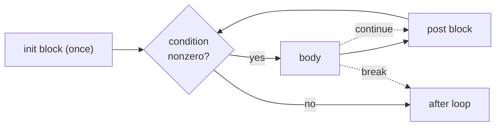

# 3.2 Syntax and control flow

> [!abstract] In one minute
> - Yul has **one type: the 256-bit word**. Numbers, booleans, addresses, short strings and memory pointers are all just words. There are **no operators**: `a + b` is written `add(a, b)`, and every builtin and every user function is called the same way. Nothing is checked: `and(2, 1)` is 0 (bitwise, not logical), arithmetic wraps, and `calldataload` past the end returns zeros.
> - Literals: decimal (`42`), hex (`0x2a`), `true` (= 1) and `false` (= 0), and string or `hex"..."` literals of **at most 32 bytes**, stored **left-aligned** in the word (`"abc"` = `0x6162630000…00`). No negative literals, no `1e18`, no `1_000`.
> - `let x := v` declares a variable (a stack slot), `x := v` reassigns it, and `let x` without a value gives **zero**. `a, b := f()` takes several return values. Variables live until the end of their `{ }` block, and **shadowing is a compile error** in every form.
> - Control flow is four statements: `if c { }` (true = any nonzero word, **no `else`**), `switch x case 1 { } default { }` (literal cases, no fallthrough; if/else is `case 0` + `default`, never `case 1`), `for { init } cond { post } { body }` with `break`/`continue`, and `leave` (exit the current function).> - `function f(a, b) -> r, s { }`: return variables start at zero, functions are **hoisted** (callable before their definition) and may recurse, but a function **cannot see any variable declared outside it**. Arguments are evaluated **right to left**.
> - Inline assembly is a restricted Yul: no `verbatim`, no `memoryguard`, no `datasize`/`datacopy`, no `.` in names, no shadowing of Solidity variables, and no `msize` when the optimizer is on. Every variable is a stack slot, so too many live variables still hit "Stack too deep".

**Prerequisites:** [[1.3 Execution model]], [[3.1 What Yul is and when to use it]] · **Leads to:** [[3.3 Opcodes by family]], [[3.4 Interop with Solidity]], [[3.5 Memory management in assembly]], [[3.10 Yul objects and standalone contracts]], [[3.11 Compiler IR and the optimizer]]

## Intuition: a tiny language over a stack machine

[[3.1 What Yul is and when to use it]] explained *why* Yul exists: it is the intermediate language the compiler uses, and the language you write inside `assembly { }`. This note teaches the language itself, from zero.

Think of Yul as "structured EVM assembly". The EVM ([[1.3 Execution model]]) only knows a stack of 256-bit words, a flat memory, and `JUMP`/`JUMPI` to move around the code. Writing raw jumps by hand is error-prone. Yul keeps the EVM's data model (one word type, opcodes as building blocks) and adds just enough structure on top to make code readable:

- **Named variables** instead of "the value three slots down the stack".
- **Blocks with scopes** instead of manual stack cleanup.
- **`if`, `switch` and `for`** instead of hand-placed jumps.
- **Functions** with parameters and return values instead of hand-managed return addresses.

That is nearly the whole language. There are no types beyond the word, no operators, no structs, no arrays, no strings beyond 32-byte constants, no `else`, no `while`, and no `return` statement in the C sense. Each missing feature maps onto something smaller, and this note shows each mapping.

The compiler turns each structure into stack operations and jumps for you. For example, a `for` loop becomes a `JUMPI` back to the condition, and a function call pushes a return address and jumps to the function body. You get the control of assembly with the readability of a small structured language.

> [!note] How the examples in this note were run
> Every snippet was compiled with solc-js **0.8.38** and run in **py-evm (Prague rules)**. Inline assembly was tested on both the legacy and the via-IR pipeline, optimizer on (200 runs), unless stated otherwise. Standalone Yul was compiled as strict assembly (standard JSON `"language": "Yul"`, optimizer on). Gas figures are execution gas only, without the 21,000 intrinsic gas or calldata cost. Every compile error quoted below is the exact first line the compiler printed.

## One type: the 256-bit word

Every value in Yul is a single 256-bit word (the EVM dialect calls the type `u256`, and it is the only type). There is nothing else:

| What you might think of as… | …is in Yul |
|---|---|
| a `uint256` | a word |
| a `bool` | a word, where 0 is false and anything else is true |
| an `address` | a word whose top 12 bytes should be zero (but nothing enforces it) |
| an `int256` | a word, read as two's complement only by signed builtins (`slt`, `sdiv`, `sar`, …) |
| a memory pointer, a storage slot, a calldata offset | a word |
| a short string | a word holding up to 32 bytes, left-aligned |

Consequences you will meet constantly:

- **No type checks.** Yul will happily `add` an address to a boolean. Meaning lives only in your head and in your comments.
- **No overflow checks.** `add`, `sub` and `mul` wrap modulo 2^256. I ran the factorial function from [[#Functions]] with `n = 58`. 58! is larger than 2^256, and Yul returned the wrapped value `0x4cc29123…c0000000000000` with no error. Checked arithmetic, if you want it, is your job (see [[2.9 Arithmetic and numeric pitfalls]]).
- **No signed literals.** `let x := -1` is a parse error (`ParserError: Literal or identifier expected.`). Write `sub(0, 1)` or `not(0)`, which both give `0xff…ff`.
- **Signedness is in the builtin, not the value.** `lt` compares as unsigned, `slt` as signed. The same word `0xff…ff` is 2^256 − 1 to `lt` and −1 to `slt`. The opcode details are in [[3.3 Opcodes by family]].

> [!info]- Deep dive: "typed Yul" exists on paper
> The Yul specification allows type annotations such as `let x:u256 := 1` and a `bool` type, for dialects other than the EVM one. The EVM dialect that solc uses is untyped. Writing a type gives `ParserError: Types are not supported in untyped Yul.` One spec rule follows from this. The docs say a `default` case is not allowed when the cases already cover every value of the type. In the untyped EVM dialect, `switch iszero(x) case true {} case false {} default {}` still compiles, because the compiler does not know that `iszero` can only return 0 or 1.

## Literals

A literal is a constant written in the source. Yul has five kinds. All of them become one word.

| Literal | Example | Word it produces (verified) | Rules |
|---|---|---|---|
| Decimal number | `42` | `0x…002a` | Digits only. No `_` separators (`1_000` → `ParserError: Invalid number literal.`), no `1e18` (same error), no sign. Max 2^256 − 1; one more gives `TypeError: Number literal too large (> 256 bits)` |
| Hex number | `0x2a`, `0xFF` | `0x…002a`, `0x…00ff` | Prefix must be lowercase `0x` (`0XFF` is a parse error). Digits may be any case. Up to 64 hex digits; leading zeros allowed (`0x00ff` = 255) |
| Boolean | `true`, `false` | `1`, `0` | Just the words 1 and 0. `add(true, 1)` = 2. `true` cannot be used as a name |
| String | `"abc"` (or `'abc'`) | `0x6162630000…0000` | At most **32 bytes** after escapes. Stored **left-aligned**, zero-padded on the right. Escapes such as `\n`, `\x41` and `é` (encoded as UTF-8) work |
| Hex string | `hex"616263"` | `0x6162630000…0000` | Even number of hex digits, at most 32 bytes, left-aligned like a string. Allowed in inline assembly since 0.8.4 |

These are the real words py-evm returned when I stored each literal with `mstore` and returned it:

```text
42                 -> 000000000000000000000000000000000000000000000000000000000000002a
0x2a               -> 000000000000000000000000000000000000000000000000000000000000002a
true / false       -> ...0001 / ...0000
"abc"              -> 6162630000000000000000000000000000000000000000000000000000000000
hex"616263"        -> 6162630000000000000000000000000000000000000000000000000000000000
"a\nb\x41"         -> 610a624100000000000000000000000000000000000000000000000000000000
"é"           -> c3a9000000000000000000000000000000000000000000000000000000000000
add("a", 0)        -> 6100000000000000000000000000000000000000000000000000000000000000
let x  (no value)  -> 0000000000000000000000000000000000000000000000000000000000000000
```

**Why left-aligned?** The docs describe a string literal as a byte sequence padded on the right to 32 bytes, "stored left-aligned". This matches how Solidity stores `bytes32("abc")`: the first character sits in the most significant byte. It is the natural layout for writing short text into memory, because `mstore(p, "abc")` puts `a` at byte `p`, `b` at `p + 1`, and so on. It is the wrong layout if you want the number 0x616263. That number is `0x616263`, not `"abc"`. The last line of the table shows the trap: `"a"` is not 0x61, it is 0x61 followed by 31 zero bytes.

**The 32-byte limit.** A 33-character string gives:

```text
TypeError: String literal too long (33 > 32)
```

The same limit applies to `hex"..."` (33 bytes gives the same message) and in inline assembly. Longer text has to be written into memory word by word (see [[3.5 Memory management in assembly]]). The only exception is builtins that take a literal *name* argument, such as `setimmutable`/`loadimmutable` and `datasize("…")`, which are not values at all ([[3.10 Yul objects and standalone contracts]]).

> [!warning] A string literal is a number, and `switch` compares numbers
> `case "ab"` and `case 0x6162` are **different** cases. `"ab"` is `0x6162` shifted to the top of the word. I ran `switch "ab" case 0x6162 {…} case 0x6162000…000 {…}` and the second case matched. The compiler also rejects `case "" {} case 0 {}` with `DeclarationError: Duplicate case "0" defined.`, because the empty string is the word 0.

## Comments and identifiers

Comments are the same as Solidity: `// to the end of the line` and `/* block */`. The compiler's own Yul output also uses comments such as `/// @src 0:120:200` to map code back to Solidity source. You will see those in [[3.11 Compiler IR and the optimizer]].

Statements need **no separators**. Newlines and spaces are interchangeable, so `let x := 1 let y := 2 x := y` is valid on one line. A semicolon is an error (`ParserError: Literal or identifier expected.`).

Identifiers (names of variables and functions) follow the grammar `[a-zA-Z_$] [a-zA-Z_$0-9.]*`:

| Name | Standalone Yul | Inline assembly |
|---|---|---|
| `x`, `_tmp`, `total2` | OK | OK |
| `$x` | OK | OK |
| `a.b` | OK (the dot has no special meaning in standalone Yul) | `DeclarationError: User-defined identifiers in inline assembly cannot contain '.'.` (since 0.7.0, because `x.slot` and `x.offset` refer to Solidity variables) |
| `1x` | `ParserError: Expected identifier but got 'ILLEGAL'` | same |
| `add`, `mload` (a builtin) | `ParserError: Cannot use builtin function name "add" as identifier name.` | same |
| `true` | `ParserError: Expected identifier but got 'true'` | same |
| `swapn`, `dupn`, `exchange` | Warning in 0.8.38: `"swapn" will be promoted to Yul reserved identifier in the future and will not be allowed anymore as an identifier.` | same warning |
| `verbatim…` | Reserved: every name starting with `verbatim` is taken | same |

Builtin names are case-sensitive. `ADD(1, 2)` gives `DeclarationError: Function "ADD" not found.`

> [!tip] Avoid names that may become builtins
> 0.8.38 warns for `swapn`, `dupn` and `exchange` because EIP-8024 (scheduled for Glamsterdam) adds those opcodes. 0.8.35 started similar warnings for "identifiers selected for future promotion to Yul keywords and reserved identifiers", among them `leave`, `memoryguard`, `mcopy`, `tload`, `tstore`, `blobhash`, `prevrandao` and `clz`. Treat every opcode name and every keyword as reserved, even where the compiler still accepts it.

## Variables: `let` and `:=`

### Declaring and assigning

```yul
{
    let x := 5          // declare x and give it a value
    let y               // declare y; it starts as 0
    y := add(x, 1)      // reassign y (no `let`): y is now 6
    x := mul(x, y)      // x is now 30
}
```

- `let name := expression` **declares** a new variable and initialises it.
- `let name` with no value declares it as **zero**. I checked this at runtime: `let x` then returning `x` gave 0 on both pipelines and in standalone Yul. Unlike memory ([[1.4 Memory]]), this zero is guaranteed by the language, not by luck.
- `name := expression` **reassigns** an existing variable. Using it on a name that was never declared gives `DeclarationError: Variable not found or variable not lvalue.`
- A variable can be used only **after** its declaration. `x := 1 let x := 2` gives `DeclarationError: Variable x used before it was declared.`
- You can only assign to variables. `f := 1` where `f` is a function gives `TypeError: Assignment requires variable.`
- In inline assembly you **may assign to Solidity locals and parameters** at the top level of the block (`a := 9` where `a` is a parameter compiles on both pipelines). That is how values flow back out to Solidity ([[3.4 Interop with Solidity]]).

### Several variables at once

A function may return several values (see [[#Functions]]). You take them with a list on the left:

```yul
{
    function divmod(a, b) -> q, r {
        q := div(a, b)
        r := mod(a, b)
    }
    let q, r := divmod(17, 5)   // q = 3, r = 2
    q, r := divmod(20, 6)       // reassign both: q = 3, r = 2
    let u, v                    // both 0
}
```

The right-hand side of a multi-assignment **must be a single function call** with exactly that many return values. These all fail:

| Code | Error |
|---|---|
| `a, b := b, a` (tuple swap) | `ParserError: Literal or identifier expected.` |
| `let x, y := 1` | `DeclarationError: Variable count mismatch for declaration of "x, y": 2 variables and 1 values.` |
| `let x := f()` where `f` returns two values | `DeclarationError: Variable count mismatch for declaration of "x": 1 variables and 2 values.` |
| `let x := g()` where `g` returns nothing | `DeclarationError: Variable count mismatch for declaration of "x": 1 variables and 0 values.` |
| `x := f()` where `f` returns two values | `DeclarationError: Variable count for assignment to "x" does not match number of values (1 vs. 2)` |

To swap two variables, use a temporary: `let t := a a := b b := t`, or a small helper `function swap(a, b) -> x, y { x := b y := a }` called as `a, b := swap(a, b)`.

### What a variable really is

A Yul variable is **a slot on the EVM stack**, nothing more. `let x := 5` pushes 5. Reading `x` copies it to the top with a `DUPn`. `x := v` computes `v` and then stores it into x's slot with a `SWAPn` and a `POP`. When the block that declared `x` ends, the compiler pops it.

This model explains three rules you will meet below:

1. Scoping is block-based because the compiler pops a block's variables at its closing brace.
2. Functions cannot see outer variables because the function body cannot know where on the stack the caller's variables are ([[#Why a function cannot see outside variables]]).
3. Too many live variables give "Stack too deep", because `DUP` and `SWAP` reach only 16 slots ([[#Variables are stack slots, so stack too deep still exists]]).

## Blocks and scope

A **block** is a pair of braces with statements inside. Blocks nest. A whole Yul program is one block, an `assembly { }` body is one block, and every `if`, `case`, `for` part and function body is a block.

The scope rules are short:

1. A variable is visible from its declaration to the end of the block that declares it, including nested blocks.
2. A function is visible in the **whole** block that defines it (before and after its definition) and in nested blocks.
3. **No shadowing, ever.** A name declared in an enclosing block cannot be declared again in an inner block.
4. A function body sees only its own parameters, its own return variables, and what it declares inside. It does **not** see variables of any enclosing block.

```yul
{
    let a := 1
    {
        let b := add(a, 1)   // fine: a is visible in a nested block
        a := b               // fine: assigning to an outer variable
    }
    // b is gone here; a is 2
    let b := 7               // fine: the inner b's scope has ended, so no clash
}
```

These all fail to compile:

| Code | Error |
|---|---|
| `let x := 1 { let x := 2 }` | `DeclarationError: Variable name x already taken in this scope.` |
| `let x := 1 let x := 2` | `DeclarationError: Variable name x already taken in this scope.` |
| `let x := 1 function f(x) {}` | `DeclarationError: Variable name x already taken in this scope.` |
| `function f(a, a) {}`, `function f(a) -> a {}` | `DeclarationError: Variable name a already taken in this scope.` |
| `let x := 1 function f() -> r { r := x }` | `DeclarationError: Identifier "x" not found.` |
| `function f() {} let f := 1` | `DeclarationError: Variable name f already taken in this scope.` |
| `function f() {} { function f() {} }` | `DeclarationError: Function name f already taken in this scope.` |
| `{ function f() {} } f()` | `DeclarationError: Function "f" not found.` |

The third row surprises people: a function **parameter** may not reuse the name of a variable in the enclosing block, even though the function cannot see that variable. Shadowing is banned by name, not by reachability.

Inline assembly adds one more rule: an assembly variable may not reuse the name of a Solidity local or parameter. `uint256 x = 1; assembly { let x := 2 }` gives:

```text
DeclarationError: This declaration shadows a declaration outside the inline assembly block.
```

The same error appears for `let r := 1` when `r` is the function's named return variable. Two separate `assembly { }` blocks in one Solidity function do not share variables: `assembly { let t := 1 } assembly { r := t }` gives `DeclarationError: Identifier "t" not found.` Functions are not shared either: a Yul function defined in one block is `DeclarationError: Function "g" not found.` in the next. Each block is its own namespace.

> [!note] Why no shadowing at all?
> Yul is designed to be easy to read, to audit and to optimize. If a name always means exactly one variable in a given block, a reader never has to work out "which `x` is this?", and an optimizer step can rename or move code without checking for capture. The compiler's own output relies on this: its optimizer first gives every variable a unique name (the "disambiguator" step, see [[3.11 Compiler IR and the optimizer]]).

## Expressions are function calls

Yul has **no operators**. There is no `+`, `==`, `&&`, `!` or `x[i]`. An expression is one of three things:

- a **literal**: `42`, `"abc"`, `true`;
- an **identifier** (a variable): `x`;
- a **function call**: `add(x, 1)`, `myHelper(a, b)`, where each argument is itself an expression.

Builtins (opcodes such as `add`, `mload`, `sstore`, `calldataload`) and your own functions are called with the same syntax. So `a + b * c` is `add(a, mul(b, c))`, `a == b` is `eq(a, b)`, `a != b` is `iszero(eq(a, b))`, `!c` is `iszero(c)`, and `a <= b` is `iszero(gt(a, b))`. Nesting reads inside-out. The meaning of each builtin is in [[3.3 Opcodes by family]].

Translation table for Solidity operators you will use most:

| Solidity | Yul |
|---|---|
| `a + b`, `a - b`, `a * b` | `add(a, b)`, `sub(a, b)`, `mul(a, b)` (all wrap) |
| `a / b`, `a % b` | `div(a, b)`, `mod(a, b)` (division by zero gives 0, not a revert) |
| `a < b`, `a > b` | `lt(a, b)`, `gt(a, b)` (unsigned); `slt`, `sgt` (signed) |
| `a <= b`, `a >= b` | `iszero(gt(a, b))`, `iszero(lt(a, b))` |
| `a == b`, `a != b` | `eq(a, b)`, `iszero(eq(a, b))` |
| `!c` | `iszero(c)` |
| `c1 && c2`, `c1 \|\| c2` | `and(c1, c2)`, `or(c1, c2)` if both are 0/1 (no short-circuit) |
| `a & b`, `a \| b`, `a ^ b`, `~a` | `and`, `or`, `xor`, `not` |
| `a << n`, `a >> n` | `shl(n, a)`, `shr(n, a)` (note the order: shift amount first) |

> [!warning] `and`/`or` are bitwise and evaluate both sides
> `and(c1, c2)` is the bitwise AND of two words. If `c1` = 2 and `c2` = 1 (both "true"), `and(2, 1)` is 0. Normalise with `iszero(iszero(c))` first, or nest two `if`s. There is no short-circuit: both arguments are always evaluated, including any `sload` or call inside them.

### Exactly one value where a value is used

Every place that needs a value (a function argument, the right side of `let x :=`, an `if` condition, a `for` condition, the value of a `switch`) needs an expression that produces **exactly one** word. A call to a function with zero or two return values fails there:

```text
TypeError: Expected expression to evaluate to one value, but got 0 values instead.   // if f() {} where f returns nothing
TypeError: Expected expression to evaluate to one value, but got 2 values instead.   // add(f(), 1) where f returns two
```

### Expression statements must return nothing: `pop`

The reverse rule holds for a call used as a statement on its own: it must return **nothing**. `add(1, 2)` alone on a line is an error, because its result would be left on the stack:

```text
TypeError: Top-level expressions are not supposed to return values (this expression returns 1 value). Use ``pop()`` or assign them.
```

`pop(x)` discards one value. You need it with builtins whose result you do not care about, most often `pop(call(...))` (only when you really mean to ignore failure, see [[3.7 External calls in assembly]]) or `pop(staticcall(...))`. The same error appears for your own function `function f() -> r {}` called as `f()`.

### Arguments are evaluated right to left

This is the most surprising rule in the language. In `f(a(), b())`, **`b()` runs before `a()`**. The EVM wants the first argument on top of the stack, so the compiler pushes the last argument first. I tested it with a function that bumps a counter in memory and returns it:

```solidity
// SPDX-License-Identifier: MIT
pragma solidity 0.8.38;

contract Order {
    function order() external pure returns (uint256 r) {
        assembly {
            function next() -> v {
                v := add(mload(0x00), 1)
                mstore(0x00, v)
            }
            r := sub(next(), next())   // right next() runs first and returns 1; left returns 2
        }
    }
}
```

`order()` returned **1** (that is, 2 − 1) on the legacy and via-IR pipelines, and the same expression in standalone Yul gave 1 with the optimizer on and off. If arguments were evaluated left to right, it would compute 1 − 2 and wrap to 2^256 − 1. This matters only when arguments have side effects (a call, an `sstore`, a memory write, `gas()`). The safe habit is to never put two side-effecting calls in one argument list: assign them to variables first, in the order you want.

## `if`: one branch, no `else`

```text
if condition { statements }
```

The block runs when `condition` is **any nonzero word**. There is no boolean type, so 1, 2 and `0xff…ff` all count as true. I ran `truthy(x)` (`if x { r := 1 }`) and got 0, 1, 1, 1 for x = 0, 1, 2 and 2^256 − 1.

There is **no `else`** and no `else if`. `if 1 { } else { }` gives `ParserError: Call or assignment expected.` (the parser reads `else` as the start of a new statement and finds no call). You have three options:

```yul
{
    let x := calldataload(0)
    let r

    // 1. Two ifs. Fine when the condition is a cheap variable with no side effects.
    if lt(x, 10) { r := 1 }
    if iszero(lt(x, 10)) { r := 2 }

    // 2. switch on the condition: one evaluation, two branches. This is the usual if/else.
    switch lt(x, 10)
    case 0 { r := 2 }
    default { r := 1 }

    // 3. Set the "else" value first, then override it.
    r := 2
    if lt(x, 10) { r := 1 }
}
```

Option 1 evaluates the condition twice. If the condition contains an `sload`, a call or anything with side effects, use option 2 or 3. Option 3 is short and needs only one branch at runtime, so you see it often in hand-optimised code.

For the switch form, always use `case 0` + `default`, never `case 1` + `default`: `case 1` matches only the exact word 1, so a truthy 2 takes the else branch. Measured: `switch and(x, 0xff) case 1 { r := 1 } default { r := 0 }` with x = 2 returned 0.

The braces are required, even for one statement (`if a r := 1` gives `ParserError: Expected '{' but got identifier`). A condition must be one value (see above). `if` has no "result": it is a statement, not an expression, so there is no ternary operator either. For a branch-free `c ? a : b`, see the `max` answer in the [[#Question ladder]].

## `switch`: literal cases, no fallthrough

```text
switch expression
case literal1 { … }
case literal2 { … }
default { … }
```

The expression is evaluated **once**. The first case whose literal equals it runs, and then control leaves the switch. There is **no fallthrough** and no `break` needed (a `break` inside a case applies to the enclosing `for`, not the switch: in a loop over i = 0…4 with `switch i case 2 { break } default { r := add(r, 1) }`, r ended at 2). If no case matches, `default` runs if present.

```solidity
// SPDX-License-Identifier: MIT
pragma solidity 0.8.38;

contract Classify {
    function classify(uint256 x) external pure returns (uint256 r) {
        assembly {
            switch x
            case 0 { r := 100 }
            case 1 { r := 101 }
            default { r := 999 }
        }
    }
}
```

`classify` returned 100, 101, 999 and 999 for x = 0, 1, 2 and 7.

The rules, each checked against the compiler:

| Rule | What happens if you break it |
|---|---|
| Case values must be **literals** (numbers, strings, `true`/`false`, hex strings) | `case y {}` with a variable: `ParserError: Literal expected.` |
| Case values must be **distinct as words** | `case 0 {} case 0 {}`: `DeclarationError: Duplicate case "0" defined.`; also `case true {} case 1 {}` and `case 0x1 {} case 1 {}` give `Duplicate case "1" defined.` |
| There must be **at least one** case or a default | `switch x` alone: `ParserError: Switch statement without any cases.` |
| `default` is **optional**, at most one, and must come **last** | `default {} case 1 {}`: `ParserError: Case not allowed after default case.`; two defaults: `ParserError: Only one default case allowed.` |
| A switch with only a default compiles, with a warning | `Warning: "switch" statement with only a default case.` |

The switched value can be any expression (`switch add(1, 2) case 3 { }` compiles). Each case body is its own block, so you can declare the same variable name in two different cases.

The best-known use of `switch` is the **function dispatcher**, which picks the function from the first 4 bytes of calldata:

```yul
switch shr(224, calldataload(0))
case 0x27ea6f2b { /* setLimit(uint256) */ }
case 0x70a08231 { /* balanceOf(address) */ }
default { revert(0, 0) }
```

The full version, with the checks Solidity adds, is in the E answer of the [[#Question ladder]] and in [[3.10 Yul objects and standalone contracts]]. The via-IR compiler also uses a `switch` to dispatch internal function pointers (with a `Panic(0x51)` default).

## `for`: the only loop

```text
for { init } condition { post } { body }
```

The four parts run like a C `for` loop:



- **init** runs once. Variables declared there are visible in the condition, the post block and the body, and are gone after the loop. `for { let i := 0 } … {} let j := i` gives `DeclarationError: Identifier "i" not found.`
- **condition** is an expression evaluated before each iteration. Nonzero means "keep going".
- **body** runs, then **post** runs, then the condition is checked again. Body variables are **not** visible in the post block: `{ i := add(i, k) } { let k := 1 }` gives `DeclarationError: Identifier "k" not found.`
- The init and post blocks may be empty: `{}`.

A sum of 1 to n:

```solidity
// SPDX-License-Identifier: MIT
pragma solidity 0.8.38;

contract Loops {
    function sumTo(uint256 n) external pure returns (uint256 total) {
        assembly {
            for { let i := 1 } iszero(gt(i, n)) { i := add(i, 1) } {
                total := add(total, i)
            }
        }
    }

    // Sum the odd numbers below n, but stop once the total passes limit.
    function oddSum(uint256 n, uint256 limit) external pure returns (uint256 total) {
        assembly {
            for { let i := 0 } lt(i, n) { i := add(i, 1) } {
                if iszero(mod(i, 2)) { continue }   // skip evens: jump to the post block
                total := add(total, i)
                if gt(total, limit) { break }       // leave the loop early
            }
        }
    }
}
```

Results: `sumTo` gave 0, 1, 55 and 5050 for n = 0, 1, 10 and 100. `oddSum(10, 1000)` = 25 (1 + 3 + 5 + 7 + 9), `oddSum(10, 10)` = 16 (stops after 1 + 3 + 5 + 7), and `oddSum(0, 5)` = 0.

**Other loop shapes.** A `while (c)` loop is `for { } c { } { … }`. An infinite loop is `for { } 1 { } { … }`, which must contain a `break` or a `leave`, or end the call with `revert`/`return`/`stop`. A `do … while` has no direct form; run the body once before the loop, or use `for { } 1 { } { body if iszero(c) { break } }`.

**Fresh scope per iteration.** A variable declared with `let` in the body is a new zero-initialised variable on every iteration. A body `{ let x  x := add(x, 1)  total := add(total, x) }` run three times gave `total` = 3, not 6. It does not count as shadowing, because the previous iteration's scope has ended.

**Two loop styles.** Index style recomputes the address from a counter each time; pointer style walks the address itself. Solady and the compiler's own output mostly use pointer style, which saves one `shl` per iteration:

```yul
{
    let n := calldataload(4)
    let s
    // index style: word i is at 4 + 32*i, and shl(5, i) is i * 32
    for { let i := 0 } lt(i, n) { i := add(i, 1) } {
        s := add(s, calldataload(add(4, shl(5, i))))
    }
    // pointer style: walk p from the first word to the end
    for { let p := 4  let end := add(4, shl(5, n)) } lt(p, end) { p := add(p, 0x20) } {
        s := add(s, calldataload(p))
    }
}
```

### `break` and `continue`

`break` jumps out of the innermost loop. `continue` jumps to the **post** block of the innermost loop (so the counter still advances). In a nested loop, a `break` in the inner loop ends only the inner loop: two nested loops with an inner `break` at j = 2 counted 3 × 2 = 6 iterations.

Where they are allowed, checked with the compiler:

| Position | Allowed? | Error |
|---|---|---|
| Anywhere in the body, including inside `if`/`switch` blocks | Yes | — |
| Outside any loop | No | `SyntaxError: Keyword "break" needs to be inside a for-loop body.` |
| In the init block | No | `SyntaxError: Keyword "break" in for-loop init block is not allowed.` |
| In the post block | No | `SyntaxError: Keyword "break" in for-loop post block is not allowed.` (same for `continue`) |
| Inside a function defined in the loop body | No | `SyntaxError: Keyword "break" needs to be inside a for-loop body.` |
| In the condition | Not possible: the condition is an expression, `break` is a statement | — |

The function rule follows from the scope rule: a function body is its own world, and it cannot jump out into the loop of whoever called it. To leave a loop from inside a helper, return a flag and test it: `if helper() { break }`.

Functions also **cannot be defined in the init block**: `SyntaxError: Functions cannot be defined inside a for-loop init block.` They may be defined in the body, though it is cleaner to define them outside.

## Functions

```yul
function name(param1, param2) -> ret1, ret2 {
    // body
}
```

- **Parameters** are local variables initialised with the arguments. You may assign to them; the caller's variable does not change. `function bump(p) -> q { p := add(p, 1) q := p }` called with `a = 5` returned 6 and left `a` at 5.
- **Return variables** are local variables that start at **zero**. Whatever they hold when the function ends is returned. There is no `return x` statement: `return` is the EVM builtin `return(offset, size)` that ends the whole call, and `return 1` is a parse error (`ParserError: Call or assignment expected.`). `function f() -> r {}` returns 0.
- A function may have **no** parameters, **no** return values, or several of each. Calls with zero returns are statements; calls with one return are expressions; calls with two or more can only be used in `let a, b := f()` or `a, b := f()`.
- **Hoisting.** A function can be called anywhere in the block that defines it, including **before** its definition. The compiler collects all function definitions of a block first.
- **Recursion** is allowed, including mutual recursion.
- **Nesting.** A function can be defined inside another function's body. The inner function still cannot see the outer function's variables: `function outer(x) -> r { function inner(y) -> z { z := add(y, x) } … }` gives `DeclarationError: Identifier "x" not found.`

Hoisting and recursion together, in a Solidity contract:

```solidity
// SPDX-License-Identifier: MIT
pragma solidity 0.8.38;

contract Fact {
    function fact(uint256 n) external pure returns (uint256 r) {
        assembly {
            r := factorial(n)          // called before it is defined: hoisting
            function factorial(k) -> out {
                out := 1
                if k { out := mul(k, factorial(sub(k, 1))) }
            }
        }
    }
}
```

`fact` returned 1, 1, 120 and 2,432,902,008,176,640,000 for n = 0, 1, 5 and 20, on both pipelines. Recursion is bounded by the EVM's 1,024-item stack, not by a language limit. Each level here keeps a return address, `k` and some temporaries on the stack. The legacy build handled n = 338 and failed at n = 339 with py-evm's `FullStack('Stack limit reached')`; the via-IR build reached n = 509. A full stack is an exceptional halt that burns all the gas forwarded to the call ([[1.3 Execution model]]). Never recurse on an attacker-controlled depth.

### `leave`: exit the current function

`leave` ends the current function immediately. The return variables keep whatever values they had at that moment. It is the Yul version of an early `return` in Solidity.

```yul
{
    function firstNonZero(a, b, c) -> v, pos {
        pos := 1
        v := a
        if v { leave }        // returns (a, 1)
        pos := 2
        v := b
        if v { leave }        // returns (b, 2)
        pos := 3
        v := c                // falls off the end: returns (c, 3)
    }
    let v, p := firstNonZero(0, 7, 9)   // v = 7, p = 2
}
```

Rules:

- `leave` is allowed anywhere inside a function body, including inside loops and `switch` cases (it exits the loop and the function). It is even accepted in a `for` init block inside a function.
- Outside a function it is an error: `SyntaxError: Keyword "leave" can only be used inside a function.` That includes the top level of an `assembly { }` block.
- `leave` was added in **0.6.0**. 0.5.17 rejects it (`Identifier not found.`).

> [!warning] `leave` vs `return` vs `stop`
> `leave` exits only the current **Yul function**. The builtins `return(p, s)`, `revert(p, s)` and `stop()` end the **entire call** (the whole contract execution), whatever function or loop you are in. In inline assembly, `return(…)` also skips the rest of the Solidity function, including any code after a modifier's `_`. How `leave` and `return` interact with Solidity return values is in [[3.4 Interop with Solidity]].

### Why a function cannot see outside variables

Look at what the compiler emits for a call. I compiled this standalone Yul with the optimizer off:

```yul
{
    function addmul(a, b) -> s, p {
        s := add(a, b)
        p := mul(a, b)
    }
    let x, y := addmul(3, 4)
    sstore(x, y)
}
```

Bytecode `600960046003600d565b9055005b919080830192029056`, which ran in py-evm and stored 12 at slot 7. Here is the assembly, with the stack after each instruction (top of stack on the right):

```text
PUSH tag_2          [ret]                      return address first
PUSH 4              [ret, 4]                   last argument (b) pushed first: right to left
PUSH 3              [ret, 4, 3]                first argument (a) ends on top
PUSH tag_1; JUMP    [ret, 4, 3]                enter the function body
tag_1:
SWAP2               [3, 4, ret]
SWAP1               [3, ret, 4]
DUP1                [3, ret, 4, 4]
DUP4                [3, ret, 4, 4, 3]
ADD                 [3, ret, 4, 7]             s = 7
SWAP3               [7, ret, 4, 3]
MUL                 [7, ret, 12]               p = 12
SWAP1               [7, 12, ret]
JUMP                [7, 12]                    back to tag_2 with s, p in place of the arguments
tag_2:
SWAP1               [12, 7]
SSTORE              []                         sstore(key = 7, value = 12)
STOP
```

The function body is one piece of code at one place (`tag_1`). Every call site jumps there. The body only knows the stack positions of its own arguments, return address and locals, counted from the top of the stack. It does not know how many values the caller has below them. A caller in a loop with ten variables and a caller at the top level with none jump to the same code. A reference to a caller's `x` would need a different `DUP` depth at every call site, so the language simply forbids it.

This is also what makes Yul functions easy to optimize. A function's behaviour depends only on its arguments and on global state (memory, storage, calldata), never on hidden local context. The inliner can copy the body into a call site, and other steps can reason about a call without looking at the caller. Values that a function needs must be passed as arguments; values it produces must come back as return values (or through memory or storage).

In inline assembly the rule also covers Solidity locals. A Yul function that mentions a Solidity parameter `a` gives:

```text
DeclarationError: Cannot access local Solidity variables from inside an inline assembly function.
```

Solidity **constants** are fine (`uint256 constant K = 5;` then `z := K` inside a Yul function compiled), because a constant is a literal value, not a stack slot.

## How `if`, `switch` and `for` become jumps

You do not need this to write Yul, but it helps when reading traces ([[6.6 Debugging and tracing]]). I compiled one inline-assembly block with an `if`, a three-way `switch` and a `for`, and read the opcodes. The two code generators lay branches out differently:

| Yul | Legacy inline assembly (optimizer on or off) | Via-IR and standalone Yul (0.8.38) |
|---|---|---|
| `if c { body }` | `c ISZERO PUSH skip JUMPI body skip: JUMPDEST`: jump *over* the body when false | `c PUSH body JUMPI rest…`: jump *to* the body (placed out of line) when true; the body jumps back |
| `switch x case A {…} case B {…} default {…}` | `DUP x PUSH A EQ PUSH caseA JUMPI`, the same for B, then the default inline; case bodies follow and jump to a common exit | Same chain of `EQ … JUMPI`, default inline, cases out of line |
| `for { init } c { post } { body }` | `init loop: JUMPDEST c ISZERO PUSH exit JUMPI body post PUSH loop JUMP exit:` | `init loop: JUMPDEST c PUSH body JUMPI exit…`; body and post sit out of line and jump back to `loop` |
| Function call (not inlined) | `PUSH ret args… PUSH fn JUMP … ret: JUMPDEST` (the `addmul` trace above) | Same shape |

In practice the optimizer inlines small functions, so a helper like `max` in the [[#Question ladder]] usually leaves no subroutine jump behind. Check with `solc --asm` or `forge inspect C assembly` when it matters.

## Variables are stack slots, so stack too deep still exists

Because every variable, parameter, return variable and return address is a stack slot, and `DUP`/`SWAP` reach only the top 16 slots ([[1.3 Execution model]]), a Yul function with too many values alive at the same time cannot be compiled. Yul gives you names, not more registers.

I wrote a Yul function that loads 17 storage slots into 17 variables, writes each back, and then adds them all up, so all 17 stay alive until the end:

```text
function g() -> r {
    let v0 := sload(0) … let v16 := sload(16)
    sstore(0, add(v0, 1)) … sstore(16, add(v16, 1))
    r := add(add(…add(v0, v1)…), v16)
}
```

Inline assembly, legacy pipeline (optimizer on or off):

```text
CompilerError: Stack too deep. Try compiling with `--via-ir` (cli) or the equivalent `viaIR: true` (standard JSON) while enabling the optimizer. Otherwise, try removing local variables. When compiling inline assembly: Variable v0 is 2 slot(s) too deep inside the stack.
```

Inline assembly, via-IR, optimizer on (with or without the `memory-safe` annotation):

```text
YulException: Cannot swap Variable usr$v10 with Variable usr$v11: too deep in the stack by 1 slots in [ usr$v1 usr$v3 … usr$v11 ]
No memoryguard was present. Consider using memory-safe assembly only and annotating it via 'assembly ("memory-safe") { ... }'.
```

With 16 variables instead of 17, legacy still failed (`Variable v0 is 1 slot(s) too deep`), because the return variable and the return address take slots too. Standalone Yul with the optimizer on failed for the same function as well; solc-js reported it as an `InternalCompilerError` wrapping `StackTooDeepError: Variable … is … too deep in the stack [ … ]`.

Notice the `usr$` prefix in the via-IR message: the compiler renames your inline-assembly variables when it merges them into its own Yul.

The fixes are the same as in Solidity: fewer live variables (finish with one value before loading the next), smaller functions, or values kept in memory instead of on the stack. Via-IR can move variables to memory automatically (the "stack limit evader", guided by `memoryguard` and the `memory-safe` annotation), but only under conditions this example did not meet. How that works, and when it fails, is in [[3.11 Compiler IR and the optimizer]]; [[2.4 Memory layout]] shows the reserved memory area it creates.

## Inline assembly vs standalone Yul

Standalone Yul (compiled with `solc --strict-assembly`, or standard JSON `"language": "Yul"`) is the full EVM dialect. Inline assembly is the same grammar with Solidity's variables visible and a few builtins removed. Every row was checked with 0.8.38:

| Feature | Standalone Yul | Inline assembly |
|---|---|---|
| `object "…" { code { } object "…" { } }` | Yes ([[3.10 Yul objects and standalone contracts]]) | No: the body is a single block |
| `datasize`, `dataoffset`, `datacopy` | Yes | `DeclarationError: Function "datacopy" not found.` (same for the others) |
| `setimmutable`, `loadimmutable`, `linkersymbol` | Yes | `Function "loadimmutable" not found.`, `Function "linkersymbol" not found.` |
| `verbatim_<n>i_<m>o(hex"…", …)` (raw bytecode, since 0.8.5) | Yes | `DeclarationError: Function "verbatim_0i_0o" not found.` |
| `memoryguard(size)` | Yes | `DeclarationError: Function "memoryguard" not found.` (the compiler inserts it itself; you mark blocks `memory-safe` instead) |
| `.` in identifiers | Yes | No (since 0.7.0) |
| `msize()` with the optimizer on | Compiles | `SyntaxError: The msize instruction cannot be used when the Yul optimizer is activated because it can change its semantics. …` |
| Access Solidity locals and parameters by name | — | Yes, in the block; not inside Yul functions |
| `x.slot`, `x.offset`, `x.length`, `x.selector`, `x.address` | — | Yes ([[3.4 Interop with Solidity]]) |
| Declaring a name that a Solidity local already uses | — | `DeclarationError: This declaration shadows a declaration outside the inline assembly block.` |
| `assembly ("memory-safe") { }` annotation (since 0.8.13) | — | Yes |
| `jump`, `jumpi`, `pc`, `dupN`, `swapN`, `pushN`, labels | No | No (`Function "jump" not found.`; `PC instruction is a low-level EVM feature. Because of that PC is disallowed in strict assembly.`; a label `lbl:` gives `ParserError: Call or assignment expected.`) |

The last row is the important design choice. Old inline assembly (before 0.5.0) allowed labels, raw jumps and stack-style instructions. Yul removed all of them, so that control flow is always structured. That is what lets the compiler analyse, optimize and stack-allocate Yul code safely. If you truly need raw jumps or stack tricks, use `verbatim` in standalone Yul or a lower-level language ([[3.12 Beyond Yul - Huff and raw bytecode]]).

## The grammar on one page

This summary follows the grammar in the Solidity docs ("Specification of Yul"), simplified for the untyped EVM dialect (the optional type suffixes are dropped).

```text
Block              = '{' Statement* '}'
Statement          = Block | FunctionDefinition | VariableDeclaration | Assignment
                   | If | Expression | Switch | ForLoop | BreakContinue | Leave
FunctionDefinition = 'function' Identifier '(' IdentifierList? ')' ( '->' IdentifierList )? Block
VariableDeclaration= 'let' IdentifierList ( ':=' Expression )?
Assignment         = IdentifierList ':=' Expression
Expression         = FunctionCall | Identifier | Literal
If                 = 'if' Expression Block
Switch             = 'switch' Expression ( Case+ Default? | Default )
Case               = 'case' Literal Block
Default            = 'default' Block
ForLoop            = 'for' Block Expression Block Block
BreakContinue      = 'break' | 'continue'
Leave              = 'leave'
FunctionCall       = Identifier '(' ( Expression ( ',' Expression )* )? ')'
Identifier         = [a-zA-Z_$] [a-zA-Z_$0-9.]*
IdentifierList     = Identifier ( ',' Identifier )*
Literal            = NumberLiteral | StringLiteral | HexLiteral | TrueLiteral | FalseLiteral
NumberLiteral      = HexNumber | DecimalNumber
HexNumber          = '0x' [0-9a-fA-F]+
DecimalNumber      = [0-9]+
StringLiteral      = '"' ([^"\r\n\\] | '\\' .)* '"'   (single quotes '...' also accepted)
HexLiteral         = 'hex' ('"' ([0-9a-fA-F]{2})* '"' | '\'' ([0-9a-fA-F]{2})* '\'')
```

Rules the grammar does not show, which the compiler enforces:

- An **Expression used as a value** must produce exactly one value. An **Expression used as a statement** must produce zero values.
- An Assignment or VariableDeclaration with several names must have a **function call** on the right with that many return values. With one name, any single-valued expression.
- **Switch** cases are distinct literals, at most one `default`, and it comes last.
- **`break`/`continue`** only in a `for` body (not init, not post, not in a nested function). **`leave`** only in a function. **Function definitions** not in a `for` init block.
- Literals fit in 256 bits; string and hex literals are at most 32 bytes.
- Names: no shadowing in nested scopes, no reuse of builtin names, functions cannot see outer variables, variables cannot be used before their declaration.
- Function **arguments** are evaluated right to left.

## Version history of the Yul syntax

Newest first. Rows marked "tested" were reproduced with old solc-js builds; the others are from the changelog.

| Version | Change | Evidence |
|---|---|---|
| 0.8.38 (22 Oct 2026) | Warns when `swapn`, `dupn` or `exchange` are used as identifiers; they become reserved from the Amsterdam EVM version (EIP-8024, scheduled for Glamsterdam) | Changelog; warning reproduced |
| 0.8.35 | Warns about identifiers selected for future promotion to Yul keywords or reserved names (`leave`, `memoryguard`, `mcopy`, `tload`, `tstore`, `blobhash`, `clz`, …) | Changelog |
| 0.8.13 | `assembly ("memory-safe") { }` annotation | Changelog |
| 0.8.5 | `verbatim_<n>i_<m>o` builtins (standalone Yul only) | Changelog |
| 0.8.4 | `hex"…"` string literals allowed in Yul and inline assembly | Changelog; tested (0.8.3: `Hex literals are not valid in this context.`, 0.8.4: OK) |
| 0.7.0 | `.` disallowed in inline-assembly identifiers | Changelog; tested (0.6.0 accepts `let a.b := 1`, 0.8.3 rejects it) |
| 0.6.0 | `leave` statement; inline-assembly names may no longer shadow Solidity declarations | Tested (0.5.17 rejects `leave` and accepts `let a := 1` over a parameter `a`; 0.6.0 accepts `leave` and gives `This declaration shadows a declaration outside the inline assembly block.`) |
| 0.5.0 | Labels, `jump`/`jumpi` and stack-style assignment (`=: x`) became errors in inline assembly (0.4.26 only warned: "The use of labels is deprecated.") | Tested (0.5.0: `The use of labels is disallowed.`, `The use of stack assignment is disallowed.`) |

The no-shadowing rule is old: 0.5.17, 0.6.0, 0.8.3 and 0.8.4 all reject `let x := 1 { let x := 2 }` with "Variable name x already taken in this scope."

## Solidity and Yul in practice

### Reading the compiler's own Yul

The fastest way to get fluent is to read the Yul that solc writes for you. Ask for `irOptimized` (standard JSON output selection, via-IR pipeline). For this contract:

```solidity
// SPDX-License-Identifier: MIT
pragma solidity 0.8.38;

contract C {
    function double(uint256 x) external pure returns (uint256) { return x * 2; }
}
```

0.8.38 (via-IR, optimizer on, 200 runs) produced this runtime object. I removed the constructor object and the metadata line:

```yul
object "C_14_deployed" {
    code {
        {
            /// @src 0:56:151  "contract C {..."
            let _1 := memoryguard(128)
            mstore(64, _1)
            if gt(calldatasize(), 3)
            {
                if eq(0xeee97206, shr(224, calldataload(0)))
                {
                    if callvalue() { revert(0, 0) }
                    if slt(add(calldatasize(), not(3)), 32) { revert(0, 0) }
                    let value := calldataload(4)
                    let product := shl(1, value)
                    if iszero(or(iszero(value), eq(/** @src 0:145:146  "2" */ 0x02, /** @src 0:56:151  "contract C {..." */ div(product, value))))
                    {
                        mstore(0, shl(224, 0x4e487b71))
                        mstore(4, 0x11)
                        revert(0, 0x24)
                    }
                    mstore(_1, product)
                    return(_1, 32)
                }
            }
            revert(0, 0)
        }
    }
}
```

Everything in it is grammar from this note:

- `let _1 := memoryguard(128)` and `mstore(64, _1)`: the free memory pointer set-up, with the standalone-only builtin `memoryguard` ([[2.4 Memory layout]]).
- Nested `if`s instead of `&&`: "calldata has at least 4 bytes" and then "the selector is `0xeee97206`". With only one function in the contract, the dispatcher is a single `if` rather than a `switch`.
- `if callvalue() { revert(0, 0) }`: truthiness. Any nonzero `msg.value` is true.
- `slt(add(calldatasize(), not(3)), 32)`: `not(3)` is −4 in two's complement, so this is the signed test "calldatasize − 4 < 32". Signed comparison guards against a negative difference.
- `x * 2` became `shl(1, value)`, and the overflow check `iszero(or(iszero(value), eq(2, div(product, value))))` is `!(x == 0 || product / x == 2)`, built only from calls.
- `Panic(0x11)` is written by hand: selector `0x4e487b71` shifted to the top of word 0, code at byte 4, `revert(0, 0x24)`. That is the same pattern as the custom errors in the E answer below ([[2.8 Errors and reverts]]).
- `/// @src` and `/** @src … */` comments map Yul back to Solidity source ranges.

### Everyday idioms

| Solidity | Yul idiom | Watch out |
|---|---|---|
| `if (c) { A } else { B }` | `switch c case 0 { B } default { A }`, or `B` first then `if c { A }` when B is a simple default value | Not `case 1` |
| `require(c)` | `if iszero(c) { revert(0, 0) }` | |
| `revert MyError(x)` | `mstore(0, shl(224, sel)) mstore(4, x) revert(0, 0x24)` | [[3.8 ABI, errors and events by hand]] |
| `c ? a : b` | `r := b if c { r := a }`, or branch-free `xor(b, mul(xor(a, b), iszero(iszero(c))))` | |
| `a && b` (as a 0/1 value) | `and(iszero(iszero(a)), iszero(iszero(b)))` | Plain `and(a, b)`: with a = 2, b = 1 it returned 0; the normalised form returned 1 |
| `a \|\| b` (as a 0/1 value) | `iszero(iszero(or(a, b)))` | No short-circuit; for side effects nest `if`s |
| `!a` | `iszero(a)` | `not(a)` is bitwise NOT, not logical |
| `x < y` for `int256` | `slt(x, y)` | `lt` reads −5 as a huge number ([[3.3 Opcodes by family]]) |
| `x + y` (checked) | `z := add(x, y) if lt(z, x) { /* Panic(0x11) */ }` | Assembly never checks for you |
| `for (uint i; i < n; ++i)` | `for { let i := 0 } lt(i, n) { i := add(i, 1) } { }` | |
| `while (c) { }` | `for { } c { } { }` | |
| `do { } while (c);` | `for { let first := 1 } or(first, c) { first := 0 } { }` | Body ran once for a false `c` (tested); `c` is still evaluated before the first pass |
| early `return` from a helper | `leave` | The `return` *builtin* ends the whole call |
| `uint256[] calldata xs` loop | `calldataload(add(xs.offset, mul(i, 0x20)))` with `lt(i, xs.length)` | [[3.4 Interop with Solidity]] |
| `(a, b) = f()` | `let a, b := f()` | |

### A playground contract

Every Solidity snippet in this note is a complete contract that compiles with 0.8.38 on both pipelines. Paste `Order`, `Classify`, `Loops`, `Fact`, `Max`, `Sign`, `Sum`, `Find`, `VaultSol` and `VaultYul` into Remix or a Foundry project and call them; the outputs quoted in this note came from exactly these contracts. To try a bare Yul fragment from this note, put it inside `assembly { }` in a function, or inside `{ }` as standalone Yul. For standalone Yul, wrap your code in an object as in the I answer below, compile with standard JSON `"language": "Yul"` (or `solc --strict-assembly`), and deploy the bytecode.

## Pitfalls and incidents

> [!warning] Right-to-left argument evaluation
> `f(a(), b())` runs `b()` first. With pure arguments this never matters. With side effects (calls, `sstore`, memory writes, `gas()`, a counter like `next()` above) it silently reverses your intended order. Put each side-effecting call in its own `let` first.

> [!warning] `continue` jumps to the post block
> If the counter is advanced in the body instead of the post block, `continue` skips the increment and the loop never ends. `for { let i := 0 } lt(i, 5) { } { if eq(i, 2) { continue } … i := add(i, 1) }` ran until it used all 1,000,000 gas I gave it. Put the increment in the post block; with that change the same loop returned 4 using 443 gas.

> [!warning] Truthiness and bitwise `and`
> `if` treats any nonzero word as true, but `and(2, 1)` is 0. Combining two "booleans" that are not strictly 0 or 1 (a balance, a returned length, a masked field) with `and` gives wrong answers. Use `iszero(iszero(x))` to normalise, or nest the `if`s.

> [!warning] String literals are left-aligned numbers
> `"abc"` is not 0x616263. Comparing a string literal with a right-aligned value (for example a `bytes3` that someone shifted down) fails, and `case "ab"` will not match `0x6162`.

> [!warning] No checks of any kind
> Arithmetic wraps, `div(x, 0)` is 0, `calldataload` past the end of calldata returns zeros, and nothing checks that an "address" fits in 160 bits. Every guard Solidity adds for free must be written by hand. [[3.9 Cleanup, dirty bits and safety]] has the checklist.

> [!warning] Two `if`s instead of `else`
> `if c { … } if iszero(c) { … }` evaluates `c` twice. If the first block changes something `c` depends on (a variable, storage, memory), both blocks or neither may run. Prefer `switch c case 0 { … } default { … }`.

> [!warning] `return` is not `leave`
> In inline assembly, `return(p, s)` ends the entire external call. Code after the assembly block, the rest of a modifier after `_`, and Solidity's own return encoding are all skipped. Use `leave` to exit a Yul function, and assign to Solidity variables to return values normally ([[3.4 Interop with Solidity]]).

> [!warning] Recursion and loops have no built-in bound
> The recursive `factorial` hit the 1,024-item stack limit at depth 339 (legacy) and 510 (via-IR), burning all gas. A loop over an attacker-supplied length can use the whole per-transaction gas cap of 16,777,216 ([[5.7 Denial of service and griefing]]).

**Compiler incidents tied to the grammar.** The rules in this note are mostly enforced at compile time, so syntax mistakes rarely reach mainnet. The real incidents come from the optimizer that rewrites Yul. One example: the 0.8.38 release notes describe a fix for a Yul optimizer bug in which the optimizer kept stale knowledge about a variable after it was **reassigned** (`x := …`). Code that reassigns variables inside branches and loops is exactly what Yul encourages, which is why optimizer bugs of this kind matter. The bug list and how to track it are in [[3.11 Compiler IR and the optimizer]] and [[5.13 Toolchain, dependencies and operations]].

## Question ladder

> [!question]- **B** Write `max(a, b)` as a Yul function.
> A Yul function takes words and returns words. Start the return variable at one candidate and override it with the other when needed. There is no `else`, so "set a default, then `if`" is the natural shape:
>
> ```solidity
> // SPDX-License-Identifier: MIT
> pragma solidity 0.8.38;
>
> contract Max {
>     function maxOf(uint256 a, uint256 b) external pure returns (uint256 r) {
>         assembly {
>             function max(x, y) -> m {
>                 m := x
>                 if gt(y, x) { m := y }
>             }
>             r := max(a, b)
>         }
>     }
>
>     // Branch-free: if b > a, a ^ (a ^ b) = b; else a ^ 0 = a.
>     function maxBranchless(uint256 a, uint256 b) external pure returns (uint256 r) {
>         assembly {
>             r := xor(a, mul(xor(a, b), gt(b, a)))
>         }
>     }
> }
> ```
>
> Results on both pipelines: `maxOf(3, 9)` = 9, `maxOf(9, 3)` = 9, `maxOf(5, 5)` = 5, `maxOf(0, 2^256 − 1)` = 2^256 − 1; `maxBranchless` gives the same.
>
> Points worth saying out loud:
> - `m` is a return variable, so it starts at 0 and is returned when the function ends. No `return` statement is needed (and none exists).
> - The function cannot use `a` and `b` directly, even though they are visible in the assembly block: Yul functions cannot see Solidity locals. They must be passed in.
> - `gt` is **unsigned**, the trap an interviewer probes. Measured with `int256` inputs a = −5, b = 3: the `gt` version returned **−5** (−5 is the word `2^256 − 5`, larger than 3), the `sgt` version returned **3**.
> - The branch-free version (`maxBranchless`) works because `gt` returns exactly 0 or 1, so `mul(xor(a, b), gt(b, a))` either keeps `a ^ b` or zeroes it. I checked it against Python's `max` on 300 random pairs (8, 255 and 256-bit values) and it matched every time. It avoids a `JUMPI`, which can matter in a tight loop; for a single call it saves only a few gas.

> [!question]- **B** Yul has no `else`. Rewrite an if/else with `switch`.
> Switch on the condition itself. A condition is a word, and "false" is exactly 0, so `case 0` is the else branch and `default` (any nonzero value) is the then branch:
>
> ```text
> Solidity:  if (c) { A } else { B }
> Yul:       switch c
>            case 0 { B }
>            default { A }
> ```
>
> Do **not** write `case 1 { A } default { B }` unless `c` is guaranteed to be 0 or 1. Builtin comparisons (`lt`, `eq`, `iszero`, …) return exactly 0 or 1, but a raw value such as a balance, a length or a masked field does not: `switch and(x, 0xff) case 1 {…} default {…}` with x = 2 took the default (else) branch.
>
> An `else if` chain becomes nested switches. Here is `sign(int256 x)`, returning −1, 0 or 1:
>
> ```solidity
> // SPDX-License-Identifier: MIT
> pragma solidity 0.8.38;
>
> contract Sign {
>     function sign(int256 x) external pure returns (int256 r) {
>         assembly {
>             // if (x < 0) r = -1; else if (x == 0) r = 0; else r = 1;
>             switch slt(x, 0)
>             case 1 { r := sub(0, 1) }
>             default {
>                 switch x
>                 case 0 { r := 0 }
>                 default { r := 1 }
>             }
>         }
>     }
> }
> ```
>
> Results on both pipelines: −1, 0, 1, −1 for x = −7, 0, 7 and −2^255. `case 1` is safe here because `slt` returns only 0 or 1.
>
> Why switch rather than two `if`s: the condition is evaluated once. `if c { A } if iszero(c) { B }` evaluates `c` twice, which costs more and is wrong if `A` changes something `c` reads. When `B` only sets a default value, the shortest form is "B first, then `if c { A }`".

> [!question]- **I** Write a loop that sums the first n 32-byte words of calldata after the selector.
> The words start at byte 4. Word `i` is `calldataload(add(4, mul(i, 32)))`. A standalone Yul object makes the calldata layout explicit: here any 4-byte selector, then the words, and n is the number of whole words sent.
>
> ```yul
> object "SumWords" {
>     code {
>         datacopy(0, dataoffset("runtime"), datasize("runtime"))
>         return(0, datasize("runtime"))
>     }
>     object "runtime" {
>         code {
>             // Calldata: 4-byte selector (ignored), then 32-byte words.
>             // Returns the sum of the first n words; n = how many whole words were sent.
>             if lt(calldatasize(), 4) { revert(0, 0) }
>             let n := div(sub(calldatasize(), 4), 32)
>             mstore(0, sumWords(n))
>             return(0, 32)
>
>             function sumWords(count) -> total {
>                 for { let i := 0 } lt(i, count) { i := add(i, 1) } {
>                     let w := calldataload(add(4, mul(i, 32)))
>                     let t := add(total, w)
>                     if lt(t, total) { revert(0, 0) }   // overflow: Yul add wraps
>                     total := t
>                 }
>             }
>         }
>     }
> }
> ```
>
> Results (py-evm, optimizer on, execution gas):
>
> | Calldata after the selector | Output | Gas |
> |---|---|---|
> | nothing | 0 | 82 |
> | `[1]` | 1 | 181 |
> | `[1, 2, 3]` | 6 | 379 |
> | `[10, 20, 30, 40]` | 100 | 478 |
> | `[2^256 − 1, 1]` | reverts (overflow) | 224 |
> | `[5]` plus 2 stray bytes | 5 (the partial word is not counted) | — |
> | fewer than 4 bytes in total | reverts | 27 |
>
> Each extra word costs 99 gas here: one `calldataload`, the address arithmetic, the add, the overflow test and the loop jump.
>
> What to explain:
> - **Hoisting**: `sumWords` is called before it is defined. That is legal.
> - **Scope**: `i` exists only inside the loop; `w` and `t` are fresh variables on every iteration, so declaring them in the body is not shadowing.
> - **Bounds**: `calldataload` past the end of calldata returns zeros instead of failing. Summing extra zeros is harmless, but for most loops you must derive the count from `calldatasize()` (as here) or check a caller-supplied n against it (next block).
> - **Overflow**: `add` wraps. Without the `lt(t, total)` check, `[2^256 − 1, 1]` would return 0. The check works because an unsigned wrap always makes the result smaller than the old total.
> - In inline assembly with an ABI-encoded `uint256[] calldata xs`, the same loop reads `calldataload(add(xs.offset, mul(i, 0x20)))` for `i < xs.length` (see the next answer).
>
> **Inline-assembly version with a caller-supplied n.** If the caller passes n as the first word, the bound check is no longer optional. This version also reverts with the same bytes as Solidity's checked `+`:
>
> ```solidity
> // SPDX-License-Identifier: MIT
> pragma solidity 0.8.38;
>
> contract Sum {
>     /// Sums the first n words after the selector. Word 0 is n itself.
>     function sumWords(uint256 n) external pure returns (uint256 s) {
>         assembly {
>             // 1. Bound check: need 4 + 32*n <= calldatasize.
>             if gt(n, shr(5, sub(calldatasize(), 4))) { revert(0, 0) }
>             for { let i := 0 } lt(i, n) { i := add(i, 1) } {
>                 let next := add(s, calldataload(add(4, shl(5, i))))
>                 // 2. Overflow check, byte-identical to Panic(0x11).
>                 if lt(next, s) {
>                     mstore(0x00, shl(224, 0x4e487b71))
>                     mstore(0x04, 0x11)
>                     revert(0x00, 0x24)
>                 }
>                 s := next
>             }
>         }
>     }
> }
> ```
>
> Measured on both pipelines, against a copy with both checks removed:
>
> | Calldata words after the selector | With the checks | Without them |
> |---|---|---|
> | `[3, 10, 20]` (n = 3) | 33 | 33 |
> | `[5, 10, 20]` (n = 5, two words missing) | empty revert | **35** (two zero words read) |
> | `[2, 2^256 − 1]` (n = 2) | revert `0x4e487b71…11` (`Panic(0x11)`) | **1** (wrapped) |
>
> The middle row is the lesson: `calldataload` never fails, it zero-pads ([[1.6 Calldata, returndata and logs]]), so a missing bound check turns malformed input into a plausible wrong answer. `sub(calldatasize(), 4)` cannot underflow here: the dispatcher already required a selector and the ABI decoder required 32 more bytes for `n`.

> [!question]- **I** Write a function with two return values that uses `leave` to exit early.
> A linear search returns two things: whether the target was found and where. `leave` exits the function as soon as it finds a match, from inside the loop:
>
> ```solidity
> // SPDX-License-Identifier: MIT
> pragma solidity 0.8.38;
>
> contract Find {
>     function find(uint256 target, uint256[] calldata xs)
>         external
>         pure
>         returns (bool found, uint256 index)
>     {
>         assembly {
>             function indexOf(t, offset, len) -> ok, i {
>                 for { } lt(i, len) { i := add(i, 1) } {
>                     if eq(calldataload(add(offset, mul(i, 0x20))), t) {
>                         ok := 1
>                         leave            // exit the function now: ok = 1, i = position
>                     }
>                 }
>                 i := 0                   // not found: report (0, 0)
>             }
>             found, index := indexOf(target, xs.offset, xs.length)
>         }
>     }
> }
> ```
>
> Results on both pipelines:
>
> | Call | Returned |
> |---|---|
> | `find(30, [10, 20, 30, 40])` | (true, 2) |
> | `find(10, [10, 20, 30])` | (true, 0) |
> | `find(99, [10, 20])` | (false, 0) |
> | `find(5, [])` | (false, 0) |
> | `find(7, [7, 7])` | (true, 0): the first match wins |
>
> The details an interviewer checks:
> - **Return variables are the state.** `ok` and `i` start at 0. The loop uses the return variable `i` itself as its counter (the init block is empty), so at `leave` time `i` already holds the answer. `leave` returns whatever the return variables hold at that moment.
> - **`leave` exits the function, not just the loop.** A `break` would have fallen through to `i := 0` and lost the index. Without `leave` you would need the flag in the loop condition (`and(iszero(ok), lt(i, len))`) or a `break` plus an extra test after the loop.
> - **No bound check needed.** The ABI decoder validated that `xs.length` words exist before the body ran: the same call with the length word changed from 4 to 10 gave an empty revert on both pipelines.
> - **Multi-assignment** `found, index := indexOf(…)` takes both returns. It assigns to Solidity return variables directly, which is allowed in the assembly block itself (not inside `indexOf`).
> - **Passing state in**: `indexOf` cannot read `target` or `xs`, so `xs.offset` and `xs.length` are passed as arguments.
> - `ok := 1` assigned to a `bool` is fine because it is exactly 1. Writing a value such as 2 into a `bool` is a dirty-bits bug ([[3.9 Cleanup, dirty bits and safety]]).

> [!question]- **A** What are Yul's scoping and shadowing rules, and why can a function not see variables declared outside it?
> **The rules.**
>
> | Rule | Detail | Error if broken |
> |---|---|---|
> | Block scope | A variable lives from its `let` to the end of its block, including nested blocks | `Identifier "x" not found.` after the block |
> | Declare before use | Variables cannot be used before `let` | `Variable x used before it was declared.` |
> | Functions are hoisted | Visible in the whole defining block (before and after the definition) and in nested blocks, not in sibling or parent blocks | `Function "f" not found.` |
> | `for` init scope | Init variables are visible in condition, post and body, and gone after the loop | `Identifier "i" not found.` |
> | No shadowing | No name may be redeclared while an outer declaration of it is in scope. This covers nested blocks, function parameters and return variables, and functions vs variables | `Variable name x already taken in this scope.`, `Function name f already taken in this scope.` |
> | Function isolation | A function body sees only its parameters, its return variables, its own locals and functions visible at its definition. Not the enclosing block's variables, and not an enclosing function's variables | `Identifier "x" not found.` |
> | Inline assembly | Solidity locals are visible in the block but not in Yul functions, and cannot be shadowed (an error since 0.6.0; 0.5.17 accepted it). Solidity constants are visible everywhere. Separate `assembly` blocks share nothing | `Cannot access local Solidity variables from inside an inline assembly function.`, `This declaration shadows a declaration outside the inline assembly block.` |
>
> One subtle point: shadowing is checked by name even where no access is possible. `let x := 1 function f(x) {}` fails, although `f` could never have read the outer `x`. In inline assembly, naming a Yul function parameter after a Solidity local also fails, with the "Cannot access local Solidity variables" error.
>
> **Why functions are isolated: the stack.** A variable is a stack slot, addressed by its distance from the top of the stack. A function body is compiled **once** and reached by a jump from every call site. On entry the stack holds `[…caller's values…, return address, args]`, and the body addresses its own values relative to the top. Below the return address is whatever each caller happened to have live, and that differs per call site: a call inside a loop with five variables live and a call from the top level with none jump to the same code. There is no frame pointer or environment pointer in the EVM, so the body has no way to say "the caller's `x`". The trace in [[#Why a function cannot see outside variables]] shows this: `addmul` only ever touches the top four slots.
>
> Languages with closures solve this by storing captured variables in memory and passing a pointer. Yul deliberately does not. The benefits:
> - **Optimizability.** A function's result depends only on its arguments and global state, so the inliner, common-subexpression eliminator and unused-variable remover can reason locally. The optimizer's first steps (disambiguation, function hoisting) rely on unique names and isolated functions.
> - **Predictable stack layout.** The compiler can lay out every function's stack frame without knowing its callers.
> - **Readability and audits.** No hidden data flow. Everything a function uses is in its signature.
>
> And why no shadowing: with unique names in every scope, a reader (and an optimizer step) never has to ask which declaration a name refers to, and code can be moved between blocks without accidental capture.
>
> What an interviewer listens for: "variables are stack slots", "functions are compiled once and called from different stack depths", "no closures, pass values explicitly or via memory", and the practical consequence that a helper which needs many values must take them as parameters, which pushes you toward stack-too-deep ([[#Variables are stack slots, so stack too deep still exists]]). A strong answer adds the anti-pattern: do not "work around" isolation by parking values at fixed memory offsets between helpers or between assembly blocks. That hides data flow from reviewers and from the optimizer, and it is the shape of code the 0.8.13–0.8.14 memory side-effects optimizer bug broke ([[3.1 What Yul is and when to use it]], [[3.5 Memory management in assembly]]).

> [!question]- **E** Hand-translate a small Solidity function, including a modifier and a revert, into Yul.
> **The original.** An owner-only setter with a custom-error modifier, a `require` with a reason string, and a custom-error revert:
>
> ```solidity
> // SPDX-License-Identifier: MIT
> pragma solidity 0.8.38;
>
> error NotOwner(address caller);
> error TooLarge(uint256 x, uint256 max);
>
> contract C {
>     uint256 constant MAX = 1000;
>     address owner;   // slot 0
>     uint256 limit;   // slot 1
>
>     constructor() { owner = msg.sender; }
>
>     modifier onlyOwner() {
>         if (msg.sender != owner) revert NotOwner(msg.sender);
>         _;
>     }
>
>     function setLimit(uint256 x) external onlyOwner returns (uint256 old) {
>         require(x != 0, "zero");
>         if (x > MAX) revert TooLarge(x, MAX);
>         old = limit;
>         limit = x;
>     }
> }
> ```
>
> **The translation.** A full standalone Yul object, so nothing is hidden by Solidity: constructor, dispatcher, ABI checks, modifier, both error encodings.
>
> ```yul
> object "Limit" {
>     code {
>         // constructor: owner = caller, then return the runtime code
>         sstore(0, caller())
>         datacopy(0, dataoffset("runtime"), datasize("runtime"))
>         return(0, datasize("runtime"))
>     }
>     object "runtime" {
>         code {
>             // dispatcher
>             switch shr(224, calldataload(0))
>             case 0x27ea6f2b /* setLimit(uint256) */ {
>                 if callvalue() { revert(0, 0) }                       // non-payable
>                 if slt(sub(calldatasize(), 4), 32) { revert(0, 0) }   // ABI: need one word
>                 let old := setLimit(calldataload(4))
>                 mstore(0, old)
>                 return(0, 32)
>             }
>             default { revert(0, 0) }                                  // no fallback
>
>             // modifier onlyOwner, as a function called first
>             function onlyOwner() {
>                 if iszero(eq(caller(), sload(0))) {
>                     mstore(0, shl(224, 0x245aecd3))  // NotOwner(address)
>                     mstore(4, caller())
>                     revert(0, 36)
>                 }
>             }
>
>             function setLimit(x) -> old {
>                 onlyOwner()
>                 if iszero(x) {                        // require(x != 0, "zero")
>                     mstore(0x00, shl(224, 0x08c379a0)) // Error(string)
>                     mstore(0x04, 0x20)                 // offset of the string
>                     mstore(0x24, 4)                    // length
>                     mstore(0x44, "zero")               // bytes, left-aligned
>                     revert(0x00, 0x64)
>                 }
>                 if gt(x, 1000) {                       // revert TooLarge(x, MAX)
>                     mstore(0x00, shl(224, 0x677fd0e3))
>                     mstore(0x04, x)
>                     mstore(0x24, 1000)
>                     revert(0x00, 0x44)
>                 }
>                 old := sload(1)
>                 sstore(1, x)
>             }
>         }
>     }
> }
> ```
>
> **The mapping, construct by construct.**
>
> | Solidity | Yul | Notes |
> |---|---|---|
> | Function selector dispatch | `switch shr(224, calldataload(0))` with literal cases and a reverting `default` | Calldata shorter than 4 bytes is zero-padded by `calldataload`, so it can never equal a real selector and falls to `default` |
> | Non-payable | `if callvalue() { revert(0, 0) }` | Truthiness: any nonzero value |
> | ABI decoding of `uint256` | `slt(sub(calldatasize(), 4), 32)` then `calldataload(4)` | Extra trailing bytes are accepted, as in Solidity |
> | `modifier onlyOwner` + `_` | A function `onlyOwner()` called as the first statement | Solidity inlines modifier bodies. The Yul optimizer did the same here: in `irOptimized` both `onlyOwner` and `setLimit` were inlined into the `case`, so the functions cost nothing at runtime (it even rewrote `shl(224, 0x08c379a0)` as `shl(229, 4594637)`, the same word). A modifier with code *after* `_` becomes code after the body, before the return values are encoded |
> | `revert NotOwner(msg.sender)` | Selector in the top 4 bytes of word 0, argument at byte 4, `revert(0, 36)` | The second `mstore` at offset 4 overwrites bytes 4–35 and leaves the selector intact |
> | `require(x != 0, "zero")` | `Error(string)` by hand: selector, offset `0x20`, length 4, then `"zero"` left-aligned, 100 bytes | The left alignment of string literals is exactly what ABI string data needs |
> | `revert TooLarge(x, MAX)` | Selector + two words, 68 bytes | `MAX` is a constant, so it is the literal 1000 |
> | Named return `old` | Return variable `old`, then `mstore(0, old) return(0, 32)` in the dispatcher | |
>
> **The test.** I deployed the Solidity contract (legacy and via-IR, optimizer on, 200 runs) and the Yul object in fresh py-evm states and sent the same calls in the same order. Every output, success flag and revert payload was byte-identical across all three builds:
>
> | Call (sender, value, calldata) | Result | Gas: legacy / via-IR / Yul |
> |---|---|---|
> | owner, `setLimit(5)` | success, returns 0 | 24,549 / 24,448 / 24,365 |
> | owner, `setLimit(7)` | success, returns 5 | 7,449 / 7,348 / 7,265 |
> | owner, `setLimit(0)` | revert `08c379a0` + `…20` + `…04` + `7a65726f00…` (`Error("zero")`, 100 bytes) | 2,483 / 2,376 / 2,286 |
> | owner, `setLimit(1001)` | revert `677fd0e3` + `…03e9` + `…03e8` (`TooLarge(1001, 1000)`) | 2,479 / 2,347 / 2,287 |
> | owner, `setLimit(1000)` | success, returns 7 | 7,449 / 7,348 / 7,265 |
> | other, `setLimit(5)` | revert `245aecd3` + `000…2020…20` (`NotOwner(0x2020…20)`) | 2,398 / 2,297 / 2,236 |
> | other, `setLimit(0)` | same `NotOwner` revert: the modifier runs before `require` | 2,398 / 2,297 / 2,236 |
> | owner, value 1 wei | empty revert | 43 / 95 / 52 |
> | owner, selector + 31 bytes | empty revert | 157 / 125 / 82 |
> | owner, `setLimit(9)` + 1 extra byte | success, returns 1000 | 7,449 / 7,348 / 7,265 |
> | owner, `0xdeadbeef` | empty revert | 101 / 78 / 35 |
> | owner, empty calldata | empty revert | 68 / 47 / 35 |
> | final `limit` (slot 1) | 9 in all three | — |
>
> Runtime code size: 322 bytes (legacy), 244 bytes (via-IR), 151 bytes (Yul). The Yul version saves 83 (vs via-IR) to 184 (vs legacy) gas on each successful call. On a 24,000-gas storage write that is under 1%, which is the usual story: hand-written Yul wins on size and dispatch overhead, not on the storage operations that dominate cost ([[4.10 Gas optimization]]).
>
> **What an expert points out.**
> - **Check order is behaviour.** Solidity checks `callvalue`, then calldata size, then runs the modifier, then the body. The test rows "other, `setLimit(0)`" and "value 1 wei" prove the order matches. Swapping `onlyOwner()` and the `require` check would leak a different error to non-owners and break any client that decodes errors.
> - **Selectors must be computed, not remembered.** My first draft of this translation had made-up error selectors. Compute them (`cast sig "NotOwner(address)"`, or `keccak256` in a script) and test the revert bytes, as above.
> - **Storage cleaning.** `eq(caller(), sload(0))` is correct only because slot 0 holds nothing but the address. If `owner` were packed with other variables, you would need `and(sload(0), 0xffffffffffffffffffffffffffffffffffffffff)` ([[3.6 Storage, transient storage and bit packing]]).
> - **Memory discipline.** The error encoding writes up to byte 0x63, over the free memory pointer at 0x40 and the zero slot at 0x60. That is safe only because the next instruction is `revert`. In inline assembly that continues into Solidity code, the same writes would corrupt memory ([[3.5 Memory management in assembly]]).
> - **ABI strictness is a choice.** Like Solidity, the translation accepts trailing calldata bytes and an empty revert on bad input. A stricter decoder is possible, but then the two contracts no longer behave identically.
> - **What you lose.** No compiler-checked types, no overflow checks, no generated ABI, no NatSpec, a harder audit. That trade is worth it only for small, hot, well-tested code ([[3.1 What Yul is and when to use it]]).
>
> **How the compiler itself translates a modifier.** In via-IR's unoptimized `ir` output, a modifier is its own Yul function, and the function body is split out as `fun_<name>_inner`, called where the source has `_;`. For an owner-gated `credit(address who, uint256 amount)` (the `VaultSol` contract below), 0.8.38 emitted (comments trimmed):
>
> ```text
> function modifier_onlyOwner_34(var__36, var_who_29, var_amount_31) -> _2 {
>     _2 := var__36
>     let expr_16 := caller()
>     let _3 := read_from_storage_split_offset_0_t_address(0x00)
>     let expr_17 := _3
>     let expr_18 := iszero(eq(cleanup_t_address(expr_16), cleanup_t_address(expr_17)))
>     if expr_18 {
>         let expr_21 := caller()
>         {
>             let _4 := 0
>             mstore(_4, 0x245aecd300000000000000000000000000000000000000000000000000000000)
>             let _5 := abi_encode_tuple_t_address__to_t_address__fromStack(add(_4, 4) , expr_21)
>             revert(_4, sub(_5, _4))
>         }
>     }
>     _2 := fun_credit_49_inner(var__36, var_who_29, var_amount_31)
> }
> ```
>
> That `_inner` split is how code *after* `_` works: it runs when the inner call returns. It is also why the correct hand translation of a modifier with post-`_` code is "modifier function wraps body function", not "call the check first".
>
> **Variant: the same exercise in inline assembly.** Most real Yul lives inside Solidity, so here is a second translation that keeps the external signature and storage layout and replaces only the body. It adds a mapping and checked arithmetic:
>
> ```solidity
> // SPDX-License-Identifier: MIT
> pragma solidity 0.8.38;
>
> contract VaultSol {
>     address public owner = msg.sender;          // slot 0
>     mapping(address => uint256) public balance; // slot 1
>     error NotOwner(address caller);
>
>     modifier onlyOwner() {
>         if (msg.sender != owner) revert NotOwner(msg.sender);
>         _;
>     }
>
>     function credit(address who, uint256 amount) external onlyOwner returns (uint256) {
>         balance[who] += amount;
>         return balance[who];
>     }
> }
>
> contract VaultYul {
>     address public owner = msg.sender;          // slot 0
>     mapping(address => uint256) public balance; // slot 1
>     error NotOwner(address caller);
>
>     function credit(address who, uint256 amount) external returns (uint256 newBalance) {
>         assembly {
>             function onlyOwner() {
>                 let o := and(sload(0), 0xffffffffffffffffffffffffffffffffffffffff)
>                 if iszero(eq(caller(), o)) {
>                     mstore(0x00, shl(224, 0x245aecd3))   // NotOwner(address)
>                     mstore(0x04, caller())
>                     revert(0x00, 0x24)
>                 }
>             }
>             function checkedAdd(x, y) -> z {
>                 z := add(x, y)
>                 if lt(z, x) {                             // Panic(0x11)
>                     mstore(0x00, shl(224, 0x4e487b71))
>                     mstore(0x04, 0x11)
>                     revert(0x00, 0x24)
>                 }
>             }
>             function balanceSlot(key) -> s {              // keccak256(key . 1)
>                 mstore(0x00, key)
>                 mstore(0x20, 1)
>                 s := keccak256(0x00, 0x40)
>             }
>             onlyOwner()                                   // the modifier, then "_"
>             let slot := balanceSlot(who)
>             newBalance := checkedAdd(sload(slot), amount)
>             sstore(slot, newBalance)
>         }
>     }
> }
> ```
>
> Differential test in py-evm, both pipelines, optimizer on (200 runs), execution gas:
>
> | Scenario | VaultSol | VaultYul |
> |---|---|---|
> | Owner credits 5 | returns 5, balance 5 | returns 5, balance 5 |
> | Owner credits 2^256 − 3 on top | `4e487b71…0011` | identical bytes |
> | Non-owner calls | `245aecd3` + caller address | identical bytes |
> | Gas, owner credits 5 (legacy / via-IR) | 25,020 / 24,790 | 24,833 / 24,617 |
> | Runtime size (legacy / via-IR) | 482 / 371 bytes | 452 / 356 bytes |
>
> Points specific to this variant:
> - **Helpers take arguments.** `balanceSlot(who)` receives `who` as a parameter because a Yul function cannot read the Solidity local. `who` arrives clean: the ABI decoder already rejected dirty addresses.
> - **Mapping slot** in scratch space 0x00–0x3f, as in [[2.3 Storage layout]]. Overwriting scratch space is always allowed.
> - **Where the 175–190 gas goes.** The Solidity version hashes and reads `balance[who]` a second time for the `return`. Most of that saving is available in plain Solidity (`uint256 b = balance[who] + amount; balance[who] = b; return b;`). The real value of the exercise is knowing what each construct expands to, so you can audit assembly that claims to be equivalent.

## Related notes
- [[1.3 Execution model]] — the stack, `DUP`/`SWAP` reach and jumps that Yul's variables and control flow compile into
- [[1.6 Calldata, returndata and logs]] — why `calldataload` past the end returns zeros instead of failing
- [[2.3 Storage layout]] — the mapping-slot formula used in the `VaultYul` translation
- [[2.4 Memory layout]] — the free pointer and reserved words that `memoryguard` and the error encodings touch
- [[2.6 Functions, modifiers and special functions]] — how modifiers and `_` compile in Solidity
- [[2.8 Errors and reverts]] — `Error(string)`, custom errors and `Panic` codes encoded by hand in the E answer
- [[2.9 Arithmetic and numeric pitfalls]] — why wrapping `add`/`mul` need explicit checks
- [[3.1 What Yul is and when to use it]] — where Yul sits in the compiler and when hand-written assembly is justified
- [[3.3 Opcodes by family]] — what each builtin called in this note actually does
- [[3.4 Interop with Solidity]] — Solidity variables in assembly, `.offset`/`.length`/`.slot`, `return` vs `leave`
- [[3.5 Memory management in assembly]] — writing more than 32 bytes, allocation and scratch space
- [[3.8 ABI, errors and events by hand]] — full error and event encoding
- [[3.9 Cleanup, dirty bits and safety]] — the checks Yul does not do for you
- [[3.10 Yul objects and standalone contracts]] — the `object` syntax used in the I and E answers
- [[3.11 Compiler IR and the optimizer]] — stack-too-deep, the stack limit evader, the optimizer steps that rely on these grammar rules
- [[3.12 Beyond Yul - Huff and raw bytecode]] — where raw jumps and stack tricks live after Yul removed them

## Sources
- [Solidity docs: Yul](https://docs.soliditylang.org/en/latest/yul.html) — grammar specification, restrictions (switch cases, `break`/`continue` placement, `leave`), hoisting, "shadowing is disallowed", functions cannot reference outer variables, right-to-left argument order, left-aligned string literals and the 32-byte limit, `verbatim`, `memoryguard`, removal of `dup`/`swap`/`jump`
- [Solidity docs: Inline Assembly](https://docs.soliditylang.org/en/latest/assembly.html) — access to Solidity variables, `memory-safe` annotation, differences from standalone Yul
- [Solidity docs: Contract ABI Specification](https://docs.soliditylang.org/en/latest/abi-spec.html) — `Panic(uint256)` selector `0x4e487b71`, `Error(string)` and custom-error encoding
- [Solidity changelog](https://github.com/argotorg/solidity/blob/develop/Changelog.md) — `verbatim` (0.8.5), hex string literals in assembly (0.8.4), `.` disallowed in inline-assembly names (0.7.0), memory-safe annotation (0.8.13), 0.8.35 reserved-identifier warnings, 0.8.38 `swapn`/`dupn`/`exchange` warning
- [Solidity 0.8.38 release](https://github.com/argotorg/solidity/releases/tag/v0.8.38) — compiler used for every test; Yul optimizer fix after variable reassignment
- [EIP-8024: DUPN, SWAPN, EXCHANGE](https://eips.ethereum.org/EIPS/eip-8024) — why those names become reserved
- Local verification: solc-js 0.8.38 (inline assembly on legacy and via-IR, standalone Yul via standard JSON, optimizer on and off) and py-evm (Prague rules) for every compile error, literal value, control-flow result, evaluation order, recursion depth, stack-too-deep message, gas figure, branch layout of `if`/`switch`/`for`, the via-IR modifier excerpt and both Solidity-vs-Yul differential tests; solc-js 0.4.26, 0.5.0, 0.5.17, 0.6.0, 0.8.3 and 0.8.4 for the version-history rows marked "tested"
