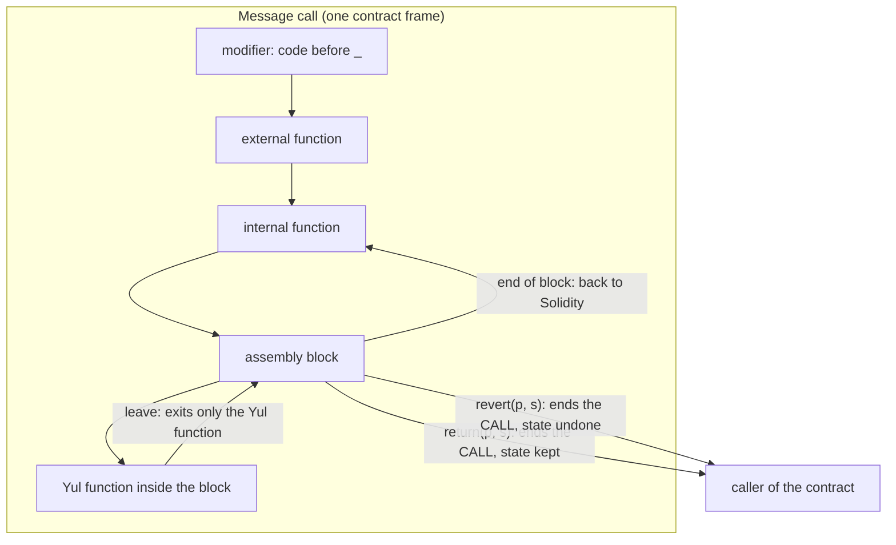

# 3.4 Interop with Solidity

> [!abstract] In one minute
> - Inside `assembly { }` every Solidity name becomes **one stack word**. Value-type locals and parameters are read and written by name. Memory variables are **pointers** (`m` is the address of the length word). Static calldata arrays and structs are their **calldata offset**.
> - Storage has no stack value, so you use suffixes: `x.slot` and `x.offset` (the **byte** offset inside the slot for packed variables). For state variables they are compile-time constants and read-only. For a local `storage` reference, `.slot` is a runtime value you **can assign**: `$.slot := SLOT` points a struct anywhere, which is how ERC-7201 accessors work. `.offset` is never assignable (`Only .slot can be assigned to.`).
> - Dynamic calldata arrays, `bytes` and `string` expose `xs.offset` (position of the first element, after the length word) and `xs.length`. Both are assignable and **nothing is validated**. External function types expose `.address` and `.selector`. Immutables and non-literal constants (`keccak256(...)`, `erc7201(...)`) cannot be referenced at all.
> - Results go out by assigning to named return variables (`r := ...`). `leave` exits only the current **Yul function**. The `return` opcode ends the **whole call**: it skips the rest of every Solidity caller and every modifier's post-`_` code. I bricked a `nonReentrant` guard with it.
> - `assembly ("memory-safe")` is an unchecked promise that the block touches only scratch space, memory it or Solidity allocated, or temporary memory above the free pointer. Via-IR needs that promise to move variables to memory: one unannotated memory-touching block makes the compiler emit `mstore(64, 128)` instead of `mstore(64, memoryguard(128))` for that **code object**, and a contract that compiled turns into "too deep in the stack". A false promise compiles and silently corrupts spilled locals.

**Prerequisites:** [[2.2 Data locations]], [[2.3 Storage layout]], [[2.4 Memory layout]], [[3.2 Syntax and control flow]] · **Leads to:** [[3.5 Memory management in assembly]], [[3.6 Storage, transient storage and bit packing]], [[3.8 ABI, errors and events by hand]], [[3.9 Cleanup, dirty bits and safety]], [[3.11 Compiler IR and the optimizer]]

## Intuition: assembly sees the stack, not the types

A Solidity function keeps its local variables on the EVM stack (or, under via-IR, sometimes in memory, see [[#The `memory-safe` contract]]). Each local variable is one 32-byte stack slot. An inline `assembly` block is code that runs in the middle of that function, with the same stack. So the natural question "what is `x` inside assembly?" has a simple answer: **it is whatever single word the compiler keeps for `x` on the stack.**

That one rule explains the whole note:

- A `uint256 x` local is a word holding the value. Assembly reads and writes it by name.
- A `uint256[] memory a` local is a word holding a **memory address**. Assembly gets the address, not the array.
- A `uint256[3] calldata a` parameter is a word holding a **calldata offset**.
- A `uint256[] calldata a` parameter needs **two** words (offset and length), so you must say which one: `a.offset` or `a.length`.
- A state variable has **no** stack word at all. It lives in storage at a position fixed at compile time. You ask for that position: `x.slot` and `x.offset`.
- An external function pointer needs two words (address and selector): `f.address`, `f.selector`.
- An `immutable` is not on the stack either. It is patched into the bytecode. Inline assembly cannot see it.

The rest of the note makes each case precise, shows the exact compile errors you get when you reach for the wrong thing, then covers the two ways out of an assembly block (assigning return variables, and the opcodes that end the call), and the `memory-safe` promise that the via-IR optimizer depends on.

Every snippet in this note compiles with solc 0.8.38 (solc-js, optimizer on, 200 runs) on both the legacy and via-IR pipelines unless I say otherwise. Every behaviour I describe was run in py-evm (Prague rules). Both pipelines gave the same results except where a table shows two columns.

## What each Solidity variable looks like inside assembly

This is the reference table. Each row was compiled and, where it compiles, run.

| Solidity variable | `x` inside assembly | Suffixes | Assignable from assembly? | Verified value / error |
|---|---|---|---|---|
| Value-type local or parameter (`uintN`, `intN`, `bool`, `address`, `bytesN`, enums, user-defined value types) | The value | none | Yes, `x := …` | `r := add(doubled, v)` read both locals. Enum `E.B` read as 1. UDVT `U.wrap(3)` read as 3. Parameters are assignable too |
| `constant` with a literal value (number, hex, address, bool, `bytes4`, arithmetic like `7 * 3`, file-level constants) | The value, inlined | none | No: `TypeError: Constant variables cannot be assigned to.` | `K = 7 * 3` read as 21; `DEAD` read as `0x…dEaD` |
| `constant` computed by a function (`keccak256("x")`, `erc7201("…")`) or of a non-value type (`string`) | — | — | — | `TypeError: Only direct number constants and references to such constants are supported by inline assembly.` |
| `immutable` | — | — | — | `TypeError: Assembly access to immutable variables is not supported.` |
| State variable (any type, including mappings and arrays) | not allowed | `.slot`, `.offset` (compile-time constants) | No: `TypeError: State variables cannot be assigned to - you have to use "sstore()" or "tstore()".` | `x` alone: `TypeError: Only local variables are supported. To access state variables, use the ".slot" and ".offset" suffixes.` |
| Packed state variable | not allowed | `.slot`, `.offset` = **byte** offset in the slot | No | `uint64 a; uint128 b; address owner; bool flag;` gave `a` (0, 0), `b` (0, 8), `owner` (1, 0), `flag` (1, 20) |
| `transient` state variable | not allowed | `.slot` (transient slot), `.offset` | No (same error) | First transient variable: `.slot` = 0, independent of storage slot numbers |
| Local `storage` reference (`S storage p`, `uint256[] storage p`) | not allowed | `.slot` (runtime value), `.offset` (always 0 for reference types) | `.slot` yes. `.offset` no: `TypeError: Only .slot can be assigned to.` | `p` alone: `TypeError: You have to use the ".slot" or ".offset" suffix to access storage reference variables.` |
| Dynamic calldata array `T[] calldata`, `bytes calldata`, `string calldata`, slices `a[1:]` | not allowed | `.offset` (calldata position of element 0, **after** the length word), `.length` (elements; bytes for `bytes`/`string`) | Both, **unchecked** | `xs.offset` = `0x64` and `bs.offset` = `0xe4` for `f(uint256[],bytes)`. `x` alone: `TypeError: Call data elements cannot be accessed directly. Use ".offset" and ".length" to access the calldata offset and length of this array and then use "calldatacopy".` |
| Static calldata array `T[3] calldata`, calldata struct (static or dynamic fields) | Calldata offset of its head | none (`.offset` gives `TypeError: The suffix ".offset" is not supported by this variable or type.`) | Yes, unchecked | For `f(uint256[3],(uint256,uint256))`, `st` = `0x4`, `sc` = `0x64` |
| Memory reference (arrays, `bytes`, `string`, structs) | Memory **address** (of the length word for dynamic arrays) | none (`.offset`/`.length` give `The suffix … is not supported`) | Yes: re-points the variable | `new uint256[](2)` read as `0x80`; an unassigned array read as `0x60` (zero slot) |
| External function type `function(...) external` | not allowed | `.address`, `.selector` (right-aligned 4 bytes) | Both | `x` alone: `TypeError: Only types that use one stack slot are supported.` `.selector` read as `0xe420264a` for `g(uint256)` |
| Internal function type `function(...) internal` | Code offset (legacy) or small integer ID (via-IR) | none | Yes, unchecked | `i1`, `i2` read as `0x2f7`, `0x2fc` (legacy, code offsets that move with any code change) and `1`, `2` (via-IR) |
| A function name used directly (`r := g`) | — | — | — | `DeclarationError: Access to functions is not allowed in inline assembly.` |
| Globals (`msg.sender`, `block.number`, …) | — | — | — | `DeclarationError: Identifier "msg.sender" not found.` Use the opcode builtin (`caller()`, `number()`), see [[3.3 Opcodes by family]] |

Three naming rules that also come from the compiler (all verified as errors):

- An assembly variable may not shadow a Solidity name: `let x := 1` with a state variable `x` in scope gives `DeclarationError: This declaration shadows a declaration outside the inline assembly block.`
- Assembly identifiers may not contain a dot: `let a.b := 1` gives `DeclarationError: User-defined identifiers in inline assembly cannot contain '.'.` The dot is reserved for the suffixes.
- Struct members are not reachable by name: `s.a := 1` on a memory struct gives `DeclarationError: Variable not found or variable not lvalue.` You compute the address yourself (`add(s, 0x00)` for `a`).

The view/pure checker sees through assembly. Reading `x.slot` is fine in a `pure` function (it is a constant), but `sload(x.slot)` in a `pure` function is `TypeError: Function declared as pure, but this expression (potentially) reads from the environment or state and thus requires "view".` A `tstore` in a `view` function is rejected the same way.

## Value-type locals: read and write by name

The simplest case needs no explanation beyond an example:

```solidity
// SPDX-License-Identifier: MIT
pragma solidity 0.8.38;

contract Locals {
    uint256 constant K = 7 * 3;
    address constant DEAD = 0x000000000000000000000000000000000000dEaD;

    function localValue(uint8 v) external pure returns (uint256 r, uint256 k, address d) {
        uint256 doubled = uint256(v) * 2;
        assembly {
            r := add(doubled, v)   // reads both Solidity locals by name
            k := K                  // a literal constant is inlined
            d := DEAD
        }
    }
}
```

`localValue(5)` returned `(15, 21, 0x…dEaD)`.

Two details matter:

- **Assigning a too-wide value to a narrow local is allowed.** I wrote `v := 0x1ff` into a `uint8 v` and then returned `v` from Solidity. The function returned `0xff`, and `v > 200` was true: Solidity cleans the value (masks it to 8 bits) when high-level code reads it. In the other direction, a narrow local *you read* in assembly may have dirty high bits (for example a parameter that came from a caller who did not clean it). The docs tell you to clean it yourself with `and` or `signextend`. Cleanup rules are in [[3.9 Cleanup, dirty bits and safety]].
- **Only "direct number constants" work.** The constant evaluator for inline assembly only accepts constants whose value is a literal or literal arithmetic. `bytes32 constant H = keccak256("x")` and `uint256 constant LOC = erc7201("example.main")` both fail with *Only direct number constants and references to such constants are supported by inline assembly.* The fix is to copy the constant into a local first (`uint256 loc = LOC; assembly { $.slot := loc }`); the optimizer folds it back into a `PUSH32` (I checked: the runtime bytecode contains the 32-byte root).

## Storage: `.slot` and `.offset`

[[2.3 Storage layout]] explains where every state variable lives: sequential slots from 0, packing of small types right to left inside a slot, `keccak256` for dynamic data. Assembly does not repeat any of that. It just asks the compiler for the result.

### State variables: compile-time constants

For a state variable, `x.slot` is the slot number and `x.offset` is the **byte offset** of the variable's lowest byte inside that slot. Both are known at compile time, so they compile to plain `PUSH` instructions.

```text
uint64  public a;      a.slot = 0   a.offset = 0
uint128 public b;      b.slot = 0   b.offset = 8     (bytes 8..23 of slot 0)
address public owner;  owner.slot = 1  owner.offset = 0
bool    public flag;   flag.slot = 1   flag.offset = 20  (after the 20-byte address)
uint256[] public arr;  arr.slot = 2    (the length word; data at keccak256(2))
mapping(...) bal;      bal.slot = 3    (always empty; entries at keccak256(key . 3))
S public s;            s.slot = 4      (members at 4 and 5)
uint256 transient t;   t.slot = 0      (transient storage has its own numbering)
```

All values above came from one probe function run on both pipelines. To read a packed variable by hand, shift right by `offset * 8` bits and mask to the variable's width:

```solidity
// SPDX-License-Identifier: MIT
pragma solidity 0.8.38;

contract PackedRead {
    uint64 small = 41;      // slot 0, offset 0
    uint128 other = 7;      // slot 0, offset 8

    function readOther() external view returns (uint128 v) {
        assembly {
            let word := sload(other.slot)
            v := and(shr(mul(other.offset, 8), word), 0xffffffffffffffffffffffffffffffff)
        }
    }
}
```

Writing a packed field needs a read-modify-write with a mask. That is [[3.6 Storage, transient storage and bit packing]].

`x.slot` and `x.offset` of a state variable are **not assignable**. `x.slot := 5` and `x.offset := 5` both give `TypeError: State variables cannot be assigned to - you have to use "sstore()" or "tstore()".` The message says what you probably meant: write the *value* with `sstore(x.slot, v)`. The same error appears for `transient` variables.

Using the bare name of a state variable (`r := x`) is the most common first mistake. The error is clear: *Only local variables are supported. To access state variables, use the ".slot" and ".offset" suffixes.*

### Local storage references: a runtime slot you can move

A local `storage` variable (`S storage p = s;`, `uint256[] storage p = arr;`) is a pointer into storage. On the stack it is one word: the slot number. Assembly exposes that word as `p.slot`. Unlike a state variable, this is a **runtime value**, and you **can assign it**.

`p.offset` exists too and can be read (it is 0, because structs and arrays always start a new slot), but it cannot be assigned: `p.offset := 1` gives `TypeError: Only .slot can be assigned to.` Packed sub-word storage pointers do not exist in Solidity, so there is nothing to move.

Assigning `.slot` makes the reference point **anywhere**. All Solidity code that uses the reference afterwards uses the new root, with the type's normal layout rules applied from there:

```solidity
// SPDX-License-Identifier: MIT
pragma solidity 0.8.38;

contract PointAnywhere {
    uint256[] public arr;   // slot 0

    function writeVia(uint256 slot, uint256 v) external {
        uint256[] storage p = arr;
        assembly { p.slot := slot }   // p is now "the array whose length lives at `slot`"
        p.push(v);                     // length at slot, element 0 at keccak256(slot)
    }

    function readVia(uint256 slot) external view returns (uint256 len, uint256 first) {
        uint256[] storage p = arr;
        assembly { p.slot := slot }
        len = p.length;
        first = len > 0 ? p[0] : 0;
    }
}
```

`writeVia(0x1234, 0xbeef)` stored `1` at slot `0x1234` and `0xbeef` at `keccak256(0x1234)`. `arr` itself (slot 0) stayed empty. `readVia(0x1234)` then returned `(1, 0xbeef)`.

This is the most powerful interop trick in Solidity and the basis of three production patterns:

- **ERC-7201 namespaced storage**: `$.slot := ROOT` returns a struct that lives at a hashed root (full accessor in the [[#Question ladder]]; the formula and the namespace rules are in [[2.3 Storage layout]]).
- **Unstructured proxy slots** (EIP-1967): `StorageSlot.getAddressSlot(SLOT).value` in OpenZeppelin is a struct `{ address value; }` whose `.slot` is set to a constant. See [[4.2 Upgradeability and proxies]].
- **Diamond storage**: the same idea with an ad-hoc `keccak256("…")` root.

> [!warning] The compiler no longer protects you
> After `p.slot := x`, Solidity has no idea whether `x` collides with another variable, a mapping entry or another namespace. Bounds checks still run (against the length read from the *new* slot), but nothing checks the root itself. A wrong constant, a reused namespace id or a user-controlled slot value is a storage-collision bug. See [[5.9 Proxies, delegatecall and storage]].

### Computing derived slots

Assembly gives you the root; you compute everything below it. For element `i` of a dynamic storage array the data starts at `keccak256(p.slot)`:

```solidity
// SPDX-License-Identifier: MIT
pragma solidity 0.8.38;

contract ElemSlot {
    uint256[] public arr;   // slot 0

    function elemSlot(uint256 i) external view returns (uint256 s, uint256 v) {
        uint256[] storage p = arr;
        assembly {
            mstore(0x00, p.slot)                       // scratch space
            s := add(keccak256(0x00, 0x20), i)         // no bounds check!
            v := sload(s)
        }
    }
}
```

With `arr` at slot 0, `elemSlot(2)` returned `keccak256(0) + 2` (`0x290decd9…e565`), and the same arithmetic in my probe contract (array at slot 2) gave `0x405787fa…5ad0` = `keccak256(2) + 2`. The block writes only scratch space, so it qualifies for `assembly ("memory-safe")`. Left unannotated, as here, it still counts as a memory operation for via-IR (see [[#The `memory-safe` contract]]). Mapping and nested slot formulas are in [[2.3 Storage layout]] and their assembly versions in [[3.6 Storage, transient storage and bit packing]].

## Calldata: `.offset`, `.length`, and plain offsets

Calldata is read-only and addressed by byte position, so a calldata variable is always "a position in calldata". How many words that takes decides the syntax.

### Dynamic arrays, `bytes` and `string`

A dynamic calldata array needs two words: where its elements start and how many there are. That is exactly what Solidity keeps on the stack after decoding the head, and assembly sees both:

- `xs.offset`: the absolute calldata position of **element 0**. That is *after* the length word. It already includes the 4-byte selector.
- `xs.length`: the number of elements (bytes, for `bytes` and `string`).

For `f(uint256[] xs, bytes bs)` called with `xs = [10, 20, 30]` and `bs = 0xabcdef`:

```text
calldata position   word                                                              meaning
0x000               ccf02bb7                                                          selector (4 bytes)
0x004               …0040                                                             head: offset of xs (relative to 0x04)
0x024               …00c0                                                             head: offset of bs
0x044               …0003                                                             xs length
0x064               …000a   <- xs.offset = 0x64                                       xs[0]
0x084               …0014                                                             xs[1]
0x0a4               …001e                                                             xs[2]
0x0c4               …0003                                                             bs length
0x0e4               abcdef00…  <- bs.offset = 0xe4                                     bs data
```

The probe returned `xs.offset = 0x64`, `xs.length = 3`, `bs.offset = 0xe4`, `bs.length = 3`, and `calldataload(add(xs.offset, 0x20)) = 0x14` (element 1). Note the arithmetic: the ABI offset `0x40` is relative to the start of the arguments, so the length word is at `4 + 0x40 = 0x44` and the first element at `0x64`. Solidity has already done that addition for you. The ABI side is in [[2.5 ABI encoding and decoding]].

Element `i` of a `uint256[] calldata` is therefore `calldataload(add(xs.offset, mul(i, 0x20)))`. The intermediate question in the [[#Question ladder]] builds the bounds-checked version.

Nested dynamic arrays (`uint256[][] calldata p`) also have `.offset` and `.length`. `p.offset` points at the inner **offset table**, not at the data. Each inner array is located by adding its table entry to `p.offset`, which is what the decoder does lazily ([[2.5 ABI encoding and decoding]] explains that inner offsets are validated only when read).

### Static arrays and structs

A static calldata array (`uint256[3] calldata st`) or a calldata struct (`P calldata sc`) needs only one word: where it starts. So the variable *is* that offset, with no suffix. For `f(uint256[3] st, (uint256,uint256) sc)` the probe returned `st = 0x4` (right after the selector) and `sc = 0x64` (after three words). `calldataload(add(sc, 0x20))` returned the second field, `9`. This also holds for a struct with a dynamic member: `r := p` compiled for `struct P { uint256 a; bytes b; }`. Asking for `.offset` on any of these is `The suffix ".offset" is not supported by this variable or type.`

### Assigning `.offset` and `.length`

Both suffixes of a dynamic calldata array, and the plain offset of a static one, can be assigned. Solidity code that runs afterwards uses the new values. **Nothing is checked**: not against `calldatasize()`, not against the original length, not for underflow.

```solidity
// SPDX-License-Identifier: MIT
pragma solidity 0.8.38;

contract Slice {
    struct P { uint256 a; uint256 b; }

    /// Drop the first element in place.
    function tail(uint256[] calldata xs) external pure returns (uint256 len, uint256 first) {
        assembly {
            xs.offset := add(xs.offset, 0x20)
            xs.length := sub(xs.length, 1)   // no underflow check
        }
        len = xs.length;
        first = xs[0];                        // reads through the new offset
    }

    /// Lie about the length: Solidity's own bounds check trusts .length.
    function grow(uint256[] calldata xs) external pure returns (uint256 len, uint256 last) {
        assembly { xs.length := 100 }
        len = xs.length;
        last = xs[99];                        // no Panic
    }

    /// The safe built-in way to slice.
    function tailSol(uint256[] calldata xs) external pure returns (uint256 len, uint256 first) {
        uint256[] calldata t = xs[1:];
        return (t.length, t[0]);
    }

    /// A static calldata struct IS its offset.
    function shiftStruct(P calldata p) external pure returns (uint256 a) {
        assembly { p := add(p, 0x20) }
        a = p.a;                              // now reads the old p.b
    }
}
```

Results, identical on both pipelines:

| Call | Result | Why |
|---|---|---|
| `tail([10, 20, 30])` | `(2, 20)` | Offset moved one word, length reduced |
| `tail([])` | `(2^256 − 1, 0)` | `sub(0, 1)` wrapped. The array now claims 2^256 − 1 elements |
| `tailSol([])` | Reverts (empty data) | Solidity's slice checks `start <= length` |
| `grow([10, 20, 30])` | `(100, 0)` | `xs[99]` passed the bounds check; `calldataload` past the end of calldata reads zeros |
| `shiftStruct((5, 6))` | `6` | The struct now starts one word later |

> [!warning] A fake length defeats every later bounds check
> Once `.length` is wrong, every high-level `xs[i]` in the rest of the function is checked against the wrong number. With `tail([])` the length became 2^256 − 1. Reading past calldata returns zeros, which can look like valid data (amount 0, address 0). Prefer Solidity slices (`xs[1:]`), which do check, and keep assembly writes to `.offset`/`.length` behind explicit `require`s.

## Memory: variables are pointers

[[2.4 Memory layout]] covers the layout of every memory type. The interop rule is short: a memory variable is a pointer, and assembly sees the pointer.

```solidity
// SPDX-License-Identifier: MIT
pragma solidity 0.8.38;

contract MemPtr {
    function memoryPtr() external pure returns (uint256 p, uint256 len, uint256 fmp, uint256 e) {
        uint256[] memory m = new uint256[](2);
        uint256[] memory empty;
        assembly {
            p := m              // 0x80: address of the length word
            len := mload(m)     // 2
            fmp := mload(0x40)  // 0xe0 = 0x80 + 32 * 3
            e := empty          // 0x60: the zero slot
        }
    }

    function retarget() external pure returns (uint256 lenA, uint256 lenB, bool same) {
        uint256[] memory a = new uint256[](3);
        uint256[] memory b = new uint256[](5);
        assembly { a := b }     // copies the pointer, exactly like `a = b`
        lenA = a.length;        // 5
        lenB = b.length;        // 5
        a[0] = 77;
        same = b[0] == 77;      // true: same memory
    }
}
```

`memoryPtr()` returned `(0x80, 2, 0xe0, 0x60)`; `retarget()` returned `(5, 5, true)`.

What follows from "it is just a pointer":

- `mload(m)` is the length, `add(m, 0x20)` is element 0, and for `bytes`/`string` the data starts at `add(b, 0x20)`. For a struct, field `k` is at `add(s, mul(k, 0x20))`, and a reference-type field holds another pointer.
- `a := b` and `a := 0x60` only move the pointer. Nothing is copied or allocated. Aliasing follows (`a[0] = 77` changed `b[0]`).
- Assigning an arbitrary number to a memory variable compiles. Solidity will then treat whatever is at that address as the object. The docs count **assigning to a memory variable** as a memory operation for the `memory-safe` rules, even if the block contains no `mload`/`mstore`. I verified that: a block containing only `m := 0x60` disabled via-IR's stack-to-memory mover just like an `mload` did.
- The suffixes do not exist for memory: `a.length` and `a.offset` are both `The suffix … is not supported by this variable or type.` Use `mload(a)`.

Allocation (bumping `0x40`), scratch space and buffer reuse are the subject of [[3.5 Memory management in assembly]].

## Function types: `.address`, `.selector`, and internal pointers

**External function types** take two words: the target address and the 4-byte selector. Assembly reaches them through `.address` and `.selector`, and both are assignable:

```solidity
// SPDX-License-Identifier: MIT
pragma solidity 0.8.38;

contract FnTypes {
    function g(uint256) external pure returns (uint256) { return 1; }

    function extFn() external view returns (address addr, bytes4 sel, uint256 rawSel) {
        function(uint256) external pure returns (uint256) h = this.g;
        assembly {
            addr := h.address
            rawSel := h.selector            // right-aligned: 0x...e420264a
            sel := shl(224, h.selector)      // bytes4 is left-aligned
        }
    }

    function extFnAssign(address target) external pure returns (address addr, bytes4 sel) {
        function(uint256) external pure returns (uint256) h;
        assembly {
            h.address := target
            h.selector := 0x12345678
        }
        addr = h.address;
        sel = h.selector;
    }
}
```

`extFn()` returned the contract's own address, `sel = 0xe420264a` and `rawSel = 3827312202` (the same four bytes as a right-aligned integer, which is how the docs describe it). `extFnAssign(0xabab…ab)` returned that address and selector `0x12345678`. The alignment trap is real: `.selector` is a number in the low 4 bytes, while a Solidity `bytes4` sits in the **high** 4 bytes, so you must shift by 224 bits when moving between them. Bare `h` gives *Only types that use one stack slot are supported.*

**Internal function types** are one word, so the variable itself is readable and assignable. The word means different things per pipeline:

| | Legacy | Via-IR |
|---|---|---|
| Value of `h = i1` / `h = i2` | `0x2f7` / `0x2fc` in the `Kinds` probe below (jump destinations; `0x4ff` / `0x504` in a larger version of the same contract) | `1` / `2` (IDs into a `switch` dispatcher) |
| Call through a garbage value (`h := 7`) | `InvalidJumpDestination`: exceptional halt, **all gas consumed** | `Panic(0x51)` revert (refunds remaining gas) |
| Call through `h := 1` | Invalid jump | Calls whatever function has ID 1 (here `i1`, returned 1) |

Never construct internal pointers from numbers. The value is not portable between pipelines, compiler versions or even unrelated code changes. Copying one pointer variable into another in assembly (`h := h2`) worked on both pipelines.

## Getting values out: named returns, `leave`, `return`, `revert`

### Named return variables

A named return variable is an ordinary local that Solidity returns at the end of the function. Assigning it in assembly is the normal, safe way to produce a result:

```solidity
// SPDX-License-Identifier: MIT
pragma solidity 0.8.38;

contract Named {
    function named(uint256 a, uint256 b) external pure returns (uint256 sum, uint256 prod) {
        assembly {
            sum := add(a, b)
            prod := mul(a, b)
        }
        // falls off the end: Solidity ABI-encodes (sum, prod)
    }
}
```

`named(6, 7)` returned `(13, 42)`. After the block, control continues in Solidity: modifiers run their post-`_` code, the ABI encoder writes the result, and the caller's code keeps going. Use this whenever you can. Unnamed returns are not reachable from assembly: you need a name to assign.

### Four ways to leave, four scopes



| Construct | What it exits | State changes | What the caller of the contract sees | Notes |
|---|---|---|---|---|
| Fall off the end / assign named returns | The block only | Kept | Normal ABI-encoded return | The safe default |
| `leave` | The current **Yul function** only | Kept | Nothing yet: the block continues | Compile error outside a Yul function: `SyntaxError: Keyword "leave" can only be used inside a function.` Syntax in [[3.2 Syntax and control flow]] |
| `return(p, s)` opcode | The **whole message call** | Kept (it is a successful halt) | Success, returndata = `memory[p, p+s)` exactly | Skips all remaining Solidity: callers, modifiers, the ABI encoder |
| `revert(p, s)` opcode | The whole message call | **Undone** | Failure, revert data = `memory[p, p+s)` | Encoding errors by hand: [[3.8 ABI, errors and events by hand]] |
| `stop()` | The whole call | Kept | Success, empty returndata | Like `return(0, 0)` |

`return` and `revert` are opcodes, not Yul keywords. Their semantics are in [[1.6 Calldata, returndata and logs]] and [[3.3 Opcodes by family]]. What matters here is that they do not know about Solidity functions at all. **There is no Solidity call stack at the EVM level**; internal functions are just jumps inside one frame. The only "return" the EVM has is the one that ends the frame.

### Demonstration: `return` skips everything

I compiled this and ran each entry point:

```solidity
// SPDX-License-Identifier: MIT
pragma solidity 0.8.38;

contract Exits {
    event Step(uint256 id);
    uint256 private locked = 1;          // 1 = free, 2 = entered (OpenZeppelin-style values)
    uint256 public counter;

    modifier nonReentrant() {
        require(locked == 1, "reentrant");
        locked = 2;
        _;
        locked = 1;                      // post-_ code
    }

    modifier traced() {
        emit Step(1);
        _;
        emit Step(9);                    // post-_ code
    }

    function _returnOpcode(uint256 v) internal pure {
        assembly {
            mstore(0x00, v)
            return(0x00, 0x20)           // ends the whole call
        }
    }

    function _leaveOnly(uint256 v) internal pure returns (uint256 r) {
        assembly {
            function pick(x) -> y {
                y := x
                if gt(x, 10) { y := 10 leave }   // exits pick() only
                y := add(x, 1000)
            }
            r := pick(v)                 // execution continues here after leave
        }
    }

    function _revertOpcode() internal pure {
        assembly {
            mstore(0x00, 0xdeadbeef)
            revert(0x1c, 0x04)           // the 4 bytes 0xdeadbeef
        }
    }

    function viaReturn() external traced returns (uint256) {
        emit Step(2);
        counter += 1;
        _returnOpcode(42);
        emit Step(3);                    // never runs
        counter += 100;                  // never runs
        return 7;                        // never runs
    }

    function viaLeave(uint256 v) external traced returns (uint256) {
        emit Step(2);
        uint256 r = _leaveOnly(v);
        emit Step(3);                    // runs
        return r;
    }

    function viaRevert() external traced returns (uint256) {
        emit Step(2);
        counter += 1;
        _revertOpcode();
        return 7;
    }

    function guarded() external nonReentrant returns (uint256) {
        counter += 1;
        _returnOpcode(1);                // skips `locked = 1`
        return 0;
    }
}
```

Results (identical on legacy and via-IR):

| Call | Success | Output | Events (`Step` ids) | Storage after |
|---|---|---|---|---|
| `viaReturn()` | yes | `42` (not 7) | `1, 2` (no 3, **no 9**) | `counter = 1` (the `+= 1` kept, the `+= 100` never ran) |
| `viaLeave(3)` | yes | `1003` | `1, 2, 3, 9` | — |
| `viaLeave(50)` | yes | `10` | `1, 2, 3, 9` | — |
| `viaRevert()` | no | `0xdeadbeef` | none (logs discarded) | unchanged |
| `guarded()` (1st) | yes | `1` | — | `locked = 2` **stays** |
| `guarded()` (2nd) | no | `Error("reentrant")` | — | The function is now permanently unusable |

The compiler noticed some of this. Compiling `Exits` gave five `Warning: Unreachable code.` warnings, pointing at `emit Step(9)` and `locked = 1` in the modifiers and at the code after each helper call: Solidity's control-flow analysis knows that a block ending in an unconditional `return` or `revert` never falls through. Do not rely on it. When I made the return conditional (`if gt(v, 0) { … return(0x00, 0x20) }`) or called the helper through an internal function pointer, the same skipped `locked = 1` produced **no warning at all**.

The last two rows are the security lesson. A `nonReentrant` modifier that keeps its flag in **regular storage** resets the flag in its post-`_` code. An assembly `return` anywhere below it, even inside a helper three internal calls deep, skips that reset and leaves the lock engaged forever. With a transient-storage guard (`ReentrancyGuardTransient` style) the flag would clear at the end of the transaction, so the damage is limited to that one transaction, but any other post-`_` logic (events, accounting, invariant checks) is still skipped. [[2.6 Functions, modifiers and special functions]] shows the opposite case: a Solidity `return` leaves only the body, and post-`_` code always runs.

> [!warning] Who uses `return` from assembly on purpose
> Proxies (`return(0, returndatasize())` after a `delegatecall`), multicall routers and "return raw bytes without re-encoding" helpers do it deliberately. They are always at the very end of an external entry point, with no modifier that has post-`_` code. Treat any `return(` inside an internal or library function as a review flag, and check every caller and modifier above it.

### `return` and `try/catch`

From the outside, an assembly `return` is just a successful call whose returndata is whatever bytes you chose. The **caller** still decodes those bytes against the declared return type. If they do not decode, the caller reverts, and `catch` does **not** catch it, because the external call itself succeeded; the failure happens in the caller's own decoding.

I deployed a caller with these `try` statements against the contract above plus two lying functions:

```solidity
// SPDX-License-Identifier: MIT
pragma solidity 0.8.38;

contract Liar {
    function liesAboutType() external pure returns (uint256) {
        assembly { return(0, 0) }                  // zero bytes, though uint256 declared
    }
    function returnsBool() external pure returns (bool) {
        assembly { mstore(0, 2) return(0, 32) }    // 2 is not a valid bool
    }
}

contract TryCaller {
    Liar public l;
    constructor(Liar _l) { l = _l; }

    function tryLies() external view returns (uint256 status) {
        try l.liesAboutType() returns (uint256) { return 1; }
        catch { return 2; }
    }
    function tryBool() external view returns (uint256 status) {
        try l.returnsBool() returns (bool) { return 1; }
        catch { return 2; }
    }
}
```

| Caller code | Result |
|---|---|
| `try e.viaReturn() returns (uint256 x)` | Success branch, `x = 42` (the raw `return` value, not the 7 in the source) |
| `try l.liesAboutType() returns (uint256)` | **Caller reverts with empty data**. Neither branch runs |
| `try l.returnsBool() returns (bool)` | **Caller reverts with empty data** (the ABI decoder rejects 2 as a `bool`) |
| `try e.viaRevert() … catch (bytes memory d)` | Catch branch, `d = 0xdeadbeef` |
| Assembly `return(0, 32)` inside the caller's own success block | Ends the **caller's** call with that value; the code after the `try` never runs |

So `try/catch` does not protect you from a callee that returns malformed data through assembly. This matches the verified rule in [[2.8 Errors and reverts]]: ABI decoding failures are empty reverts, never Panics, and they happen in the decoding contract.

### One more: `return` in a constructor

In creation code, `return(p, s)` does not return a value; it supplies the **runtime code** to store ([[1.8 Contract creation]]). A Solidity constructor whose assembly returns 10 bytes `602a60005260206000f3` deployed exactly those 10 bytes as the contract's code, replacing everything the compiler generated, and calling it returned 42 on both pipelines. That is how hand-written runtimes are deployed from Solidity; the Yul-object way is in [[3.10 Yul objects and standalone contracts]].

## The `memory-safe` contract

### Why the compiler needs a promise

The legacy code generator keeps every local on the stack and fails with "Stack too deep" when a function needs more than the 16 slots that `DUP16`/`SWAP16` can reach ([[1.3 Execution model]]). The via-IR pipeline has an escape hatch: the **stack-to-memory mover** (the "stack limit evader") moves some variables into a reserved block of memory right above `0x80`. It was experimental in 0.8.7 and is enabled by default whenever possible since 0.8.21.

To reserve that block, the IR code generator does not write `mstore(64, 128)`. It writes `mstore(64, memoryguard(128))`. `memoryguard` is a Yul builtin ([[3.3 Opcodes by family]]) with a contract: the code promises to use only memory below 128 or above the returned pointer, and the optimizer may claim `[128, ptr)` for spilled variables. At the end of optimization `memoryguard(128)` becomes a constant: `0x80` if nothing was spilled, or something larger. [[2.4 Memory layout]] measured `0x3a0` for a 24-local function; my 20-local example below gives `0x320`. The internals of the evader are in [[3.11 Compiler IR and the optimizer]].

The compiler can check Solidity code against that contract, because Solidity code always allocates through the free memory pointer. It cannot check inline assembly. So it asks you. The rule in the docs: moving variables to memory "and additional memory optimizations" are "globally disabled" in the presence of any inline assembly block "that contains a memory operation or assigns to Solidity variables in memory", unless that block is marked memory-safe.

I checked what "disabled" means in the generated IR. For a contract whose only assembly block is `mstore(0x00, x) r := keccak256(0x00, 0x20)`:

```text
                       creation object "M_11"            runtime object "M_11_deployed"
block annotated        mstore(64, memoryguard(128))      mstore(64, memoryguard(128))
block not annotated    mstore(64, memoryguard(128))      mstore(64, 128)
```

That is the whole mechanism: **no `memoryguard`, no spill area**, so the optimizer has nowhere to put variables and falls back to "too deep" errors.

### What the annotation promises

`assembly ("memory-safe") { … }` (since 0.8.13) asserts that the block only accesses:

| Memory region | Allowed in a memory-safe block | Typical use |
|---|---|---|
| Scratch space `0x00–0x3f` | Yes, freely | Hashing two words, a short revert |
| Memory you allocated by bumping the free pointer at `0x40` | Yes | Building a `bytes` result ([[3.5 Memory management in assembly]]) |
| Memory Solidity allocated that you reference (inside the bounds of an array or struct you were given) | Yes | Reading or overwriting elements of `bytes memory b` |
| Temporary memory **at or above** the free pointer, without bumping it | Yes, if you do not expect it to survive | Encoding call arguments, copying returndata before `revert` |
| `0x40–0x7f` (free pointer and zero slot) | Only if the block restores both by its end, or the block always terminates (`return`/`revert`), so Solidity never sees them | A 128-byte encoding at `0x00` before a `revert` |
| Anything else (a hard-coded `0x80`, `returndatacopy(0, 0, returndatasize())` with unbounded size) | **No**, not even if the block then reverts | — |

Three clarifications from the docs and my tests:

- **Blocks that do no memory access need no annotation.** A block with only `sload`, arithmetic or `.slot` assignment is automatically memory-safe. Every ERC-7201 accessor (`$.slot := ROOT`) is in this class. I confirmed it: `assembly { p := add(p, 1) }` left the stack-to-memory mover working.
- **Assigning to a memory variable counts as a memory operation.** `assembly { m := 0x60 }` with no `mload`/`mstore` still disabled the mover.
- **Termination does not excuse arbitrary writes.** The docs' own counterexample is `returndatacopy(0, 0, returndatasize()) revert(0, returndatasize())`: returndata can be longer than 64 bytes, so it writes past scratch space. The memory-safe version copies to `mload(0x40)` instead. The special allowance for `0x40–0x7f` in terminating blocks covers only memory **below `0x80`**.

The annotation has **no effect on the legacy pipeline**: legacy runtime bytecode with and without it was byte-for-byte identical (271 bytes, metadata stripped). It also does nothing for correctness. It only unlocks optimizations.

### The legacy comment form, and a typo that is only a warning

Before 0.8.13 there was no annotation syntax. For libraries that must compile on both old and new compilers, 0.8.13 also accepts a NatSpec comment with the same effect:

```solidity
// SPDX-License-Identifier: MIT
pragma solidity 0.8.38;

library OldStyle {
    function h(uint256 x) internal pure returns (bytes32 r) {
        /// @solidity memory-safe-assembly
        assembly {
            mstore(0x00, x)
            r := keccak256(0x00, 0x20)
        }
    }
}
```

Since **0.8.31** (3 Dec 2025) the comment is deprecated. On 0.8.38 it still works (my stack-too-deep contract compiled with it), with this warning:

```text
Warning: Natspec memory-safe-assembly special comment for inline assembly is deprecated and scheduled for removal. Use the memory-safe block annotation instead.
```

Using both forms on one block adds a second warning: *Inline assembly marked as memory safe using both a NatSpec tag and an assembly block annotation. If you are not concerned with backwards compatibility, only use the assembly block annotation, otherwise only use the NatSpec tag.*

> [!warning] A misspelled flag is silently ignored
> `assembly ("memory_safe") { … }` (underscore) is **not an error**. It compiles with `Warning: Unknown inline assembly flag: "memory_safe"`, the block is treated as unannotated, and in my stack-too-deep contract it caused the same `YulException` as no annotation at all. Treat that warning as an error in CI.

### Demonstration: one block decides whether the contract compiles

This contract keeps 20 hashes alive at once. The second function is a one-line assembly block that reads the free memory pointer:

```solidity
// SPDX-License-Identifier: MIT
pragma solidity 0.8.38;

contract Deep {
    function deep(bytes32 seed) external pure returns (uint256) {
        uint256 v0 = uint256(keccak256(abi.encode(seed, 0)));
        uint256 v1 = uint256(keccak256(abi.encode(seed, 1)));
        uint256 v2 = uint256(keccak256(abi.encode(seed, 2)));
        uint256 v3 = uint256(keccak256(abi.encode(seed, 3)));
        uint256 v4 = uint256(keccak256(abi.encode(seed, 4)));
        uint256 v5 = uint256(keccak256(abi.encode(seed, 5)));
        uint256 v6 = uint256(keccak256(abi.encode(seed, 6)));
        uint256 v7 = uint256(keccak256(abi.encode(seed, 7)));
        uint256 v8 = uint256(keccak256(abi.encode(seed, 8)));
        uint256 v9 = uint256(keccak256(abi.encode(seed, 9)));
        uint256 v10 = uint256(keccak256(abi.encode(seed, 10)));
        uint256 v11 = uint256(keccak256(abi.encode(seed, 11)));
        uint256 v12 = uint256(keccak256(abi.encode(seed, 12)));
        uint256 v13 = uint256(keccak256(abi.encode(seed, 13)));
        uint256 v14 = uint256(keccak256(abi.encode(seed, 14)));
        uint256 v15 = uint256(keccak256(abi.encode(seed, 15)));
        uint256 v16 = uint256(keccak256(abi.encode(seed, 16)));
        uint256 v17 = uint256(keccak256(abi.encode(seed, 17)));
        uint256 v18 = uint256(keccak256(abi.encode(seed, 18)));
        uint256 v19 = uint256(keccak256(abi.encode(seed, 19)));
        unchecked {
            return ((v0 * 1) ^ (v1 * 2) ^ (v2 * 3) ^ (v3 * 4) ^ (v4 * 5) ^ (v5 * 6) ^ (v6 * 7)
                ^ (v7 * 8) ^ (v8 * 9) ^ (v9 * 10) ^ (v10 * 11) ^ (v11 * 12) ^ (v12 * 13) ^ (v13 * 14)
                ^ (v14 * 15) ^ (v15 * 16) ^ (v16 * 17) ^ (v17 * 18) ^ (v18 * 19) ^ (v19 * 20))
                + (v0 + v1 + v2 + v3 + v4 + v5 + v6 + v7 + v8 + v9
                + v10 + v11 + v12 + v13 + v14 + v15 + v16 + v17 + v18 + v19);
        }
    }

    function fmp() external pure returns (uint256 p) {
        assembly ("memory-safe") { p := mload(0x40) }   // the line under test
    }
}
```

I compiled it with different versions of the `fmp()` block and ran `deep(0x0101…01)`:

| Pipeline / optimizer | `fmp()` block | Compile result | Initial free pointer | `deep` gas |
|---|---|---|---|---|
| Legacy, on or off | any | `CompilerError: Stack too deep. Try compiling with --via-ir (cli) or the equivalent viaIR: true (standard JSON) while enabling the optimizer. Otherwise, try removing local variables.` | — | — |
| Via-IR, on | `assembly ("memory-safe") { p := mload(0x40) }` | OK, `irOptimized` has `memoryguard(0x0320)` | `0x320` | 5,012 |
| Via-IR, off | same | OK | `0x320` | 21,634 |
| Via-IR, on | `/// @solidity memory-safe-assembly` comment | OK (plus deprecation warning) | `0x320` | 5,012 |
| Via-IR, on | `assembly { p := add(p, 1) }` (no memory access) | OK | (block returns 1) | 5,012 |
| Via-IR, on | `assembly { p := mload(0x40) }` | `YulException: Cannot swap Variable _32 with Variable _41: too deep in the stack by 3 slots in [ JUNK _5 _2 _11 … _41 ]` | — | — |
| Via-IR, off | same | `YulException: Cannot swap Variable expr_43 with Variable expr_51: too deep in the stack by 2 slots in [ RET expr_3 … expr_51 ]` | — | — |
| Via-IR, on | `assembly ("memory_safe") { … }` (typo) | Same `YulException` | — | — |
| Via-IR, on | `uint256[] memory m; assembly { m := 0x60 }` | Same `YulException` | — | — |

All gas figures: py-evm Prague rules, execution gas only (no 21,000 intrinsic, no calldata cost). Note that `fmp()` reports `0x320` even though `fmp()` itself spills nothing: the free pointer is initialised once in the dispatcher, so the spill area is reserved for every function in the runtime code.

### How far does one unannotated block reach?

The docs and the 0.8.13 announcement say "for the whole contract". I measured where the boundary actually is by putting one unannotated `p := mload(0x40)` block in different places around the `deep` function:

| Where the unannotated block is | `Deep` compiles on via-IR? |
|---|---|
| Inside `deep` itself | No |
| Another function of `Deep` | No |
| A **base contract** of `Deep` | No |
| An **internal library function** that `Deep` calls | No |
| A **free function** that `Deep` calls | No |
| An internal library function that `Deep` never calls | Yes |
| A `private` function of `Deep` that nothing calls | Yes |
| A **public/external library function** that `Deep` calls (separate contract, reached by `DELEGATECALL`) | Yes |
| A different contract in the same file | Yes |
| A different contract that `Deep` deploys with `new` | Yes (its code is a separate object) |
| `Deep`'s **constructor** | Yes: the creation object loses its `memoryguard`, the runtime object keeps `memoryguard(0x0320)` |

So "the whole contract" is accurate in spirit but the real unit is the **Yul object**: the creation code and the runtime code are separate objects, and each one is affected by the assembly that is code-generated into it. Inheritance, internal libraries and free functions are all compiled into the same object, so their assembly counts. Code that is never referenced is not generated and does not count. This is a measured result on 0.8.38, not a documented guarantee; do not rely on "it is unused" to keep an unsafe block harmless.

### When the promise is false

The compiler never checks the annotation. To see what a false promise does, I kept `assembly ("memory-safe")` on blocks inside `deep` that write into the spill area `0x80–0x31f`, placed after the 20 locals were computed:

| Block inside `deep` (all annotated memory-safe) | Optimizer on | Optimizer off |
|---|---|---|
| `mstore(0x00, 0)` (honest: scratch space) | `0xf80825f2…feb7` (correct) | `0xf80825f2…feb7` (correct) |
| `mstore(0x80, 0xdead)` ("my buffer starts at 0x80") | `0xf80825f2…feb7` (happened to be correct) | `0x16fa2611…deaf` **wrong, no revert** |
| Zero `0x80..0x31f` in a loop | `0x000…000` **wrong, no revert** | `0x000…000` **wrong, no revert** |

All runs succeeded. Nothing in the output says anything went wrong. Whether a given write hits a live spilled variable depends on the optimizer's slot assignment, which changes with optimizer settings (the single-word write only broke the unoptimized build here) and with any unrelated edit. [[2.4 Memory layout]] saw a different failure from the same bug class: an infinite loop that ran out of all 30,000,000 gas. The docs' wording is exact: incorrect and undefined behaviour "that cannot easily be discovered by testing".

> [!info]- Deep dive: the annotation is not free in every case
> With `memoryguard`, the start of the heap is an opaque value until the very end of optimization, so the optimizer cannot treat `mload(64)` right after the dispatcher as the constant `0x80`. In a small via-IR contract with an `abi.encode` + `keccak256` function, annotating the *other* function's block changed the runtime from 355 to 302 bytes, but the `abi.encode` function's execution gas went **up** from 520 to 544: the unannotated build had constant-folded addresses such as `mstore(160, value0)`, while the annotated one computed `add(_1, 32)` from the memoryguard value. The difference is tiny and the annotation is still the right default, but "memory-safe always makes code cheaper" is not true. (py-evm Prague, via-IR, optimizer on, 200 runs.)

### Compiler bugs in this area

| Fixed in | Bug | Relevance |
|---|---|---|
| 0.8.37 (Sep 2026) | Via-IR: with mutually recursive functions, the stack-to-memory mover could give two variables the same spill slot | Spilled variables can be corrupted by the compiler itself, not only by false annotations. Pin a current compiler ([[5.13 Toolchain, dependencies and operations]]) |
| 0.8.21 (19 Jul 2023) | Not a bug: the mover became enabled by default "whenever possible" | Before this, many via-IR builds did not spill at all, so a false annotation could stay dormant and then start corrupting after a compiler upgrade |
| 0.8.13 (16 Mar 2022) | Not a bug: `assembly ("memory-safe")` and the NatSpec comment introduced | — |

## Solidity and Yul in practice

All snippets compile with 0.8.38 on both pipelines and were run in py-evm.

**A probe for every variable kind.** This contract produced most of the reference table. Keep it as a template for "what does the compiler give me for X?":

```solidity
// SPDX-License-Identifier: MIT
pragma solidity 0.8.38;

contract Kinds {
    uint64 public a = 0x11;                  // slot 0, offset 0
    uint128 public b = 0x22;                 // slot 0, offset 8
    address public owner;                    // slot 1, offset 0
    bool public flag;                        // slot 1, offset 20
    uint256[] public arr;                    // slot 2
    mapping(address => uint256) public bal;  // slot 3
    struct S { uint256 x; uint256 y; }
    S public s;                              // slots 4, 5
    uint256 transient t;                     // transient slot 0

    function storageVars() external pure returns (
        uint256 aSlot, uint256 aOff, uint256 bSlot, uint256 bOff,
        uint256 oSlot, uint256 oOff, uint256 fSlot, uint256 fOff,
        uint256 arrSlot, uint256 balSlot, uint256 sSlot, uint256 tSlot)
    {
        assembly {
            aSlot := a.slot      aOff := a.offset
            bSlot := b.slot      bOff := b.offset
            oSlot := owner.slot  oOff := owner.offset
            fSlot := flag.slot   fOff := flag.offset
            arrSlot := arr.slot  balSlot := bal.slot
            sSlot := s.slot      tSlot := t.slot
        }
    }

    function calldataDyn(uint256[] calldata xs, bytes calldata bs)
        external pure returns (uint256 xsOff, uint256 xsLen, uint256 bsOff, uint256 bsLen, uint256 x1)
    {
        assembly {
            xsOff := xs.offset  xsLen := xs.length
            bsOff := bs.offset  bsLen := bs.length
            x1 := calldataload(add(xs.offset, 0x20))
        }
    }

    function calldataStatic(uint256[3] calldata st, S calldata sc)
        external pure returns (uint256 stPtr, uint256 scPtr, uint256 scY)
    {
        assembly {
            stPtr := st
            scPtr := sc
            scY := calldataload(add(sc, 0x20))
        }
    }

    function i1() internal pure returns (uint256) { return 101; }
    function i2() internal pure returns (uint256) { return 202; }

    function intFn(bool second) external pure returns (uint256 raw1, uint256 raw2, uint256 result) {
        function() internal pure returns (uint256) h = i1;
        function() internal pure returns (uint256) h2 = i2;
        assembly { raw1 := h raw2 := h2 }
        if (second) { assembly { h := h2 } }
        result = h();
    }
}
```

`storageVars()` returned `(0, 0, 0, 8, 1, 0, 1, 20, 2, 3, 4, 0)`. `intFn(true)` returned `(0x2f7, 0x2fc, 202)` on legacy and `(1, 2, 202)` on via-IR.

**Summing a calldata array without copying it.** Walk the offset range directly. No memory, so no memory-safe question:

```solidity
// SPDX-License-Identifier: MIT
pragma solidity 0.8.38;

library CalldataSum {
    function sum(uint256[] calldata xs) internal pure returns (uint256 s) {
        assembly {
            let end := add(xs.offset, shl(5, xs.length))
            for { let p := xs.offset } lt(p, end) { p := add(p, 0x20) } {
                s := add(s, calldataload(p))       // unchecked: wraps on overflow
            }
        }
    }
}
```

As an external function, `sum([1, 2, 3, 4])` returned 10 for 779 gas (legacy) and 627 gas (via-IR). `shl(5, n)` is `n * 32`.

**Returning bytes that are already ABI-encoded**, the legitimate use of the `return` opcode. Only call it at the end of an external function with no post-`_` modifiers:

```solidity
// SPDX-License-Identifier: MIT
pragma solidity 0.8.38;

contract RawReturn {
    function forward(address target, bytes calldata data) external returns (bytes memory) {
        (bool ok, bytes memory ret) = target.call(data);
        assembly ("memory-safe") {
            // ret is Solidity-allocated memory: [length][bytes]
            if iszero(ok) { revert(add(ret, 0x20), mload(ret)) }
            return(add(ret, 0x20), mload(ret))     // skip re-encoding ret as `bytes`
        }
    }
}
```

The block reads only memory Solidity allocated for `ret`, so the annotation is honest. Without the assembly, Solidity would wrap `ret` in a second ABI layer (offset + length + data). Doing the call itself in assembly to avoid copying returndata is [[3.7 External calls in assembly]].

**A tiny storage-pointer helper**, the pattern behind OpenZeppelin's `StorageSlot`:

```solidity
// SPDX-License-Identifier: MIT
pragma solidity 0.8.38;

library Slot {
    struct AddressSlot { address value; }

    function getAddressSlot(bytes32 slot) internal pure returns (AddressSlot storage r) {
        assembly { r.slot := slot }               // no memory access: automatically memory-safe
    }
}

contract UsesSlot {
    // EIP-1967 implementation slot: bytes32(uint256(keccak256("eip1967.proxy.implementation")) - 1)
    bytes32 internal constant IMPL = 0x360894a13ba1a3210667c828492db98dca3e2076cc3735a920a3ca505d382bbc;

    function setImpl(address a) external { Slot.getAddressSlot(IMPL).value = a; }
    function impl() external view returns (address) { return Slot.getAddressSlot(IMPL).value; }
}
```

## Pitfalls and incidents

> [!warning] `return` inside an internal function or library
> It ends the whole call. Post-`_` modifier code (reentrancy unlocks, events, invariant checks) and the rest of every caller are skipped. Measured: a storage-based `nonReentrant` guard stayed locked at 2 forever, and the second call reverted with `"reentrant"`. Use named return variables, or `leave` inside a Yul function, for anything that should return to Solidity.

> [!warning] Unchecked `.offset` / `.length` writes
> Assigning calldata `.length` is trusted by every later bounds check. `sub(xs.length, 1)` on an empty array produced a length of 2^256 − 1, and reads past calldata returned zeros instead of reverting. Use Solidity slices (`xs[1:]`), which revert on bad bounds.

> [!warning] Reading calldata arrays in assembly skips bounds checks
> `calldataload(add(xs.offset, shl(5, i)))` with `i >= xs.length` reads whatever follows: with `xs = [10, 20, 30]`, `ys = [77, 88]` and `i = 3, 4, 5` I got `2` (the length of `ys`), `77`, `88`. Past `calldatasize()` it reads zeros. Check `lt(i, xs.length)` yourself.

> [!warning] `.selector` is right-aligned
> `h.selector` is a number in the low 4 bytes; a `bytes4` value is in the high 4 bytes. Mixing them without `shl(224, …)` / `shr(224, …)` gives a selector of zero or garbage.

> [!warning] Storage pointer roots are not checked
> `p.slot := x` accepts any value. A user-controlled or miscomputed root is a storage collision ([[5.9 Proxies, delegatecall and storage]]). Keep roots as reviewed constants with the ERC-7201 formula next to them.

> [!warning] False or misspelled `memory-safe` annotations
> A false annotation compiles and corrupts spilled locals silently (wrong results with no revert, in my tests). A misspelled one (`"memory_safe"`) is only a warning and silently disables the mover. Grep for every annotation in review and fail CI on `Unknown inline assembly flag`.

> [!warning] Dropping the annotation to "be safe"
> Removing `memory-safe` from one block can break compilation of an unrelated function in the same contract, a derived contract, or every contract that uses an internal library function. Widely used assembly libraries annotate their blocks for exactly this reason.

> [!warning] Internal function pointers from numbers
> Legacy: an invalid jump that burns all gas. Via-IR: `Panic(0x51)`, or a call to whichever function owns that ID. Never build them in assembly.

I know of no public exploit whose root cause was an assembly `return` skipping a modifier or a false `memory-safe` annotation; the documented real-world failures in this area are compiler bugs (the 0.8.37 spill-slot fix above). Storage-root collisions through hand-set `.slot` values are a recognised proxy bug class, covered with cases in [[5.9 Proxies, delegatecall and storage]].

## Question ladder

> [!question]- **B** How do you read the slot of a storage variable inside assembly?
> Use the `.slot` suffix. A state variable has no value on the stack, so its bare name is not allowed in assembly (`TypeError: Only local variables are supported. To access state variables, use the ".slot" and ".offset" suffixes.`). `x.slot` is the slot number the compiler assigned, and `x.offset` is the **byte** offset inside that slot for packed variables:
>
> ```solidity
> // SPDX-License-Identifier: MIT
> pragma solidity 0.8.38;
>
> contract ReadSlot {
>     uint64 public small = 41;    // slot 0, offset 0
>     uint128 public other = 7;    // slot 0, offset 8
>     uint256 public big = 99;     // slot 1
>
>     function readBig() external view returns (uint256 slot, uint256 v) {
>         assembly {
>             slot := big.slot     // 1, a compile-time constant
>             v := sload(big.slot) // 99
>         }
>     }
>
>     function readOther() external view returns (uint128 v) {
>         assembly {
>             // shift the packed slot right by offset*8 bits, then mask to 128 bits
>             v := and(shr(mul(other.offset, 8), sload(other.slot)), 0xffffffffffffffffffffffffffffffff)
>         }
>     }
> }
> ```
>
> `readBig()` returned `(1, 99)` and `readOther()` returned 7.
>
> Points that show you know more than the syntax:
> - For a state variable, `.slot` and `.offset` are constants and **read-only** (`State variables cannot be assigned to - you have to use "sstore()" or "tstore()".`). Reading `.slot` is even allowed in a `pure` function; `sload` is not.
> - For a mapping or dynamic array, `.slot` is the *base* slot. The data lives at `keccak256(…)` of it ([[2.3 Storage layout]]).
> - For a **local storage reference** (`S storage p`), `p.slot` is a runtime value and *is* assignable. `p.offset` is readable (always 0) but not assignable (`Only .slot can be assigned to.`).
> - For a `transient` variable, `.slot` is the transient slot, used with `tload`/`tstore`.

> [!question]- **I** Why does `return(p, s)` inside an internal function skip the rest of the calling function?
> Because `return` is an EVM opcode, and the EVM has no idea that Solidity functions exist. An internal function call is just a `JUMP` inside the same message call frame (legacy) or a Yul function call that the optimizer may inline (via-IR). The only thing the EVM can "return" from is the whole frame. `RETURN` halts execution successfully, keeps state changes, and hands `memory[p, p+s)` to the caller of the **contract**. Nothing after it runs: not the rest of the internal function, not the external function that called it, not the modifier code after `_`, not the ABI encoder.
>
> Measured with a `traced` modifier that emits `Step(1)` before `_` and `Step(9)` after it:
>
> ```text
> viaReturn():  emit 2; counter += 1; _returnOpcode(42); emit 3; counter += 100; return 7;
> result:       success, output 42, events [1, 2], counter = 1
>               -> no Step(3), no Step(9), no +100, and 42 instead of the declared 7
> ```
>
> Contrast:
> - **`leave`** exits only the current Yul function inside the block, and the block continues (`viaLeave` emitted `1, 2, 3, 9`). It is a compile error outside a Yul function.
> - **Assigning named returns** (`r := …`) and falling off the end of the block returns normally to Solidity.
> - **`revert`** also ends the frame, but undoes state and logs.
> - A Solidity `return` statement leaves only the current function body; post-`_` modifier code still runs ([[2.6 Functions, modifiers and special functions]]).
>
> Why it matters: a storage-based `nonReentrant` modifier never reached `locked = 1`, so after one call to a function that used an assembly `return` in a helper, every later call reverted with `"reentrant"`. And because the return data is raw, the caller decodes whatever bytes you wrote: returning zero bytes from a function declared `returns (uint256)` made a caller's `try` statement revert with empty data, with neither branch running. The compiler warns `Unreachable code.` when the helper returns unconditionally, but I got no warning when the `return` was inside an `if` or the helper was called through an internal function pointer. Use the opcode only at the end of an external entry point that has no post-`_` modifier code (proxies, routers, raw-bytes returns).

> [!question]- **I** How do you read element i of a `uint256[] calldata` parameter in assembly?
> A dynamic calldata array has no single stack value; it is two words, `xs.offset` (calldata position of element 0, already past the length word and including the 4-byte selector) and `xs.length` (number of elements). Element `i` is at `xs.offset + 32·i`:
>
> ```solidity
> // SPDX-License-Identifier: MIT
> pragma solidity 0.8.38;
>
> contract ReadCalldata {
>     function elementAt(uint256[] calldata xs, uint256 i) external pure returns (uint256 v) {
>         assembly {
>             if iszero(lt(i, xs.length)) {
>                 mstore(0x00, 0x4e487b71)   // Panic(uint256)
>                 mstore(0x20, 0x32)         // 0x32: array index out of bounds
>                 revert(0x1c, 0x24)
>             }
>             v := calldataload(add(xs.offset, shl(5, i)))   // shl(5, i) = i * 32
>         }
>     }
> }
> ```
>
> With `xs = [10, 20, 30]`: `elementAt(xs, 0)` = 10, `elementAt(xs, 2)` = 30, `elementAt(xs, 3)` reverts with `0x4e487b71…32`, the same Panic Solidity's own `xs[i]` gives. The block touches only scratch space for the revert, so it could be annotated `memory-safe`.
>
> What the interviewer wants to hear:
> - **The bounds check is yours.** Without it, `i = 3, 4, 5` on `f(xs, ys = [77, 88], i)` returned `2`, `77`, `88`: the bytes of the *next* argument. Past `calldatasize()`, `calldataload` returns zeros, which can look like valid input.
> - **Do not use `xs` alone.** It is a compile error: *Call data elements cannot be accessed directly. Use ".offset" and ".length" …*
> - **Mind the offset base.** In raw calldata the head word for `xs` holds `0x40`, relative to the start of the arguments (byte 4). Solidity's `xs.offset` is absolute and points past the length word (`0x64` in my example). If you decode by hand from `calldataload(4)`, you must add 4 and 32 yourself ([[2.5 ABI encoding and decoding]]).
> - **Calldata is validated lazily.** Solidity checked that the array fits in calldata when it decoded the head, so reading elements below `xs.length` is safe. Nested arrays (`uint256[][]`) are different: `xs.offset` points at an offset table whose entries are only checked when Solidity reads them, and your assembly does not get those checks.
> - **Overflow.** `add(xs.offset, shl(5, i))` can wrap for huge `i`; the `lt(i, xs.length)` check prevents it.

> [!question]- **A** Write an ERC-7201 accessor: a function that returns a storage struct pointer at a fixed slot.
> The idea, from [[2.3 Storage layout]]: put all of a module's state in one struct, and place that struct at a root derived from a namespace id, so it cannot collide with sequential storage or with other modules. The root is
>
> ```text
> erc7201(id) = keccak256(abi.encode(uint256(keccak256(bytes(id))) - 1)) & ~bytes32(uint256(0xff))
> erc7201("example.main") = 0x183a6125c38840424c4a85fa12bab2ab606c4b6d0e7cc73c0c06ba5300eab500
> ```
>
> The accessor declares a `storage` return variable and moves it with `.slot`:
>
> ```solidity
> // SPDX-License-Identifier: MIT
> pragma solidity 0.8.38;
>
> contract Vault {
>     /// @custom:storage-location erc7201:example.main
>     struct MainStorage {
>         uint256 total;
>         address owner;
>         mapping(address => uint256) balances;
>     }
>
>     // keccak256(abi.encode(uint256(keccak256("example.main")) - 1)) & ~bytes32(uint256(0xff))
>     bytes32 private constant MAIN_STORAGE_LOCATION =
>         0x183a6125c38840424c4a85fa12bab2ab606c4b6d0e7cc73c0c06ba5300eab500;
>
>     function _getMainStorage() private pure returns (MainStorage storage $) {
>         assembly {
>             $.slot := MAIN_STORAGE_LOCATION
>         }
>     }
>
>     function deposit() external payable {
>         MainStorage storage $ = _getMainStorage();
>         $.total += msg.value;
>         $.balances[msg.sender] += msg.value;
>     }
>
>     function total() external view returns (uint256) { return _getMainStorage().total; }
>     function balanceOf(address a) external view returns (uint256) { return _getMainStorage().balances[a]; }
>
>     function checks() external pure returns (bool formulaOk, bool builtinOk) {
>         formulaOk = keccak256(abi.encode(uint256(keccak256("example.main")) - 1)) & ~bytes32(uint256(0xff))
>             == MAIN_STORAGE_LOCATION;
>         builtinOk = bytes32(erc7201("example.main")) == MAIN_STORAGE_LOCATION;   // builtin: 0.8.35+
>     }
> }
> ```
>
> Verified on both pipelines:
> - `checks()` returned `(true, true)`: the formula written out, the `erc7201()` builtin and the literal agree (Python with `eth_hash` gives the same value).
> - `deposit()` with 5 wei wrote 5 to the root slot `…b500` (`total` is member 0). `balances` is member 2, so it sits at root + 2, and my balance was at `keccak256(abi.encode(sender, root + 2))` = `0xe052a94b…2bee`, holding 5. `balanceOf` returned 5.
>
> Details an expert mentions:
> - **Why `$.slot` works.** `$` is a local storage reference, whose `.slot` is assignable; a state variable's `.slot` is not. The block does no memory access, so it is automatically memory-safe and needs no annotation (the ERC's reference code writes it unannotated).
> - **Why a literal constant.** `assembly { $.slot := LOC }` with `uint256 constant LOC = erc7201("example.main")` does not compile: *Only direct number constants and references to such constants are supported by inline assembly.* Either write the literal (with the formula in a comment, as above), or copy into a local first: `uint256 loc = LOC; assembly { $.slot := loc }`. I checked the second form: it wrote to the same root, and the optimizer still emitted the root as one 32-byte constant. Note `erc7201()` returns `uint256`; `bytes32 constant B = erc7201("a")` is a type error.
> - **The annotation matters for tools.** `@custom:storage-location erc7201:example.main` is how OpenZeppelin's upgrade checks find the namespace; the struct is not a state variable, so it does not appear in the compiler's `storageLayout` output.
> - **Evolving it.** Append members at the end of the struct only. Never reuse an id for a different struct.
> - **Alternatives.** Solidity 0.8.29+ `layout at erc7201("…")` moves the whole contract's layout, which is a different tool ([[2.3 Storage layout]]). Hand-set roots are the pattern used by `StorageSlot` and EIP-1967 proxies ([[4.2 Upgradeability and proxies]]).

> [!question]- **A** What exactly does `assembly ("memory-safe")` promise?
> It promises the compiler that the block respects Solidity's memory model: it only accesses
> 1. scratch space `0x00–0x3f`;
> 2. memory it allocated itself by reading and bumping the free memory pointer at `0x40`;
> 3. memory Solidity allocated that the block was given (inside the bounds of a memory array, `bytes` or struct it references);
> 4. temporary memory at or above the free pointer **as it was at the start of the block**, without bumping, with no expectation that it survives.
>
> Plus one advanced allowance: the block may use `0x40–0x7f` (the free pointer and the zero slot) if it restores both before it ends, or if it always terminates with `return`/`revert`, so Solidity code never sees the modified values.
>
> What it does **not** mean:
> - It is **not checked**. The compiler trusts it. A false annotation compiled and returned wrong results without reverting in my tests (zeroing `0x80..0x31f` in a 20-local via-IR function made it return 0).
> - It does not make the block safe in any other sense: no bounds checks, no cleanup, no reentrancy protection.
> - Termination is not a free pass for everything: `returndatacopy(0, 0, returndatasize())` before a `revert` is **not** memory-safe, because returndata can exceed 64 bytes and overwrite the heap. Copy to `mload(0x40)` instead.
> - It has no effect on the legacy pipeline (identical bytecode with and without it).
>
> What it buys: via-IR keeps `mstore(64, memoryguard(128))` instead of `mstore(64, 128)` for the code object, so the stack-to-memory mover can spill variables into a reserved region above `0x80` and avoid "too deep in the stack" errors, and memory-related optimizations stay enabled.
>
> Blocks that do not touch memory at all (only stack, storage, calldata, `.slot` assignments) and do not assign memory variables are memory-safe automatically. The deprecated `/// @solidity memory-safe-assembly` NatSpec comment has the same meaning; since 0.8.31 it triggers a deprecation warning. A misspelled flag such as `("memory_safe")` is only a warning (`Unknown inline assembly flag`) and leaves the block unannotated.
>
> A model answer ends with the review rule: for every annotated block, list every address it writes and show that each falls in one of the four regions. Hard-coded `0x80`, writes at `0x60`, and unbounded copies to low addresses are the usual violations.

> [!question]- **E** How does a block that is not marked memory-safe affect via-IR's stack-to-memory mover for the whole contract?
> **Mechanism.** The via-IR code generator initialises the free pointer as `mstore(64, memoryguard(128))`. `memoryguard` is a contract between the generated code and the optimizer: user code may use `[0, 128)` and memory above the returned pointer; the optimizer may reserve `[128, ptr)` for variables it moves off the stack. If any code-generated inline assembly block in the object accesses memory (or assigns a memory-typed Solidity variable) and is not marked memory-safe, the generator cannot honour that contract, so it emits a plain `mstore(64, 128)` instead. I saw exactly that swap in the runtime object's IR. Without `memoryguard`, the StackLimitEvader has no region to use, so a function that needed spilling fails with a `YulException: … too deep in the stack by N slots`. The docs call this "globally disabled"; the 0.8.13 announcement says "for the whole contract".
>
> **Demonstrated.** A function with 20 live `keccak256` locals fails on legacy (`Stack too deep`) and compiles on via-IR, with the heap starting at `0x320` (`memoryguard(0x0320)`), *if* the contract's only other assembly block, a one-liner `p := mload(0x40)` in an unrelated function, is annotated. Remove the annotation, misspell it as `"memory_safe"`, or replace it with `assembly { m := 0x60 }` on a memory variable, and the **unrelated** `deep` function stops compiling: `Cannot swap Variable _32 with Variable _41: too deep in the stack by 3 slots`. Replace it with a block that does no memory access (`p := add(p, 1)`) and it compiles again.
>
> **Exact scope, measured on 0.8.38.** The unit is the Yul **object**, not the source file and not the function:
>
> | Unannotated block in… | Breaks `Deep`? |
> |---|---|
> | the same function, another function, a base contract, a called internal library function, a called free function | Yes: all compiled into the same runtime object |
> | an unused internal library function, an unused private function | No: never code-generated |
> | a public library function, another contract in the file, a contract deployed with `new` | No: separate object |
> | the constructor | No for the runtime: only the creation object loses `memoryguard` |
>
> **Consequences an expert names:**
> - *Action at a distance.* Adding one innocent `mload(0x40)` to a base contract or a shared internal library can break the build of every derived contract that relied on spilling. This is why shared libraries should annotate every block that genuinely qualifies.
> - *The tempting fix is the dangerous one.* Adding `memory-safe` to a block that is not memory-safe makes the build pass and moves the failure to runtime. In my test, a "harmless" `mstore(0x80, 0xdead)` changed the result of `deep` in the unoptimized build and not in the optimized one, and zeroing the spill area returned 0 in both, all with successful calls. Whether a write hits a live spill slot depends on optimizer settings and unrelated code.
> - *Hard-coded `0x80` is the classic violation*, because with spilling the heap does not start there (`0x320` here, `0x3a0` in [[2.4 Memory layout]]). Always read `mload(0x40)`.
> - *Not all costs go one way.* Keeping `memoryguard` hides the heap start from the optimizer; in a small contract the annotated build was 53 bytes smaller but one function cost 24 more gas (544 vs 520). The real win is that spilling becomes possible at all.
> - *History.* The mover became enabled by default "whenever possible" in 0.8.21. A false annotation can therefore stay dormant for years and start corrupting state after a compiler upgrade or a refactor that increases stack pressure. And the mover itself had a bug: before 0.8.37, mutually recursive functions could share a spill slot.
> - *Alternatives to spilling:* split the function, group locals into a memory struct, use block scoping `{ }` to end variable lifetimes, or move work into internal functions ([[1.3 Execution model]], [[3.11 Compiler IR and the optimizer]]).
>
> What the interviewer listens for: that you know the effect is object-wide and not per block, that the annotation is an unchecked promise with a precise definition, and that the correct response to "too deep" after removing an annotation is to make the block genuinely memory-safe (scratch space, `mload(0x40)` temporaries, proper allocation), not to annotate it anyway.

## Related notes
- [[2.2 Data locations]] — why calldata, memory and storage variables are offsets, pointers and slots
- [[2.3 Storage layout]] — the slot and offset values that `.slot`/`.offset` report, and the ERC-7201 formula
- [[2.4 Memory layout]] — what a memory pointer points at, and the via-IR spill area measured from the memory side
- [[2.5 ABI encoding and decoding]] — the calldata layout behind `.offset` and `.length`, and lazy validation
- [[2.6 Functions, modifiers and special functions]] — Solidity `return` vs modifiers, the behaviour assembly `return` bypasses
- [[2.8 Errors and reverts]] — why a malformed return makes the caller revert with empty data
- [[3.2 Syntax and control flow]] — `leave`, Yul functions and scoping rules
- [[3.3 Opcodes by family]] — `return`, `revert`, `stop`, `memoryguard` and other builtins
- [[3.5 Memory management in assembly]] — allocating, scratch use and temporary memory: how to stay memory-safe
- [[3.6 Storage, transient storage and bit packing]] — writing packed fields and deriving slots in assembly
- [[3.7 External calls in assembly]] — forwarding returndata with `return`/`revert` in proxies
- [[3.9 Cleanup, dirty bits and safety]] — dirty high bits in narrow locals and the audit checklist
- [[3.11 Compiler IR and the optimizer]] — `memoryguard`, the StackLimitEvader and via-IR internals
- [[4.2 Upgradeability and proxies]] — `StorageSlot`, EIP-1967 and namespaced storage in practice
- [[5.9 Proxies, delegatecall and storage]] — collisions caused by hand-set storage roots

## Sources
- [Solidity docs: Inline Assembly](https://docs.soliditylang.org/en/latest/assembly.html) — access to local, state, calldata and function-type variables (`.slot`, `.offset`, `.length`, `.address`, `.selector`, assignability, no validation), memory conventions, memory-safety rules and the four allowed regions, "globally disabled" wording, advanced use of memory below `0x80`, deprecated `memory-safe-assembly` comment
- [Solidity 0.8.13 release announcement](https://soliditylang.org/blog/2022/03/16/solidity-0.8.13-release-announcement/) — introduction of `assembly ("memory-safe")` and the NatSpec form; "Even a single such block disables the stack-to-memory mechanism for the whole contract"; annotations are not checked
- [Solidity changelog](https://github.com/argotorg/solidity/blob/develop/Changelog.md) — 0.8.7 experimental Stack Limit Evader, 0.8.13 annotation, 0.8.21 mover enabled by default, 0.8.31 deprecation warning for the special comment, 0.8.35 `erc7201` builtin
- [Solidity docs: Yul](https://docs.soliditylang.org/en/latest/yul.html) — `memoryguard` semantics and `leave`
- [ERC-7201: Namespaced Storage Layout](https://eips.ethereum.org/EIPS/eip-7201) — formula, `@custom:storage-location` annotation, the `example.main` accessor with `$.slot := …`
- [Solidity 0.8.37 release announcement (forum)](https://forum.soliditylang.org/t/solidity-0-8-37-is-released/3753) — via-IR spill-slot sharing bug with mutually recursive functions
- [Solidity 0.8.38 release](https://github.com/argotorg/solidity/releases/tag/v0.8.38) — the compiler used for every test
- Local verification: solc-js 0.8.38 (legacy and via-IR, optimizer on and off) and py-evm 0.12.1b1 (Prague rules) for every compile error, `.slot`/`.offset`/`.length` value, function-pointer value, modifier/`return`/`leave`/`revert` trace, `try/catch` outcome, `memoryguard` presence, stack-too-deep result, scope table, false-annotation result and gas figure in this note
