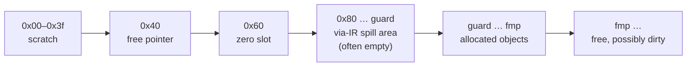

# 3.5 Memory management in assembly

> [!abstract] In one minute
> - In assembly **you are the allocator**. Read the free pointer with `mload(0x40)`, use the bytes from there, then bump it with `mstore(0x40, newEnd)`. Never hard-code `0x80`: via-IR moved it to `0x200` in a contract that spills locals.
> - Round sizes up with `and(add(n, 31), not(31))`. Via-IR always keeps the pointer aligned. The **legacy pipeline does not**: after `abi.encodePacked(uint8, uint16)` the pointer was `0xa3`. Never round the pointer *down*.
> - Memory above the pointer is **free but dirty**. Events, return encodings and abandoned allocations leave old words there. Write every byte you later read, padding included.
> - Scratch space `0x00–0x3f` is for data used inside one block (a two-word hash). You may borrow `0x40–0x7f` too, but you must put back the free pointer **and** `mstore(0x60, 0)` before the block ends, unless the block always ends in `return`/`revert`. Every empty dynamic array points at `0x60`.
> - To return dynamic data, either hand a properly allocated `bytes memory` back to Solidity (it re-encodes a second copy), or write the ABI head in place and `return(ptr - 0x20, 0x40 + padded length)`. The second is cheaper, but it ends the whole call, skips modifier code, and returns your padding as is.
> - Bumping the pointer costs nothing; you pay `3·w + w²/512` only when you touch the memory. That is why a builder that **reserves capacity and appends in place with MCOPY** stays linear: 1,000 appends cost 195,683 gas, while a `string.concat` loop ran out of 30,000,000 gas.

**Prerequisites:** [[1.4 Memory]], [[2.4 Memory layout]], [[3.2 Syntax and control flow]], [[3.4 Interop with Solidity]] · **Leads to:** [[3.7 External calls in assembly]], [[3.8 ABI, errors and events by hand]], [[3.9 Cleanup, dirty bits and safety]], [[4.10 Gas optimization]]

## Intuition: you hold the bookmark now

[[2.4 Memory layout]] described Solidity's memory as a notebook with a bookmark. The first four lines are reserved (scratch paper, the bookmark, a line that must read zero), and every new object goes on the first blank page, after which the bookmark moves forward and never back. Solidity does all of that for you. Inside an `assembly` block it does none of it. The block can write anywhere, and the compiler simply trusts that you followed the same rules.

So assembly memory management is a contract between you and the compiler:

1. **Find free space** by reading the bookmark: `mload(0x40)`.
2. **Claim it** by moving the bookmark past what you need: `mstore(0x40, add(p, size))`. If you do not claim it, it is only yours until the next Solidity statement.
3. **Do not trust what is written there.** Free pages are not blank pages.
4. **Leave the reserved lines as you found them.** The bookmark must be sane and line 4 (`0x60`) must read zero whenever Solidity code runs again.

The raw machine side (how MLOAD and MSTORE work, what memory expansion costs, why `msize` is special) is in [[1.4 Memory]]. The byte layout of arrays, `bytes` and structs is in [[2.4 Memory layout]]. How assembly sees Solidity variables, and the exact wording of the `memory-safe` promise, is in [[3.4 Interop with Solidity]]. This note is about the patterns: allocate, borrow, return and build.



| Region | Who owns it | What assembly may do |
|---|---|---|
| `0x00–0x3f` | Nobody, between statements | Write and read within one block. Never expect it to survive a Solidity statement |
| `0x40` free pointer | Solidity's allocator | Read it. Write it only to bump forward, or to restore a saved value |
| `0x60` zero slot | Every empty dynamic array | Write it only if you restore 0 before Solidity runs again |
| `0x80` up to the guard | Via-IR's spilled variables | Nothing. You cannot even see where it ends except by reading `mload(0x40)` at the start |
| Below the free pointer | Live Solidity objects and your allocations | Only objects you hold a pointer to, within their bounds |
| From the free pointer up | Free | Temporary use without a bump; claim it with a bump if it must outlive the block |

## Reading the free pointer: never assume `0x80`

Every contract starts by setting the free pointer. Legacy runtime code begins `6080604052` (`PUSH1 0x80 PUSH1 0x40 MSTORE`). An unspilled via-IR build begins `608080604052` (`PUSH1 0x80 DUP1 PUSH1 0x40 MSTORE`, keeping a copy of `0x80` on the stack). A function that just reads `mload(0x40)` returned `0x80` on both pipelines.

Via-IR can change that. When a function needs more live values than DUP and SWAP can reach, the via-IR code generator moves some of them into memory. It reserves that memory with the Yul builtin `memoryguard`: the IR initialises the pointer with `mstore(64, memoryguard(128))`, and the optimizer replaces `memoryguard(128)` with the end of the reserved area. ([[3.11 Compiler IR and the optimizer]] covers the mechanism. [[2.4 Memory layout]] has a second measurement.)

I compiled a contract with one function holding 24 simultaneously live `uint256` locals (each a `keccak256`, combined with XOR at the end) and a second function that reports `mload(0x40)`:

| Build | Result | Runtime prefix | `startFmp()` |
|---|---|---|---|
| Legacy, optimizer on | `CompilerError: Stack too deep. Try compiling with --via-ir …` | — | — |
| Via-IR, optimizer on, all assembly `memory-safe` | Compiles. `irOptimized` contains `memoryguard(0x0200)` | `61020080604052` (`PUSH2 0x0200 DUP1 PUSH1 0x40 MSTORE`) | **`0x200`** |
| Via-IR, optimizer on, the one-line `p := mload(0x40)` block **not** annotated | `YulException: Cannot swap Variable _11 with Variable _62: too deep in the stack by 1 slots …` and the hint `No memoryguard was present. Consider using memory-safe assembly only and annotating it via 'assembly ("memory-safe")'` | — | — |

Three lessons for assembly writers:

- **The spill area is invisible.** `0x80–0x1ff` belongs to the compiler for the whole call, in every function, even ones that spill nothing (the pointer is set once, in the dispatcher). Assembly that writes at `0x80` "because the heap starts there" overwrites spilled locals.
- **The only correct start is `mload(0x40)`.** Read it at the start of the block and work from there.
- **One unannotated block that touches memory switches spilling off for the whole contract.** The compiler cannot prove an unannotated block leaves the spill area alone, so it refuses to spill at all, and the contract no longer compiles. That is why the `memory-safe` annotation matters, and why it must be *true* (see [[#The memory-safe promise in one page]]).

## Allocating: read, bump, initialise

A complete allocation in assembly is two instructions:

```solidity
// SPDX-License-Identifier: MIT
pragma solidity 0.8.38;

library Alloc64 {
    /// Claim 64 bytes. Returns their start. The contents are NOT zeroed.
    function alloc64() internal pure returns (uint256 p) {
        assembly ("memory-safe") {
            p := mload(0x40)            // first free byte
            mstore(0x40, add(p, 0x40))  // bump: [p, p + 64) is now ours
        }
    }
}
```

Calling it twice in a fresh call returned `0x80` and `0xc0`, and the pointer ended at `0x100`, on both pipelines. Memory state after the two calls:

```text
0x0040: 0000000000000000000000000000000000000000000000000000000000000100  free pointer
0x0080: ................................................................  first 64-byte block (not initialised)
0x00c0: ................................................................  second 64-byte block
```

Nothing else is needed. There is no `free`, no header and no size record. Inside one block the order of "bump" and "write" does not matter, because nothing else can run in between. Across a function boundary it does: a helper that writes first and leaves the bump to its caller hands out memory that any allocation in between will reuse. Bump in the same place you read the pointer.

### Round to whole words

A `bytes` of length `n` needs `32 + n` bytes, but you should claim `32 + roundup32(n)`. The standard idiom:

```solidity
// SPDX-License-Identifier: MIT
pragma solidity 0.8.38;

library Round {
    function roundUp32(uint256 n) internal pure returns (uint256 r) {
        assembly ("memory-safe") {
            r := and(add(n, 31), not(31))   // add 31, then clear the low 5 bits
        }
    }
}
```

`not(31)` is `0xff…ffe0`, a mask that clears the low five bits. Adding 31 first turns "round down" into "round up": 0 → 0, 1 → 32, 31 → 32, 32 → 32, 33 → 64. Overflow is not a concern because `n` is a memory size, and memory sizes far below `2^64` already cost more gas than exists in a block.

Why bother? Unaligned memory is legal for the EVM: MLOAD and MSTORE accept any offset. But every Solidity allocation after yours starts where you left the pointer, and every word access then straddles two words. More importantly, other assembly (including libraries you did not write) often assumes alignment.

### Does Solidity keep the pointer aligned? Not always

I checked what each allocation does to the pointer, starting from `0x80` (solc 0.8.38, optimizer on and off gave the same result):

| Allocation | Legacy: pointer after | Via-IR: pointer after |
|---|---|---|
| `new bytes(5)` | `0xc0` | `0xc0` |
| `string memory s = "abc"` | `0xc0` | `0xc0` |
| `abi.encodePacked(uint8(1), uint16(2))` (3 bytes) | **`0xa3`** | `0xc0` |
| `bytes.concat(x, hex"01")` with a 2-byte `x` | **`0xe3`** (from `0xc0`) | `0x100` |
| `string.concat(x, "z")` with a 2-byte `x` | **`0xe3`** (from `0xc0`) | `0x100` |
| then `new uint256[](1)` after the packed encoding | array at **`0xa3`** | array at `0xc0` |

So the legacy pipeline's packed encoders (`abi.encodePacked`, `bytes.concat`, `string.concat`) bump the pointer by exactly `32 + length`, and the next Solidity allocation inherits the misalignment. `new`, literals and `abi.encode` are rounded on both pipelines. If assembly deliberately misaligns the pointer (I stored `0x85`), both pipelines happily allocate the next `new uint256[](1)` at `0x85`. Solidity never repairs alignment.

The consequence for assembly: **if you need an aligned start, round the pointer up, never down.**

```solidity
// SPDX-License-Identifier: MIT
pragma solidity 0.8.38;

contract AlignDemo {
    /// Rounding DOWN after a legacy packed encoding overlaps live data.
    function alignDown() external pure returns (bytes memory b, uint256 fmp) {
        b = abi.encodePacked(uint8(0x11), uint16(0x2233));
        assembly {
            fmp := mload(0x40)
            let p := and(fmp, not(31))            // WRONG: 0xa3 -> 0xa0, inside b
            mstore(p, 0)
            mstore(0x40, add(p, 0x20))
        }
    }

    function alignUp() external pure returns (bytes memory b, uint256 fmp) {
        b = abi.encodePacked(uint8(0x11), uint16(0x2233));
        assembly {
            fmp := mload(0x40)
            let p := and(add(fmp, 31), not(31))   // right: 0xa3 -> 0xc0
            mstore(p, 0)
            mstore(0x40, add(p, 0x20))
        }
    }
}
```

Under legacy, `alignDown()` returned `b = 0x000000` (its three data bytes zeroed), `alignUp()` returned `0x112233`. Under via-IR both returned `0x112233`, because the pointer was already `0xc0`. A bug that only appears on one pipeline is exactly the kind that survives testing.

### Free memory is dirty

The docs say it directly: "There is no guarantee that the memory has not been used before and thus you cannot assume that its contents are zero bytes." Solidity knows this and zero-fills every `new` array itself. Your allocator must do the same for anything it will read.

Two ordinary ways stale data ends up above the pointer, both reproduced on both pipelines. The helper `_rawArray(3)` allocates a `uint256[]` of length 3 in assembly and **does not** zero the elements:

```solidity
// SPDX-License-Identifier: MIT
pragma solidity 0.8.38;

contract Stale {
    event Three(uint256 a, uint256 b, uint256 c);

    /// Allocates n words WITHOUT zeroing them (the bug under test).
    function _rawArray(uint256 n) private pure returns (uint256[] memory a) {
        assembly ("memory-safe") {
            a := mload(0x40)
            mstore(a, n)
            mstore(0x40, add(a, shl(5, add(n, 1))))
        }
    }

    /// Case 1: an event's data is encoded above the free pointer, never bumped.
    function afterEvent() external returns (uint256 fmp, uint256[] memory a) {
        emit Three(0xaaaa, 0xbbbb, 0xcccc);
        assembly { fmp := mload(0x40) }
        a = _rawArray(3);
    }

    /// Case 2: an abi.encode allocation is abandoned by rewinding the pointer.
    function afterRewind() external pure returns (uint256 fmp, uint256[] memory a) {
        uint256 saved;
        assembly ("memory-safe") { saved := mload(0x40) }
        bytes memory e = abi.encode(uint256(0x1111), uint256(0x2222));
        e; // unused on purpose
        assembly ("memory-safe") { mstore(0x40, saved) }
        assembly { fmp := mload(0x40) }
        a = _rawArray(3);
    }

    /// Same as case 2 with Solidity's allocator, which zero-fills.
    function afterRewindNew() external pure returns (uint256[] memory a) {
        uint256 saved;
        assembly ("memory-safe") { saved := mload(0x40) }
        bytes memory e = abi.encode(uint256(0x1111), uint256(0x2222));
        e;
        assembly ("memory-safe") { mstore(0x40, saved) }
        a = new uint256[](3);
    }
}
```

| Function | Free pointer seen | Elements of the "new" array |
|---|---|---|
| `afterEvent()` | `0x80` | `[0xbbbb, 0xcccc, 0]` |
| `afterRewind()` | `0x80` | `[0x1111, 0x2222, 0]` |
| `afterRewindNew()` | — | `[0, 0, 0]` |

In both buggy cases the free pointer still read `0x80`. Solidity had written the event data (`0xaaaa`, `0xbbbb`, `0xcccc`) at `0x80–0xdf` without bumping, and in case 2 the abandoned encoding (length `0x40`, then the two words) sat at `0x80–0xdf`. The raw array's length word overwrote the first stale word, and the elements inherited the rest.

Rules that follow:

- **Initialise what you read.** If your allocation is a struct, an array or a buffer you will hash, write every word first.
- **Zero cheaply when you must.** `calldatacopy(dst, calldatasize(), size)` copies from past the end of calldata, which reads as zeros, at 3 gas per word with no loop. (A word loop costs far more; see the copying section below.)
- **Clean the padding of `bytes`/`string`.** Solidity's ABI encoder re-pads when *it* encodes, so dirty padding is invisible to Solidity callers. It is not invisible to `keccak256` over whole words, to code that compares words, or to the direct-return idiom below.
- **Never use "fresh memory is zero" tricks.** Older code used `msize()` as "the first never-touched byte, guaranteed zero". With the optimizer on, `msize` is a compile error in inline assembly (both pipelines, solc 0.8.38): `SyntaxError: The msize instruction cannot be used when the Yul optimizer is activated because it can change its semantics. Either disable the Yul optimizer or do not use the instruction.` [[1.4 Memory]] explains why. Use the free pointer.

### What a bump costs: nothing, until you touch it

Moving the pointer is one MLOAD, an ADD and an MSTORE. Memory expansion is charged only when an opcode actually touches bytes past the current size. I measured both halves inside one block (legacy, optimizer on; gas read with `gas()` around the block):

| Bytes reserved `n` | Bump only | Bump + write the last word | Difference | Formula `C(0x80 + n) − C(0x80)` |
|---|---|---|---|---|
| 32 | 38 | 71 | 33 | 3 |
| 1,024 | 38 | 166 | 128 | 98 |
| 32,768 | 38 | 5,204 | 5,166 | 5,136 |
| 1,048,576 | 38 | 2,196,036 | 2,195,998 | 2,195,968 |

`C(bytes) = 3·w + ⌊w²/512⌋` with `w = ⌈bytes/32⌉`, as in [[1.4 Memory]]. The difference column is the formula plus a constant 30 gas for the extra PUSH/SUB/MSTORE instructions, at every size. So:

- Reserving a large capacity you might not use is **free**. You only pay for what you write. The string builder at the end of this note relies on this.
- The price of a word depends on how big memory already is. A word added when memory is already 1 MiB (32,768 words) costs about 3 + 2·32,768/512 = 131 gas, not 3. Allocations late in a memory-heavy call are expensive, and so is touching temporary memory far above the pointer.

## Scratch space `0x00–0x3f`

The first 64 bytes are scratch space: "can be used as 'scratch space' for short-term allocation" in the docs' words. The compiler uses it the same way: for `keccak256` of mapping keys, and other two-word temporaries. It belongs to nobody between statements.

The classic use is hashing two words without allocating:

```solidity
// SPDX-License-Identifier: MIT
pragma solidity 0.8.38;

library ScratchHash {
    /// keccak256(abi.encode(a, b)) in scratch space. Touches only 0x00-0x3f.
    function hash2(bytes32 a, bytes32 b) internal pure returns (bytes32 h) {
        assembly ("memory-safe") {
            mstore(0x00, a)
            mstore(0x20, b)
            h := keccak256(0x00, 0x40)
        }
    }
}
```

Stack and memory for `hash2(0x0101…01, 0x0202…02)`:

```text
op                       stack (top first)            memory 0x00 / 0x20
mstore(0x00, a)          –                            0101…01 / 0000…00
mstore(0x20, b)          –                            0101…01 / 0202…02
keccak256(0x00, 0x40)    346d8c96a2454213…            unchanged
```

Compared with `keccak256(abi.encode(a, b))` in a fresh call (execution gas, py-evm, optimizer on):

| Version | Legacy gas | Via-IR gas | Free pointer before → after | Memory size at the end |
|---|---|---|---|---|
| `hash2` (scratch) | 420 | 325 | `0x80` → `0x80` | 224 bytes |
| `keccak256(abi.encode(a, b))` | 564 | 470 | `0x80` → `0xe0` | 320 bytes |

The plain Solidity version allocated a 96-byte `bytes` (length plus two words) and never released it. In a loop that is the leak measured in [[2.4 Memory layout]]; the scratch version costs a flat 120 gas per iteration there.

What makes scratch use safe is that the data is **consumed within the same block**. Two failures to avoid:

- Writing scratch in one assembly block and reading it in another, with Solidity code between them. Any statement may hash a mapping key or otherwise use `0x00–0x3f`.
- Relying on the compiler to keep a scratch write that the same block never reads. That is exactly what solc 0.8.13 and 0.8.14 got wrong (see the incident below).

> [!warning] Incident: InlineAssemblyMemorySideEffects (0.8.13–0.8.14)
> 0.8.13 added a Yul optimizer step that removes memory writes that are never read. In the legacy pipeline, the Yul optimizer sees each inline assembly block **on its own** (when the block does not use Solidity locals), so a write that is read by a *later* block looked dead and was deleted. Medium severity, fixed in 0.8.15. Via-IR was not affected, because there the whole program is optimised as one Yul unit. I reproduced the blog's example with solc-js 0.8.14 (`--optimize`, `evmVersion` london):
> ```solidity
> // SPDX-License-Identifier: MIT
> pragma solidity >=0.8.13;
>
> contract C {
>     function f() external pure returns (uint256 x) {
>         assembly { mstore(0, 0x42) }
>         assembly { x := mload(0) }
>     }
> }
> ```
> 0.8.14 returned `0`. 0.8.38 returns `0x42`. The deeper lesson is the one this section teaches: do not carry scratch data across block boundaries, even when it seems to work.

## Temporary memory above the free pointer

When the temporary data does not fit in 64 bytes, use the memory **at** the free pointer without bumping it. The docs list "temporary memory that is located after the value of the free memory pointer" as allowed in a `memory-safe` block. Solidity itself does this for event data, return encodings and external call arguments, which is precisely why that memory is dirty.

```solidity
// SPDX-License-Identifier: MIT
pragma solidity 0.8.38;

library TempHash {
    /// keccak256(abi.encode(a, b, c, d)) using memory above the free pointer.
    function hash4(bytes32 a, bytes32 b, bytes32 c, bytes32 d) internal pure returns (bytes32 h) {
        assembly ("memory-safe") {
            let m := mload(0x40)     // free, possibly dirty: we overwrite all 128 bytes
            mstore(m, a)
            mstore(add(m, 0x20), b)
            mstore(add(m, 0x40), c)
            mstore(add(m, 0x60), d)
            h := keccak256(m, 0x80)  // consumed here; the pointer is NOT bumped
        }
    }
}
```

This is safe because nothing can allocate between the writes and the hash. The data is dead the moment the block ends. It has one hidden cost: the words at `m` may lie past the current memory size, so the first use pays expansion at whatever size memory has reached. That cost is what the next pattern avoids.

## Borrowing `0x40–0x7f`: the save-and-restore pattern

Three or four words can also be laid out in the first 128 bytes, `0x00–0x7f`, which already exist in every frame. That overwrites the free pointer and the zero slot, so they must be put back. The docs' "Advanced Safe Use of Memory" permits memory up to `0x80` in a `memory-safe` block if, quoting, "the free memory pointer at offset `0x40` is restored to a sane value" and "the memory word at offset `0x60` is restored to a value of zero", **or** if "the assembly block terminates, i.e. execution can never return to high-level Solidity code".

Solady's `ECDSA.recover` uses exactly this shape for the four-word ecrecover input: it caches the pointer (`let m := mload(0x40) // Cache the free memory pointer.`), lays out hash, v, r, s at `0x00–0x7f`, calls the precompile, then ends with `mstore(0x60, 0) // Restore the zero slot.` and `mstore(0x40, m) // Restore the free memory pointer.`

The same pattern for a four-word hash, plus a broken copy that forgets the zero slot:

```solidity
// SPDX-License-Identifier: MIT
pragma solidity 0.8.38;

library LowMemHash {
    /// Borrow 0x00-0x7f, then restore the free pointer and the zero slot.
    function hash4(bytes32 a, bytes32 b, bytes32 c, bytes32 d) internal pure returns (bytes32 h) {
        assembly ("memory-safe") {
            let m := mload(0x40)     // cache the free memory pointer
            mstore(0x00, a)
            mstore(0x20, b)
            mstore(0x40, c)          // overwrites the free memory pointer
            mstore(0x60, d)          // overwrites the zero slot
            h := keccak256(0x00, 0x80)
            mstore(0x40, m)          // restore the free memory pointer
            mstore(0x60, 0)          // restore the zero slot
        }
    }

    /// The same, but the author forgot the zero slot. Do not use.
    function hash4Broken(bytes32 a, bytes32 b, bytes32 c, bytes32 d) internal pure returns (bytes32 h) {
        assembly ("memory-safe") {
            let m := mload(0x40)
            mstore(0x00, a)
            mstore(0x20, b)
            mstore(0x40, c)
            mstore(0x60, d)
            h := keccak256(0x00, 0x80)
            mstore(0x40, m)
        }
    }
}
```

Memory during and after `hash4(1, 2, 3, 4)`:

```text
                    inside the block, before keccak     after the block
0x0000              ...0001                              ...0001   (scratch: leftovers are fine)
0x0020              ...0002                              ...0002
0x0040              ...0003   (free pointer gone!)       ...0080   restored
0x0060              ...0004   (zero slot dirty!)         ...0000   restored
```

After `hash4Broken(1, 2, 3, 4)`, a fresh `uint256[] memory e;` reported **`e.length == 4`** on both pipelines. The hash itself was right. The damage shows up later, in code that never touched assembly.

Is it worth it? Measured execution gas (legacy, optimizer on):

| Scenario | `keccak256(abi.encode(a,b,c,d))` | Temp memory at the free pointer | Borrow `0x00–0x7f` |
|---|---|---|---|
| Loop of 1 | 573 | 471 | 549 |
| Loop of 100 | 27,504 | 18,093 | 18,072 |
| Loop of 1,000 | 316,231 | 178,293 | 177,372 |
| One hash, after a 1 MiB allocation (gas of the hash alone) | — | 613 | **41** |
| One hash, after a 32 KiB allocation | — | 117 | 41 |

Via-IR had the same shape (1,000 iterations: 313,171 / 173,221 / 173,309; after 1 MiB: 645 vs 34).

Reading it honestly:

- Both assembly versions crush `abi.encode`, which allocates 160 bytes per call.
- **Between the two assembly versions there is almost no difference in a loop.** The temporary words at the free pointer are expanded once and then reused. At one iteration the borrowing version was even slower on legacy (extra save/restore work).
- The borrowing version wins when memory is already large. Touching four fresh words past a 1 MiB heap costs about 570 gas of expansion. The low 128 bytes are always paid for. That is the case Solady optimises: library code that may be called deep inside a memory-heavy function.

## The zero slot at `0x60`

Every **default** dynamic memory value points at `0x60`, so its length reads as 0 without any allocation. Checked in py-evm, both pipelines:

```solidity
// SPDX-License-Identifier: MIT
pragma solidity 0.8.38;

contract ZeroSlot {
    struct S { uint256 a; bytes c; }

    function emptyPointers() external pure
        returns (uint256 pb, uint256 ps, uint256 parr, uint256 pfield, uint256 pNew0)
    {
        bytes memory b;
        string memory s;
        uint256[] memory arr;
        S memory st;
        bytes memory n0 = new bytes(0);
        bytes memory c = st.c;
        assembly { pb := b  ps := s  parr := arr  pfield := c  pNew0 := n0 }
    }
}
```

| Value | Pointer |
|---|---|
| `bytes memory b;` | `0x60` |
| `string memory s;` | `0x60` |
| `uint256[] memory arr;` | `0x60` |
| the `bytes` field of a default struct `S memory st;` | `0x60` |
| `new bytes(0)` | `0xc0` (a real allocation, after `st` at `0x80`) |

Because thousands of variables may share that one word, a write to `0x60` changes all of them at once. I wrote a non-zero value there with a plain `mstore(0x60, v)` and did **not** restore it:

- `mstore(0x60, 5)`, then `bytes memory b; b.length` returned **5**, and `keccak256(b)` hashed five bytes starting at `0x80` (`0xc41589e7…` instead of the empty hash).
- `mstore(0x60, 0x30)`, then `return s;` for an unassigned `string memory s` returned a **48-byte string**: the length word `0x10` and the bytes `"0123456789abcdef"` of another string that happened to live at `0x80`. The "empty" return value leaked unrelated memory to the caller.
- `abi.encode(d)` of a default struct whose `bytes` field points at `0x60` encoded that field as 5 bytes long.

None of these reverted. That is why the restore of `0x60` is not optional, and why "I only need it for one hash" is not an excuse to skip it.

## Returning dynamic data

There are two ways to get a `bytes` built in assembly out of a function.

### Path 1: allocate properly and hand it to Solidity

Allocate the value exactly like Solidity would: length word, data, clean padding, pointer bumped past the rounded size. Then it is an ordinary `bytes memory`. Solidity can hash it, concatenate it, store it or return it.

```solidity
// SPDX-License-Identifier: MIT
pragma solidity 0.8.38;

library Build {
    /// Build a `bytes` of length n in assembly; Solidity can keep using it.
    /// Word i of the data is the byte (i + 1) repeated, truncated to n bytes.
    function build(uint256 n) internal pure returns (bytes memory b) {
        assembly ("memory-safe") {
            b := mload(0x40)
            mstore(b, n)                                   // length word
            let data := add(b, 0x20)
            let size := and(add(n, 31), not(31))           // round up to a whole word
            for { let i := 0 } lt(i, size) { i := add(i, 0x20) } {
                mstore(add(data, i), mul(add(shr(5, i), 1), 0x0101010101010101010101010101010101010101010101010101010101010101))
            }
            // Clean the padding of the last word: zero bytes [n, size).
            if and(n, 31) {
                let last := add(data, sub(size, 0x20))
                let keep := sub(n, sub(size, 0x20))        // data bytes in the last word
                mstore(last, and(mload(last), not(shr(shl(3, keep), not(0)))))
            }
            mstore(0x40, add(data, size))                  // bump past data + padding
        }
    }
}

contract Ret {
    /// Path 1: hand the bytes back to Solidity, which ABI-encodes a second copy.
    function viaSolidity(uint256 n) external pure returns (bytes memory) {
        return Build.build(n);
    }

    /// Path 2: write the ABI head in place and RETURN straight from assembly.
    function viaAssembly(uint256 n) external pure returns (bytes memory) {
        bytes memory b = Build.build(n);
        assembly ("memory-safe") {
            let head := sub(b, 0x20)        // the word just below the length
            mstore(head, 0x20)              // ABI offset of the single bytes value
            // offset word + length word + data rounded up to whole words
            return(head, add(0x40, and(add(mload(b), 31), not(31))))
        }
    }

    /// Solidity keeps using the assembly-built value afterwards.
    function useAfter(uint256 n) external pure
        returns (bytes32 h, uint256 len, bytes memory joined, uint256 bPtr, uint256 nextPtr)
    {
        bytes memory b = Build.build(n);
        bytes memory next = new bytes(1);    // must land after b, not inside it
        h = keccak256(b);
        len = b.length;
        joined = bytes.concat(b, hex"ff");
        assembly { bPtr := b  nextPtr := next }
    }
}
```

The mask in the padding step: `shr(8·keep, not(0))` is a word whose low `32 − keep` bytes are `ff`. Its `not` keeps the high `keep` bytes, which are the data.

When an external function returns this value, Solidity ABI-encodes it **a second time**, at the free pointer, without bumping. Memory after `viaSolidity(40)` (legacy):

```text
0x0040: 00000000000000000000000000000000000000000000000000000000000000e0  free pointer
0x0060: 0000000000000000000000000000000000000000000000000000000000000000  zero slot
0x0080: 0000000000000000000000000000000000000000000000000000000000000028  b.length = 40
0x00a0: 0101010101010101010101010101010101010101010101010101010101010101  b data
0x00c0: 0202020202020202000000000000000000000000000000000000000000000000  b data + clean padding
0x00e0: 0000000000000000000000000000000000000000000000000000000000000020  encoder: offset
0x0100: 0000000000000000000000000000000000000000000000000000000000000028  encoder: length
0x0120: 0101010101010101010101010101010101010101010101010101010101010101  encoder: data copy
0x0140: 0202020202020202000000000000000000000000000000000000000000000000
0x0160: 0000000000000000000000000000000000000000000000000000000000000000  touched by the encoder, past the returned region
```

### Path 2: write the ABI head in place and return from assembly

The ABI encoding of a single `bytes` return value is `[offset 0x20][length][data, padded]`. The value already *is* `[length][data, padded]`. Only the offset word is missing, and it goes in the 32 bytes just below the value:

```yul
// the assembly block of viaAssembly() in the file above
let head := sub(b, 0x20)        // the word just below the length
mstore(head, 0x20)              // ABI offset of the single bytes value
// offset word + length word + data rounded up to whole words
return(head, add(0x40, and(add(mload(b), 31), not(31))))
```

The word below `b` belongs to someone else: here `b` was `0x80`, so the head landed on the zero slot, which held `0x20` at the end. That is acceptable only because `return` **terminates the call**: no Solidity code can ever observe the damage. This is the "terminates" clause of the docs' rule, and Solady's direct-return helpers rely on the same reasoning.

```text
memory after viaAssembly(40), legacy
0x0040: ...00e0   free pointer
0x0060: ...0020   ABI offset written over the zero slot (harmless: we RETURN next)
0x0080: ...0028   length            <- RETURN(0x60, 0x80) starts at 0x60
0x00a0: 0101…01
0x00c0: 0202020202020202000…
```

The returndata of the two paths was byte-identical for every length I tried (0, 5, 32, 33, 1,000, 10,000). The cost (execution gas; memory size at the end):

| Length | Path 1 legacy | Path 2 legacy | Path 1 via-IR | Path 2 via-IR | Memory, path 1 → path 2 |
|---|---|---|---|---|---|
| 0 | 589 | 417 | 440 | 349 | 256 → 160 B |
| 33 | 834 | 650 | 701 | 598 | 384 → 224 B |
| 1,000 | 3,544 | 3,172 | 3,531 | 3,240 | 2,304 → 1,184 B |
| 10,000 | 29,609 | 26,971 | 30,720 | 28,163 | 20,288 → 10,176 B |

Path 2 saves about 90–180 gas of fixed overhead plus the second copy (2,638 gas at 10,000 bytes on legacy), and halves the memory. The trade-offs are real, though:

| Concern | Path 1 (return to Solidity) | Path 2 (`return` from assembly) |
|---|---|---|
| Padding | Re-padded by the encoder | Returned exactly as it sits in memory |
| Code after the call site | Runs (modifiers' post-`_` code, later statements) | **Skipped**. The whole call ends |
| Multiple return values or nested types | Automatic | You write the full head/tail encoding ([[3.8 ABI, errors and events by hand]]) |
| Reviewability | Obvious | Needs a comment and a test |

Two of those rows I tested because they bite in practice.

**Dirty padding is returned verbatim.** I emitted an event with two `0xff…ff` words (leaving them above the pointer), then built `"hello"` with five `mstore8`s and did not clean the padding. Path 1 returned the data word `68656c6c6f000000…`. Path 2 returned `68656c6c6fffffffff…ff`. Strict ABI decoders, signature schemes that hash returned words and cross-chain message formats may reject or misread that.

**Modifiers do not finish.** A `nonReentrant` modifier written as `locked = 2; _; locked = 1;` around a function that returns from assembly left `locked == 2` in storage after a *successful* call. Every later `nonReentrant` call reverted with `"reentrant"`: the contract was bricked, on both pipelines. `return` inside assembly is not Solidity's `return`; [[3.4 Interop with Solidity]] covers `return` vs `leave` in detail.

> [!tip] When to use which
> Use path 1 by default. Use path 2 in forwarders whose whole job is to relay bytes (proxies, multicall, routers), in functions without post-`_` modifier code, and when the value was built with clean padding. Forwarding returndata from a call is the most common case; it is shown in [[3.7 External calls in assembly]].

## Copying memory: MCOPY, loops and the identity precompile

Building values in assembly usually means copying bytes from one place in memory to another. [[1.4 Memory]] measured the three methods opcode against opcode (MCOPY `3 + 3·words`; identity precompile about 122 gas more per call; a word loop about 52 gas per word). Here is the same comparison as complete `bytes` clone functions, each including a fresh aligned allocation:

```solidity
// SPDX-License-Identifier: MIT
pragma solidity 0.8.38;

library CopyLib {
    /// Allocate a bytes of the same length as src; returns (dst, dstData, srcData, len).
    function _prep(bytes memory src) private pure returns (bytes memory dst, uint256 d, uint256 s, uint256 len) {
        assembly ("memory-safe") {
            len := mload(src)
            dst := mload(0x40)
            mstore(dst, len)
            d := add(dst, 0x20)
            s := add(src, 0x20)
            mstore(0x40, add(d, and(add(len, 31), not(31))))
        }
    }

    /// Cancun and later.
    function withMcopy(bytes memory src) internal pure returns (bytes memory dst) {
        uint256 d; uint256 s; uint256 len;
        (dst, d, s, len) = _prep(src);
        assembly ("memory-safe") { mcopy(d, s, len) }
    }

    /// Word loop: copies whole words, so it also copies up to 31 bytes of src padding.
    function withLoop(bytes memory src) internal pure returns (bytes memory dst) {
        uint256 d; uint256 s; uint256 len;
        (dst, d, s, len) = _prep(src);
        assembly ("memory-safe") {
            for { let i := 0 } lt(i, len) { i := add(i, 0x20) } {
                mstore(add(d, i), mload(add(s, i)))
            }
        }
    }

    /// Pre-Cancun fallback: STATICCALL to the identity precompile at 0x04.
    function withIdentity(bytes memory src) internal view returns (bytes memory dst) {
        uint256 d; uint256 s; uint256 len;
        (dst, d, s, len) = _prep(src);
        assembly ("memory-safe") {
            if iszero(staticcall(gas(), 0x04, s, len, d, len)) { revert(0, 0) }
        }
    }
}
```

Extra execution gas over a baseline that only builds the source (py-evm, Prague rules, optimizer on). Every result was checked against `keccak256` of the source:

| Size | MCOPY (via-IR) | Loop (via-IR) | Identity (via-IR) | `bytes.concat(s)` (via-IR) | MCOPY (legacy) | Loop (legacy) | Identity (legacy) |
|---|---|---|---|---|---|---|---|
| 32 B | **89** | 176 | 198 | 247 | 206 | 245 | 274 |
| 256 B | **132** | 653 | 241 | 290 | 249 | 736 | 317 |
| 1 KiB | **282** | 2,291 | 391 | 440 | 399 | 2,422 | 467 |
| 4 KiB | **951** | 8,912 | 1,060 | 1,109 | 1,068 | 9,235 | 1,136 |

- **MCOPY wins at every size**, and the gap to the identity precompile is a constant (109 gas here under via-IR; 1.4's isolated measurement is 122). The legacy columns carry about 60–120 gas of extra stack shuffling around the library call, which is codegen noise, not the copy.
- **The word loop is linear but slow**: about 9 times MCOPY at 4 KiB. It also needs care: it copies whole words, so the destination's padding inherits the source's padding (fine only if the source is clean), and it is wrong for overlapping regions where MCOPY is not.
- **Solidity's own `bytes.concat` emits MCOPY** (I found opcode `0x5e` in the runtime with `evmVersion` prague). It was 33 gas cheaper than the hand-written library on legacy and 158 gas dearer on via-IR. For a plain copy, the high-level code is good enough. Hand-written copies pay off inside builders, where you copy into the *middle* of an existing buffer, which Solidity cannot express.
- **Use identity only without MCOPY** (`evmVersion` below cancun, or a chain that lags). It also overwrites the returndata buffer, which matters if you were about to forward an earlier call's returndata.

## Leaks in loops, and reusing memory

Solidity never frees memory, so every allocation inside a loop stays counted for the rest of the call. [[2.4 Memory layout]] measured the classic leak (`acc = keccak256(abi.encode(acc, i))`): 11,233,020 gas at 20,000 iterations, against 2,400,342 for the scratch-space version, with the leaky curve growing quadratically. That note also tabulates when each reuse technique is safe. In assembly, the four reuse tools are:

| Tool | Assembly form | Correct when |
|---|---|---|
| Scratch space | `mstore(0x00, …) mstore(0x20, …)` then consume | ≤ 64 bytes, consumed in the same block |
| Temporary memory | write at `mload(0x40)` without bumping | consumed in the same block |
| One buffer, reused | allocate once before the loop, overwrite each iteration | nothing keeps a pointer to an old iteration's contents |
| Rewind | `let s := mload(0x40)` … `mstore(0x40, s)` | no pointer allocated inside the window escapes it |

The rewind is the dangerous one. It turns a leak into aliasing as soon as one pointer escapes: 2.4 shows an array allocated inside the window being overwritten by the next allocation (42 became 7, no error). Use it around code you fully control, and prefer a buffer you allocate once.

String building is the leak most people meet first. Each `s = string.concat(s, part)` allocates a brand-new string holding everything so far, so `n` appends copy and allocate `O(n²)` bytes. With a 10-byte part (legacy, optimizer on):

| Appends | `string.concat` loop | Memory at the end |
|---|---|---|
| 100 | 49,373 gas | 54,016 B |
| 300 | 591,931 gas | 461,408 B |
| 500 | 3,473,470 gas | 1,268,800 B |
| 700 | 12,389,932 gas | 2,476,192 B |
| 1,000 | out of gas (30,000,000 limit) | — |

700 appends of 10 bytes, a 7,000-byte result, already use three quarters of the 16,777,216 per-transaction gas cap. The fix is a builder that allocates once and appends in place, which is the expert question at the end of this note.

## The memory-safe promise in one page

[[3.4 Interop with Solidity]] covers the annotation's syntax and semantics. From the memory-management side, the promise `assembly ("memory-safe")` makes is that the block only touches:

1. memory it allocated with the free pointer (read, bump, use),
2. memory of Solidity objects it holds pointers to, within their bounds,
3. scratch space `0x00–0x3f`,
4. temporary memory at or above the current free pointer, **and**
5. memory below `0x80` only if the free pointer and the zero slot are restored, or the block never returns to Solidity.

Everything in this note is built to fit inside that list. The interview version of the question:

> *"Walk through Solidity's memory layout: scratch space (0x00–0x3f), the free memory pointer at 0x40, and the zero slot at 0x60. When can inline assembly write past the free memory pointer without updating it, and what does the `memory-safe` annotation promise the compiler?"*

A strong answer goes like this. The first 128 bytes are reserved: 64 bytes of scratch, the pointer to the first unallocated byte (starting at `0x80`, or higher under via-IR when variables are spilled), and a word that must stay zero because every default dynamic array points at it. Assembly may write past the free pointer **without** bumping it whenever the data is dead by the time any other code could allocate: hashing three words, encoding a call's arguments, building a revert payload, or anything followed by `return`/`revert`. That is exactly what Solidity does for event data and return encodings. It must bump the pointer as soon as the data has to survive a Solidity statement, because the next allocation starts at the old pointer. The annotation promises that the block stays within the ranges listed above. The via-IR pipeline relies on it: its stack-to-memory mover places spilled variables between `0x80` and the guard, and it only does so if every assembly block in the contract that touches memory is annotated (blocks without memory operations count as safe). I showed above that a single unannotated one-line block turned a compiling contract into "too deep in the stack", and [[2.4 Memory layout]] shows a *false* annotation corrupting spilled locals silently (one run out of gas, another returning wrong values). The compiler does not check the annotation.

The red flag an interviewer listens for is the assumption that **memory above the free pointer is zero**. It is not: events, return encodings and abandoned allocations leave data there (the `Stale` contract above), and the docs say so in as many words.

## Solidity and Yul in practice

All snippets compile with solc 0.8.38 (solc-js, optimizer on, both pipelines, `evmVersion` prague so that py-evm can run them) and were tested in py-evm.

**A small memory toolkit.** Every function bumps by whole words (an aligned pointer stays aligned) and leaves the zero slot at zero:

```solidity
// SPDX-License-Identifier: MIT
pragma solidity 0.8.38;

/// Small, memory-safe building blocks. Every function bumps the free pointer
/// by whole words and leaves the zero slot at zero.
library MemLib {
    /// Reserve `n` bytes (rounded up to whole words). Contents are NOT zeroed.
    function alloc(uint256 n) internal pure returns (uint256 p) {
        assembly ("memory-safe") {
            p := mload(0x40)
            mstore(0x40, add(p, and(add(n, 31), not(31))))
        }
    }

    /// A zero-filled `bytes` of length `n`. CALLDATACOPY from past the end of
    /// calldata writes zeros: 3 gas per word, no loop.
    function zeroedBytes(uint256 n) internal pure returns (bytes memory b) {
        assembly ("memory-safe") {
            b := mload(0x40)
            mstore(b, n)
            let size := and(add(n, 31), not(31))
            calldatacopy(add(b, 0x20), calldatasize(), size)   // reading past calldata yields zeros
            mstore(0x40, add(add(b, 0x20), size))
        }
    }

    /// Save the free pointer (start of a scratch window).
    function save() internal pure returns (uint256 fmp) {
        assembly ("memory-safe") { fmp := mload(0x40) }
    }

    /// Rewind to a saved pointer. Only correct if nothing allocated since `save`
    /// is still referenced.
    function restore(uint256 fmp) internal pure {
        assembly ("memory-safe") { mstore(0x40, fmp) }
    }

    /// keccak256(abi.encode(a, b, c)): borrows 0x00-0x5f, restores the free pointer.
    function hash3(bytes32 a, bytes32 b, bytes32 c) internal pure returns (bytes32 h) {
        assembly ("memory-safe") {
            let m := mload(0x40)
            mstore(0x00, a)
            mstore(0x20, b)
            mstore(0x40, c)
            h := keccak256(0x00, 0x60)
            mstore(0x40, m)
        }
    }

    /// RETURN `b` as the ABI encoding of a single `bytes` value and end the call.
    /// `b` must have clean padding. Skips any code after the call site, modifiers included.
    function returnBytes(bytes memory b) internal pure {
        assembly ("memory-safe") {
            let head := sub(b, 0x20)
            mstore(head, 0x20)
            return(head, add(0x40, and(add(mload(b), 31), not(31))))
        }
    }
}
```

`hash3` touches `0x40` but not `0x60`, so it only restores the pointer. The test contract checked that two `alloc` calls are 32 bytes apart for `n = 5`, that `zeroedBytes(40)` hashes like `new bytes(40)`, that `hash3` matches `keccak256(abi.encode(...))`, that an empty array still has length 0 afterwards, and that `restore` returns the pointer to the saved value.

**Reading what you allocated.** In a `memory-safe` block you may read and write a Solidity object's memory through its pointer, within bounds. Shrinking a `bytes` in place is a one-liner, growing it is not (you would overwrite whatever was allocated after it):

```solidity
// SPDX-License-Identifier: MIT
pragma solidity 0.8.38;

library Truncate {
    function truncate(bytes memory b, uint256 newLen) internal pure {
        require(newLen <= b.length, "grow not allowed");
        assembly ("memory-safe") { mstore(b, newLen) }
    }
}
```

After truncating, the bytes past the new length are still there. They become the new value's padding, so they are dirty. Clean them if the value will be returned from assembly or hashed by word.

**Checking for the spill area in tests.** If a contract is compiled with via-IR, log `mload(0x40)` at the start of one function in a test. If it is not `0x80`, the contract spills, and any hand-written assembly that assumes `0x80` is broken. The value can change with unrelated code changes, so make it a test assertion rather than a one-off check.

## Pitfalls and incidents

> [!warning] Hard-coding `0x80`
> Under via-IR, `0x80` up to the guard is the compiler's spill area: `0x80–0x1ff` in this note's test, `0x80–0x39f` in [[2.4 Memory layout]]. Writing there corrupts locals. Always start from `mload(0x40)`.

> [!warning] Rounding the pointer down
> The legacy pipeline leaves the pointer unaligned after `abi.encodePacked`, `bytes.concat` and `string.concat` (I saw `0xa3` and `0xe3`). `and(mload(0x40), not(31))` then points back inside the last allocation. Under legacy it zeroed the three bytes of `abi.encodePacked(uint8(0x11), uint16(0x2233))`; under via-IR it did nothing wrong. Round up, or do not round at all.

> [!warning] Assuming free memory is zero
> Event data, return encodings and rewound allocations stay above the pointer. A raw assembly array allocated after an `emit` inherited `[0xbbbb, 0xcccc]`. Initialise every word you read, and clean `bytes` padding yourself.

> [!warning] Forgetting the zero slot
> Borrowing `0x60` and restoring only the free pointer made a fresh `uint256[] memory e` report length 4, and an unassigned `string` return 48 bytes of unrelated memory to the caller. Restore with `mstore(0x60, 0)`, or end the block with `return`/`revert`.

> [!warning] Returning from assembly ends the whole call
> `return(p, n)` in assembly skips everything after it: the rest of the function, the caller's code if it was an internal call, and the post-`_` half of every modifier. A `nonReentrant` modifier left its lock set and bricked the contract in my test. Use it only in functions without trailing logic.

> [!warning] Dirty padding through the direct-return idiom
> Solidity's encoder re-pads; your `return(head, …)` does not. I returned `"hello"` with `ffffff…` padding. Some decoders accept that, strict ones do not, and hashes over the returned words differ.

> [!warning] Carrying scratch data across blocks
> Data written in one assembly block and read in another can be clobbered by any Solidity statement in between, and solc 0.8.13–0.8.14 (legacy, optimizer on) even deleted such writes (`InlineAssemblyMemorySideEffects`, medium, fixed in 0.8.15; reproduced above). Keep each scratch use inside one block.

> [!warning] Rewinding past an escaped pointer
> `mstore(0x40, saved)` is only correct if nothing allocated since `saved` is still referenced. Otherwise the next allocation aliases it ([[2.4 Memory layout]] has the reproduction). Builders and caches are the usual escape routes.

> [!warning] A false `memory-safe` label
> The compiler takes the annotation on trust. A block that writes outside the allowed ranges and carries the label can corrupt via-IR's spilled variables, with failures that appear and disappear as unrelated code changes alter what gets spilled. Removing the label is safe but can stop the contract compiling. The only fix is to make the block genuinely memory-safe.

> [!warning] `msize` as an allocator
> `msize()` does not compile in inline assembly with the optimizer on (0.8.38, both pipelines). Code that relied on "everything past `msize` is fresh and zero" must use the free pointer instead, and must not assume zeros.

> [!info]- Deep dive: compiler bugs in this area
> | Fixed in | Bug | Affected |
> |---|---|---|
> | 0.8.37 (Sep 2026) | Via-IR: mutually recursive functions could share a stack-to-memory spill slot, so one overwrote the other | 0.7.2 to 0.8.36, via-IR only |
> | 0.8.37 (Sep 2026) | Legacy: `delete b[i]` on a memory `bytes` cleared 32 bytes instead of one | Up to 0.8.36, legacy only |
> | 0.8.15 (15 Jun 2022) | `InlineAssemblyMemorySideEffects`: the Yul optimizer removed memory writes in an inline assembly block that were only read by a later block | 0.8.13–0.8.14, legacy with optimizer |
>
> All three are "two owners of the same bytes" bugs, the same failure class this note is about. [[2.4 Memory layout]] has the details of the 0.8.37 pair. Check the list of known bugs for your pinned compiler ([[5.13 Toolchain, dependencies and operations]]).

## Question ladder

> [!question]- **B** Allocate 64 bytes of memory correctly.
> Read the free pointer, claim the bytes by moving the pointer past them, and only then use them:
>
> ```solidity
> // SPDX-License-Identifier: MIT
> pragma solidity 0.8.38;
>
> library Alloc64 {
>     function alloc64() internal pure returns (uint256 p) {
>         assembly ("memory-safe") {
>             p := mload(0x40)            // first free byte
>             mstore(0x40, add(p, 0x40))  // [p, p + 64) is now ours
>         }
>     }
> }
> ```
>
> Two calls in a fresh call frame returned `0x80` and `0xc0`, and left the pointer at `0x100` (both pipelines). The block is genuinely `memory-safe`: it only reads and bumps the free pointer.
>
> What separates a correct answer from a lucky one:
> - **Start from `mload(0x40)`, never from `0x80`.** Under via-IR the start can be higher because of spilled variables (`0x200` in this note's test).
> - **Bump before you use.** The order is irrelevant inside one block, but the habit prevents the bug where a helper call between "write" and "bump" reuses the space.
> - **The contents are not zero.** Free memory may hold event data or an abandoned encoding. If you will read before writing, zero it.
> - **Alignment.** 64 is a whole number of words, so an aligned pointer stays aligned. But the starting pointer itself can be unaligned on the legacy pipeline after `abi.encodePacked`/`bytes.concat`/`string.concat`. If you need an aligned block, round the start **up**.
> - **Bumping is free; touching costs.** The expansion price (`3·w + w²/512`) is charged when you write, not when you move the pointer.
>
> The fully defensive version, tested after `abi.encodePacked(uint8(1), uint16(2), "dirty")` (8 bytes): under legacy the pointer was `0xa8`, the function returned the aligned `0xc0` and left the pointer at `0x100`; under via-IR the pointer was already `0xc0`, with the same result.
>
> ```solidity
> // SPDX-License-Identifier: MIT
> pragma solidity 0.8.38;
>
> library Alloc64Zeroed {
>     /// 64 bytes, aligned start even after a legacy packed encoding, zeroed.
>     function alloc64Zeroed() internal pure returns (uint256 p) {
>         assembly ("memory-safe") {
>             p := and(add(mload(0x40), 31), not(31))   // round the start UP
>             mstore(0x40, add(p, 0x40))                // claim [p, p + 64)
>             mstore(p, 0)                              // free memory may be dirty
>             mstore(add(p, 0x20), 0)
>         }
>     }
> }
> ```
>
> And if the 64 bytes are only needed inside the block (a two-word hash), do not allocate at all: use scratch space `0x00–0x3f`.

> [!question]- **I** Return a `bytes` value built in assembly so Solidity can use it afterwards.
> Build it in exactly the shape Solidity uses, so that it is indistinguishable from a `new bytes(n)`:
>
> 1. `b := mload(0x40)`: the value's pointer is the address of its **length word**.
> 2. `mstore(b, n)`: the length in bytes.
> 3. Write the data at `b + 0x20`.
> 4. **Clean the padding**: bytes `n` up to the next multiple of 32 must be zero. Memory above the pointer may be dirty, and assembly consumers (and the direct-return idiom) see whole words.
> 5. `mstore(0x40, add(add(b, 0x20), and(add(n, 31), not(31))))`: bump past the **rounded** size, so the next allocation is aligned and cannot overlap the tail.
> 6. Return `b` through a `bytes memory` return variable.
>
> The `Build.build` library in the section on returning dynamic data does exactly this. I tested that Solidity can keep using it: after `b = Build.build(n)` the function allocated `new bytes(1)`, then computed `keccak256(b)`, `b.length` and `bytes.concat(b, hex"ff")`:
>
> | `n` | `b` | next allocation | `keccak256(b)` | `b.length` | `bytes.concat` |
> |---|---|---|---|---|---|
> | 5 | `0x80` | `0xc0` | matches Python | 5 | correct |
> | 40 | `0x80` | `0xe0` | matches Python | 40 | correct |
>
> The next allocation landed right after the rounded data (`0x80 + 32 + 32` and `0x80 + 32 + 64`), never inside it. Both pipelines gave the same result.
>
> Common wrong answers:
> - **Forgetting the bump.** The value works until the next allocation, which then overwrites it. The function's own return encoding is enough to corrupt it if it is used after.
> - **Bumping by `32 + n` instead of the rounded size.** It works, but leaves the pointer unaligned, and the next MSTORE-based writer may clobber the tail.
> - **Pointing the variable at the data instead of the length word.** `b := add(p, 0x20)` makes Solidity read the first data word as the length.
>
> If the value is the function's only return value and nothing must run afterwards, you can also skip Solidity's re-encoding: `mstore(sub(b, 0x20), 0x20)` then `return(sub(b, 0x20), add(0x40, roundedLen))`. That saved 2,638 gas at 10,000 bytes (legacy) and halved memory, but it ends the whole call, skips modifier code (it bricked a `nonReentrant` modifier in my test) and returns your padding verbatim.

> [!question]- **I** Hash two words using scratch space without touching the free pointer.
> ```solidity
> // SPDX-License-Identifier: MIT
> pragma solidity 0.8.38;
>
> library ScratchHash2 {
>     /// keccak256(abi.encode(a, b)) in scratch space. Touches only 0x00-0x3f.
>     function hash2(bytes32 a, bytes32 b) internal pure returns (bytes32 h) {
>         assembly ("memory-safe") {
>             mstore(0x00, a)
>             mstore(0x20, b)
>             h := keccak256(0x00, 0x40)
>         }
>     }
> }
> ```
>
> Why it is correct: `0x00–0x3f` belongs to nobody between statements; the two words are written and consumed inside one block; nothing else (free pointer, zero slot, heap) is touched; so the `memory-safe` label is true. The result equals `keccak256(abi.encode(a, b))` because `abi.encode` of two 32-byte values is exactly those 64 bytes.
>
> Measured in a fresh call (execution gas, optimizer on): scratch 420 (legacy) / 325 (via-IR), pointer `0x80` before and after; `keccak256(abi.encode(a, b))` 564 / 470, pointer moved to `0xe0` because the encoding was allocated and never released. In a loop, the scratch version is a flat 120 gas per iteration; the allocating one grows quadratically ([[2.4 Memory layout]]).
>
> The most common real use is a mapping slot: `keccak256(abi.encode(key, slot))`. I checked `mappingSlot(bytes32(key), 0)` built this way against a real `mapping(uint256 => uint256)` at slot 0: `sload` at the computed slot returned the stored `0xbeef` on both pipelines. Solidity computes mapping slots with the same scratch-space trick, which is why you can never expect scratch data to survive a Solidity statement.
>
> Follow-ups an interviewer may ask: "What about three words?" Either use temporary memory at `mload(0x40)` without bumping, or borrow `0x40` and restore it (next question). "Can I read the hash inputs back in a later block?" No: any statement in between may overwrite scratch, and solc 0.8.13–0.8.14 even deleted such writes under the legacy optimizer.

> [!question]- **A** When may you temporarily overwrite the free pointer or the zero slot, and what must you restore?
> The docs' "Advanced Safe Use of Memory" rule: inside a `memory-safe` block you may use memory up to (not including) `0x80` if **either**
> - before control returns to Solidity, the free pointer at `0x40` is restored to a sane value **and** the word at `0x60` is restored to zero, **or**
> - the block always terminates (`return`, `revert`, `stop`, `invalid`), so no Solidity code ever runs again.
>
> | Word | Who reads it | What to restore | What breaks if you do not |
> |---|---|---|---|
> | `0x00–0x3f` | Nobody between statements | Nothing | Nothing |
> | `0x40` | Every allocation | The saved pointer (or a higher, aligned one if you mean to allocate) | The next allocation lands at your garbage value: overlap or a huge expansion |
> | `0x60` | Every default dynamic array, struct field and empty return | `mstore(0x60, 0)` | Empty arrays get a length. I measured `e.length == 4`, and an unassigned `string` returning 48 bytes of unrelated memory |
>
> Practical conditions that make the window safe:
> - **Save first.** `let m := mload(0x40)` before the first overwrite.
> - **Stay in one block.** No Solidity statement, internal function call or modifier between overwrite and restore, because any of them may allocate or read an empty array.
> - **Restore on every path out of the block**, including early exits through `leave` in a Yul function. Reverting paths need no restore.
>
> The pattern in use, as Solady's `ECDSA.recover` does for the four-word ecrecover input:
>
> ```solidity
> // SPDX-License-Identifier: MIT
> pragma solidity 0.8.38;
>
> library LowMem {
>     function hash4(bytes32 a, bytes32 b, bytes32 c, bytes32 d) internal pure returns (bytes32 h) {
>         assembly ("memory-safe") {
>             let m := mload(0x40)     // cache the free memory pointer
>             mstore(0x00, a)
>             mstore(0x20, b)
>             mstore(0x40, c)          // free pointer overwritten
>             mstore(0x60, d)          // zero slot overwritten
>             h := keccak256(0x00, 0x80)
>             mstore(0x40, m)          // restore the free memory pointer
>             mstore(0x60, 0)          // restore the zero slot
>         }
>     }
> }
> ```
>
> A variant that only needs `0x40`: the EIP-712 digest `keccak256("\x19\x01" ‖ domainSeparator ‖ structHash)` is 66 bytes, which fits at `0x1e–0x5f`. Only the free pointer must be restored, because `0x60` is never touched:
>
> ```solidity
> // SPDX-License-Identifier: MIT
> pragma solidity 0.8.38;
>
> library Typed {
>     function typedDataHash(bytes32 domainSeparator, bytes32 structHash) internal pure returns (bytes32 d) {
>         assembly ("memory-safe") {
>             let m := mload(0x40)            // save the free pointer
>             mstore(0x00, 0x1901)            // bytes 0x1e, 0x1f = 0x19 0x01
>             mstore(0x20, domainSeparator)
>             mstore(0x40, structHash)        // free pointer overwritten
>             d := keccak256(0x1e, 0x42)
>             mstore(0x40, m)                 // restore it
>         }
>     }
> }
> ```
>
> It matched `keccak256(abi.encodePacked("\x19\x01", a, b))` and left the pointer at `0x80` and `0x60` at zero, on both pipelines.
>
> When is it worth it? In a loop it is not: the 1,000-iteration loop cost 177,372 gas borrowing low memory against 178,293 using temporary memory at the free pointer (legacy). It pays off when memory is already large. After a 1 MiB allocation, one hash cost 613 gas at the free pointer (four fresh words at the expensive end of the quadratic curve) and 41 gas in low memory, which is always paid for. That is the case for library code that may be called from memory-heavy callers.
>
> What the interviewer listens for: naming **both** words, explaining *why* `0x60` matters (the shared empty-array pointer), the "terminating block" exception, and the observation that the gain is about memory expansion, not opcodes.

> [!question]- **E** Write a string builder that appends in place without repeated reallocation.
> **The problem.** `s = string.concat(s, part)` allocates a new string holding everything so far on every iteration. Total bytes allocated and copied are `O(n²)` and, because memory expansion is quadratic in the memory size, gas grows even faster: 700 appends of a 10-byte part cost 12,389,932 gas and 1,000 ran out of 30,000,000 gas.
>
> **The design.** Reserve capacity once, keep the used length in the length word, append with MCOPY into the tail, and grow geometrically when full. Because Solidity's allocator is a bump allocator, a buffer that is still the **newest allocation** can grow in place by just moving the free pointer; otherwise it must move. Memory owned by the builder:
>
> ```text
> buf ->  [ length = bytes used ][ data: cap bytes, multiple of 32 ][ safety word ]
>                                                                    ^ end = buf + 0x20 + cap + 0x20
> in place iff  cap != 0  and  mload(0x40) == end
> ```
>
> The safety word lets the finaliser zero `[len, len + 32)` without ever writing past the allocation.
>
> ```solidity
> // SPDX-License-Identifier: MIT
> pragma solidity 0.8.38;
>
> /// @notice Append-in-place string builder. Requires evmVersion cancun or later (MCOPY).
> /// Memory owned by a builder: [length word][cap bytes of data][one safety word].
> library StringBuilder {
>     struct Builder {
>         bytes buf;    // buf.length = bytes used so far; data follows the length word
>         uint256 cap;  // data bytes reserved after the length word, a multiple of 32
>     }
>
>     /// @dev Reserve room for `capacity` bytes up front. One allocation, no copies.
>     function create(uint256 capacity) internal pure returns (Builder memory sb) {
>         assembly ("memory-safe") {
>             let cap := and(add(capacity, 31), not(31))       // round up to whole words
>             let buf := mload(0x40)
>             mstore(buf, 0)                                    // length = 0 (memory may be dirty)
>             mstore(0x40, add(buf, add(cap, 0x40)))            // length + data + safety word
>             mstore(sb, buf)                                   // sb.buf
>             mstore(add(sb, 0x20), cap)                        // sb.cap
>         }
>     }
>
>     /// @dev Append `s`. Copies only `s`; grows at most O(log n) times.
>     function append(Builder memory sb, string memory s) internal pure {
>         assembly ("memory-safe") {
>             let buf := mload(sb)
>             let len := mload(buf)
>             let n := mload(s)
>             let newLen := add(len, n)
>             let cap := mload(add(sb, 0x20))
>             if gt(newLen, cap) {
>                 // New capacity: at least double, at least newLen, whole words.
>                 let newCap := shl(1, cap)
>                 if lt(newCap, newLen) { newCap := newLen }
>                 newCap := and(add(newCap, 31), not(31))
>                 let fmp := mload(0x40)
>                 switch and(iszero(iszero(cap)), eq(fmp, add(buf, add(cap, 0x40))))
>                 case 1 {
>                     // The buffer is the newest allocation: extend it in place.
>                     mstore(0x40, add(buf, add(newCap, 0x40)))
>                 }
>                 default {
>                     // Something was allocated after us (or cap == 0): move.
>                     mcopy(fmp, buf, add(len, 0x20))           // length word + used bytes
>                     mstore(0x40, add(fmp, add(newCap, 0x40)))
>                     buf := fmp
>                     mstore(sb, buf)
>                 }
>                 mstore(add(sb, 0x20), newCap)
>             }
>             mcopy(add(add(buf, 0x20), len), add(s, 0x20), n)
>             mstore(buf, newLen)
>         }
>     }
>
>     /// @dev Finish: clean the padding, give back unused capacity if possible,
>     /// and reset the builder so later appends cannot alias the result.
>     function toString(Builder memory sb) internal pure returns (string memory out) {
>         assembly ("memory-safe") {
>             out := mload(sb)
>             let len := mload(out)
>             let data := add(out, 0x20)
>             mstore(add(data, len), 0)                         // zero [len, len+32): in bounds thanks to the safety word
>             let cap := mload(add(sb, 0x20))
>             if eq(mload(0x40), add(out, add(cap, 0x40))) {
>                 // We are the newest allocation: shrink to the used size.
>                 mstore(0x40, add(data, and(add(len, 31), not(31))))
>             }
>             mstore(sb, 0x60)                                  // builder is now empty (zero slot)
>             mstore(add(sb, 0x20), 0)
>         }
>     }
> }
>
> contract BuilderTest {
>     using StringBuilder for StringBuilder.Builder;
>
>     function viaConcat(string calldata part, uint256 n) external pure returns (bytes32, uint256, uint256) {
>         string memory p = part;
>         string memory out;
>         for (uint256 i; i < n; ++i) out = string.concat(out, p);
>         return (keccak256(bytes(out)), bytes(out).length, _fmp());
>     }
>
>     function viaPacked(string calldata part, uint256 n) external pure returns (bytes32, uint256, uint256) {
>         string memory p = part;
>         string memory out;
>         for (uint256 i; i < n; ++i) out = string(abi.encodePacked(out, p));
>         return (keccak256(bytes(out)), bytes(out).length, _fmp());
>     }
>
>     function viaBuilder(string calldata part, uint256 n, uint256 initialCap) external pure returns (bytes32, uint256, uint256) {
>         string memory p = part;
>         StringBuilder.Builder memory sb = StringBuilder.create(initialCap);
>         for (uint256 i; i < n; ++i) sb.append(p);
>         string memory out = sb.toString();
>         return (keccak256(bytes(out)), bytes(out).length, _fmp());
>     }
>
>     /// Correctness: mixed lengths, allocations in between (forces the move path),
>     /// returns the string and the 32 bytes after its data (must be zero padding).
>     function mixed(string[] calldata parts, uint256 initialCap, bool interleave)
>         external pure returns (string memory out, bytes32 tailWord)
>     {
>         StringBuilder.Builder memory sb = StringBuilder.create(initialCap);
>         for (uint256 i; i < parts.length; ++i) {
>             sb.append(parts[i]);
>             if (interleave) { bytes memory junk = new bytes(33); junk[0] = 0xff; }
>         }
>         out = sb.toString();
>         assembly ("memory-safe") {
>             let len := mload(out)
>             let last := and(len, not(31))             // start of the last data word
>             tailWord := mload(add(add(out, 0x20), last))
>         }
>         // After toString, appending to the reset builder must not touch `out`.
>         sb.append("XYZ");
>     }
>
>     function _fmp() private pure returns (uint256 p) { assembly { p := mload(0x40) } }
> }
> ```
>
> **Tests** (py-evm, both pipelines, 60 random cases each): 0 to 12 parts with lengths 0, 1, 5, 31, 32, 33, 64 and 100 bytes; initial capacities 0, 1, 31, 32, 64 and 500; with and without a 33-byte allocation between appends (which forces the move path). Every result matched Python's concatenation, the word holding the end of the data had clean zero padding, and appending to the builder after `toString` did not change the returned string.
>
> **Gas**, appending the 10-byte part `"item-0042,"` `n` times (execution gas, legacy, optimizer on; via-IR within about 2%):
>
> | `n` | `string.concat` loop | `abi.encodePacked` loop | Builder, capacity 32 | Builder, exact capacity | Memory: concat → builder |
> |---|---|---|---|---|---|
> | 10 | 4,354 | 4,288 | 3,490 | 3,174 | 1,184 → 512 B |
> | 100 | 49,373 | 49,307 | 21,319 | 20,529 | 54,016 → 1,408 B |
> | 300 | 591,931 | 591,865 | 60,211 | 59,105 | 461,408 → 3,392 B |
> | 1,000 | out of gas | out of gas | 195,683 | 194,261 | — → 10,400 B |
> | 5,000 | out of gas | out of gas | 971,887 | 970,149 | — → 50,400 B |
>
> The builder costs about 194 gas per append at every size: linear. Starting from 32 bytes of capacity costs only about 1,400 gas more than an exact reservation at 1,000 appends, because doubling means about nine growths, all in place here. And the memory column is the same for both capacities: reserved-but-untouched capacity is not paid for, and `toString` gives back the unused tail.
>
> **Trade-offs and failure modes an expert names:**
> - **Amortised `O(1)` appends need geometric growth.** Growing by "just enough" turns every append after the first overflow into a move: back to `O(n²)` copying. Doubling bounds total copying by about `2n` bytes.
> - **In place vs move.** The in-place check is only valid if nothing else owns memory between the buffer and the pointer. If the loop body allocates (number formatting, `abi.encode`), every growth moves. Still amortised linear, but the abandoned buffers leak. Reserve the expected size up front when you can.
> - **`cap == 0` must take the move path.** After `toString` the builder points at the zero slot with capacity 0. Without the `cap != 0` guard, a pointer that happened to equal `0x60 + 0x40` would "extend" the zero slot in place.
> - **Aliasing after finalising.** `toString` returns the buffer itself, without a copy. That is why it resets the builder; otherwise the next append would change the length of a string the caller already holds. Solady's `DynamicBufferLib` makes a different choice: it keeps the buffer usable and documents the aliasing.
> - **Dirty memory.** The buffer's capacity was free memory, so it may hold garbage. Only the used bytes are ever written, so `toString` must clean the padding; the safety word keeps that store in bounds when `len` equals the capacity.
> - **Trimming.** Moving the pointer back to `data + roundup(len)` is only legal because the buffer is the newest allocation (checked) and nothing else points into the given-back tail.
> - **`memory-safe` is honest.** Appends write only inside the claimed capacity, growth writes at or above the free pointer before bumping it, and the finaliser writes only inside the allocation. Nothing below `0x80` is touched.
> - **Requires MCOPY** (`evmVersion` cancun or later). On older targets, use the identity precompile for the copies (about 109–122 gas more per append).
> - **Don't over-engineer small cases.** At 10 appends the builder saves 864 gas (20%). The quadratic term only dominates after a few hundred appends or when the parts are large, or when `n` is attacker-controlled ([[5.7 Denial of service and griefing]]).
>
> **Comparison with Solady's `DynamicBufferLib`.** It stores the capacity in the word *before* the length, multiplied by a prime, so it can tell a real builder from an arbitrary `bytes` passed in (a word that is not a multiple of the prime means "capacity 0"). It grows to roughly double ("Approximately more than double the capacity"), expands in place when "the memory is contiguous", otherwise copies, and "Zeroize[s] the word after the buffer" after each append. Same ideas, a tighter memory layout, and no separate struct.

## Related notes
- [[1.4 Memory]] — the EVM memory model, the expansion formula, MCOPY vs identity at opcode level, and why `msize` blocks the optimizer
- [[2.4 Memory layout]] — the byte layout of arrays, `bytes`, structs and ABI encodings in memory, and the measured loop-leak tables
- [[2.5 ABI encoding and decoding]] — the head/tail encoding that the direct-return idiom writes by hand
- [[3.2 Syntax and control flow]] — the `let`, `for` and `switch` used by every snippet here
- [[3.3 Opcodes by family]] — MLOAD, MSTORE, MSTORE8, MCOPY and KECCAK256 semantics and gas
- [[3.4 Interop with Solidity]] — how assembly sees memory variables, the exact `memory-safe` rules, `return` vs `leave`
- [[3.7 External calls in assembly]] — encoding call arguments in temporary memory and forwarding returndata with the direct-return idiom
- [[3.8 ABI, errors and events by hand]] — encoding multiple and nested return values, revert data and log data in memory
- [[3.9 Cleanup, dirty bits and safety]] — dirty padding and dirty high bits, and the audit checklist for assembly
- [[3.11 Compiler IR and the optimizer]] — `memoryguard`, the stack-to-memory mover and the optimizer steps that remove memory writes
- [[4.10 Gas optimization]] — where allocation patterns show up in real gas budgets
- [[5.7 Denial of service and griefing]] — attacker-controlled loop counts and quadratic memory bills

## Sources
- [Solidity docs: Inline Assembly (Conventions in Solidity, Memory Safety, Advanced Safe Use of Memory)](https://docs.soliditylang.org/en/latest/assembly.html) — free pointer at `0x40`, memory not guaranteed zero, no free mechanism, zero slot "meant to be zero permanently", scratch space, the list of memory a `memory-safe` block may access, restore rules for memory below `0x80`, stack-to-memory moving disabled by unsafe blocks
- [Solidity docs: Layout in Memory](https://docs.soliditylang.org/en/latest/internals/layout_in_memory.html) — reserved regions, initial `0x80`, empty arrays at `0x60`, temporary encodings not bumping the pointer
- [Solidity blog: Inline Assembly Memory Side Effects bug (15 Jun 2022)](https://www.soliditylang.org/blog/2022/06/15/inline-assembly-memory-side-effects-bug/) — affected 0.8.13–0.8.14, legacy with optimizer, removal of writes read only by later blocks, medium severity, the example reproduced here
- [Solidity 0.8.15 release announcement](https://soliditylang.org/blog/2022/06/15/solidity-0.8.15-release-announcement/) — the fix release for that bug
- [Solidity 0.8.38 release](https://github.com/argotorg/solidity/releases/tag/v0.8.38) — the compiler used for every test
- [Solidity 0.8.37 release announcement (forum)](https://forum.soliditylang.org/t/solidity-0-8-37-is-released/3753) — via-IR spill-slot collision and legacy `delete b[i]` bugs
- [EIP-5656: MCOPY](https://eips.ethereum.org/EIPS/eip-5656) — MCOPY semantics and gas
- [Solady `ECDSA.sol`](https://github.com/Vectorized/solady/blob/main/src/utils/ECDSA.sol) — the save/restore pattern ("Cache the free memory pointer", "Restore the zero slot", "Restore the free memory pointer") and scratch-space hashing in `toEthSignedMessageHash`
- [Solady `DynamicBufferLib.sol`](https://github.com/Vectorized/solady/blob/main/src/utils/DynamicBufferLib.sol) — capacity prefix word with prime multiplier, near-doubling growth, in-place expansion when contiguous, safety word, zeroing the word after the buffer
- Local verification: solc-js 0.8.38 (legacy and via-IR, optimizer on and off, `evmVersion` prague) and py-evm (Prague rules) for every pointer value, memory dump, gas figure and compile error in this note; solc-js 0.8.14 (soljson with the 0.8.38 wrapper) for the InlineAssemblyMemorySideEffects reproduction. Gas figures are execution gas only, excluding the 21,000 intrinsic gas and calldata cost, optimizer runs 200
