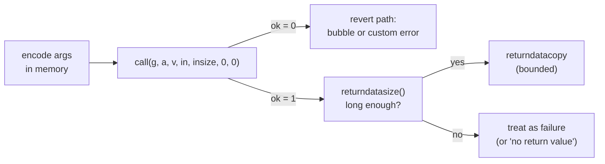

# 3.7 External calls in assembly

> [!abstract] In one minute
> - `call(g, a, v, in, insize, out, outsize)` pushes **1 or 0**. It never reverts by itself, so every call needs an explicit `if iszero(ok) { … }`. A call to an address with **no code returns 1** with empty returndata (measured for `call`, `staticcall` and `delegatecall`).
> - Pass **`out = 0, outsize = 0`** and then read what you need with `returndatasize()` and `returndatacopy`. The output area is only written up to the returned length; shorter returndata leaves **stale bytes** there. A `mload(0)` check without a length check accepted a token address with no code in this note's test.
> - Bubble a revert exactly with `returndatacopy(p, 0, returndatasize())` + `revert(p, returndatasize())`, where `p` is the free pointer. The bytes matched the callee's custom error exactly (`Bad(7, "nope")`, 132 bytes).
> - Solidity's `(bool ok, ) = t.call(d)` **still copies all returndata** in 0.8.38. A callee returning 500,000 bytes made a keeper written that way run out of gas at a 1,000,000 gas limit. The same keeper with an assembly call and output size 0 finished.
> - `gas()` as the gas argument is capped by EIP-150 to **all but 1/64** of what is left (measured: 981,557 of 997,137). The 1/64 your frame keeps is what a griefing relayer exploits. Check `gas() >= reqGas / 63` after the call, or burn everything.
> - Safe ERC-20: accept if the call succeeded **and** (it returned ≥ 32 bytes whose first word is exactly 1, **or** it returned nothing and the target has code). After EIP-7702, "has code" includes a 23-byte delegation indicator, so a delegated EOA with an empty fallback passes Solady's, OpenZeppelin's and this note's checks.

**Prerequisites:** [[1.7 Message calls and precompiles]], [[1.6 Calldata, returndata and logs]], [[3.3 Opcodes by family]], [[3.4 Interop with Solidity]], [[3.5 Memory management in assembly]] · **Leads to:** [[3.8 ABI, errors and events by hand]], [[3.9 Cleanup, dirty bits and safety]], [[5.7 Denial of service and griefing]], [[5.10 Token integration]]

## Intuition: a phone call where you must check the line yourself

A high-level Solidity call such as `token.transfer(to, 5)` does five things for you. It encodes the arguments, checks that the target has code (only when no return value is expected), makes the call, re-throws the callee's error if it failed, and decodes and validates the answer.

In assembly you get only the middle step. `call` is a bare telephone line:

1. **You write the message** into memory yourself: a 4-byte selector followed by ABI-encoded arguments.
2. **You dial**: target, gas to lend, ether to attach, where the message is, and (optionally) where to put the reply.
3. **You get one number back**: 1 if the callee finished normally (`STOP` or `RETURN`), 0 if it reverted or halted. Nothing is thrown. If you do not look at the number, a failure is silent.
4. **The reply waits in a separate buffer** (returndata) until your next call. You decide how much of it to copy into memory, if any.

Every bug in this note is one of those four steps done wrong: arguments encoded at the wrong offset, a flag never checked, a reply trusted without checking its length, or a reply copied in full when the callee was hostile.

The EVM side (what each call opcode does to `msg.sender`, storage and value, the full gas schedule, static frames, precompiles) is in [[1.7 Message calls and precompiles]]. Returndata as a buffer, and why `RETURNDATACOPY` past the end halts, is in [[1.6 Calldata, returndata and logs]]. This note is about writing the calls correctly in Yul.



## The call builtins

| Builtin | Byte | Arguments | Returns | Context in the callee |
|---|---|---|---|---|
| `call(g, a, v, in, insize, out, outsize)` | `0xf1` | gas, address, wei, input area, output area | 1 / 0 | target's code and storage, `msg.sender` = this contract |
| `staticcall(g, a, in, insize, out, outsize)` | `0xfa` | no value | 1 / 0 | as `call` with value 0, and no state changes anywhere below |
| `delegatecall(g, a, in, insize, out, outsize)` | `0xf4` | no value | 1 / 0 | target's code on **this** contract's storage, `msg.sender` and `msg.value` kept |
| `callcode(…)` | `0xf2` | as `call` | 1 / 0 | obsolete; still compiles inline in 0.8.38 with no warning. Never use it |
| `returndatasize()` | `0x3d` | — | bytes in the last returndata | — |
| `returndatacopy(t, f, s)` | `0x3e` | memory target, returndata offset, length | — | reading past the end is an **exceptional halt** |
| `create(v, p, n)` | `0xf0` | wei, initcode area | address or 0 | runs initcode; address from sender and nonce |
| `create2(v, p, n, s)` | `0xf5` | wei, initcode area, salt | address or 0 | address from sender, salt and initcode hash |

The Solidity docs describe `call` as "returning 0 on error (eg. out of gas) and 1 on success". Note the order of arguments: Yul builtins take arguments in the same order as the EVM stack, top first, so the gas comes first.

### What each argument really means

- **`g` (gas)**: a *request*, not an order. The EVM gives the child `min(g, all but 1/64 of what is left)` after paying for access, value and memory. `gas()` is the usual request (see [[#Choosing how much gas to forward]]).
- **`a` (address)**: only the low 160 bits are used. The EVM ignores the high 96 bits, but Solidity code that compares or logs the same value later does not (see [[3.9 Cleanup, dirty bits and safety]]). Mask with `and(a, 0xffffffffffffffffffffffffffffffffffffffff)` if the value came from assembly arithmetic or raw calldata.
- **`v` (value)**: wei to send. If it exceeds this contract's balance the call returns 0 without running the callee and without consuming the forwarded gas ([[1.7 Message calls and precompiles]]). A nonzero `v` adds 9,000 gas (25,000 more to a new account) and gives the child a free 2,300 stipend.
- **`in, insize`**: the calldata the callee will see, read from your memory. Memory is expanded (and paid for) if needed.
- **`out, outsize`**: where to copy the *start* of the reply. Usually `0, 0`; see the next section for why.

### Laying out the arguments

The callee sees exactly `insize` bytes starting at `in`. For `transfer(address,uint256)` that is 4 + 32 + 32 = 68 (`0x44`) bytes. There are three common layouts.

**1. At the free pointer (clearest).** Write the selector left-aligned, then the arguments, in memory you do not keep:

```text
m + 0x00  a9 05 9c bb 00 00 … 00         selector, left-aligned by shl(224, 0xa9059cbb)
m + 0x04  00 … 00 <20-byte to>           to, one full word starting at byte 4
m + 0x24  <32-byte amount>               amount
          ^ insize = 0x44
```

Nothing is allocated, because the bytes are dead once the call returns. That is allowed inside a `memory-safe` block ([[3.4 Interop with Solidity]], [[3.5 Memory management in assembly]]).

**2. In scratch space starting at `0x1c`.** For one argument word: `mstore(0x00, sel)` puts the 4-byte selector in bytes `0x1c–0x1f`, `mstore(0x20, arg)` puts the argument right after it, and the input area is `(0x1c, 0x24)`. This is the `Reader` example below. Two arguments do not fit below `0x40` this way.

**3. Solady's overlapped layout.** `SafeTransferLib.safeTransfer` writes `to` at `0x14`, `amount` at `0x34` and the selector constant `0xa9059cbb000000000000000000000000` at `0x00`, then calls with input area `(0x10, 0x44)`. The selector lands at bytes `0x10–0x13`, and the 12 zero bytes in front of `to` come from the high bytes of the `to` word. `amount` spills into `0x40–0x53`, which are the (normally zero) high bytes of the free pointer word. The library therefore ends with `mstore(0x34, 0)`, commented "Restore the part of the free memory pointer that was overwritten." It is clever and saves gas, but it relies on the free pointer being below 2^96, and it is not something to improvise in your own code.

## A call never reverts for you

`call` only reports. This contract makes a call and reverts if it failed, which is the minimum you should write:

```solidity
// SPDX-License-Identifier: MIT
pragma solidity 0.8.38;

contract Calls {
    error CallFailed();

    /// Call `target` with `data` (and msg.value); revert with CallFailed() if it fails.
    function mustCall(address target, bytes calldata data) external payable {
        assembly ("memory-safe") {
            let p := mload(0x40)                         // temporary memory, never bumped
            calldatacopy(p, data.offset, data.length)    // arguments -> memory
            let ok := call(gas(), target, callvalue(), p, data.length, 0, 0)
            if iszero(ok) {
                mstore(0x00, 0x3204506f)                 // CallFailed()
                revert(0x1c, 0x04)
            }
        }
    }

    /// What does each call opcode return for a target with no code?
    function probe(address target)
        external
        returns (uint256 okCall, uint256 okStatic, uint256 okDelegate, uint256 rds, uint256 size)
    {
        assembly {
            okCall := call(gas(), target, 0, 0, 0, 0, 0)
            okStatic := staticcall(gas(), target, 0, 0, 0, 0)
            okDelegate := delegatecall(gas(), target, 0, 0, 0, 0)
            rds := returndatasize()
            size := extcodesize(target)
        }
    }
}
```

Run results (solc 0.8.38, legacy and via-IR, py-evm Prague rules):

| Call | Result |
|---|---|
| `mustCall(callee, ok(7))` | success, 3,485 gas legacy / 3,222 via-IR (execution gas) |
| `mustCall(callee, fail(7))` | reverted with `0x3204506f` (`CallFailed()`) |
| `mustCall(address(0), transfer(…))` | **success**: nothing was called, but nothing failed either |
| `probe(0xdead00…00)` (no code) | `okCall = 1`, `okStatic = 1`, `okDelegate = 1`, `returndatasize = 0`, `extcodesize = 0` |
| `probe(0x…01)` (ecrecover precompile, empty input) | all three 1, `returndatasize = 0`, `extcodesize = 0` |

The third row is the Qubit bug in miniature ([[1.7 Message calls and precompiles]] has the about $80M incident). If you expect a contract, check `extcodesize(target)` yourself, either before the call or (cheaper) only on the path where you got no returndata, as the safe ERC-20 code below does. Solidity's high-level calls skip that check when they decode return data and rely on the decoder failing on empty returndata (since 0.8.10).

> [!warning] `pop(call(…))` is almost always a bug
> `pop` throws the success flag away. It is right only when failure is truly acceptable and you have said so in a comment (a best-effort notification, a refund that may fail). The compiler warns about unused low-level call results in Solidity; it does not warn in assembly.

## The output area and the returndata buffer

The output area (`out`, `outsize`) is a convenience: the EVM copies `min(outsize, returndatasize)` bytes there when the call returns. The docs are explicit about the rest: if the callee returns less data, "the remaining bytes are not touched at all." So after `call(…, 0x00, 0x20)`:

| Callee returned | Bytes `0x00–0x1f` after the call |
|---|---|
| 32 bytes or more | the first word of the reply |
| 1 byte | that byte, then 31 **stale** bytes from before the call |
| nothing (no code, `stop()`, empty revert) | all 32 bytes **stale** |

This matters whenever you write `eq(mload(0x00), 1)`. In the test below, a function first left `1` in scratch word `0x00` (as an earlier hash or helper might), then called a "token" and checked `eq(mload(0), 1)` with no length check. It accepted a transfer to an address with **no code**, and to a token that returned one `0x00` byte. Solady and OpenZeppelin avoid this by writing the selector into word `0x00` just before the call, so a stale word can never equal 1; their check is safe because of their memory layout, not because of the comparison. When you write your own, check `gt(returndatasize(), 31)` before trusting `mload(out)`.

The robust habit is to pass `0, 0` as the output area and then:

1. Read `returndatasize()` (2 gas).
2. Decide how many bytes you want, never more than `returndatasize()` (a `returndatacopy` past the end is an exceptional halt that burns all your gas).
3. Copy exactly that many with `returndatacopy`.

The returndata buffer survives until the next call or create in this frame. A successful `create`/`create2` clears it (I measured `returndatasize() = 0` right after a successful `create`); a failing one leaves the constructor's revert data in it.

## Bubbling revert data exactly

To make your contract fail with the callee's exact error, custom errors and all, copy the whole buffer and revert with it:

```solidity
// SPDX-License-Identifier: MIT
pragma solidity 0.8.38;

contract Callee {
    error Bad(uint256 code, string why);

    function ok(uint256 x) external pure returns (uint256) { return x + 1; }
    function fail(uint256 code) external pure { revert Bad(code, "nope"); }
    function failEmpty() external pure { revert(); }
    function failString() external pure { revert("plain string"); }
}

contract Bubbler {
    function bubble(address target, bytes calldata data) external {
        assembly ("memory-safe") {
            let p := mload(0x40)
            calldatacopy(p, data.offset, data.length)
            if iszero(call(gas(), target, 0, p, data.length, 0, 0)) {
                returndatacopy(p, 0, returndatasize())   // to the free pointer, not to 0x00
                revert(p, returndatasize())
            }
        }
    }
}
```

`Bubbler.bubble(callee, fail(7))` reverted with these 132 bytes, byte-identical to calling `fail(7)` directly and to a plain Solidity `c.fail(7)` (both pipelines):

```text
5a80ad6f                                                          Bad(uint256,string) selector
0000000000000000000000000000000000000000000000000000000000000007  code = 7
0000000000000000000000000000000000000000000000000000000000000040  offset of why
0000000000000000000000000000000000000000000000000000000000000004  length 4
6e6f706500000000000000000000000000000000000000000000000000000000  "nope"
```

`failString()` bubbled its 100-byte `Error(string)` payload and `failEmpty()` bubbled zero bytes, both identical to the direct call.

Two details make this correct:

- **Copy to the free pointer, not to `0x00`.** `returndatacopy(0, 0, returndatasize())` is the idiom you see in proxies. It is fine there because the proxy owns the whole frame. Inside a function marked `memory-safe` it is **not** allowed: the docs' own counterexample is exactly this pattern, because returndata can be longer than 64 bytes and overwrite the free pointer and beyond ([[3.4 Interop with Solidity]]).
- **Do not decode, re-wrap or add context** if you want transparency. A wrapper error like `CallFailed(bytes reason)` adds an offset and a length and breaks off-chain decoding of the original error. If you want both, emit context in an event before reverting, or define a wrapper error deliberately and document it.

Bubbling copies whatever the callee chose to send. Against an untrusted callee that is a returndata bomb; the bounded version is in [[#Returndata bombs]] and [[2.8 Errors and reverts]].

## Forwarding returndata: the delegatecall proxy

A proxy forwards everything: calldata in, returndata out, success or failure. It never returns to Solidity, so it may take over all of memory from `0x00`. This is the shape of OpenZeppelin's `Proxy._delegate` (whose comment says "We take full control of memory in this inline assembly block because it will not return to Solidity code"):

```solidity
// SPDX-License-Identifier: MIT
pragma solidity 0.8.38;

contract MiniProxy {
    address private immutable impl;

    constructor(address i) { impl = i; }

    fallback() external payable {
        address i = impl;                              // immutables are not readable in assembly
        assembly {
            calldatacopy(0, 0, calldatasize())
            let ok := delegatecall(gas(), i, 0, calldatasize(), 0, 0)
            returndatacopy(0, 0, returndatasize())
            switch ok
            case 0 { revert(0, returndatasize()) }
            default { return(0, returndatasize()) }
        }
    }
}
```

Pointed at `Callee`, `ok(7)` through the proxy returned `8`, and `fail(7)` reverted with bytes identical to the direct call. The block is deliberately **not** annotated `memory-safe`: it writes from `0x00` up to an unbounded length. Since it always ends in `return` or `revert`, the only compiler-side consequence is that via-IR loses the stack-to-memory mover for that code object (the runtime code here; see [[3.4 Interop with Solidity]]). Proxy storage, the `delegatecall`-to-no-code trap (Parity) and selector clashes are in [[4.2 Upgradeability and proxies]] and [[5.9 Proxies, delegatecall and storage]].

## Reading with `staticcall`

`staticcall` is the right opcode for any read: a view function of a token, an oracle, `isValidSignature`. If the callee (or anything it calls) tries to write, emit a log or send value, that frame halts and you get 0. Two checks belong in every read:

```solidity
// SPDX-License-Identifier: MIT
pragma solidity 0.8.38;

contract Reader {
    function balanceOfSafe(address token, address who) external view returns (uint256 bal) {
        assembly ("memory-safe") {
            mstore(0x00, 0x70a08231)                   // balanceOf(address), selector at 0x1c
            mstore(0x20, who)                          // argument at 0x20
            let ok := staticcall(gas(), token, 0x1c, 0x24, 0x00, 0x20)
            if iszero(and(ok, gt(returndatasize(), 0x1f))) { revert(0, 0) }
            bal := mload(0x00)
        }
    }
}
```

It returned the right balance for a real token. For an address with no code it reverted: the `staticcall` returned 1, but `returndatasize()` was 0. Without the length check it would have returned whatever was left in `0x00`, here the selector word `0x70a08231`, as a "balance". Scratch space `0x00–0x3f` is free to use here because the block uses it only between two statements ([[3.5 Memory management in assembly]]).

For an untrusted target, also cap the gas: `staticcall(gas(), …)` lets a hostile view burn 63/64 of your gas, for example by looping or by deliberately attempting a write (an exceptional halt consumes everything forwarded).

## Choosing how much gas to forward

### What the callee actually gets: the 63/64 rule

Since EIP-150 (Tangerine Whistle, 18 Oct 2016) a call can forward at most all but one 64th of the gas left after the call's own costs:

```text
available   = gas at CALL - access (100 / 2,600) - value costs - memory expansion
child gets  = min(g, available - floor(available / 64))   (+ 2,300 stipend if value > 0)
```

Asking for more is not an error; the request is silently capped. That is why `call(gas(), …)` works even though `gas()` is more than the call can give. I measured it with a callee whose code is only `GAS PUSH0 MSTORE PUSH1 0x20 PUSH0 RETURN` (`0x5a5f5260205ff3`), so it reports its gas at its first instruction (reported value + 2 = what it started with). The caller read `gas()` just before the call, forwarded `gas()` to the cold callee, and read `gas()` again afterwards (legacy, optimizer on, 200 runs):

| Transaction gas | `gas()` before | Child started with | `available` at CALL | Caller kept (1/64) |
|---|---|---|---|---|
| 100,000 | 99,758 | 95,620 | 97,137 | 1,517 |
| 1,000,000 | 999,758 | 981,557 | 997,137 | 15,580 |
| 10,000,000 | 9,999,758 | 9,840,932 | 9,997,137 | 156,205 |

In every row `available` = `gas()` before − 2,600 (cold access) − 21 (the pushes between the two reads), and the child got exactly `available − floor(available / 64)`. Via-IR gave the same structure with slightly different offsets. The rule guarantees your frame always keeps at least 1/64 to finish, and makes deep call stacks run out of gas long before depth 1,024 ([[1.7 Message calls and precompiles]]).

### Patterns and their trade-offs

| Gas argument | Use it when | Risk |
|---|---|---|
| `gas()` | Trusted callee; you want "everything" (proxies, routers, your own contracts) | Callee can burn 63/64 of your gas; you keep only 1/64 for what follows |
| A fixed number `g` | Untrusted callee whose job has a known cost (hooks, notifications, oracles, per-item calls in a batch) | Too low breaks honest callees after a repricing; pick generously and make it configurable |
| `g` from the user (meta-tx `reqGas`) | Relayers, forwarders, account abstraction | Relayer can supply less than `g` in total; check afterwards (below) |
| `0` with value | Plain ether transfer that may run only a tiny `receive()` | 2,300 stipend only; breaks smart wallets; avoid ([[1.7 Message calls and precompiles]]) |

Make sure the work *after* the call fits in what you keep. If your frame must write storage or emit an event after an untrusted call, either forward a fixed amount or check `gas()` before the call against "callee budget + your own remaining cost".

### Interview question: "Explain the 63/64 gas rule. How can a relayer grief a meta-transaction with it?"

A user signs a request: "call `to` with `data`, and give it `reqGas` gas". A relayer submits it and chooses the transaction gas limit. If the relayer gives just enough for the forwarder's own bookkeeping but not enough for the inner call to receive `reqGas`, the 63/64 cap silently gives the inner call less. It runs out of gas, `call` returns 0, and the forwarder still has its 1/64 to mark the nonce used and emit `Executed(nonce, false)`. The user's signed request is consumed without doing its job (a liquidation protection that never fired, a vote that never counted), and the relayer may still collect a fee.

I reproduced it with a job that needs 376,964 gas when called directly (legacy), signed with `reqGas = 381,964`:

```solidity
// SPDX-License-Identifier: MIT
pragma solidity 0.8.38;

/// Target of the user's meta-transaction: a heavy job that ends with a write.
contract Worker {
    uint256 public done;

    function work(uint256 rounds) external {
        uint256 h;
        for (uint256 i; i < rounds; ++i) h = uint256(keccak256(abi.encode(h, i)));
        done = h | 1;
    }
}

contract SafeForwarder {
    mapping(uint256 => bool) public used;
    event Executed(uint256 nonce, bool ok);

    function execute(uint256 nonce, address to, bytes calldata data, uint256 reqGas) external {
        // (signature verification omitted: see 5.8)
        require(!used[nonce]);
        used[nonce] = true;
        bool ok;
        assembly ("memory-safe") {
            let p := mload(0x40)
            calldatacopy(p, data.offset, data.length)
            ok := call(reqGas, to, 0, p, data.length, 0, 0)
            // If the callee could not have received reqGas, burn everything.
            if lt(gas(), div(reqGas, 63)) { invalid() }
        }
        emit Executed(nonce, ok);
    }
}
```

`NaiveForwarder` is the same contract without the `if lt(gas(), …)` line. Calling `work(1500)` through each, with the relayer choosing the transaction gas (legacy; via-IR shifted every number by about 9,000 but gave the same pattern):

| Transaction gas | `NaiveForwarder` | `SafeForwarder` |
|---|---|---|
| 371,964 to 406,964 (steps of 5,000) | **succeeds**: nonce used, `Executed(ok = false)`, job not done | **fails** (all gas burned), nonce still unused |
| 411,964 and above | succeeds, job done | succeeds, job done |

Why `reqGas / 63` works: if the child ran out of gas, it consumed `available · 63/64` and the caller is left with about `available / 64`. That is below `reqGas / 63` exactly when `available · 63/64 < reqGas`, that is, when the child got less than it was promised. If the child had enough and simply used some, more than `reqGas / 63` is left. OpenZeppelin's `ERC2771Forwarder._checkForwardedGas` uses the same test and walks through the proof in its comments. `invalid()` burns everything, so griefing costs the relayer the whole transaction. The broader defense (relayer bonds, gas-price griefing, `gasleft()` checks before the call) is in [[5.7 Denial of service and griefing]], and the signature side is in [[5.8 Signatures and replay]].

> [!tip] Check before, too
> A cheaper complement is to reject early: `if lt(gas(), add(reqGas, reqGas / 63 + overhead))`. It cannot replace the post-call check, because call costs (cold access, memory expansion) are hard to predict exactly and change with forks; the post-call check is fork-proof.

## Returndata bombs

### Interview question: "What is a returndata bomb? How do you safely make a low-level call to an untrusted contract?"

A callee decides how much it returns. Returning is cheap for it in one sense: it pays for its own memory expansion once. But if the **caller** then copies that returndata into its own memory, the caller pays memory expansion again, quadratically (`3·w + w²/512` per [[1.4 Memory]]), plus 3 gas per word to copy. Worse, the caller pays it *after* the call, from the 1/64 it kept plus whatever the callee handed back.

Solidity does this copy for you:

- `(bool ok, bytes memory r) = t.call(d)` copies everything into `r`.
- `(bool ok, ) = t.call(d)` **also copies everything** in 0.8.38, legacy and via-IR, even though the bytes are discarded.
- `try … catch (bytes memory reason)` copies all revert data ([[2.8 Errors and reverts]]).

So a keeper, bridge relayer or liquidator that must record "message processed" after calling an untrusted target can be made to run out of gas forever. I built that keeper twice:

```solidity
// SPDX-License-Identifier: MIT
pragma solidity 0.8.38;

/// Returns (or reverts with) n zero bytes, n = first calldata word.
contract Bomb {
    fallback() external {
        assembly {
            let n := calldataload(0)
            if calldataload(32) { revert(0, n) }
            return(0, n)
        }
    }
}

contract Keeper {
    mapping(uint256 => bool) public processed;
    event Done(uint256 id, bool ok);

    /// Solidity low-level call: copies ALL returndata although it is dropped.
    function processSol(uint256 id, address target, bytes calldata data) external {
        require(!processed[id]);
        processed[id] = true;
        (bool ok, ) = target.call(data);
        emit Done(id, ok);
    }

    /// Assembly: output area 0, nothing copied.
    function processAsm(uint256 id, address target, bytes calldata data) external {
        require(!processed[id]);
        processed[id] = true;
        bool ok;
        assembly ("memory-safe") {
            let p := mload(0x40)
            calldatacopy(p, data.offset, data.length)
            ok := call(gas(), target, 0, p, data.length, 0, 0)
        }
        emit Done(id, ok);
    }
}
```

Each run had a 1,000,000 gas transaction limit; the bomb returned `n` zero bytes (legacy; via-IR within 400 gas of these):

| `n` returned | `processSol` | `processAsm` |
|---|---|---|
| 100,000 | ok, 93,473 gas | ok, 55,385 gas |
| 300,000 | ok, 455,069 gas | ok, 226,723 gas |
| 500,000 | **out of gas** ("Needed 524011") | ok, 550,649 gas |
| 650,000 | **out of gas** ("Needed 867224") | ok, 893,770 gas |
| 700,000 | ok: the bomb itself ran out of gas, so `ok = false` and nothing came back | same |

At 500,000 and 650,000 bytes the Solidity keeper's whole transaction reverts, so `processed[id]` is never set and every retry fails the same way. The target can block that message forever. The assembly keeper pays only for the callee's own expansion (out of the gas it forwarded) and records the result.

### Safe low-level call to an untrusted contract: the checklist

1. **Bound the gas** you forward, so the callee cannot take 63/64 of yours.
2. **Pass an output area of `0, 0`.**
3. **Copy at most `maxCopy` bytes**, and never more than `returndatasize()`.
4. **Check the success flag** and decide what failure means for you (revert, record, or skip).
5. **Leave enough gas** for your own post-call work (check `gas()` before the call if the work is fixed).
6. **Apply checks-effects-interactions or a reentrancy guard**; the callee runs arbitrary code ([[5.2 Reentrancy]]).

Steps 1–3 as one function:

```solidity
// SPDX-License-Identifier: MIT
pragma solidity 0.8.38;

contract CappedCall {
    /// Bounded gas, bounded copy. Returns success and at most maxCopy bytes.
    function cappedCall(address target, bytes calldata data, uint256 gasLimit, uint256 maxCopy)
        external
        returns (bool ok, bytes memory ret)
    {
        assembly ("memory-safe") {
            // 1. Arguments into temporary memory.
            let p := mload(0x40)
            calldatacopy(p, data.offset, data.length)
            // 2. Explicit gas budget, empty output area.
            ok := call(gasLimit, target, 0, p, data.length, 0, 0)
            // 3. Copy min(returndatasize, maxCopy) bytes into a properly allocated bytes.
            let n := returndatasize()
            if gt(n, maxCopy) { n := maxCopy }
            ret := p                                          // args are dead: reuse the space
            mstore(ret, n)
            returndatacopy(add(ret, 0x20), 0, n)
            mstore(0x40, and(add(add(ret, 0x3f), n), not(0x1f)))   // bump, word aligned
        }
    }
}
```

Against the 100,000-byte bomb with 1,000,000 gas forwarded and a 256-byte cap:

| Caller | Legacy | Via-IR | Bytes in memory |
|---|---|---|---|
| Solidity `(ok, r) = t.call{gas: g}(d)` | 69,920 | 69,648 | 100,000 |
| `cappedCall(…, 256)` | 32,178 | 31,907 | 256 |
| Nomad `ExcessivelySafeCall.excessivelySafeCall(t, g, 256, d)` | 32,314 | 32,295 | 256 |

A reverting bomb gave the same numbers within 1 gas. Most of the capped figure is the callee's own memory expansion, paid from the gas you forwarded. The extra 37,742 gas (legacy) in the Solidity row is your frame copying 100,000 bytes and expanding its own memory. Nomad's library (written for bridge message handling) does exactly steps 2–3; its cap is a `uint16 _maxCopy`, so at most 65,535 bytes. It compiled unchanged with 0.8.38 in both pipelines.

> [!warning] A cap trades fidelity for safety
> A truncated `Error(string)` or custom error no longer decodes. Pick a cap well above any honest result (a few hundred bytes for errors, the known size for a return value). If you need the exact error from a semi-trusted callee, bound the gas instead and bubble everything.

## Safe ERC-20 transfers

### Why tokens need special handling

ERC-20 says `transfer` returns `bool`. Real tokens disagree:

| Behaviour | Examples (from the weird-erc20 list) | What a plain `require(token.transfer(to, a))` does |
|---|---|---|
| Returns `true`, reverts on failure | most modern tokens | works |
| **Returns nothing** | USDT, BNB, OMG | **reverts even on success**: empty returndata fails the ABI decoder |
| **Returns `false` instead of reverting** | ZRX, EURS | works only if you check the bool |
| Declares `bool` but returns `false` even on success | Tether Gold | nothing can handle it generically |
| No code at the address | wrong address, address 0, not yet deployed | reverts (decoder), but a raw `call` "succeeds" |

So libraries implement a relaxed check: the call must succeed, and *either* the token returned something that decodes as `true`, *or* it returned nothing at all and the address has code.

### This note's implementation

```solidity
// SPDX-License-Identifier: MIT
pragma solidity 0.8.38;

library SafeTransferAsm {
    error TransferFailed();

    /// Accepts: call succeeded AND (returned >= 32 bytes whose first word == 1,
    /// OR returned nothing AND the target has code). Bubbles the token's revert
    /// data when it reverted with data; otherwise reverts with TransferFailed().
    function safeTransfer(address token, address to, uint256 amount) internal {
        assembly ("memory-safe") {
            let m := mload(0x40)                                  // temporary, not bumped
            mstore(m, shl(224, 0xa9059cbb))                       // transfer(address,uint256)
            mstore(add(m, 0x04), and(to, 0xffffffffffffffffffffffffffffffffffffffff))
            mstore(add(m, 0x24), amount)
            let ok := call(gas(), token, 0, m, 0x44, 0x00, 0x20)  // first word -> 0x00
            switch ok
            case 0 {
                if returndatasize() {                             // token reverted with a reason
                    returndatacopy(m, 0, returndatasize())
                    revert(m, returndatasize())
                }
            }
            default {
                switch returndatasize()
                case 0 { ok := gt(extcodesize(token), 0) }        // no return value: need code
                default { ok := and(gt(returndatasize(), 31), eq(mload(0x00), 1)) }
            }
            if iszero(ok) {
                mstore(0x00, 0x90b8ec18)                          // TransferFailed()
                revert(0x1c, 0x04)
            }
        }
    }
}

contract Vault {
    function pay(address token, address to, uint256 amount) external {
        SafeTransferAsm.safeTransfer(token, to, amount);
    }
}
```

Design notes, each one a thing an auditor checks:

- **The `extcodesize` check runs only on the "returned nothing" path.** A token that returned `true` obviously has code, so the common path skips the extra opcode.
- **`gt(returndatasize(), 31)` is not optional** in this layout. Word `0x00` is not written before the call, so without it a stale `1` in scratch space would pass (see the test). Solady and OpenZeppelin get away without it only because they write the selector into word `0x00` first.
- **`eq(mload(0x00), 1)`, not `iszero(iszero(…))`.** A token that returns `2` is not returning a valid `bool`. Solidity's own decoder rejects it, and so do all three libraries tested here.
- **Bubbling the token's revert reason** is a choice. OpenZeppelin bubbles (its `bubble` flag); Solady replaces every failure with `TransferFailed()`. Bubbling helps debugging; it also means a hostile token can send a large revert payload, which you pay to copy. For arbitrary user-supplied tokens, consider a cap.
- **Amount and recipient are not validated.** Fee-on-transfer, rebasing and blocklisting tokens all pass this check and still move a different amount or revert later. That is [[5.10 Token integration]].

### Tested against six token behaviours

Each mock token was deployed and called through four wrappers: this note's `safeTransfer`, a verbatim copy of Solady 0.1.26 `SafeTransferLib.safeTransfer`, a verbatim copy of OpenZeppelin 5.6.1 `SafeERC20._safeTransfer` (with `bubble = true` and its `SafeERC20FailedOperation` revert), and a plain `require(IERC20(t).transfer(to, a))`. Results were identical in legacy and via-IR:

| Token | Transfer that should succeed | Transfer that should fail (insufficient balance) |
|---|---|---|
| Returns `true` / custom error | all four succeed | this note, OZ, plain: bubble `InsufficientBalance` (`0xcf479181`); Solady: `TransferFailed()` |
| USDT style, returns nothing | this note, Solady, OZ succeed; **plain reverts** (empty) | this note, Solady: `TransferFailed()`; OZ, plain: empty revert (bubbled `require`) |
| Returns `false` on failure | all four succeed | this note, Solady: `TransferFailed()`; OZ: `SafeERC20FailedOperation`; plain: empty revert |
| Returns `uint256(2)` | all reject | all reject |
| Returns one byte `0x00` | all reject | all reject |
| No code (plain address) | all reject | all reject |
| **EIP-7702 delegated EOA → empty fallback** | **this note, Solady, OZ accept**; plain reverts | **accepted**: nothing moved |
| *Stale-buffer variant* (`eq(mload(0),1)` with no length check, `1` left in `0x00`) | accepted the **no-code address** and the **one-byte** token | same |

Gas for a successful transfer of 1 unit of the `true`-returning token (both balances already nonzero, execution gas including the token's own storage writes, optimizer 200 runs):

| Wrapper | Legacy | Via-IR |
|---|---|---|
| This note's `safeTransfer` | 14,192 | 13,718 |
| Solady `safeTransfer` | 14,016 | 13,612 |
| OpenZeppelin `_safeTransfer` | 14,142 | 13,709 |
| Plain `require(t.transfer(…))` | 14,252 | 13,990 |

The differences are a few hundred gas; choose a wrapper for its failure semantics, not for gas.

### Solady and OpenZeppelin, side by side

| | Solady `SafeTransferLib` 0.1.26 | OpenZeppelin `SafeERC20` 5.6.1 |
|---|---|---|
| Argument layout | overlapped, input area `(0x10, 0x44)`, then `mstore(0x34, 0)` to restore the free pointer's high bytes | selector at `0x00`, args at `0x04`/`0x24`, then `mstore(0x40, fmp)` to restore the free pointer |
| Success test | `and(eq(mload(0x00), 1), success)`, else `lt(or(iszero(extcodesize(token)), returndatasize()), success)` | "if call success and return is true, all is good", else `and(success, and(iszero(returndatasize()), gt(extcodesize(token), 0)))` |
| On failure | `TransferFailed()` (`0x90b8ec18`), revert reason dropped | bubbles the token's revert data; for a soft failure reverts `SafeERC20FailedOperation(token)` |
| Non-reverting variant | `trySafeTransferFrom` returns `bool` | `trySafeTransfer`, `trySafeTransferFrom` return `bool` |
| Memory annotation | old `/// @solidity memory-safe-assembly` comment (deprecated since 0.8.31, warns) | `assembly ("memory-safe")` |

Solady's `lt(or(iszero(extcodesize(token)), returndatasize()), success)` is a branch-free way of writing "`success == 1` and `extcodesize != 0` and `returndatasize == 0`": `lt(x, 1)` is true only when `x == 0`, and `x` is zero only when the code size is nonzero and there is no returndata. When `success` is 0, `lt(x, 0)` is always false.

### EIP-7702: "has code" no longer means "is a contract"

An EOA that signed an EIP-7702 authorization has 23 bytes of code, `0xef0100 || delegate`. `extcodesize` returns 23, and calls run the delegate's code in the EOA's context ([[1.7 Message calls and precompiles]]). The last token row above shows the consequence: a "token" address that is a delegated EOA whose delegate has an empty or permissive fallback returns success with no data, and passes every library's "returned nothing but has code" rule. Nothing moves. Code-size checks were never a proof of "this is the ERC-20 I think it is"; after Pectra they are not even a proof of "contract". Validate token addresses against an allowlist or a factory where it matters ([[5.10 Token integration]], [[5.11 New attack surfaces - transient storage, EIP-7702, account abstraction]]).

## `create` and `create2` in assembly

Contract creation is also a call: the EVM runs the initcode in a new frame, and whatever that frame returns becomes the new contract's code. The address formulas (`keccak256(rlp([sender, nonce]))` for `CREATE`, `keccak256(0xff ++ sender ++ salt ++ keccak256(initcode))` for `CREATE2`), the nonce rules and the size limits are in [[1.8 Contract creation]]. Deployment strategy (factories, CreateX, cross-chain addresses) is in [[4.3 Deterministic and cross-chain deployment]]. Assembly is needed when the initcode is just bytes (not a contract type known at compile time), and it is how `new C{salt: s}()` is implemented under the hood.

```solidity
// SPDX-License-Identifier: MIT
pragma solidity 0.8.38;

contract Factory {
    error DeployFailed();

    /// CREATE2 from arbitrary initcode; bubbles the constructor's revert data.
    function deploy2(bytes memory initcode, bytes32 salt) external payable returns (address a) {
        assembly ("memory-safe") {
            a := create2(callvalue(), add(initcode, 0x20), mload(initcode), salt)
            if iszero(a) {
                if returndatasize() {                  // the constructor reverted with data
                    let p := mload(0x40)
                    returndatacopy(p, 0, returndatasize())
                    revert(p, returndatasize())
                }
                mstore(0x00, 0xb4f54111)               // DeployFailed(): collision, balance, depth, OOG
                revert(0x1c, 0x04)
            }
        }
    }

    /// CREATE: the address depends on this contract's nonce.
    function deploy(bytes memory initcode) external returns (address a, uint256 rds) {
        assembly ("memory-safe") {
            a := create(0, add(initcode, 0x20), mload(initcode))
            rds := returndatasize()
        }
    }

    /// keccak256(0xff ++ deployer ++ salt ++ keccak256(initcode))[12:]
    function predict2(bytes32 salt, bytes32 initHash) external view returns (address a) {
        assembly ("memory-safe") {
            let p := mload(0x40)
            mstore(add(p, 0x40), initHash)
            mstore(add(p, 0x20), salt)
            mstore(p, address())                       // address in bytes p+12 .. p+31
            mstore8(add(p, 0x0b), 0xff)                // 0xff right before it
            a := and(keccak256(add(p, 0x0b), 0x55), 0xffffffffffffffffffffffffffffffffffffffff)
        }
    }
}

contract Reverter {
    error Nope(uint256 x);
    constructor() { revert Nope(42); }
}
```

What the runs showed (both pipelines):

| Test | Result |
|---|---|
| `predict2(salt, keccak256(initcode))` vs `deploy2(initcode, salt)` vs the formula in Python | all three equal |
| `deploy2` again with the same salt and initcode (address collision) | reverted with `DeployFailed()`; the transaction used 29,531,817 of its 30,000,000 gas, because the gas handed to `CREATE2` (all but 1/64) is consumed on a collision |
| `deploy2(Reverter initcode, salt)` | reverted with the constructor's exact error, `0x63a2a81f…002a` = `Nope(42)` |
| `deploy(initcode)` after one successful `deploy2` | address = `keccak256(rlp([factory, 2]))[12:]`; `returndatasize()` = 0 after success |

Points to remember:

- **`create`/`create2` return 0 on failure; they never revert.** Check `iszero(a)`, exactly as with `call`.
- **Revert data is available on failure** (EIP-211): the constructor's revert payload sits in the returndata buffer. On success the buffer is empty, not the deployed code.
- **A collision burns gas.** Under EIP-684 a create to an address that already has code or a nonce fails, and the gas given to it is not returned. A factory that may be asked to redeploy should check `extcodesize(predicted)` first.
- **The `0x55`-byte hash input** is 1 + 20 + 32 + 32 bytes. The `mstore(p, address())` + `mstore8(p + 11, 0xff)` trick places `0xff` immediately before the 20 address bytes; an off-by-one here gives a valid-looking but wrong address.
- **Memory**: `initcode` is a Solidity `bytes memory`, so the code starts at `add(initcode, 0x20)` and its length is `mload(initcode)`. Passing `initcode` itself would deploy the length word as code.
- **Value**: `create2(callvalue(), …)` funds the new contract; a non-payable constructor then reverts.

## Solidity and Yul in practice

A cheat sheet of the idioms in this note, all compiled and run above:

| Task | Idiom |
|---|---|
| Call, revert on failure | `if iszero(call(gas(), t, v, p, n, 0, 0)) { … revert … }` |
| Selector + one word in scratch | `mstore(0, sel)` `mstore(0x20, arg)` → input area `(0x1c, 0x24)` |
| Selector + several words | at `m := mload(0x40)`: `mstore(m, shl(224, sel))`, args at `m+4`, `m+0x24`, … (do not bump) |
| Read a one-word result | `staticcall(g, t, in, n, 0, 0x20)`, then require `gt(returndatasize(), 31)` before `mload(0)` |
| Bubble a revert exactly | `returndatacopy(m, 0, returndatasize())` `revert(m, returndatasize())` with `m = mload(0x40)` |
| Bounded copy | `n := returndatasize()` `if gt(n, cap) { n := cap }` `returndatacopy(dst, 0, n)` |
| Forward everything (proxy) | `calldatacopy(0,0,calldatasize())` → `delegatecall` → `returndatacopy(0,0,returndatasize())` → `return`/`revert` |
| Code-less target guard | `if iszero(extcodesize(t)) { … }` (only where a missing contract must fail; 23 bytes after 7702 still counts as code) |
| Meta-tx gas guard | after `call(reqGas, …)`: `if lt(gas(), div(reqGas, 63)) { invalid() }` |
| Deterministic deploy | `create2(v, add(code, 0x20), mload(code), salt)`, check `iszero` |

Libraries worth reading before writing your own: OpenZeppelin `LowLevelCall` (5.x: `callNoReturn`, `callReturn64Bytes`, `returnDataSize`, `bubbleRevert`), OpenZeppelin `SafeERC20` and `Proxy`, Solady `SafeTransferLib`, and Nomad `ExcessivelySafeCall`. OpenZeppelin's `callReturn64Bytes` doc comment repeats this note's stale-buffer warning: "Do not assume that the results are zero if `success` is false."

## Pitfalls and incidents

| Date | Incident | Call-level root cause |
|---|---|---|
| Late Jan 2022 | **Qubit QBridge, about $80M** | A home-grown `safeTransferFrom` used a plain `call` on token address 0. A call to a code-less address succeeds, so the "deposit" passed ([[1.7 Message calls and precompiles]]) |
| 6 Nov 2017 | **Parity multisig library, 587 wallets frozen** | `DELEGATECALL` into a self-destructed library "succeeded" and did nothing ([[5.9 Proxies, delegatecall and storage]]) |
| 6–8 Feb 2016 | **King of the Ether Throne** | `send()` to a contract wallet failed under the 2,300 stipend; the return value was not checked, so the game continued without paying the dethroned monarch |

Recurring bugs, roughly in the order an auditor finds them:

- **Unchecked flag.** `pop(call(…))` or a flag stored and never read. Silent failure.
- **Trusting the output area.** `mload(out)` after a call that may have returned fewer than 32 bytes reads stale memory. Check `returndatasize()` first (demonstrated above with a code-less "token" accepted as a successful transfer).
- **`returndatacopy` past the end.** An exceptional halt, which burns all gas instead of reverting. Always bound the length by `returndatasize()`.
- **Unbounded copy of untrusted returndata.** Returndata bombs; this includes Solidity's `(bool ok, ) = t.call(d)` and `catch (bytes memory)`.
- **`gas()` into untrusted code** when you must do work afterwards. The callee keeps 63/64; you keep 1/64.
- **No post-call gas check in forwarders.** Insufficient-gas griefing of meta-transactions.
- **Code-less targets.** `call`, `staticcall`, `delegatecall` all return 1. Check code where a contract is required, and remember that 7702 EOAs have code.
- **Dirty high bits in addresses** built in assembly or read from raw calldata. The EVM ignores them, Solidity code later does not ([[3.9 Cleanup, dirty bits and safety]]).
- **`memory-safe` lies.** Copying returndata to `0x00` in a block marked `memory-safe` and then continuing in Solidity ([[3.4 Interop with Solidity]]).
- **Reentrancy.** Every `call` hands control to someone else. Assembly does not change that, and transient-storage locks are in [[3.6 Storage, transient storage and bit packing]] and [[5.2 Reentrancy]].
- **`msg.value` reuse in delegatecall batches.** A `delegatecall`-based multicall (OpenZeppelin `Multicall`) runs every sub-call with the same `msg.value`. A payable function in the batch can count the same ether several times ([[5.7 Denial of service and griefing]], [[5.9 Proxies, delegatecall and storage]]).

## Question ladder

> [!question]- **B** Make a call and revert if it failed.
> Write the arguments into temporary memory, call with an empty output area, and test the flag:
>
> ```solidity
> // SPDX-License-Identifier: MIT
> pragma solidity 0.8.38;
>
> contract MustCall {
>     error CallFailed();
>
>     function mustCall(address target, bytes calldata data) external payable {
>         assembly ("memory-safe") {
>             let p := mload(0x40)                         // temporary memory, not bumped
>             calldatacopy(p, data.offset, data.length)
>             if iszero(call(gas(), target, callvalue(), p, data.length, 0, 0)) {
>                 mstore(0x00, 0x3204506f)                 // CallFailed()
>                 revert(0x1c, 0x04)
>             }
>         }
>     }
> }
> ```
>
> Tested: a call to `ok(7)` succeeded (3,420 gas legacy, 3,161 via-IR); a call to a reverting function reverted with `0x3204506f`.
>
> What the interviewer listens for:
> - **`call` returns 0 or 1, it does not revert.** Forgetting `iszero` is the classic silent failure.
> - **No code means success.** The same function called on `address(0)` succeeded. If the target must be a contract, add `if iszero(extcodesize(target)) { … }`, and know that an EIP-7702 EOA has 23 bytes of code.
> - **Memory discipline.** Writing at the free pointer without bumping is fine because the bytes are dead after the call; the block is honestly `memory-safe`.
> - **Which error?** `CallFailed()` hides the callee's reason. If the caller should see it, bubble instead (next question).

> [!question]- **I** Bubble the callee's revert data exactly, including custom errors.
> Copy the whole returndata buffer to free memory and revert with it:
>
> ```solidity
> // SPDX-License-Identifier: MIT
> pragma solidity 0.8.38;
>
> contract Bubble {
>     function bubble(address target, bytes calldata data) external {
>         assembly ("memory-safe") {
>             let p := mload(0x40)
>             calldatacopy(p, data.offset, data.length)
>             if iszero(call(gas(), target, 0, p, data.length, 0, 0)) {
>                 returndatacopy(p, 0, returndatasize())
>                 revert(p, returndatasize())
>             }
>         }
>     }
> }
> ```
>
> For a callee reverting with `Bad(7, "nope")` the 132 revert bytes (`0x5a80ad6f…`) were identical to a direct call and to a high-level Solidity call, in both pipelines. `Error(string)` (100 bytes) and an empty `revert()` (0 bytes) were also passed through unchanged.
>
> Points that separate a good answer:
> - **Destination `p = mload(0x40)`, not `0x00`.** Returndata can be any length. Writing it at `0x00` overwrites the free pointer and the zero slot; the Solidity docs use exactly that as their example of a block that is *not* memory-safe, even though it reverts right after.
> - **Length from `returndatasize()`, always.** It is the only correct size, and copying more halts.
> - **Exactly means no wrapping.** Adding context (`revert CallFailed(reason)`) changes the selector and the encoding; off-chain decoders then see your error, not the callee's.
> - **Nested calls bubble naturally**: each layer forwards the buffer it received, so an error from three contracts down arrives intact.
> - **Untrusted callee?** Bubbling copies everything it chose to send (a returndata bomb). Bound the gas, or cap the copy and accept a truncated reason.
> - The same thing exists ready-made as OpenZeppelin `LowLevelCall.bubbleRevert()`.

> [!question]- **I** Implement `safeTransfer` that handles tokens returning nothing, `true` or `false`.
> The full, tested library is in [[#This note's implementation]]. The rule it implements:
>
> ```text
> ok = call succeeded
>      AND ( (returndatasize >= 32 AND first word == 1)
>            OR (returndatasize == 0 AND extcodesize(token) > 0) )
> ```
>
> Results against mock tokens (both pipelines):
>
> | Token | Good transfer | Failing transfer |
> |---|---|---|
> | returns `true` | succeeds | bubbles `InsufficientBalance(have, want)` |
> | returns nothing (USDT style) | succeeds (a plain `require(t.transfer())` reverts here) | `TransferFailed()` |
> | returns `false` | succeeds | `TransferFailed()` |
> | returns `2`, or a single byte, or address has no code | rejected | rejected |
>
> What a strong answer adds:
> - **Why each condition exists.** `extcodesize` catches the code-less address that a raw call reports as success (the Qubit pattern). `returndatasize >= 32` stops a stale scratch word from being read as `true`: without it, my test accepted a code-less address after leaving `1` in `0x00`. `== 1` rejects non-bool garbage.
> - **Libraries differ in failure semantics, not in the acceptance rule.** Solady and OpenZeppelin accept and reject the same cases; Solady always reverts `TransferFailed()`, OpenZeppelin bubbles the token's revert reason and offers `trySafeTransfer`.
> - **Limits.** A delegated EIP-7702 EOA with an empty fallback is accepted by all three (it has code, returns nothing). Tokens like Tether Gold that return `false` on success cannot be supported by any generic wrapper. Fee-on-transfer and rebasing tokens pass the check but move a different amount ([[5.10 Token integration]]).

> [!question]- **A** Cap the amount of returndata you copy and choose how much gas to forward.
> Use an output area of `0, 0`, a gas budget you choose, and a copy of `min(returndatasize(), maxCopy)` bytes into properly allocated memory. `CappedCall.cappedCall` in [[#Returndata bombs]] is the complete, tested function.
>
> Measured against a callee that returns 100,000 bytes, 1,000,000 gas forwarded, cap 256:
>
> | Caller | Gas (legacy / via-IR) |
> |---|---|
> | Solidity `(ok, r) = t.call{gas: g}(d)` | 69,920 / 69,648 |
> | `cappedCall` | 32,178 / 31,907 |
> | Nomad `excessivelySafeCall` | 32,314 / 32,295 |
>
> **Choosing the gas:**
> - **Trusted callee** (your own contract, a proxy implementation): `gas()`. EIP-150 caps it at all but 1/64 automatically (measured: 981,557 forwarded of 997,137 available).
> - **Untrusted callee** whose job has a known cost: a fixed budget, ideally configurable, with headroom for repricing (cold access went from 700 to 2,600 in 2021, and Glamsterdam has more repricing scheduled).
> - **User-specified budget** (meta-transactions, account abstraction): forward exactly what was signed and check `gas() >= reqGas / 63` afterwards, burning everything otherwise.
> - **Your own post-call work** must fit in what you keep. With `gas()` that is 1/64; a keeper that writes a fresh storage slot after the call needs about 22,100 gas, so it needs a transaction with well over 1.4 million gas, or a fixed budget for the callee.
>
> **Choosing the cap:** large enough for every honest answer (the exact size of a known return value; a few hundred bytes for error reasons), small enough that copying it is cheap. A cap of 256 bytes costs a few dozen gas for the copy and about 8 words of memory. Remember that a cap above zero still lets a hostile callee spend the gas you gave it on its own memory; only the gas budget limits that.
>
> **The test that convinces**: with a 1,000,000 gas limit, a keeper using `(bool ok, ) = t.call(d)` ran out of gas when the callee returned 500,000 bytes, so it could never mark the message processed. The assembly keeper with an empty output area finished with 550,649 gas.

> [!question]- **E** Write a multicall in assembly that collects per-call success and returndata without reverting the batch.
> The function returns `abi.encode(Result[])` with `Result = (bool success, bytes returnData)`, built in place at the free pointer and returned straight from assembly. It validates the calldata it reads, gives each call its own gas budget and caps each returndata copy:
>
> ```solidity
> // SPDX-License-Identifier: MIT
> pragma solidity 0.8.38;
>
> contract MulticallAsm {
>     struct Result {
>         bool success;
>         bytes returnData;
>     }
>
>     /// Calls targets[i] with data[i], forwarding at most gasPerCall to each.
>     /// Never reverts because a call failed. Returns abi.encode(Result[]),
>     /// each returnData capped at maxRet bytes.
>     function aggregate(address[] calldata targets, bytes[] calldata data, uint256 gasPerCall, uint256 maxRet)
>         external
>         returns (Result[] memory)
>     {
>         assembly ("memory-safe") {
>             if iszero(eq(targets.length, data.length)) { revert(0, 0) }
>             // Build the return value at the free pointer; never bumped, we end with return().
>             mstore(mload(0x40), 0x20)                        // offset of the Result[]
>             mstore(add(mload(0x40), 0x20), targets.length)   // array length
>             // Heads (one offset word per element) start at mload(0x40) + 0x40.
>             let tail := add(add(mload(0x40), 0x40), shl(5, targets.length))   // next tuple
>
>             for { let i := 0 } lt(i, targets.length) { i := add(i, 1) } {
>                 let buf := add(tail, 0x60)                   // args now, returndata later
>                 {
>                     // Read and validate data[i] (offsets are relative to data.offset).
>                     let rel := calldataload(add(data.offset, shl(5, i)))
>                     if gt(rel, 0xffffffffffffffff) { revert(0, 0) }
>                     let src := add(add(data.offset, rel), 0x20)
>                     let len := calldataload(sub(src, 0x20))
>                     if or(gt(len, 0xffffffffffffffff), gt(add(src, len), calldatasize())) { revert(0, 0) }
>                     let target := calldataload(add(targets.offset, shl(5, i)))
>                     if shr(160, target) { revert(0, 0) }     // dirty address in calldata
>                     calldatacopy(buf, src, len)
>                     mstore(tail, call(gasPerCall, target, 0, buf, len, 0, 0))   // success flag
>                 }
>                 // Bounded copy of the returndata, then zero the padding.
>                 let r := returndatasize()
>                 if gt(r, maxRet) { r := maxRet }
>                 returndatacopy(buf, 0, r)
>                 mstore(add(buf, r), 0)
>
>                 // Rest of the tuple (bool success, bytes returnData) and its head offset.
>                 let heads := add(mload(0x40), 0x40)
>                 mstore(add(heads, shl(5, i)), sub(tail, heads))
>                 mstore(add(tail, 0x20), 0x40)                // returnData offset inside the tuple
>                 mstore(add(tail, 0x40), r)                   // returnData length
>                 tail := add(buf, and(add(r, 0x1f), not(0x1f)))
>             }
>             return(mload(0x40), sub(tail, mload(0x40)))
>         }
>     }
> }
> ```
>
> Memory picture for one element (offsets relative to `heads`, as the ABI requires for an array of dynamic tuples):
>
> ```text
> start + 0x00   0x20                       offset of the array
> start + 0x20   n                          array length
> heads + 32·i   tail_i - heads             head of element i
> tail_i + 0x00  success (0 or 1)
> tail_i + 0x20  0x40                       offset of returnData inside the tuple
> tail_i + 0x40  r                          returnData length
> tail_i + 0x60  returndata, zero-padded to a multiple of 32
> ```
>
> **Proof that the ABI is right.** I called it with six sub-calls: `ok(7)` (32 bytes back), `fail(7)` (custom error, 132 bytes), a code-less address, a callee returning 33 bytes (tests padding), an empty revert, and a `revert("plain string")`. The 1,216 output bytes were **byte-identical** to a plain Solidity reference that builds `Result[]` with `new` and `t.call(d)`, in both pipelines. Decoding in Python:
>
> ```python
> from eth_abi import decode
> for ok, ret in decode(["(bool,bytes)[]"], output)[0]:
>     print(ok, len(ret), ret[:4].hex())
> # True 32 00000000 / False 132 5a80ad6f / True 0 / True 33 00000000 / False 0 / False 100 08c379a0
> ```
>
> | Batch | Assembly (legacy / via-IR) | Solidity reference |
> |---|---|---|
> | the six calls above | 12,836 / 12,472 gas | 17,690 / 17,444 gas |
> | 100,000-byte bomb + one normal call, `maxRet = 256` | 35,849 / 35,589 gas, `[(true, 256 bytes), (true, 32 bytes)]` | 152,113 / 152,016 gas, 100,352-byte output |
>
> **Why the per-call gas budget is not optional.** With `gasPerCall = 2^256 − 1` (effectively `gas()`) and a 1,000,000 gas limit, one target that loops forever was survivable (the batch kept 1/64 and reported `[false, true]`), but **two** such targets made the whole batch run out of gas. With `gasPerCall = 100,000`, eight looping targets plus one normal call finished with 811,016 gas and returned eight `false` and one `true`.
>
> Design decisions an expert should name:
> - **Calldata validation.** The block reads raw offsets, so it must do what Solidity's decoder would: element offset and length below 2^64, element inside `calldatasize()`, address high bits clean. Crafted calldata with an element offset of `0x10000` and with an overlong length both reverted (the Solidity reference also reverted on the bad offset).
> - **Reusing memory.** Each call's arguments are copied to where its returndata will go (`tail + 0x60`), so the batch needs no extra buffer. The `mstore(add(buf, r), 0)` after the copy zeroes the padding, which would otherwise contain leftover argument bytes.
> - **Returning from assembly** ends the call. That is fine in an `external` function with no modifiers, and the block never bumps the free pointer, so `memory-safe` is honest ([[3.5 Memory management in assembly]]).
> - **Truncation is silent.** A capped `returnData` is shorter than what the callee sent. If callers must know, also return `returndatasize()` per element, or revert when it exceeds the cap.
> - **No value, `call` not `delegatecall`.** A `delegatecall` batch against `address(this)` (OpenZeppelin `Multicall`) is a different tool with the `msg.value`-reuse trap; a value-carrying batch must check that the sum of values equals `msg.value`.
> - **Stack pressure.** My first version kept `n`, `start`, `heads` and `ok` in variables and hit "Stack too deep" in the legacy pipeline. Re-reading `mload(0x40)`, writing the flag straight to memory and scoping temporaries in an inner `{ }` block fixed it.
> - **Reentrancy and ordering.** Each sub-call can reenter. The batch holds no state, so that is the targets' problem, but a stateful aggregator would need a lock.

## Related notes
- [[1.7 Message calls and precompiles]] — what each call opcode does to sender, value and storage; the full call gas schedule; code-less targets and EIP-7702 delegation at EVM level
- [[1.6 Calldata, returndata and logs]] — the returndata buffer, `RETURNDATACOPY` halting past the end, returndata bombs measured at EVM level
- [[1.8 Contract creation]] — `CREATE`/`CREATE2` address formulas, nonces, initcode and size limits
- [[1.4 Memory]] — the quadratic expansion cost that makes returndata bombs work
- [[2.8 Errors and reverts]] — revert data formats, `try/catch` copying, the bounded bubble
- [[3.3 Opcodes by family]] — reference rows for every builtin used here
- [[3.4 Interop with Solidity]] — `memory-safe` rules, `.offset`/`.length` of calldata arguments, returning from assembly
- [[3.5 Memory management in assembly]] — temporary memory above the free pointer and the direct-return idiom used by the multicall
- [[3.8 ABI, errors and events by hand]] — encoding selectors, custom errors and dynamic return values by hand
- [[3.9 Cleanup, dirty bits and safety]] — dirty address bits and the audit checklist for call sites
- [[4.2 Upgradeability and proxies]] — the delegatecall forwarding pattern in real proxies
- [[4.3 Deterministic and cross-chain deployment]] — CREATE2 factories in practice
- [[5.2 Reentrancy]] — what the callee can do once you hand it control
- [[5.7 Denial of service and griefing]] — returndata bombs, insufficient-gas griefing, gas-burning callees in loops
- [[5.10 Token integration]] — the token behaviours that `safeTransfer` does not cover
- [[5.11 New attack surfaces - transient storage, EIP-7702, account abstraction]] — delegated EOAs with code

## Sources
- [Solidity docs: Yul, EVM dialect builtins](https://docs.soliditylang.org/en/latest/yul.html) — signatures and descriptions of `call`, `staticcall`, `delegatecall`, `callcode`, `returndatasize`, `returndatacopy`, `create`, `create2`; "returning 0 on error"; the output-area note "the remaining bytes are not touched at all"
- [Solidity docs: Inline Assembly, memory safety](https://docs.soliditylang.org/en/latest/assembly.html) — the `returndatacopy(0, 0, returndatasize())` counterexample for `memory-safe`
- [EIP-150](https://eips.ethereum.org/EIPS/eip-150) — the all-but-1/64 cap on forwarded gas
- [EIP-211](https://eips.ethereum.org/EIPS/eip-211) — `RETURNDATASIZE`/`RETURNDATACOPY`, out-of-bounds copy halts, returndata after create
- [EIP-214](https://eips.ethereum.org/EIPS/eip-214) — `STATICCALL`
- [EIP-684](https://eips.ethereum.org/EIPS/eip-684) — creation fails on address collision
- [EIP-1014](https://eips.ethereum.org/EIPS/eip-1014) — the `CREATE2` address formula
- [EIP-2771](https://eips.ethereum.org/EIPS/eip-2771) — meta-transaction forwarders
- [EIP-7702](https://eips.ethereum.org/EIPS/eip-7702) — the 23-byte delegation indicator and call behaviour
- [Solady `SafeTransferLib.sol` (v0.1.26 from npm)](https://github.com/Vectorized/solady/blob/main/src/utils/SafeTransferLib.sol) — overlapped argument layout, free-pointer restore comment, `TransferFailed()`, branch-free success test, `trySafeTransferFrom`
- [OpenZeppelin `SafeERC20.sol` (v5.6.1 from npm)](https://github.com/OpenZeppelin/openzeppelin-contracts/blob/master/contracts/token/ERC20/utils/SafeERC20.sol) — `_safeTransfer` with the `bubble` flag, comments quoted, `trySafeTransfer`
- [OpenZeppelin `ERC2771Forwarder.sol`](https://github.com/OpenZeppelin/openzeppelin-contracts/blob/master/contracts/metatx/ERC2771Forwarder.sol) — `_checkForwardedGas`, the `gasleft() < req.gas / 63` test and its proof
- [OpenZeppelin `LowLevelCall.sol`, `Proxy.sol`, `Multicall.sol`](https://github.com/OpenZeppelin/openzeppelin-contracts/tree/master/contracts/utils) — `bubbleRevert`, `callReturn64Bytes` warning, `_delegate` comment, delegatecall-based multicall
- [Nomad `ExcessivelySafeCall`](https://github.com/nomad-xyz/ExcessivelySafeCall/blob/main/src/ExcessivelySafeCall.sol) — `uint16 _maxCopy` bounded copy; compiled and measured here
- [d-xo/weird-erc20](https://github.com/d-xo/weird-erc20) — tokens without return values (USDT, BNB, OMG), tokens returning `false` (ZRX, EURS), Tether Gold
- [King of the Ether Throne post-mortem](https://www.kingoftheether.com/postmortem.html) — unchecked `send()`, 6–8 Feb 2016
- [Halborn: Explained, the Qubit hack](https://halborn.com/explained-the-qubit-hack-january-2022/) — call to the code-less address 0 (as cited in 1.7)
- Local verification: solc-js 0.8.38 (legacy and via-IR, optimizer on, 200 runs, `evmVersion` prague) and py-evm (Prague rules, which include EIP-7702 delegation) for every result, byte string and gas figure in this note. Gas figures are execution gas only, excluding the 21,000 intrinsic gas and calldata cost
