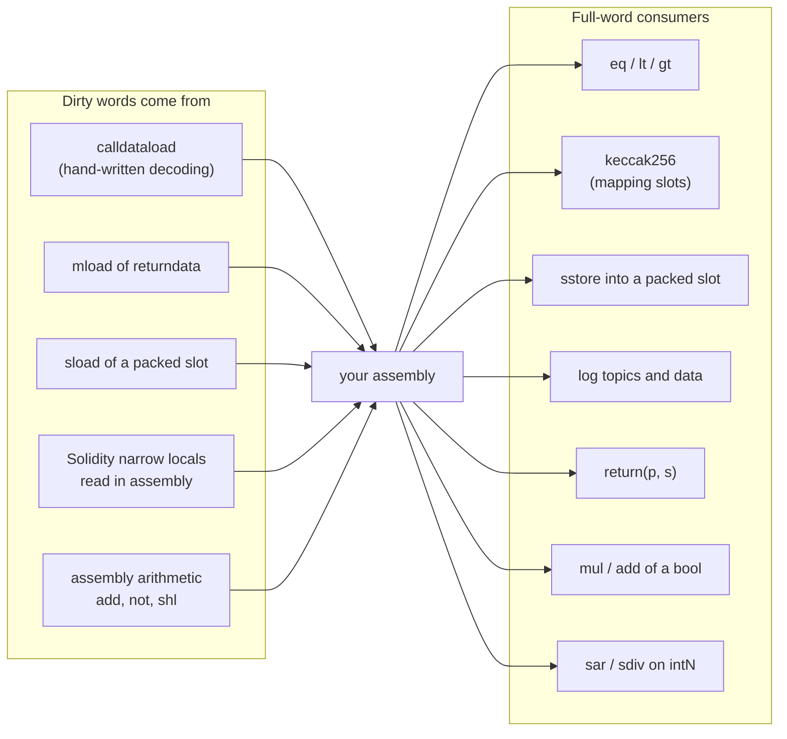

# 3.9 Cleanup, dirty bits and safety

> [!abstract] In one minute
> - Every EVM value is a 256-bit word. A narrow type (`uint8`, `int24`, `address`, `bool`, `bytes4`) uses only part of it. The word is **clean** when the unused bits hold what the type requires: zeros for unsigned, address and `bool`, copies of the sign bit for signed, zeros at the low end for `bytesN`. A `bool` must be exactly 0 or 1.
> - Solidity cleans or validates at every boundary it controls. In 0.8.38, in both pipelines, a `bool` of 2 or `0x100` set in assembly behaved as `true` in `if`, `==`, `!`, `&&`, return values, events and storage. Dirty addresses were masked in `==`, mapping keys, events and hashes. The ABI decoder **rejects** dirty calldata and returndata with an empty revert.
> - Assembly gets none of this. `calldataload`, `mload` of returndata, `sload` of a packed slot, and Solidity locals read inside `assembly` can all carry dirty bits. `eq`, `lt`, `keccak256`, `sstore`, `log`, `return`, `mul` and `sar` all use the full word.
> - The rule: **validate what comes from outside** (revert like the decoder: `if shr(160, a) { revert(0, 0) }`), and **clean what you produce** before Solidity or another opcode sees it (`and`, `signextend`, `iszero(iszero(·))`). Each costs 3–5 gas.
> - Prove an optimized assembly version equals its Solidity reference with a **differential test**: same inputs to both, compare success, returndata, logs and storage, and include 0, max, one-past-max, dirty upper bits, short calldata and overflow. The py-evm harness below caught 156 mismatches in 433 cases for a version that looked correct on clean input, and 0 for the fixed version.
> - Eleven entries in the official compiler bug list are cleanup bugs. Two were reproduced here: SOL-2022-5 (dirty bytes copied to storage, fixed 0.8.15) and SOL-2022-6 (ABI re-encoding cleanup overwrote a length, fixed 0.8.16).

**Prerequisites:** [[2.1 Types]], [[2.5 ABI encoding and decoding]], [[3.3 Opcodes by family]], [[3.4 Interop with Solidity]], [[3.5 Memory management in assembly]] · **Leads to:** [[3.11 Compiler IR and the optimizer]], [[6.2 Unit, fuzz and invariant testing]], [[6.5 Formal verification]], [[6.9 Audit process]]

All measurements below come from solc-js 0.8.38 and py-evm 0.12.1b1 (Prague rules), legacy and via-IR, optimizer on with 200 runs unless stated otherwise. Gas figures are execution gas only (no 21,000 intrinsic, no calldata cost).

## Clean words: the contract between Solidity and the EVM

[[2.1 Types|Note 2.1]] introduced dirty bits from the Solidity side: what the compiler cleans, and when (legacy lazily, via-IR eagerly). This note looks from the assembly side. The question here is not "what does the compiler do?" but "what must my assembly do so that nothing breaks?"

Start with the intuition. The EVM has one type: the 256-bit word. Solidity invents narrower types on top of it. A `uint8` is a word in which only the lowest 8 bits are meant to matter. That is a promise, not a fact. Nothing in the EVM stops the other 248 bits from being set. When they are set, the word is **dirty**.

Solidity defines one canonical word for each narrow value:

| Type | Clean word | Example of a dirty word for the same value |
|---|---|---|
| `uintN` (N < 256) | Bits N..255 are zero | `uint8` 255 as `0x1ff` |
| `intN` (N < 256) | Bits N..255 copy bit N−1 (sign-extended) | `int8` −128 as `0x80` instead of `0xff…ff80` |
| `address`, `address payable`, contract types | Bits 160..255 are zero | `0x…dead` followed by 20 address bytes |
| `bool` | Exactly 0 or 1 | 2, `0x100`, `0xff…ff` |
| `bytesN` (N < 32) | The low 32−N bytes are zero (left-aligned) | `bytes4` `0xdeadbeef` with a stray `01` at the end |
| enum with n members | 0 … n−1 | n or more (Solidity panics with `Panic(0x21)`) |
| `uint256`, `int256`, `bytes32` | Every word is valid | — |

Two things make dirty bits dangerous.

First, **most EVM opcodes cannot tell**. `add(0x1ff, 1)` returns `0x200`. `eq(0x1ff, 0xff)` returns 0. `keccak256` hashes all 32 bytes. Only the program knows that the top 248 bits were supposed to be ignored.

Second, **some operations ignore the top bits anyway**, so the bug hides. `balance`, `call` and `extcodesize` use only the low 160 bits of an address ([[3.3 Opcodes by family|3.3]] checked `balance` with dirty bits). The low 8 bits of `add(x, 1)` are right even if `x` is dirty. So a dirty value can pass through several steps correctly and fail only at the one step that reads the whole word: a comparison, a hash, a storage write.

The docs put the assembly rule bluntly: "If you access variables of a type that spans less than 256 bits (for example `uint64`, `address`, or `bytes16`), you cannot make any assumptions about bits not part of the encoding of the type. Especially, do not assume them to be zero."



## Where dirty words come from

### Calldata you decode yourself

The Solidity ABI decoder (coder v2, the default since 0.8.0) **validates** every narrow argument. It does not mask. A word that is not in canonical form makes the call revert with empty data. This holds even for a parameter the function never uses: `function unused(address) external` reverted on a dirty address in both pipelines. In via-IR's generated code the check is visible:

```text
function cleanup_t_address(value) -> cleaned { cleaned := cleanup_t_uint160(value) }
function cleanup_t_uint160(value) -> cleaned { cleaned := and(value, 0xffffffffffffffffffffffffffffffffffffffff) }
function validator_revert_t_address(value) {
    if iszero(eq(value, cleanup_t_address(value))) { revert(0, 0) }
}
function cleanup_t_bool(value) -> cleaned { cleaned := iszero(iszero(value)) }
function validator_revert_t_bool(value) {
    if iszero(eq(value, cleanup_t_bool(value))) { revert(0, 0) }
}
```

"Clean it, and revert if cleaning changed it." That is the validation pattern you will copy into assembly.

The protection ends the moment you read calldata yourself. `calldataload` returns the raw word. Measured, 0.8.38, both pipelines, identical results:

| Input word | Through a typed parameter | Through `calldataload` in assembly |
|---|---|---|
| `address` with `0xdead` in the top 96 bits | Empty revert | Raw word, `0x…dead0000…1234` |
| `bool` = 2 | Empty revert | 2 |
| `uint8` = `0x1ff` | Empty revert | `0x1ff` |
| `int8` = `0x80` (not sign-extended) | Empty revert | `0x80` |
| `bytes4` with a nonzero low byte | Empty revert | Raw word |
| `address[]` element 1 dirty, read `xs[1]` | Empty revert (checked when read) | Raw word via `calldataload(add(xs.offset, 0x20))` |
| `address[]` element 1 dirty, read only `xs[0]` or `xs.length` | Succeeds (elements are checked only when read) | — |
| `abi.decode(data, (address))` of a dirty word | Empty revert | — |
| Calldata 1 byte shorter than needed | Empty revert | Missing bytes read as zero |
| Trailing bytes after the arguments | Accepted | Accepted |
| Dirty padding after a `bytes` value | Accepted (padding is not checked) | — |

The last row matters for the bug reproduction later: the decoder never looks at the padding of `bytes`/`string`.

Two variants of the old behavior still exist. A contract with `pragma abicoder v1;` compiled with the legacy pipeline **masks** instead of reverting: a dirty address, a `bool` of 2 and a `uint8` of `0x1ff` came back as the address, `true` and `0xff`. It prints "Warning: ABI coder v1 is deprecated and scheduled for removal. Use ABI coder v2 instead." Under via-IR the pragma is ignored with "Warning: Contract requests the ABI coder v1, which is incompatible with the IR. Using ABI coder v2 instead.", and all three reverted. So the same source gives different behavior per pipeline. A Solidity reference you test against must use the coder you intend to match.

### Returndata

`mload` after a `call` gives the callee's raw word. A token, a hook or an oracle can return anything. If a high-level call decodes the result, the decoder validates it. In assembly you must. The next section shows a token returning 2 for `transfer`.

### Solidity variables read in assembly

A narrow Solidity local is not cleaned when assembly reads it. [[2.1 Types|2.1]] measured the pipeline difference. One more data point: `uint8 y; unchecked { y = x + 1; }` with `x` set to `0x1ff` in assembly, then `assembly { r := y }`, returned `0x200` under legacy and `0x0` under via-IR. Via-IR cleans after the addition. Legacy does not. Neither cleans a value that assembly assigned: `bool b = mk(2); assembly { r := b }` returned 2 in all four settings (both pipelines, optimizer on and off).

### Packed storage, memory and your own arithmetic

`sload` of a packed slot returns all the neighbours too: shift and mask ([[3.6 Storage, transient storage and bit packing|3.6]]). Memory above the free pointer and the padding after `bytes` are dirty until you write them ([[3.5 Memory management in assembly|3.5]]). And your own arithmetic dirties words: `add` past 255 for a `uint8`, `not(x)` sets all high bits, `shl` pushes bits past the type's width.

## What Solidity does with a dirty value (0.8.38)

The task is to hand Solidity a dirty word and see what it does. The helper is the same in every test:

```solidity
// SPDX-License-Identifier: MIT
pragma solidity 0.8.38;

contract BoolProbe {
    bool public flag;          // slot 0, byte 0
    uint8 public tag = 7;      // slot 0, byte 1 (packed neighbour)
    event E(bool b);
    event EI(bool indexed b);

    function mk(uint256 raw) internal pure returns (bool b) {
        assembly { b := raw }  // hand Solidity a dirty bool
    }

    function ifB(uint256 raw) external pure returns (uint256) { if (mk(raw)) return 1; return 0; }
    function eqTrue(uint256 raw) external pure returns (bool) { return mk(raw) == true; }
    function neTrue(uint256 raw) external pure returns (bool) { bool t = true; return mk(raw) != t; }
    function notB(uint256 raw) external pure returns (bool) { return !mk(raw); }
    function andB(uint256 raw) external pure returns (bool) { bool t = true; return mk(raw) && t; }
    function ret(uint256 raw) external pure returns (bool) { return mk(raw); }
    function packedB(uint256 raw) external pure returns (bytes memory) { return abi.encodePacked(mk(raw)); }
    function store(uint256 raw) external { flag = mk(raw); }
    function emitB(uint256 raw) external { emit E(mk(raw)); emit EI(mk(raw)); }
    function readBack(uint256 raw) external pure returns (uint256 r) { bool b = mk(raw); assembly { r := b } }
    function eqAsm(uint256 raw) external pure returns (uint256 r) { bool b = mk(raw); assembly { r := eq(b, 1) } }
}
```

Taking `raw` as an argument stops the optimizer from folding the constant. Results for `raw` = 2, `0x100` and `2**256 − 1`, **identical in all four settings** (legacy and via-IR, optimizer on and off):

| Use of the dirty `bool` | Result | Meaning |
|---|---|---|
| `if (b)` | Taken | Any nonzero word is true |
| `b == true` | `true` | Both sides cleaned before `EQ` |
| `b != t` (with `t = true`) | `false` | Same |
| `!b` | `false` | |
| `b && t` | `true` | |
| `return b` | `0x…01` | The encoder applies `iszero(iszero(·))` |
| `abi.encodePacked(b)` | `0x01` | One byte, cleaned |
| `flag = b` (packed next to `tag = 7`) | Slot 0 = `0x0701` | Storage write cleans; neighbour safe |
| `emit E(b)`, `emit EI(b)` | Data word `…01`, topic `…01` | Events clean |
| `assembly { r := b }` | 2, `0x100`, `0xff…ff` | **Raw** |
| `assembly { r := eq(b, 1) }` | 0 | **Wrong** |

Note `0x100`: its low byte is zero, yet Solidity treats it as `true`. The compiler cleans `bool` with `iszero(iszero(·))` on the whole word, not by masking the low byte. Code that masks a bool with `and(b, 0xff)` reaches the opposite answer. Keep this case in your fuzz inputs.

The same experiment with a dirty `address` (`0xdead` in the top 96 bits, low 160 bits equal to the owner):

| Use of the dirty `address` | Solidity | Assembly |
|---|---|---|
| `a == owner` | `true` | `eq(a, sload(owner.slot))` = 0 |
| `credits[a] += 1` | Writes `keccak256(clean ‖ 1)`; the getter sees it | `mstore(0, a)` + `keccak256` writes `keccak256(dirty ‖ 1)` = slot `0xf9b4e2c5db…`, invisible to the getter |
| `emit Seen(a, a)` | Topic and data clean | `log2(…, a)`: topic and data `0x…dead1010…10` |
| `keccak256(abi.encode(a))` | Hash of the clean word | — |
| `a.balance` | Correct | `balance(a)` also correct: the EVM drops the top 96 bits |
| `return a` / `uint160(a)` | Clean | — |

And with a dirty `uint8` of `0x1ff` (Solidity's value is 255), again the same in all four settings:

| Expression | Result | Note |
|---|---|---|
| `x + 1` (checked) | `Panic(0x11)` | Clean value 255 overflows |
| `unchecked { x + 1 }` returned | 0 | Wraps at 8 bits |
| `x << 1` returned as `uint8` | `0xfe` | |
| `x >> 1`, `x / 2` | `0x7f` | Cleaned before `SHR`/`DIV` |
| `x > 200` | `true`; for `0x105` (value 5) `false` | Cleaned before `GT` |
| `uint256(x) + 1` | `0x100` | Widening cleans |
| `2 ** x` with `x = 0x103` | 8 | Exponent cleaned: the fix for ExpExponentCleanup |
| `t[x]` on `uint256[256] memory t` | `t[255]` | Index cleaned before the bounds check |
| `int8` `0x80`: `x < 0` / `return x` | `true` / `0xff…ff80` | Sign-extended |
| `int8` `0x80`: `int256(x) >> 1` | −64 | Correct |
| `int8` `0x80`: `assembly { r := sar(1, x) }` | `0x40` (+64) | **Wrong sign** |
| `int8` `0x80`: `sar(1, signextend(0, x))` | −64 | Fixed |

The pattern is the same as in [[2.1 Types|2.1]] and holds for all three types. **Pure Solidity in 0.8.38 never observed the dirty bits.** Every leak went through an assembly consumer. That moves the question from "is the value dirty?" to "who reads the whole word?"

## Who reads the whole word: the consumer side

| Consumer | What dirty bits do | Fix |
|---|---|---|
| `eq`, `lt`, `gt`, `slt`, `sgt`, `iszero` | Compare all 256 bits: false negatives on equality, wrong order on `lt`/`gt` | Clean or validate first |
| `keccak256` over memory you wrote | Different hash: wrong mapping slot, wrong signature digest, wrong Merkle leaf | Clean before `mstore` |
| `sstore` of `or(slot, shl(k, v))` | Bits spill into the packed neighbour | Clean `v` to its width before shifting |
| `log0`–`log4` | Off-chain decoders reject or misread the event; indexed topics no longer match filters | Clean topics and data |
| `return(p, s)` / `revert(p, s)` with raw words | The **caller's** decoder rejects the value (empty revert), or older decoders accept it | Clean before `mstore` |
| `add`, `mul` with a `bool` | `mul(amount, b)` scales by 2 or 256 instead of selecting | `iszero(iszero(b))` |
| `sar`, `sdiv`, `smod`, `slt`, `sgt`, `signextend` reads | Positive where negative was meant | `signextend(k, x)` first |
| `byte(i, x)`, `shr` used as an extractor | Can extract a dirty byte instead of zero | Mask after extraction |
| Index arithmetic `add(base, mul(i, 32))` | Reads or writes far from the array | Bound-check after cleaning |
| `call`, `balance`, `extcodesize`, `extcodehash` | Ignore the top 96 bits of the address | Nothing needed for the opcode itself, but the same word used elsewhere is still dirty |

### Clean or reject?

There are two correct responses to a dirty word, and they are not interchangeable.

- **Reject** (validate) values that come from **outside**: calldata, returndata, signatures, data read from another contract. This matches the ABI decoder. If your assembly masks where the Solidity version reverts, the two are not equivalent: a caller who sends `to = 1<<160 | alice` would credit Alice through your assembly and fail through Solidity. Whether that is "harmless" depends on code you have not seen, such as a relayer that signed the dirty word.
- **Clean** (mask) values you **produce**: results of your own arithmetic, a `bool` built from a comparison, a byte extracted from a word, a field read out of a packed slot. Here there is no one to reject. You owe the next consumer a canonical word.

The idioms, all checked on both pipelines with edge inputs (`0xff`/`0x100`, `0x7f`/`0x80`/−128/−129, `2**160 − 1`/`2**160`, 0/1/2, `bytes4` with and without a stray low byte):

```solidity
// SPDX-License-Identifier: MIT
pragma solidity 0.8.38;

/// Cleanup and validation idioms for words that should hold a narrow type.
library CleanLib {
    // --- clean: force the canonical form (use for values you produced yourself) ---
    function cleanU8(uint256 x) internal pure returns (uint256 r) { assembly { r := and(x, 0xff) } }
    function cleanI8(uint256 x) internal pure returns (uint256 r) { assembly { r := signextend(0, x) } }
    function cleanAddr(uint256 x) internal pure returns (uint256 r) { assembly { r := shr(96, shl(96, x)) } }
    function cleanBool(uint256 x) internal pure returns (uint256 r) { assembly { r := iszero(iszero(x)) } }
    function cleanB4(uint256 x) internal pure returns (uint256 r) { assembly { r := and(x, shl(224, 0xffffffff)) } }

    // --- validate: revert like the ABI decoder (use for values from outside) ---
    function checkU8(uint256 x) internal pure { assembly { if shr(8, x) { revert(0, 0) } } }
    function checkI8(uint256 x) internal pure { assembly { if iszero(eq(x, signextend(0, x))) { revert(0, 0) } } }
    function checkAddr(uint256 x) internal pure { assembly { if shr(160, x) { revert(0, 0) } } }
    function checkBool(uint256 x) internal pure { assembly { if gt(x, 1) { revert(0, 0) } } }
    function checkB4(uint256 x) internal pure { assembly { if shl(32, x) { revert(0, 0) } } }
}
```

For `x = 0xdeadbeef00…001280` the clean functions returned `0x80`, `0xff…ff80`, `0x1280`, `1` and `0xdeadbeef00…00`. Every validator accepted the canonical edge and rejected the one just past it.

| Type | Clean | Validate | Gas of the core opcodes |
|---|---|---|---|
| `uintN` | `and(x, 2^N − 1)` | `if shr(N, x) { revert(0, 0) }` | `AND` 3 / `SHR` 3 + `JUMPI` 10 |
| `intN` (N = 8k) | `signextend(k − 1, x)` | `if iszero(eq(x, signextend(k − 1, x)))` | `SIGNEXTEND` 5 (+ `EQ` 3, `ISZERO` 3) |
| `address` | `and(x, 0xff…ff)` (20 bytes) or `shr(96, shl(96, x))` | `if shr(160, x)` | 3 or 6 / 3 |
| `bool` | `iszero(iszero(x))` | `if gt(x, 1)` | 6 / 3 |
| `bytesN` | `and(x, not(shr(8N, not(0))))` | `if shl(8N, x)` | 3 (mask is a constant) / 3 |
| enum (n members) | — (there is no meaningful clean value) | `if iszero(lt(x, n))` | 6 |

A mask costs less than any `SLOAD` you could get wrong. The [[#Differential test an optimized version against its reference|differential test below]] measured the full price: five checks added 132 gas (legacy) and 118 gas (via-IR) per call.

> [!warning] The two mistakes auditors find
> 1. **Masking where the reference reverts.** The function then accepts inputs the Solidity version rejects. Downstream code (relayers, signatures over calldata, indexers) may treat the dirty word differently from your contract.
> 2. **Cleaning at the wrong time.** The value is masked for the mapping lookup but compared raw for the uniqueness check, or masked in the event but not in the hash. Every consumer must see the same word. The simplest way: validate or clean once, at the point where the word enters the block, and use only the cleaned variable afterwards.

## Solidity and Yul in practice

### A dirty signer that counts twice

Multisig and threshold-signature code often proves "no duplicate signers" by requiring the list to be strictly increasing. That check is cheap and correct, as long as the words compared are the same words used for the lookup. Here the loop reads calldata in assembly to save the decoder's checks:

```solidity
// SPDX-License-Identifier: MIT
pragma solidity 0.8.38;

contract Approvals {
    mapping(address => bool) public isSigner;
    uint256 public constant THRESHOLD = 2;

    constructor(address a, address b) { isSigner[a] = true; isSigner[b] = true; }

    // Uniqueness by "strictly increasing", the usual multisig trick.
    // Signers are read from calldata in assembly to skip the decoder's checks.
    function approvedUnsafe(address[] calldata signers) external view returns (bool) {
        uint256 last;
        uint256 count;
        for (uint256 i; i < signers.length; ++i) {
            uint256 w;
            assembly { w := calldataload(add(signers.offset, shl(5, i))) }
            require(w > last, "not sorted");     // BUG: compares the raw 256-bit word
            last = w;
            address s;
            assembly { s := w }
            if (isSigner[s]) ++count;            // the mapping lookup cleans s
        }
        return count >= THRESHOLD;
    }

    function approvedSafe(address[] calldata signers) external view returns (bool) {
        uint256 last;
        uint256 count;
        for (uint256 i; i < signers.length; ++i) {
            uint256 w;
            assembly {
                w := calldataload(add(signers.offset, shl(5, i)))
                if shr(160, w) { revert(0, 0) }  // reject, like the ABI decoder
            }
            require(w > last, "not sorted");
            last = w;
            address s;
            assembly { s := w }
            if (isSigner[s]) ++count;
        }
        return count >= THRESHOLD;
    }
}
```

Deployed with signers A = `0xAAAA` and B = `0xBBBB`. Same results in both pipelines:

| `signers` | `approvedUnsafe` | `approvedSafe` |
|---|---|---|
| `[A]` | `false` | `false` |
| `[A, B]` | `true` | `true` |
| `[A, A]` | reverts "not sorted" | reverts "not sorted" |
| `[A, A | 1<<160]` | **`true`**: one signer met a threshold of two | empty revert |

The second copy of A is a larger 256-bit word, so it passes the ordering check. Then Solidity cleans it for the mapping lookup, and it counts again. Nothing here is exotic: the bug is two consumers seeing two different words. With a real signature scheme the address usually comes out of `ecrecover`, which is clean, but any list of addresses read raw from calldata (allowlists, routes, batch recipients) has the same shape.

### A dirty bool in a packed slot

Writing a `bool` into a packed slot by hand is the classic place where "any nonzero is true" stops being true:

```solidity
// SPDX-License-Identifier: MIT
pragma solidity 0.8.38;

contract BoolPack {
    uint8 public tag = 7;        // slot 0, byte 0
    bool public paused;          // slot 0, byte 1
    uint8 public level = 4;      // slot 0, byte 2

    function mk(uint256 raw) internal pure returns (bool b) {
        assembly { b := raw }    // simulate a bool built in assembly
    }

    function setPausedUnsafe(uint256 raw) external {
        bool b = mk(raw);
        assembly {
            let s := and(sload(paused.slot), not(shl(8, 0xff)))   // clear byte 1
            sstore(paused.slot, or(s, shl(8, b)))                   // BUG: b not cleaned
        }
    }

    function setPausedSafe(uint256 raw) external {
        bool b = mk(raw);
        assembly {
            let s := and(sload(paused.slot), not(shl(8, 0xff)))
            sstore(paused.slot, or(s, shl(8, iszero(iszero(b)))))   // exactly 0 or 1
        }
    }

    function countUnsafe(uint256 raw) external pure returns (uint256 n) {
        bool b = mk(raw);
        assembly { n := add(n, b) }                                 // "count the trues"
    }

    function selectUnsafe(uint256 raw, uint256 amount) external pure returns (uint256 r) {
        bool b = mk(raw);
        assembly { r := mul(amount, b) }                            // branchless "b ? amount : 0"
    }
}
```

Starting from slot 0 = `0x040007` (level 4, paused false, tag 7). Same in both pipelines:

| Call | Slot 0 after | `paused()` | `level()` |
|---|---|---|---|
| `setPausedUnsafe(2)` | `0x040207` | `true` (getter cleans the byte) | 4 |
| `setPausedUnsafe(0x100)` | `0x050007` | **`false`** | **5** |
| `setPausedSafe(2)` or `(0x100)` | `0x040107` | `true` | 4 |
| `countUnsafe(2)` / `(0x100)` | — | returns 2 / 256 | — |
| `selectUnsafe(2, 1000)` / `(0x100, 1000)` | — | returns 2,000 / 256,000 | — |

With `0x100`, a value Solidity treats as `true`, the contract is not paused, and the bit lands in `level`. The slot layout is [[2.3 Storage layout|2.3]]; the masking discipline for packed writes is [[3.6 Storage, transient storage and bit packing|3.6]].

### A dirty bool across a call boundary

Returndata is the other door. This "token" writes its own return word in assembly and so can return 2:

```solidity
// SPDX-License-Identifier: MIT
pragma solidity 0.8.38;

contract DirtyBoolToken {
    // An assembly "token" whose transfer() returns the raw word it was given.
    function transfer(address, uint256 v) external pure returns (bool) {
        assembly { mstore(0, v) return(0, 32) }  // bypasses the ABI encoder
    }
}

interface IToken { function transfer(address, uint256) external returns (bool); }

contract Consumer {
    // High-level call: the ABI decoder validates the returned bool.
    function highLevel(IToken t, uint256 v) external returns (bool) { return t.transfer(address(1), v); }

    // Solady/OpenZeppelin-style check: success only if the returned word is exactly 1.
    function exactlyOne(address t, uint256 v) external returns (bool ok) {
        assembly {
            mstore(0x00, 0xa9059cbb)       // transfer(address,uint256)
            mstore(0x20, 1)
            mstore(0x40, v)
            ok := and(eq(mload(0x00), 1), call(gas(), t, 0, 0x1c, 0x44, 0x00, 0x20))
            mstore(0x40, 0x80)             // restore the free memory pointer
        }
    }
}
```

| Token returns | `highLevel` | `exactlyOne` |
|---|---|---|
| 1 | `true` | `true` |
| 2 | empty revert | `false` |
| `0x100` | empty revert | `false` |

Both pipelines agree. The `and(eq(…), call(…))` order is safe because Yul evaluates arguments right to left, so the `call` runs before the `mload` ([[3.2 Syntax and control flow|3.2]]). OpenZeppelin's current `SafeERC20._safeTransfer` uses the same `eq(mload(0x00), 1)` test. So a contract that returns a dirty `bool` is not "lenient". It is broken for every careful caller, while a legacy `abicoder v1` caller reads it as `true` (measured: a v1 caller's `t.transfer(...)` returned `true` for 2 and `0x100`). Off-chain tools are strict too: `eth_abi` 6.0.0 raised `NonEmptyPaddingBytes: Boolean must be either 0x0 or 0x1` for a returned 2. Always end an assembly function that returns a `bool` with `iszero(iszero(·))`. The full safe-transfer pattern, including the empty-returndata case, is in [[3.7 External calls in assembly|3.7]].

### Differential test an optimized version against its reference

The defense that scales is not reading more carefully. It is running both versions on the same inputs and demanding identical behavior. Here is a reference ledger in Solidity and two hand-optimized versions. The first is the kind of code that passes a happy-path unit test.

```solidity
// SPDX-License-Identifier: MIT
pragma solidity 0.8.38;

/// Reference: plain Solidity. The ABI decoder validates every argument.
contract LedgerRef {
    mapping(address => uint256) public balanceOf;   // slot 0
    event Credited(address indexed to, uint256 amount, bool bonus);
    error ZeroAddress();

    function credit(address to, uint96 amount, bool bonus) external returns (uint256 newBalance) {
        if (to == address(0)) revert ZeroAddress();
        uint256 a = bonus ? uint256(amount) * 2 : amount;
        newBalance = balanceOf[to] + a;              // checked: Panic(0x11) on overflow
        balanceOf[to] = newBalance;
        emit Credited(to, a, bonus);
    }
}

/// "Optimized" v1: hand-written dispatch and decoding. Looks right on clean input.
contract LedgerFast {
    mapping(address => uint256) public balanceOf;   // slot 0 (unused by name; same layout)
    event Credited(address indexed to, uint256 amount, bool bonus);

    fallback() external {
        bytes32 sig = Credited.selector;
        assembly {
            switch shr(224, calldataload(0))
            case 0x5491d750 {                           // credit(address,uint96,bool)
                let to := calldataload(4)
                let amount := calldataload(36)
                let bonus := calldataload(68)
                if iszero(to) { mstore(0, 0xd92e233d) revert(0x1c, 4) }   // ZeroAddress()
                let a := shl(bonus, amount)            // bonus doubles the amount
                mstore(0x00, to)
                mstore(0x20, 0)                        // balanceOf.slot
                let s := keccak256(0x00, 0x40)
                let nb := add(sload(s), a)
                sstore(s, nb)
                mstore(0x00, a)
                mstore(0x20, bonus)
                log2(0x00, 0x40, sig, to)
                mstore(0x00, nb)
                return(0x00, 0x20)
            }
            default { revert(0, 0) }
        }
    }
}

/// "Optimized" v2: the same code plus every check the ABI decoder and
/// checked arithmetic were doing, in the same order.
contract LedgerFastFixed {
    mapping(address => uint256) public balanceOf;
    event Credited(address indexed to, uint256 amount, bool bonus);

    fallback() external {
        bytes32 sig = Credited.selector;
        assembly {
            switch shr(224, calldataload(0))
            case 0x5491d750 {
                if lt(calldatasize(), 100) { revert(0, 0) }                 // 4 + 3 words
                let to := calldataload(4)
                let amount := calldataload(36)
                let bonus := calldataload(68)
                // Validate, do not clean: the reference reverts on dirty input.
                if shr(160, to) { revert(0, 0) }                            // address: 160 bits
                if shr(96, amount) { revert(0, 0) }                         // uint96
                if gt(bonus, 1) { revert(0, 0) }                            // bool: exactly 0 or 1
                if iszero(to) { mstore(0, 0xd92e233d) revert(0x1c, 4) }
                let a := shl(bonus, amount)
                mstore(0x00, to)
                mstore(0x20, 0)
                let s := keccak256(0x00, 0x40)
                let old := sload(s)
                let nb := add(old, a)
                if lt(nb, old) {                                            // Panic(0x11)
                    mstore(0x00, 0x4e487b71)
                    mstore(0x20, 0x11)
                    revert(0x1c, 0x24)
                }
                sstore(s, nb)
                mstore(0x00, a)
                mstore(0x20, bonus)
                log2(0x00, 0x40, sig, to)
                mstore(0x00, nb)
                return(0x00, 0x20)
            }
            default { revert(0, 0) }
        }
    }
}
```

Why a `fallback`? Because a typed `credit(address, uint96, bool)` would run the decoder before the body, even with unnamed parameters, and the decoder would already reject dirty words. Hand-written dispatch is exactly where dirty calldata gets in. The selectors were computed with `keccak256`: `credit(address,uint96,bool)` = `0x5491d750`, `ZeroAddress()` = `0xd92e233d`.

`LedgerFast` has five bugs, none visible on clean input: it accepts a dirty `to` (and credits a slot no getter can read), a dirty `amount`, a `bonus` of 2 (`shl(2, amount)` quadruples), short calldata (missing bytes read as zero) and an overflowing balance (it wraps). The order of checks in `LedgerFastFixed` matters too: the reference decodes first, then checks for zero, then adds. A version that tested `iszero(to)` before validating would return `ZeroAddress()` where the reference returns an empty revert, for `to = 1<<160`.

The harness. It compiles all three, deploys the reference and one candidate into one py-evm state, seeds a "whale" balance near `2**256` so overflow is reachable, and runs 33 hand-picked edge cases followed by 400 random ones. For each case it compares success, returndata, log topics and data, and the **storage root** of each contract. Equal roots mean identical storage, without guessing which slots to inspect.

```python
"""Differential test: LedgerRef (Solidity) vs an assembly candidate, in py-evm (Prague rules).
usage: python3 difftest_note.py Ledger.sol LedgerFast|LedgerFastFixed [via-ir]"""
import sys, random, collections
sys.path.insert(0, "/tmp/claude-0/-home-claude/121773dd-7f4e-5b7d-91b4-143bd20e442f/scratchpad/tools")
from harness import compile_sol, Env, selector
from eth_hash.auto import keccak

SRC, CANDIDATE = open(sys.argv[1]).read(), sys.argv[2]
VIA_IR = sys.argv[3:] == ["via-ir"]
SEL = selector("credit(address,uint96,bool)")
M96, M160, M256 = 2**96 - 1, 2**160 - 1, 2**256 - 1
WHALE = 0xCAFE                                      # pre-seeded near 2**256 to reach overflow

def word(x): return x.to_bytes(32, "big")
def slot_of(key): return int.from_bytes(keccak(word(key) + word(0)), "big")   # balanceOf[key]
def call(to, amount, bonus): return SEL + word(to) + word(amount) + word(bonus)

def storage_root(env, addr):                        # equal roots <=> identical storage
    env.state.make_state_root()
    return env.state._account_db._get_account(addr).storage_root

# 1. Hand-picked edge cases: 0, 1, max, one bit past max, all ones, for every field.
EDGE = [("clean", call(t, a, b)) for t in (1, M160) for a in (0, 1, M96) for b in (0, 1)]
EDGE += [("dirty address", call(t, 5, 0)) for t in (1 << 160 | 1, M256, M256 ^ M160 | 7)]
EDGE += [("dirty uint96", call(1, a, 0)) for a in (1 << 96, M256)]
EDGE += [("dirty bool", call(1, 5, b)) for b in (2, 0x100, M256)]
EDGE += [("zero address", call(0, 5, 0)), ("zero address", call(1 << 160, 5, 0))]
EDGE += [("overflow", call(WHALE, a, b)) for a, b in ((5, 0), (6, 0), (3, 1), (M96, 1))]
EDGE += [("short calldata", call(1, 5, 0)[:n]) for n in (0, 3, 4, 35, 99)]
EDGE += [("trailing bytes", call(1, 5, 0) + b"\xff" * 7), ("unknown selector", b"\xde\xad\xbe\xef" + word(1))]

# 2. Random cases with dirty bits mixed in.
def random_case(rng):
    to, amount, bonus = rng.choice([1, M160, rng.getrandbits(160)]), rng.choice([0, 1, M96, rng.getrandbits(96)]), rng.getrandbits(1)
    r = rng.random()
    if r < 0.12:   return "dirty address", call(to | rng.getrandbits(96) << 160 | 1 << 160, amount, bonus)
    if r < 0.22:   return "dirty uint96", call(to, amount | rng.getrandbits(160) << 96 | 1 << 96, bonus)
    if r < 0.32:   return "dirty bool", call(to, amount, rng.choice([2, 0x100, rng.getrandbits(256) | 2]))
    if r < 0.37:   return "short calldata", call(to, amount, bonus)[:rng.randrange(0, 100)]
    if r < 0.42:   return "trailing bytes", call(to, amount, bonus) + rng.randbytes(rng.randrange(1, 40))
    return "clean", call(to, amount, bonus)

def main(n_random=400, seed=1):
    env = Env()
    ref = env.deploy(compile_sol(SRC, "LedgerRef", via_ir=VIA_IR)["bytecode"])
    cand = env.deploy(compile_sol(SRC, CANDIDATE, via_ir=VIA_IR)["bytecode"])
    for a in (ref, cand):
        env.sstore(a, slot_of(WHALE), M256 - 10)
    rng = random.Random(seed)
    cases = EDGE + [random_case(rng) for _ in range(n_random)]
    seen, bad, example = collections.Counter(), collections.Counter(), {}
    for label, data in cases:                       # one shared, evolving state: calls are stateful
        seen[label] += 1
        r1, r2 = env.call(ref, data), env.call(cand, data)
        same = (r1.success == r2.success and r1.output == r2.output
                and [log[1:] for log in r1.logs] == [log[1:] for log in r2.logs]   # topics + data
                and storage_root(env, ref) == storage_root(env, cand))
        if not same:
            bad[label] += 1
            example.setdefault(label, f"ref {'ok' if r1.success else 'revert'} 0x{r1.output.hex()[:8]}, "
                                      f"candidate {'ok' if r2.success else 'revert'} 0x{r2.output.hex()[:8]}")
            raw = int.from_bytes(data[4:36].ljust(32, b"\0"), "big")   # resync so one bug does not cascade
            for s in (slot_of(raw), slot_of(raw & M160)):
                env.sstore(cand, s, env.sload(ref, s))
    print(f"{CANDIDATE} vs LedgerRef ({'via-IR' if VIA_IR else 'legacy'}): {len(cases)} cases, {sum(bad.values())} mismatches")
    for label in sorted(seen):
        print(f"  {label:16s} {seen[label]:4d} cases {bad[label]:4d} mismatches   {example.get(label, '')}")
    return sum(bad.values())

if __name__ == "__main__":
    sys.exit(1 if main() else 0)
```

Two design points. The calls share one evolving state, because real bugs often need a sequence (the whale must exist before overflow is reachable). And after a mismatch the harness copies the reference's values into the two slots either version could have written. Without that resync, the first bug makes every later storage comparison fail and hides the others. (`_account_db` is a private py-evm API; it worked in 0.12.1b1.)

Output, legacy pipeline (via-IR gave identical counts):

```text
LedgerFast vs LedgerRef (legacy): 433 cases, 156 mismatches
  clean             247 cases    0 mismatches
  dirty address      43 cases   43 mismatches   ref revert 0x, candidate ok 0x00000000
  dirty bool         48 cases   48 mismatches   ref revert 0x, candidate ok 0x00000000
  dirty uint96       41 cases   41 mismatches   ref revert 0x, candidate ok 0x00000000
  overflow            4 cases    3 mismatches   ref revert 0x4e487b71, candidate ok 0x00000000
  short calldata     23 cases   20 mismatches   ref revert 0x, candidate revert 0xd92e233d
  trailing bytes     24 cases    0 mismatches
  unknown selector    1 cases    0 mismatches
  zero address        2 cases    1 mismatches   ref revert 0x, candidate ok 0x00000000

LedgerFastFixed vs LedgerRef (legacy): 433 cases, 0 mismatches
  (every category 0 mismatches)
```

Read the table the way an auditor would:

- **247 clean cases, 0 mismatches.** A unit-test suite built from realistic inputs would have passed `LedgerFast`.
- **Short calldata** produced a *different* revert: the candidate read the missing `to` as zero and returned `ZeroAddress()` where the reference returned an empty revert. The other 3 short cases were cut before the selector and both reverted empty.
- **Overflow**: 3 of 4 edge cases overflowed; the fourth (whale + 5) did not, and both agreed.
- **Zero address**: `to = 0` matched; `to = 1<<160` did not, because its low 160 bits are zero but the word is not.
- **Trailing bytes** matched, because both the decoder and `calldataload` ignore extra bytes.

Gas, same settings, calling `credit(0x77…77, 1000, true)` on a fresh contract (first call writes a new slot) and again (second call updates it):

| Pipeline | `LedgerRef` first / second | `LedgerFast` | `LedgerFastFixed` |
|---|---|---|---|
| Legacy | 24,729 / 7,629 | 24,039 / 6,939 | 24,171 / 7,071 |
| via-IR | 24,358 / 7,258 | 24,014 / 6,914 | 24,132 / 7,032 |

The safe assembly still saves 558 gas (legacy) or 226 gas (via-IR) on the second call. The unsafe version saves another 132 or 118 gas on top. That is the real trade: the five checks are cheap, and only the differential test shows that they were missing.

### The same test in Foundry, and with Halmos

In a real project you run this in Foundry ([[6.1 Foundry essentials|6.1]], [[6.2 Unit, fuzz and invariant testing|6.2]]). The fuzzer chooses the inputs; you decide which fields get dirty bits, so most runs still reach the success path. A uniform random `uint256` for `to` would be dirty almost every time and would only test the revert path.

```solidity
// SPDX-License-Identifier: MIT
pragma solidity 0.8.38;

// The two cheatcodes used here (forge-std's Test normally provides `vm`).
interface Vm {
    function deployCode(string calldata artifactPath) external returns (address);
    function load(address target, bytes32 slot) external view returns (bytes32);
}

contract LedgerDiffTest {
    Vm constant vm = Vm(address(uint160(uint256(keccak256("hevm cheat code")))));
    address ref;
    address fast;

    function setUp() public {
        ref = vm.deployCode("Ledger.sol:LedgerRef");
        fast = vm.deployCode("Ledger.sol:LedgerFastFixed");
    }

    /// Foundry fuzzes every argument. `mode` decides which fields get dirty
    /// upper bits, so most runs still exercise the success path.
    function testFuzz_creditMatches(uint160 to, uint96 amount, bool bonus, uint256 junk, uint8 mode, uint8 cut) public {
        uint256 toW = uint256(to);
        uint256 amountW = uint256(amount);
        uint256 bonusW = bonus ? 1 : 0;
        if (mode & 1 != 0) toW |= junk << 160;          // dirty address
        if (mode & 2 != 0) amountW |= junk << 96;       // dirty uint96
        if (mode & 4 != 0) bonusW = junk | 2;           // dirty bool (never 0 or 1)
        bytes memory data = abi.encodePacked(bytes4(0x5491d750), toW, amountW, bonusW);
        if (mode & 8 != 0 && cut < 100) {
            assembly { mstore(data, cut) }              // short calldata
        }

        (bool ok1, bytes memory out1) = ref.call(data);
        (bool ok2, bytes memory out2) = fast.call(data);
        require(ok1 == ok2, "success differs");
        require(keccak256(out1) == keccak256(out2), "returndata differs");

        // State: the two slots either implementation could have written.
        bytes32 s1 = keccak256(abi.encode(toW, uint256(0)));
        bytes32 s2 = keccak256(abi.encode(toW & type(uint160).max, uint256(0)));
        require(vm.load(ref, s1) == vm.load(fast, s1), "state differs (raw key)");
        require(vm.load(ref, s2) == vm.load(fast, s2), "state differs (clean key)");
    }
}
```

> [!warning] Unverified
> This test compiles with 0.8.38 in both pipelines, but Foundry is blocked in this environment, so it has not been run under `forge test`. In practice you would inherit forge-std's `Test`, use `assertEq`, compare events with `vm.recordLogs()`/`vm.getRecordedLogs()`, and add an invariant test with a handler that calls both contracts in random sequences. `junk` may be 0, in which case the "dirty" word is clean; that is fine, both must still agree.

Fuzzing samples the input space. A **symbolic** tool covers all of it. [Halmos](https://github.com/a16z/halmos) runs Foundry-style tests with symbolic arguments: rename the function to `check_creditMatches` and it tries to prove that no input makes any `require` fail, or returns a counterexample. For a function this small that is a proof of equivalence, dirty bits included. Loops and hashes limit how far symbolic execution scales, so the usual practice is fuzz everything and prove the small, critical kernels ([[6.4 Property-based fuzzers|6.4]], [[6.5 Formal verification|6.5]]).

## Pitfalls and incidents

### Pitfalls

- **Hand-written dispatch or decoding.** A `fallback` router, a packed-calldata format or `calldataload` on a typed parameter's position skips the decoder. Every narrow field needs a validator, plus a `calldatasize` check.
- **One word, two consumers.** Cleaned for one use, raw for another (the dirty-signer example). Clean once at entry and use only the clean variable.
- **`bool` built by arithmetic.** `sub(a, b)`, `and(flags, bit)` or a raw returndata word used as a `bool`. Normalize with `iszero(iszero(·))` before you store, return, count or multiply.
- **`0x100` is true for Solidity and false for a byte mask.** Code that treats `and(b, 0xff)` as "the bool" disagrees with the compiler.
- **Signed values from packed storage.** `shr` extracts a field zero-extended. An `int24` tick must go through `signextend(2, ·)` before `slt`, `sar` or `sdiv`.
- **Pipeline-dependent assembly.** A narrow Solidity local read in assembly may be clean under via-IR and dirty under legacy. Code that passes tests in one pipeline can fail in the other. Test both, or clean explicitly.
- **`abicoder v1` libraries.** Legacy plus v1 masks dirty input; via-IR silently upgrades to v2 and reverts. Behavior changes when you switch pipelines.
- **Dirty padding.** Memory above the free pointer, and the padding of `bytes` in calldata, are not zero. Hashing or returning whole words carries the garbage along ([[3.5 Memory management in assembly|3.5]]).
- **Assuming the compiler cleaned it.** The docs promise cleanup only "when necessary" for Solidity's own operations. Assembly is never "necessary" from the compiler's point of view.

### Compiler bugs caused by cleanup

From `bugs.json` in the compiler repository (`argotorg/solidity`, `docs/bugs.json`, downloaded 1 Nov 2026), filtered to entries where cleanup of high-order bits, padding or stale bytes was the cause. Newest first. "Affected" runs from the `introduced` field to the release before `fixed`; where `introduced` is absent the bug was present in all earlier versions.

| Bug (`uid`) | Severity | Affected | What went wrong |
|---|---|---|---|
| **MemoryByteArrayElementDeleteClearsWholeWord** (SOL-2026-5) | low/medium | all versions before 0.8.37; legacy only | `delete b[i]` on a memory `bytes` wrote a full-word `MSTORE` of zero instead of `MSTORE8`, zeroing up to 31 following bytes and possibly the start of the next memory object. The inverse failure: too much cleanup |
| **AbiReencodingHeadOverflowWithStaticArrayCleanup** (SOL-2022-6) | medium | 0.5.8–0.8.15; ABI coder v2 | Zeroing the padding after a static `uint256`/`bytes32` calldata array in the **last** head slot wrote exactly 32 bytes and overwrote the first word of the tail |
| **DirtyBytesArrayToStorage** (SOL-2022-5) | low | 0.0.1–0.8.14; legacy only | Copying `bytes` from memory or calldata to storage in 32-byte chunks copied the bytes past the end; a later `push()` exposed them |
| **SignedImmutables** (SOL-2021-3) | very low | 0.6.5–0.8.8 | Signed immutables shorter than 256 bits were zero-extended, not sign-extended. "The only way to access the value in its unclean state is by reading it through inline assembly" |
| **EmptyByteArrayCopy** (SOL-2020-11) | medium | all versions before 0.7.4 | Copying an empty `bytes`/`string` to storage stored unrelated data from after the source; growing the array exposed it |
| **DynamicArrayCleanup** (SOL-2020-10) | medium | all versions before 0.7.3 | Shrinking a packed small-type storage array cleaned only the first packed value of the boundary slot; regrowth exposed the old values |
| **SignedArrayStorageCopy** (SOL-2019-8) | low/medium | 0.4.7–0.5.9 | Copying signed integer arrays to storage with a type conversion cleared the high bits using the **source** width, not the target width |
| **ExpExponentCleanup** (SOL-2018-4) | medium/high | all versions before 0.4.25 | A narrow exponent was not cleaned before `EXP` |
| **HighOrderByteCleanStorage** (SOL-2016-9) | high | 0.1.6–0.4.3 | Short types were not cleaned before a full-word storage write, so a write to one packed variable could overwrite its neighbour |
| **CleanBytesHigherOrderBits** (SOL-2016-3) | medium/high | all versions before 0.3.3 | `bytesNN` were not cleaned before comparison; "an attacker might use this to reach seemingly unreachable code paths" |
| **ArrayAccessCleanHigherOrderBits** (SOL-2016-2) | medium/high | all versions before 0.3.1 | Writing one element of a packed small-type storage array did not clean high bits and corrupted other elements |

Other assembly-related entries (InlineAssemblyMemorySideEffects, StorageWriteRemovalBeforeConditionalTermination, KeccakCaching, the 0.8.38 stale-knowledge bug) are optimizer bugs, not cleanup bugs; they are covered in [[3.1 What Yul is and when to use it|3.1]] and [[3.11 Compiler IR and the optimizer|3.11]].

### Reproduction: DirtyBytesArrayToStorage (SOL-2022-5)

The ABI decoder does not check the padding of `bytes` in calldata. So a caller can send `"ab"` followed by 30 bytes of `0xff`:

```solidity
// SPDX-License-Identifier: MIT
pragma solidity >=0.8.0;

contract DirtyBytes {
    bytes public s;
    function setAndPush(bytes calldata b) external returns (bytes memory) {
        s = b;          // copied to storage in 32-byte chunks
        s.push();       // new last byte should be 0x00
        return s;
    }
}
```

Run in py-evm with solc-js 0.8.13 and 0.8.15 installed locally with `npm install` (the npm package for 0.8.14 is incomplete and would not load), optimizer on, `evmVersion` london:

| Compiler | Returned `s` after `push()` | Slot 0 |
|---|---|---|
| 0.8.13 legacy | `0x6162ff` | `0x6162ffff…ff06` |
| 0.8.13 via-IR | `0x616200` | `0x616200…0006` |
| 0.8.15 legacy | `0x616200` | `0x616200…0006` |
| 0.8.38 legacy and via-IR | `0x616200` | `0x616200…0006` |

The short-array slot holds the data left-aligned and `2 × length` in the last byte (6 = length 3). In 0.8.13 legacy the 30 dirty bytes went into the slot with the data, and `push()` "created" an element whose value is `0xff`. Via-IR was never affected, as the bug entry says.

### Reproduction: AbiReencodingHeadOverflowWithStaticArrayCleanup (SOL-2022-6)

```solidity
// SPDX-License-Identifier: MIT
pragma solidity >=0.8.0;

contract Reencode {
    // Re-encode a tuple whose LAST component is a static calldata array.
    function f(bytes calldata b, uint256[2] calldata a) external pure returns (bytes memory) {
        return abi.encode(b, a);
    }
}
```

Calling `f("hello", [7, 8])` and splitting the returned encoding into words:

| Compiler | Words of `abi.encode(b, a)` |
|---|---|
| 0.8.13 legacy | `0x60`, 7, 8, **0**, `68656c6c6f00…` |
| 0.8.13 via-IR | `0x60`, 7, 8, **0**, `68656c6c6f00…` |
| 0.8.38 legacy | `0x60`, 7, 8, **5**, `68656c6c6f00…` |

The fourth word is the length of `"hello"`. The padding cleanup after the array (the last head component) wrote 32 zero bytes over it. Any contract that forwarded such an encoding (a relayer, a multicall, an event) would emit an empty `bytes` instead of five bytes, with no revert.

### Incidents

> [!warning] Unverified
> I could not find a public postmortem of a mainnet loss whose root cause was specifically dirty high-order bits in hand-written assembly. The compiler bugs above are the documented cases. The audit literature regularly reports the patterns in this note (unmasked addresses in assembly hashing, dirty `bool` returns, unchecked `calldataload`) as findings, but I have not cited a specific report here. Do not quote a loss figure for this bug class without a source.

## Question ladder

> [!question]- **B** Why mask with `and(x, 0xffffffffffffffffffffffffffffffffffffffff)`?
> The constant is 160 one-bits: 40 hex `f`s, 20 bytes. An address is a 160-bit value stored in a 256-bit word, and Solidity's canonical form has the top 96 bits zero. `and` with that mask forces them to zero and keeps the address. The compiler's own helper is exactly this: via-IR generates `cleanup_t_uint160(value) -> and(value, 0xffffffffffffffffffffffffffffffffffffffff)`.
>
> You need it whenever an address enters assembly from a source that does not guarantee the form, and is then used by an opcode that reads the whole word:
>
> - **Sources:** `calldataload` (hand-written decoding), `mload` of returndata, `sload` of a slot where the address is packed with other fields (for example `address` + `uint96` in one slot: after `sload` you must mask off the `uint96`), and Solidity `address` variables whose value came from earlier assembly.
> - **Consumers:** `eq` (an `owner` check fails for `0x…dead ‖ owner`), `lt`/`gt` (sorted-signer checks: a dirty duplicate counted twice in the example above), `keccak256` for mapping slots (the measured dirty key wrote slot `keccak256(dirty ‖ 1)`, invisible to the getter), `log` topics (indexers filter on the exact topic), `mstore` before `return` (the caller's decoder reverts).
>
> You do **not** need it for `caller()`, `address()`, `origin()`, `coinbase()` or the result of `create`/`create2`: the EVM produces those clean. And the `call`, `balance`, `extcodesize` family ignores the top bits anyway; the mask matters for everything else you do with the same word.
>
> Two refinements an interviewer likes to hear. First, mask vs validate: for **calldata** the Solidity version reverts on a dirty address, so a faithful assembly version validates with `if shr(160, x) { revert(0, 0) }` rather than masking; masking silently accepts inputs the reference rejects. Second, alternatives: `shr(96, shl(96, x))` does the same with no 20-byte `PUSH`: counting the pushes it costs 12 gas instead of 6, but takes 6 bytes of code instead of 22, and `sub(shl(160, 1), 1)` builds the mask without a typo-prone literal. A 39-`f` mask is a real bug: it silently drops the top 4 bits of every address.

> [!question]- **I** What can break when assembly hands Solidity a `bool` equal to 2?
> Measured in 0.8.38, legacy and via-IR, optimizer on and off, with `assembly { b := raw }` for `raw` = 2, `0x100` and `2**256 − 1`:
>
> **Inside Solidity, nothing visible.** `if (b)` took the branch; `b == true` was `true`; `b != true` was `false`; `!b` was `false`; `b && true` was `true`; `return b` encoded `0x…01`; `abi.encodePacked(b)` gave `0x01`; `flag = b` stored `01` in its byte and left the packed neighbour intact; `emit E(b)` and an indexed `bool` topic both carried 1. The compiler cleans `bool` with `iszero(iszero(·))` on the full word, so even `0x100` (low byte zero) is `true`.
>
> **What breaks is everything that is not Solidity:**
>
> | Consumer | Measured effect |
> |---|---|
> | Other assembly: `eq(b, 1)` | 0: "not true" |
> | `add(n, b)` to count trues | +2 or +256 |
> | `mul(amount, b)` as a branchless select | 2× or 256× the amount |
> | `or(slot, shl(8, b))` into a packed slot | `b = 2` stored a 2 in the byte; `b = 0x100` left `paused = false` and turned `level` 4 into 5 |
> | `return` of the raw word from assembly | Every ABI v2 caller reverted with empty data; an `eq(mload(0), 1)` safe-transfer check (OpenZeppelin, Solady) returned failure |
> | Off-chain decoding | `eth_abi` 6.0.0 raised `NonEmptyPaddingBytes` |
> | `bool` calldata parameter = 2 | Empty revert before the function body |
>
> So the danger is asymmetric. A dirty `bool` is mostly harmless where Solidity reads it, and harmful where assembly or another contract reads it. The behaviour also depends on who decodes: a legacy `abicoder v1` caller reads the 2 as `true`, a v2 caller reverts, a careful assembly caller says `false`. That inconsistency is the bug: the same return value means three different things to three integrators.
>
> The docs also do not promise that Solidity will keep normalizing: invalid values for `uintN`/`intN` are "silently masked ('may throw in future')", and inline assembly is explicitly outside the guarantee. The fix costs 6 gas: `b := iszero(iszero(x))` at the point where the `bool` is produced, and `if gt(x, 1) { revert(0, 0) }` where a `bool` comes from outside.

> [!question]- **A** Describe a past compiler bug class caused by missing cleanup, and how you would detect a similar one.
> **The class.** The compiler packs or pads a narrow value, writes a full 32-byte word, and assumes the bytes beyond the value are zero or clean. When they are not, the extra bytes land somewhere that is later read as data.
>
> **The canonical example: HighOrderByteCleanStorage (SOL-2016-9), severity high, 0.1.6–0.4.3.** Short types share a storage slot, but `SSTORE` always writes 32 bytes. For some types the compiler did not clean the high-order bytes of the value before merging it into the slot, so writing one variable could overwrite its packed neighbour. Its siblings followed the same shape: ArrayAccessCleanHigherOrderBits (SOL-2016-2, before 0.3.1, elements of packed storage arrays), CleanBytesHigherOrderBits (SOL-2016-3, before 0.3.3, `bytesNN` compared with dirty bits), ExpExponentCleanup (SOL-2018-4, before 0.4.25, narrow exponent not cleaned before `EXP`), SignedArrayStorageCopy (SOL-2019-8, 0.4.7–0.5.9, cleaned with the source width instead of the target width), DynamicArrayCleanup (SOL-2020-10, before 0.7.3) and EmptyByteArrayCopy (SOL-2020-11, before 0.7.4).
>
> **The modern form is padding, not high bits.** DirtyBytesArrayToStorage (SOL-2022-5, low, 0.0.1–0.8.14, legacy only) copied `bytes` to storage in 32-byte chunks, so the bytes past the end came along. I reproduced it: with 0.8.13 legacy, `s = b; s.push();` for `b = "ab"` with `0xff` padding returned `0x6162ff`; via-IR and 0.8.15+ returned `0x616200`. AbiReencodingHeadOverflowWithStaticArrayCleanup (SOL-2022-6, medium, 0.5.8–0.8.15) zeroed 32 bytes of padding after a static calldata array in the last head slot and overwrote the next word: re-encoding `("hello", [7, 8])` in 0.8.13 lost the length 5 (both pipelines). And SOL-2026-5 (fixed 0.8.37) is the mirror image: `delete` on one memory `bytes` element cleaned a whole word instead of one byte.
>
> **What these have in common:** a full-word write where a partial write was meant; an assumption about what was in memory, calldata padding or the slot before; a symptom that appears only later (on `push()`, on regrowth, on a neighbour's read) and only with unusual prior state.
>
> **How to detect a similar one:**
>
> 1. **Know your exposure.** Look up the exact compiler version in `bugs_by_version.json` (or the docs' "List of known bugs") and read each entry's `conditions` (pipeline, optimizer, ABI coder). For deployed code, check the version in the metadata.
> 2. **Differential compilation.** Run the same test suite against the same source compiled with legacy and via-IR, optimizer on and off, and with an older and a newer compiler. Any behavioural difference is either a compiler bug or code whose meaning depends on unspecified behaviour (usually your assembly). That is exactly how both reproductions above were found: one source, five builds, one table.
> 3. **Dirty the environment on purpose.** Compiler cleanup bugs only show with dirty prior state. Send non-zero padding in calldata `bytes`; fill memory with `0xff` words before the operation under test (emit an event or write above the free pointer in a test helper); pre-fill packed neighbours with all-ones so a stray bit changes them; grow arrays after shrinking them.
> 4. **Assert invariants that a cleanup bug would break.** "Writing field A never changes fields B and C of the same slot." "A new array element is zero." "`abi.decode(abi.encode(x)) == x` for every component." "Re-encoding calldata equals the original encoding." These are cheap property tests ([[6.2 Unit, fuzz and invariant testing|6.2]]).
> 5. **Watch the compiler channels.** The bug list, release notes and the Solidity blog publish each bug with conditions; set up a process to check new entries against deployed versions ([[5.13 Toolchain, dependencies and operations|5.13]]).
>
> What an interviewer listens for: that you can name the shape (full-word write plus an unchecked assumption about adjacent bytes), that you think of pipeline and version as test dimensions, and that you know you must create the dirty state yourself, because clean-state tests cannot find these bugs.

> [!question]- **E** Write your own audit checklist for any assembly block.
> I review every block with the same table. Each row has a question, the red flag, and how I prove the answer. The order is roughly the order in which bugs cost money.
>
> | # | Area | Question | Red flag | How I verify |
> |---|---|---|---|---|
> | 1 | Purpose | Why is this assembly? What does the Solidity equivalent cost? | No benchmark, or a saving of a few gas in a cold path | Ask for the reference version and the gas table; if none exists, write it |
> | 2 | Inputs (cleanup) | Where does each word come from: calldata, returndata, storage, a Solidity local? Is every narrow value validated (outside) or cleaned (inside) **once**, at entry? | `calldataload` into an address/`bool`/`uintN` with no `shr`/`gt` check; a value cleaned for one use and raw for another | Trace each variable; fuzz with dirty upper bits, `bool` = 2 and `0x100`, `int8` = `0x80` |
> | 3 | Outputs (cleanup) | Is every value handed back to Solidity, returned, logged or stored canonical? | `return` of a raw word; `bool` from arithmetic; `shr` of a signed field without `signextend` | Decode outputs with a strict decoder; compare to the reference |
> | 4 | Calldata bounds | Is `calldatasize` checked? Are offsets and lengths bounded before use? | `calldataload(add(offset, …))` with an offset from calldata and no bound | Short-calldata and huge-offset fuzz cases |
> | 5 | Memory | Which memory does it write: scratch `0x00–0x3f`, above the free pointer, Solidity objects? Is the free pointer advanced (and aligned) when memory must survive? Is the zero slot `0x60` left zero? | Writes to `0x40`/`0x60` that are not restored; allocations not bumped; reads of memory never written | Dump memory before and after in a test ([[3.5 Memory management in assembly|3.5]]) |
> | 6 | `memory-safe` | Is the annotation true for every path? Is it missing where it would help via-IR? | Annotated block that writes below the free pointer outside scratch space | Read every `mstore`; compile via-IR and check for "StackTooDeep" changes ([[3.4 Interop with Solidity|3.4]]) |
> | 7 | Storage | How is each slot computed? Can it collide with the Solidity layout, a proxy's slots or another namespace? Are packed neighbours masked? | Hand-computed `keccak256` with dirty keys; `sstore(or(…))` without clearing the field first | Compare against `storageLayout` output; fuzz neighbours with all-ones ([[3.6 Storage, transient storage and bit packing|3.6]]) |
> | 8 | Call results | Is `success` checked? Is `returndatasize` checked before `mload` of the output? Is a `bool` result compared with `eq(…, 1)`? Is "no code at target" handled? | `pop(call(…))`; `mload(0)` after a call that returned nothing (reads stale scratch) | Mock targets that revert, return nothing, return 2, return 31 bytes, have no code ([[3.7 External calls in assembly|3.7]]) |
> | 9 | Returndata | Is `returndatacopy` bounded by `returndatasize`? Is unbounded returndata copied (returndata bomb)? Are revert reasons bubbled faithfully? | `returndatacopy(p, 0, returndatasize())` to memory from an untrusted callee in a gas-sensitive path | Callee that returns 1 MB; measure gas |
> | 10 | Gas forwarding | `gas()` or a fixed amount? Is the 63/64 rule relied on? Can the callee grief by consuming all forwarded gas? | Fixed small stipends to arbitrary contracts; no check that enough gas was left after the call | Run with tight gas limits ([[1.7 Message calls and precompiles|1.7]]) |
> | 11 | Reentrancy | Are state writes done before external calls? Is a lock held across the call, and released on every path? | `call` before `sstore`; a transient lock that is not cleared ([[5.2 Reentrancy|5.2]], [[5.11 New attack surfaces - transient storage, EIP-7702, account abstraction|5.11]]) | Reentrant mock callee in tests |
> | 12 | Termination | Does the block `return`, `revert` or `stop` from inside an internal function? | Skipped modifier epilogue (a `nonReentrant` lock that stays set); skipped Solidity code after the call site | Search for `return(`/`stop()` in blocks reachable from internal functions ([[3.4 Interop with Solidity|3.4]]) |
> | 13 | Arithmetic | Overflow, underflow, division by zero (returns 0), `sdiv(−2^255, −1)`, shifts ≥ 256 | `add`/`mul` on user values with no check; `div` by a user value | Edge-value fuzz: 0, 1, max, max−1, 2^255 |
> | 14 | Events and errors | Correct topic0, indexed fields clean, data ABI-encoded with clean padding, custom error selectors right | Hand-typed selector constants; dirty topics | Decode logs with a strict decoder; compare selectors with `keccak256` ([[3.8 ABI, errors and events by hand|3.8]]) |
> | 15 | Compiler and pipeline | Which `solc` version and pipeline? Any open entries in the bug list for this code shape? Does behaviour change between legacy and via-IR? | Old compiler; assembly that reads narrow Solidity locals; isolated blocks that touch no Solidity variables (legacy optimizes them alone) | `bugs_by_version.json`; run the suite in both pipelines |
> | 16 | Equivalence | Is there a Solidity reference, and a differential test with edge and dirty inputs, comparing success, returndata, logs and state? Is the critical kernel proven? | "Tested on mainnet fork" as the only evidence | The harness in this note; Foundry fuzz plus invariants; Halmos or Certora for kernels ([[6.5 Formal verification|6.5]]) |
>
> How I use it. Rows 2–4 and 8 catch most real findings in practice, so I do them first. Every "yes" needs evidence (a test, a trace, a line reference), not a reading. And for each block I write one sentence of **justification**: what it saves, measured, and why that saving is worth the review cost. A block without that sentence is a candidate for deletion, which is the cheapest fix on this list.
>
> What an interviewer listens for: coverage beyond memory (cleanup, call results and termination are the three areas candidates forget), concrete red flags rather than "be careful", a verification method per row, and the willingness to say "replace it with Solidity".

> [!question]- **E** How do you differential-test an optimized assembly implementation against a reference Solidity version?
> *(From the main guide's interview list.)* Keep the Solidity version as the specification. Then run both on identical inputs and require identical **observable behaviour**: the success flag, the returndata (including revert data, so `Panic(0x11)` vs empty revert vs a custom error all count), the logs (topics and data), and the state (storage, transient storage within a transaction, balances).
>
> The inputs that matter are not the happy path. They are the edges: 0, 1, max, one past max, all ones, for each field; dirty upper bits for every narrow parameter; `bool` = 2 and `0x100`; short calldata, trailing bytes, unknown selectors; and state that makes overflow or other rare paths reachable (pre-seed a balance near `2**256`). Mix random cases in, and make the dirt opt-in per field so most cases still succeed.
>
> The py-evm harness in [[#Differential test an optimized version against its reference|the practice section]] does exactly this for a ledger: 33 edge cases plus 400 random ones on one evolving state, comparing storage roots so no slot is missed, and resyncing after a mismatch so one bug does not hide another. The version that looked fine passed all 247 clean cases and failed 156 of the rest (dirty address, dirty `uint96`, dirty `bool`, short calldata, overflow, a dirty zero address). The fixed version had 0 mismatches in both pipelines and still saved 558 gas (legacy) or 226 gas (via-IR) per call.
>
> Practical rules:
>
> - **Match the reference's choices exactly**, including check order. If Solidity validates and reverts, the assembly validates too; masking is a behaviour change.
> - **Run both pipelines** (and optimizer settings) for both implementations. A narrow local read in assembly can differ between them.
> - **Stateful sequences**, not only single calls: use Foundry invariant tests with a handler that calls both contracts.
> - **Production tooling:** Foundry fuzz tests (`testFuzz_…`) with a dirty-mode argument as shown, `vm.etch` or `deployCode` to deploy standalone Yul or Huff bytecode next to the Solidity reference, and Halmos (`check_…`) to prove equivalence for all inputs on small kernels ([[6.2 Unit, fuzz and invariant testing|6.2]], [[6.5 Formal verification|6.5]]).
> - **Keep the reference in the repository** and run the differential test in CI, so every later gas tweak is checked against the same specification.

## Related notes

- [[2.1 Types]] — canonical forms of narrow types, legacy vs via-IR cleanup timing, the dirty mapping-key example
- [[2.5 ABI encoding and decoding]] — what the decoder validates and what it accepts (trailing bytes, padding)
- [[3.3 Opcodes by family]] — `signextend`, `iszero`, `and`, and which opcodes ignore high address bits
- [[3.4 Interop with Solidity]] — reading Solidity variables in assembly, `memory-safe`, termination from internal functions
- [[3.5 Memory management in assembly]] — dirty memory and padding
- [[3.6 Storage, transient storage and bit packing]] — masks and packed writes
- [[3.7 External calls in assembly]] — call results, returndata checks, safe ERC-20 transfers
- [[3.8 ABI, errors and events by hand]] — encoding outputs, errors and logs cleanly by hand
- [[3.11 Compiler IR and the optimizer]] — where the compiler's cleanup helpers come from and how the optimizer removes them
- [[5.13 Toolchain, dependencies and operations]] — tracking compiler bugs against deployed versions
- [[6.2 Unit, fuzz and invariant testing]] — differential and invariant testing in Foundry
- [[6.5 Formal verification]] — proving equivalence with symbolic tools
- [[6.9 Audit process]] — where the checklist fits in a review

## Sources

- [Solidity docs: Inline Assembly](https://docs.soliditylang.org/en/latest/assembly.html) — "you cannot make any assumptions about bits not part of the encoding of the type"; cleanup with `and`/`signextend`; "Values of Typed Variables" convention
- [Solidity docs: Cleaning up variables](https://docs.soliditylang.org/en/latest/internals/variable_cleanup.html) — per-type valid and invalid values; legacy vs via-IR cleanup timing
- [Solidity docs: List of known bugs](https://docs.soliditylang.org/en/latest/bugs.html) and [bugs.json](https://github.com/argotorg/solidity/blob/develop/docs/bugs.json) — IDs, severities, `introduced`/`fixed` versions and conditions of every bug in the table
- [Solidity blog: Dirty bytes array to storage bug (15 Jun 2022)](https://blog.soliditylang.org/2022/06/15/dirty-bytes-array-to-storage-bug/) — SOL-2022-5
- [Solidity blog: Calldata tuple re-encoding head overflow bug (8 Aug 2022)](https://blog.soliditylang.org/2022/08/08/calldata-tuple-reencoding-head-overflow-bug/) — SOL-2022-6
- [Solidity blog: Memory byte array element delete clears whole word bug (10 Sep 2026)](https://blog.soliditylang.org/2026/09/10/memory-byte-array-element-delete-clears-whole-word-bug/) — SOL-2026-5
- [Solidity blog: Signed immutables bug (29 Sep 2021)](https://blog.soliditylang.org/2021/09/29/signed-immutables-bug/) — SOL-2021-3
- [OpenZeppelin SafeERC20 (master)](https://github.com/OpenZeppelin/openzeppelin-contracts/blob/master/contracts/token/ERC20/utils/SafeERC20.sol) — `eq(mload(0x00), 1)` return-value check
- [Halmos](https://github.com/a16z/halmos) — symbolic testing of Foundry-style `check_` functions
- [Foundry book](https://book.getfoundry.sh/) — fuzz and invariant tests, `deployCode`, `vm.load`
- solc-js 0.8.38, 0.8.15 and 0.8.13 (`solcjs --standard-json`, legacy and `viaIR`) and [py-evm](https://github.com/ethereum/py-evm) 0.12.1b1 (Prague rules) — every result, slot, revert, log, gas figure and bug reproduction in this note; [eth_abi](https://github.com/ethereum/eth-abi) 6.0.0 for strict decoding
